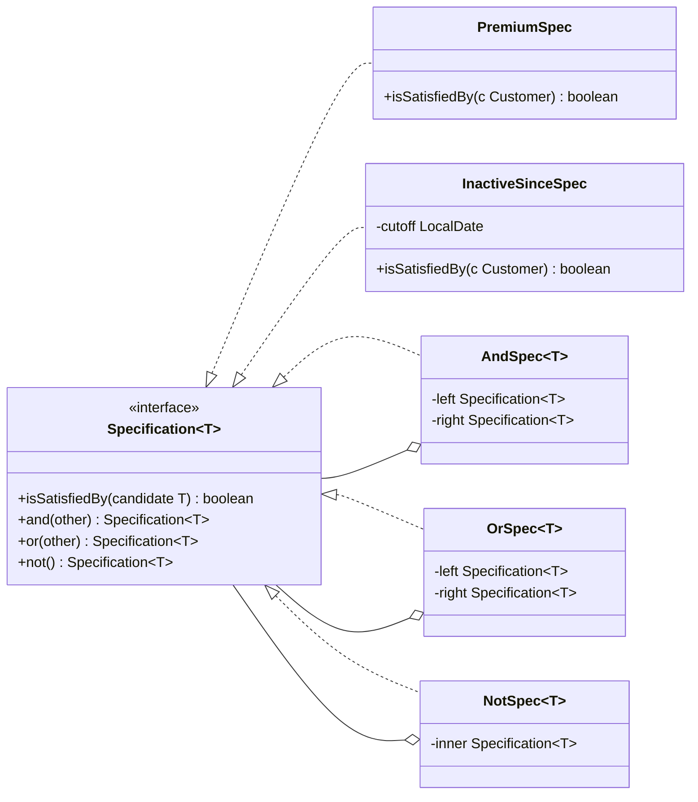
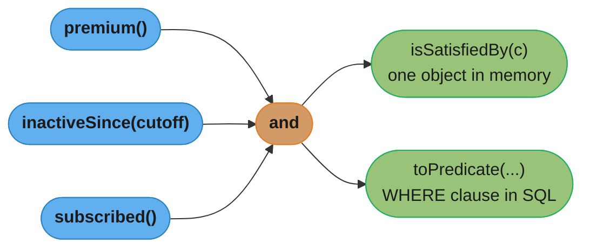

# Specification Pattern

## 1. Pattern Name & Category

**Pattern:** Specification
**Category:** Behavioral
**Classification:** Not in the GoF catalog. Described by Eric Evans and Martin Fowler in the paper "Specifications" and in Evans, *Domain-Driven Design* (Addison-Wesley, 2003), chapters 9 and 10
**Also Known As:** Composite Specification, Business Rule Object

---

## 2. Intent

Encapsulate a business rule as an object with one question, `isSatisfiedBy(candidate)`, so that rules can be named, combined with `and`, `or` and `not`, reused for validation and selection, and translated into a database query.

---

## Intuition

> **One-line analogy**: A Specification is a search filter saved as a named object. "Premium customers in the EU who have not ordered in 90 days" becomes one value you can test, reuse in a report, check against a single customer, and hand to the database.

**Mental model**: A business rule is usually written inline as an `if` with five conditions, then copied into a repository query, then copied again into a validator. Each copy drifts. A Specification gives the rule one home, one name and one test, and lets larger rules be built from smaller ones the way boolean expressions are built from variables.

**Why it matters**: Rule logic is where domain code changes most often. When "eligible for free shipping" lives in three `if` statements and one SQL `WHERE` clause, a change to the threshold misses one of them, and the cart shows free shipping that checkout then charges for.

**Key insight**: The pattern has three uses that share one object: **validation** (does this object satisfy the rule?), **selection** (find all objects that satisfy it) and **building to order** (create an object that satisfies it). In-memory checks are easy; the hard part is selection, where the same rule must become a SQL predicate instead of loading every row and filtering in Java.

---

## 3. Problem Statement

### The Core Problem
Business rules are embedded as conditionals in services and repeated in queries. They cannot be named, combined, tested alone, or passed as parameters.

### Concrete Scenario
An e-commerce service decides which customers receive a win-back email:

```java
// BROKEN: the rule exists three times, in three forms
public class WinBackService {
    public boolean shouldEmail(Customer c, LocalDate today) {
        return c.tier() == Tier.PREMIUM
            && c.region().isEu()
            && c.lastOrderDate().isBefore(today.minusDays(90))
            && !c.unsubscribed();
    }
}

public interface CustomerRepository {
    @Query("select c from Customer c where c.tier = 'PREMIUM' and c.region in :eu "
         + "and c.lastOrderDate < :cutoff")      // forgot unsubscribed: emails opted-out users
    List<Customer> findWinBackCandidates(Set<Region> eu, LocalDate cutoff);
}
```

### What Goes Wrong Without the Pattern
- The same rule is written in Java and in JPQL, and they drift (here the query emails unsubscribed customers, a GDPR and CAN-SPAM problem).
- A new rule combination ("premium OR lifetime value above 5,000") needs a new repository method.
- The rule cannot be unit-tested without the service around it.
- Rule names live only in comments and method names, not in types the domain can talk about.

---

## 4. Solution

Make each rule a small object. Combine rules with `and`, `or` and `not`, which return new composite specifications.

```java
@FunctionalInterface
public interface Specification<T> {
    boolean isSatisfiedBy(T candidate);

    default Specification<T> and(Specification<T> other) { return c -> isSatisfiedBy(c) && other.isSatisfiedBy(c); }
    default Specification<T> or(Specification<T> other)  { return c -> isSatisfiedBy(c) || other.isSatisfiedBy(c); }
    default Specification<T> not()                        { return c -> !isSatisfiedBy(c); }
}

public final class CustomerSpecs {
    public static Specification<Customer> premium()          { return c -> c.tier() == Tier.PREMIUM; }
    public static Specification<Customer> inEu()             { return c -> c.region().isEu(); }
    public static Specification<Customer> unsubscribed()     { return Customer::unsubscribed; }
    public static Specification<Customer> inactiveSince(LocalDate cutoff) {
        return c -> c.lastOrderDate().isBefore(cutoff);
    }
    public static Specification<Customer> winBack(LocalDate today) {
        return premium().and(inEu()).and(inactiveSince(today.minusDays(90))).and(unsubscribed().not());
    }
}
```

The in-memory form is close to `java.util.function.Predicate`, which already has `and`, `or` and `negate`, plus `Predicate.not` since JDK 11. The pattern's extra value appears when the same specification must also run as a query, covered in §6.

---

## 5. UML Structure



**Key structural insight:** `AndSpec`, `OrSpec` and `NotSpec` make Specification a [Composite](../../structural/composite/composite.md): a tree whose leaves are domain rules and whose inner nodes are boolean operators. Evaluating the tree is an [Interpreter](../interpreter/interpreter.md) over that tiny boolean grammar, and translating it to SQL is a second interpretation of the same tree.

---

## 6. How It Works

1. **Name each atomic rule** as a leaf specification (`premium()`, `inEu()`).
2. **Compose** larger rules with `and`/`or`/`not`, which build a tree.
3. **Validate**: call `spec.isSatisfiedBy(customer)` on one object.
4. **Select in memory**: `customers.stream().filter(spec::isSatisfiedBy)` for small, already-loaded sets.
5. **Select in the database**: translate the same tree into a query predicate so filtering happens in SQL.

### Selection through the database: Spring Data JPA

Spring Data JPA ships the query-translating form. A `Specification<T>` there is `toPredicate(Root<T> root, CriteriaQuery<?> query, CriteriaBuilder cb)`, which returns a JPA Criteria `Predicate`; repositories gain `findAll(Specification<T>)` by extending `JpaSpecificationExecutor<T>`. Spring Data JPA 4.0 added `PredicateSpecification<T>` (`toPredicate(From<?, T> from, CriteriaBuilder cb)`), which does not depend on the query type, plus `UpdateSpecification<T>` and `DeleteSpecification<T>` for bulk updates and deletes.

```java
public final class CustomerQuerySpecs {
    public static Specification<Customer> premium() {
        return (root, query, cb) -> cb.equal(root.get("tier"), Tier.PREMIUM);
    }
    public static Specification<Customer> inactiveSince(LocalDate cutoff) {
        return (root, query, cb) -> cb.lessThan(root.get("lastOrderDate"), cutoff);
    }
    public static Specification<Customer> subscribed() {
        return (root, query, cb) -> cb.isFalse(root.get("unsubscribed"));
    }
}

public interface CustomerRepository
        extends JpaRepository<Customer, Long>, JpaSpecificationExecutor<Customer> { }

List<Customer> targets = repo.findAll(
    premium().and(inactiveSince(today.minusDays(90))).and(subscribed()));
// one SQL statement: ... where tier=? and last_order_date<? and unsubscribed=false
```



*One rule tree, two interpretations. The pattern pays off when both come from the same leaves.*

### Keeping the two forms in step

A rule written once as a lambda over `Customer` and once as a Criteria predicate can still drift. Three ways to keep them aligned, from least to most machinery:

| Approach | How | Cost |
|----------|-----|------|
| Two methods per leaf | Each leaf class implements both `isSatisfiedBy` and `toPredicate` | Two implementations, but in one file side by side; a shared test runs both against the same fixtures |
| Query only, evaluate in DB | Validation of a single entity runs `repo.exists(spec.and(idEquals(id)))` | One implementation; one round trip per check |
| Expression tree | Leaves are data (`field`, `operator`, `value`) and two interpreters walk the tree | Most code; worth it when rules come from user input or configuration |

A contract test that loads fixtures, runs `findAll(spec)` against a real database (Testcontainers), and compares the result with `fixtures.stream().filter(spec::isSatisfiedBy)` catches drift on every build.

---

## 7. Key Components

| Role | Responsibility |
|------|---------------|
| **Specification** (interface) | `isSatisfiedBy(T)`, plus combinators |
| **Leaf specification** | One named domain rule, possibly parameterized (`inactiveSince(cutoff)`) |
| **Composite specification** | `And`, `Or`, `Not` nodes that combine children |
| **Translator** (optional) | Turns the tree into a query predicate: JPA Criteria, Querydsl, SQL, or an Elasticsearch bool query |
| **Client** | Validator, repository, or factory that uses the spec |

---

## 8. When to Use

- **The same rule is used for validation and for querying**, and must not drift.
- **Users or admins build filters at runtime**: a search screen with optional criteria maps to optional `and` terms.
- **Rules are a domain concept** with names the business uses ("overdue invoice", "win-back customer").
- **Repository method explosion**: `findByTierAndRegion`, `findByTierAndRegionAndLastOrderBefore`, and so on, replaced by one `findAll(spec)`.
- **Policy objects that combine**: eligibility, pricing tiers, access rules.

---

## 9. When NOT to Use

- **A single condition used once**: a lambda or an `if` is clearer.
- **Plain in-memory filtering only**: `java.util.function.Predicate` already composes with `and`, `or` and `negate`; a custom interface adds nothing.
- **Complex reporting queries** with joins, aggregates and window functions: write SQL or a jOOQ query; boolean composition of leaf predicates does not express `GROUP BY`.
- **Performance-critical selection** where the composed predicate defeats an index; a hand-written query with a known plan is safer.
- **Rules that need data from several aggregates**: a specification evaluated on one entity cannot see another without loading it, which hides N+1 queries.

---

## 10. Pros

- **One home per rule**, named in domain language and testable alone.
- **Composable**: new combinations need no new repository methods.
- **Open/Closed**: add a leaf, do not edit existing ones.
- **Reusable across validation, selection and creation.**
- **Removes repository method explosion** for optional search criteria.

---

## 11. Cons

- **Two interpretations can drift** unless tested together.
- **Opaque SQL**: a deep `and`/`or` tree yields queries that are hard to read in logs and can defeat indexes.
- **Lambdas lose names**: a stack trace or log line shows `CustomerSpecs$$Lambda/0x...`, not "winBack"; use named classes or records when rules are logged or explained.
- **Over-generalization**: a homegrown expression language grows until it is a worse SQL.
- **N+1 risk**: an in-memory `isSatisfiedBy` that walks lazy associations triggers one query per candidate.

---

## 12. Tradeoffs

| Approach | Reuse across validate/select | Query pushed to DB | Readability of generated SQL | Best fit |
|----------|-----------------------------|--------------------|------------------------------|----------|
| Inline `if` + derived query method | No | Yes | High | One-off rules |
| `java.util.function.Predicate` | In-memory only | No | n/a | Filtering loaded collections |
| Spring Data `Specification` | Query side only | Yes | Medium | Optional search criteria over JPA |
| Querydsl `Predicate` | Query side, type-safe paths | Yes | Medium | Large JPA codebases wanting compile-checked field names |
| Full Specification (both forms) | Yes | Yes | Medium | Rules that are both validated and queried |

---

## 13. Common Pitfalls

1. **Filtering in memory after `findAll()`.** `repo.findAll().stream().filter(spec::isSatisfiedBy)` loads the whole table; at 2 million customers that is a full scan and gigabytes of heap. Push selection to the database.

2. **Drift between the Java and query forms.** The incident in §3: the JPQL omitted `unsubscribed`, and opted-out users were emailed. Test both forms against the same fixtures.

3. **Index-hostile predicates.** A leaf like `cb.like(cb.lower(root.get("email")), "%@corp.com")` cannot use a B-tree index; composed with `or`, it can turn the whole query into a sequential scan. Check `EXPLAIN` for composed specs used on hot paths.

4. **Null leaves.** A builder that returns `null` for an absent optional filter must be handled; older Spring Data code used `Specification.where(null)` for this. Build the list of present criteria and combine only those.

5. **Unnamed lambda specs in audit trails.** When a rule decision must be explained ("why was this loan rejected?"), use specification records with a `describe()` method, not anonymous lambdas.

6. **Fetch joins inside `toPredicate`.** Adding `root.fetch(...)` in a spec used by a paged `findAll(spec, pageable)` also applies to the count query, which fails or duplicates rows. Keep fetch plans out of specs; use entity graphs.

---

## 14. Real-World Usage

### Production Scenario: Loan Eligibility With an Explainable Decision

A lender evaluates 40,000 applications a day and must tell rejected applicants which rule failed. Rules change every quarter.

```java
public sealed interface Rule permits Leaf, All, AnyOf, Not {
    boolean isSatisfiedBy(Application a);
    String describe();
}

public record Leaf(String name, Predicate<Application> test) implements Rule {
    public boolean isSatisfiedBy(Application a) { return test.test(a); }
    public String describe() { return name; }
}

public record All(List<Rule> rules) implements Rule {
    public boolean isSatisfiedBy(Application a) { return rules.stream().allMatch(r -> r.isSatisfiedBy(a)); }
    public String describe() { return rules.stream().map(Rule::describe).collect(joining(" AND ", "(", ")")); }
    public List<Rule> failures(Application a) {
        return rules.stream().filter(r -> !r.isSatisfiedBy(a)).toList();
    }
}

public record AnyOf(List<Rule> rules) implements Rule {
    public boolean isSatisfiedBy(Application a) { return rules.stream().anyMatch(r -> r.isSatisfiedBy(a)); }
    public String describe() { return rules.stream().map(Rule::describe).collect(joining(" OR ", "(", ")")); }
}

public record Not(Rule inner) implements Rule {
    public boolean isSatisfiedBy(Application a) { return !inner.isSatisfiedBy(a); }
    public String describe() { return "NOT " + inner.describe(); }
}

All eligible = new All(List.of(
    new Leaf("age >= 18",              a -> a.age() >= 18),
    new Leaf("debt-to-income < 0.43",  a -> a.debtToIncome() < 0.43),
    new Leaf("credit score >= 620",    a -> a.creditScore() >= 620),
    new Not(new Leaf("on sanctions list", a -> a.sanctioned()))));

List<Rule> why = eligible.failures(application);   // ["debt-to-income < 0.43"]
```

Because rules are records in a `sealed` hierarchy, a second interpreter (a SQL translator for the nightly batch that re-scores stored applications, or a JSON serializer for the audit log) is an exhaustive `switch` over four cases, and the compiler flags a new node type that a translator forgot.

### Famous Codebase Usages

| Library | Specification form |
|---------|-------------------|
| Spring Data JPA | `Specification<T>`, `PredicateSpecification<T>` (4.0+), `JpaSpecificationExecutor<T>` |
| Querydsl | `Predicate` / `BooleanExpression` built from generated Q-types, used by `QuerydslPredicateExecutor` |
| JDK | `java.util.function.Predicate` with `and`, `or`, `negate`, `Predicate.not` (JDK 11) |
| Hibernate / Jakarta Persistence | Criteria API `CriteriaBuilder.and/or/not` as the translation target |
| Elasticsearch | `bool` query with `must`, `should`, `must_not`: the same and/or/not tree, server-side |

### Anti-Pattern: Specification as a Generic Query Language

```java
// BROKEN: a "flexible" spec that takes field names as strings from the client
public static Specification<Customer> fieldEquals(String field, Object value) {
    return (root, q, cb) -> cb.equal(root.get(field), value);   // any column, including passwordHash
}
```

Exposing raw field names lets callers filter on columns they should never see and couples the API to the schema. Keep leaves domain-named (`premium()`, `inactiveSince()`) and map external filter parameters to them through an allow-list.

### Migration Story

**Move TO Specification when** a repository grows a fourth `findByXAndYAndZ` variant, or the same rule appears in a validator and a query.
**Move AWAY to hand-written SQL when** a composed spec produces a plan you cannot explain from `EXPLAIN`, or the query needs aggregates.

---

## 15. Comparison with Similar Patterns

| Pattern | Relationship |
|---------|-------------|
| **Composite** | `And`/`Or`/`Not` nodes form a Composite tree of rules; see [Composite](../../structural/composite/composite.md) |
| **Interpreter** | Evaluating or translating the tree is an Interpreter over a boolean grammar; see [Interpreter](../interpreter/interpreter.md) |
| **Strategy** | A specification is a strategy whose one job is a yes/no decision; Strategy covers any algorithm; see [Strategy](../strategy/strategy.md) |
| **Chain of Responsibility** | A validation chain runs rules in order and may stop early; a specification tree has no order and no handler hand-off; see [Chain of Responsibility](../chain_of_responsibility/chain_of_responsibility.md) |
| **Visitor** | A translator from spec tree to SQL or JSON is a Visitor (or a pattern-matching `switch`) over node types; see [Visitor](../visitor/visitor.md) |
| **Repository** | Specifications are the argument type that keeps a repository interface small |

---

## 16. Interview Questions with Answers

**Q: What is wrong with `repo.findAll().stream().filter(spec::isSatisfiedBy)`?**
**Short:** It loads every row into memory and filters in Java, so a table of millions becomes a full scan plus gigabytes of heap; selection belongs in the database query.

A: The in-memory `isSatisfiedBy` form is for validating one object or filtering a small loaded set. For selection, the same rule must become a query predicate, for example a Spring Data `Specification` whose `toPredicate` returns a Criteria `Predicate`, so the database applies it with indexes and returns only matching rows. The pattern's main design work is exactly this second interpretation; skipping it keeps the name but loses the reason to use it.

**Q: How do you stop the in-memory and query forms of a specification from drifting apart?**
**Short:** Keep both forms of each leaf in one place and run one contract test that compares the database result with the in-memory filter over the same fixtures.

A: Put `isSatisfiedBy` and `toPredicate` for a leaf side by side in one class or record so a change to one is visible next to the other. Then write a contract test with Testcontainers: insert fixtures, run `repo.findAll(spec)` and compare it with `fixtures.stream().filter(spec::isSatisfiedBy)`, for each leaf and for a few composites. The alternative is to keep only the query form and validate single entities with `repo.exists(spec.and(idEquals(id)))`, which costs a round trip but has one implementation.

**Q: Is the Specification pattern just `java.util.function.Predicate`?**
**Short:** For in-memory checks it nearly is; the pattern adds domain names, translation to a database query, and explainable rule trees, which Predicate does not give.

A: `Predicate<T>` already has `test`, `and`, `or`, `negate` and `Predicate.not` (JDK 11), so a homegrown in-memory Specification interface duplicates it. The pattern earns its own type when a rule must also be translated into SQL or another query language, when rule decisions must be explained ("failed: credit score >= 620"), or when the business names rules and wants them as first-class domain objects. Without those needs, use `Predicate`.

**Q: How does Spring Data JPA implement the Specification pattern?**
**Short:** A Specification's toPredicate builds a JPA Criteria Predicate from root, query and CriteriaBuilder, and JpaSpecificationExecutor adds findAll(spec) to repositories.

A: `Specification<T>` declares `Predicate toPredicate(Root<T> root, CriteriaQuery<?> query, CriteriaBuilder cb)` and composes with `and`/`or`. A repository that extends `JpaSpecificationExecutor<T>` gains `findAll(spec)`, paged variants and a fluent `findBy(spec, q -> ...)` for projections and paging. Spring Data JPA 4.0 added `PredicateSpecification<T>`, whose `toPredicate(From<?, T> from, CriteriaBuilder cb)` does not depend on the query type, plus `UpdateSpecification<T>` and `DeleteSpecification<T>` for bulk statements.

**Q: Why can a composed specification be slow even when each leaf is fast?**
**Short:** Composition can produce predicates the database cannot index, such as OR across columns or a function on a column, turning an index lookup into a full scan.

A: `tier = ? AND region = ?` uses a composite index. `tier = ? OR lower(email) LIKE '%@corp.com'` cannot use an index for the second branch, so the planner often scans the table. Specs make such combinations easy to build without anyone looking at the SQL. Log the generated SQL in tests, run `EXPLAIN` for specs on hot paths, and give leaves that need indexes a matching index (or a functional index for `lower(email)`).

**Q: What are the three uses of a Specification that Evans and Fowler describe?**
**Short:** Validation of one object, selection of matching objects from a collection or database, and building to order, meaning creating an object that satisfies the rule.

A: Validation asks `isSatisfiedBy(candidate)`. Selection asks a repository for all candidates that satisfy the spec, ideally translated into a query. Building to order hands the spec to a factory or generator, for example "build a shipping container that satisfies these cargo constraints", so the creator reads the rule rather than the rule being repeated in creation logic. Most production code uses the first two.

**Q: How is the Specification pattern related to Composite and Interpreter?**
**Short:** And, Or and Not nodes form a Composite tree of rules, and evaluating or translating that tree is an Interpreter over a small boolean grammar.

A: Leaves are domain rules; `And`, `Or`, `Not` hold children and implement the same interface, which is Composite. `isSatisfiedBy` walks the tree and evaluates it, which is one interpreter. A SQL or Elasticsearch translator walks the same tree and emits a query, which is a second interpreter. With a `sealed` interface and records, each interpreter is an exhaustive `switch`.

**Q: How do you handle optional search filters with specifications?**
**Short:** Collect a spec only for each filter that is present, then combine that list with and, so absent filters add nothing to the query.

A: For a search form with optional tier, region and date range, build a `List<Specification<Customer>>`, add `premium()` only if the tier was given, and so on, then reduce the list with `and`. An empty list maps to "no restriction". This replaces the repository method explosion (`findByTier`, `findByTierAndRegion`, ...) and avoids leaves that must handle `null` parameters internally.

**Q: How do you make a specification explain why a candidate failed?**
**Short:** Model rules as named records in a sealed tree with a describe method, and have the And node return the list of child rules that failed.

A: Lambdas have no useful name, so a rejected loan logs `Lambda$17`. Represent each leaf as a record with a name and a test, and composites as `All`, `AnyOf` and `Not` records. `All.failures(candidate)` filters children that are not satisfied and returns them, so the decision record says "debt-to-income < 0.43". Regulated domains (credit, insurance) often need exactly this audit trail.

**Q: Why should a Specification API not accept field names from the client?**
**Short:** Arbitrary field filters let callers query columns they should not see and tie the API to the schema; map external parameters to named domain leaves instead.

A: `fieldEquals(String field, Object value)` lets a request filter on `passwordHash` or `internalRiskScore`, and every column rename becomes an API break. Keep leaves domain-named and parameterized (`inactiveSince(date)`), and translate query-string filters through an allow-list of supported names. Field-level freedom is what a reporting tool or SQL is for.

**Q: What is the N+1 risk with in-memory specifications?**
**Short:** An isSatisfiedBy that reads a lazy association loads it per candidate, so filtering 1,000 entities fires 1,000 extra queries.

A: `c -> c.orders().size() > 5` on JPA entities triggers a lazy load of `orders` for each customer. Over a list of 1,000 that is 1,001 queries. Either translate the rule into a query predicate (a subquery or join with `count`), or fetch the association up front with an entity graph before filtering.

**Q: Specification or Chain of Responsibility for validation rules?**
**Short:** Specification for an unordered set of yes/no rules you want to combine and query; Chain of Responsibility for ordered handlers where each may stop processing or transform the request.

A: Specifications are side-effect free and combine with boolean operators; order does not matter except for short-circuit cost. A chain is ordered, each handler decides whether to pass on, and handlers can modify the request or produce a response, as in a servlet filter chain. Use the chain for pipelines, specifications for rules.

**Q: How do you unit-test specifications?**
**Short:** Test each leaf with boundary fixtures as a pure function, test composites with a few truth-table cases, and test the query form against a real database.

A: Leaves are pure functions of the candidate, so tests are one-liners: `inactiveSince(cutoff)` is false on the cutoff date and true one day before. Composites need only a few cases each because `and`, `or` and `not` are generic. The query translation is where bugs hide (wrong column, wrong comparison operator, null handling), so cover it with an integration test against the same database engine as production.

**Q: How do you treat nulls when translating a specification to SQL?**
**Short:** SQL uses three-valued logic, so NOT(column = x) excludes NULL rows while the Java negation includes them; handle nulls explicitly in the leaf.

A: In Java, `!"EU".equals(region)` is true when `region` is `null`. In SQL, `NOT (region = 'EU')` is UNKNOWN for a NULL region, and the row is excluded. A `not()` composite therefore gives different answers in memory and in the database for rows with nulls. Make leaves null-explicit, for example `cb.or(cb.isNull(root.get("region")), cb.notEqual(root.get("region"), "EU"))`, and include null rows in the contract-test fixtures.

**Q: When is a specification tree the wrong tool for a query?**
**Short:** When the query needs aggregates, grouping, window functions or a hand-tuned plan, since boolean composition of row predicates cannot express them.

A: Specifications describe WHERE clauses: which rows match. "Top 10 customers by revenue per region last quarter" needs `GROUP BY`, `SUM` and a window or `LIMIT` per group, which no `and`/`or` tree expresses. Write such queries in SQL, jOOQ or a JPQL `@Query`, and keep specifications for filtering entities by business rules.

---

## Cross-Perspective: HLD Connections

- **Search services**: an Elasticsearch `bool` query (`must`, `should`, `must_not`) is a specification tree evaluated server-side across shards; see [Search Engines](../../../database/search_engines/search_engines.md).
- **Policy engines**: authorization rules as composable predicates evaluated by a central engine (OPA/Rego, Cedar) are specifications at service scale; see [Policy as Code](../../../devops/policy_as_code_and_compliance/policy_as_code_and_compliance.md).
- **Query pushdown**: translating a predicate tree to run where the data lives is the same move a query engine makes when it pushes filters to storage.

---

## 17. Best Practices

- Name leaves in domain language and keep them small and parameterized.
- Push selection to the database; use the in-memory form for single-object checks.
- Test the query form against a real database engine, and compare it with the in-memory form.
- Make null handling explicit in every leaf that can see a null column.
- Use records in a `sealed` hierarchy when rules must be explained, serialized or translated more than one way.
- Use `java.util.function.Predicate` instead of a custom interface when there is no query translation.
- Read the generated SQL for composed specs on hot paths.

---

## 18. Technologies and Tools

| Technology | What it gives you | When to reach for it |
|-----------|-------------------|---------------------|
| Spring Data JPA `Specification<T>` + `JpaSpecificationExecutor<T>` | Criteria-API specs with `and`/`or` and `findAll(spec)` | Optional search criteria over JPA repositories |
| Spring Data JPA 4.0+ `PredicateSpecification<T>`, `UpdateSpecification<T>`, `DeleteSpecification<T>` | Query-type-agnostic predicates and bulk update/delete specs | New code on Spring Data JPA 4.x |
| Querydsl | Type-safe predicates from generated Q-classes; `QuerydslPredicateExecutor` | Compile-checked field paths in large JPA codebases |
| `java.util.function.Predicate` | `and`, `or`, `negate`, `Predicate.not` | In-memory filtering with no query translation |
| Jakarta Persistence Criteria API | `CriteriaBuilder.and/or/not`, the translation target | Writing leaves by hand |
| Testcontainers | Real database in tests | Contract tests between in-memory and query forms |
