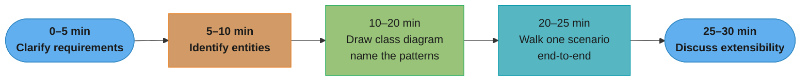

# LLD Case Studies — Learning Path

The problems in `../system_design_problems/` serve as the practical interview case studies
for Low-Level Design. This README provides the learning path, pattern dependency map, and
interview preparation shortcuts.

---

## 1. Quick Start

Read these three first, in order:

| Problem | File | Why First |
|---------|------|-----------|
| Vending Machine | [VendingMachine.md](../system_design_problems/VendingMachine.md) | Cleanest State pattern implementation — 5 states, tight FSM, easy to draw in 30 min |
| Parking Lot | [ParkingLot.md](../system_design_problems/ParkingLot.md) | Combines Singleton + Strategy + Observer + Factory; most common LLD interview question |
| ATM | [ATM.md](../system_design_problems/ATM.md) | State machine + Command with rollback behind a Facade; introduces transaction idempotency concerns |

These three cover State (FSM), Command, Strategy, Factory, Observer, and Singleton — the patterns
that recur across most of the remaining problems. Once you can draw these three designs cold, the
rest become variations on the same modelling moves.

---

## 2. Full Learning Path

Problems grouped by the dominant engineering concern they exercise:

### Group A — State Machines (Start Here)

| Problem | Dominant Concern | File | Core Patterns |
|---------|-----------------|------|--------------|
| Vending Machine | FSM design — 5 states, clean transitions | [VendingMachine.md](../system_design_problems/VendingMachine.md) | State, Singleton (machine), Flyweight (shared state objects) |
| ATM | FSM + transaction integrity | [ATM.md](../system_design_problems/ATM.md) | State, Command (execute + rollback), Facade |
| Elevator System | Complex FSM + scheduling algorithm | [ElevatorSystem.md](../system_design_problems/ElevatorSystem.md) | State, Observer (floor requests), Strategy (SCAN/FCFS) |
| Ride Sharing | Ride lifecycle FSM with rejected-transition handling | [RideSharing.md](../system_design_problems/RideSharing.md) | State (ride lifecycle), Strategy (fare), Observer (status), Factory (vehicle) |
| Food Delivery | Three-party order lifecycle; cancellation illegal once picked up | [FoodDelivery.md](../system_design_problems/FoodDelivery.md) | State (order lifecycle), Strategy (fee, partner assignment), Decorator (pricing chain), Observer |
| Payment Processor | Payment lifecycle FSM plus idempotent, ledger-balanced money movement | [PaymentProcessor.md](../system_design_problems/PaymentProcessor.md) | State (enum transition table), Strategy (payment method), Command (refunds), Observer, Adapter (gateway) |

### Group B — Concurrency + Resource Management

| Problem | Dominant Concern | File | Core Patterns |
|---------|-----------------|------|--------------|
| Parking Lot | Concurrent spot allocation, pricing strategy | [ParkingLot.md](../system_design_problems/ParkingLot.md) | Singleton (lot), Strategy (pricing), Observer (display boards), Factory (vehicle) |
| Online Booking System | Double-booking prevention, seat reservation | [OnlineBookingSystem.md](../system_design_problems/OnlineBookingSystem.md) | Strategy (pricing), Observer (notifications), Builder (Movie/Show) |
| Meeting Scheduler | Half-open interval conflicts across rooms and attendees | [MeetingScheduler.md](../system_design_problems/MeetingScheduler.md) | Strategy (room selection), Observer (notifications) |
| Car Rental | Interval bookings on a resource that moves between branches; ordered price rules | [CarRental.md](../system_design_problems/CarRental.md) | Decorator (price components), Builder (pricing order), State (reservation lifecycle) |
| Online Auction | Many bidders racing on one auction; proxy bidding; what happens at the end time | [OnlineAuction.md](../system_design_problems/OnlineAuction.md) | Strategy (increments, end policy, clock), State (auction lifecycle), Observer, Facade |

### Group C — Domain Modeling

| Problem | Dominant Concern | File | Core Patterns |
|---------|-----------------|------|--------------|
| Library Management | Borrow/return lifecycle, overdue notifications | [LibraryManagement.md](../system_design_problems/LibraryManagement.md) | Builder (Book), Iterator (catalog search), Observer (overdue) |
| Chess Game | Move validation, undo/redo, game phases | [ChessGame.md](../system_design_problems/ChessGame.md) | Command (move + undo), Observer (game events), Singleton (board) |
| Splitwise | Expense-sharing ledger, debt-graph simplification | [Splitwise.md](../system_design_problems/Splitwise.md) | Strategy (split type), Factory (split-strategy selection) |
| Online Stock Brokerage | Buying power reserved at accept, released on venue evidence; settlement | [OnlineStockBrokerage.md](../system_design_problems/OnlineStockBrokerage.md) | State (order status guards), Adapter (venue), Observer (execution reports), Facade |

### Group D — Algorithms & Data Structures

| Problem | Dominant Concern | File | Core Patterns |
|---------|-----------------|------|--------------|
| LRU Cache | O(1) get/put via doubly-linked list + HashMap; thread-safe wrapper | [LRUCache.md](../system_design_problems/LRUCache.md) | Decorator (thread safety), Observer (eviction listener) |
| Rate Limiter | Per-client request throttling; 4 interchangeable algorithms | [RateLimiter.md](../system_design_problems/RateLimiter.md) | Strategy (algorithm), Factory (algorithm selection) |
| Tic-Tac-Toe | Incremental win detection; pluggable AI move selection | [TicTacToe.md](../system_design_problems/TicTacToe.md) | Strategy (AI move), State (game state) |
| Snake and Ladder | Turn loop with a validated jump table; one jump per landing | [SnakeAndLadder.md](../system_design_problems/SnakeAndLadder.md) | Strategy (dice, win rule), Observer (game events), Factory (board) |
| Order Matching Engine | Price-time priority order book; cancel by id without a scan | [OrderMatchingEngine.md](../system_design_problems/OrderMatchingEngine.md) | State (order lifecycle), Strategy (time-in-force) |
| File System | Path resolution over a part/whole tree; recursive size | [FileSystem.md](../system_design_problems/FileSystem.md) | Composite (files and directories), Iterator (find), Visitor |
| Connect Four | O(1) gravity per column; a win completed from the middle of a line | [ConnectFour.md](../system_design_problems/ConnectFour.md) | Strategy (move source), enum game state, lightweight Command (undo), Observer |
| Feed Generator | Hybrid push/pull fan-out, pluggable ranking, pagination that stays stable while posts arrive | [FeedGenerator.md](../system_design_problems/FeedGenerator.md) | Strategy (ranking), Decorator (affinity boost), filter chain, Facade |

### Group E - Infrastructure Components

| Problem | Dominant Concern | File | Core Patterns |
|---------|-----------------|------|--------------|
| Logging Framework | Cheap disabled calls; slow appenders never stall the caller | [LoggingFramework.md](../system_design_problems/LoggingFramework.md) | Chain of Responsibility (logger hierarchy), Strategy (formatter), Decorator (async appender) |
| Notification Service | Channel fan-out with retry that never sends twice | [NotificationService.md](../system_design_problems/NotificationService.md) | Strategy + Factory (channel), Decorator (retry), Chain of Responsibility (filters), Observer |
| Task Scheduler | Delay queue with no lost wakeup under concurrent submission | [TaskScheduler.md](../system_design_problems/TaskScheduler.md) | Command (task), Strategy (retry policy), Producer-Consumer (delay queue), Observer |
| Key-Value Store | Nested transactions as a layer stack; TTL expiry | [KeyValueStore.md](../system_design_problems/KeyValueStore.md) | Unit of Work, Memento-like layer stack, Strategy (clock) |
| Pub-Sub | Log-based broker; per-partition order; at-least-once delivery | [PubSub.md](../system_design_problems/PubSub.md) | Observer (pull-based), Strategy (partitioner), Mediator (consumer group) |
| Cache Manager | Pluggable eviction, per-entry TTL, many named caches safe for many threads | [CacheManager.md](../system_design_problems/CacheManager.md) | Strategy (eviction policy), Factory, Builder, Observer (removal listener), lock striping |
| URL Shortener | Where code uniqueness comes from: generator vs atomic insert-if-absent | [UrlShortener.md](../system_design_problems/UrlShortener.md) | Strategy (code generator), Decorator (caching repository), Chain of Responsibility (validation), Observer |

---

## 3. Cross-Cutting Pattern Matrix

Which GoF patterns appear in which problems — use this to decide which problems to study
when preparing for a specific pattern question. The matrix covers the classic twelve; the Core
Patterns column in Section 2 lists the patterns for every other problem:

| Pattern | Vending | Parking | Library | Chess | Elevator | ATM | Booking | RideSharing | LRUCache | RateLimiter | TicTacToe | Splitwise |
|---------|---------|---------|---------|-------|----------|-----|---------|-------------|----------|-------------|-----------|-----------|
| State | Primary | — | — | — | Primary | Primary | — | — | — | — | Supporting | — |
| Strategy | — | Primary | — | — | Supporting | — | Primary | Primary | — | Primary | Primary | Primary |
| Factory | — | Primary | — | — | — | — | — | Supporting | — | Supporting | — | Supporting |
| Observer | — | Supporting | Primary | Supporting | Supporting | — | Supporting | Supporting | Supporting | — | — | — |
| Command | — | — | — | Primary | — | Supporting | — | — | — | — | — | — |
| Builder | — | — | Supporting | — | — | — | Supporting | — | — | — | — | — |
| Singleton | — | Primary | — | Supporting | — | — | — | — | — | — | — | — |
| Iterator | — | — | Primary | — | — | — | — | — | — | — | — | — |
| Decorator | — | — | — | — | — | — | — | — | Primary | Supporting | — | — |
| Facade | — | — | — | — | — | Supporting | — | — | — | — | — | — |
| Flyweight | Supporting | — | — | — | — | — | — | — | — | — | — | — |

**Legend**: Primary = the pattern is the main architectural decision; Supporting = the pattern
appears as a secondary component.

**Template Method**, a pattern interviewers often expect, appears in **none** of the problems
(Tic-Tac-Toe explicitly rejects it — `HumanPlayer` and `AIPlayer` share no multi-step skeleton, so
it would be plain polymorphism wearing a pattern name). **Composite** appears only in File System,
the one problem with a genuine part/whole tree. Splitwise likewise considers Observer and deliberately omits it.
Naming a pattern you did *not* use, and why, is a stronger interview signal than padding the list.

Three cells read `—` for a reason worth knowing, because each problem argues the omission in its
own write-up. **Ride Sharing** has a six-state lifecycle but no GoF State: `RideState.canTransitionTo()`
is a `switch` inside an enum — a guarded transition table, not a class per state — because the states
carry legality rules and no behaviour of their own. **Vending Machine** rejects Singleton outright so
that a test can hold several independent machines; "one machine per physical unit" is a fact about the
hardware, not a reason for global uniqueness. **Parking Lot** has no State pattern either — a spot is
occupied or free, which is a boolean, not a state machine.

---

## 4. Dependency Map

Conceptual dependencies — study problems lower in the tree first:

```mermaid
flowchart TD
    classDef io      fill:#61afef,stroke:#2e86c1,color:#1a1a1a,font-weight:bold
    classDef frozen  fill:#c678dd,stroke:#9b59b6,color:#fff
    classDef train   fill:#98c379,stroke:#27ae60,color:#1a1a1a
    classDef mathOp  fill:#d19a66,stroke:#e67e22,color:#1a1a1a,font-weight:bold
    classDef lossN   fill:#e06c75,stroke:#c0392b,color:#fff,font-weight:bold
    classDef req     fill:#56b6c2,stroke:#0097a7,color:#1a1a1a
    classDef base    fill:#e5c07b,stroke:#f39c12,color:#1a1a1a

    F(["Foundation<br/>study first"]) --> VM["Vending Machine<br/>5-state FSM, clean"]
    VM --> ATM["ATM<br/>State + Command rollback<br/>+ idempotency"]
    ATM --> PL["Parking Lot<br/>Strategy + Factory<br/>+ concurrent access"]
    PL --> ES["Elevator System<br/>Complex FSM<br/>+ scheduling algo"]
    PL --> OBS["Online Booking System<br/>Concurrency + Strategy<br/>+ double-booking prevention"]
    OBS --> RS["Ride Sharing<br/>State + Strategy<br/>+ Observer + Factory"]
    ES --> CG["Chess Game<br/>Command undo/redo<br/>+ Observer game events"]
    ES --> LM["Library Management<br/>Observer + Builder<br/>+ borrow lifecycle"]
    ES --> SW["Splitwise<br/>Strategy splits + Factory<br/>+ debt-graph simplification"]
    RS --> FD["Food Delivery<br/>three-party lifecycle<br/>+ Decorator pricing"]
    OBS --> MS["Meeting Scheduler<br/>interval conflicts<br/>+ room Strategy"]
    ATM --> PP["Payment Processor<br/>idempotency + ledger<br/>+ payment FSM"]
    OBS --> CR["Car Rental<br/>interval calendar<br/>+ Decorator pricing"]
    OBS --> AUC["Online Auction<br/>one lock per auction<br/>+ proxy bidding"]

    subgraph SA["Standalone — Algorithms and Data Structures (any order)"]
        LRU["LRU Cache<br/>DLL + HashMap, O(1)"]
        RL["Rate Limiter<br/>4 Strategy algorithms"]
        TTT["Tic-Tac-Toe<br/>Win-check + Strategy AI"]
        SNL["Snake and Ladder<br/>jump table + Strategy dice"]
        OME["Order Matching Engine<br/>price-time order book"]
        FS["File System<br/>Composite tree"]
        C4["Connect Four<br/>gravity + 4-way win check"]
        FG["Feed Generator<br/>fan-out + keyset paging"]
    end

    subgraph INF["Standalone: Infrastructure Components (any order)"]
        LOG["Logging Framework<br/>Chain + async Decorator"]
        NS["Notification Service<br/>channel fan-out + retry"]
        TS["Task Scheduler<br/>delay queue, no lost wakeup"]
        KV["Key-Value Store<br/>transaction layers + TTL"]
        PS["Pub-Sub<br/>partitioned log + groups"]
        CM["Cache Manager<br/>pluggable eviction + TTL"]
        URL["URL Shortener<br/>code uniqueness + cache"]
    end

    TTT --> C4
    LRU --> CM
    OME --> OSB["Online Stock Brokerage<br/>buying power + settlement"]

    class F base
    class VM,ATM,PL,ES,PP train
    class OBS,RS,FD,MS,CR,AUC req
    class CG,LM,SW,OSB frozen
    class LRU,RL,TTT,SNL,OME,FS,C4,FG mathOp
    class LOG,NS,TS,KV,PS,CM,URL io
```

**Why this order**: Vending Machine's clean 5-state FSM is the template you'll reuse in every
other state-machine problem. ATM adds the transaction integrity concern. Parking Lot adds Factory
and Strategy. Elevator extends the FSM complexity, and Ride Sharing reuses the same Strategy +
Observer + State combination on a trip lifecycle. Chess, Library, and Splitwise are standalone
domain-modeling problems but assume you can already identify patterns quickly. The Algorithms &
Data Structures group (LRU Cache, Rate Limiter, Tic-Tac-Toe) is independent of the rest — these
lean more on data-structure correctness than on OOP class design, so study them whenever a
"design X" question turns out to really be "implement X efficiently." Snake and Ladder, Order
Matching Engine, and File System sit in the same group. Food Delivery extends Ride Sharing to three
parties, and Meeting Scheduler reuses Online Booking's double-booking check on intervals. The
Infrastructure Components group (Logging Framework, Notification Service, Task Scheduler, Key-Value
Store, Pub-Sub) leans on concurrency and delivery guarantees; study it after
[Concurrency Patterns](../concurrency_patterns/concurrency_patterns.md).

The eight later additions slot into the same tree. Payment Processor extends ATM's
transaction-integrity concern to idempotency keys and a balanced ledger. Car Rental and Online
Auction build on Online Booking: Car Rental books intervals on a resource that moves, and Online
Auction puts many writers on one piece of state with a deadline. Connect Four is Tic-Tac-Toe with
gravity. Cache Manager starts exactly where LRU Cache stops (pluggable eviction, TTL, lock
striping) and URL Shortener joins it in the infrastructure group. Feed Generator is a standalone
fan-out and pagination problem. Online Stock Brokerage is the broker side of the venue that Order
Matching Engine models, so read the matching engine first.

---

## 5. Interview Prep Shortcuts

| "Design X" interview question | Best case study to study | Why |
|------------------------------|--------------------------|-----|
| Design a vending machine | Vending Machine | Direct match |
| Design an ATM | ATM | Direct match |
| Design a parking system / lot | Parking Lot | Direct match |
| Design an elevator / lift | Elevator System | Direct match |
| Design a library management system | Library Management | Direct match |
| Design a chess game | Chess Game | Direct match |
| Design a movie / flight / hotel booking | Online Booking System | Pattern is identical |
| Design a traffic light system | Vending Machine | Same state-object FSM structure |
| Design a food delivery app (Swiggy/DoorDash) | Food Delivery | Direct match: three-party State lifecycle, Decorator pricing |
| Design a ride-sharing app (Uber/Lyft) | Ride Sharing | Direct match — State, Strategy, Observer, Factory |
| Design a bank transaction system | ATM | Transaction integrity, rollback, idempotency |
| Design a document editor with undo | Chess Game | Command pattern undo/redo |
| Design a notification system | Notification Service | Direct match: channel Strategy, retry Decorator, filter chain |
| Design an LRU cache (or LFU variant) | LRU Cache | Direct match — doubly-linked list + HashMap, O(1) |
| Design a rate limiter (class-design angle) | Rate Limiter | Direct match — Strategy across 4 algorithms |
| Design tic-tac-toe / a turn-based board game | Tic-Tac-Toe | Direct match — incremental win-check, pluggable AI |
| Design Splitwise / a bill-splitting app | Splitwise | Direct match — Strategy splits + debt simplification |
| Design a logging framework (Log4j/SLF4J) | Logging Framework | Direct match: logger hierarchy, async appender |
| Design a task scheduler / cron | Task Scheduler | Direct match: delay queue, lost-wakeup fix |
| Design snake and ladder | Snake and Ladder | Direct match: validated jump table, Strategy dice |
| Design a stock exchange order book | Order Matching Engine | Direct match: price-time priority, cancel by id |
| Design a key-value store with transactions | Key-Value Store | Direct match: layer-stack transactions, TTL |
| Design a message queue / Kafka-like pub-sub | Pub-Sub | Direct match: partitions, consumer groups, offsets |
| Design an in-memory file system | File System | Direct match: Composite tree, path resolution |
| Design a meeting room scheduler / calendar | Meeting Scheduler | Direct match: interval conflict check, room Strategy |
| Design a payment processor / digital wallet | Payment Processor | Direct match: idempotency keys, double-entry ledger, payment FSM |
| Design a cache with pluggable eviction and TTL (LRU follow-up) | Cache Manager | Direct match: eviction Strategy, TTL, lock striping, single-flight load |
| Design a URL shortener (class-design angle) | URL Shortener | Direct match: generator Strategy, atomic insert-if-absent, caching Decorator |
| Design a car rental system | Car Rental | Direct match: interval calendar per vehicle, ordered pricing Decorators |
| Design an online auction (eBay) | Online Auction | Direct match: proxy bidding, one lock per auction, soft close |
| Design Connect Four / a gravity board game | Connect Four | Direct match: per-column height, four-direction win check |
| Design a news feed / timeline (class-design angle) | Feed Generator | Direct match: hybrid fan-out, ranking Strategy, keyset pagination |
| Design an online stock brokerage / trading app | Online Stock Brokerage | Direct match: buying-power reservation, execution-report dedup, settlement |

### 30-Minute Interview Time Box

Each stage feeds the next inside a strict 30-minute budget — requirements (0–5 min) and entity
identification (5–10 min) exist only to feed the 10-minute class-diagram stage, the interviewer's
primary signal.

The most common failure mode: spending 15+ minutes on requirements and running out of time
for the class diagram. Timebox requirements to 5 minutes maximum.

---

## Cross-References

| LLD Concern | See Also |
|-------------|---------|
| State machine depth | [../behavioral/state/](../behavioral/state/state.md) |
| Command pattern (undo/redo) | [../behavioral/command/](../behavioral/command/command.md) |
| Observer (notifications) | [../behavioral/observer/](../behavioral/observer/observer.md) |
| Factory + Strategy combo | [../creational/factory_method/](../creational/factory_method/factory_method.md), [../behavioral/strategy/](../behavioral/strategy/strategy.md) |
| Concurrency in Parking/Elevator | [../concurrency_patterns/concurrency_patterns.md](../concurrency_patterns/concurrency_patterns.md) |
| Distributed scale of these problems | [../../hld/microservices/](../../hld/microservices/microservices.md) |
| Decorator (LRU Cache thread safety) | [../structural/decorator/](../structural/decorator/decorator.md) |
| Rate limiting at distributed scale | [../../hld/rate_limiting/](../../hld/rate_limiting/rate_limiting.md) |
| LRU as a data structure, a class design, and a distributed tier | [design_lru_cache](../../cs_fundamentals/case_studies/design_lru_cache.md) (data structure), [LRUCache](../system_design_problems/LRUCache.md) and [CacheManager](../system_design_problems/CacheManager.md) (class design), [../../hld/caching/](../../hld/caching/caching.md) (distributed) |
| Payments and trading at distributed scale | [design_payment_system](../../hld/case_studies/design_payment_system.md), [design_stock_exchange](../../hld/case_studies/design_stock_exchange.md) |
