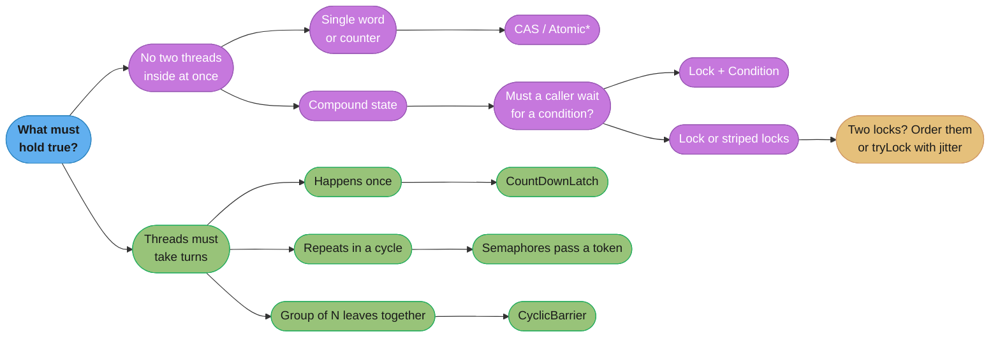
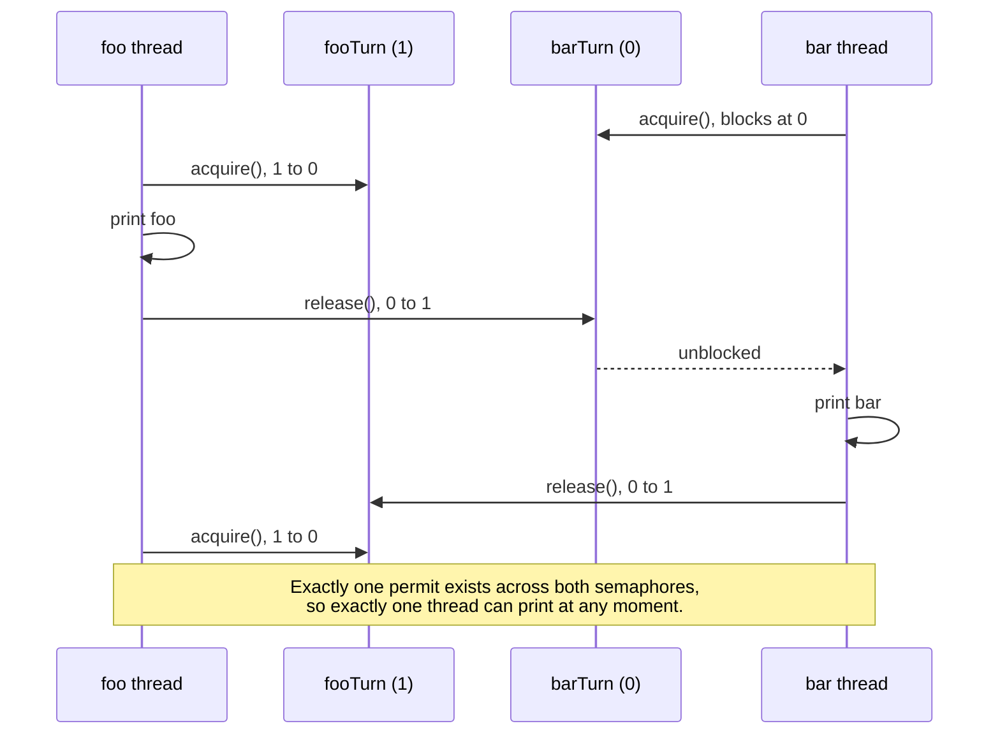
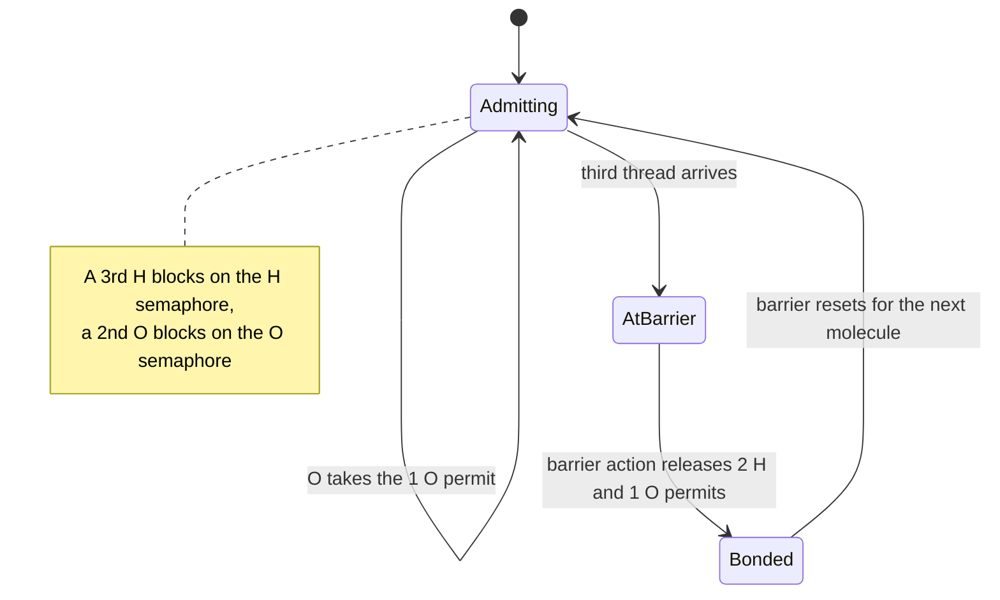
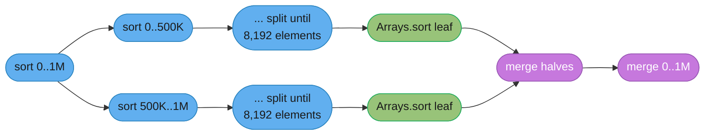

# Concurrency Problems Toolkit: Blocking Queue, TTL Cache, Concurrent HashMap, Bloom Filter, Ordering Puzzles, Parallel Merge Sort

The nine concurrency problems interviewers actually set, solved from a small kit of primitives: mutex, semaphore, condition variable, reentrant lock, try-lock, compare-and-swap, and the signalling pattern, plus the livelock trap that waits for anyone who gets back-off wrong.

## 1. Concept Overview

"Now make it thread-safe" is the standard follow-up to every LLD problem, and a growing number of rounds open with a pure concurrency problem instead. The set is small and stable. The awesome-low-level-design catalogue (ashishps1 on GitHub) lists nine named problems: Print FooBar Alternately, Print Zero Even Odd, Fizz Buzz Multithreaded, Building H2O, Thread-Safe Cache with TTL, Concurrent HashMap, Thread-Safe Blocking Queue, Concurrent Bloom Filter and Multi-threaded Merge Sort. Four of them come from the LeetCode concurrency set, together with Print in Order:

| Problem | Origin | Core primitive | What it really tests |
|---------|--------|----------------|----------------------|
| Bounded blocking queue | Classic, POSA2 Monitor Object | Lock + two condition variables | Guarded waits, `while` not `if`, targeted signalling |
| Thread-safe cache with TTL | Common LLD follow-up | `ConcurrentHashMap` + atomic compute + sweeper | Check-then-act races, lazy vs eager expiry, clock injection |
| Concurrent hash map | Classic | Lock striping, then CAS per bin | Granularity of locking, resize under concurrency |
| Concurrent Bloom filter | Classic | CAS on 64-bit words | Lock-free update of shared bits, no false negatives |
| Print in Order | LeetCode 1114 | One-shot signal (`CountDownLatch`) | Happens-before between threads |
| Print FooBar Alternately | LeetCode 1115 | Two semaphores | Token passing between two threads |
| Print Zero Even Odd | LeetCode 1116 | Three semaphores | Token ring with a dispatcher |
| Building H2O | LeetCode 1117 | Counting semaphores + barrier | Admission control and grouping |
| Fizz Buzz Multithreaded | LeetCode 1195 | One lock + one condition + `signalAll` | Shared state, unknown next owner, clean exit |
| Multithreaded merge sort | Classic | Fork/join with a sequential cutoff | Task granularity, work stealing, merge buffers |

Every solution on this page runs in the companion **[ConcurrencyProblemsToolkit.java](ConcurrencyProblemsToolkit.java)**. It holds one static nested class per problem plus a `main` that drives each one under contention and asserts its invariant: 10,000 items through a capacity-4 queue with an exact sum, a TTL cache tested with an injected clock instead of `sleep`, 8 threads writing 40,000 keys into a striped map with an exact size, 100,000 Bloom filter inserts from 4 threads with zero false negatives, the four LeetCode puzzles with their exact output, 1,000,000 integers sorted on 4 fork/join workers, and two threads taking two locks in opposite order without livelock. Run it with `java -ea`.

The patterns these problems lean on live elsewhere in this module: [Producer-Consumer](ProducerConsumer.md) for the queue, [Read-Write Lock](ReadWriteLock.md) for read-heavy caches, [Thread Pool](ThreadPool.md) for the executors, and [Coordination Patterns](CoordinationPatterns.md) for Monitor Object, Guarded Suspension and Balking. The theory under the primitives (deadlock conditions, lock ordering, happens-before, the memory model) is owned by [Deadlocks and Synchronization](../../cs_fundamentals/deadlocks_and_synchronization/deadlocks_and_synchronization.md) and [Memory Models and Concurrency Theory](../../cs_fundamentals/memory_models_and_concurrency_theory/memory_models_and_concurrency_theory.md); this page applies them and does not re-derive them.

---

## 2. Intuition

> **One-line analogy**: A mutex is a single bathroom key. A semaphore is a bowl of N keys. A condition variable is the waiting room next to the bathroom, where you sit until someone calls your name. A latch is a starting pistol that fires once. A barrier is a ride that leaves only when every seat is filled. CAS is writing on a whiteboard only if it still says what you last read.

**Mental model**: Every problem on this page is one of two shapes. **Mutual exclusion** problems (queue, cache, hash map, Bloom filter) protect shared state so that concurrent operations look like they happened one at a time. **Ordering** problems (Print in Order, FooBar, Zero Even Odd, H2O, FizzBuzz) protect nothing; they force threads to take turns. The first shape needs locks or CAS. The second shape needs signals: semaphores, latches, barriers and condition variables. Most wrong answers use the tool from the other shape, for example a `synchronized` block for FooBar, which gives exclusion and no order at all.

**Why it matters**: Real systems are built from these exact parts. `ArrayBlockingQueue` is the bounded queue. Caffeine and Guava caches are the TTL cache. `ConcurrentHashMap` is the hash map. Guava's `BloomFilter` has been lock-free since Guava 23.0 and is the Bloom filter. `Arrays.parallelSort` is the merge sort on fork/join. Knowing the toy version tells you what the production version is protecting against.

**Key insight**: The hardest part of each problem is not the happy path but the state between two operations. A thread reads, then acts: in that gap another thread changes the state. Every correct solution closes that gap, either by holding one lock across read and act, by making the read-and-act a single atomic step (CAS, `compute`, `putIfAbsent`), or by giving the state a single owner.

---

## 3. Core Principles

- **Name the invariant first.** "count is between 0 and capacity", "foo and bar strictly alternate", "every group of three printed threads is two H and one O". The invariant decides the primitive. A solution without a stated invariant cannot be checked.
- **Exclusion and ordering are different problems.** A mutex prevents two threads from being inside together. It does not decide who goes next. Ordering needs a signal.
- **Guarded waits loop.** `while (!condition) await();` always. A woken thread can find the condition false again: a spurious wakeup, or another thread got there first.
- **Check-then-act is one atomic step or it is a bug.** `if (!map.containsKey(k)) map.put(k, v)` on a `ConcurrentHashMap` is two thread-safe calls and one race. Use `putIfAbsent`, `computeIfAbsent`, or hold a lock across both.
- **Hold locks briefly and never call unknown code under them.** A callback, a listener or a loader run under a lock can block, re-enter or deadlock.
- **Bound everything and give every wait a timeout.** An unbounded queue turns a slow consumer into an `OutOfMemoryError`. An untimed wait turns a lost signal into a hung thread with no stack trace worth reading.
- **Back off with jitter.** Two threads that retry on the same schedule after a failed `tryLock` collide forever. That is livelock: both threads run, neither progresses.
- **Inject the clock.** Any time-based logic (TTL, timeouts, rate limits) takes a `LongSupplier` or `Clock`, so tests advance time instead of sleeping.

---

## 4. Types / Architectures / Strategies

### 4.1 The primitive toolkit

| Primitive | Java form | Semantics | Owner? | Use for |
|-----------|-----------|-----------|--------|---------|
| Mutex | `synchronized`, `ReentrantLock` | One holder at a time | Yes: only the holder may unlock | Protecting a critical section |
| Reentrant lock | `ReentrantLock`, `synchronized` | The holder may acquire again; a hold count tracks depth | Yes | Methods that call other locked methods on the same object |
| Try-lock | `lock.tryLock()`, `tryLock(timeout, unit)` | Acquire if free, else return `false` | Yes | Deadlock avoidance, bounded waiting, opportunistic work |
| Counting semaphore | `Semaphore(n)` | n permits; `acquire` blocks at 0 | No: any thread may release | Limiting concurrency, token passing |
| Binary semaphore | `Semaphore(1)` or `Semaphore(0)` | One permit | No | Signalling between two specific threads |
| Condition variable | `Condition` from `lock.newCondition()`, `wait`/`notify` | Release lock and sleep until signalled | Tied to its lock | Guarded waits on shared state |
| One-shot latch | `CountDownLatch(n)` | Opens forever once counted to 0 | No | "Start after X happened" |
| Cyclic barrier | `CyclicBarrier(n, action)` | Releases n threads together, then resets | No | Grouping, phases |
| CAS | `AtomicInteger.compareAndSet`, `AtomicLongArray`, `VarHandle` | Write only if the value is still the expected one | No lock at all | Counters, flags, bit sets, lock-free structures |

### 4.2 Problem to primitive map

| Problem | Shape | First-choice primitive | Acceptable alternative | Wrong answer |
|---------|-------|------------------------|------------------------|--------------|
| Bounded blocking queue | Exclusion + guarded wait | `ReentrantLock` + `notFull` + `notEmpty` | `synchronized` + `wait`/`notifyAll` | Busy-wait on `size()` |
| TTL cache | Exclusion per key | `ConcurrentHashMap.compute` | Striped locks | `synchronized` on every method of a `HashMap` under load |
| Concurrent hash map | Exclusion per bucket | Lock striping (interview), CAS + per-bin lock (JDK) | Read-write lock per stripe | One global lock |
| Concurrent Bloom filter | Exclusion per word | CAS on `AtomicLongArray` | Striped locks over words | Unsynchronized `long[]` or `BitSet` |
| Print in Order | Ordering, one-shot | Two `CountDownLatch(1)` | Two semaphores at 0 | `Thread.sleep` |
| FooBar | Ordering, alternating | Two semaphores (1 and 0) | Lock + condition + turn flag | `synchronized` alone |
| Zero Even Odd | Ordering, ring | Three semaphores | Lock + condition + state | Polling a shared int |
| H2O | Admission + grouping | `Semaphore(2)`, `Semaphore(1)`, `CyclicBarrier(3)` | Lock + counters + condition | Counting without a barrier |
| FizzBuzz | Ordering, data-dependent owner | Lock + one condition + `signalAll` | Four semaphores and a dispatcher | `signal()` to one arbitrary waiter |
| Merge sort | Divide and conquer | `ForkJoinPool` + `RecursiveAction` | Executor with futures | One thread per split |

### 4.3 Locking granularity ladder

| Level | Structure | Parallel writers | Cost |
|-------|-----------|------------------|------|
| Global lock | One `ReentrantLock` for the whole map | 1 | Simplest; collapses under contention |
| Read-write lock | `ReentrantReadWriteLock` | 1 writer, many readers | Good for read-mostly data; writer can starve |
| Lock striping | N locks, bucket i uses lock i mod N | Up to N | Fixed N; whole-map operations must take all N |
| Per-bin lock + CAS | Lock the bin head; CAS into empty bins | One per non-empty bin | The JDK 8+ `ConcurrentHashMap` design |
| Lock-free | CAS only | Unlimited, with retries | Hardest to get right; retries burn CPU under contention |

---

## 5. Architecture Diagrams

**Which primitive?** Start from the shape of the problem, not from the API you remember:



*The left branch is exclusion, the right branch is ordering. Most broken interview answers cross from one branch to the other, for example using `synchronized` to force alternation.*

**FooBar with two semaphores.** One permit circulates; whoever holds it prints:



**H2O admission and grouping.** Semaphores admit at most 2 H and 1 O; the barrier releases them as one molecule and its action re-opens admission:



**Lock striping.** 1,024 buckets, 16 locks. Bucket b is guarded by lock b mod 16, so writes to buckets 3 and 19 contend, writes to buckets 3 and 4 do not:

```
bucket:  0   1   2   3   4  ...  15 | 16  17  18  19  20 ... 31 | 32 ... 1023
lock  :  L0  L1  L2  L3  L4 ...  L15| L0  L1  L2  L3  L4 ... L15| L0  ... L15
                     ^                          ^
                     +---- same lock (L3) ------+    thread A on bucket 3 blocks
                                                     thread B on bucket 19

 16 stripes -> at most 16 concurrent writers; size() and resize() must take all 16
```

*Striping caps write parallelism at the stripe count. The JDK `ConcurrentHashMap` removed the cap in Java 8 by locking each bin head instead of a fixed set of segments.*

**Parallel merge sort on fork/join.** Splits stop at a cutoff, leaves sort sequentially, merges run as the stack unwinds:



*1,000,000 elements over an 8,192 cutoff gives 128 leaves after 7 levels of splitting; idle workers steal the larger, older subtasks from the tail of busy workers' deques.*

---

## 6. How It Works: Detailed Mechanics

### 6.1 The primitives, one paragraph and one snippet each

**Mutex.** A lock with an owner. `synchronized` gives one implicitly; `ReentrantLock` gives one explicitly with `lock()` and `unlock()` in `finally`. Only the owner may unlock: `ReentrantLock.unlock()` from another thread throws `IllegalMonitorStateException`.

**Reentrancy.** Both Java locks are reentrant: a thread already holding the lock may take it again, and the lock frees only when the hold count returns to 0. Without reentrancy, a `synchronized` method calling another `synchronized` method on `this` would deadlock with itself. `StampedLock` is the exception: its documentation states that StampedLocks are not reentrant.

**Semaphore.** A counter of permits with no owner. `acquire()` blocks at 0, `release()` adds a permit from any thread. That missing owner is what makes a semaphore a signalling tool: thread A releases, thread B acquires.

**Condition variable.** Always paired with a lock. `await()` atomically releases the lock and sleeps; on wake it reacquires the lock before returning. A `ReentrantLock` can create several conditions, so producers and consumers wait in separate queues.

**Try-lock.** `tryLock()` returns at once. Note the fairness exception: even on a fair `ReentrantLock`, untimed `tryLock()` barges in and takes a free lock ahead of queued threads. The timed `tryLock(timeout, unit)` honours fairness.

**CAS.** `compareAndSet(expected, update)` writes only if the current value equals `expected`, as one atomic hardware instruction. A CAS loop reads, computes, tries to swap, and retries on failure:

```java
// CAS loop: increment a counter without a lock
long current;
do {
    current = counter.get();
} while (!counter.compareAndSet(current, current + 1));
// Real code uses counter.incrementAndGet(), or LongAdder when many threads write.
```

**Signalling pattern.** One thread tells another that an event happened, through a primitive with no owner: a semaphore starting at 0, a latch, or a condition plus a flag. The flag matters: a `signal()` with no waiter is lost, so the event must be recorded in state that the late waiter checks first.

```java
// BROKEN: lost wakeup. If ready() runs before waitReady() starts waiting, the signal is lost.
class Gate {
    void ready()     { synchronized (this) { notifyAll(); } }
    void waitReady() throws InterruptedException { synchronized (this) { wait(); } }
}

// FIX: record the event in state, and wait on the state, not on the signal.
class Gate {
    private boolean open;
    synchronized void ready() { open = true; notifyAll(); }
    synchronized void waitReady() throws InterruptedException {
        while (!open) wait();
    }
}
```

**Livelock.** Two threads each hold one resource, see a conflict, release, and retry, in lockstep, forever. Unlike deadlock, both threads are RUNNABLE and burn CPU, so a thread dump shows no BLOCKED threads. The fix is asymmetry: a global lock order, or randomized back-off so the retries drift apart.

```java
// BROKEN: livelock. Both threads back off for the same fixed time and retry together.
while (true) {
    if (a.tryLock()) {
        try {
            if (b.tryLock()) { try { work(); return; } finally { b.unlock(); } }
        } finally { a.unlock(); }
    }
    Thread.sleep(1);                     // same delay in both threads
}

// FIX: randomized back-off breaks the symmetry; or acquire in a fixed global order.
Thread.sleep(ThreadLocalRandom.current().nextLong(1, 5));
```

### 6.2 Bounded blocking queue

The canonical Monitor Object. A circular array, a count, one lock and two conditions. `put` waits on `notFull`, `take` waits on `notEmpty`, and each signals the other condition after changing the count:

```java
public void put(T item) throws InterruptedException {
    lock.lockInterruptibly();
    try {
        while (count == items.length) notFull.await();   // guarded wait
        items[tail] = item;
        tail = (tail + 1) % items.length;
        count++;
        notEmpty.signal();                                // wake ONE consumer, not everyone
    } finally {
        lock.unlock();
    }
}

public T take() throws InterruptedException {
    lock.lockInterruptibly();
    try {
        while (count == 0) notEmpty.await();
        T item = (T) items[head];
        items[head] = null;                               // release the reference for GC
        head = (head + 1) % items.length;
        count--;
        notFull.signal();
        return item;
    } finally {
        lock.unlock();
    }
}
```

Design points interviewers probe:

- **Two conditions, so `signal()` is safe.** With one condition (or `synchronized` and `wait`), a producer's `notify()` can wake another producer, which finds the queue still full and waits again, and the consumer never wakes: the lost-wakeup hang. With one wait set you must use `notifyAll()`.
- **`lockInterruptibly`**, so a thread blocked on a full queue can be cancelled.
- **Timed `offer(item, timeout, unit)`** with `awaitNanos`, which returns the remaining time so the loop does not restart the full timeout after each spurious wakeup.
- **One lock or two?** `ArrayBlockingQueue` uses one lock for both ends. `LinkedBlockingQueue` uses separate `putLock` and `takeLock` with an atomic count, so a producer and a consumer can run at the same moment. Two locks only work when the two ends touch different memory, which a linked list allows and a shared array index makes harder.

### 6.3 Thread-safe cache with TTL

Three decisions: how to store, how to expire, how to load.

```java
record Entry<V>(V value, long expiresAtNanos) {}

private final ConcurrentHashMap<K, Entry<V>> map = new ConcurrentHashMap<>();
private final LongSupplier clock;                 // System::nanoTime in production

V get(K key) {
    Entry<V> e = map.get(key);
    if (e == null) return null;
    if (clock.getAsLong() - e.expiresAtNanos() >= 0) {   // subtract, never compare directly
        map.remove(key, e);                       // remove THIS entry only
        return null;
    }
    return e.value();
}

V getOrLoad(K key, Function<K, V> loader) {
    return map.compute(key, (k, old) ->
        old != null && clock.getAsLong() - old.expiresAtNanos() < 0
            ? old
            : new Entry<>(loader.apply(k), clock.getAsLong() + ttlNanos)).value();
}
```

- **Immutable entries.** Value and expiry live in one record, so a reader never sees a new value with an old expiry.
- **`remove(key, e)`, not `remove(key)`.** Between reading the expired entry and removing it, another thread may have put a fresh value. The two-argument remove deletes only if the mapping is still the expired entry.
- **Lazy plus eager expiry.** Lazy expiry on read is exact for keys that are read. Keys that are never read again need a sweeper (`ScheduledExecutorService`, or a `DelayQueue` of keys), or memory grows without bound.
- **Single-flight load.** `compute` runs the loader at most once per key at a time; other callers for the same key wait. That prevents a cache stampede inside one process. The cost: the loader runs while holding the bin lock, so a slow loader blocks unrelated keys that hash to the same bin.
- **`System.nanoTime()` and subtraction.** `nanoTime` is monotonic but may be negative and may overflow, so compare `now - deadline >= 0`, never `now >= deadline`. `currentTimeMillis` jumps when NTP adjusts the wall clock.
- **Production answer.** Caffeine does all of this, with expiration performed during periodic maintenance on writes and occasionally on reads, and an optional `Scheduler` for prompt expiration. Build the toy in the interview; ship Caffeine.

### 6.4 Concurrent hash map

The interview answer is **lock striping**: an array of N locks, and bucket i is guarded by lock i mod N. Reads and writes to buckets on different stripes run in parallel.

```java
V putIfAbsent(K key, V value) {
    int b = bucketOf(key);
    ReentrantLock lock = locks[b % STRIPES];
    lock.lock();                     // check and insert under ONE lock
    try {
        for (Node<K, V> n = buckets[b]; n != null; n = n.next)
            if (n.key.equals(key)) return n.value;
        buckets[b] = new Node<>(key, value, buckets[b]);
        size.incrementAndGet();
        return null;
    } finally {
        lock.unlock();
    }
}
```

The follow-ups, in the order they usually come:

1. **Why not `Collections.synchronizedMap`?** One lock serializes every reader and writer. Under 16 threads the map becomes a queue.
2. **How does `size()` work?** Either a shared `AtomicInteger` (a contention hotspot for writers) or per-stripe counters summed on demand (cheap writes, approximate reads). `ConcurrentHashMap` uses a `LongAdder`-style set of counter cells, which is why its `size()` is an estimate under concurrent updates.
3. **How do you resize?** Take every stripe lock in index order (a fixed order, so two resizers cannot deadlock), rehash, release. The JDK instead resizes incrementally: threads that touch the map during a resize help move bins, and moved bins hold a forwarding node.
4. **Why no null keys or values?** In a concurrent map, `get(k) == null` must mean "absent". If null were a legal value you could not tell absent from null without a second call, and the second call races.
5. **What does the JDK actually do?** Java 7 used 16 segments by default, each a small lock-protected table. Java 8 replaced segments with per-bin locking: an empty bin is filled with a CAS and no lock; a non-empty bin is locked by synchronizing on its first node. Reads take no lock. A bin with 8 or more entries (`TREEIFY_THRESHOLD = 8`) becomes a red-black tree once the table has at least 64 bins (`MIN_TREEIFY_CAPACITY = 64`), and shrinks back to a list at 6 (`UNTREEIFY_THRESHOLD`). The constructor's `concurrencyLevel` argument survives only as a sizing hint.

### 6.5 Concurrent Bloom filter

A Bloom filter of m bits and k hash functions answers "definitely absent" or "maybe present". Sizing, for n expected items and false-positive rate p:

```
m = -n * ln(p) / (ln 2)^2        k = (m / n) * ln 2

n = 1,000,000 items, p = 1%   ->   m = 9,585,059 bits (about 1.2 MB), k = 6.64 -> 7
n =   100,000 items, p = 1%   ->   m =   958,506 bits (about 117 KB),  k = 7
```

The concurrency problem is that bits live inside 64-bit words, and two threads setting different bits in the same word race: both read word w, each ORs in its own bit, both write, and one bit is lost. A lost bit is a **false negative**, which a Bloom filter must never produce. The fix is a CAS loop per word:

```java
private void setBit(long bit) {
    int idx = (int) (bit >>> 6);           // word index
    long mask = 1L << bit;                 // Java masks a long shift to the low 6 bits
    while (true) {
        long old = words.get(idx);
        if ((old & mask) != 0) return;     // already set: no write at all
        if (words.compareAndSet(idx, old, old | mask)) return;
        // lost the race to a different bit in the same word: re-read and retry
    }
}
```

- **Reads need no lock.** `mightContain` reads words with `AtomicLongArray.get`, which has volatile semantics. A read racing with a write may see the bit unset and return "absent" for an item whose `put` has not completed yet. That is linearizable: the `put` had not finished.
- **k hashes from two.** Kirsch and Mitzenmacher showed that `h1 + i * h2` for i = 1..k performs as well as k independent hashes, so one 64-bit hash split into two halves is enough.
- **Bits only go from 0 to 1.** That monotonicity is what makes lock-free CAS easy here. A counting Bloom filter that supports delete must decrement, which brings back ABA and underflow problems; stripe it with locks instead.
- **Guava**: as of Guava 23.0 `BloomFilter` is thread-safe and lock-free, using atomics and compare-and-swap internally.

### 6.6 Print in Order (LeetCode 1114)

Three threads call `first()`, `second()` and `third()` in any order; output must be `firstsecondthird`. Two one-shot signals:

```java
private final CountDownLatch firstDone = new CountDownLatch(1);
private final CountDownLatch secondDone = new CountDownLatch(1);

public void first(Runnable printFirst)  { printFirst.run(); firstDone.countDown(); }
public void second(Runnable printSecond) throws InterruptedException {
    firstDone.await(); printSecond.run(); secondDone.countDown();
}
public void third(Runnable printThird) throws InterruptedException {
    secondDone.await(); printThird.run();
}
```

`countDown()` happens-before a successful return from `await()`, so anything `first` wrote is visible to `second`. A `volatile int stage` with a spin loop also works but burns a core while waiting.

### 6.7 Print FooBar Alternately (LeetCode 1115)

Two threads loop n times each; output must be `foobar` n times. Two binary semaphores pass one token:

```java
private final Semaphore fooTurn = new Semaphore(1);   // foo goes first
private final Semaphore barTurn = new Semaphore(0);

public void foo(Runnable printFoo) throws InterruptedException {
    for (int i = 0; i < n; i++) { fooTurn.acquire(); printFoo.run(); barTurn.release(); }
}
public void bar(Runnable printBar) throws InterruptedException {
    for (int i = 0; i < n; i++) { barTurn.acquire(); printBar.run(); fooTurn.release(); }
}
```

The invariant: `fooTurn.permits + barTurn.permits == 1` between operations. Thread start order does not matter, because `bar` blocks on a semaphore at 0.

### 6.8 Print Zero Even Odd (LeetCode 1116)

Three threads; output `0102030405` for n = 5. The zero thread acts as a dispatcher: after printing 0 it hands the token to odd or even depending on i, and both hand it back to zero:

```java
public void zero(IntConsumer print) throws InterruptedException {
    for (int i = 1; i <= n; i++) {
        zero.acquire();
        print.accept(0);
        (i % 2 == 1 ? odd : even).release();
    }
}
public void odd(IntConsumer print) throws InterruptedException {
    for (int i = 1; i <= n; i += 2) { odd.acquire(); print.accept(i); zero.release(); }
}
```

### 6.9 Building H2O (LeetCode 1117)

Hydrogen and oxygen threads arrive in any order; they must leave in groups of exactly two H and one O. Two jobs, two primitives: **admission** (no more than 2 H and 1 O in the current molecule) and **grouping** (nobody leaves until all 3 are in).

```java
private final Semaphore hSlots = new Semaphore(2);
private final Semaphore oSlots = new Semaphore(1);
private final CyclicBarrier molecule = new CyclicBarrier(3, () -> {
    hSlots.release(2);                     // runs once, after all 3 arrive
    oSlots.release(1);
});

public void hydrogen(Runnable releaseHydrogen) throws Exception {
    hSlots.acquire();
    releaseHydrogen.run();
    molecule.await();
}
public void oxygen(Runnable releaseOxygen) throws Exception {
    oSlots.acquire();
    releaseOxygen.run();
    molecule.await();
}
```

Re-opening admission inside the barrier action, not after `await()` returns, is the subtle part. If each thread released its own permit after `await()`, a fast H from the next molecule could be admitted while a slow O from this molecule is still printing, and the output groups interleave.

### 6.10 Fizz Buzz Multithreaded (LeetCode 1195)

Four threads (fizz, buzz, fizzbuzz, number) share a counter from 1 to n. The owner of the next value depends on the value, so no thread knows whom to wake. One lock, one condition, `signalAll`:

```java
private void loop(IntPredicate mine, IntConsumer action) throws InterruptedException {
    lock.lock();
    try {
        while (true) {
            while (current <= n && !mine.test(current)) changed.await();
            if (current > n) { changed.signalAll(); return; }   // let the others exit
            action.accept(current);
            current++;
            changed.signalAll();           // the next owner is unknown: wake all three
        }
    } finally {
        lock.unlock();
    }
}
```

Two traps. `signal()` instead of `signalAll()` wakes one arbitrary waiter, which may not own the next number; it goes back to sleep and the owner never wakes. And forgetting the termination signal leaves three threads waiting forever after the last number. The semaphore alternative (number thread as dispatcher releasing fizz, buzz or fizzbuzz) wakes exactly one thread per step and scales better past four threads.

### 6.11 Multithreaded merge sort

Fork/join with a sequential cutoff, a shared scratch buffer, and a stable merge:

```java
protected void compute() {
    if (hi - lo <= CUTOFF) {               // 8,192: the same order as Arrays.parallelSort
        Arrays.sort(a, lo, hi);
        return;
    }
    int mid = (lo + hi) >>> 1;             // no overflow for large arrays
    invokeAll(new ParallelMergeSort(a, buf, lo, mid),
              new ParallelMergeSort(a, buf, mid, hi));
    merge(mid);                            // each task touches only [lo, hi) of buf
}
```

- **Cutoff.** Below a few thousand elements, creating a task costs more than sorting. The JDK's `Arrays.parallelSort` falls back to sequential sorting at `MIN_ARRAY_SORT_GRAN = 1 << 13` (8,192) elements.
- **One scratch buffer.** Allocating a new array per merge creates n log n garbage; one buffer of size n, partitioned by range, needs no locking because sibling tasks own disjoint ranges.
- **`invokeAll` or `fork` + `compute` + `join`.** Forking both halves and joining both wastes the current thread; `invokeAll` (or fork one, compute the other inline) keeps it busy.
- **Work stealing.** Each worker pushes subtasks onto its own deque and pops from the head; idle workers steal from the tail, where the largest remaining tasks sit.
- **Expected speedup.** The merge at the top level is sequential and touches all n elements, so speedup flattens below the core count (Amdahl's law). Merge is memory-bound as well, so on 4 cores expect clearly less than 4x over `Arrays.sort`; measure on the target machine before quoting a number.

---

## 7. Real-World Examples

- **`java.util.concurrent.ArrayBlockingQueue`** is section 6.2: one `ReentrantLock`, `notEmpty` and `notFull` conditions, a circular array. `LinkedBlockingQueue` splits into `putLock` and `takeLock` for producer-consumer parallelism.
- **Caffeine** is section 6.3 at production quality: `expireAfterWrite`, `expireAfterAccess` and variable `expireAfter(Expiry)`, expiration during periodic maintenance in amortized O(1), an optional `Scheduler` for prompt expiry, and a `Ticker` interface so tests do not wait for the wall clock.
- **`java.util.concurrent.ConcurrentHashMap`** is section 6.4 with per-bin locking, CAS into empty bins, cooperative resizing and tree bins at 8 entries.
- **Guava `BloomFilter`** is section 6.5: thread-safe and lock-free since Guava 23.0.
- **LSM-tree storage engines** (Cassandra, RocksDB) keep a Bloom filter per immutable SSTable to skip files that cannot hold a key; because the files are immutable, those filters are built once and then read concurrently without any locking at all.
- **`Arrays.parallelSort`** is section 6.11 on the common `ForkJoinPool`, with the 8,192-element sequential cutoff.
- **`Semaphore` as a bulkhead.** Resilience4j's semaphore bulkhead and every "max N concurrent calls to the payment provider" limiter is a counting semaphore with a timed `tryAcquire`.
- **`CountDownLatch` in tests and startup.** "Start the load generator after all 50 workers are connected" is Print in Order with a count of 50.

---

## 8. Tradeoffs

**Lock vs CAS:**

| Aspect | Lock (`ReentrantLock`) | CAS (`Atomic*`) |
|--------|------------------------|-----------------|
| Scope | Any amount of compound state | One word (or one reference) per operation |
| Under low contention | One CAS on the lock state, no parking | One CAS on the value, no lock object at all |
| Under high contention | Threads park; throughput stays flat | Retries spin; CPU burns, throughput can collapse |
| Waiting for a condition | Built in (`Condition`) | Not possible without spinning |
| Failure modes | Deadlock, priority inversion, convoying | Livelock-like retry storms, ABA on references |
| Fix for hot counters | Shard the lock | `LongAdder`: per-thread cells summed on read |

**Signalling primitives:**

| Need | Semaphore | CountDownLatch | CyclicBarrier | Condition |
|------|-----------|----------------|---------------|-----------|
| Reusable | Yes | No, one shot | Yes, resets after each trip | Yes |
| Has an owner | No | No | No | Tied to its lock |
| Remembers a signal sent before the wait | Yes (permit) | Yes (count stays 0) | No | No, needs a state flag |
| Natural fit | Token passing, limits | "After X happened" | "When all N arrived" | Waiting on arbitrary shared state |

**Expiry strategies for a TTL cache:**

| Strategy | Memory accuracy | CPU cost | Read latency | Risk |
|----------|----------------|----------|--------------|------|
| Lazy only (check on read) | Unread keys never freed | None in background | One clock read | Unbounded growth from write-once keys |
| Periodic full sweep | Freed within one sweep period | O(n) per sweep | None | Sweep pauses on very large maps |
| `DelayQueue` or timer wheel | Freed near the deadline | O(log n) or O(1) per entry | None | Extra memory per entry |
| Lazy + periodic sweep | Good enough for most caches | Low | One clock read | The usual interview answer |

---

## 9. When to Use / When NOT to Use

**Use the hand-built versions when:**
- The interviewer asks for it. They want to see the guarded wait, the two conditions, the atomic check-then-act.
- You need a behaviour the JDK does not offer, such as a queue that rejects by priority, or a Bloom filter that must share bits with an off-heap buffer.
- You are teaching or debugging and need to see the moving parts.

**Do NOT hand-build when:**
- The JDK has it: `ArrayBlockingQueue`, `LinkedBlockingQueue`, `ConcurrentHashMap`, `Semaphore`, `CountDownLatch`, `CyclicBarrier`, `Phaser`, `Arrays.parallelSort`. They are tested against interleavings your unit tests will never produce.
- A mature library has it: Caffeine for caches, Guava for Bloom filters.
- The shared state can be removed instead. A single-owner design (one thread per partition, actor, Active Object) needs no lock at all; see [Coordination Patterns](CoordinationPatterns.md).
- The data is per-request. Most "make it thread-safe" problems disappear when the object is not shared.

**Choose the primitive by shape:**
- One-time event: latch. Repeating turn-taking: semaphores. Group release: barrier. Waiting on compound state: lock and condition. Single word: atomic.

---

## 10. Common Pitfalls

1. **`if` instead of `while` around `await()`.** A consumer woke spuriously, skipped the recheck, read a `null` slot and threw `NullPointerException` once every few million messages. Always loop.
2. **`signal()` with one shared condition.** A producer's `signal()` woke another producer on a single-condition queue; the consumer never woke and both sides parked forever. Use two conditions, or `signalAll()` with one.
3. **Check-then-act across two thread-safe calls.** A team cached user sessions with `if (!map.containsKey(id)) map.put(id, load(id))` on a `ConcurrentHashMap`. At 9:00 a.m. login peak, 40 threads loaded the same session at once and the identity service saw 40x its normal call rate. `computeIfAbsent` collapses the 40 loads to 1.
4. **Calling slow or re-entrant code inside `computeIfAbsent`.** A loader that made a 2-second HTTP call held the bin lock for 2 seconds, blocking every other key that hashed to that bin. A loader that itself updated the same map threw `IllegalStateException: Recursive update`. Keep mapping functions short and never touch the same map inside them.
5. **Unsynchronized `BitSet` behind a Bloom filter.** Concurrent `set()` calls on the same word lost bits; the filter then said "definitely not present" for 0.3% of existing usernames, and the signup service let duplicates through. Use CAS on an `AtomicLongArray`, or Guava 23.0+.
6. **Comparing `nanoTime` values with `>=`.** `System.nanoTime()` has an arbitrary origin and can be negative; `now >= deadline` misbehaves near overflow. Compare `now - deadline >= 0`.
7. **Lost wakeup in signalling.** `notify()` sent before the other thread called `wait()` vanished, and the waiter hung. Record the event in a field and wait on the field.
8. **Livelock from symmetric back-off.** Two transfer threads each took one account lock with `tryLock`, failed on the second, released, slept exactly 10 ms, and retried, for 40 minutes, at 100% of two cores, with no BLOCKED threads in any dump. Add jitter, or order locks by account id.

The single most common bug, shown as a pair:

```java
// BROKEN: FooBar with synchronized only. Mutual exclusion, no ordering.
// Output depends on the scheduler: "foofoobarbar" is legal for this code.
public synchronized void foo(Runnable printFoo) { for (int i = 0; i < n; i++) printFoo.run(); }
public synchronized void bar(Runnable printBar) { for (int i = 0; i < n; i++) printBar.run(); }

// FIX: pass a single token between the two threads.
private final Semaphore fooTurn = new Semaphore(1);
private final Semaphore barTurn = new Semaphore(0);
public void foo(Runnable printFoo) throws InterruptedException {
    for (int i = 0; i < n; i++) { fooTurn.acquire(); printFoo.run(); barTurn.release(); }
}
public void bar(Runnable printBar) throws InterruptedException {
    for (int i = 0; i < n; i++) { barTurn.acquire(); printBar.run(); fooTurn.release(); }
}
```

---

## 11. Technologies & Tools

| Tool | Problem it solves | Notes |
|------|-------------------|-------|
| `ReentrantLock` | Mutex, reentrancy, try-lock | `newCondition()` for multiple wait queues; optional fairness |
| `Semaphore` | Token passing, concurrency limits | No owner; `tryAcquire(timeout, unit)` for bounded waits |
| `CountDownLatch` | One-shot ordering | Cannot be reset |
| `CyclicBarrier` | Grouping (H2O), phased work | Optional barrier action runs once per trip |
| `Phaser` | Barriers with a changing party count | Generalizes latch and barrier |
| `AtomicLongArray` | Lock-free bit sets, counters per slot | Volatile semantics per element |
| `LongAdder` | Hot counters under heavy writes | Striped cells, summed on `sum()` |
| `ArrayBlockingQueue` | Bounded blocking queue | One lock, two conditions |
| `LinkedBlockingQueue` | Bounded queue with producer-consumer parallelism | Separate put and take locks |
| `ConcurrentHashMap` | Concurrent map, atomic per-key compute | No null keys or values |
| `ForkJoinPool` | Divide-and-conquer parallelism | Work stealing; `AutoCloseable` since JDK 19 |
| Caffeine | TTL and size-bounded caches | `Ticker` for tests, `Scheduler` for prompt expiry |
| Guava `BloomFilter` | Probabilistic membership | Lock-free since Guava 23.0 |
| jcstress | Testing concurrent code for memory-model violations | OpenJDK harness for small concurrency tests |
| `jstack`, `jcmd Thread.print` | Diagnosing deadlock and livelock | Deadlocks are reported; livelock shows as RUNNABLE threads in retry loops |

---

## 12. Interview Questions with Answers

**Q: Why does a FooBar solution using only `synchronized` methods fail?**
**Short:** synchronized gives mutual exclusion but no ordering, so the scheduler may run foo twice in a row; alternation needs a signal such as two semaphores passing one token.

A: A monitor guarantees that `foo` and `bar` are never inside at the same time. It says nothing about which runs next after one leaves, so `foofoobarbar` is a legal schedule. Alternation is an ordering constraint and needs a primitive that carries a turn: two semaphores starting at 1 and 0, or a lock with a condition and a `fooTurn` boolean. Name the shape of the problem (ordering, not exclusion) before choosing a tool.

**Q: Why does a bounded blocking queue need two condition variables?**
**Short:** With one wait queue, a signal meant for a consumer can wake a producer that finds the queue still full, so the consumer never wakes; separate notFull and notEmpty make signal() target the right side.

A: Producers wait for "not full" and consumers wait for "not empty". If both wait in one wait set, `signal()` picks an arbitrary waiter. A producer that just inserted can wake another producer, which rechecks, sees the queue full and waits again, while the consumer sleeps: the lost-wakeup hang. With `synchronized` you must use `notifyAll()`, which wakes everyone and wastes context switches. `ReentrantLock.newCondition()` twice gives two queues, so `notEmpty.signal()` after a put wakes exactly one consumer.

**Q: What is wrong with `if (!map.containsKey(k)) map.put(k, load(k))` on a `ConcurrentHashMap`?**
**Short:** It is a check-then-act race: two thread-safe calls are not one atomic operation, so several threads can all see the key missing and all load it; use computeIfAbsent.

A: Each call is thread-safe on its own, but between `containsKey` and `put` another thread can do the same check. Under a burst, N threads load the same value and the last `put` wins, wasting N - 1 loads and possibly overwriting a newer value. `computeIfAbsent(k, this::load)` runs the check and the insert under the bin's lock, so the loader runs once and the other callers wait for its result. Keep the loader short: it holds the bin lock while it runs.

**Q: What is the difference between a mutex and a binary semaphore?**
**Short:** A mutex has an owner and only the owner may release it, which enables reentrancy and misuse detection; a binary semaphore has no owner, so any thread may release it, which makes it a signalling tool.

A: `ReentrantLock.unlock()` from a non-owner throws `IllegalMonitorStateException`, and the lock tracks a hold count so its owner can re-acquire it. A `Semaphore(1)` is just a counter: thread A can `acquire()` and thread B can `release()`. That is a bug if you meant exclusion and exactly the point if you meant signalling, as in FooBar, where the foo thread releases the permit the bar thread acquires. Use a lock to protect data and a semaphore to pass turns or limit concurrency.

**Q: What is livelock, and how is it different from deadlock?**
**Short:** In livelock threads keep running and reacting to each other but make no progress, typically retrying in lockstep; in deadlock they are blocked forever. Fix livelock with randomized back-off or a fixed lock order.

A: Two threads each `tryLock` their first lock, fail on the second, release, wait the same fixed delay, and retry at the same moment, forever. Both are RUNNABLE, CPU is high, and a thread dump shows no BLOCKED threads, so deadlock detection in `jstack` finds nothing. Breaking the symmetry fixes it: random jitter on the back-off, exponential back-off with jitter, or a global acquisition order (for example by account id) so that the conflict cannot arise at all.

**Q: Why is a plain `long[]` unsafe as the bit array of a concurrent Bloom filter, and how do you fix it without locks?**
**Short:** Two threads setting different bits in the same 64-bit word both read, OR and write, so one bit is lost and the filter returns a false negative; a CAS loop on AtomicLongArray fixes it.

A: `words[i] |= mask` is a read, a modify and a write. If two threads do it on the same word at once, the second write erases the first thread's bit. A Bloom filter may give false positives but must never give false negatives, and this race produces exactly that. Read the word, return if the bit is already set, otherwise `compareAndSet(i, old, old | mask)` and retry on failure. Because bits only ever go from 0 to 1, there is no ABA problem. Guava's `BloomFilter` has worked this way since 23.0.

**Q: How do you size a Bloom filter for 1 million items at a 1% false-positive rate?**
**Short:** m = -n ln p / (ln 2)^2 gives about 9.59 million bits, roughly 1.2 MB, and k = (m/n) ln 2 gives about 6.6, so use 7 hash functions.

A: For n = 1,000,000 and p = 0.01, `-n ln p` is 4,605,170 and `(ln 2)^2` is 0.4805, so m is about 9,585,059 bits, which is 9.6 bits per item and about 1.2 MB. The optimal k is 9.585 times 0.693, about 6.64, rounded to 7. Each halving of p costs about 1.44 extra bits per item. Generate the k positions from two hashes with `h1 + i * h2` (Kirsch and Mitzenmacher) instead of computing k independent hashes.

**Q: How do you solve Building H2O so that threads leave in exact groups of two hydrogen and one oxygen?**
**Short:** Admit with Semaphore(2) for H and Semaphore(1) for O, group with CyclicBarrier(3), and re-open admission in the barrier action so the next molecule cannot start early.

A: Admission and grouping are separate jobs. The semaphores stop a third H or a second O from joining the current molecule. The barrier holds the three admitted threads until all have arrived. The barrier action runs exactly once per trip, after all three arrive and before any is released, so releasing 2 H permits and 1 O permit there starts the next molecule cleanly. Releasing permits after `await()` in each thread lets a fast thread from the next molecule interleave with a slow one from this molecule.

**Q: Why does Fizz Buzz Multithreaded need `signalAll()` rather than `signal()`?**
**Short:** The thread that owns the next number depends on the number, so the signaller cannot know whom to wake; signal() can wake the wrong thread, which goes back to sleep while the owner never wakes.

A: Four threads share one condition. After printing value i, the next value i + 1 might belong to number, fizz, buzz or fizzbuzz. `signal()` wakes one arbitrary waiter; if it is not the owner, it rechecks, waits again, and the owner is never signalled: a hang. `signalAll()` wakes all three, the owner proceeds and the rest wait again. The alternative is a dispatcher with one semaphore per thread, which wakes exactly the right thread. Either way, signal once more after the last number so all threads exit.

**Q: How do you implement a TTL cache so that a reader never deletes a freshly written value?**
**Short:** Store value and expiry in one immutable entry and delete an expired one with map.remove(key, expiredEntry), which only removes the mapping if it is still that exact entry.

A: The race: reader A sees an expired entry; writer B puts a fresh entry; A calls `remove(key)` and deletes B's fresh value. `ConcurrentHashMap.remove(key, value)` is a conditional remove, so A deletes only the entry it inspected. Keeping value and expiry in one record means no reader sees a new value with an old deadline. Add a periodic sweep (or a `DelayQueue`) for keys that are never read again, or memory grows without bound.

**Q: Why should time-based concurrent code compare `System.nanoTime()` values by subtraction?**
**Short:** nanoTime has an arbitrary origin, may be negative and may overflow, so only the difference of two readings is meaningful; write now - deadline >= 0, not now >= deadline.

A: `System.nanoTime()` measures elapsed time from an unspecified origin, and values can be negative. Differences are correct even across numeric overflow as long as the interval is under about 292 years, but direct comparison breaks at the wrap. `System.currentTimeMillis()` is worse for deadlines because NTP and manual clock changes move it backwards or forwards. Inject the clock as a `LongSupplier` so tests advance it without sleeping, which is exactly how Caffeine's `Ticker` works.

**Q: How did `ConcurrentHashMap` change between Java 7 and Java 8?**
**Short:** Java 7 locked one of 16 default segments per write; Java 8 removed segments, inserts into empty bins with CAS, locks only the head node of a non-empty bin, and treeifies bins of 8 or more.

A: Java 7's map was an array of segments, each a lock-protected hash table, so write parallelism was capped by the segment count (16 by default). Java 8 uses one table: an empty bin is filled with a CAS and no lock, a non-empty bin is locked by synchronizing on its first node, and reads are lock-free. A bin that reaches 8 entries becomes a red-black tree when the table has at least 64 bins, and resizing is spread across the threads that touch the map. The `concurrencyLevel` constructor argument remains only as a sizing hint.

**Q: Why does `ConcurrentHashMap` reject null keys and values?**
**Short:** In a concurrent map get returning null must mean absent; if null were a valid value, telling absent from null would need a second call, and that second call races.

A: In a `HashMap` you can disambiguate with `containsKey(k)` after `get(k)` returns `null`, because nobody else changes the map in between. In a concurrent map, another thread can insert or remove between the two calls, so the answer is meaningless. Rejecting null makes `get` a single atomic answer and lets methods such as `putIfAbsent`, `compute` and `merge` use null to mean "no mapping" or "remove". Wrap optional values in `Optional` or a sentinel object if you need them.

**Q: In a parallel merge sort, why use a sequential cutoff, and how large should it be?**
**Short:** Task creation and scheduling cost more than sorting a small range, so recursion stops at a cutoff and sorts sequentially; the JDK's Arrays.parallelSort uses 8,192 elements.

A: Each fork allocates a task and pushes it on a deque; for a few hundred elements that overhead exceeds the sort itself, and a full recursion down to size 1 would create millions of tasks. `Arrays.parallelSort` falls back to a sequential sort when the range is at most `MIN_ARRAY_SORT_GRAN = 1 << 13`, which is 8,192. In practice measure between roughly 1,000 and 10,000 elements. Use one shared scratch buffer partitioned by range so sibling tasks need no locks, and `invokeAll` so the current thread works on one half instead of idling in `join`.

**Q: What does work stealing buy a fork/join merge sort?**
**Short:** Each worker pops its own newest small tasks from the head of its deque while idle workers steal the oldest, largest tasks from the tail, which balances load without a central queue.

A: A recursive split creates an unbalanced tree in time: one branch may finish early because its data was already sorted. With a central queue, every split and every take contends on one lock. With per-worker deques, owners work LIFO on hot, cache-resident small tasks and thieves take FIFO from the other end, getting a big chunk per steal, so steals are rare. Do not expect a 4x speedup on 4 cores: the final merges are sequential and memory-bound, so measure before quoting a figure.

**Q: How do you implement Print in Order, and why is `Thread.sleep` not an answer?**
**Short:** Use two CountDownLatch(1) objects, first counts down the first, second awaits it and counts down the second, third awaits the second; sleep only makes the wrong order less likely.

A: `countDown()` happens-before a successful `await()` return, so the latches both order the threads and make `first`'s writes visible to `second`. `Thread.sleep(100)` before `second` assumes a scheduling delay that a loaded machine or a GC pause will break, and it adds 100 ms of latency to every run. Two semaphores starting at 0 work too. A `volatile int stage` with a spin loop is correct but burns a core while waiting.

**Q: When would you choose `tryLock` over `lock`?**
**Short:** When waiting forever is unacceptable: to avoid deadlock when you cannot fix lock order, to bound latency with a timeout, or to skip optional work if another thread is already doing it.

A: `lock()` blocks until it succeeds; if two threads take two locks in opposite orders, both block forever. `tryLock(timeout, unit)` returns `false` after the timeout, so the caller can release what it holds, back off with jitter and retry, or fail the request with a clear error. Untimed `tryLock()` suits balking: if a cache refresh is already running, skip it. Note that untimed `tryLock()` ignores the fairness setting and barges in when the lock is free.

**Q: Why are `CountDownLatch` and `Semaphore` safer for signalling than a bare `Condition.signal()`?**
**Short:** They store the signal in their state, a count of 0 or a permit, so a waiter that arrives late still sees it; a bare signal with no waiter is simply lost.

A: `Condition.signal()` and `Object.notify()` wake a thread that is already waiting and do nothing otherwise. If the signaller runs first, the waiter later calls `await()` and sleeps forever: the lost wakeup. A latch at 0 stays open and a released permit stays available, so ordering of the two threads does not matter. With conditions, always pair the signal with a state change (`ready = true`) and wait in `while (!ready)`.

---

## 13. Best Practices

- State the invariant before writing code, and say which primitive enforces it.
- Prefer JDK building blocks: blocking queues, `ConcurrentHashMap.compute*`, latches, barriers, `Arrays.parallelSort`.
- Every guarded wait is `while (!cond) await();`, with a timed variant where a deadline exists.
- Use two conditions for two kinds of waiters; use `signalAll()` when the next owner is unknown.
- Make check-then-act a single atomic call or hold one lock across both steps.
- Never run slow, blocking or re-entrant code inside a lock or a `compute` function.
- Acquire multiple locks in a global order; if you cannot, use `tryLock` with timeout and jittered back-off.
- Inject the clock; test TTL and timeout logic by advancing it, not by sleeping.
- Bound queues and give waits timeouts, so overload produces an error instead of a hang or an `OutOfMemoryError`.
- Test with many threads and many iterations, assert invariants (sums, sizes, output patterns), and use jcstress for memory-model questions.

---

## 14. Case Study: A Rate-Limited Enrichment Cache That Stampeded

**Context.** A pricing service enriched each request with merchant data from an internal API limited to 200 requests per second. It kept a hand-written TTL cache: a `HashMap` wrapped in `synchronized` methods, entries expiring after 60 seconds, and a background thread scanning the map once a minute.

**Symptoms.** Every few minutes, p99 latency jumped from 30 ms to 2.4 s for about 5 seconds, and the merchant API returned HTTP 429 to the whole company. Thread dumps during the spikes showed 180 of 200 Tomcat threads BLOCKED on the cache monitor.

**Diagnosis.**
1. The `synchronized get` called the loader on a miss **while holding the cache lock**. One 300 ms merchant-API call blocked every other request, hit or miss.
2. Popular merchants were cached at the same moment at startup, so their entries expired together every 60 seconds.
3. When the lock was later narrowed, the check-then-act gap let 40 threads load the same expired merchant at once, which blew through the 200 rps limit.

```java
// BROKEN: loader runs under the global lock, and expiry is checked then acted on loosely.
public synchronized Merchant get(String id) {
    Entry e = map.get(id);
    if (e == null || e.expiresAt < System.currentTimeMillis()) {
        Merchant m = merchantApi.fetch(id);      // 300 ms while every other thread waits
        map.put(id, new Entry(m, System.currentTimeMillis() + 60_000));
        return m;
    }
    return e.merchant;
}

// FIX: per-key single-flight load, jittered TTL, monotonic clock, conditional removal.
private final ConcurrentHashMap<String, CompletableFuture<Entry>> map = new ConcurrentHashMap<>();

public Merchant get(String id) {
    CompletableFuture<Entry> f = map.compute(id, (k, old) -> {
        boolean stale = old == null
                || (old.isDone() && (old.isCompletedExceptionally() || expired(old.join())));
        if (!stale) return old;                  // fresh, or a load already in flight
        return CompletableFuture.supplyAsync(() -> {
            long ttl = TimeUnit.SECONDS.toNanos(60 + ThreadLocalRandom.current().nextInt(-6, 7));
            return new Entry(merchantApi.fetch(k), clock.getAsLong() + ttl);
        }, loaderPool);                          // load OUTSIDE the bin lock
    });
    try {
        return f.get(500, TimeUnit.MILLISECONDS).merchant();
    } catch (Exception ex) {
        map.remove(id, f);                       // drop only this failed attempt
        throw new MerchantUnavailableException(id, ex);
    }
}
```

**Why each change matters.** Storing a `CompletableFuture` makes the first caller start the load and every concurrent caller for that key wait on the same future: single-flight, so 40 callers make 1 API call. The load runs on `loaderPool`, outside the `compute` bin lock, so one slow merchant blocks only its own key. A TTL of 60 plus or minus 6 seconds spreads expiries out. `remove(id, f)` removes a failed attempt without deleting a newer successful one. `clock` is `System::nanoTime` in production and a fake in tests.

**Result.** API calls to the merchant service fell from peaks of 1,100 per second to a steady 40 per second, 429 responses dropped to zero, and p99 latency stayed at 30 to 35 ms through expiry windows. A later migration replaced the hand-written cache with Caffeine's `AsyncLoadingCache` and `refreshAfterWrite`, which provides the same single-flight behaviour; the hand-written version remained as the interview answer.
