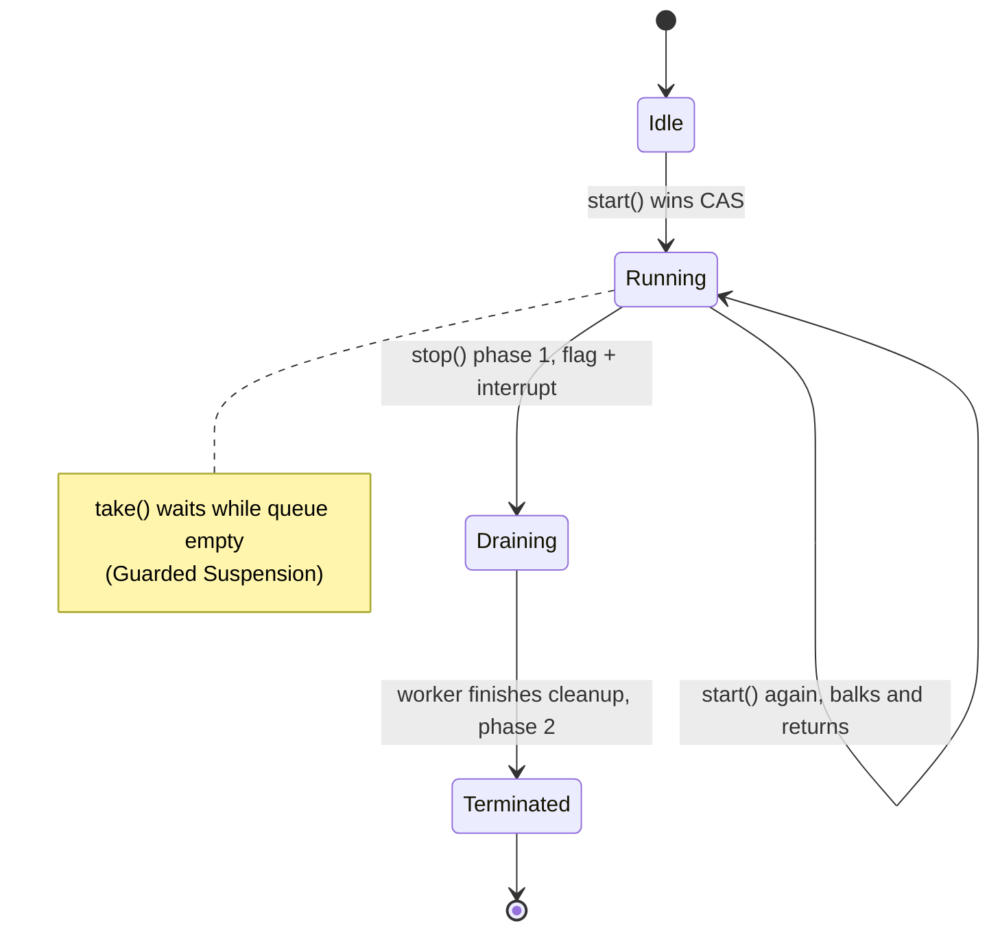
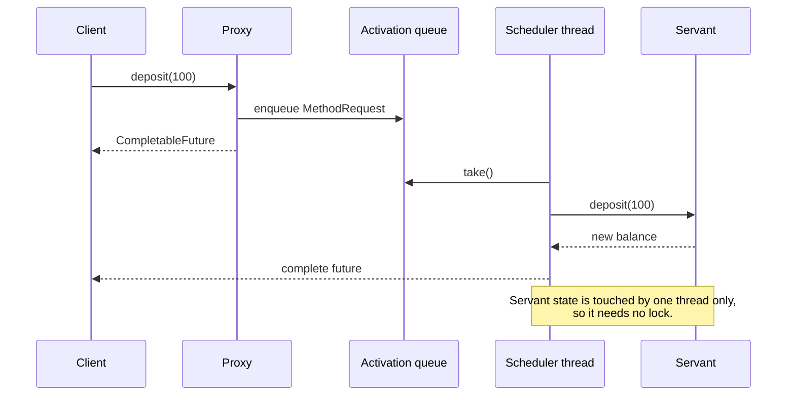
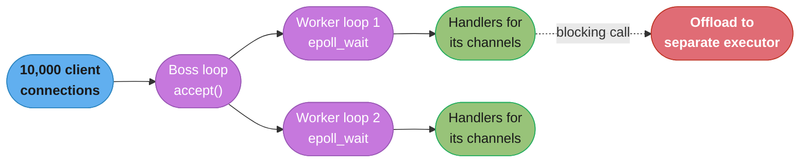

# Coordination Patterns: Monitor Object, Guarded Suspension, Balking, Two-Phase Termination, Active Object, Reactor, Proactor, Actor

The named concurrency patterns beyond producer-consumer and thread pools: how a thread waits, refuses, stops, hands work to another thread, or reacts to I/O events.

## 1. Concept Overview

[Producer-Consumer](ProducerConsumer.md), [Read-Write Lock](ReadWriteLock.md), [Thread Pool](ThreadPool.md) and [Thread-Safe Singleton](ThreadSafeSingleton.md) cover how threads share a buffer, a lock and a pool. A second set of patterns covers how a single object or a whole server coordinates threads and events. Most come from two books: Douglas Schmidt, Michael Stal, Hans Rohnert and Frank Buschmann, *Pattern-Oriented Software Architecture Volume 2: Patterns for Concurrent and Networked Objects* (Wiley, 2000), known as POSA2; and Doug Lea, *Concurrent Programming in Java*, 2nd edition (Addison-Wesley, 1999), with Mark Grand's *Patterns in Java, Volume 1* (Wiley, 1998). The Actor model is older, from Carl Hewitt, Peter Bishop and Richard Steiger (IJCAI 1973).

| Pattern | Source | Problem | Java form |
|---------|--------|---------|-----------|
| Monitor Object | POSA2 (after Hoare 1974) | Several threads call methods on one shared object | `synchronized` methods, or `ReentrantLock` + `Condition` |
| Guarded Suspension | Lea, Grand | A method cannot proceed until a condition holds | `while (!cond) wait();`, `Condition.await()`, `BlockingQueue.take()` |
| Balking | Lea, Grand | A call arrives when the object is in the wrong state | Return immediately: `if (!started.compareAndSet(false, true)) return;` |
| Two-Phase Termination | Lea, Grand | Stop a thread without losing work or leaking resources | Flag + `interrupt()`, then the thread cleans up; `shutdown()` + `awaitTermination()` |
| Active Object | POSA2 | Decouple calling a method from running it, on the object's own thread | Single-thread executor + `CompletableFuture` |
| Reactor | POSA2 | Serve many connections with few threads by dispatching ready I/O events | `java.nio.channels.Selector`, Netty `EventLoop` |
| Proactor | POSA2 | Same, but the OS performs the I/O and reports completion | `AsynchronousSocketChannel` + `CompletionHandler`, Windows IOCP, Linux io_uring |
| Actor | Hewitt et al. 1973 | Concurrency with no shared state, only messages | Akka / Apache Pekko, Erlang/OTP processes |

---

## 2. Intuition

> **One-line analogy**: A Monitor is a single-occupancy meeting room with a waiting bench (Guarded Suspension) and a "closed" sign that sends you away (Balking). An Active Object is a secretary who takes your request slip and does it later. A Reactor is one receptionist watching 10,000 phone lines and only picking up the ones that ring. An Actor is a person you can only reach by letter.

**Mental model**: Every pattern here answers one of three questions. What does a thread do when it cannot proceed: wait (Guarded Suspension) or leave (Balking)? Who runs the work: the caller's thread (Monitor), the object's own thread (Active Object, Actor), or an event loop (Reactor, Proactor)? How does it stop: abruptly, or in two phases?

**Why it matters**: Netty, Spring WebFlux (on Reactor Netty), Vert.x, Node.js, Redis and Nginx are Reactor implementations. Graceful shutdown in Kubernetes is Two-Phase Termination. Every `BlockingQueue.take()` is Guarded Suspension. Naming them lets you reason about their failure modes: blocking an event loop, a lost wakeup, a shutdown that drops in-flight work.

**Key insight**: The patterns trade where the waiting happens. Monitor and Guarded Suspension make the caller wait. Active Object and Actor move the wait into a queue owned by the callee. Reactor and Proactor move it into the operating system, so one thread can wait on thousands of sources at once.

---

## 3. Core Principles

- **Guard conditions are rechecked in a loop.** A woken thread must retest the condition because of spurious wakeups and because another thread may have taken the resource first. `if (!cond) wait();` is a bug; `while (!cond) wait();` is the pattern.
- **Wait or balk is a policy decision.** Waiting suits work that must happen eventually (take the next item). Balking suits work that is redundant if already in progress (a second autosave, a second `start()`).
- **Stopping is cooperative in Java.** `Thread.stop()` was deprecated in JDK 1.2 and throws `UnsupportedOperationException` since JDK 20. A thread stops when its own code observes a flag or an interrupt and exits after cleanup.
- **Serialize access by ownership, not only by locks.** Active Object and Actor give state one owning thread, so the state needs no lock at all; callers communicate through a queue.
- **Never block an event-loop thread.** In a Reactor, one thread serves thousands of connections; a 200 ms blocking JDBC call on it stalls every one of them for 200 ms.

---

## 4. Types / Architectures / Strategies

### 4.1 By what happens to the caller

| Pattern | Caller blocks? | Who runs the work | State protection |
|---------|---------------|-------------------|------------------|
| Monitor Object | Yes, while holding or waiting for the lock | Caller's thread | Lock |
| Guarded Suspension | Yes, until the guard holds | Caller's thread | Lock + condition |
| Balking | No, returns at once | Caller's thread, or nobody | Lock or CAS on a state flag |
| Active Object | No, gets a `Future` | Object's own thread | Single owning thread |
| Actor | No, fire and forget (or ask with a future) | Actor's dispatcher thread | Single owning actor |
| Reactor | Handler code runs on the loop | Event-loop thread | Single loop thread per connection |
| Proactor | No | OS performs I/O; completion handler runs on a pool | Handler discipline |

### 4.2 Reactor variants

| Variant | Threads | Example |
|---------|---------|---------|
| Single-threaded Reactor | One loop does accept, read, decode, handle, write | Redis command execution, Node.js main loop |
| Reactor + worker pool | Loop does I/O, a pool runs handlers | Classic NIO servers, Tomcat NIO connector with its worker pool |
| Multiple Reactors (main / sub) | One acceptor loop, N I/O loops, each connection pinned to one loop | Netty `bossGroup` + `workerGroup`, Nginx worker processes |

---

## 5. Architecture Diagrams

**Monitor Object with Guarded Suspension and Balking** in one object:



**Active Object.** The caller enqueues a method request and gets a future; one scheduler thread runs requests against the servant in order:



**Reactor with main and sub loops** (the Netty shape):



*Each channel is pinned to one worker loop for its life, so its handlers never run concurrently and need no locks. Netty's default worker count is twice the available processors.*

**Reactor versus Proactor:**

```mermaid
sequenceDiagram
    participant App
    participant OS

    rect rgb(40, 44, 52)
    Note over App,OS: Reactor: OS says ready, app does the I/O
    App->>OS: epoll_wait(fds)
    OS-->>App: fd 7 readable
    App->>OS: read(fd 7, buf)
    OS-->>App: bytes
    end

    rect rgb(40, 44, 52)
    Note over App,OS: Proactor: app starts I/O, OS does it, reports completion
    App->>OS: async read(fd 7, buf, handler)
    OS-->>App: completion, bytes already in buf
    end
```



---

## 6. How It Works: Detailed Mechanics

### 6.1 Monitor Object and Guarded Suspension

```java
// Monitor Object: every public method holds the same lock; take() is guarded
public final class BoundedMailbox<T> {
    private final Deque<T> items = new ArrayDeque<>();
    private final int capacity;
    private final ReentrantLock lock = new ReentrantLock();
    private final Condition notEmpty = lock.newCondition();
    private final Condition notFull  = lock.newCondition();

    public BoundedMailbox(int capacity) { this.capacity = capacity; }

    public void put(T item) throws InterruptedException {
        lock.lock();
        try {
            while (items.size() == capacity) notFull.await();   // guard rechecked in a loop
            items.addLast(item);
            notEmpty.signal();
        } finally { lock.unlock(); }
    }

    public T take() throws InterruptedException {
        lock.lock();
        try {
            while (items.isEmpty()) notEmpty.await();
            T item = items.removeFirst();
            notFull.signal();
            return item;
        } finally { lock.unlock(); }
    }
}
```

An intrinsic Java monitor (`synchronized` + `wait`/`notifyAll`) has one wait set per object, so producers and consumers wake each other needlessly; two `Condition`s give each guard its own queue. The `while` loop is mandatory: `Object.wait()` and `Condition.await()` both document spurious wakeups. A guard with a deadline uses `awaitNanos(remaining)` and recomputes `remaining` after each wake. In production use `ArrayBlockingQueue`, which is exactly this class.

### 6.2 Balking

```java
public final class AutoSaver {
    private final AtomicBoolean saving = new AtomicBoolean(false);

    public void saveIfIdle(Document doc) {
        if (!saving.compareAndSet(false, true)) return;   // balk: a save is already running
        try { doc.writeToDisk(); }
        finally { saving.set(false); }
    }
}
```

The JDK balks in several places: `Thread.start()` on a started thread throws `IllegalThreadStateException`, `FutureTask.run()` returns at once unless its state is `NEW`, and `CompletableFuture.complete()` returns `false` if the future is already done. Balking by exception tells the caller it misused the object; balking by silent return says the request was redundant. Pick one deliberately and document it.

### 6.3 Two-Phase Termination

```java
public final class Poller implements Runnable {
    private volatile boolean stopRequested;
    private volatile Thread runner;

    public void run() {
        runner = Thread.currentThread();
        try {
            while (!stopRequested && !Thread.currentThread().isInterrupted()) {
                Batch b = source.poll(Duration.ofSeconds(1));   // interruptible blocking call
                if (b != null) process(b);
            }
        } catch (InterruptedException e) {
            Thread.currentThread().interrupt();                  // restore the flag, then fall through
        } finally {
            flushPendingAcks();                                  // phase 2: cleanup always runs
            source.close();
        }
    }

    public void requestStop() {                                  // phase 1: ask, do not kill
        stopRequested = true;
        Thread t = runner;
        if (t != null) t.interrupt();                            // wake it from poll()/sleep()
    }
}
```

The flag covers code that never blocks; the interrupt covers code blocked in `sleep`, `wait`, `poll` or interruptible I/O. Neither stops a thread stuck in non-interruptible blocking I/O (classic `java.io` socket reads), which must be unblocked by closing the socket. For executors the same two phases are built in:

```java
executor.shutdown();                                         // phase 1: no new tasks
if (!executor.awaitTermination(25, TimeUnit.SECONDS)) {      // phase 2: let running tasks finish
    List<Runnable> dropped = executor.shutdownNow();         // interrupt stragglers
    log.warn("dropped {} queued tasks", dropped.size());
}
```

Since JDK 19, `ExecutorService` is `AutoCloseable` and `close()` performs `shutdown()` then waits for termination. At the process level the same shape appears again: Kubernetes sends `SIGTERM`, waits `terminationGracePeriodSeconds` (default 30), then sends `SIGKILL`. Spring Boot's graceful shutdown is on by default for Tomcat, Jetty and Reactor Netty (`server.shutdown=immediate` turns it off), and `spring.lifecycle.timeout-per-shutdown-phase` (default 30 s) bounds phase 2. Set the application timeout below the pod's grace period, or Kubernetes kills the process mid-drain.

### 6.4 Active Object

```java
public final class AccountActor {                 // Proxy + Servant in one class for brevity
    private final ExecutorService scheduler = Executors.newSingleThreadExecutor();  // activation queue + scheduler
    private long balanceCents;                    // touched only by the scheduler thread

    public CompletableFuture<Long> deposit(long cents) {
        return CompletableFuture.supplyAsync(() -> balanceCents += cents, scheduler);
    }

    public CompletableFuture<Long> balance() {
        return CompletableFuture.supplyAsync(() -> balanceCents, scheduler);
    }

    public void close() { scheduler.close(); }    // two-phase termination via AutoCloseable (JDK 19+)
}
```

POSA2 names six participants: Proxy (the public interface), Method Request (one queued call), Activation List (the queue), Scheduler (decides which request runs next, possibly by guard), Servant (the real object), and Future (the result). `newSingleThreadExecutor()` collapses Activation List and Scheduler into one FIFO. The cost: every call is a queue hop and a context switch, around a few microseconds, so Active Object fits coarse operations, not a getter called a million times a second. Android's `Looper`/`Handler` and Swing's event dispatch thread (`SwingUtilities.invokeLater`) are Active Objects for UI state.

### 6.5 Reactor with `java.nio`

```java
Selector selector = Selector.open();
ServerSocketChannel server = ServerSocketChannel.open().bind(new InetSocketAddress(8080));
server.configureBlocking(false);
server.register(selector, SelectionKey.OP_ACCEPT);

while (running) {
    selector.select();                                       // synchronous event demultiplexer (epoll/kqueue)
    for (Iterator<SelectionKey> it = selector.selectedKeys().iterator(); it.hasNext(); ) {
        SelectionKey key = it.next(); it.remove();
        if (key.isAcceptable()) {                            // dispatch to the acceptor
            SocketChannel ch = server.accept();
            ch.configureBlocking(false);
            ch.register(selector, SelectionKey.OP_READ, new ConnectionHandler(ch));
        } else if (key.isReadable()) {                       // dispatch to the handler attached to the key
            ((ConnectionHandler) key.attachment()).onReadable();
        }
    }
}
```

POSA2's participants map directly: Handles (channels), Synchronous Event Demultiplexer (`Selector`, backed by `epoll` on Linux and `kqueue` on macOS), Initiation Dispatcher (the loop), Event Handlers (`ConnectionHandler`). Forgetting `it.remove()` re-dispatches the same key forever; a handler that blocks freezes every connection on that selector. Netty packages this as `EventLoopGroup`, each `EventLoop` owning one selector and one thread, with each channel registered to exactly one loop.

### 6.6 Proactor

In a Proactor the application starts the operation and the OS performs it. Windows I/O Completion Ports and Linux `io_uring` (kernel 5.1, 2019) are native proactor interfaces. Java's NIO.2 `AsynchronousSocketChannel.read(buffer, attachment, CompletionHandler)` is a Proactor API; on Linux the JDK implements it with an `epoll` loop internally, so the programming model is proactive while the mechanism underneath is reactive. Proactor removes the "ready, now read" round trip and suits high-throughput file and network I/O, at the cost of buffers that stay owned by the OS until completion and harder-to-follow control flow.

### 6.7 Actor

An actor has private state, a mailbox, and a behavior. On each message it can send messages, create actors, and change its behavior for the next message; it processes one message at a time, so its state needs no lock. Failures are handled by supervision: a parent actor restarts, resumes or stops a failed child ("let it crash" in Erlang/OTP).

```java
// Apache Pekko typed actor (Pekko is the Apache-licensed fork of Akka 2.6)
public final class Counter extends AbstractBehavior<Counter.Cmd> {
    public sealed interface Cmd permits Inc, Get {}
    public record Inc(int by) implements Cmd {}
    public record Get(ActorRef<Integer> replyTo) implements Cmd {}

    private int value;                                   // owned by this actor only

    private Counter(ActorContext<Cmd> ctx) { super(ctx); }
    public static Behavior<Cmd> create() { return Behaviors.setup(Counter::new); }

    @Override public Receive<Cmd> createReceive() {
        return newReceiveBuilder()
            .onMessage(Inc.class, m -> { value += m.by(); return this; })
            .onMessage(Get.class, m -> { m.replyTo().tell(value); return this; })
            .build();
    }
}
```

Akka moved from Apache 2.0 to the Business Source License 1.1 with version 2.7 in September 2022; the Apache Software Foundation's Pekko project forked Akka 2.6 and released Pekko 1.0 in 2023. Microsoft Orleans uses "virtual actors" (grains) that the runtime activates on demand and places across a cluster.

---

## 7. Real-World Examples

| System | Pattern | Detail |
|--------|---------|--------|
| Netty, Vert.x, Reactor Netty (under Spring WebFlux) | Multiple Reactors | Boss loop accepts, worker loops own channels; default workers = 2 x CPUs in Netty |
| Redis | Single-threaded Reactor | Commands execute on one thread; Redis 6.0 added optional I/O threads for socket reads and writes only |
| Nginx | Multiple Reactors as processes | One worker process per core, each an `epoll` loop |
| Node.js | Reactor (libuv) | One JavaScript thread; libuv's thread pool (default 4) handles file I/O and DNS |
| Windows IIS, Boost.Asio | Proactor | IOCP completion-based I/O |
| `ArrayBlockingQueue`, `LinkedBlockingQueue` | Monitor Object + Guarded Suspension | `take()` and `put()` wait on `Condition`s |
| `ExecutorService.shutdown()` / `close()` | Two-Phase Termination | Stop intake, drain, then interrupt |
| Android `Looper` / `Handler`, Swing EDT | Active Object | All UI state touched by one thread through a message queue |
| WhatsApp (Erlang), Discord (Elixir), LinkedIn and PayPal (Akka) | Actor | Millions of lightweight processes or actors with supervision |

---

## 8. Tradeoffs

| Pattern | Gains | Costs |
|---------|-------|-------|
| Monitor Object | Simple; correctness from one lock | Contention; callers block; deadlock risk across monitors |
| Guarded Suspension | Waits without spinning | Lost-wakeup and spurious-wakeup bugs if the loop or signal is wrong |
| Balking | No waiting, no duplicate work | Caller must handle "nothing happened"; silent balks can hide bugs |
| Two-Phase Termination | No lost work, resources released | Needs every blocking call to be interruptible or closable; bounded by a timeout |
| Active Object | Lock-free state; async API | Queue hop per call; unbounded queue is a memory risk; ordering only per object |
| Reactor | Thousands of connections on a few threads | Any blocking call stalls the loop; callback or reactive code style |
| Proactor | No readiness round trip; OS does the copy | Platform-specific; buffer ownership rules; harder debugging |
| Actor | No shared state; location transparency; supervision | Message-passing overhead; no global ordering; mailbox growth; harder request/response |

**Virtual threads (JDK 21) change the Reactor tradeoff for application code.** A thread-per-request server on virtual threads parks the virtual thread on a blocking call while its carrier serves other work, so plain blocking code gets most of the connection density that used to require an event loop. The Reactor stays the right choice inside networking frameworks (Netty itself, proxies, gateways) and for workloads that are pure byte shuffling. See [Modern Java Concurrency](modern_java_concurrency.md).

---

## 9. When to Use / When NOT to Use

**Use:**
- **Monitor + Guarded Suspension** for a shared object with a small number of state-dependent operations (a bounded buffer, a connection slot). Prefer the JDK class that already implements it.
- **Balking** for idempotent triggers: autosave, cache refresh, lazy start, scheduled jobs that must not overlap.
- **Two-Phase Termination** for every long-running thread or executor you own.
- **Active Object** when an object's state is complex and touched from many threads, and calls are coarse enough to absorb a queue hop.
- **Reactor** when you write the network layer itself or a proxy handling tens of thousands of mostly idle connections.
- **Actor** for many independent stateful entities (sessions, devices, game rooms) with failure isolation and possibly distribution.

**Do NOT use:**
- Active Object or Actor for fine-grained, high-frequency reads; a lock or an immutable snapshot is cheaper.
- A hand-written Reactor in business code on JDK 21+; use virtual threads or an existing framework.
- Balking where the request must eventually happen (a payment retry); queue it or wait.
- `Thread.stop()` or `System.exit()` from a worker as a "termination pattern".

---

## 10. Common Pitfalls

1. **Blocking the event loop.** A team moved a service to Spring WebFlux and called a JDBC repository from a handler. p99 latency rose from 40 ms to 2 s under load because 8 Netty threads spent their time inside blocking queries. Offload with `subscribeOn(Schedulers.boundedElastic())`, use R2DBC, or run blocking code on virtual threads instead of the loop.
2. **`if` instead of `while` around `wait()`.** A consumer woke spuriously, skipped the check, and called `removeFirst()` on an empty deque: `NoSuchElementException` once a week, never reproducible locally.
3. **Swallowed interrupts break Two-Phase Termination.** `catch (InterruptedException e) {}` inside a loop clears the flag, so `requestStop()` has no effect and shutdown waits the full grace period before `SIGKILL`. Restore the flag or exit the loop.
4. **Shutdown timeout longer than the platform's.** `timeout-per-shutdown-phase=60s` on a pod with the default 30 s grace period: Kubernetes kills the JVM mid-drain and in-flight requests fail. Keep application timeout plus pre-stop delay below `terminationGracePeriodSeconds`.
5. **Unbounded Active Object queue.** `newSingleThreadExecutor()` uses an unbounded `LinkedBlockingQueue`; a burst of 2 million requests became 2 million queued lambdas and an `OutOfMemoryError`. Use a bounded queue with a rejection policy.
6. **Actor mailbox growth.** A slow actor receiving 10,000 messages per second while processing 8,000 grows its mailbox by 2,000 per second until the JVM dies. Use bounded mailboxes, back-pressure, or shard the work across actors.
7. **Ask-pattern deadlock.** Actor A blocks on `ask` to B while B blocks on `ask` to A. Never block inside an actor; compose futures and pipe the result back as a message.
8. **Forgetting `selectedKeys().remove()`** in a raw NIO loop: the same key is processed on every `select()`, burning a core at 100%.

---

## 11. Technologies & Tools

| Tool | Pattern | Notes |
|------|---------|-------|
| `java.util.concurrent.locks.ReentrantLock`, `Condition` | Monitor, Guarded Suspension | Multiple condition queues, timed and interruptible waits |
| `ArrayBlockingQueue`, `LinkedBlockingQueue` | Monitor + Guarded Suspension | Ready-made bounded buffer |
| `AtomicBoolean.compareAndSet` | Balking | Lock-free state guard |
| `ExecutorService.shutdown` / `awaitTermination` / `close` | Two-Phase Termination | `close()` from JDK 19 |
| `CompletableFuture` + single-thread executor | Active Object | Future-returning proxy |
| `java.nio.channels.Selector` | Reactor | `epoll` (Linux), `kqueue` (macOS) |
| `AsynchronousSocketChannel`, `CompletionHandler` | Proactor API | NIO.2, JDK 7 |
| Netty, Vert.x, Reactor Netty | Multiple Reactors | Production event loops |
| Apache Pekko, Akka, Erlang/OTP, Microsoft Orleans | Actor | Supervision, clustering, virtual actors (Orleans) |
| Spring Boot graceful shutdown | Two-Phase Termination | On by default; bounded by `spring.lifecycle.timeout-per-shutdown-phase` |

---

## 12. Interview Questions with Answers

**Q: Why must a guarded wait use `while` and not `if`?**
**Short:** A thread can wake without the condition being true, through a spurious wakeup or another thread taking the resource first, so the guard must be rechecked after every wake.

A: `Object.wait()` and `Condition.await()` both permit spurious wakeups, and even a genuine `signal()` only means "the condition may have changed". Between the signal and the woken thread reacquiring the lock, another consumer can take the item. With `if`, the woken thread proceeds on a false condition and fails, for example `removeFirst()` on an empty deque. With `while (!cond) await();` it re-tests and waits again. This is the defining rule of Guarded Suspension.

**Q: What is the difference between Guarded Suspension and Balking?**
**Short:** Guarded Suspension waits until the precondition holds and then proceeds; Balking returns immediately, or throws, when the precondition is false.

A: Both check a state precondition. A consumer calling `take()` on an empty queue must eventually get an item, so it waits (Guarded Suspension). An autosave triggered while a save is already running is redundant, so it returns at once (Balking). The JDK balks in `Thread.start()` on a started thread (throws `IllegalThreadStateException`) and in `FutureTask.run()` when the task is no longer `NEW` (returns silently). Choose by asking whether the request must eventually happen.

**Q: What goes wrong if you call a blocking JDBC method on a Netty or WebFlux event-loop thread?**
**Short:** The loop thread serves thousands of connections, so while it is blocked none of them make progress, and latency rises for every client on that loop.

A: Netty pins each channel to one event loop, and there are only about two loops per CPU. A 100 ms blocking call on a loop delays every other channel on it by 100 ms, and under load the delays queue up, so p99 latency climbs by orders of magnitude while CPU stays low. Use non-blocking drivers (R2DBC), offload blocking calls to a separate scheduler (`Schedulers.boundedElastic()`), or move the service to virtual threads, where blocking is cheap.

**Q: What is Two-Phase Termination, and why not just call `Thread.stop()`?**
**Short:** Phase one requests the stop with a flag and an interrupt; phase two lets the thread finish its current unit and clean up; Thread.stop() kills mid-update and is unsupported since JDK 20.

A: `Thread.stop()` threw `ThreadDeath` at an arbitrary point, releasing monitors while an object was half-updated, which is why it was deprecated in JDK 1.2; since JDK 20 it throws `UnsupportedOperationException`. Two-Phase Termination sets a volatile stop flag and interrupts the thread to wake it from blocking calls; the thread checks the flag at safe points, exits its loop, and its `finally` block flushes and closes resources. `ExecutorService.shutdown()` followed by `awaitTermination()` and then `shutdownNow()` is the executor form.

**Q: Why can graceful shutdown still drop requests on Kubernetes?**
**Short:** If the application's drain timeout plus any pre-stop delay exceeds terminationGracePeriodSeconds, default 30 seconds, Kubernetes sends SIGKILL before the drain finishes.

A: Kubernetes sends `SIGTERM`, waits `terminationGracePeriodSeconds`, then sends `SIGKILL`. Spring Boot's graceful shutdown stops accepting requests and waits up to `spring.lifecycle.timeout-per-shutdown-phase` (default 30 s) for in-flight ones. With equal 30 s values and a 5 s `preStop` sleep (often added so the load balancer stops routing first), the JVM is killed at 30 s while requests are still draining. Budget it: pre-stop delay plus app timeout plus a margin, below the grace period.

**Q: What are the participants of the Active Object pattern, and how do you build one in Java?**
**Short:** Proxy, Method Request, Activation List, Scheduler, Servant and Future; in Java a single-thread executor plus CompletableFuture-returning methods implements it.

A: The Proxy exposes the interface and turns each call into a Method Request placed on the Activation List; the Scheduler, on its own thread, takes requests and runs them against the Servant; the caller holds a Future for the result. In Java, `CompletableFuture.supplyAsync(() -> servant.op(), singleThreadExecutor)` combines all of them. Because only the scheduler thread touches the servant, the servant needs no locks. Bound the executor's queue, since the default single-thread executor's queue is unbounded.

**Q: What is the difference between Reactor and Proactor?**
**Short:** A Reactor is told a handle is ready and then performs the I/O itself; a Proactor starts the I/O and is told when the OS has completed it.

A: Reactor uses a synchronous event demultiplexer (`select`, `epoll`, `kqueue`, Java's `Selector`): wait for readiness, then call `read()`. Proactor uses asynchronous operations (Windows IOCP, Linux `io_uring`, Java's `AsynchronousSocketChannel` with a `CompletionHandler`): issue the read with a buffer, and the completion handler runs when the bytes are already in the buffer. On Linux the JDK's asynchronous channels are built on `epoll`, so the API is proactive while the mechanism is reactive.

**Q: How do Active Object and the Actor model differ?**
**Short:** Active Object keeps a normal method interface and returns futures from one object's thread; an Actor exposes only message passing, can change behavior per message, creates other actors and is supervised.

A: Active Object is an object-oriented wrapper: callers invoke typed methods on a proxy and receive futures, and there is usually a fixed set of active objects. Actors communicate only by asynchronous messages, may number in the millions, can create children, change their behavior for the next message, and are organized in supervision trees that restart failed children. Actor runtimes also offer location transparency across a cluster. Active Object is a pattern; the Actor model is a whole programming model.

**Q: Why does an actor's state need no lock, and what breaks that guarantee?**
**Short:** An actor processes one message at a time, so only one thread touches its state at once; sharing a mutable object through a message or touching state from a future callback breaks it.

A: The runtime guarantees at most one message is processed per actor at a time, with a happens-before edge between messages. The guarantee covers only state the actor owns. Sending a mutable `ArrayList` in a message lets two actors mutate it concurrently, and updating `this.value` inside a `CompletableFuture` callback runs on another thread outside message processing. Send immutable messages (records) and pipe future results back to the actor as a message.

**Q: How does Netty implement the Reactor pattern?**
**Short:** A boss EventLoopGroup accepts connections and hands each channel to one worker EventLoop, a thread with its own selector, which runs all of that channel's handlers.

A: Each `EventLoop` is one thread with one `Selector`; a channel is registered to exactly one loop for its lifetime, so its `ChannelPipeline` handlers never run concurrently and need no synchronization. The worker group defaults to twice the available processors. Work submitted from other threads is queued to the loop, and long-running work should go to a separate `EventExecutorGroup` or executor so the loop keeps polling.

**Q: Do virtual threads make the Reactor pattern obsolete?**
**Short:** For application code, mostly yes: blocking code on virtual threads reaches similar connection counts; inside network frameworks and proxies the Reactor remains the core.

A: A virtual thread that blocks on I/O unmounts from its carrier, and the JDK parks it on an internal poller, so thread-per-request code can hold tens of thousands of concurrent connections without callbacks. That removes the main reason business services adopted reactive stacks. The Reactor still underlies the JDK's own poller and remains the right model for Netty, gateways and proxies that move bytes with minimal per-connection state, and for code needing fine-grained back-pressure.

**Q: How do you implement Balking without a lock?**
**Short:** Use AtomicBoolean.compareAndSet(false, true) as the guard, so exactly one caller wins and the rest return immediately, and reset it in a finally block.

A: `if (!running.compareAndSet(false, true)) return;` is atomic, so two concurrent callers cannot both pass. The winner does the work and sets the flag back to `false` in `finally`, so an exception does not leave the object stuck in the busy state. For one-shot initialization, never reset it. A plain `volatile boolean` check followed by a write is a race: both threads can read `false` before either writes `true`.

**Q: What is a Monitor Object, and why would you use `ReentrantLock` with several `Condition`s instead of `synchronized`?**
**Short:** A Monitor serializes all methods of an object on one lock with condition waits; ReentrantLock allows separate condition queues, timed and interruptible lock attempts, and fairness.

A: With `synchronized`, each object has one wait set, so a bounded buffer must use `notifyAll()` and wake both producers and consumers on every change. `ReentrantLock.newCondition()` gives `notFull` and `notEmpty` queues, so `signal()` wakes exactly one waiter of the right kind. `ReentrantLock` also offers `tryLock(timeout)` and `lockInterruptibly()`. Since JDK 24 (JEP 491) `synchronized` no longer pins virtual threads, so the choice is about these features, not about pinning.

**Q: What makes a thread impossible to stop with an interrupt, and how do you handle it?**
**Short:** Non-interruptible blocking such as a classic java.io socket read or a CPU loop that never checks the flag; close the underlying resource or add explicit checks.

A: `Thread.interrupt()` sets a flag and wakes `sleep`, `wait`, `join`, `BlockingQueue` operations and interruptible NIO channels. A `java.io` `InputStream.read()` on a socket ignores it; closing the socket from the stopping thread makes the read throw and the worker exit. A compute loop must check `Thread.currentThread().isInterrupted()` periodically. Code that catches `InterruptedException` and continues defeats both; restore the flag with `Thread.currentThread().interrupt()`.

**Q: When is the Actor model a poor fit?**
**Short:** For request/response logic over shared data that needs transactions or strong consistency across entities, and for fine-grained calls where message overhead dominates.

A: Transferring money between two account actors needs both to agree; without a transaction you build a saga by hand. Reads that span many entities (reports, searches) become scatter-gather over thousands of actors. Each message costs an allocation and a mailbox enqueue, which matters for calls that would otherwise be nanosecond method calls. Actors fit many independent, long-lived, stateful entities with failure isolation; a database and stateless services fit shared-data workloads.

**Q: How did Akka's 2022 license change affect Java teams using actors?**
**Short:** Akka 2.7 moved to the Business Source License 1.1, which requires a paid license for production above a revenue threshold, and Apache Pekko forked Akka 2.6 under Apache 2.0.

A: Lightbend relicensed Akka from version 2.7 in September 2022; the source is available but production use by larger companies requires a commercial license, with each release converting to Apache 2.0 after three years. The Apache Software Foundation's Pekko project forked the last Apache-licensed Akka (2.6) and released Pekko 1.0 in 2023 with package names changed from `akka` to `org.apache.pekko`. Teams wanting an Apache-licensed actor runtime on the JVM migrate to Pekko; the APIs are close, mostly a package rename.

---

## 13. Best Practices

- Use the JDK's blocking queues, latches and executors before writing a monitor by hand.
- Always wrap guarded waits in a `while` loop, and use timed waits where a deadline exists.
- Decide per operation whether to wait or balk, and document the choice in the method contract.
- Give every long-running thread a two-phase stop: volatile flag, interrupt, `finally` cleanup, bounded wait.
- Keep the application's shutdown timeout below the platform's grace period.
- Bound every queue: Active Object activation lists, actor mailboxes, event-loop task queues.
- Never block an event-loop thread; on JDK 21+ prefer virtual threads for blocking business code.
- Send immutable messages to actors and active objects.

---

## 14. Case Study: Replacing a Hand-Written NIO Server and Its Shutdown Bug

**Context.** An internal telemetry ingest service accepted 20,000 long-lived TCP connections from devices. It ran a hand-written single-selector Reactor with a 32-thread worker pool for parsing and a `kill -9`-style deploy: the pod was deleted and the JVM died with whatever was in memory.

**Symptoms.** Every deploy lost about 4 seconds of telemetry: batches parsed but not yet flushed to Kafka. Occasionally the selector thread burned 100% CPU after a reconnect storm.

**Diagnosis.**
1. The selector loop never removed keys from `selectedKeys()` on one error path, so a failed key was redispatched forever.
2. The worker pool was created with `newFixedThreadPool(32)` and never shut down; there was no phase 2 at all.
3. A `catch (InterruptedException e) {}` in the Kafka flush loop swallowed the interrupt, so even a manual `shutdownNow()` left the thread running.

**Fix.**
1. Replaced the hand-written loop with Netty: one boss loop, worker loops at the default size, one channel per device pinned to one loop, and parsing done in the pipeline because it was CPU-light (about 20 microseconds per frame).
2. Implemented Two-Phase Termination on `SIGTERM`: close the server channel (no new connections), send each device a reconnect-elsewhere frame, flush the Kafka producer with `producer.flush()`, then `close(Duration.ofSeconds(10))`, all under a 20 s budget with `terminationGracePeriodSeconds: 30`.
3. Restored the interrupt flag in the flush loop and exited on interrupt.

**Result.** Zero lost batches across the next 40 deploys, and the reconnect-storm CPU spin disappeared with the hand-written loop. The service stayed on Netty rather than virtual threads because it was byte-shuffling with little per-connection logic, the case where the Reactor is still the best fit.
