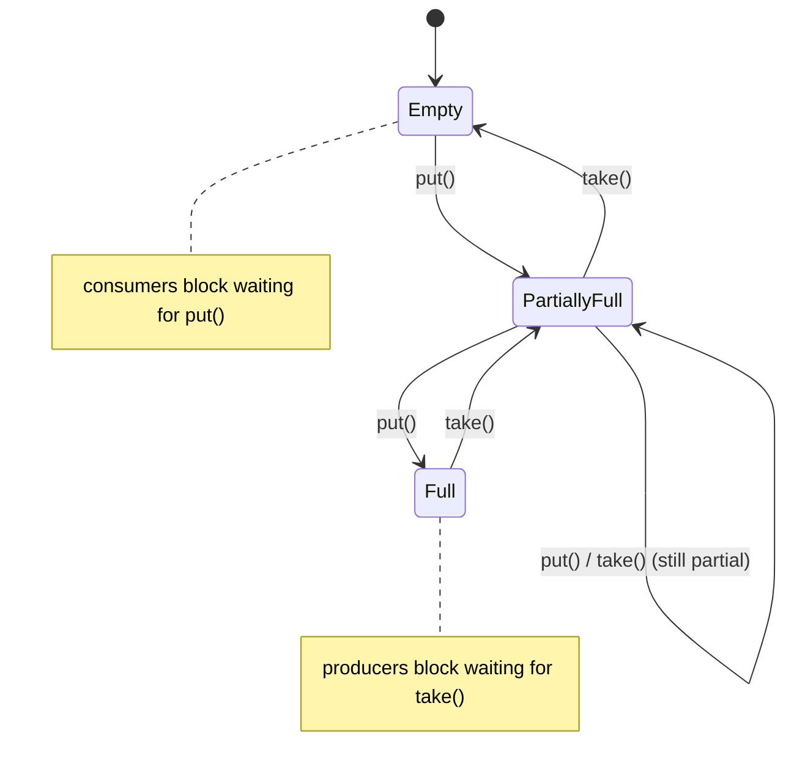
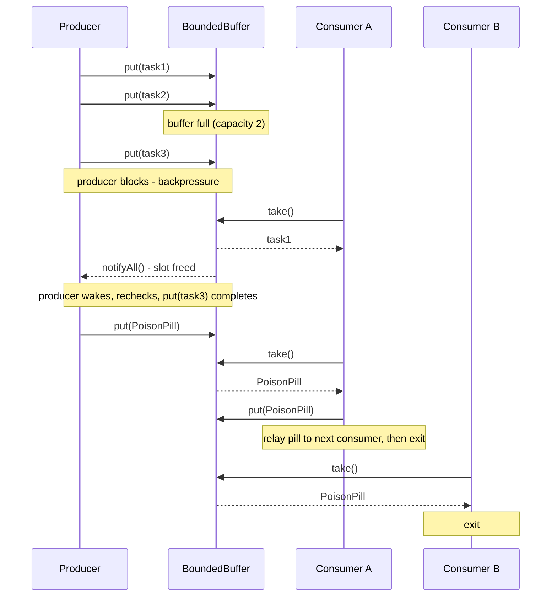

# Producer-Consumer Pattern
## Intuition

> **One-line analogy**: Producer-Consumer is like a bakery conveyor belt — bakers (producers) place loaves at one end at their own pace; packagers (consumers) take them at their own pace — the belt absorbs the difference.

**Mental model**: Without a buffer, producers and consumers must synchronize on every item — one waits for the other constantly. A bounded queue between them lets each run at its natural speed. When the queue fills up, the producer slows down (backpressure). When it empties, consumers wait. The system self-regulates without tight coupling between the two sides.

**Why it matters**: This pattern appears everywhere in production systems — HTTP request queues, Kafka topics, thread pools, async job schedulers. Understanding it deeply means understanding backpressure, queue sizing, and graceful degradation under load.

**Key insight**: The bounded buffer capacity is a tuning dial: small = aggressive backpressure, large = large latency spikes before producers feel the pain. Size it as `max_throughput × max_acceptable_latency`.

**Full runnable implementation:** [`ProducerConsumer.java`](ProducerConsumer.java) — 395 lines, one file, `main()` at the bottom. It demonstrates the `wait`/`notify` buffer written by hand, the same problem solved on a `BlockingQueue` with a poison-pill shutdown, and a three-stage log-processing pipeline showing what backpressure looks like when it works.

---

## Intent

Decouple producers (which generate work items) from consumers (which process them) using a shared bounded buffer. Producers don't wait for consumers; consumers don't poll for work — both run at their natural rates.

## When to Use

- Tasks are generated at a different rate than they're processed
- You need backpressure (slow down producers when consumers are overwhelmed)
- You want to smooth out bursty traffic
- Multiple producers/consumers need to coordinate without tight coupling

---

## Bounded Buffer

The buffer's capacity is critical:
- **Too small**: producers block frequently, reducing throughput
- **Too large**: memory exhaustion; backpressure signal arrives too late
- **Rule of thumb**: queue size = (max throughput) × (max acceptable latency)

**Put simply.** "Make the buffer exactly deep enough that a full queue still drains inside your
latency budget." A queue slot is not free storage — it is a promise of delay, because the item at
the back of a full queue must wait for everything ahead of it to be consumed. Sizing by this rule
means the worst case you can ever observe is the worst case you already agreed to.

| Symbol | What it is |
|--------|-----------|
| `queue size` | Bounded-buffer capacity — the `new ArrayBlockingQueue<>(n)` argument |
| `max throughput` | Sustained consumer drain rate, in items per second (not the producer rate) |
| `max acceptable latency` | Worst-case end-to-end queue delay your SLA permits |

**Walk one example.** A pipeline whose consumers drain 5,000 messages/sec, with a 200ms latency
budget and roughly 2KB per message:

```
given   max throughput = 5000 msg/s
        max latency    = 0.2 s
        message size   = 2 KB = 2048 bytes

size    queue = 5000 x 0.2                     = 1000 slots
memory  worst-case heap = 1000 x 2048 bytes    = 2.05 MB   (bounded, by construction)

what the two bad sizes cost:
        queue = 100000 slots -> drain time = 100000 / 5000 = 20 s     latency blown 100x
                                heap       = 100000 x 2048 = 204.8 MB OOM territory
        queue =     10 slots -> drain time =     10 / 5000 = 0.002 s  producers block constantly
```

Result: 1,000 slots is the largest buffer that still honours the 200ms promise, and it caps
worst-case memory at ~2MB. Note that the drain rate — not the producer rate — is the correct
`max throughput`: a queue sized off producers can never empty if consumers are slower, which is
precisely the unbounded-growth failure the pattern exists to prevent.

The buffer's own fill level *is* the backpressure signal — producers and consumers each block on exactly one edge of it, with no other coordination required:



Producers only stall at `Full`; consumers only stall at `Empty` — this is the "self-regulates" behavior from the Key insight above, driven entirely by the buffer's own capacity check.

---

## Implementation Comparison

| Approach | Pros | Cons | Use When |
|----------|------|------|----------|
| `wait()/notifyAll()` | No dependencies, fine-grained | Error-prone, verbose | Never in production |
| `BlockingQueue` | Clean API, built-in, reliable | Less flexible | Almost always |
| `Disruptor` | Extreme throughput (LMAX) | Complex | Financial trading systems |
| `Kafka` | Durable, distributed, replay | Heavy infrastructure | Cross-service async |

---

## Why `while` and NOT `if` for wait()

```java
// WRONG — vulnerable to spurious wakeups
synchronized void consume() throws InterruptedException {
    if (buffer.isEmpty()) {  // ← if another thread consumed before you wake
        wait();
    }
    // buffer could be empty here! NullPointerException or wrong result
    return buffer.poll();
}

// CORRECT — re-checks condition after wakeup
synchronized void consume() throws InterruptedException {
    while (buffer.isEmpty()) {  // ← always re-check
        wait();
    }
    return buffer.poll();
}
```

Spurious wakeups: JVM/OS can wake threads without `notify()` being called. The JVM specification explicitly allows this.

---

## BlockingQueue Variants

| Class | Bounded | Order | Notes |
|-------|---------|-------|-------|
| `ArrayBlockingQueue` | Yes | FIFO | Fixed array, single lock |
| `LinkedBlockingQueue` | Optional | FIFO | Two locks (head/tail), higher throughput |
| `PriorityBlockingQueue` | No | Priority | Heap-based, natural order |
| `DelayQueue` | No | Delay expiry | Tasks available after delay |
| `SynchronousQueue` | 0 (handoff) | — | Direct producer→consumer handoff |

---

## Poison Pill Shutdown

```java
// Sentinel value signals consumers to stop
queue.put(PoisonPill.INSTANCE);  // producer puts it after last real task

// Consumer:
while (true) {
    Task task = queue.take();
    if (task == PoisonPill.INSTANCE) {
        queue.put(PoisonPill.INSTANCE); // pass it along to other consumers
        break;
    }
    process(task);
}
```

Alternative: `ExecutorService.shutdown()` + `awaitTermination()`.

The full lifecycle — normal blocking handoff, then poison-pill shutdown relayed across a consumer pool — looks like this end to end:



Consumer A never swallows the pill — it re-`put()`s it before exiting, so Consumer B (and any other pool member) also sees it and shuts down cleanly.

---

## Monitoring Metrics

| Metric | What it tells you | Alert threshold |
|--------|-------------------|-----------------|
| Queue depth | Consumer lag | > 80% capacity |
| Producer rate (tasks/sec) | Input load | Sudden spike |
| Consumer rate (tasks/sec) | Processing throughput | Drop below producer rate |
| Task age in queue | Latency | > SLA target |
| Rejected tasks | Queue overflow | > 0 |

---

## Real-World Examples

- **Java Thread Pool**: `ThreadPoolExecutor` internally uses a BlockingQueue for tasks
- **Kafka**: The ultimate producer-consumer at scale — durable, distributed, replayable
- **Android MainThread**: UI events are tasks in a message queue; Looper is the consumer
- **Node.js Event Loop**: Single-threaded consumer for async I/O events
- **Database connection pool**: Connections are "consumers" waiting for queries (tasks)

---

## Cross-Perspective: HLD Connections

**HLD View — Where Producer-Consumer Appears in Distributed Systems**

- **Message queue architecture** — Kafka, RabbitMQ, SQS, and Pub/Sub are Producer-Consumer at infrastructure scale with persistence, replay, and multi-consumer fan-out. The bounded queue becomes a distributed durable log; the backpressure signal is queue depth or consumer lag.
- **Async job processing** — Web tier (producer) drops jobs into a queue; a worker fleet (consumers) processes them asynchronously. This decouples peak request volume from processing throughput and enables independent scaling of web and worker tiers.
- **Stream processing pipelines** — Flink and Kafka Streams chains are cascaded Producer-Consumer stages: each stage consumes from an upstream topic (bounded buffer) and produces to a downstream topic, with backpressure managed by consumer lag monitoring.
- **Connection pool as consumer** — A connection pool is a Producer-Consumer variant: requests (producers) submit work; pooled threads (consumers) process it from a bounded work queue. Queue saturation triggers the rejection handler — the system's backpressure mechanism.

---

## Interview Questions

**Q: What is the difference between `notify()` and `notifyAll()`?**
**Short:** notify() wakes one arbitrary waiter and notifyAll() wakes every one, so notify() is only safe when all waiting threads block on the identical condition.
`notify()` wakes one random waiting thread. `notifyAll()` wakes all. Use `notifyAll()` when multiple threads are waiting on different conditions; `notify()` is only safe when all threads wait on the same condition.

**Q: What is a spurious wakeup? How do you handle it?**
**Short:** A spurious wakeup is a thread returning from wait() without being notified, which is why the condition must be rechecked in a while loop rather than an if.
A thread waking from `wait()` without being notified. Handle by always rechecking the condition in a `while` loop.

**Q: How do you gracefully shut down a producer-consumer system?**
**Short:** Push a poison-pill sentinel through the queue so consumers stop on receiving it, or call ExecutorService.shutdown() followed by awaitTermination().
Option A: Poison pill — producers send a sentinel task; consumers stop on receiving it.
Option B: `ExecutorService.shutdown()` then `awaitTermination()`.
Option C: `volatile boolean running = false` flag checked in consumer loop.

**Q: What BlockingQueue would you use for a priority work queue?**
**Short:** PriorityBlockingQueue, which orders tasks by their Comparable ordering or a supplied Comparator instead of FIFO arrival order.
`PriorityBlockingQueue` — tasks implement `Comparable` or provide a `Comparator`.

**Q: How would you implement backpressure?**
**Short:** A bounded BlockingQueue provides backpressure for free, because put() blocks the producing thread as soon as the queue is full.
Use a bounded `BlockingQueue`. `put()` blocks the producer thread when full. For async systems, use reactive streams (RxJava, Project Reactor) which have explicit backpressure signals.

---

**Q: What's the rule of thumb for sizing a bounded buffer, and why must "max throughput" be the consumer's drain rate?**
**Short:** Size the queue as max throughput times max acceptable latency, using the consumer's drain rate, not the producer's.

A: Queue size = max throughput x max acceptable latency, where max throughput is the sustained consumer drain rate in items per second. Using the producer's rate instead is wrong because a queue sized off producers can never empty when consumers are slower — that is precisely the unbounded-growth failure the bounded buffer exists to prevent. A slot in the queue is not free storage; it is a promise of delay, since the item at the back must wait for everything ahead of it to be consumed.

---

**Q: What happens if you size the bounded buffer far too large, say 100,000 slots when 1,000 would do?**
**Short:** Latency blows up roughly a hundredfold past the SLA and worst-case memory approaches OOM territory.

A: Drain time for a full queue grows to the total slot count divided by the drain rate, so an oversized queue can miss its latency SLA by two orders of magnitude before the last item is even processed. Worst-case memory also scales linearly with slot count times message size, turning a comfortably bounded buffer into an OOM risk under sustained load. The correct size is the largest buffer that still honors the latency budget, not the largest one memory can technically hold.

---

**Q: Why does the Implementation Comparison table mark wait()/notifyAll() as "never in production"?**
**Short:** It's error-prone and verbose compared to BlockingQueue, which handles the same coordination safely and cleanly.

A: Hand-rolled `wait()`/`notifyAll()` requires getting the synchronized block, the while-loop re-check, and the choice between `notify()` and `notifyAll()` all correct simultaneously, and getting any one wrong produces an intermittent, hard-to-reproduce bug. `BlockingQueue` implementations solve the identical coordination problem internally, tested and correct, with a two-method API (`put`/`take`). The comparison table's guidance is blunt for a reason: there is essentially no production scenario where hand-written wait/notify buffer code is the right call over `BlockingQueue`.

---

**Q: What is SynchronousQueue and how does it differ from a normal bounded queue?**
**Short:** SynchronousQueue has zero capacity — every put() must rendezvous directly with a waiting take().

A: `SynchronousQueue` holds no elements at all; a `put()` call blocks until another thread calls `take()` at that exact moment, making it a direct producer-to-consumer handoff rather than a buffer. This is the mechanism behind `Executors.newCachedThreadPool()`, where a submitted task is handed straight to an available (or newly created) worker thread instead of sitting in a queue. It is the extreme end of the bounded-buffer spectrum: capacity zero instead of some tuned positive number.

---

**Q: Why does LinkedBlockingQueue typically offer higher throughput than ArrayBlockingQueue?**
**Short:** LinkedBlockingQueue uses two separate locks for head and tail, letting puts and takes proceed concurrently.

A: `ArrayBlockingQueue` uses a single lock guarding both ends of the fixed backing array, so a `put()` and a `take()` cannot proceed at exactly the same instant. `LinkedBlockingQueue` uses two independent locks — one for the head, one for the tail — so a producer adding at the tail and a consumer removing from the head do not contend with each other under moderate load. The tradeoff is `LinkedBlockingQueue`'s optional (and easy to forget) bound, versus `ArrayBlockingQueue`'s fixed-capacity array which is always bounded by construction.

---

**Q: In the poison-pill shutdown with two consumers, why must Consumer A re-put the pill instead of simply exiting?**
**Short:** Re-putting the pill relays the shutdown signal so every other consumer in the pool also sees it and exits.

A: If Consumer A swallowed the poison pill and just exited, Consumer B would keep calling `take()` on a queue that will never receive another sentinel, blocking forever. By re-`put()`-ing the pill before exiting, Consumer A relays the shutdown signal to the next consumer in the pool, and each consumer in turn does the same until every pool member has seen it and exited cleanly. This relay pattern is what lets a single `put(PoisonPill)` from the producer cascade through an arbitrarily sized consumer pool.

---

**Q: Besides queue depth, what's a key metric to alert on when monitoring a producer-consumer system?**
**Short:** Task age in queue exceeding the SLA target signals consumers can't keep pace, even before overflow.

A: Task age in queue — how long the oldest item has been waiting — crossing the SLA target is an earlier and more direct latency signal than queue depth alone, since a deep-but-fast-draining queue can still meet its SLA while a shallow-but-stalled one cannot. Rejected tasks greater than zero is the hard failure signal: it means the bounded queue is full and the rejection policy has already kicked in. Producer rate and consumer rate together tell you which side of the imbalance is causing the buildup.

---

**Q: Give a real-world example of producer-consumer coordination inside the JVM itself.**
**Short:** ThreadPoolExecutor internally uses a BlockingQueue to hold submitted tasks awaiting a worker thread.

A: `ThreadPoolExecutor` is itself a producer-consumer system: the code calling `submit()` is the producer, the internal `BlockingQueue` (an `ArrayBlockingQueue` or `LinkedBlockingQueue`, depending on configuration) is the bounded buffer, and the pool's worker threads are the consumers pulling tasks off it. This is why thread pool tuning and producer-consumer buffer sizing use the identical vocabulary — corePoolSize/maximumPoolSize are the consumer side, and the workQueue capacity is the buffer side of the exact same pattern.

---

**Q: How does Kafka extend the producer-consumer pattern beyond an in-process bounded buffer?**
**Short:** Kafka turns the bounded buffer into a distributed, durable, replayable log with multi-consumer fan-out.

A: Kafka is producer-consumer at infrastructure scale: producers append records to a durable, replicated log instead of an in-memory queue, and consumers track their own offset into that log rather than destructively dequeuing an item. This durability means a consumer can replay from an earlier offset, and multiple independent consumer groups can each read the same stream at their own pace — capabilities an in-process `BlockingQueue` simply cannot offer. The backpressure signal also changes shape, from "queue is full, put() blocks" to "consumer lag is growing, alert and scale."

---

**Q: How does a connection pool act as a producer-consumer variant?**
**Short:** Requests act as producers submitting work while pooled threads or connections act as consumers draining a bounded work queue.

A: In a connection pool, incoming requests are the producers submitting work items, and the pooled connections are the consumers that process them from a bounded work queue — the same roles as a classic Producer-Consumer setup, just with database connections standing in for worker threads. Saturating the pool (all connections busy, queue full) triggers the same kind of rejection or timeout handling that a full `BlockingQueue` triggers in a thread pool. HikariCP and similar pools expose the same queue-depth and wait-time metrics for exactly this reason.
