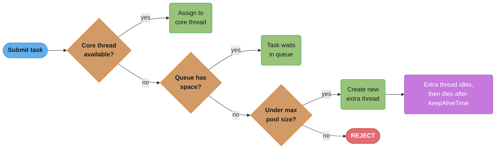
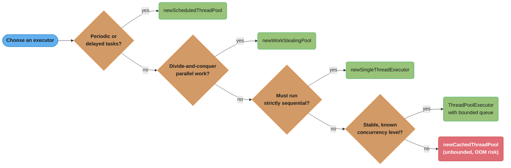
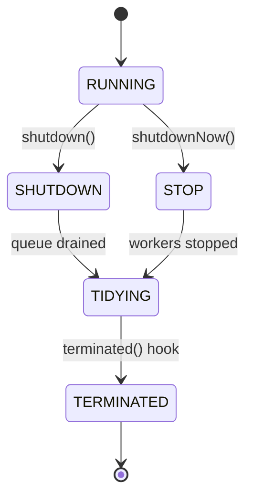

# Thread Pool Pattern
## Intuition

> **One-line analogy**: Thread Pool is like a restaurant kitchen — instead of hiring and firing a cook for every single order, you keep a fixed crew who handle all orders in sequence; new orders queue up when everyone is busy.

**Mental model**: Creating a Java thread costs ~1ms and ~512KB of stack memory. For a service handling 1,000 requests/second, spawning a thread per request means 1,000 thread creations per second and unbounded memory growth under load. A thread pool amortizes creation cost across many tasks, bounds total memory, and provides a queue that applies backpressure when all workers are busy.

**Why it matters**: Thread pools are the standard execution model for every Java server. Understanding `corePoolSize`, `maximumPoolSize`, `keepAliveTime`, queue type, and rejection policies is essential for tuning throughput vs latency vs memory under production load.

**Key insight**: The right pool size depends on whether tasks are CPU-bound (size = CPU cores) or I/O-bound (size = CPU cores × (1 + wait_time/compute_time)). Guessing wrong degrades either throughput or memory — profile before tuning.

**Full runnable implementation:** [`ThreadPool.java`](ThreadPool.java) — 399 lines, one file, `main()` at the bottom. It demonstrates `SimpleThreadPool` built from a `BlockingQueue` plus worker threads, the same work handed to `ExecutorService`, a `CompletableFuture` async pipeline, a `SimpleWebServer` handler pool, and `ParallelSum`/`ParallelMergeSort` as `RecursiveTask`s on the common `ForkJoinPool`.

---

## Intent

Reuse a fixed set of worker threads to execute many tasks, avoiding the overhead of creating and destroying threads for each task. Decouples task submission from task execution.

## Why Thread Pools?

| Creating new Thread per task | Thread Pool |
|-----------------------------|-------------|
| ~1ms to create + destroy | Thread already exists |
| Unbounded threads → OOM | Bounded thread count |
| No backpressure | Queue provides backpressure |
| No monitoring | Active/completed/queue metrics |
| Hard to shut down cleanly | `shutdown()` + `awaitTermination()` |

---

## ThreadPoolExecutor Parameters

```java
new ThreadPoolExecutor(
    2,              // corePoolSize: threads kept alive even when idle
    8,              // maximumPoolSize: max threads created under load
    30,             // keepAliveTime: how long extra threads survive when idle
    TimeUnit.SECONDS,
    new ArrayBlockingQueue<>(100),  // workQueue: holds tasks when all threads busy
    threadFactory,   // creates new thread objects
    rejectionHandler // what to do when queue is full AND max threads reached
)
```

### Thread lifecycle:



Each submitted task walks this cascade in order — core thread, then queue, then a fresh thread up to `maximumPoolSize`, then rejection — which is exactly the four knobs (`corePoolSize`, `workQueue`, `maximumPoolSize`, `rejectionHandler`) from the constructor above.

---

## Thread Pool Sizing

### CPU-bound tasks:
```
threads = N_CPUs + 1
```
The "+1" ensures a thread is available if another is briefly paused.

### I/O-bound tasks:
```
threads = N_CPUs × (1 + wait_time / compute_time)
```

Example: if a task spends 90% waiting on DB and 10% computing:
```
threads = 8 × (1 + 9) = 80 threads
```

**What this actually says.** "Keep every CPU core busy by hiring enough threads that, at any
instant, the ones parked on I/O are covered by others that still have compute to do." The
`wait_time / compute_time` ratio is the blow-up factor: a thread that is idle nine tenths of the
time only delivers one tenth of a core, so you need ten of them to keep one core saturated.

| Symbol | What it is |
|--------|-----------|
| `threads` | Pool size to configure (`corePoolSize` / `maximumPoolSize`) |
| `N_CPUs` | Available hardware cores — `Runtime.getRuntime().availableProcessors()` |
| `wait_time` | Per-task time blocked on I/O (DB, HTTP, disk) doing no CPU work |
| `compute_time` | Per-task time actually burning CPU |
| `wait_time / compute_time` | Blocking coefficient — how many idle threads one core can absorb |

**Walk one example.** The 8-core, 90%-waiting service from above, with a 100ms task:

```
given   N_CPUs        = 8 cores
        wait_time     = 90 ms  (blocked on DB)
        compute_time  = 10 ms  (actual CPU)

ratio   wait / compute = 90 / 10           = 9
size    threads        = 8 x (1 + 9)       = 80 threads

check the pool is right, not just the formula:
        each thread finishes 1 task per 100 ms = 0.1 s
        throughput  = 80 / 0.1 s                     = 800 tasks/s
        CPU demanded = 800 tasks/s x 0.010 s CPU     = 8.0 cores  -> all 8 saturated

contrast, sizing the pool at N_CPUs = 8 because "8 cores, 8 threads":
        throughput  = 8 / 0.1 s                      =  80 tasks/s
        CPU demanded = 80 tasks/s x 0.010 s CPU      = 0.8 cores  -> 10% utilization
```

Result: the naive "one thread per core" pool leaves 7.2 of 8 cores idle and gives away 10x the
throughput. The blocking coefficient is the entire difference.

Why the CPU-bound formula has no such term: when `wait_time` is 0 the ratio collapses to 0 and
`threads = N_CPUs`, and extra threads beyond that only add context-switch overhead — hence the
bare `+1` rather than a multiplier.

### Little's Law for queue sizing:
```
L = λ × W
```
- L = average items in queue
- λ = average arrival rate (tasks/sec)
- W = average time a task spends in queue

For queue to handle peak: `queueSize ≥ peak_arrival_rate × acceptable_wait_time`

**Read it like this.** "However fast work arrives, multiplied by how long you are willing to let
it sit, is exactly how many slots you need — and no more." Little's Law turns queue capacity from
a guess into a latency budget: you pick the wait you can tolerate, and the arrival rate tells you
the number.

| Symbol | What it is |
|--------|-----------|
| `L` | Average number of tasks resident in the queue — the `workQueue` capacity to configure |
| `λ` (lambda) | Arrival rate of submitted tasks, in tasks per second |
| `W` | Average time a task waits in the queue before a worker picks it up |
| `peak_arrival_rate` | The burst value of λ, not the daily average — size for the spike |
| `acceptable_wait_time` | The queueing slice of your latency SLA |

**Walk one example.** Reuse the 80-thread pool above, which drains 800 tasks/s, and assume a
250ms queueing budget:

```
given   lambda = 800 tasks/s   (peak arrival, matches drain rate above)
        W      = 0.25 s        (queue-wait slice of the SLA)

        L = lambda x W
          = 800 x 0.25         = 200 slots

so      new LinkedBlockingQueue<>(200)

sanity-check the two failure modes:
        queue = 2000 slots -> full-queue wait = 2000 / 800 = 2.50 s   (SLA blown 10x)
        queue =   20 slots -> full-queue wait =   20 / 800 = 0.025 s  (rejects on tiny bursts)
```

Result: 200 is the only size that spends the whole 250ms budget without exceeding it. Note the
danger of an unbounded queue — `Integer.MAX_VALUE` slots means `W` grows without limit, so tasks
queue until memory dies rather than being rejected. Bounding the queue is what converts an OOM
into a `RejectedExecutionException` you can actually handle.

---

## Rejection Policies

| Policy | Behavior | When to Use |
|--------|----------|-------------|
| `AbortPolicy` (default) | Throws `RejectedExecutionException` | Caller must handle |
| `CallerRunsPolicy` | Caller thread runs the task | Natural backpressure |
| `DiscardPolicy` | Silently drops the task | OK to lose tasks |
| `DiscardOldestPolicy` | Drops oldest queued task | Latest tasks matter most |
| Custom | Your logic (circuit breaker, metrics, DLQ) | Production systems |

`CallerRunsPolicy` is powerful — it slows down the task producer naturally, creating implicit backpressure without dropping tasks.

---

## Executor Types

| Factory Method | Threads | Queue | Use Case |
|----------------|---------|-------|----------|
| `newFixedThreadPool(n)` | n fixed | Unbounded | Known stable workload |
| `newCachedThreadPool()` | 0 to ∞ | SynchronousQueue | Short-lived, many tasks |
| `newSingleThreadExecutor()` | 1 | Unbounded | Sequential processing |
| `newScheduledThreadPool(n)` | n | DelayQueue | Periodic/delayed tasks |
| `newWorkStealingPool()` | N_CPUs | ForkJoin | Parallel divide-and-conquer |

**Warning**: `newCachedThreadPool()` and `newFixedThreadPool(n)` with default queue can OOM — the queue is **unbounded**. In production, always use `ThreadPoolExecutor` directly with bounded queue.



Match the task shape to the factory method instead of defaulting to `newFixedThreadPool()` or `newCachedThreadPool()` — both are convenient but hide the unbounded queue that the warning above calls out.

---

## Common Pitfalls

### 1. Thread Pool Induced Deadlock
```java
// Pool has 2 threads. Task A submits Task B and waits for it.
// If both pool threads are running Task A, Task B never starts → deadlock.
Future<?> b = pool.submit(taskB);
b.get(); // blocks thread A — if all threads blocked, Task B can't run
```
Solution: Use a separate pool for dependent tasks, or ForkJoinPool with `join()`.

### 2. ThreadLocal in Thread Pools
```java
// ThreadLocal values persist between tasks on the same thread!
// Task 1 sets user = "Alice"
threadLocal.set("Alice");
// After task 1 completes, the thread goes back to pool
// Task 2 picks up the same thread:
threadLocal.get(); // still "Alice"! Data leak!
```
Solution: Always call `threadLocal.remove()` in a `finally` block.

### 3. Exception Swallowing
```java
// Runnable exceptions are swallowed silently
executor.submit(() -> {
    throw new RuntimeException("I'm lost!"); // nobody sees this
});

// Use Callable or wrap with exception logging
executor.submit(() -> {
    try {
        riskyOperation();
    } catch (Exception e) {
        log.error("Task failed", e); // at least log it
        throw e;
    }
});
```

### 4. Shutdown Not Called
If `shutdown()` is never called, the JVM won't exit (daemon threads would, but pool threads are not daemon by default).



`shutdown()` moves the pool to `SHUTDOWN` and lets already-queued tasks finish before it reaches `TERMINATED`; `shutdownNow()` jumps straight to `STOP`, interrupting running tasks and returning whatever was still queued. Neither transition happens on its own — this is exactly why forgetting to call `shutdown()` leaves a pool (and the JVM) stuck in `RUNNING` forever.

---

## Monitoring ThreadPoolExecutor

```java
ThreadPoolExecutor pool = (ThreadPoolExecutor) executor;
pool.getPoolSize();          // current number of threads
pool.getActiveCount();       // threads currently executing tasks
pool.getQueue().size();      // tasks waiting in queue
pool.getCompletedTaskCount();// total tasks completed
pool.getCorePoolSize();      // core thread count
pool.getMaximumPoolSize();   // max thread count
pool.getLargestPoolSize();   // peak thread count ever
```

Expose these as metrics (Micrometer → Prometheus → Grafana) for production monitoring.

---

## Virtual Threads (Java 21 — Project Loom)

Virtual threads are lightweight threads managed by the JVM, not the OS.

```java
// Before Java 21: pool of platform threads
ExecutorService pool = Executors.newFixedThreadPool(200);

// Java 21: one virtual thread per task — scales to millions
ExecutorService pool = Executors.newVirtualThreadPerTaskExecutor();
```

**Virtual threads change the calculus**:
- I/O-bound tasks: no need to size thread pools — virtual threads are cheap
- CPU-bound tasks: still need bounded pools (one per CPU core)
- `ThreadLocal` starvation disappears, but a `ThreadLocal` set on a per-task virtual thread is also gone at task end — use `ScopedValue` (final in Java 25) when a value must be visible down the call chain
- Pinning: a blocking **native** frame — JNI, an FFM upcall, class loading, a class initializer — still pins a virtual thread to its carrier. `synchronized` does not, since JEP 491 in Java 24

---

## Cross-Perspective: HLD Connections

**HLD View — Where Thread Pool Appears in Distributed Systems**

- **HTTP server thread pools** — Tomcat, Jetty, and gRPC servers each maintain a thread pool for handling concurrent requests. Pool size determines throughput ceiling; queue size determines how many requests wait before being rejected. These are production-critical tuning parameters.
- **Worker fleet as distributed thread pool** — A fleet of worker service instances processing jobs from a message queue is a Thread Pool at infrastructure scale: the instances are the "threads," the queue is the work queue, and auto-scaling is the equivalent of `maximumPoolSize`.
- **Database connection pools** — HikariCP connection pools are Thread Pools for database connections: a fixed set of connections (workers) handles database requests (tasks); callers block when the pool is full — exactly the `corePoolSize` / `workQueue` dynamic.
- **Kubernetes pod scaling** — Horizontal Pod Autoscaler scales the number of pods (threads) based on CPU utilization or queue depth. The pod resource request is the `corePoolSize`; the HPA max replicas is the `maximumPoolSize`; pod startup time is the thread creation overhead.

---

## Interview Questions

**Q: What is the difference between `Runnable` and `Callable`?**
**Short:** Callable.call() returns a value through a Future and may throw checked exceptions; Runnable.run() returns void and can throw neither.
`Runnable.run()` returns void and cannot throw checked exceptions. `Callable.call()` returns a value (`Future<V>`) and can throw checked exceptions.

**Q: What happens when a thread pool's queue is full?**
**Short:** The rejection handler fires: the default AbortPolicy throws RejectedExecutionException, while CallerRunsPolicy runs the task on the submitting thread.
The rejection handler is invoked. Default `AbortPolicy` throws `RejectedExecutionException`. `CallerRunsPolicy` runs the task on the submitting thread (backpressure).

**Q: How do you size a thread pool for a REST service that makes DB calls?**
**Short:** Size an I/O-bound pool as CPUs x (1 + wait/compute), starting near twice the CPU count and tuning against measured throughput.
I/O-bound formula: `threads = N_CPUs × (1 + DB_wait/compute_time)`. Profile to measure actual wait ratio. Start with `2 × N_CPUs` and tune based on throughput metrics.

**Q: What's the difference between `shutdown()` and `shutdownNow()`?**
**Short:** shutdown() refuses new tasks but drains the queue to completion; shutdownNow() interrupts running tasks and returns the tasks that never started.
`shutdown()`: no new tasks accepted, existing tasks and queue are processed to completion. `shutdownNow()`: attempts to interrupt running tasks, returns queued tasks that were not started.

**Q: Why might `Executors.newFixedThreadPool()` cause OOM in production?**
**Short:** It uses an unbounded LinkedBlockingQueue, so a sustained submission surplus grows the queue until the heap is exhausted.
It uses an unbounded `LinkedBlockingQueue`. If tasks are submitted faster than processed, the queue grows without bound until OOM. Always use `ThreadPoolExecutor` with a bounded queue in production.

---

**Q: Walk through the exact order ThreadPoolExecutor follows when a task is submitted.**
**Short:** It tries a core thread first, then the queue, then a new thread up to maximumPoolSize, then rejects.

A: First, if a core thread is available (fewer than `corePoolSize` are running), the task is assigned straight to a core thread. If not, the task goes into the work queue if there is space. If the queue is full and the pool is still below `maximumPoolSize`, a new non-core thread is created to run the task. Only if the queue is full and the pool is already at `maximumPoolSize` does the task hit the rejection handler — this cascade is exactly why an unbounded queue means the pool never reaches step three.

---

**Q: Why does an unbounded work queue mean the pool never grows past corePoolSize?**
**Short:** New threads beyond corePoolSize are only created once the queue is full, and an unbounded queue never fills.

A: `ThreadPoolExecutor` only creates a thread beyond `corePoolSize` when the work queue is full and a task still needs somewhere to go. An unbounded queue (like the default `LinkedBlockingQueue` behind `newFixedThreadPool()`) has no capacity limit, so it is never "full" in the sense the executor checks — tasks just keep queuing instead of triggering new threads. The practical result: setting `maximumPoolSize=200` with an unbounded queue is pure decoration, since the pool stays pinned at `corePoolSize` no matter how much load arrives.

---

**Q: What's the CPU-bound thread pool sizing formula, and why the "+1"?**
**Short:** Size CPU-bound pools at N_CPUs + 1, with the extra thread covering a briefly paused core.

A: For CPU-bound tasks, `threads = N_CPUs + 1`. The "+1" ensures a thread is available to keep a core busy if another thread is briefly paused — for a page fault or a minor GC pause, for instance — rather than leaving that core idle. Beyond `N_CPUs + 1`, extra threads add context-switch overhead without adding throughput, since there's no more CPU capacity left to hand them. This is why the CPU-bound formula has no `wait_time`/`compute_time` term the way the I/O-bound formula does — when wait time is zero, more threads only compete for the same fixed compute capacity.

---

**Q: Using Little's Law, how do you size a bounded work queue for a given latency budget?**
**Short:** Queue size equals arrival rate times acceptable wait time, so 800 tasks/sec with a 250ms budget needs 200 slots.

A: Little's Law gives `L = lambda x W` — average items resident in the queue equals arrival rate times average wait time. For a pool draining 800 tasks/sec with a 250ms queueing-budget slice of the SLA, `L = 800 x 0.25 = 200` slots. Sizing larger (say 2,000 slots) blows the SLA tenfold when the queue is full; sizing smaller (20 slots) rejects on tiny, otherwise-harmless bursts — 200 is the size that spends the whole budget without exceeding it.

---

**Q: What causes the classic thread-pool-induced deadlock, and how do you avoid it?**
**Short:** A task that submits and blocks on a dependent task in the same fixed-size pool starves the pool of a thread.

A: If a pool has only 2 threads and Task A, running on one of them, submits Task B to the same pool and then calls `b.get()` to block waiting for it, Task B can never start once both pool threads are occupied by copies of Task A — the pool has no thread left to run it, so Task A waits forever. The fix is to run dependent tasks on a separate pool from the one they were submitted from, or use `ForkJoinPool` with `join()`, which is specifically designed to let a blocked thread help execute other queued work instead of just parking.

---

**Q: Why is ThreadLocal dangerous in a pooled thread, and how do you fix it?**
**Short:** Values persist on the thread across tasks since the thread returns to the pool instead of dying; call remove() in a finally block.

A: A `ThreadLocal` value set during one task's execution is not automatically cleared when the task finishes — the underlying platform thread goes back into the pool and picks up the next task with the old value still attached. If Task 1 sets `threadLocal.set("Alice")` and Task 2 later runs on that same recycled thread, `threadLocal.get()` still returns `"Alice"`, silently leaking data between unrelated tasks. The fix is to always call `threadLocal.remove()` in a `finally` block at the end of every task, guaranteeing cleanup regardless of how the task completes.

---

**Q: Why does executor.submit() with a Runnable silently swallow an uncaught exception?**
**Short:** The exception is captured inside the returned Future instead of surfaced, so nobody sees it unless the Future is checked.

A: When a `Runnable` submitted via `executor.submit()` throws, the exception is captured and stored inside the returned `Future` rather than propagated anywhere visible — if nobody calls `future.get()` (which would re-throw it as an `ExecutionException`), the failure is completely silent. The fix is to catch and log the exception inside the task itself before it can escape unnoticed, or to consistently check every submitted `Future`. This is a routine production trap: a task quietly failing every time with no log line and no alert, until someone notices the expected side effect never happened.

---

**Q: What is CallerRunsPolicy and why is it called "natural backpressure"?**
**Short:** The submitting thread itself executes the rejected task, which slows the producer to consumer speed without dropping work.

A: `CallerRunsPolicy` runs a rejected task directly on the thread that tried to submit it, instead of throwing or discarding it. Because the caller is now busy executing that task itself, it cannot submit further tasks until it finishes, which naturally throttles the rate of incoming work to match the pool's actual processing speed. This makes it "natural backpressure": no task is lost, and no separate throttling mechanism is needed — the producer is slowed down by the exact mechanism that would otherwise have rejected its work.

---

**Q: How does newWorkStealingPool differ from the other Executors factory methods?**
**Short:** It's backed by ForkJoinPool with work-stealing across N_CPUs threads, for parallel divide-and-conquer tasks.

A: `newWorkStealingPool()` is backed by `ForkJoinPool` rather than a standard `ThreadPoolExecutor`, and it defaults to `N_CPUs` threads that use work-stealing — an idle thread pulls queued sub-tasks from a busy thread's own deque rather than sitting idle. This suits divide-and-conquer workloads with uneven, recursively forked sub-tasks, unlike `newFixedThreadPool()` or `newCachedThreadPool()`, which are built for independent, uniformly-sized tasks submitted from outside the pool. Choosing it for ordinary request-handling work would be a mismatch, since there's no recursive forking to steal work from.

---

**Q: How does Kubernetes' Horizontal Pod Autoscaler mirror ThreadPoolExecutor's sizing knobs?**
**Short:** The pod resource request maps to corePoolSize, max replicas maps to maximumPoolSize, and pod startup time maps to thread creation overhead.

A: A fleet of worker pods processing jobs from a queue is a thread pool at infrastructure scale: the pod's baseline replica count is the equivalent of `corePoolSize`, the HPA's configured max replicas is `maximumPoolSize`, and pod startup latency plays the same role as the ~1ms cost of spinning up a new thread. CPU utilization or queue depth driving the HPA's scale-out decision is the same signal that drives a `ThreadPoolExecutor` past `corePoolSize` toward `maximumPoolSize` once its work queue fills. The tuning tradeoffs are identical in shape: too few replicas/threads underuses capacity, too many wastes resources on idle workers.
