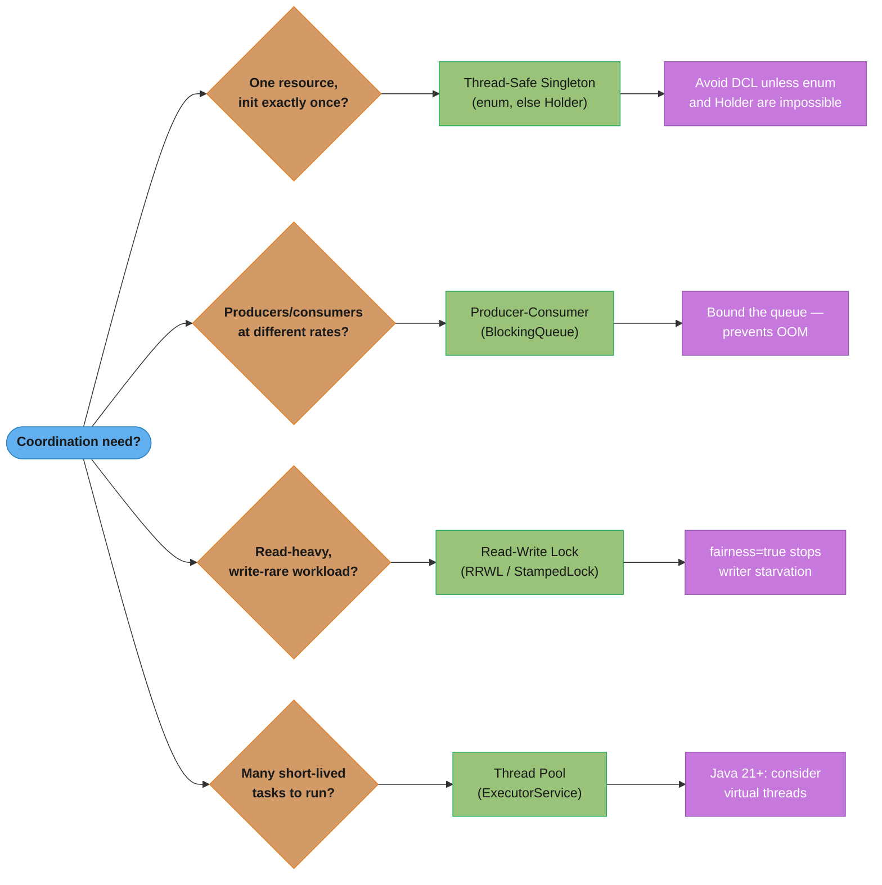
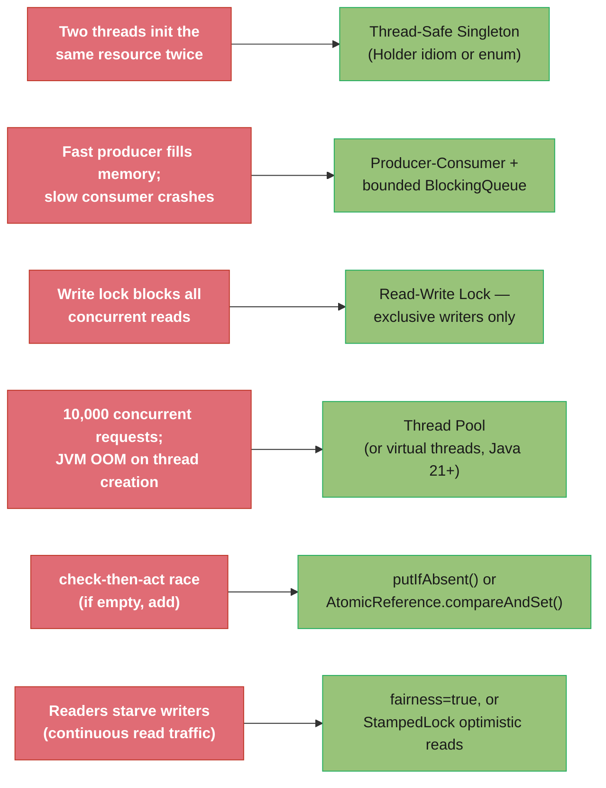
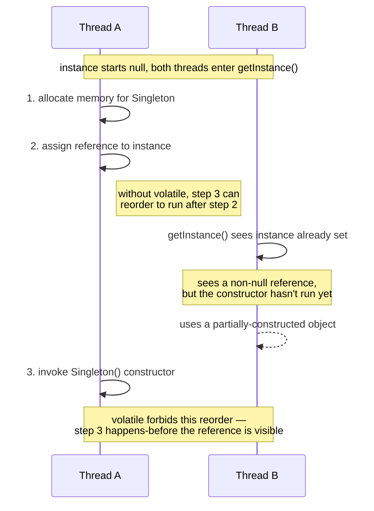
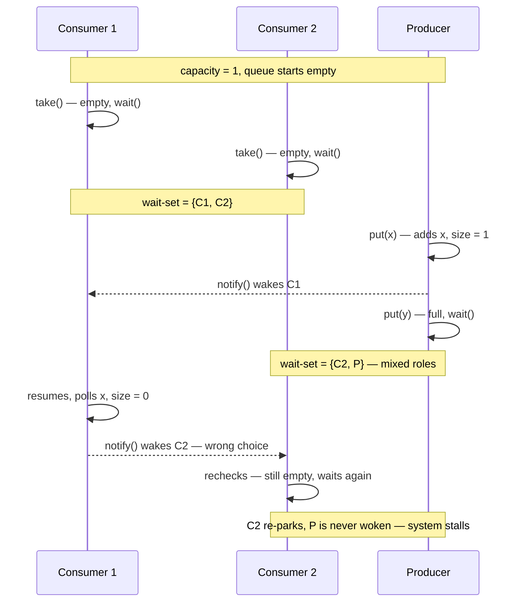

# Concurrency Patterns

Low-level design patterns that address coordination between threads sharing a JVM process. Each pattern targets a specific coordination failure mode.

---

## 1. Concept Overview

| Pattern | File | Problem Solved | Primary Mechanism |
|---------|------|---------------|-------------------|
| Thread-Safe Singleton | [ThreadSafeSingleton.md](ThreadSafeSingleton.md) | One shared instance across all threads | DCL + volatile, enum, Holder idiom |
| Producer-Consumer | [ProducerConsumer.md](ProducerConsumer.md) | Decouple production from consumption via bounded buffer | `BlockingQueue`, `wait()`/`notifyAll()` |
| Read-Write Lock | [ReadWriteLock.md](ReadWriteLock.md) | Allow concurrent reads, exclusive writes | `ReentrantReadWriteLock`, `StampedLock` |
| Thread Pool | [ThreadPool.md](ThreadPool.md) | Reuse worker threads across many tasks | `ExecutorService`, `ThreadPoolExecutor` |

---

## 2. Intuition

Concurrency patterns solve the coordination problem: multiple threads competing for shared resources without stepping on each other. Each pattern addresses a specific coordination failure mode: Singleton prevents duplicate shared resource initialization, Producer-Consumer prevents speed mismatch from causing unbounded queues or starvation, Read-Write Lock prevents readers from blocking each other unnecessarily, and Thread Pool prevents thread-per-request from exhausting OS resources.

---

## 3. When to Use Which Pattern

Decision tree from coordination characteristic to pattern; each leaf also carries the key caveat called out in the surrounding text.



---

## 4. Relationship to Java Concurrency Infrastructure

| Pattern | Java Classes | Key Guarantees |
|---------|-------------|----------------|
| Thread-Safe Singleton | `volatile`, class-loading guarantees | Visibility; no partial construction visible to other threads |
| Producer-Consumer | `BlockingQueue`, `ArrayBlockingQueue`, `LinkedBlockingQueue` | Bounded capacity; blocking on full/empty; thread-safe by contract |
| Read-Write Lock | `ReentrantReadWriteLock`, `StampedLock`, `ReadWriteLock` | Multiple concurrent readers; exclusive writers; optional fairness |
| Thread Pool | `Executors`, `ThreadPoolExecutor`, `ForkJoinPool`, `ExecutorCompletionService` | Thread reuse; task queue management; configurable rejection policies |

---

## 5. Common Concurrency Anti-Patterns

These are the most frequent mistakes found in production code reviews. Each is a specific failure mode of the patterns above.

**Locking too broadly** — `synchronized` on an entire method when only a three-line critical section needs protection. Throughput drops because threads queue behind the lock even for work that doesn't touch shared state.

**Locking too narrowly** — two separate `synchronized` blocks that together form one logical atomic operation. Another thread can interleave between the two blocks and observe an inconsistent intermediate state.

**DCL without volatile** — double-checked locking where the `instance` field is not `volatile`. Partial construction is visible: a second thread can observe a non-null reference to an incompletely-constructed object. See `ThreadSafeSingleton.md` for the broken and fixed versions.

**`notify()` instead of `notifyAll()`** — with multiple consumers, `notify()` may wake a producer instead of a consumer, deadlocking the system. Use `notifyAll()` and re-check the condition in a `while` loop, not an `if`. `BlockingQueue` handles this internally.

**Creating threads directly instead of using a pool** — one thread per incoming HTTP request or DB query. Under load, OS thread count explodes. Default OS limit: ~32k threads. At ~1MB stack each, 1,000 threads = 1 GB RAM before doing any work.

**Sharing mutable state without synchronization** — `ArrayList`, `HashMap`, `SimpleDateFormat` used as static fields read and written by multiple threads. `HashMap` concurrent modification can cause an infinite loop in JDK 7 (a real production incident pattern). Use `ConcurrentHashMap`.

---

## 6. Virtual Threads (Project Loom) Impact

Java 21 virtual threads (`Thread.ofVirtual().start(...)`) are cheap enough (~few KB stack vs ~1 MB for platform threads) that thread-per-task is viable again for I/O-bound workloads.

**What changes:**
- Thread Pool sizing: `Executors.newVirtualThreadPerTaskExecutor()` replaces fixed-size pools for I/O tasks. Thousands of virtual threads are sustainable.
- `ThreadPoolExecutor` tuning: corePoolSize / maxPoolSize / keepAliveTime matter less for I/O tasks.

**What does NOT change:**
- Thread-Safe Singleton: virtual threads have the same memory visibility concerns. DCL still needs `volatile`; enum is still the best choice.
- Read-Write Lock semantics: virtual threads can still race on shared mutable state. `ReentrantReadWriteLock` is still necessary.
- Producer-Consumer backpressure: if consumers are CPU-bound, having 10,000 virtual threads producing work they cannot process still causes memory pressure. Bounded `BlockingQueue` backpressure remains essential.

**Caution:** a virtual thread still pins its carrier when it blocks inside a **native frame** — a JNI call, a Foreign Function & Memory upcall, class resolution, or a class initializer. Those are the surviving pinning cases; `synchronized` is not one of them, so choose between `synchronized` and `java.util.concurrent.locks` on the merits of the problem (JEP 491, JDK 24). Diagnose the remainder with the `jdk.VirtualThreadPinned` JFR event, which now reports both the reason and the carrier thread.

### Scoping data and tasks instead of pooling them

Cheap threads change what the surrounding structure should be, and two APIs carry that:

- **`ScopedValue`** (final in Java 25, JEP 506) replaces `ThreadLocal` for sharing immutable data down a call chain. `ScopedValue.where(CONTEXT, ctx).run(task)` binds a value for exactly the dynamic extent of `run`, so it is unbound on return — there is nothing left to leak into the next task that reuses the thread, which is precisely the `ThreadLocal` hazard the pooling patterns below have to guard against manually.
- **`StructuredTaskScope`** (still a preview API — fifth preview in Java 25 via JEP 505, and re-previewed since) makes fan-out/fan-in a single unit of work: fork subtasks inside a `try`-with-resources scope, `join()` once, and the scope guarantees every subtask has finished or been cancelled before the block exits. It is the structural answer to the orphaned-subtask and lost-cancellation failure modes that raw `ExecutorService.submit()` leaves to the caller.

```java
static final ScopedValue<RequestContext> CONTEXT = ScopedValue.newInstance();

ScopedValue.where(CONTEXT, ctx).run(() -> {
    // every callee on this thread reads CONTEXT.get(); nothing outlives the run()
    handle();
});
```

Because `StructuredTaskScope` is preview, it needs `--enable-preview` and its API is still moving between releases; `ScopedValue` does not and is safe to adopt in production on Java 25. Do not describe them as having the same maturity. Deep coverage of both lives in [`java/structured_concurrency_and_loom/`](../../java/structured_concurrency_and_loom/structured_concurrency_and_loom.md); this section is the design-pattern view.

---

## 7. Pattern Selection by Failure Mode

Same four patterns, indexed by the symptom you'd actually see in production rather than by upfront design characteristics — the reactive/debugging counterpart to the tree above.



---

## 8. Code Examples — Broken Then Fixed

### DCL Without volatile — Broken and Fixed

```java
// BROKEN: instance is not volatile; partial construction visible to other threads
public class Singleton {
    private static Singleton instance; // missing volatile

    public static Singleton getInstance() {
        if (instance == null) {             // Thread A passes this check
            synchronized (Singleton.class) {
                if (instance == null) {
                    instance = new Singleton(); // Thread B may see non-null but unconstructed
                }
            }
        }
        return instance; // Thread B may return a partially-constructed object
    }
}

// FIXED: volatile prevents reordering; JMM guarantees construction before publication
public class Singleton {
    private static volatile Singleton instance;

    public static Singleton getInstance() {
        if (instance == null) {
            synchronized (Singleton.class) {
                if (instance == null) {
                    instance = new Singleton();
                }
            }
        }
        return instance;
    }
}

// PREFERRED: Holder idiom — lazy, thread-safe, no volatile needed
public class Singleton {
    private static class Holder {
        static final Singleton INSTANCE = new Singleton();
    }
    public static Singleton getInstance() { return Holder.INSTANCE; }
}
```

The interleaving below is what the "BROKEN" version above actually allows: Thread B can observe a non-null `instance` before Thread A's constructor has finished running.



### notify() Lost Wakeup — Broken and Fixed

```java
// BROKEN: notify() with multiple consumers may wake the wrong thread
class BoundedBuffer<T> {
    private final Queue<T> queue = new LinkedList<>();
    private final int capacity;

    public synchronized void put(T item) throws InterruptedException {
        while (queue.size() == capacity) wait();
        queue.add(item);
        notify(); // may wake another producer, not a consumer
    }

    public synchronized T take() throws InterruptedException {
        while (queue.isEmpty()) wait();
        T item = queue.poll();
        notify(); // may wake another consumer, not a producer
        return item;
    }
}

// FIXED: notifyAll() wakes all waiting threads; while-loop re-checks condition
class BoundedBuffer<T> {
    private final Queue<T> queue = new LinkedList<>();
    private final int capacity;

    public synchronized void put(T item) throws InterruptedException {
        while (queue.size() == capacity) wait(); // re-check after wakeup
        queue.add(item);
        notifyAll(); // wake ALL waiting threads; each checks its own condition
    }

    public synchronized T take() throws InterruptedException {
        while (queue.isEmpty()) wait();
        T item = queue.poll();
        notifyAll();
        return item;
    }
}

// BEST: Use BlockingQueue — handles all of this internally
BlockingQueue<String> queue = new ArrayBlockingQueue<>(1000);
// producer:
queue.put(item);  // blocks when full; no notify() needed
// consumer:
String item = queue.take(); // blocks when empty; no notify() needed
```

The interleaving below is the classic lost wakeup the "BROKEN" version's comments warn about: with two consumers and one producer sharing a single wait-set, `notify()` can pick the wrong role, and the thread that could actually make progress is left asleep — exactly what `notifyAll()` (in the "FIXED" version above) eliminates.



### ThreadPoolExecutor with CallerRunsPolicy — Backpressure

```java
// Producer that naturally slows down when the pool is saturated
ExecutorService pool = new ThreadPoolExecutor(
    4,                             // corePoolSize
    8,                             // maxPoolSize
    60L, TimeUnit.SECONDS,         // keepAliveTime for non-core threads
    new ArrayBlockingQueue<>(100), // bounded queue; fills before spawning max threads
    new ThreadPoolExecutor.CallerRunsPolicy() // caller thread executes task when queue full
);

// When queue=100 full AND threads=8, the submitting thread runs the task itself.
// This slows the producer to consumer speed — natural backpressure.
```

---

## 9. Common Pitfalls — Production War Stories

**The ConcurrentModificationException in a multi-threaded cache** — A team used `HashMap` as a shared cache across request threads with no synchronization. Under load, `HashMap.get()` entered an infinite loop because another thread's `put()` caused a resize mid-traversal (JDK 7 behavior). Fix: `ConcurrentHashMap`. Lesson: `HashMap` is never safe for concurrent use, even for read-only access during writes.

**The ThreadPoolExecutor that never scaled** — Configuration: `corePoolSize=5`, `maxPoolSize=200`, `LinkedBlockingQueue` (unbounded). Load increased to 500 concurrent requests. The pool stayed at 5 threads. Reason: with an unbounded queue, the pool never grows past corePoolSize — the queue never fills. Fix: use a bounded queue (`new ArrayBlockingQueue<>(50)`) so the pool grows when the queue fills under load.

**Write starvation killed the configuration service** — A configuration service used `ReentrantReadWriteLock` (unfair). 200 web threads read config every 100ms. Configuration updates (writes) were attempted every 30 seconds. Writers waited for minutes because new readers arrived faster than the queue drained. Fix: `new ReentrantReadWriteLock(true)` (fair). Alternatively: read-through cache so config updates are infrequent; readers hit the cache, not the lock.

**Virtual thread pinning through a native driver** — After switching a service to `newVirtualThreadPerTaskExecutor()`, a team saw no throughput improvement. A `jdk.VirtualThreadPinned` JFR recording showed virtual threads pinned for the whole of each database call, with the reason reported as a native frame: the driver dropped into JNI and blocked there, so the carrier could not be released. Note what the event did *not* say — the `synchronized` blocks inside the ORM, the usual suspect before Java 24, no longer pin anything. Fix: move the JNI-bound calls to a bounded platform-thread pool sized to the database's own connection limit and keep the virtual threads for the rest of the request, or move to a pure-Java driver. The general lesson: when virtual threads buy nothing, read the pinning event's reason before rewriting any locks — a native-frame diagnosis and a monitor diagnosis have different fixes, and only one of them still exists.

---

## 10. Technologies and Tools

| Tool / Library | Concurrency Pattern |
|----------------|-------------------|
| `java.util.concurrent.BlockingQueue` | Producer-Consumer |
| `java.util.concurrent.ThreadPoolExecutor` | Thread Pool |
| `java.util.concurrent.locks.ReentrantReadWriteLock` | Read-Write Lock |
| `java.util.concurrent.locks.StampedLock` | Optimistic Read-Write Lock |
| `java.util.concurrent.Executors` | Thread Pool factory |
| `java.lang.Thread.ofVirtual()` (Java 21) | Virtual thread per task |
| `jcstress` (OpenJDK) | Stress-testing concurrency correctness |
| SpotBugs + `@GuardedBy` | Static analysis for synchronization violations |
| `java.util.concurrent.atomic.*` | Lock-free atomic operations for Singleton init |

---

## 11. Cross-References

| Pattern | See Also |
|---------|---------|
| Thread-Safe Singleton | `../creational/singleton/` — GoF Singleton; this section covers the thread-safety mechanisms |
| Thread Pool | `../../java/concurrency/` — ExecutorService internals, ThreadPoolExecutor parameters |
| Read-Write Lock | `../../java/java_memory_model/` — happens-before, volatile semantics |
| Producer-Consumer | `../../backend/messaging_patterns/` — distributed Producer-Consumer via Kafka |
| All patterns | `../../java/structured_concurrency_and_loom/` — virtual threads impact on all patterns |

---

## 12. Interview Q&As

Q&As ordered by interview frequency: gotchas and traps first, internals second, edge cases last.

---

**Q: Why must the field in DCL Singleton be volatile — what breaks without it?**
**Short:** Without volatile, instruction reordering can let another thread see a partially-constructed Singleton instance.

Without `volatile`, the JVM may reorder the instructions: `instance = new Singleton()` can be seen by another thread as (1) allocate memory, (2) assign reference to `instance`, (3) invoke constructor — steps 2 and 3 can be reordered. A second thread checks `instance != null` after step 2 but before step 3, sees a non-null reference, and uses a partially-constructed object. `volatile` inserts a memory barrier that prevents this reordering. This is the pre-Java 5 DCL bug; `volatile` fixes it in Java 5+ via the JMM.

---

**Q: Enum Singleton vs Holder idiom vs DCL + volatile — which is "correct" and when do you use each?**
**Short:** Enum Singleton is the definitive choice; Holder idiom is next-best when enum isn't possible; DCL is the verbose fallback.

Enum (Effective Java Item 3) is the definitive answer: thread-safe by JVM guarantee, handles serialization and reflection attacks automatically, and is the simplest. Holder idiom (`private static class Holder`) is the preferred choice when enum is not possible (e.g., the class has to extend another class, or the singleton must implement a more complex initialization). DCL + volatile is correct but verbose — it exists for cases where the singleton must be lazily initialized AND the class cannot use enum or Holder for some reason. In practice: enum if possible; Holder if you need a class-based singleton.

---

**Q: Producer-Consumer with `wait()`/`notify()`: what is the spurious wakeup bug?**
**Short:** notify() wakes exactly one thread, but the woken thread must re-check the condition rather than assume it holds.

`notify()` wakes exactly one thread, but a thread woken by `notify()` should re-check the condition — not assume the condition is true — because the condition may have changed between the `notify()` call and the awakened thread actually running. More critically, `notify()` with multiple consumers can wake the wrong thread (a producer waking a producer instead of a consumer, deadlocking the system). Fix: always use `notifyAll()` and re-check the condition in a `while` loop, not an `if` statement. `BlockingQueue` handles all of this internally — prefer it over raw `wait()`/`notifyAll()`.

---

**Q: ThreadPoolExecutor: when does it create new threads vs queue tasks vs reject?**
**Short:** A ThreadPoolExecutor doesn't grow past corePoolSize until its queue is completely full, which surprises most engineers.

With `corePoolSize=5`, `maxPoolSize=10`, `queueCapacity=20`: (1) if active threads < corePoolSize, create a new core thread even if the queue has space; (2) if active threads >= corePoolSize, add to queue; (3) if queue is full AND active threads < maxPoolSize, create a new non-core thread; (4) if queue is full AND active threads >= maxPoolSize, apply rejection policy. Counter-intuitive: the pool doesn't grow beyond corePoolSize until the queue is FULL. If corePoolSize=5 and maxPoolSize=50 with an unbounded queue, max threads stay at 5 forever.

---

**Q: What is write starvation in Read-Write Lock and how does the fairness parameter fix it?**
**Short:** An unfair ReentrantReadWriteLock can starve a waiting writer forever if reads never stop; fair mode enforces FIFO ordering.

In an unfair `ReentrantReadWriteLock`, new read lock requests can be granted even when a writer is waiting — because readers don't block other readers. If reads are continuous, writers wait indefinitely (starvation). Fix: `new ReentrantReadWriteLock(true)` (fair mode) uses a FIFO ordering: once a writer is waiting, new readers must queue behind it. Cost: throughput drops because reads that could be concurrent are now serialized behind the waiting writer. `StampedLock` provides optimistic reads as an alternative: read without acquiring the lock, then validate; if invalid, upgrade to a full read lock.

---

**Q: Thread pool rejection policies — when does each apply?**
**Short:** AbortPolicy throws, CallerRunsPolicy applies backpressure, DiscardPolicy drops silently, DiscardOldestPolicy evicts the oldest task.

`AbortPolicy` (default): throws `RejectedExecutionException`. Use when the caller must know the task was rejected. `CallerRunsPolicy`: the submitting thread executes the task directly, providing natural backpressure (the caller slows down). Use when you'd rather slow the producer than lose tasks. `DiscardPolicy`: silently drops the task. Use only when tasks are truly expendable (e.g., monitoring samples). `DiscardOldestPolicy`: drops the oldest queued task and retries. Use when newest tasks are more valuable than oldest (e.g., real-time position updates).

---

**Q: Virtual threads (Java 21): do these concurrency patterns still apply?**
**Short:** Singleton and Read-Write Lock concerns still apply fully to virtual threads; only I/O-bound thread pools are meaningfully replaced.

Singleton and Read-Write Lock: still fully relevant — virtual threads have the same memory visibility concerns and can still race on shared state. Producer-Consumer backpressure: still needed for CPU-bound consumers (virtual threads don't help with CPU saturation). Thread Pool: partially replaced — for I/O-bound tasks, a virtual thread per task is now viable. `Executors.newVirtualThreadPerTaskExecutor()` replaces a fixed thread pool for I/O tasks. But for CPU-bound work with known parallelism needs, a fixed platform-thread pool (sized to CPU cores) is still preferred.

---

**Q: How does `BlockingQueue` implement both the Producer-Consumer and the backpressure patterns?**
**Short:** A bounded BlockingQueue blocks put() when full and take() when empty, giving Producer-Consumer built-in backpressure.

`BlockingQueue.put()` blocks the producer when the queue is at capacity. `BlockingQueue.take()` blocks the consumer when the queue is empty. The bounded capacity (`new ArrayBlockingQueue<>(1000)`) acts as a buffer: it absorbs speed bursts. When the buffer is full, `put()` blocks — the producer slows to consumer speed automatically (backpressure). `offer(item, timeout)` gives producers a timeout to avoid indefinite blocking. `LinkedBlockingQueue` with no capacity limit is an unbounded queue — it provides buffering but no backpressure and can grow until OOM under sustained producer excess.

---

**Q: ForkJoinPool vs ThreadPoolExecutor — when do you use each?**
**Short:** ThreadPoolExecutor suits independent uniform tasks; ForkJoinPool suits divide-and-conquer work via work-stealing.

`ThreadPoolExecutor`: general-purpose; best for independent tasks of uniform size (HTTP requests, DB queries, event processing). `ForkJoinPool`: designed for divide-and-conquer tasks that recursively fork subtasks and join results. Uses work-stealing: idle threads steal tasks from busy threads' queues, keeping all CPUs busy even when subtask sizes vary. `ForkJoinPool.commonPool()` backs `CompletableFuture.supplyAsync()` and parallel streams. Use `ForkJoinPool` for recursive computation (merge sort, tree traversal, parallel streams); use `ThreadPoolExecutor` for independent task execution.

---

**Q: How do you detect thread safety issues in code review?**
**Short:** Look for unsynchronized shared mutable fields, non-atomic check-then-act calls, and static SimpleDateFormat or Calendar fields.

Look for: (1) mutable shared fields accessed from multiple threads without synchronization or `volatile`; (2) check-then-act patterns that aren't atomic (`if (map.containsKey(k)) map.put(k, v)` — use `putIfAbsent`); (3) iterating over a shared collection while another thread modifies it; (4) `SimpleDateFormat` or `Calendar` shared as a static field (not thread-safe); (5) lazy initialization without `volatile` or synchronization. Tools: SpotBugs `@GuardedBy` annotations, ErrorProne checks, and `jcstress` for JMM correctness verification.

---

**Q: What still pins a virtual thread to its carrier, and what should you do about it?**
**Short:** Only native frames pin now — JNI or FFM upcalls, class loading and class initializers; `synchronized` stopped pinning in Java 24.

Native frames are the surviving cause: a JNI call or a Foreign Function & Memory upcall that blocks, blocking while resolving a symbolic reference to a class, and blocking inside or waiting on a class initializer. `synchronized` is no longer one of them — JEP 491 (JDK 24) changed the JVM so a monitor is tracked against the virtual thread rather than its carrier, so a virtual thread now unmounts when it blocks acquiring a monitor, while holding one, or inside `Object.wait()`. That removed the blanket "prefer `ReentrantLock` over `synchronized`" advice: pick between them on the merits — `synchronized` where it is practical because it is less error-prone, `ReentrantLock` when you need `tryLock` with a timeout, interruptibility, fairness, or a `Condition`. To find the remainder, record the `jdk.VirtualThreadPinned` JFR event, which now reports both the pinning reason and the carrier identity; the old `jdk.tracePinnedThreads` system property was removed by the same JEP and setting it does nothing.

---

**Q: How does `ScopedValue` differ from `ThreadLocal` for sharing data down a call chain?**
**Short:** ScopedValue binds a value only for one run() call's dynamic extent, so it can't leak into a pooled thread's next task.

`ScopedValue.where(CONTEXT, ctx).run(task)` binds a value for exactly the dynamic extent of that `run()` call and unbinds it automatically on return, whereas `ThreadLocal.set()` leaves a value attached to the thread indefinitely until something explicitly calls `remove()`. On a per-task-thread model — one virtual thread per task, never reused — this matters less, but on any pooled platform-thread model it is the difference that eliminates the classic `ThreadLocal` leak: with `ScopedValue` there is nothing left over for the next task that happens to reuse the same thread to accidentally read. It replaces `ThreadLocal` specifically for immutable data that needs to be visible down the call chain, not for mutable per-thread accumulator state.

---

**Q: What does `StructuredTaskScope` guarantee that a raw `ExecutorService.submit()` does not?**
**Short:** The scope guarantees every forked subtask has finished or been cancelled before the try-with-resources block exits.

Forking subtasks inside a `StructuredTaskScope`'s `try`-with-resources block and calling `join()` once guarantees that every subtask has either completed or been cancelled before the block exits — there is no path out of the scope that leaves a subtask still running unsupervised. Raw `ExecutorService.submit()` gives no such guarantee: a caller that stops waiting on a `Future` leaves that task's thread running to completion regardless, an orphaned subtask with no owner tracking it. `StructuredTaskScope` is the structural fix for exactly that failure mode, plus the related one of a cancellation silently getting lost when one subtask fails and the others are never told to stop.

---

**Q: Why is pooling virtual threads pointless?**
**Short:** Virtual threads cost only a few KB of stack and are cheap to create per task, so reuse saves almost nothing.

A platform thread costs roughly 1MB of stack and ~1ms to create, which is exactly why thread pools exist — reusing a thread amortizes that real creation cost across many tasks. A virtual thread costs only a few KB and is cheap enough to create fresh for every single task, so the entire reason a pool exists (avoiding creation overhead) is no longer a meaningful cost to avoid. The idiomatic pattern is `Executors.newVirtualThreadPerTaskExecutor()` — one virtual thread per task, created and discarded freely, with no fixed pool size to tune at all.

---

**Q: When do virtual threads buy you nothing over platform threads?**
**Short:** For CPU-bound work, since virtual threads only help hide blocking I/O wait, not add compute parallelism beyond core count.

Virtual threads solve the problem of a thread sitting idle while blocked on I/O — they let thousands of them unmount from their carriers and free those carriers for other work during the wait. For CPU-bound work, there is no idle wait to hide: every thread is actively consuming a core the entire time, so adding more virtual threads than you have CPU cores just adds scheduling overhead without adding real parallelism. A fixed platform-thread pool sized to the CPU core count is still the right tool for CPU-bound work; virtual threads are for the I/O-bound case where the old thread-per-request model wasted memory on threads that spent most of their life blocked.

---

## 13. Tradeoffs — What Each Concurrency Pattern Costs

Concurrency patterns are chosen by failure mode, not by elegance, so every one of them trades a class of bug for a different class of bug. State the cost, and state which symptom tells you the choice was wrong.

| Pattern / Mechanism | What you gain | What it costs | How the wrong choice shows up |
|--------------------|--------------|--------------|------------------------------|
| Thread-safe singleton (enum or holder idiom) | Correct lazy initialisation with no locking on the hot path | Nothing beyond one extra class for the holder — this is the cheap option | Double-checked locking without `volatile` publishes a partially constructed object; the enum and holder forms cannot have this bug |
| Producer-consumer with a bounded `BlockingQueue` | Backpressure: a fast producer is throttled instead of exhausting the heap | Producer threads block, so the pressure moves upstream and must be handled there | An unbounded queue instead: latency climbs, then `OutOfMemoryError` under a burst |
| Thread pool (`ThreadPoolExecutor`) | Bounded parallelism and reused threads instead of one thread per task | Every parameter is a tuning decision, and the rejection policy is a design choice | A saturated pool with tasks waiting on results from the same pool — deadlock at exactly the wrong moment |
| Virtual threads (Java 21+) | Blocking code that scales to hundreds of thousands of concurrent tasks | Pooling them is pointless, and a blocking native frame still pins the carrier | Throughput no better than platform threads because the hot path drops into JNI |
| `ReentrantLock` over `synchronized` | `tryLock` with timeout, interruptibility, fairness, and a `Condition` per queue | `unlock()` must be in a `finally` block — the compiler will not do it for you, where `synchronized` releases automatically | An exception on the happy path leaves the lock held forever, and every subsequent caller hangs |
| Read-write lock (`ReentrantReadWriteLock` or `StampedLock`) | Concurrent readers when reads dominate | Writer starvation without fairness, and more expensive than a plain lock when writes are frequent | A read-heavy assumption that was wrong: throughput below what one `synchronized` block would have given |
| Immutability and confinement | No synchronisation needed at all, because there is nothing to race on | Allocation per change, and the whole object graph must be immutable to count | A `final` field pointing at a mutable collection — immutable in name only |
| Lock-free CAS (`AtomicReference`, `LongAdder`) | No blocking, no deadlock, and excellent throughput at low contention | Retry loops that live-lock under heavy contention, and code that is hard to prove correct | CPU pinned at 100% with throughput falling as contention rises |

The single most useful framing: **locks trade throughput for simplicity, and lock-free code trades simplicity for throughput** — and immutability escapes the trade entirely, at the cost of allocation. Reach for immutability and thread confinement first, a plain lock second, and CAS only where a profiler has shown the lock is the bottleneck. Virtual threads change the arithmetic of the first choice but not of the last: they make blocking cheap, so the classic reason to write lock-free asynchronous code largely disappears, while the cost of getting lock-free code wrong does not.
