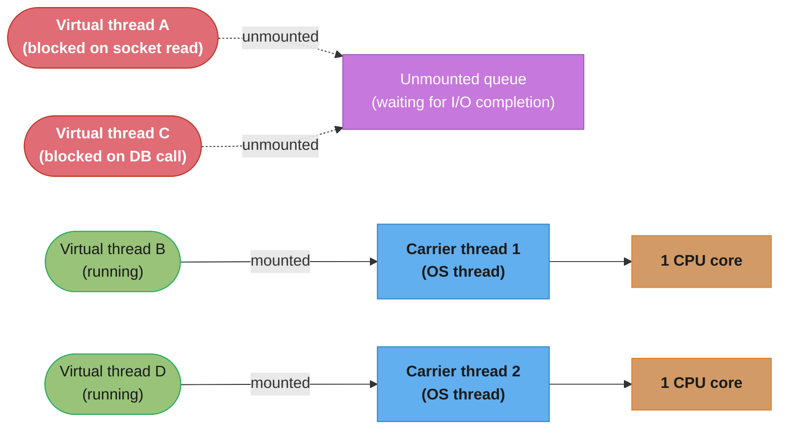
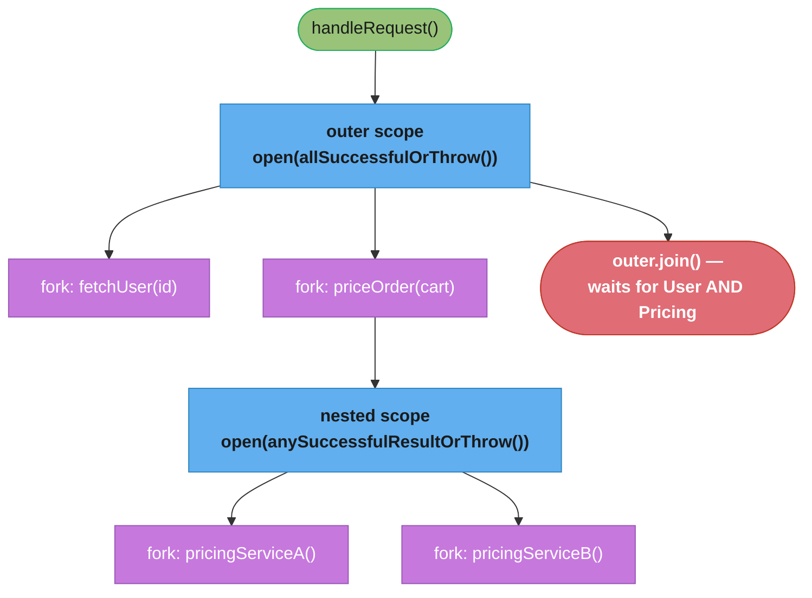

# Modern Java Concurrency

The design-pattern view of virtual threads, structured concurrency, and scoped values — how the four classic patterns in [concurrency_patterns.md](concurrency_patterns.md) change shape once threads stop being scarce.

---

## 1. Concept Overview

Every pattern in this directory — Singleton, Producer-Consumer, Read-Write Lock, Thread Pool — was designed around one assumption: a thread costs ~1 MB of reserved stack and roughly a millisecond to create, so you ration threads with a pool and reuse them. Virtual threads (`Thread.ofVirtual()`, GA since JDK 21, JEP 444) break that assumption. A virtual thread costs a few hundred bytes to a few KB of heap that grows on demand, and the JVM multiplexes thousands of them onto a small pool of OS-visible **carrier** threads. When a virtual thread blocks on I/O, it *unmounts* from its carrier so the carrier can run a different virtual thread — the OS thread is never left idle waiting.

That single change does not just make Thread Pool bigger; it changes what the surrounding structure should be. Two APIs carry the new structure: `StructuredTaskScope` (fan-out/fan-in as one unit of work, still a preview API) and `ScopedValue` (immutable, leak-proof context propagation, final since JDK 25). This file covers the pattern-level decisions — when to reach for each, what they replace, and where the old advice about `Thread Pool` and `ThreadLocal` is now obsolete. The JVM-internals depth (continuations, carrier scheduling, JFR pinning diagnostics) lives in [`java/structured_concurrency_and_loom/`](../../java/structured_concurrency_and_loom/structured_concurrency_and_loom.md); do not expect that detail duplicated here.

---

## 2. Intuition

> Pooling was always a workaround for expensive threads, not a goal in itself. Once a thread is nearly free, the discipline moves from *how many threads can I afford* to *how do I bound and structure the ones I create* — you stop pooling and start scoping.

**Mental model:** a `ThreadPoolExecutor` answers "how many workers may exist." A `StructuredTaskScope` answers "which subtasks belong to this one unit of work, and what happens to the rest if one of them fails." Those are different questions, and virtual threads make the second one the one that actually matters — creation cost stopped being the constraint, coordination correctness didn't.

**Why it matters:** the same production failure modes that motivated Producer-Consumer's bounded queue and Thread Pool's rejection policy reappear one layer up. A `StructuredTaskScope` with no downstream bound will fan out 10,000 virtual-thread HTTP calls just as eagerly as an unbounded `BlockingQueue` will accept 10,000 objects — the bottleneck moved from thread creation to the database, the socket pool, or the downstream service, and none of those got cheaper.

**Key insight:** cheap threads did not make Java's mutable-shared-state hazards go away. `ScopedValue` fixes exactly one of them — implicit mutable context leaking across reused threads — by making context immutable and scope-bound instead of thread-bound. Everything else — races, visibility, deadlock — still needs the same discipline the other three patterns in this directory teach.

---

## 3. Core Principles

1. **Unbounded concurrency is still bounded by the downstream.** Virtual threads remove the thread-creation ceiling, not the database connection pool, the socket count, or the rate limit on the API you're calling. Fan-out width must be capped at the true bottleneck, which is now almost never "can I afford another thread."
2. **Cancellation must be structural, not cooperative-by-convention.** `ExecutorService.submit()` plus manual `Future.cancel()` bookkeeping is a discipline every caller has to reimplement correctly. `StructuredTaskScope` makes "every subtask finishes or is cancelled before the block exits" a property of the `try`-with-resources block itself.
3. **Context must be immutable and scope-bound, not thread-bound and mutable.** A `ThreadLocal` is a `set()`/`get()`/`remove()` contract that a pooled thread can violate by simply forgetting the `remove()`. `ScopedValue.where(KEY, value).run(task)` cannot be forgotten in the same way — the binding exists only for the dynamic extent of `run()` and is gone when it returns, on the same thread or any thread forked from it.
4. **A preview API is not a shipping decision — plan for the rename.** `StructuredTaskScope`'s shape has moved every release since it entered preview (JEP 453 in JDK 21 through JEP 533 targeting JDK 27); wrap it behind your own narrow interface so one JDK upgrade does not touch every call site.
5. **Blocking is not the enemy any more; unstructured blocking is.** The old advice to avoid blocking calls and reach for `CompletableFuture` chains was a workaround for platform-thread scarcity. On virtual threads, straight-line blocking code IS the efficient form — the imperative style is not a readability compromise you pay for with worse concurrency.

---

## 4. Types / Architectures / Strategies

| Building block | Replaces | Maturity (see §11) | What it guarantees |
|---|---|---|---|
| `Thread.ofVirtual().start(...)` / `Executors.newVirtualThreadPerTaskExecutor()` | `Executors.newFixedThreadPool(n)` for I/O-bound work | Final, JDK 21 (JEP 444) | One virtual thread per task; carrier reuse handled by the JVM |
| `StructuredTaskScope.open()` (+ a `Joiner`) | `ExecutorService.invokeAll()` / `CompletableFuture.allOf()` for fan-out | Preview (see §11) | Every forked subtask completes or is cancelled before the scope's `try` block exits |
| `ScopedValue` | `ThreadLocal` / `InheritableThreadLocal` for request-scoped context | Final, JDK 25 (JEP 506) | Immutable binding, visible only for one dynamic extent, automatically inherited by forked subtasks |
| `Joiner.allSuccessfulOrThrow()` / `.anySuccessfulResultOrThrow()` / `.allUntil(Predicate)` | Hand-rolled `CountDownLatch` + result-collection logic | Preview, part of `StructuredTaskScope` | Declarative policy for "what does join() return, and when does a failure cancel the rest" |

**Strategy 1 — thread-per-task, no scope.** `newVirtualThreadPerTaskExecutor()` for independent, fire-and-forget-ish tasks where you don't need structured cancellation across a group — e.g., a request-handling executor in an HTTP server. This is a drop-in replacement for a fixed pool sized for I/O concurrency.

**Strategy 2 — scoped fan-out/fan-in.** `StructuredTaskScope` for the classic "call N services, combine the results" shape. Replaces manual `Future` bookkeeping and is what §6 and §14 walk through in code.

**Strategy 3 — immutable context propagation.** `ScopedValue` anywhere a `ThreadLocal` currently carries request-scoped, read-mostly data (principal, tenant ID, trace ID, transaction) down a call chain that may fan out across forked subtasks.

**Strategy 4 — the two combined.** The common production shape is neither in isolation: bind a `ScopedValue` for the request's context, then open a `StructuredTaskScope` inside that binding. Every forked subtask sees the context automatically, and every subtask's fate is tied to the scope — §14 walks through exactly this combination end to end.

---

## 5. Architecture Diagrams

Carrier mounting: a small, fixed pool of OS threads (default size = CPU core count, itself a `ForkJoinPool`) runs many virtual threads by swapping which one is mounted whenever the running one blocks.



*A carrier pool of 2 runs 4 virtual threads because half are unmounted, waiting on I/O — this is the whole mechanism behind "thousands of virtual threads, a handful of OS threads."*

Scope tree: a `StructuredTaskScope` owns its forked subtasks the way a stack frame owns its callees — the parent cannot exit until every child has finished or been cancelled, and scopes nest.



*The nested scope must fully resolve — one winner, one cancelled loser — before `priceOrder` can return, and the outer scope in turn cannot return before both top-level forks resolve. Cancellation and completion both flow bottom-up through this tree; nothing outlives its enclosing `try` block.*

---

## 6. How It Works — Detailed Mechanics

### 6.1 Fan-out/fan-in, current API shape

`StructuredTaskScope.open()` returns a scope with the default `Joiner` (wait for all subtasks, throw on first failure). Fork inside the `try`-with-resources block, then `join()` exactly once before reading results:

```java
import java.util.concurrent.StructuredTaskScope;
import java.util.concurrent.StructuredTaskScope.Subtask;

class OrderAggregator {
    record OrderView(User user, List<Order> orders, Preferences prefs) {}

    OrderView fetch(String userId) throws Exception {
        try (var scope = StructuredTaskScope.open()) {              // default: allSuccessfulOrThrow-ish
            Subtask<User>          userTask  = scope.fork(() -> userService.find(userId));
            Subtask<List<Order>>   orderTask = scope.fork(() -> orderService.findAll(userId));
            Subtask<Preferences>   prefTask  = scope.fork(() -> prefService.get(userId));

            scope.join();                                            // waits for ALL forks, or throws
            return new OrderView(userTask.get(), orderTask.get(), prefTask.get());
        }
        // scope closes here: any still-running subtask has already been
        // cancelled by join() throwing, and close() waits for it to unwind
    }
}
```

If any of the three forks throws, `join()` cancels the other two and raises a `StructuredTaskScope.FailedException` wrapping the first failure — there is no orphaned subtask still running against the database after the caller has moved on, which is exactly the leak a raw `ExecutorService.submit()` × 3 does not prevent on its own.

### 6.2 Racing instead of waiting for all

`Joiner.anySuccessfulResultOrThrow()` returns the first success and cancels every other fork — the structured version of "hedge the request across two replicas". That is the **Java 25 LTS** spelling (JEP 505); JDK 26's JEP 525 renamed it to `anySuccessfulOrThrow()`, so pin the JDK and budget the call-site edit at the next upgrade — see [Java 22-26 Features](../../java/java22_to_26_features/java22_to_26_features.md):

```java
String fetchFastest(String path) throws Exception {
    try (var scope = StructuredTaskScope.open(
            StructuredTaskScope.Joiner.<String>anySuccessfulResultOrThrow())) {
        scope.fork(() -> fetchFromReplica(REPLICA_A, path));
        scope.fork(() -> fetchFromReplica(REPLICA_B, path));
        return scope.join();       // first success wins; the loser is cancelled, not abandoned
    }
}
```

### 6.3 `ScopedValue` replacing a leaking `ThreadLocal`

`ThreadPool.md` §Common Pitfalls flags exactly this failure: a `ThreadLocal` set during one task and never `remove()`-d is still attached the next time the pool hands that platform thread a new task. `ScopedValue` removes the failure mode structurally instead of relying on every caller remembering cleanup:

```java
// BROKEN shape (the ThreadPool.md pitfall, restated): a ThreadLocal on a pooled
// thread outlives the task that set it unless every call site remembers remove().
static final ThreadLocal<RequestContext> CTX = new ThreadLocal<>();

void handleOnPooledThread(RequestContext ctx) {
    CTX.set(ctx);
    try {
        process();                 // reads CTX.get() correctly, this time
    } finally {
        CTX.remove();               // omit this line and the NEXT task on this
                                     // recycled thread silently inherits ctx
    }
}

// FIX: ScopedValue binds only for the dynamic extent of run() — there is
// nothing left to clean up, and nothing to forget.
static final ScopedValue<RequestContext> CTX = ScopedValue.newInstance();

void handleOnVirtualThread(RequestContext ctx) {
    ScopedValue.where(CTX, ctx).run(() -> {
        process();                  // every callee, including StructuredTaskScope
                                     // forks started inside this run(), sees CTX
    });
    // binding is gone the instant run() returns — no finally block to forget
}
```

A `ScopedValue` bound in the parent is automatically visible to every subtask a `StructuredTaskScope` forks from inside the `run()` — no `InheritableThreadLocal` boilerplate, and no risk of a stale binding surviving into the next unrelated request.

### 6.4 Pinning, as of JDK 24 (JEP 491) onward

A blocking `synchronized` block no longer pins a virtual thread to its carrier — the monitor is now tracked per virtual thread, so the thread unmounts on a blocking operation inside `synchronized` exactly as it would outside one. What still pins a carrier today:

- a **native frame** on the stack — a JNI call or a Foreign Function & Memory upcall
- **class loading** and **class initialization**

Diagnose remaining pins with the `jdk.VirtualThreadPinned` JFR event, which reports both the reason and the carrier thread. Choosing between `synchronized` and `java.util.concurrent.locks.ReentrantLock` is now a question of the lock's own semantics (reentrancy, fairness, `tryLock`, interruptibility) — not of virtual-thread pinning.

---

## 7. Real-World Examples

- **Tomcat 10.1+ and Jetty 12** ship a virtual-thread-per-request executor as a configuration option — `protocol.setVirtualThreadExecutor(Executors.newVirtualThreadPerTaskExecutor())` on the Tomcat connector — for request handling, replacing a bounded platform-thread pool that previously capped concurrent connections.
- **Spring Boot** exposes `spring.threads.virtual.enabled=true`, which switches the embedded servlet container's task executor and `@Async` executor to virtual threads without touching controller code.
- **JDBC drivers and connection pools** (HikariCP) still gate true concurrency at the connection pool size — a service can run 50,000 virtual threads and still be limited to `maximumPoolSize` concurrent DB calls, which is precisely principle 1 in §3.
- **Workflow/orchestration engines** (Temporal, Conductor-style activity fan-out) are a natural `StructuredTaskScope` fit: "run these N activities, fail the workflow step if any fails, cancel the rest" is the scope's default `Joiner` policy expressed directly instead of as a hand-rolled `CountDownLatch`.
- **API gateways and BFF layers** that fan a single incoming request out to several backend services (the pattern §14 walks through) are the other common fit — each incoming request becomes one `StructuredTaskScope`, so a slow or failing backend cancels the sibling calls for that request instead of leaving them to complete uselessly after the response has already failed.

---

## 8. Tradeoffs

| Dimension | Platform thread pool (`ThreadPoolExecutor`) | Virtual thread, unstructured (`newVirtualThreadPerTaskExecutor`) | `StructuredTaskScope` |
|---|---|---|---|
| Per-thread cost | ~1 MB reserved OS stack | ~hundreds of bytes to a few KB heap, grows on demand | Same as virtual thread — it forks virtual threads internally |
| Concurrency ceiling | Hundreds to low thousands before OOM | Hundreds of thousands, bounded by heap and the true downstream limit | Same, plus an explicit cap you choose per scope |
| Cancellation on partial failure | Manual (`Future.cancel()` on every sibling) | Manual — nothing ties siblings together | Automatic — the scope's `Joiner` policy cancels siblings |
| Leaked/orphaned subtasks | Possible if cancellation bookkeeping is wrong | Same risk, and easier to create by accident since forking is so cheap | Structurally prevented — `close()` will not return with a task unaccounted for |
| Context propagation | `ThreadLocal`, must be cleared manually per task | Same hazard, now per-task instead of per-pool-slot | `ScopedValue`, auto-bound to forked subtasks, self-clearing |
| API maturity today | Final since JDK 5 | Final since JDK 21 (JEP 444) | **Preview** (see §11) — plan for a signature change on upgrade |
| Best fit | CPU-bound work; a hard concurrency cap you want to enforce yourself | Independent I/O-bound tasks with no cross-task lifecycle coupling | Any fan-out/fan-in where siblings should live and die together |

---

## 9. When to Use / When NOT to Use

**Use virtual threads when:**
- The workload is I/O-bound (DB calls, HTTP calls, file I/O) and blocking code is the natural expression of the logic.
- You currently size a thread pool by `N_CPUs × (1 + wait/compute)` — that formula is the tell that threads are spending most of their life blocked, exactly what virtual threads are for.
- You want straight-line, debuggable, blocking-style code instead of a `CompletableFuture` chain, without losing throughput.

**Use `StructuredTaskScope` when:**
- Several subtasks belong to one logical unit of work and should share a fate — one fails, the rest should stop.
- You are currently hand-rolling `CountDownLatch` + shared result list + manual cancellation to fan out and join.

**Use `ScopedValue` when:**
- Request-scoped, read-mostly context (principal, tenant, trace ID, transaction) needs to be visible down a call chain and across forked subtasks, and nothing needs to write it back up to the caller.

**Do NOT reach for virtual threads when:**
- The workload is **CPU-bound** — matrix math, JSON parsing, compression, image processing. A CPU-bound task never blocks, so it never unmounts; running 10,000 virtual threads doing CPU work just contends the same core count a platform-thread pool would, with extra scheduling overhead and no benefit. Size CPU-bound pools at `N_CPUs`, on `ForkJoinPool.commonPool()` or a platform-thread `ThreadPoolExecutor`, exactly as before.
- You need a **hard cap on concurrent callers of a downstream system** for its own protection, independent of how cheap your own threads are — that is a semaphore or a bulkhead around the call, not a thread-pool-sizing decision either way.
- `ThreadLocal` is used to write a value **back to a caller that outlives the callee** (rare, but real — e.g., accumulating diagnostics up a call stack). `ScopedValue`'s binding is read-only and scoped to `run()`/`call()`; it deliberately does not support that shape.

---

## 10. Common Pitfalls

**Pooling virtual threads.** `Executors.newFixedThreadPool(200, Thread.ofVirtual().factory())` caps concurrency at 200 and throws away the entire reason to use virtual threads — you paid the API-migration cost and kept the platform-thread-era ceiling.

*Broken:*
```java
// BROKEN: still a fixed pool — 200 virtual threads is the same ceiling
// a 200-thread platform pool already had, minus the memory saving nobody needed
ExecutorService pool = Executors.newFixedThreadPool(200, Thread.ofVirtual().factory());
```
*Fix:*
```java
// FIX: one virtual thread per task, uncapped — the true bound belongs on the
// downstream resource (DB pool, HTTP client's connection pool), not the executor
ExecutorService executor = Executors.newVirtualThreadPerTaskExecutor();
```

**`ThreadLocal` in a per-task-thread world.** A `ThreadLocal` set inside a virtual thread and never removed does not leak to the *next task* the way it does in a pool — a virtual thread is not reused — but it still holds memory for the life of that (possibly long-lived) virtual thread, and it still fails to propagate to any subtask forked by a `StructuredTaskScope`, because `ThreadLocal` was never inherited across threads without `InheritableThreadLocal`. Either hazard disappears with `ScopedValue` (see §6.3).

**Unbounded fan-out.** `StructuredTaskScope` makes forking a subtask so cheap it is tempting to fork one per row of a 50,000-row result set. The scope does not protect the downstream: 50,000 forked HTTP calls will exhaust the target service's connection limit or your own HTTP client's pool exactly as fast as 50,000 platform threads would have — cap fan-out width explicitly (a `Semaphore`, chunking, or an explicit batch size) before forking.

**Treating `synchronized` avoidance as still-current advice.** Code and code review comments from before JDK 24 commonly say "avoid `synchronized` on a virtual thread, it pins the carrier — use `ReentrantLock` instead." Since JEP 491 (JDK 24), a blocking `synchronized` no longer pins. Repeating that advice today produces `ReentrantLock` churn (extra `try`/`finally`, lost automatic release on exception) for zero benefit; choose the lock type on its own merits (see §6.4).

**Forgetting `scope.join()` before reading a `Subtask`'s result.** `Subtask.get()` before `join()` completes throws `IllegalStateException` — the scope has not resolved the subtask's outcome yet. `join()` is not optional bookkeeping; it is the point where the scope's `Joiner` policy actually runs.

**Wrapping every blocking call in `CompletableFuture` out of pre-Loom habit.** The old advice — "never block a thread, chain futures instead" — was a workaround for platform threads being expensive to leave idle. On virtual threads, a blocking call inside a `try`-with-resources scope is the efficient, debuggable form; wrapping it in `CompletableFuture.supplyAsync(...)` just adds an extra executor hop and a callback-style stack trace for no remaining benefit. Reach for `StructuredTaskScope` instead when the shape is genuinely fan-out/fan-in.

*Broken:*
```java
// BROKEN: callback chaining kept out of pre-Loom habit — no cancellation
// coupling between the two calls, and a harder stack trace to debug
CompletableFuture<User> userF = CompletableFuture.supplyAsync(() -> userService.find(id));
CompletableFuture<List<Order>> ordersF = CompletableFuture.supplyAsync(() -> orderService.findAll(id));
CompletableFuture.allOf(userF, ordersF).join();
```
*Fix:*
```java
// FIX: straight-line blocking code inside a scope — same concurrency,
// automatic cancellation coupling, a normal stack trace on failure
try (var scope = StructuredTaskScope.open()) {
    var userTask   = scope.fork(() -> userService.find(id));
    var ordersTask = scope.fork(() -> orderService.findAll(id));
    scope.join();
}
```

---

## 11. Technologies & Tools

| Tool / API | Role | Current status |
|---|---|---|
| `Thread.ofVirtual()`, `Executors.newVirtualThreadPerTaskExecutor()` | Create and run virtual threads | Final — JDK 21, JEP 444 |
| `ScopedValue` | Immutable context propagation | Final — JDK 25, JEP 506 |
| `StructuredTaskScope` | Structured fan-out/fan-in with automatic cancellation | **Preview** — JEP 505 (fifth preview, JDK 25, introduced the `open()` factory + `Joiner` shape), JEP 525 (sixth preview, JDK 26), JEP 533 (seventh preview, targeting JDK 27) |
| JFR `jdk.VirtualThreadPinned` event | Diagnose which operation pinned a carrier | Stable, JDK 21+ |
| Tomcat / Jetty virtual-thread connector executor | Server-side request handling on virtual threads | Shipping, Tomcat 10.1+, Jetty 12+ |
| `spring.threads.virtual.enabled` | Switch Spring Boot's request + `@Async` executors to virtual threads | Spring Boot 3.2+ |
| `--enable-preview` (compiler + runtime flag) | Required to compile and run any `StructuredTaskScope` code today | Needed until finalization (JEP 533 targets JDK 27) |

A preview API needs `--enable-preview` on both `javac` and `java`, and class files it produces are tied to that JDK's preview minor version — they will not run unmodified on a different JDK build even with `--enable-preview` set. Isolate `StructuredTaskScope` calls behind your own interface so the eventual final signature touches one file, not every call site.

---

## 12. Interview Questions with Answers

**Q: Why does pooling virtual threads (e.g., a fixed-size executor built on a virtual thread factory) defeat their purpose?**
**Short:** A fixed pool caps concurrency at the pool size, discarding the entire benefit of near-free per-task threads.
Virtual threads are meant to be created one per task and discarded, not reused — the JVM's carrier-thread scheduling is what makes that cheap. Wrapping them in a fixed-size `ExecutorService` re-imposes the platform-thread-era concurrency ceiling while adding scheduling overhead, with none of the upside. The correct replacement for a bounded I/O pool is `Executors.newVirtualThreadPerTaskExecutor()`, with the real bound moved onto whatever downstream resource actually needs protecting.

**Q: Since JEP 491 (JDK 24), is `synchronized` now always preferred over `ReentrantLock` for virtual-thread code?**
**Short:** Neither is "always preferred" now — JEP 491 removed the pinning penalty, so choose by lock semantics, not pinning.
Before JDK 24, a virtual thread blocking inside `synchronized` stayed pinned to its carrier, which was a real reason to prefer `ReentrantLock`. JEP 491 rewrote monitor tracking to be per-virtual-thread, so `synchronized` no longer pins on a blocking operation. The decision is now purely about lock semantics: `ReentrantLock` offers `tryLock`, fairness, and interruptible acquisition; `synchronized` offers automatic release on exception and less boilerplate. Advice that still cites pinning as the reason to avoid `synchronized` is stale.

**Q: Why does `ThreadLocal` still cause problems in a virtual-thread-per-task model, even though threads are no longer pooled and reused?**
**Short:** ThreadLocal values on a virtual thread aren't inherited by forked subtasks and still hold memory until the thread ends.
Pooled-thread leakage (a stale value from a previous task) mostly disappears because a virtual thread isn't recycled across unrelated tasks. Two hazards remain: a `ThreadLocal` set inside a `StructuredTaskScope` fork is invisible to sibling forks and to the parent, since plain `ThreadLocal` is never automatically inherited across threads; and a value set early in a long-lived virtual thread holds its memory for that thread's whole life if nothing calls `remove()`. `ScopedValue` fixes both: bindings are automatically visible to forked subtasks and are released the instant `run()`/`call()` returns.

**Q: What still pins a virtual thread to its carrier as of JDK 24+?**
**Short:** Native frames — JNI calls and FFM upcalls — plus class loading and class initialization still pin.
`synchronized` and `Object.wait()` stopped pinning in JDK 24 (JEP 491), which removed the most common cause. What remains is anything the JVM cannot unmount mid-execution: a JNI call into native code, a Foreign Function & Memory API upcall back into Java from native code, and the class-loading/initialization machinery. Use the `jdk.VirtualThreadPinned` JFR event to find the specific call site — it reports both the pinning reason and the carrier thread involved.

**Q: What happens if you forget `scope.join()` before calling `Subtask.get()` on a `StructuredTaskScope` fork?**
**Short:** Subtask.get() throws IllegalStateException because the scope hasn't resolved the subtask's outcome yet.
`fork()` only schedules the subtask; the scope's `Joiner` policy — success, failure, cancellation of siblings — is applied when `join()` runs, not before. Calling `get()` on a `Subtask` ahead of `join()` finds no resolved state to return and throws `IllegalStateException`. The fix is mechanical: always call `join()` exactly once, immediately after the last `fork()` and before reading any subtask's result.

**Q: Why is unbounded fan-out inside a `StructuredTaskScope` still dangerous even though forking a virtual thread is nearly free?**
**Short:** The scope doesn't protect the downstream — a database or HTTP connection pool exhausts the same way regardless of thread cost.
`StructuredTaskScope` guarantees structural cleanup of the threads it creates; it says nothing about the capacity of what those threads call. Forking one subtask per row of a large result set can exhaust a JDBC connection pool, an HTTP client's connection limit, or a downstream service's rate limit just as fast as the equivalent platform-thread fan-out would. Cap fan-out width explicitly — chunk the work, or gate it behind a `Semaphore` sized to the real downstream capacity — before forking.

**Q: What is the difference between `Executors.newVirtualThreadPerTaskExecutor()` and `StructuredTaskScope`?**
**Short:** The executor runs independent tasks with no shared fate; the scope ties a group of subtasks to one lifecycle.
`newVirtualThreadPerTaskExecutor()` is a general-purpose `ExecutorService`: submitted tasks are independent, and a failure in one has no effect on the others or on the executor. `StructuredTaskScope` is narrower and stricter — subtasks forked inside one scope share a lifecycle: the scope's `Joiner` decides whether one subtask's outcome cancels the rest, and `close()` will not return until every forked subtask has finished or been cancelled. Use the executor for a stream of unrelated tasks (e.g., request handling); use the scope whenever subtasks belong to one caller-visible unit of work.

**Q: How does `ScopedValue.where(KEY, value).run(task)` differ mechanically from `ThreadLocal.set()`/`remove()`?**
**Short:** ScopedValue binds only for run()'s dynamic extent and unbinds automatically; ThreadLocal requires manual remove().
`ThreadLocal.set()` mutates a slot that persists on the thread until something calls `remove()` — a step that is easy to omit, especially in a `finally` block someone forgot. `ScopedValue.where(KEY, value).run(task)` binds the value only for the exact duration of `task`'s execution; the binding is popped automatically when `run()` returns, whether normally or via exception, with no cleanup call to forget. Bindings also chain (`where(A, a).where(B, b).run(...)`) and are automatically visible to any `StructuredTaskScope` subtask forked from inside `run()`, which `ThreadLocal` never was without `InheritableThreadLocal`.

**Q: How does the current `StructuredTaskScope.open(Joiner)` shape differ from the older subclass-based API (e.g., `ShutdownOnFailure`)?**
**Short:** Public constructors and subclassing were replaced by static open() factories taking a Joiner strategy object.
Early previews exposed policy as concrete subclasses you instantiated directly (`new StructuredTaskScope.ShutdownOnFailure()`). JEP 505 (fifth preview, JDK 25) replaced the public constructors with static `open()` factory methods and introduced the `Joiner` interface, which separates "what triggers cancellation" from "what does `join()` return" as a single composable policy object passed to `open()` — for example `StructuredTaskScope.open(Joiner.<String>allSuccessfulOrThrow())`. `open()` with no argument uses a sensible default policy. The API is still moving (sixth preview in JDK 26 via JEP 525, seventh targeting JDK 27 via JEP 533), so treat any specific method signature as provisional.

**Q: What does the default `Joiner` policy do when one forked subtask fails?**
**Short:** join() cancels every other still-running subtask and throws, wrapping the first failure it observed.
The default policy waits for every forked subtask, but the moment one subtask fails, it cancels the remaining unfinished subtasks and `join()` throws a `StructuredTaskScope.FailedException` wrapping that first failure. This is the structural replacement for manually calling `Future.cancel()` on every sibling inside a `catch` block — the scope does it uniformly, and `close()` still waits for the cancelled subtasks to actually unwind before the `try` block can exit.

**Q: How do you race two calls and use whichever finishes first, cancelling the loser, with `StructuredTaskScope`?**
**Short:** Open the scope with Joiner.anySuccessfulResultOrThrow(), fork both calls, and join() returns the first success.
`Joiner.anySuccessfulResultOrThrow()` changes the scope's policy to "the first subtask to succeed wins": `join()` returns that result immediately and cancels every subtask still running. This is the structured version of a two-way hedge across replicas or CDNs — `scope.fork(() -> callA())`, `scope.fork(() -> callB())`, `return scope.join();` — without hand-writing a `CompletableFuture.anyOf()` plus manual cancellation of the loser.

**Q: What is the default carrier-thread pool for virtual threads, and why does its size default to the CPU count?**
**Short:** Virtual threads run on a ForkJoinPool sized to available processors by default, since carriers do the actual CPU work.
Unless overridden, the JVM schedules virtual threads onto an internal `ForkJoinPool` in FIFO mode, sized to `Runtime.availableProcessors()`. Since a mounted virtual thread occupies a real CPU exactly like any other running thread, more carriers than cores would not add throughput for CPU-bound work — the pool's job is to have exactly enough carriers to keep every core busy while virtual threads unmount during I/O waits, not to add parallelism the hardware doesn't have.

**Q: Does `StructuredTaskScope` replace `ForkJoinPool`'s `RecursiveTask` for divide-and-conquer work like `ParallelMergeSort`?**
**Short:** No — RecursiveTask's work-stealing suits recursive CPU-bound splitting; StructuredTaskScope targets I/O fan-out lifecycles.
`ThreadPool.java` in this directory uses `RecursiveTask` on the common `ForkJoinPool` for `ParallelSum`/`ParallelMergeSort` precisely because that workload is CPU-bound and recursively splittable — work-stealing keeps every core busy by letting idle workers steal half-finished subdivisions from busy ones, which `StructuredTaskScope` does not attempt to do. `StructuredTaskScope` solves a different problem: a fixed, known set of I/O-bound subtasks (three service calls, not a recursively-split array) that should share a cancellation lifecycle. Keep `RecursiveTask`/`ForkJoinPool` for CPU-bound recursive decomposition; reach for `StructuredTaskScope` for I/O-bound fan-out with a small, enumerable set of subtasks.

**Q: When a `StructuredTaskScope` subtask migrates between carrier threads (as it unmounts and remounts during I/O), does its `ScopedValue` binding survive?**
**Short:** Yes — a ScopedValue binding belongs to the virtual thread's logical execution, not to whatever carrier it happens to run on.
`ScopedValue` bindings are tracked per virtual thread, not per OS thread, so unmounting from one carrier and remounting on another during a blocking call has no effect on which bindings are visible — the whole mechanism is designed to be orthogonal to carrier scheduling. This is also why a `ThreadLocal` stored via low-level `Thread`-object tricks would be fragile here in a way `ScopedValue` is not: `ScopedValue` was built for exactly this migration.

**Q: Why doesn't adding more carrier threads fix a CPU-bound workload that's slow under virtual threads?**
**Short:** CPU-bound work never blocks, so it never unmounts — more carriers than cores just adds contention, not throughput.
Virtual threads help by unmounting from a carrier during a blocking wait, freeing the carrier for other work. A CPU-bound task — parsing, hashing, numeric computation — never blocks, so it occupies its carrier for its entire execution; running more virtual threads than there are cores just queues additional CPU-bound work behind the same fixed hardware parallelism. The fix for CPU-bound work is unchanged from the pre-Loom era: size the pool to the CPU count and use `ForkJoinPool.commonPool()` or an equivalent platform-thread pool, not more virtual threads.

**Q: When would you still choose a bounded platform-thread pool over `newVirtualThreadPerTaskExecutor()`?**
**Short:** For CPU-bound work, or when you want the executor's own size to be the hard concurrency cap on a resource.
Two cases: CPU-bound tasks, where a platform-thread pool sized to `N_CPUs` is already optimal and virtual threads add nothing (see above); and cases where the pool size itself is meant to be the throttle on a downstream resource with no separate rate limiter — some legacy integrations lean on `ThreadPoolExecutor`'s `maximumPoolSize` as the de facto concurrency cap. In the virtual-thread world that cap belongs on a `Semaphore` or the resource's own client library instead, but a bounded platform pool is a legitimate stopgap where that refactor hasn't happened yet.

**Q: Can two nested `StructuredTaskScope`s share cancellation, and how does that differ from a flat tree of `CompletableFuture.allOf()` calls?**
**Short:** A nested scope's failure propagates up and cancels the parent's other forks, unlike allOf() trees which need manual wiring.
Scopes nest the same way stack frames do: an inner scope must fully resolve (all its own subtasks finished or cancelled) before the fork that opened it can return, and if the inner scope's `join()` throws, that exception propagates out through the fork like any other subtask failure — triggering the outer scope's own cancellation policy against its siblings. A tree of `CompletableFuture.allOf()` calls has no equivalent default: a failure inside one nested `allOf()` does not automatically cancel a sibling branch unless every branch's exceptional-completion handler was wired by hand to do so.

**Q: How do you put a timeout on a `StructuredTaskScope` fan-out without leaking the thread running the slow subtask?**
**Short:** Configure withTimeout() on the scope itself via open(Joiner, config), not a per-subtask timeout on join().
The timeout belongs to the scope's configuration, not to an individual `Future.get(timeout)` call: open the scope with the two-argument `open(Joiner, UnaryOperator<Configuration>)` form and call `withTimeout(Duration)` on the configuration. The clock starts when the scope opens; if it elapses before `join()` returns, the scope cancels every unfinished subtask — interrupting it — before `join()` throws. Because cancellation goes through the same structured-interrupt path as any other scope cancellation, there is no dangling thread still running the slow call after the timeout fires, which a bare per-`Future` timeout does not guarantee on its own.

---

## 13. Best Practices

1. **Default to `newVirtualThreadPerTaskExecutor()` for new I/O-bound work**, and stop tuning `corePoolSize`/`maximumPoolSize` for it — those knobs were solving a problem virtual threads no longer have.
2. **Put the real concurrency cap on the downstream resource** (a `Semaphore`, a connection pool's own limit, a rate limiter) rather than on the number of threads you allow yourself to create.
3. **Reach for `StructuredTaskScope` the moment a fan-out has more than one subtask whose failure should cancel the others** — that is the signal you're about to hand-roll what the scope already gives you.
4. **Migrate request-scoped `ThreadLocal` context to `ScopedValue` first**, before anything else in this list — it is the structural fix for the specific pooled-thread leak that motivated the migration in the first place.
5. **Isolate `StructuredTaskScope` calls behind a narrow interface of your own** while it remains preview — expect one signature change per JDK release until it finalizes.
6. **Keep CPU-bound work on a platform-thread or `ForkJoinPool` sized to `N_CPUs`** — virtual threads solve a blocking problem, not a computation problem.
7. **Stop citing pinning as a reason to avoid `synchronized` on virtual threads** — since JEP 491 (JDK 24), it isn't one; choose the lock by its own semantics.
8. **Diagnose remaining pinning with the `jdk.VirtualThreadPinned` JFR event** rather than guessing — it names the call site and the carrier.

---

## 14. Case Study: Migrating a Fan-Out Order Endpoint off a Bounded Thread Pool

**Starting point.** `ThreadPool.md` models an HTTP handler pool where a fixed `ThreadPoolExecutor` sizes itself to the downstream connection pool — "callers block when the pool is full" is called out there as the load-bearing dynamic. Take that pattern to its logical endpoint: a single order-detail request that needs a user record, the order list, and a live price quote, each fetched independently, run on a pool sized by the old I/O formula (`N_CPUs × (1 + wait/compute)`), with the request's tenant ID carried through a `ThreadLocal` set by a servlet filter.

```java
// BEFORE: bounded platform pool, ThreadLocal context, manual Future bookkeeping
ExecutorService pool = new ThreadPoolExecutor(16, 64, 30, TimeUnit.SECONDS,
        new ArrayBlockingQueue<>(200));
static final ThreadLocal<String> TENANT_ID = new ThreadLocal<>();

OrderView handle(String userId) throws Exception {
    TENANT_ID.set(currentTenant());
    try {
        Future<User> userF   = pool.submit(() -> userService.find(userId));
        Future<List<Order>> ordersF = pool.submit(() -> orderService.findAll(userId));
        Future<Quote> quoteF = pool.submit(() -> pricingService.quote(userId));
        // if quoteF throws, userF/ordersF are NOT cancelled — they keep running
        // and TENANT_ID must be remove()-d here even on this exception path
        return new OrderView(userF.get(), ordersF.get(), quoteF.get());
    } finally {
        TENANT_ID.remove();   // omit this once and the next task on this pooled
                               // thread silently inherits the wrong tenant
    }
}
```

The pool's 64-thread ceiling caps concurrent requests regardless of how much idle capacity the downstream services actually have, `TENANT_ID.remove()` is a correctness-critical line that is easy to lose in a refactor, and a failed `quoteF` leaves the other two futures running to completion for no reason.

```java
// AFTER: virtual threads, ScopedValue context, StructuredTaskScope fan-out
static final ScopedValue<String> TENANT_ID = ScopedValue.newInstance();

OrderView handle(String userId) throws Exception {
    return ScopedValue.where(TENANT_ID, currentTenant()).call(() -> {
        try (var scope = StructuredTaskScope.open()) {                 // default: all-or-cancel
            var userTask   = scope.fork(() -> userService.find(userId));
            var ordersTask = scope.fork(() -> orderService.findAll(userId));
            var quoteTask  = scope.fork(() -> pricingService.quote(userId)); // reads TENANT_ID.get() fine

            scope.join();   // one failure cancels the other two — no orphaned calls
            return new OrderView(userTask.get(), ordersTask.get(), quoteTask.get());
        }
        // TENANT_ID binding ends here automatically — nothing to remove()
    });
}
```

**What changed, concretely.** The request handler runs on the server's virtual-thread-per-request executor (Tomcat/Jetty, or `spring.threads.virtual.enabled=true`), so the old 16–64 thread ceiling is gone — concurrency is now bounded only by whatever the user/order/pricing services can actually sustain, which is where the limit belongs. `pricingService.quote()` failing now cancels the in-flight user and order lookups instead of leaving them to finish uselessly. `TENANT_ID` is bound once via `ScopedValue.where(...).call(...)`, is automatically visible inside all three forked subtasks with no propagation code, and is guaranteed unbound the moment the lambda returns — the exact class of bug the `finally { TENANT_ID.remove(); }` line existed to prevent no longer has a code path to occur on. The one thing that did **not** change: `pricingService`'s own connection or rate limit still caps how many `quote()` calls can run at once, and that cap now needs to be explicit (a `Semaphore` or the client library's own pool) rather than an accidental side effect of a 64-thread executor — principle 1 from §3, made concrete.
