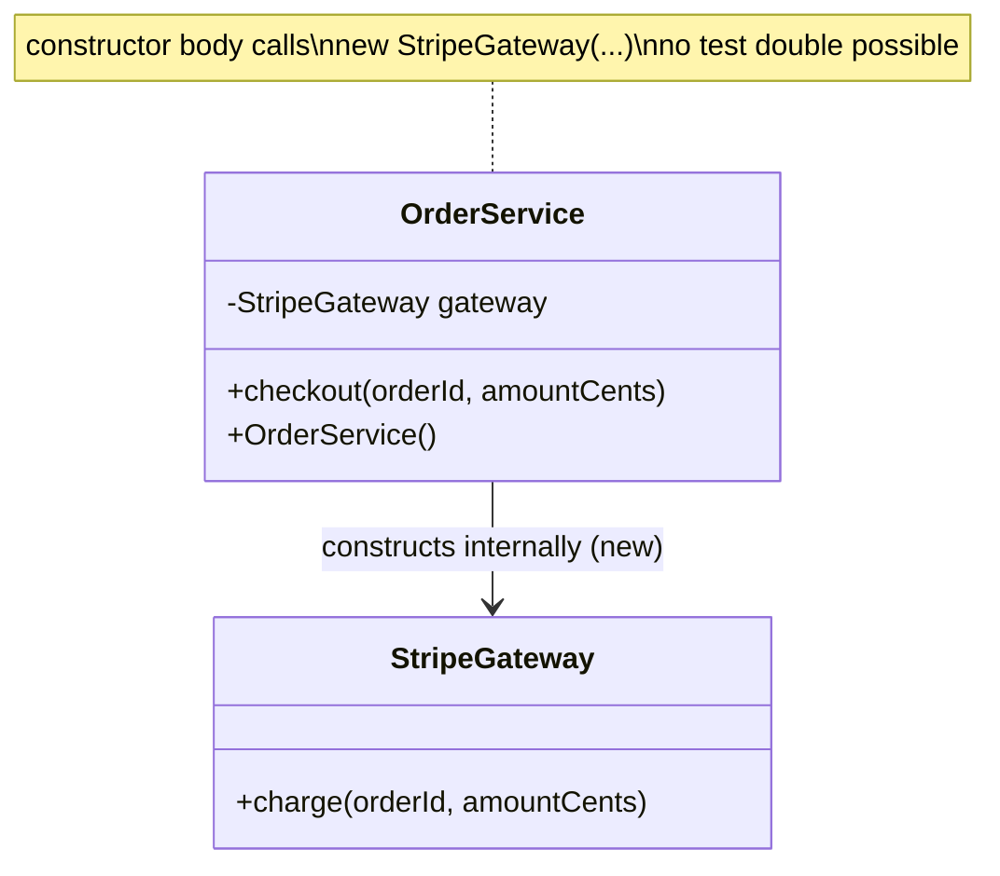
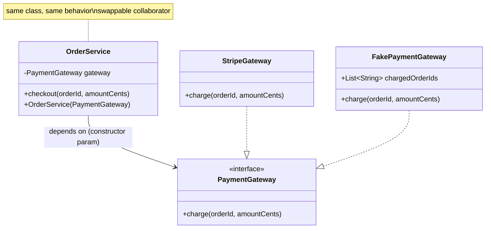
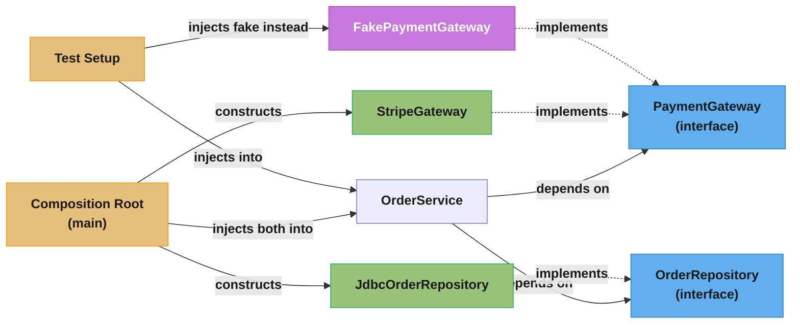

# Dependency Injection and Testability

How pushing collaborators into a class instead of letting it construct them turns "add a test" from a research project into a five-minute task.

## 1. Concept Overview

Dependency Injection (DI) is a pattern for supplying a class's collaborators from outside instead of letting the class construct them itself. A class that needs a `PaymentGateway` declares that need — typically as a constructor parameter — and something else decides which concrete `PaymentGateway` to hand it. The class never writes `new StripeGateway()` in its own body.

That one move is the entire pattern. Everything else — containers, annotations, XML configs, `@Inject`, Spring, Guice, Dagger — is tooling built on top of it, and the tooling is optional. DI is a design discipline first and a framework feature second; you can practice it with zero dependencies using nothing but constructors and a `main` method.

The reason this shows up constantly in interviews is not academic. A class that builds its own dependencies cannot be tested without also standing up everything it depends on: a real database, a real HTTP client, a real clock. A class that receives its dependencies through its constructor can be handed fakes, stubs, or mocks instead, so the test exercises the class's logic in isolation, in milliseconds, with no network and no shared state. **"Is this class testable?" and "does this class construct its own collaborators?" are the same question asked two ways.** Interviewers who ask "how would you unit test this?" are really asking whether you understand DI, whether you know it or not.

This module treats DI as a language-and-framework-agnostic design principle. Framework mechanics (Spring's `@Autowired`, component scanning, bean scopes) live in [`spring/dependency_injection/dependency_injection.md`](../../spring/dependency_injection/dependency_injection.md); the mechanics of writing and running the tests themselves (JUnit lifecycle, Mockito's API surface) live in [`java/testing_junit_mockito/testing_junit_mockito.md`](../../java/testing_junit_mockito/testing_junit_mockito.md). Here the question is narrower and more fundamental: what shape does a class need to have before either of those tools can help you?

---

## 2. Intuition

> **One-line analogy**: A hard-wired dependency is a lamp spliced directly into the wall — to test a different bulb, you cut wire and strip copper. An injected dependency is a lamp with a plug — to test a different bulb, you unplug one lamp and plug in another, and the wall never changes.

**Mental model**: A class with hard-wired collaborators is a black box soldered shut. You can observe its inputs and outputs, but you cannot see or swap what happens inside without opening the case. A class built for injection exposes its seams as constructor parameters — the "sockets" — and anything conforming to the expected plug shape (the interface) can be inserted, including a fake built purely for a test.

**Why it matters**: Testability is not a property you add to a finished class with a testing library. It is a property of the class's *shape*, decided the moment you write `new` versus accept a parameter. A library like Mockito can fake almost anything, but it cannot fake a dependency the class never exposed — it can only reach in through reflection, which is exactly the "cut wire and strip copper" case the plug was supposed to avoid.

**Key insight**: Ask "how do I test this?" before you ask "which mocking library?". If the honest answer requires bytecode manipulation or a running server, the class was built without sockets — DI is not a testing technique bolted on afterward, it is the decision, made at design time, that makes the testing technique possible at all.

---

## 3. Core Principles

Three terms get used interchangeably in interviews and should not be:

| Term | What it actually is | Coined / formalized |
|---|---|---|
| **Inversion of Control (IoC)** | A general principle: the framework calls your code, not the other way around ("the Hollywood principle" — don't call us, we'll call you). Broader than DI; template method and event loops are also IoC. | Popularized as a term by Martin Fowler, 2004 |
| **Dependency Inversion Principle (DIP)** | A design rule: high-level modules should depend on abstractions, not on low-level modules; both should depend on abstractions. The "D" in SOLID. | Robert C. Martin |
| **Dependency Injection (DI)** | A concrete technique: dependencies are passed into an object rather than constructed by it. One specific way of *achieving* both IoC and DIP. | Term coined by Martin Fowler, 2004 (Fowler, "Inversion of Control Containers and the Dependency Injection pattern") |

DIP is the *what* (depend on abstractions). DI is the *how* (pass them in rather than construct them). IoC is the *why-it-feels-inverted* (control over which implementation runs moves from the class to something outside it). A class can satisfy DIP without a DI framework, and a DI framework can wire concrete classes together without anyone honoring DIP — the three are orthogonal, and conflating them is the single most common terminology slip in this area. See [`solid_principles/solid_principles.md`](../solid_principles/solid_principles.md) for DIP's full treatment as a SOLID principle.

**Depend on abstractions, not concretions.** A constructor parameter typed as an interface (`PaymentGateway`) rather than a concrete class (`StripeGateway`) is what makes substitution possible at all — inject a concrete type and there is nothing to swap in for a test. This is DIP applied at the parameter level.

**Explicit dependencies.** Everything a class needs to do its job should be visible in its constructor signature. A class whose constructor takes zero arguments but reaches for a database connection three methods later is lying about what it needs — the Explicit Dependencies Principle (Mark Seemann) treats a hidden dependency as a defect independent of whether it causes a bug today.

**The composition root.** Somewhere near the program's entry point, one place decides which concrete implementation satisfies which abstraction and wires the object graph together. Everywhere else in the codebase depends only on interfaces and never calls `new` on another class's collaborator. See §4 and §5 for the pattern in code and diagram form.

**Prefer composition over configuration magic.** A framework's annotation-driven wiring (`@Autowired`, `@Inject`) is convenient but optional — the underlying discipline (interfaces in, composition root wires them) is what makes a class testable, and it works identically with or without a container. That equivalence is the point of §4's "DI without a container" example.

---

## 4. Types / Architectures / Strategies

### 4.1 The four injection mechanisms

```java
public interface PaymentGateway {
    void charge(String orderId, long amountCents);
}

// --- Constructor injection: the default choice ---
public final class OrderService {
    private final PaymentGateway gateway;   // final: cannot be null after construction,
                                             // cannot change after construction
    public OrderService(PaymentGateway gateway) {
        this.gateway = Objects.requireNonNull(gateway);
    }
    public void checkout(String orderId, long amountCents) {
        gateway.charge(orderId, amountCents);
    }
}

// --- Setter injection: for genuinely optional collaborators ---
public final class ReportGenerator {
    private MetricsSink metrics = MetricsSink.NO_OP;   // safe default, no setter required
    public void setMetrics(MetricsSink metrics) { this.metrics = metrics; }
}

// --- Method injection: dependency varies per call, not per instance ---
public interface DiscountPolicy {
    long apply(long amountCents, Customer customer);   // customer supplied per call
}

// --- Field injection: framework-only, and the one to avoid by default ---
public final class LegacyController {
    @jakarta.inject.Inject
    private PaymentGateway gateway;   // no constructor, no setter — only a container
                                       // (or reflection) can ever populate this field
}
```

| Mechanism | Verdict |
|---|---|
| Constructor injection | **Default choice.** Dependencies are mandatory, visible in one signature, assignable to `final`, and the object is never in a half-constructed state. Spring's own reference documentation states the team "generally recommend[s] using constructor injection to wire up dependencies." |
| Setter injection | Use only for genuinely optional collaborators that have a safe default (`MetricsSink.NO_OP` above). If the object is unusable without it, it is not optional — make it a constructor parameter instead. |
| Method injection | Use when the dependency varies per invocation rather than per instance (a `Customer`, a request-scoped value) — passing it as a parameter is more honest than smuggling it into the constructor and re-reading a field. |
| Field injection | **Avoid by default.** No constructor exists to call in a test, so a plain `new LegacyController()` produces an object with a null `gateway` — the only ways to populate it are running a full container or reaching in with reflection (`ReflectionTestUtils`, `@InjectMocks`'s field-scanning). It also permits a class to compile with zero declared dependencies while secretly requiring several, which is exactly the hidden-dependency problem DI exists to prevent. |

### 4.2 DI without any container at all

Nothing above requires a framework. A composition root is just a `main` method (or a small `AppConfig` class) that constructs the object graph by hand:

```java
public final class Application {
    public static void main(String[] args) {
        // composition root: the ONE place concrete types are chosen
        PaymentGateway gateway = new StripeGateway(System.getenv("STRIPE_KEY"));
        OrderRepository repository = new JdbcOrderRepository(dataSource());
        OrderService service = new OrderService(gateway, repository);

        new HttpServer(service).start(8080);
    }
}
```

Every collaborator below `main` receives what it needs through its constructor; nothing below `main` ever calls `new` on another class's dependency. This is "pure DI" (Mark Seemann's term) — every guarantee a container gives you (substitutable collaborators, no hidden state, a test that runs without a server) is available with zero dependencies and zero annotations. A container's value is automating the wiring at scale — hundreds of beans, lifecycle callbacks, scopes — not providing testability that hand-wiring lacked.

### 4.3 DI vs Service Locator

The two patterns solve the same problem — decouple a class from its collaborators' concrete types — with opposite control flow, and interviewers routinely ask for the contrast directly:

- **DI**: the class *receives* its dependency; the dependency is visible in the constructor signature.
- **Service Locator**: the class *asks* a global registry for its dependency at runtime; the dependency is invisible until you read the method body.

The full argument against Service Locator as a default for application logic — including the correct attribution (it is Mark Seemann's 2010 position, not Fowler's, who treats the two as comparable alternatives) — lives in [`anti_patterns/ServiceLocator.md`](../anti_patterns/ServiceLocator.md); this module does not restate it. The one line worth keeping here: Service Locator makes a class *compile* with fewer declared dependencies than it *needs*, so the failure surfaces at runtime instead of at the constructor call site, and a test has to know to pre-populate the locator instead of simply passing an argument.

### 4.4 The composition root pattern

A composition root is not "wherever `new` happens to get called" — it is a deliberate architectural boundary: exactly one layer of the application (the entry point, or a small number of `*Config`/`*Module` classes near it) is allowed to know concrete types. Every class below that boundary depends only on interfaces. This is what makes the [Factory Method](../creational/factory_method/factory_method.md) and DI patterns complementary rather than competing: a factory can *be* the mechanism a composition root uses to build a family of related concretes, while DI is how those concretes reach the classes that use them.

---

## 5. Architecture Diagrams

**Before — hard-wired dependency.** `OrderService` both decides the concrete gateway and constructs it; nothing external can intervene.



**After — injected dependency.** `OrderService` depends on the `PaymentGateway` abstraction; the concrete type is decided by whoever constructs `OrderService`, which in a test is a fake and in production is `StripeGateway`.



**Composition root wiring.** One boundary knows concrete types; everything past it only ever sees interfaces.



`OrderService` never changes between production and test — only which concrete type the composition root hands it changes. That is the entire value proposition of DI expressed as one picture.

---

## 6. How It Works — Detailed Mechanics

### 6.1 Manual wiring end to end

```java
// --- abstraction ---
public interface Clock { Instant now(); }

// --- production implementation ---
public final class SystemClock implements Clock {
    public Instant now() { return Instant.now(); }
}

// --- the class under test ---
public final class SubscriptionService {
    private final Clock clock;
    private final PaymentGateway gateway;

    public SubscriptionService(Clock clock, PaymentGateway gateway) {
        this.clock = clock;
        this.gateway = gateway;
    }

    public boolean isExpired(Subscription sub) {
        return sub.renewsAt().isBefore(clock.now());
    }
}

// --- production wiring (composition root) ---
SubscriptionService prod = new SubscriptionService(new SystemClock(), new StripeGateway(key));

// --- test wiring: no container, no reflection, no network ---
Clock frozen = () -> Instant.parse("2026-08-25T00:00:00Z");   // Clock is a functional interface here
SubscriptionService underTest = new SubscriptionService(frozen, new FakePaymentGateway());
```

A frozen clock is the canonical example of why DI matters even when nothing is "mocked" in the Mockito sense — `Instant.now()` is nondeterministic, and a test that calls it directly is a test that occasionally fails for no reason a stack trace explains.

### 6.2 The test-double taxonomy

"Mock" gets used as a catch-all in casual speech; Gerard Meszaros's taxonomy (xUnit Test Patterns) distinguishes five roles, and knowing which one a test needs is itself an interview signal:

| Double | What it does | Example |
|---|---|---|
| **Dummy** | Passed to satisfy a signature; never actually used. | `new OrderService(gateway, null)` when the test never calls the path that reads the second argument. |
| **Stub** | Returns canned answers to calls made during the test; has no expectations of its own. | `FakeInventory` that always returns `42` for `stockOf(anyId)`. |
| **Spy** | A stub that also records what was called, so the test can assert on it afterward. | A `FakePaymentGateway` that stores every `charge()` call in a `List` for later inspection. |
| **Mock** | Pre-programmed with expectations; verifies those expectations were met, and the test fails if they were not. | `verify(gateway).charge("order-1", 4999)` (Mockito) — the assertion is on *behavior*, not state. |
| **Fake** | A working, lighter-weight implementation of the real thing — not canned answers, actual logic. | An in-memory `HashMap`-backed `OrderRepository` standing in for a real database. |

```java
// Dummy — argument required by the signature, irrelevant to this test
new OrderService(gateway, /* dummy */ null);

// Stub — canned response, no verification
class StubInventory implements Inventory {
    public int stockOf(String sku) { return 42; }
}

// Spy — records calls for the test to inspect afterward
class SpyPaymentGateway implements PaymentGateway {
    final List<String> chargedOrderIds = new ArrayList<>();
    public void charge(String orderId, long amountCents) { chargedOrderIds.add(orderId); }
}

// Fake — a real, working, simplified implementation
class InMemoryOrderRepository implements OrderRepository {
    private final Map<String, Order> store = new ConcurrentHashMap<>();
    public void save(Order order) { store.put(order.id(), order); }
    public Optional<Order> findById(String id) { return Optional.ofNullable(store.get(id)); }
}

// Mock — behavior verification, via Mockito (API details: java/testing_junit_mockito.md)
PaymentGateway gateway = mock(PaymentGateway.class);
new OrderService(gateway, repo).checkout("order-1", 4999);
verify(gateway).charge("order-1", 4999);
```

Pick the cheapest double that proves the point: a stub or fake for state-based assertions, a mock only when the *interaction itself* — "was this called, with these arguments, this many times" — is the thing under test. Defaulting to mocks everywhere produces the over-mocking failure mode covered in §10.

### 6.3 Seams

A seam (Michael Feathers, *Working Effectively with Legacy Code*) is a place in the code where you can alter behavior without editing that code directly. A constructor parameter is an **object seam** — swap the argument, the behavior changes, the class body is untouched. A static method call (`PaymentGateway.charge(...)`) or a `new` inside a method body has *no* seam: the only way to change what runs is to edit the line itself.

Introducing a seam into legacy code that has none is a mechanical, safe refactor: extract the offending `new` (or static call) into a method, give that method an overridable or parameterized form, and only then can a test substitute something else — this is the **Extract and Override** technique, one step short of full constructor injection and useful when a bigger refactor is too risky to do in one pass:

```java
// Step 0 — no seam at all: cannot test without a live SMS provider
public class OtpSender {
    public void send(String phone, String code) {
        TwilioClient.getInstance().sendSms(phone, "Your code: " + code);   // static singleton call
    }
}

// Step 1 — Extract and Override: introduces a seam without a full redesign
public class OtpSender {
    public void send(String phone, String code) {
        smsClient().sendSms(phone, "Your code: " + code);
    }
    protected SmsClient smsClient() { return TwilioClient.getInstance(); }   // overridable in a test subclass
}

// Step 2 — the real fix, once the seam proved the class is worth stabilizing: constructor injection
public class OtpSender {
    private final SmsClient smsClient;
    public OtpSender(SmsClient smsClient) { this.smsClient = smsClient; }
    public void send(String phone, String code) { smsClient.sendSms(phone, "Your code: " + code); }
}
```

### 6.4 The humble object pattern

Some code genuinely resists injection — a static factory method a platform requires you to override (an Android `Activity`, a servlet's `init()`), or logic entangled with a UI toolkit's lifecycle. The **Humble Object** pattern (Gerard Meszaros) handles this by shrinking the untestable boundary to almost nothing and moving every decision into a plain, injectable, fully-testable class next to it:

```java
// The untestable boundary — deliberately kept trivial, nothing left to unit test here
public class CheckoutActivity extends PlatformActivity {
    private final CheckoutPresenter presenter = new CheckoutPresenter(this, new OrderService(...));
    @Override public void onSubmit() { presenter.onSubmitClicked(); }   // one line, no logic
}

// All the actual logic — plain object, constructor-injected, fully unit-testable
public class CheckoutPresenter {
    private final CheckoutView view;
    private final OrderService orderService;
    public CheckoutPresenter(CheckoutView view, OrderService orderService) {
        this.view = view; this.orderService = orderService;
    }
    public void onSubmitClicked() {
        if (orderService.checkout(view.orderId(), view.amountCents())) view.showSuccess();
        else view.showError();
    }
}
```

`CheckoutActivity` is humble by design — one line, nothing worth a unit test. `CheckoutPresenter` is a plain constructor-injected class and gets the full test suite. The framework boundary shrinks to the one thing it must own; everything with a decision in it moves next door where DI applies normally.

### 6.5 Constructor over-injection as a design smell

A constructor with two or three parameters is normal. A constructor with eight is not a DI problem — it is [Single Responsibility](../solid_principles/solid_principles.md) telling you the class has eight reasons to change. DI does not cause this smell; it makes it *visible*, because every hidden dependency a Service Locator or a static call would have swallowed now has to appear in the signature. Treating the long constructor as the problem and reaching for a Service Locator to shorten it hides the smell instead of fixing it — see §10 for the pitfall version of this same mistake.

---

## 7. Real-World Examples

| Tool | How it realizes DI | Notes |
|---|---|---|
| **Spring Framework** | Reflection-based container; scans for `@Component`/`@Service`/`@Configuration`, builds the object graph at startup, injects via constructor (its own recommended default), setter, or field. | Full mechanics — bean scopes, `@Autowired`, component scanning, `ApplicationContext` lifecycle — in [`spring/dependency_injection/dependency_injection.md`](../../spring/dependency_injection/dependency_injection.md). |
| **Google Guice** | Reflection-based, standalone (no application-server assumptions). `Module` subclasses declare bindings (`bind(PaymentGateway.class).to(StripeGateway.class)`); an `Injector` resolves the graph at runtime. Supports `jakarta.inject` annotations since 7.0. Its release cadence has slowed markedly in recent years, worth noting when a project is choosing a container today. | |
| **Dagger** | **Compile-time**, not reflection-based — annotation processing generates plain Java source that performs the wiring, so a missing binding is a compile error, not a runtime `NoSuchBeanDefinitionException`. Actively maintained by Google, dominant on Android where reflection at startup has a real cost. Supports `jakarta.inject` providers. | |
| **`jakarta.inject`** | The vendor-neutral annotation standard (`@Inject`, `@Qualifier`, `@Singleton`, `@Named`) originally specified as JSR-330; the artifact is `jakarta.inject:jakarta.inject-api` in the `jakarta.inject` package. Spring, Guice, and Dagger all recognize it, so code annotated against it is not locked to one container. | Prefer `jakarta.inject.Inject` over a container-proprietary annotation in library code you want portable. |
| **`java.util.ServiceLoader`** | JDK-native, no annotations, no reflection library: a provider class is listed in `META-INF/services/<InterfaceName>` and `ServiceLoader.load(Interface.class)` returns every implementation found on the classpath. It is a *lookup* mechanism (closer in spirit to Service Locator) rather than push-style DI, but it is how the JDK itself achieves pluggability (JDBC drivers, `java.security.Provider`) with zero third-party dependency. | Framework-free DI (§4.2) is the push-style equivalent with none of the classpath-scanning cost. |

None of these tools change what makes a class testable — that decision was already made when the class's constructor was written to accept `PaymentGateway` instead of constructing `StripeGateway`. A container automates *finding* the right concrete type at scale; it cannot retroactively give a field-injected or `new`-riddled class the seams it never declared. That is why the framework-free `main` in §4.2 and a fully containerized Spring application produce identically testable `OrderService` classes — the container is a convenience layered on top of a design decision it did not make.

---

## 8. Tradeoffs

**Constructor vs. setter injection**

| | Constructor | Setter |
|---|---|---|
| Mandatory dependency | ✓ enforced — cannot construct without it | ✗ object can exist half-configured |
| Immutability (`final` fields) | ✓ | ✗ |
| Circular dependency support | ✗ cannot express (see §12 Q18) | ✓ can break the cycle |
| Readable "what does this need" | ✓ one signature | ✗ scattered across setter calls |

**Container vs. manual wiring**

| | Container (Spring/Guice) | Manual (pure DI) |
|---|---|---|
| Startup wiring at scale (hundreds of beans) | ✓ automated | ✗ hand-written, scales linearly with effort |
| Compile-time safety | Guice/Spring: runtime failure on a missing binding; Dagger: compile error | ✓ a missing argument is a compiler error immediately |
| Learning curve / magic | Higher — annotations, scopes, proxying | Lower — it is just constructors calling constructors |
| Startup cost | Reflection-based scanning has real cost at scale | None — no scanning |
| Good default for a small service or a library | Often unnecessary | ✓ |

**Interface-for-everything vs. interface-where-variation-is-real** — the tradeoff candidates get wrong most often. An interface exists to let something vary — a different implementation in production vs. test, or multiple production implementations. A class with exactly one implementation that will only ever have one implementation (a `Money` value object, a pure calculation with no I/O) does not need an interface just because "DI wants interfaces" — that is speculative abstraction, not testability. The correct rule is narrower than "interface everything": interface the collaborators that cross an I/O boundary or that a test needs to replace (gateways, repositories, clocks, external services); leave plain classes plain where nothing ever varies. See §9.

The give-away that a candidate has memorized "always program to an interface" rather than understood why: they add an interface for a class with a single, permanent implementation, then cannot answer what a second implementation of it would even look like. The honest test is not "could this theoretically vary" — almost anything theoretically could — it is "does anything in this codebase, today or on a visible near-term roadmap, actually need it to vary." A `TaxCalculator` that only ever does arithmetic fails that test; a `PaymentGateway` that already has a Stripe implementation and a test fake passes it trivially.

---

## 9. When to Use / When NOT to Use

**Use constructor-injected interfaces for:**
- Anything crossing an I/O boundary — databases, HTTP clients, message queues, filesystems
- Anything nondeterministic — clocks, random number generators, UUID generation
- Anything a test legitimately needs to replace to isolate the class under test
- Any collaborator with more than one real (not hypothetical) production implementation

**Skip it for:**
- **Value objects** (`Money`, `Email`, `OrderId`) — pure data with no behavior worth substituting; wrapping one in an interface and injecting it is pure ceremony
- **Pure functions / stateless calculations** with no I/O and no nondeterminism — a tax calculator that only does arithmetic needs no seam, because there is nothing to replace; test it by calling it directly
- **Framework-mandated final classes** the container cannot subclass anyway (rare, but worth checking before adding an interface purely for a mocking library that cannot mock a `final` class without the inline mock maker — see §12 Q8)
- **A class with a single, permanent, non-I/O collaborator** where the "interface" would have exactly one implementation forever — YAGNI applies to seams the same way it applies to any other abstraction

A useful gut check: if you cannot describe a second real implementation of an interface you are about to add — not a hypothetical one, an actual one someone would write — the interface is speculative, and speculative abstractions cost exactly what any other unrequested flexibility costs: an extra file, an extra layer of indirection at every call site, and a reader who now has to check whether "the one implementation" really is the only one before trusting a call. DI's testability argument justifies an interface at a genuine seam; it does not justify one everywhere.

---

## 10. Common Pitfalls

**Field injection defeating construction-time testability.**

*Broken:*
```java
public class OrderController {
    @jakarta.inject.Inject
    private OrderService orderService;   // no constructor — a plain `new` leaves this null

    public void submit(String orderId) { orderService.checkout(orderId, ...); }
}

// In a test:
OrderController controller = new OrderController();
controller.submit("order-1");   // NullPointerException — orderService was never set
```
*Fix:*
```java
public class OrderController {
    private final OrderService orderService;
    public OrderController(OrderService orderService) { this.orderService = orderService; }
    public void submit(String orderId) { orderService.checkout(orderId, ...); }
}

// In a test — no container, no reflection:
OrderController controller = new OrderController(fakeOrderService);
controller.submit("order-1");
```

**`new` inside a method body hiding a dependency.** `PaymentGateway gateway = new StripeGateway(apiKey);` written inline inside `checkout()` compiles cleanly and looks like an implementation detail, but it means the class's *real* dependency list (Stripe, a network call, an API key) is invisible from its constructor. A test calling `checkout()` makes a live network call whether the test author intended that or not. The fix is always the same: promote the `new` to a constructor parameter.

**Static or singleton state defeating every test in the suite.** `TwilioClient.getInstance()` is process-wide mutable state; one test's stub survives into the next test unless every test remembers to reset it, and tests that pass in isolation fail when run in parallel or in a different order. This is the seam problem from §6.3 wearing a different hat — the fix is the same Extract-and-Override-then-inject sequence.

**Mocking a type you don't own.** Mocking `OrderRepository` (your own interface) is safe — you control its contract. Mocking `java.sql.ResultSet` or a third-party SDK class directly couples your tests to that library's internal method-call sequence, and the mock can silently drift out of sync with what the real library actually does (its `next()`/`getString()` contract, its exception types) with no compiler warning. Wrap the third-party type in a thin interface you own — a **role interface** shaped around what your code needs, not the vendor's full API — and mock that instead. This is "mock roles, not objects" (Steve Freeman & Nat Pryce).

**Over-mocking producing a test that only tests the mock.** A test that mocks four of a class's five collaborators and asserts `verify()` on all of them is asserting that the code calls the methods it calls — it breaks on every refactor that changes *how* the result is produced, even when the result itself is unchanged, and it would pass even if the production wiring connected the wrong implementations. Prefer state-based assertions (check the real output) over interaction-based ones (verify the calls) whenever the *result* is what the test actually cares about; reserve `verify()` for the cases where the interaction genuinely is the requirement — "an email must be sent," not "the repository must be called."

---

## 11. Technologies & Tools

- **`jakarta.inject`** (`jakarta.inject:jakarta.inject-api`, package `jakarta.inject`) — the vendor-neutral `@Inject`/`@Qualifier`/`@Singleton`/`@Named` annotation standard (originally JSR-330), recognized by Spring, Guice, and Dagger alike.
- **Spring Framework** — reflection-based container; see [`spring/dependency_injection/dependency_injection.md`](../../spring/dependency_injection/dependency_injection.md).
- **Google Guice** — standalone reflection-based injector; binding DSL via `Module`/`AbstractModule`.
- **Dagger** — compile-time annotation-processed injector; dominant on Android.
- **Mockito** — the default JVM mocking library; its inline mock maker (default mock maker since Mockito 5) mocks final classes, final methods, static methods, and constructors without a separate opt-in. API depth: [`java/testing_junit_mockito/testing_junit_mockito.md`](../../java/testing_junit_mockito/testing_junit_mockito.md).
- **JUnit 5** — test runner; supports constructor/parameter injection of its own extensions, a mechanism distinct from but often confused with application DI.
- **`java.util.ServiceLoader`** — JDK-native provider lookup; see §7.
- **ArchUnit** — can assert architectural rules at build time, e.g. "no class outside the composition root package calls `new` on a class in package `gateways.impl`," turning the composition-root discipline from a convention into an enforced rule.

---

## 12. Interview Questions with Answers

**Q: Why does Spring's own documentation recommend constructor injection over field injection even though `@Autowired` on a field is shorter to write?**
**Short:** Field injection has no constructor to call, so plain `new` in a test leaves it null.
A field-injected class has no constructor a test can call with a substitute, so instantiating it outside a container produces an object whose dependencies are null unless a test reaches in with reflection. Constructor injection additionally lets the field be `final`, guarantees the object is never in a partially-constructed state, and makes every dependency visible in one signature instead of scattered across annotated fields. Spring's own reference documentation states the team "generally recommend[s] using constructor injection to wire up dependencies" for exactly these reasons.

**Q: What's actually wrong with writing `new StripeGateway(key)` inside a business method instead of injecting it?**
**Short:** It hides a real dependency, so tests of that method make live network calls.
The method compiles and looks self-contained, but it secretly requires a network connection, valid credentials, and Stripe's availability every time it runs — none of which is visible from the class's public surface. A unit test calling that method makes a real HTTP call whether the author intended to test that or not, and the test becomes slow, flaky, and dependent on an external service being up. The fix is always to promote the construction to a constructor parameter so the dependency is explicit and substitutable.

**Q: What's the real difference between Dependency Injection and the Service Locator pattern?**
**Short:** DI pushes dependencies into a class; Service Locator has the class pull them from a registry.
In DI the dependency arrives through the constructor, so it is visible in the class's public signature and a compiler error catches a missing one. In Service Locator the class calls `locator.get(PaymentGateway.class)` from inside a method body, so the dependency is invisible until you read that line, and a missing registration only fails at runtime. The full argument, including the correct Fowler-vs-Seemann attribution, is in [`anti_patterns/ServiceLocator.md`](../anti_patterns/ServiceLocator.md) — the short version for an interview is: DI makes what a class needs part of its contract, Service Locator makes it an implementation detail.

**Q: A candidate says "Inversion of Control, Dependency Inversion, and Dependency Injection are basically the same thing." What's wrong with that?**
**Short:** IoC is the broad principle, DIP is a design rule, DI is one specific technique.
They are related but distinct: Inversion of Control is the general idea that a framework calls your code rather than your code calling it (template method and event loops are IoC too, with no DI involved); the Dependency Inversion Principle is a design rule that high-level code should depend on abstractions, not concretions; Dependency Injection is one concrete technique — passing collaborators in rather than constructing them — for achieving both. A class can satisfy DIP with zero DI framework, and a container can wire concretions together while violating DIP entirely, so treating the three as synonyms produces confused answers under follow-up questions.

**Q: What's the difference between a stub and a mock, and why does the distinction matter?**
**Short:** A stub returns canned answers; a mock verifies specific calls were made and fails if not.
A stub exists purely to make the test runnable — it returns a fixed answer when called and has no expectations of its own, so the test asserts on the *state* the code under test produced. A mock is pre-programmed with expected calls and actively fails the test if those calls do not happen as specified, so the test asserts on *behavior* — the interaction itself. Reaching for a mock when a stub would do turns the test into an assertion that a particular method was called, which breaks on any refactor that gets the same result a different way.

**Q: When should you mock a type you don't own — a JDK class or a third-party SDK class?**
**Short:** Wrap it in a thin interface you own and mock that instead, never the vendor type directly.
Mocking `java.sql.ResultSet` or a payment SDK's client class directly couples the test to that library's exact method-call sequence and exception types, which the compiler will not catch drifting out of sync with the real library across a version bump. Wrapping the third-party surface in a small interface shaped around what your code actually needs — a role interface — gives you something you control to mock, and an adapter class implementing it is the only place that ever touches the vendor API directly. This is Freeman and Pryce's "mock roles, not objects."

**Q: A test suite is green on every commit but a refactor that changes *how* a result is computed (same output) breaks a dozen tests. What's the likely cause?**
**Short:** Over-mocking: tests verify internal calls instead of asserting on the actual result.
The tests are almost certainly asserting on interactions (`verify(x).method(y)`) rather than on the class's actual output, so any refactor that reaches the same correct answer through a different sequence of collaborator calls breaks tests that never cared about the answer being wrong. The fix is to prefer state-based assertions — check the real return value or the real side effect through a fake — and reserve interaction verification for the cases where the interaction genuinely is the requirement, such as "an email must be sent exactly once."

**Q: Why does static or singleton state (`TwilioClient.getInstance()`) make a class hard to test even after you've extracted an interface for it?**
**Short:** Static state is shared across tests, so one test's setup can leak into another's.
A `getInstance()` call reaches process-wide mutable state that outlives any single test, so a stub configured in one test method can still be sitting there when the next test method runs, producing failures that depend on test execution order or on whether tests run in parallel. Extracting an interface around the static call is the first step (a seam via Extract and Override), but the real fix is injecting a fresh instance per test through the constructor so each test owns isolated state with nothing to reset.

**Q: What is a composition root, and why does it matter that it's a single, deliberate place rather than wherever `new` happens to be convenient?**
**Short:** It's the one layer allowed to construct concrete types; everywhere else depends on interfaces.
Confining object construction to one boundary near the entry point — a `main` method or a small number of `*Config` classes — means every other class in the codebase only ever sees abstractions, so any of them can be tested by supplying a different implementation without touching their source. If construction is scattered (a `new` wherever it's locally convenient), there is no single place to point a test's substitute implementations at, and the "which concrete type runs" decision has to be hunted down class by class instead of read off one file.

**Q: Can you get real DI benefits — testability, substitutable collaborators — without Spring, Guice, or any container?**
**Short:** Yes; a hand-written `main` that constructs objects and passes them to constructors suffices.
Mark Seemann calls this "pure DI": a composition root (often just `main`) constructs the concrete implementations and passes them into constructors exactly the way a container would, with zero reflection, zero annotations, and zero third-party dependency. Every guarantee that makes a class testable — dependencies visible in the constructor, swappable in a test — comes from the constructor-injection discipline itself, not from the container; a container's actual value is automating that wiring at the scale of hundreds of components, not providing testability a hand-wired graph lacked.

**Q: A constructor takes eight parameters. Is that a DI problem?**
**Short:** No — it's Single Responsibility exposing a class that already had eight jobs.
DI did not create the eight dependencies; it made them visible, because a hidden static call or a Service Locator lookup would have let the same eight dependencies exist without appearing anywhere in the signature. The correct response is to split the class along its responsibilities (typically revealing two or three smaller classes with two or three dependencies each), not to shorten the constructor by hiding some of the dependencies behind a Service Locator — that treats the symptom and throws away the visibility DI was giving you for free.

**Q: What's a "fake" and how is it different from a mock or a stub?**
**Short:** A fake is a real, working, lighter-weight implementation, not a canned or verified response.
A stub returns a fixed answer and a mock verifies a call happened, but neither actually *does* the work — a fake does: an in-memory `HashMap`-backed repository that really stores and really retrieves objects is a fake standing in for a real database, with real (if simplified) logic behind `save()` and `findById()`. Fakes are the right choice when a test needs to exercise a sequence of operations against a collaborator's actual behavior (save then find then delete) rather than a single canned response.

**Q: What is a "seam," and how do you introduce one into legacy code with no existing DI?**
**Short:** A seam is a place to alter behavior without editing that code; static calls have none.
Michael Feathers defines a seam as any point where you can change what runs without touching the surrounding source; a constructor parameter is a seam because swapping the argument changes behavior with the class body untouched, while a static method call or an inline `new` has no seam at all — the only way to change it is to edit that exact line. To introduce one into legacy code safely, use Extract and Override: pull the static/`new` call into its own protected method, subclass it in a test to override that one method, and only later — once the class has proven worth stabilizing — replace the override with a real constructor parameter.

**Q: What is the Humble Object pattern and when do you reach for it?**
**Short:** Shrink an untestable framework boundary to one line and move all logic beside it.
Some code — an Android `Activity`, a servlet's lifecycle callback — is dictated by a platform that instantiates it directly, leaving no composition root to inject through. The Humble Object pattern keeps that boundary deliberately trivial (a one-line delegate call with no logic worth testing) and moves every actual decision into a plain, constructor-injected class next to it that the framework boundary merely calls into — so 95% of the logic gets ordinary unit tests and only a thin, self-evidently-correct sliver is left untested.

**Q: When would you actually choose setter injection over constructor injection?**
**Short:** Only for a genuinely optional collaborator that has a safe default without it.
If a class is fully usable without the dependency — a `MetricsSink` that defaults to a no-op implementation, logging that can be silently skipped — a setter communicates "this is optional" honestly, whereas cramming it into the constructor implies it is required. If the object is *not* usable without the dependency, setter injection is the wrong tool regardless of convenience, because it permits constructing an object in a broken, half-configured state that a constructor parameter would have made impossible.

**Q: How does Dagger's approach to DI differ mechanically from Spring's or Guice's?**
**Short:** Dagger wires the graph at compile time via generated code; Spring and Guice use reflection at runtime.
Spring and Guice build the object graph when the application starts, using reflection to inspect annotations and construct objects, so a missing or ambiguous binding surfaces as a runtime exception. Dagger instead runs an annotation processor at compile time that generates ordinary Java source performing the wiring directly, so the same class of error — a missing binding — is a compile failure instead of something discovered when that code path first executes; the tradeoff is Dagger's more rigid, more verbose module declarations against Spring/Guice's runtime flexibility.

**Q: What does `java.util.ServiceLoader` do, and is it Dependency Injection?**
**Short:** Not quite — it's JDK-native provider lookup, closer to Service Locator than push-style DI.
`ServiceLoader.load(SomeInterface.class)` scans `META-INF/services/` on the classpath and returns every implementation registered there, with zero third-party dependency — it is how the JDK achieves its own pluggability, such as discovering JDBC drivers. Because the calling code actively *asks* for implementations rather than having one *handed* to it through a constructor, it sits mechanically closer to Service Locator's pull-based control flow than to push-style DI, even though its motivation (decoupling from concrete types) is identical.

**Q: Two classes, `A` and `B`, each need the other injected through their constructors. What does that actually mean, and how do you fix it?**
**Short:** A true constructor cycle can't be built; it means a missing abstraction or wrong boundary.
Constructor injection cannot express a cycle — to build `A` you need a finished `B`, and to build `B` you need a finished `A`, so neither can ever be constructed first, which most containers detect and reject at startup (Spring throws `BeanCurrentlyInCreationException`). The fix is never "switch to setter injection to break the cycle," even though that technically compiles — a genuine mutual dependency almost always means a third abstraction is missing (an event, a mediator, a shared interface) that both `A` and `B` should depend on instead of depending on each other directly.

---

## 13. Best Practices

- **Default to constructor injection.** Reach for setter injection only for provably optional collaborators with a safe default, and method injection only when the value varies per call rather than per instance.
- **Depend on interfaces at the seams that matter** — I/O boundaries, nondeterministic sources, anything a test needs to substitute — and leave plain value objects and pure functions un-interfaced. Interfacing everything is speculative abstraction, not testability.
- **Confine construction to a composition root.** One layer knows concrete types; everything else only ever sees abstractions. Consider an architecture test (ArchUnit) to enforce this mechanically rather than by convention.
- **Prefer the cheapest test double that proves the point.** Stub or fake for state-based assertions; reserve mocks and `verify()` for cases where the interaction genuinely is the requirement.
- **Mock types you own, not vendor types.** Wrap third-party SDKs in a role interface shaped around what your code needs, and mock that.
- **Treat a bloated constructor as an SRP signal, not a DI inconvenience.** Split the class; do not hide the dependency count behind a Service Locator.
- **Use `jakarta.inject` annotations in library code you want portable** across Spring, Guice, and Dagger, rather than a container-proprietary annotation.
- **Never let production code new-up a collaborator that a test needs to replace.** If a test cannot substitute it, it was not actually injected.

---

## 14. Case Study: Untestable Order Processing to Testable in Three Moves

**The starting class.** `OrderProcessor` looks unremarkable and is completely untestable without a live database, a live clock, and stdout capture:

```java
public class OrderProcessor {
    private static final Logger LOG = Logger.getLogger("orders");   // static, process-wide

    public boolean process(String orderId, long amountCents) {
        Instant now = Instant.now();                                 // nondeterministic
        if (now.isAfter(businessHoursEnd())) {
            LOG.info("Order " + orderId + " rejected: after hours");
            return false;
        }
        PaymentGateway gateway = new StripeGateway(System.getenv("STRIPE_KEY"));  // hidden, network I/O
        boolean charged = gateway.charge(orderId, amountCents);
        LOG.info("Order " + orderId + " charged=" + charged);
        return charged;
    }
}
```

**Why it resists testing.** Three independent problems, each requiring a different fix:
1. `Instant.now()` makes the "after business hours" branch nondeterministic — the test's result depends on what time it happens to run.
2. `new StripeGateway(...)` inside the method hides a real network dependency; calling `process()` in a test makes a live HTTP call to Stripe.
3. The static `Logger` is shared process-wide state, harmless here but a smell that compounds as the class grows — and it cannot be swapped for a `SpyLogger` that asserts what was logged.

*Broken test attempt* — the honest version of what a developer tries first, and why it cannot work:
```java
@Test
void rejectsOrdersAfterHours() {
    OrderProcessor processor = new OrderProcessor();
    // No way to control "now" — this test passes or fails depending on the wall clock
    // No way to avoid a real Stripe call if the "before hours" branch is hit instead
    boolean result = processor.process("order-1", 4999);
    assertFalse(result);   // flaky: true outside a fixed window this test cannot control
}
```

**The fix — inject the two real collaborators, and only those two.** The `Logger` is left alone; it is a smell worth noting but not one blocking a test, and interfacing it now would be exactly the speculative-abstraction mistake §9 warns against.

```java
public class OrderProcessor {
    private static final Logger LOG = Logger.getLogger("orders");

    private final Clock clock;
    private final PaymentGateway gateway;

    public OrderProcessor(Clock clock, PaymentGateway gateway) {
        this.clock = clock;
        this.gateway = gateway;
    }

    public boolean process(String orderId, long amountCents) {
        if (clock.now().isAfter(businessHoursEnd())) {
            LOG.info("Order " + orderId + " rejected: after hours");
            return false;
        }
        boolean charged = gateway.charge(orderId, amountCents);
        LOG.info("Order " + orderId + " charged=" + charged);
        return charged;
    }
}

// Composition root (production):
OrderProcessor prod = new OrderProcessor(new SystemClock(), new StripeGateway(apiKey));
```

**The resulting tests** — deterministic, no network, run in milliseconds:
```java
@Test
void rejectsOrdersAfterHours() {
    Clock afterHours = () -> Instant.parse("2026-08-25T23:00:00Z");
    OrderProcessor processor = new OrderProcessor(afterHours, dummyGateway());
    assertFalse(processor.process("order-1", 4999));
}

@Test
void chargesGatewayDuringBusinessHours() {
    Clock duringHours = () -> Instant.parse("2026-08-25T14:00:00Z");
    SpyPaymentGateway gateway = new SpyPaymentGateway();   // records the call for the assertion
    OrderProcessor processor = new OrderProcessor(duringHours, gateway);

    assertTrue(processor.process("order-1", 4999));
    assertEquals(List.of("order-1"), gateway.chargedOrderIds);   // state-based, not verify()
}
```

**What changed and what didn't.** The production behavior of `OrderProcessor` is identical before and after — same branch logic, same side effects, same output for the same inputs. What changed is exclusively the *shape*: two collaborators moved from being constructed inside the class to being passed into it. That single move is what took the test suite from "impossible without a live Stripe account and a controlled clock" to "two tests, both under a millisecond, both deterministic." This is the case study's whole argument in one sentence: testability was never about the testing library, it was about whether the constructor had sockets.

---

## Related / See Also

- [`anti_patterns/ServiceLocator.md`](../anti_patterns/ServiceLocator.md) — the negative case: what happens when dependencies are pulled instead of pushed.
- [`solid_principles/solid_principles.md`](../solid_principles/solid_principles.md) — Dependency Inversion Principle, the design rule DI is one technique for satisfying.
- [`design_principles/design_principles.md`](../design_principles/design_principles.md) — composition over inheritance and program-to-an-interface, both prerequisites for injectable design.
- [`creational/factory_method/factory_method.md`](../creational/factory_method/factory_method.md) — a factory is often the mechanism a composition root uses to build a family of concretes.
- [`creational/singleton/singleton.md`](../creational/singleton/singleton.md) — the pattern most responsible for the static-state pitfall in §10.
- [`spring/dependency_injection/dependency_injection.md`](../../spring/dependency_injection/dependency_injection.md) — Spring's container mechanics: `@Autowired`, bean scopes, component scanning.
- [`java/testing_junit_mockito/testing_junit_mockito.md`](../../java/testing_junit_mockito/testing_junit_mockito.md) — JUnit lifecycle and Mockito's full API surface.
