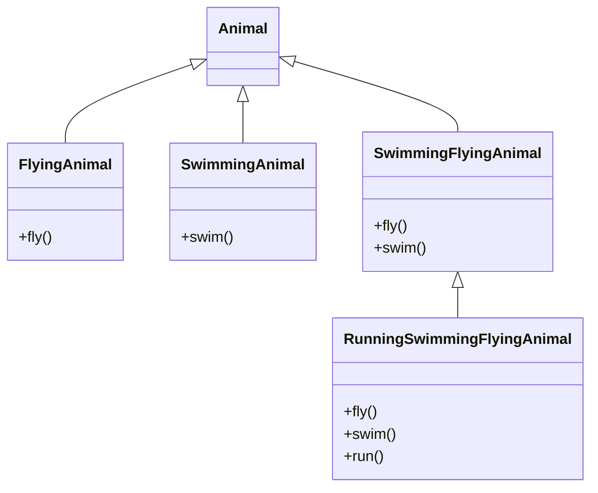
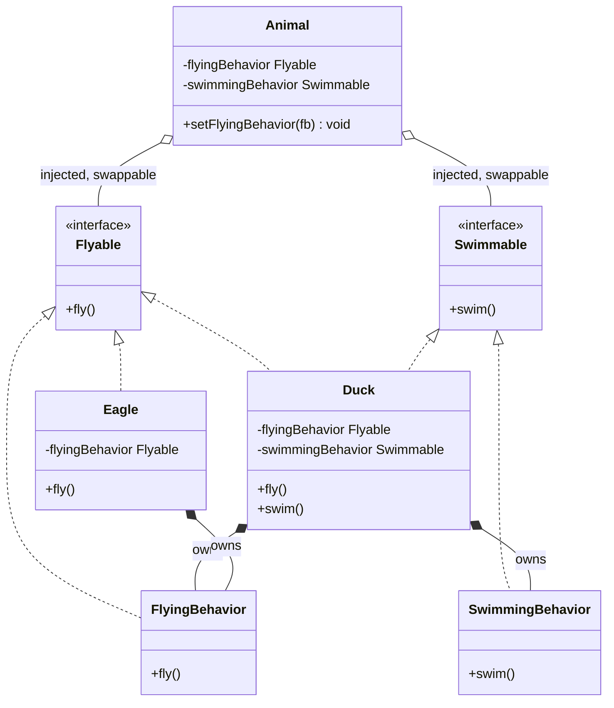

# Composition Over Inheritance
## Origins

One of the **two golden rules** from the Gang of Four's "Design Patterns: Elements of Reusable Object-Oriented Software" (1994):

> "Favor object composition over class inheritance."

The GoF identified this principle after observing that inheritance — despite being a central feature of OOP languages — leads to rigid, brittle designs when overused as the primary mechanism for code reuse.

---

## Intuition

> **One-line analogy**: Composition is like building with Lego — you assemble independent bricks (components) into any shape; Inheritance is like molding clay — you start with a parent shape and can only add, never fundamentally restructure without starting over.

**Mental model**: Inheritance locks you into a class hierarchy that's hard to change. If `Bird extends Animal` and `FlyingBird extends Bird`, what do you do with `Penguin` (a bird that doesn't fly)? Composition escapes this: `Bird` has-a `FlightBehavior` (an interface). `Eagle` gets `CanFly`; `Penguin` gets `CannotFly`. Swap behaviors at runtime; mix behaviors freely; no fragile hierarchy to maintain.

**Why it matters**: Deep inheritance hierarchies are the most common source of rigid, brittle design in OOP. The Strategy pattern is composition-over-inheritance in its purest form. Almost every GoF pattern relies on composition as its primary code reuse mechanism.

**Key insight**: Use inheritance when the IS-A relationship is genuine and stable (and when you want to inherit behavior, not just contract). Use composition when you want flexibility, testability (inject mock behaviors), or when the relationship might change. When in doubt, compose.

---

## Definition

**Inheritance** ("IS-A" relationship): a class gains behavior by extending a parent class. Behavior is fixed at compile time. Structure is hierarchical.

**Composition** ("HAS-A" relationship): a class gains behavior by holding references to objects that provide that behavior. Behavior can be assembled at runtime. Structure is flat.

**The principle:** when choosing between the two for code reuse, prefer composition. Reserve inheritance for genuine IS-A relationships.

---

## Problems with Inheritance

### 1. Fragile Base Class Problem

When a base class changes, all subclasses are potentially affected — even if the subclass had no reason to change. A subclass is tightly coupled to the internals of its parent, often in ways that are invisible from the subclass code.

```java
public class Base {
    public void doA() {
        doB(); // calls doB internally
    }
    public void doB() { ... }
}

public class Child extends Base {
    @Override
    public void doB() {
        super.doB();
        // additional logic
    }
}
// If Base.doA() stops calling doB(), Child silently breaks.
```

### 2. Deep Hierarchies

After 3-4 levels of inheritance, understanding what a class actually does requires tracing the entire hierarchy. Debugging becomes an exercise in class archaeology.

### 3. Inflexibility — Cannot Change at Runtime

Inheritance is a compile-time decision. A `FlyingDog` is always a `FlyingDog`. You cannot make it swim at runtime without restructuring the class hierarchy.

### 4. Java's Single Inheritance Constraint

Java only allows a class to extend one parent. In multiple-axis inheritance (a class that needs two behaviors from two unrelated hierarchies), the hierarchy approach forces awkward workarounds.

---

## Java Violation Example

Modeling animals with varying combinations of flying and swimming:

```java
class Animal { ... }
class FlyingAnimal extends Animal { void fly() { ... } }
class SwimmingAnimal extends Animal { void swim() { ... } }

// What about a duck — it both flies and swims?
// Option A: Pick one hierarchy branch, lose the other.
// Option B: Create a separate class:
class SwimmingFlyingAnimal extends Animal {
    void fly() { ... }
    void swim() { ... }
}
// But now: what about a FlyingSwimmingRunningAnimal?
// The hierarchy explodes combinatorially.

class FlyingAnimal extends Animal { ... }
class SwimmingFlyingAnimal extends FlyingAnimal { ... }
class RunningSwimmingFlyingAnimal extends SwimmingFlyingAnimal { ... }
// This is the "class explosion" problem.
```

Every new combination of behaviors requires a new class. The hierarchy becomes unmaintainable.



*Two capabilities already force a third sibling (`SwimmingFlyingAnimal`) that duplicates both method bodies; adding a third capability (`run`) forces yet another subclass down the chain — this is the class explosion the code above warns about.*

---

## Compliant Example

Model capabilities as interfaces and compose them:

```java
// Capability interfaces
public interface Flyable {
    void fly();
}

public interface Swimmable {
    void swim();
}

public interface Runnable {
    void run();
}

// Concrete implementations of each capability
public class FlyingBehavior implements Flyable {
    public void fly() {
        System.out.println("Flying with wings");
    }
}

public class SwimmingBehavior implements Swimmable {
    public void swim() {
        System.out.println("Swimming with webbed feet");
    }
}

// Animal composes whatever capabilities it needs
public class Duck implements Flyable, Swimmable {
    private final Flyable flyingBehavior = new FlyingBehavior();
    private final Swimmable swimmingBehavior = new SwimmingBehavior();

    public void fly() { flyingBehavior.fly(); }
    public void swim() { swimmingBehavior.swim(); }
}

public class Eagle implements Flyable {
    private final Flyable flyingBehavior = new FlyingBehavior();
    public void fly() { flyingBehavior.fly(); }
}

// With dependency injection: behaviors can be changed at runtime
public class Animal {
    private Flyable flyingBehavior;
    private Swimmable swimmingBehavior;

    public Animal(Flyable flyingBehavior, Swimmable swimmingBehavior) {
        this.flyingBehavior = flyingBehavior;
        this.swimmingBehavior = swimmingBehavior;
    }

    // Behavior can be swapped at runtime
    public void setFlyingBehavior(Flyable fb) {
        this.flyingBehavior = fb;
    }
}
```

Any combination of behaviors is possible with no class explosion. Behaviors can be changed at runtime by swapping the injected object.



*`Duck` and `Eagle` compose their behavior — each constructs its own `FlyingBehavior`/`SwimmingBehavior` for life; `Animal` only aggregates it, since the behavior is injected via the constructor and `setFlyingBehavior()` can swap it at runtime without touching `Animal`'s own lifecycle.*

---

## When IS Inheritance Appropriate?

Inheritance is not always wrong. Use it when:

1. **Genuine IS-A relationship:** `Dog` truly IS-A `Animal` in the domain. Not just "reuses some of the same code."

2. **Liskov Substitution Principle holds:** every subclass can be used wherever the parent is expected without breaking correctness. If you need to override a method with "throw UnsupportedOperationException," LSP is violated — use composition instead.

3. **Sealed, well-understood hierarchy:** the hierarchy is small, closed to external extension, and unlikely to need new axes of variation. Example: `Exception` → `RuntimeException` → `IllegalArgumentException`.

4. **Framework extension points:** some frameworks (e.g., older JUnit, some Spring components) are designed for extension via subclassing. Follow the framework's intent.

---

## Real-World Examples

### Java I/O Streams — Composition (Decorator Pattern)

```java
// Composition: wrap streams to add behavior
InputStream fileStream = new FileInputStream("data.txt");
InputStream bufferedStream = new BufferedInputStream(fileStream);  // adds buffering
InputStream gzipStream = new GZIPInputStream(bufferedStream);       // adds decompression
DataInputStream dataStream = new DataInputStream(gzipStream);       // adds typed reads
```

Each wrapper adds one behavior. You compose exactly the behaviors you need. The underlying stream can be any InputStream implementation.

### Spring Framework

Spring uses composition extensively. A `BeanFactory` holds references to beans (composition). Spring AOP creates proxy objects that wrap target objects (composition, not subclassing). `JdbcTemplate` holds a `DataSource` (composition).

---

## Related Patterns

- **Decorator:** The composition-over-inheritance pattern made explicit. Wraps an object to add behavior, rather than subclassing it.
- **Strategy:** Encapsulates a varying algorithm as an object. The host class holds a Strategy interface (composition), not a subclass.
- **Bridge:** Decouples abstraction from implementation using composition, preventing the two dimensions from creating a class explosion.

---

## Cross-Perspective: HLD Connections

**HLD View — Where Composition Over Inheritance Appears in Distributed Systems**

- **Microservices over monolith** — Rather than inheriting functionality from a shared monolith base, microservices compose capabilities: a service uses auth, storage, and messaging as independent components. This avoids the brittle coupling of a shared inheritance hierarchy.
- **Sidecar pattern** — Infrastructure capabilities (auth, logging, tracing, mTLS) are composed into a service via sidecars, not inherited from a shared base service. Adding a new capability means deploying a new sidecar — no changes to the service itself.
- **Plugin/middleware composition** — API gateway capabilities are composed as plugins: rate limiting, auth, and transformation are separate, composable units. This is more flexible than inheriting from a monolithic gateway base class.
- **Service mesh capability composition** — Envoy, Istio, and Linkerd compose security, observability, and traffic management as orthogonal capabilities added to any service without the service "inheriting" from a specific framework.

---

## Interview Questions and Answers

**Q: When IS inheritance the right call, according to the module's own criteria?**
**Short:** When the IS-A relationship is genuine, LSP holds, and the hierarchy is small and closed to surprise extension.
The module lists four cases: a genuine IS-A relationship in the domain (not just code reuse convenience), every subclass being substitutable for its parent without breaking correctness (Liskov Substitution Principle), a sealed and well-understood hierarchy unlikely to need new axes of variation, and following a framework's own designed extension points. `Exception → RuntimeException → IllegalArgumentException` is the module's example of a sealed, well-understood hierarchy where inheritance is appropriate. Needing to override a method with `throw UnsupportedOperationException` is the concrete tell that LSP has failed and composition should be used instead.

**Q: What is the "class explosion" problem, and how does the Animal/FlyingAnimal/SwimmingAnimal example demonstrate it?**
**Short:** Every new combination of capabilities forces a brand-new subclass, growing combinatorially instead of linearly.
Modeling flying and swimming as separate branches (`FlyingAnimal`, `SwimmingAnimal`) breaks down the moment an animal needs both, forcing a `SwimmingFlyingAnimal` class that duplicates both method bodies. Adding a third capability, running, forces yet another subclass (`RunningSwimmingFlyingAnimal`) down the chain, and the count of required subclasses grows combinatorially with the number of independent capabilities. The compliant fix models each capability as an interface (`Flyable`, `Swimmable`, `Runnable`) so any combination composes without any new class per combination.

**Q: What exactly is the Fragile Base Class problem, and how does the `Base.doA()`/`Child.doB()` example illustrate it?**
**Short:** A subclass can silently break when its parent's internal call pattern changes, even though the subclass's own code never changed.
`Child` overrides `doB()` and assumes `Base.doA()` will call it, since that's how `Base` currently behaves — but that assumption is implicit, not part of any contract. If `Base.doA()` is later refactored to stop calling `doB()`, `Child`'s override silently stops being invoked, and nothing about `Child`'s own source code changed to cause the break. This is why the module calls the coupling "invisible from the subclass code" — the subclass depends on an internal calling convention it cannot see or enforce.

**Q: Why does the module treat Java's single-inheritance constraint as a structural argument for composition, not just a language quirk?**
**Short:** A class needing two independent behaviors from two unrelated hierarchies cannot extend both, forcing awkward workarounds via inheritance.
Since a Java class may extend only one parent, a class that genuinely needs two independent axes of behavior — say, being both "flyable" and "loggable" via two different base classes — has no clean inheritance-only solution. Composition sidesteps this entirely: a class can implement any number of interfaces and hold any number of composed behavior objects, with no single-parent limit. The module presents this as one of four concrete structural problems, alongside class explosion, fragile base class, and compile-time rigidity, that inheritance runs into as a general-purpose reuse mechanism.

**Q: How do Java I/O streams demonstrate composition over inheritance in a real, widely-used API?**
**Short:** Each stream wrapper — Buffered, GZIP, DataInputStream — composes one added behavior around any underlying InputStream.
`new DataInputStream(new GZIPInputStream(new BufferedInputStream(new FileInputStream("data.txt"))))` builds up buffering, decompression, and typed reads by wrapping, not by subclassing a combinatorial hierarchy of `BufferedGZIPDataFileInputStream`-style classes. Each wrapper adds exactly one behavior and can be composed with any other `InputStream` implementation, not just `FileInputStream`. The module cites this as the real-world instance of the Decorator pattern, which it calls "the composition-over-inheritance pattern made explicit."

**Q: How does Spring's own architecture use composition rather than inheritance, according to the module?**
**Short:** BeanFactory holds bean references, AOP creates wrapping proxies, and JdbcTemplate holds a DataSource — all composition, not subclassing.
`BeanFactory` manages beans by holding references to them, not by inheriting from them; Spring AOP adds cross-cutting behavior by creating proxy objects that wrap the target object rather than by generating a subclass in the traditional sense; and `JdbcTemplate` gains database access by holding a `DataSource` object rather than extending one. The module presents Spring as a framework that is composition-first throughout its core mechanisms, reinforcing that composition scales to production frameworks, not just toy examples.

**Q: What does the runtime-behavior-swapping benefit of composition look like concretely in the Animal example?**
**Short:** `Animal.setFlyingBehavior(fb)` can replace the injected `Flyable` implementation without touching the Animal class itself.
Because `Animal` holds a `Flyable flyingBehavior` field set via constructor injection rather than gaining flight through `extends FlyingAnimal`, the concrete behavior object can be swapped out at runtime with `setFlyingBehavior()`. Inheritance cannot offer this at all — a class's parent is fixed at compile time and cannot be changed once the object is constructed. This is the module's clearest illustration of "behavior can be assembled at runtime" versus inheritance's "behavior is fixed at compile time."

**Q: Why do `Duck` and `Eagle` each construct their own `FlyingBehavior` instance rather than sharing one injected object, and what does that reveal about ownership versus injection in composition?**
**Short:** `Duck` and `Eagle` own their behavior for their whole lifecycle; `Animal` merely aggregates an injected, swappable one.
`Duck` and `Eagle` instantiate `new FlyingBehavior()` themselves as a permanent part object they own for life — this is composition as strong ownership. `Animal`, by contrast, receives its `Flyable` through the constructor and can later swap it via `setFlyingBehavior()` — this is composition as aggregation, a looser relationship where the composed object's lifecycle is independent of the container's. The module's class diagram marks this distinction explicitly with `*--` (owns) for Duck/Eagle versus `o--` (injected, swappable) for Animal, showing composition itself has degrees of coupling, not just one flavor.

**Q: How does the Strategy pattern relate to composition over inheritance, as described in the module?**
**Short:** Strategy encapsulates a varying algorithm as a composed object rather than as a subclass override.
Instead of creating a subclass per algorithm variant — `BubbleSortList extends List`, `QuickSortList extends List` — Strategy has the host class hold a reference to a `Strategy` interface and delegate to whichever concrete strategy object is composed in. This avoids both the class-explosion problem (one subclass per variant) and the compile-time rigidity problem (can't change the algorithm after construction), the same two problems the Animal/capability example targets. The module lists Strategy as one of three directly related patterns, alongside Decorator and Bridge.

**Q: What does the Bridge pattern add to composition over inheritance that the basic Animal/Flyable example doesn't emphasize?**
**Short:** Bridge decouples two independently-varying dimensions using composition, preventing a class explosion across both dimensions at once.
Where the Animal example composes independent single-axis capabilities (flying, swimming, running), Bridge specifically targets the case where an abstraction and its implementation both vary independently — for example, shapes that can be rendered by different rendering engines. Without Bridge, you'd get a subclass per (shape, engine) combination; with Bridge, the abstraction holds a reference to an implementation interface, and either side can vary without multiplying the other. The module lists Bridge alongside Decorator and Strategy as one of the patterns whose flexibility depends specifically on composition instead of inheritance.

**Q: Why does the module call the sidecar pattern an infrastructure-level instance of composition over inheritance?**
**Short:** Capabilities like auth, logging, and mTLS are composed into a service via sidecars instead of inherited from a shared base service.
A monolithic "base service" that every other service extends to gain auth and logging is the infrastructure equivalent of a fragile base class — every service is coupled to that base's internals, and changing the base risks breaking every service that extends it. A sidecar instead attaches these capabilities as an independent, composed process alongside the service, so adding a new capability means deploying a new sidecar, with zero change to the service's own code. This is presented as the same has-a-versus-is-a distinction as the code-level examples, applied to deployment topology.

**Q: How does the module distinguish microservices-over-monolith from "composition" in the plain code sense, and why is it still the same principle?**
**Short:** Microservices compose independent capabilities like auth, storage, and messaging as separate services rather than inheriting them from a shared monolith base.
In a monolith, shared functionality is often accessed by extending or importing from a common base module, coupling every consumer to that module's internals in the same way a fragile base class does. Microservices instead treat auth, storage, and messaging as independent, composable services that any other service calls or integrates with as needed, without any inheritance-like relationship to a shared codebase. The module frames this as the architectural-scale version of "has-a, not is-a" — a service *uses* auth, it doesn't *is-a* auth-provider.

**Q: What is the practical test the module offers for deciding between inheritance and composition when starting a new design?**
**Short:** "When in doubt, compose" — use inheritance only for genuine, stable IS-A relationships where you also want to inherit behavior, not just a contract.
The module's intuition section states the choice directly: use inheritance when the IS-A relationship is genuine and stable and you specifically want inherited behavior; use composition when you want flexibility, testability via injected mock behaviors, or when the relationship might change. Because most relationships that look like IS-A at design time turn out to need variation later (the Duck/Penguin problem), the module's default guidance under uncertainty is to compose rather than extend.

**Q: In the Duck/Penguin scenario referenced in the module's intuition section, what specifically breaks if `Bird` implements flight via inheritance?**
**Short:** A `FlyingBird extends Bird` hierarchy has no clean place for `Penguin`, a bird that cannot fly.
If flight capability is baked into a `FlyingBird` subclass that all birds are expected to extend, `Penguin` either has to fake flight support it doesn't have or requires an awkward restructuring of the hierarchy to carve out non-flying birds. Modeling flight as a composed `FlightBehavior` interface instead means `Eagle` is given a `CanFly` behavior and `Penguin` is given a `CannotFly` behavior, with no subclassing conflict and no wasted or misleading inherited methods. This is the module's opening illustration of why inheritance-first designs for capability variation break down as soon as an exception to the assumed pattern appears.

**Q: Why does the module warn that debugging becomes "an exercise in class archaeology" past 3-4 levels of inheritance?**
**Short:** Understanding a deeply-inherited class requires tracing behavior scattered across every ancestor in the chain.
A method's actual behavior in a deep hierarchy may be defined in the immediate class, overridden two levels up, and partially implemented four levels up in a common ancestor — a reader has to walk the entire chain to understand what a single call actually does. Composition avoids this because a composed object's behavior lives entirely within that one object; there is no ancestor chain to trace, only the object you're directly holding a reference to. This is presented as a concrete cost of deep hierarchies distinct from, but compounding, the fragile base class problem.

---

## Quick Summary

| Aspect | Summary |
|--------|---------|
| Core idea | Build behavior by combining objects, not by extending class hierarchies |
| Problems with inheritance | Fragile base class, class explosion, compile-time rigidity, single-inheritance limit |
| When to use inheritance | Genuine IS-A, LSP holds, sealed hierarchy |
| Runtime benefit | Behavior can be changed by swapping composed objects |
| Real-world example | Java I/O streams (Decorator), Spring (composition-first framework) |
| Related patterns | Decorator, Strategy, Bridge |
