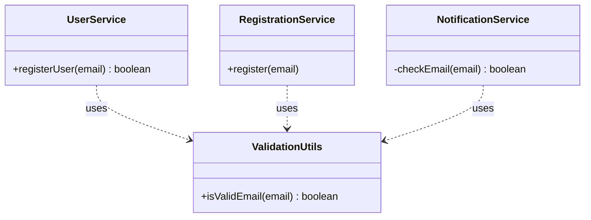

# DRY — Don't Repeat Yourself
## Origins

Coined by Andrew Hunt and David Thomas in **"The Pragmatic Programmer" (1999)**:

> "Every piece of knowledge must have a single, unambiguous, authoritative representation within a system."

---

## Intuition

> **One-line analogy**: DRY is like maintaining one authoritative source of truth — one master spreadsheet, not a dozen copies. When the truth changes, update once; if it's duplicated, update everywhere and miss one.

**Mental model**: Every piece of business knowledge has exactly one home in your codebase. "Discount is 10% for premium users" should live in exactly one place. If it's copied in three services, changing the discount rate to 15% requires finding and updating all three — missing one is a bug. DRY isn't about code similarity; it's about knowledge duplication.

**Why it matters**: Duplication is the root cause of most maintenance nightmares. One change requires multiple edits; forgetting any one creates inconsistencies. DRY makes codebases cheaper to change and less error-prone.

**Key insight**: DRY is often misapplied — similar-looking code that encodes different concepts is NOT a violation. Three sorting functions for three different business rules that happen to look similar should stay separate; premature abstraction creates worse coupling. Test duplication WET (Write Everything Twice) first, then DRY when the duplication pattern is clear.

---

## Definition

DRY is NOT just about avoiding copy-paste. It is about avoiding duplication of **knowledge and logic**. Two pieces of code that look identical but represent different concepts are NOT a DRY violation. Two pieces of code that look different but encode the same business rule ARE a DRY violation.

The key question: **"If this business rule changes, how many places do I need to update?"**

If the answer is more than one, you have a DRY violation — regardless of whether the code looks similar.

---

## Motivation

- A single change to a business rule should require only one code change.
- Duplicated knowledge creates inconsistency bugs when one copy is updated and another is forgotten.
- Reduces the cognitive surface area of the system.

---

## Java Violation Example

Three services each define their own email validation logic:

```java
// In UserService.java
public boolean validateEmail(String email) {
    return email != null && email.contains("@") && email.endsWith(".com");
}

// In RegistrationService.java
public boolean isValidEmail(String email) {
    return email != null && email.contains("@") && email.endsWith(".com");
}

// In NotificationService.java
private boolean checkEmail(String email) {
    return email != null && email.contains("@") && email.endsWith(".com");
}
```

**The problem:** the email validation rule (what constitutes a valid email) is a single piece of business knowledge encoded in three places. When the rule needs to change (e.g., support `.org` and `.net` domains), a developer must find and update all three copies — and is likely to miss one.

---

## Compliant Example

Extract the shared knowledge into a single authoritative location:

```java
// ValidationUtils.java
public final class ValidationUtils {

    private ValidationUtils() {}

    public static boolean isValidEmail(String email) {
        if (email == null) return false;
        // Single, authoritative email validation rule
        return email.matches("^[A-Za-z0-9+_.-]+@[A-Za-z0-9.-]+\\.[A-Za-z]{2,}$");
    }
}

// UserService.java
public boolean registerUser(String email) {
    if (!ValidationUtils.isValidEmail(email)) {
        throw new IllegalArgumentException("Invalid email");
    }
    // ...
}

// RegistrationService.java
public void register(String email) {
    if (!ValidationUtils.isValidEmail(email)) {
        throw new IllegalArgumentException("Invalid email");
    }
    // ...
}
```

Now there is one place to update when the email rule changes.

Completing the fix across all three original services (the code above shows two of the three): every caller now depends on one authoritative `ValidationUtils.isValidEmail()`, so the email rule has exactly one home to update.



---

## WET vs DRY

**WET** = "Write Everything Twice" (or "We Enjoy Typing") — the anti-pattern opposite of DRY.

| WET | DRY |
|-----|-----|
| Logic copied across classes | Logic centralized in one place |
| Bug fixed in one copy, forgotten in others | Fix once, everywhere benefits |
| Inconsistent behavior between copies | Consistent, single source of truth |
| Easy to write, expensive to maintain | Requires upfront abstraction discipline |

---

## Tradeoffs

**Benefits:**
- Single place to fix bugs.
- Consistent behavior guaranteed by design.
- Easier to understand the system (one canonical place for each rule).

**Costs:**
- Abstractions add indirection — developers must navigate to the abstraction to understand what's happening.
- Wrong abstractions create coupling between unrelated things just because they look alike today.
- Over-DRYing can make code harder to read and modify.

---

## When DRY is WRONG: The Danger of Premature Abstraction

**"Duplication is far cheaper than the wrong abstraction."** — Sandi Metz

Consider two pieces of code that look identical today but represent different domain concepts — for example, `calculateEmployeeTax()` and `calculateContractorTax()`. If you merge them into one `calculateTax()` function now, when the rules diverge (and they will), you'll have to untangle a shared abstraction — which is harder than having two separate functions.

**Signs you have the wrong abstraction:**
- You need to add boolean flags or `type` parameters to the shared function to handle different cases.
- Callers pass `null` for parameters they don't need.
- The abstraction has comments like "only used for X, not Y."

---

## Rule of Three

A pragmatic heuristic for when to apply DRY:

1. **First time:** just write it.
2. **Second time:** note the duplication, but leave it (premature abstraction risk is too high).
3. **Third time:** now you have enough signal to understand the real abstraction — extract it.

This prevents over-engineering while still preventing rampant duplication.

The escalation is deliberate: waiting until the third occurrence is what supplies enough signal to avoid the "wrong abstraction" trap described above.

```mermaid
flowchart LR
    classDef io      fill:#61afef,stroke:#2e86c1,color:#1a1a1a,font-weight:bold
    classDef frozen  fill:#c678dd,stroke:#9b59b6,color:#fff
    classDef train   fill:#98c379,stroke:#27ae60,color:#1a1a1a
    classDef mathOp  fill:#d19a66,stroke:#e67e22,color:#1a1a1a,font-weight:bold
    classDef lossN   fill:#e06c75,stroke:#c0392b,color:#fff,font-weight:bold
    classDef req     fill:#56b6c2,stroke:#0097a7,color:#1a1a1a
    classDef base    fill:#e5c07b,stroke:#f39c12,color:#1a1a1a

    A(["1st occurrence"]) --> B("Just write it")
    B --> C(["2nd occurrence"])
    C --> D("Note duplication,<br/>leave it - risk too high")
    D --> E(["3rd occurrence"])
    E --> F("Enough signal to see<br/>the real abstraction")
    F --> G(["Extract it"])

    class A,C,E io
    class B,G train
    class D frozen
    class F mathOp
```



---

## Real-World Examples

- **Spring Framework:** `JdbcTemplate` eliminates duplicated boilerplate for database connection setup/teardown that every DAO would otherwise repeat.
- **Apache Commons / Guava:** utility libraries that centralize common operations so every project doesn't re-implement them.
- **Database normalization:** 3NF (Third Normal Form) is literally DRY applied to data — every fact stored exactly once.
- **CSS variables / design tokens:** a color defined once in a variable, not hardcoded in hundreds of selectors.

---

## Related Patterns

- **Template Method:** Defines a skeleton algorithm in a base class, eliminating duplication of the algorithm structure while allowing steps to vary.
- **Strategy:** Eliminates duplicated conditional logic by encapsulating each variant as an interchangeable object.
- **Single Responsibility Principle:** Each class has one reason to change — closely tied to having one authoritative place per concept.

---

## Cross-Perspective: HLD Connections

**HLD View — Where DRY Appears in Distributed Systems**

- **Shared service libraries** — Cross-cutting concerns (auth token validation, distributed tracing, structured logging, metrics emission) are extracted into shared libraries rather than duplicated per service. Every service imports the library; the logic lives in one place.
- **API gateway centralization** — Instead of each microservice implementing rate limiting, auth, and request logging independently, the API gateway centralizes these concerns. Adding a new service means it inherits these capabilities automatically — DRY at the infrastructure level.
- **Schema registry** — A schema registry (Confluent Schema Registry, AWS Glue Schema Registry) is the single source of truth for event schemas. Producers and consumers reference the registry; no service hard-codes schema definitions — preventing divergence.
- **Infrastructure modules** — Terraform modules and Helm charts reuse infrastructure definitions (VPC setup, RDS config, EKS cluster) rather than copy-pasting across environments. A fix in the module propagates everywhere.

---

## Interview Questions and Answers

**Q: What is the real test for whether two pieces of code are a DRY violation?**
**Short:** Ask whether a single business-rule change would require editing more than one place.
The test is not "do these two blocks look similar" but "if this piece of knowledge changes, how many places do I need to update." Two blocks that look identical today but encode different business rules — like tax calculation for employees versus contractors — are not a violation, because they can diverge independently. Two blocks that look different but encode the same rule, like the same email-validation regex spelled out three different ways, ARE a violation. When answering "how many files change for this one rule," more than one is the actual signal.

**Q: Why is it wrong to merge two identical-looking functions just because they currently share code?**
**Short:** Identical code that represents different domain concepts will diverge and force painful untangling later.
`calculateEmployeeTax()` and `calculateContractorTax()` may compute the same formula today, but they represent different domain concepts that are only coincidentally equal. Merging them into `calculateTax()` creates a false coupling: when the rules diverge, as tax rules do, someone must add a `type` flag or a conditional branch to the shared function. Sandi Metz's line captures it directly — duplication is far cheaper than the wrong abstraction, so leave them separate until a real shared rule, not a coincidental resemblance, justifies merging.

**Q: What does the Rule of Three actually prescribe, and why wait for a third occurrence instead of abstracting on the second?**
**Short:** Write it once, tolerate duplication on the second occurrence, and extract only on the third.
On the first occurrence you just write the code. On the second, you note the duplication but deliberately leave it, because two data points aren't enough to know the real shape of the abstraction. On the third occurrence you finally have enough signal to see what actually varies and what doesn't, so you extract with confidence. Abstracting after only two instances is exactly the premature-abstraction trap the rule exists to prevent.

**Q: What are the concrete signs that you've built the wrong abstraction while chasing DRY?**
**Short:** Boolean flags, null parameters, and "only used for X" comments on a shared function.
A shared function that needs a `type` or boolean flag to branch between callers is really two functions pretending to be one. Callers passing `null` for parameters they don't need is another tell — the abstraction is bigger than any single caller actually requires. A comment reading "only used for X, not Y" is the clearest signal of all: it admits the function is not actually general, just prematurely generalized. Any of these three is a cue to split the abstraction back apart rather than keep patching it.

**Q: What is WET and how does it relate to DRY?**
**Short:** WET ("Write Everything Twice") is the anti-pattern of copying logic instead of centralizing it.
WET code copies the same logic across multiple classes or services, so a bug fix applied to one copy leaves the others silently wrong. DRY is the opposite discipline: centralize the logic once so a fix or a rate change benefits every caller automatically. WET is cheap to write in the moment but expensive to maintain, while DRY costs upfront abstraction discipline in exchange for guaranteed consistency. The tradeoff is not free either way — DRY still needs a genuinely correct abstraction, not just any centralization.

**Q: In the ValidationUtils example, what exactly changed to fix the DRY violation, and what does each caller now depend on?**
**Short:** Three duplicated regex checks were replaced by one static `ValidationUtils.isValidEmail()` method.
`UserService`, `RegistrationService`, and `NotificationService` each hard-coded their own copy of the same email-validation rule (`contains("@") && endsWith(".com")`). The fix extracted that rule into a single static method on `ValidationUtils`, and every caller now invokes that one method instead of its own copy. When the email rule needs to support `.org` or `.net` domains, there is exactly one method to change, and every caller picks up the new behavior automatically.

**Q: What do you give up when you extract a DRY abstraction — what is the cost side of the tradeoff?**
**Short:** Abstractions add indirection that a reader must navigate to see what code actually does.
Every extraction adds a layer between the caller and the behavior: a reader must jump to `ValidationUtils` to understand what "valid email" means instead of seeing it inline. If the abstraction is wrong, it also creates coupling between unrelated callers who now share a class that doesn't fit either of them cleanly. DRY's benefits — one fix point, guaranteed consistency — are real, but they are only worth the indirection cost when the abstraction genuinely represents one piece of knowledge.

**Q: How is database normalization (3NF) an application of DRY?**
**Short:** Third Normal Form stores every fact exactly once, eliminating update anomalies from duplicated data.
3NF eliminates transitive dependencies so that each fact — a customer's address, a product's price — is stored in exactly one row rather than repeated across many. This is literally the DRY principle applied to data instead of code: if the fact changes, exactly one row is updated, and every reader sees a consistent value. Denormalization deliberately reintroduces duplication for read performance, which is the same "duplication is sometimes the right choice" tradeoff DRY makes at the code level.

**Q: How does an API gateway apply DRY at the infrastructure level across microservices?**
**Short:** Centralizing rate limiting, auth, and logging in the gateway avoids reimplementing them per service.
Without a gateway, every microservice would need its own rate-limiting, authentication, and request-logging logic — the same knowledge duplicated across every service boundary. Centralizing these concerns in the gateway means a new service inherits them automatically just by sitting behind it, with no per-service implementation required. This is DRY operating at the infrastructure layer rather than the code layer: one authoritative place for a cross-cutting policy.

**Q: Why is a schema registry (Confluent Schema Registry, AWS Glue Schema Registry) considered a DRY pattern?**
**Short:** A schema registry is the single authoritative source for event schemas instead of each service hard-coding its own copy.
Without a registry, producers and consumers each hard-code their understanding of an event's shape, and those copies silently drift apart as the event evolves. The registry becomes the one authoritative representation of the schema that every producer and consumer references directly. This prevents the exact failure mode DRY targets in code — divergent copies of the same knowledge — but at the scale of an entire event-driven system.

**Q: How does the Template Method pattern reduce duplication compared to writing each algorithm variant from scratch?**
**Short:** Template Method centralizes the algorithm's skeleton once while letting only the varying steps differ per subclass.
Without it, each variant of an algorithm — say, three data-export formats — would duplicate the entire control flow (open, validate, process, close) and vary only in one or two steps. Template Method puts that shared skeleton in a base class exactly once, and subclasses override only the steps that actually differ. This is DRY applied to algorithm structure specifically: the sequencing logic has one authoritative home even though the details vary.

**Q: How does the Strategy pattern eliminate duplication that a chain of if/else branches would otherwise create?**
**Short:** Strategy replaces duplicated conditional branches with one interchangeable object per variant.
A naive design might repeat the same `if (paymentType == CREDIT_CARD) {...} else if (paymentType == PAYPAL) {...}` conditional in every place a payment is processed. Strategy pulls each variant into its own class implementing a shared interface, so the conditional logic exists in exactly one place — wherever the strategy is selected — instead of being copy-pasted at every call site. This is DRY applied to conditional logic rather than to straight-line code.

**Q: What real-world Spring class is cited as a DRY example, and what boilerplate does it eliminate?**
**Short:** `JdbcTemplate` centralizes the connection-open/close boilerplate every DAO would otherwise repeat.
Without it, every DAO class would duplicate the same connection-acquisition, exception-translation, and resource-cleanup logic around each query. `JdbcTemplate` extracts that repetitive plumbing into one place, so a DAO only supplies the SQL and the row-mapping logic while the template handles the rest. This is the same DRY payoff as the `ValidationUtils` example: one authoritative implementation instead of N near-identical copies.

**Q: Give an example of a genuine DRY violation versus a coincidental duplication that should stay separate.**
**Short:** Three copies of the same email-regex are a violation; two similarly-shaped tax functions for different roles are not.
The email-validation example is a genuine violation because all three services encode literally the same business rule — "what counts as a valid email" — and a rule change should touch one place. `calculateEmployeeTax()` and `calculateContractorTax()` look alike today but represent independently-evolving rules for different roles, so merging them creates false coupling rather than removing real duplication. The distinguishing question is always whether the two pieces of code would need to change together for the same reason.

**Q: Once you confirm two copies encode the same rule, where should the single authoritative copy live?**
**Short:** In the module that owns the business concept the rule describes, such as an `EmailAddress` value type, not in a generic `utils` class every layer imports.
Put the rule next to the concept it defines. An email-format rule belongs in an `EmailAddress` value type whose constructor rejects bad input, so no caller can hold an unvalidated address and no caller needs to remember to call `ValidationUtils.validateEmail()`. A `CommonUtils` or shared library that every service imports is the usual wrong answer: it gathers unrelated rules, so a change to one forces every consumer to upgrade, and it couples teams that share nothing but the jar. Across service boundaries, the single copy is often a contract instead of code, such as an OpenAPI schema or a Protobuf message, owned by the service that owns the data. The test is the same one DRY uses everywhere: when the rule changes, which team makes the change, and does the change reach every caller from one edit.

---

## Quick Summary

| Aspect | Summary |
|--------|---------|
| Core idea | Every piece of knowledge has exactly one authoritative representation |
| Not just | Copy-paste avoidance — it is knowledge/logic duplication avoidance |
| Key question | "If this rule changes, how many places change?" |
| Danger | Wrong abstraction is worse than duplication |
| Heuristic | Rule of Three — abstract on the third occurrence |
| Opposite | WET (Write Everything Twice) |
