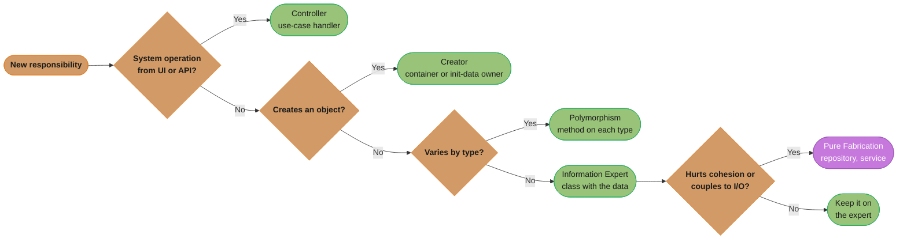
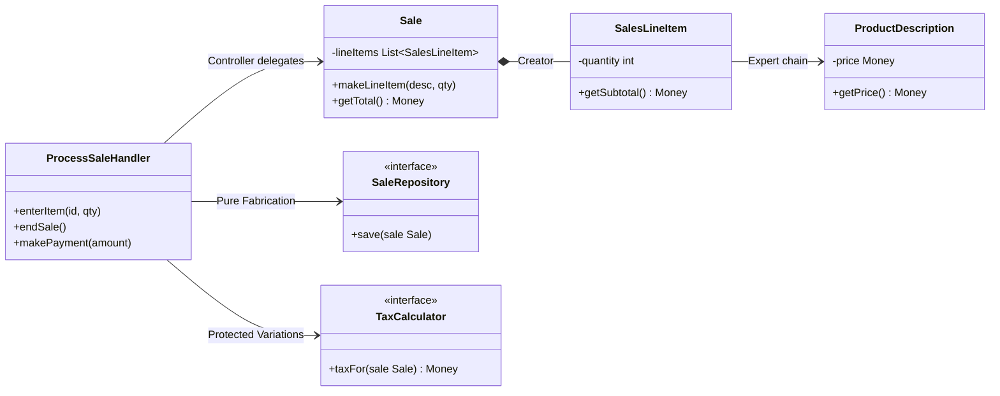
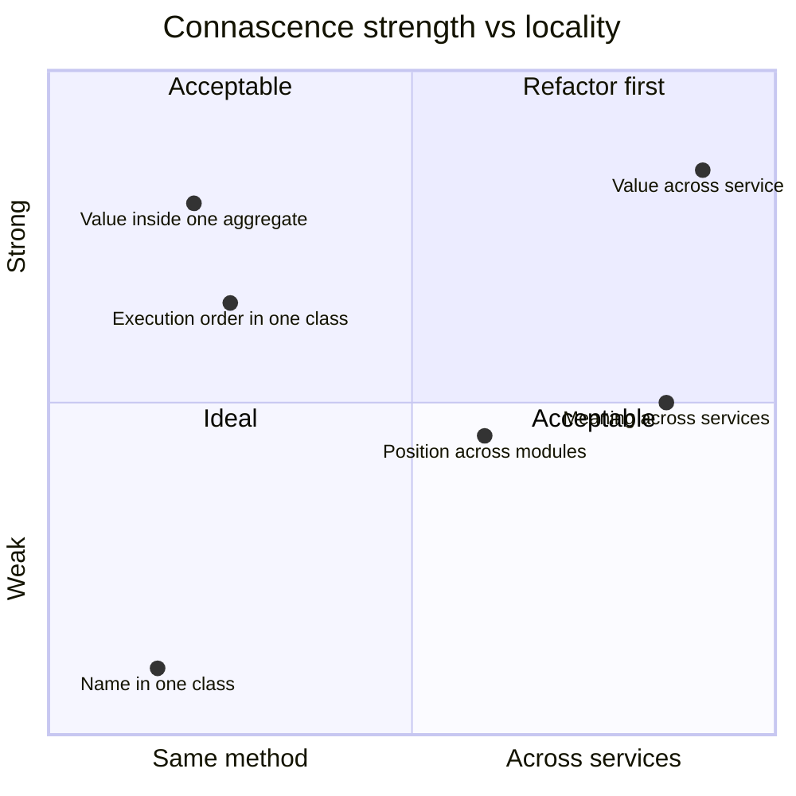

# GRASP and Connascence

Who should own this method? GRASP gives nine named answers, and connascence measures how badly the answer couples the code.

## 1. Concept Overview

**GRASP** (General Responsibility Assignment Software Patterns) is a set of nine principles from Craig Larman's *Applying UML and Patterns* (3rd edition, Prentice Hall, 2004) for the one decision every object-oriented design makes over and over: which class gets this responsibility? A responsibility is either *knowing* (data a class holds or can compute) or *doing* (an action it performs or coordinates). GoF patterns are reusable solutions to recurring problems; GRASP sits one level lower and explains why those solutions put methods where they do.

| GRASP principle | Question it answers | One-line rule |
|-----------------|--------------------|---------------|
| Information Expert | Who computes X? | The class that has the information needed |
| Creator | Who creates instances of A? | B, if B contains, records, closely uses, or has the init data for A |
| Controller | Who first handles a system operation from the UI or API? | A use-case or facade object, not the UI or the domain entity |
| Low Coupling | How do I keep change local? | Prefer assignments that add fewer and weaker dependencies |
| High Cohesion | How do I keep a class focused? | Prefer assignments that keep each class's responsibilities related |
| Polymorphism | How do I handle behavior that varies by type? | Give the varying behavior to the types, not to a `switch` |
| Pure Fabrication | Where does a responsibility go when no domain class fits? | Invent a non-domain class (a repository, a service) |
| Indirection | How do I avoid direct coupling between two parts? | Put an intermediate object between them |
| Protected Variations | How do I protect code from a part that will change? | Wrap the unstable point in a stable interface |

**Connascence** (Meilir Page-Jones, "Comparing Techniques by Means of Encapsulation and Connascence", *Communications of the ACM*, September 1992; expanded in *What Every Programmer Should Know About Object-Oriented Design*, 1995) is the vocabulary for measuring coupling. Two elements are connascent if a change to one requires a change to the other for the system to stay correct. GRASP says "keep coupling low"; connascence says which coupling is cheap, which is expensive, and how to refactor from one to the other.

---

## 2. Intuition

> **One-line analogy**: GRASP is the seating chart for a dinner: each guest (responsibility) sits next to the people they talk to most (the data they need). Connascence is the count of strings tying guests at different tables together, and how thick each string is.

**Mental model**: Draw the domain classes, then for each new method ask "who already knows the data this needs?" Put the method there (Expert). If the answer creates a dependency between two distant parts, ask how strong and how far-reaching that dependency is (connascence). If it is strong and crosses a module boundary, add an interface (Protected Variations) or a helper class that the domain does not have (Pure Fabrication).

**Why it matters**: LLD interviews are graded largely on responsibility assignment. A design where `ParkingLotService` computes fees by reading every field of `Ticket`, `Vehicle` and `Rate` works, but it is the anemic-model shape interviewers mark down. The GRASP names let you say why `Ticket.fee(rate)` is better in one sentence.

**Key insight**: All nine GRASP principles serve two of them: Low Coupling and High Cohesion. The other seven are recurring ways to reach those two. Connascence makes "low coupling" measurable instead of a matter of taste.

---

## 3. Core Principles

### The five basic GRASP principles

**Information Expert.** Assign a responsibility to the class that has the information to fulfill it. In Larman's point-of-sale example, `Sale.getTotal()` sums `SalesLineItem.getSubtotal()`, which multiplies quantity by `ProductDescription.getPrice()`. Each class computes what its own data supports, and no class reaches through another to read its fields. This is the same insight as Tell, Don't Ask and the [Law of Demeter](LawOfDemeter.md).

**Creator.** Assign class B the job of creating A when one or more of these hold, in rough order of preference: B contains or aggregates A; B records A; B closely uses A; B has the data needed to initialize A. `Sale` creates `SalesLineItem` because it aggregates line items. When creation is complex (pooling, conditional subtype choice), the rule hands over to a [Factory](../creational/factory_method/factory_method.md), which is a Pure Fabrication.

**Controller.** The first object beyond the UI or transport layer that receives and coordinates a system operation (`enterItem`, `endSale`, `makePayment`). Larman names two kinds: a *facade controller* for the whole system or subsystem (`Register`, `POSSystem`) when there are few operations, and a *use-case controller* (`ProcessSaleHandler`) per use case when there are many. The controller delegates; it does not hold business rules. In Spring, a `@Service` application service plays this role and the `@RestController` stays in the UI layer.

**Low Coupling.** Among candidate assignments, prefer the one that adds fewer dependencies and weaker ones. Coupling is not bad in itself; coupling to something unstable is.

**High Cohesion.** Among candidate assignments, prefer the one that keeps each class's responsibilities related. A class with 40 unrelated methods (the [God Object](../anti_patterns/GodObject.md)) has low cohesion.

### The four advanced GRASP principles

**Polymorphism.** When behavior varies by type, assign it to the types through a polymorphic operation instead of testing the type in a conditional. This is the principle behind [Strategy](../behavioral/strategy/strategy.md) and State.

**Pure Fabrication.** When Expert would give a responsibility to a domain class and wreck its cohesion (making `Sale` save itself to the database), invent a class that does not represent a domain concept: `SaleRepository`, `PricingService`, `EventPublisher`. Most GoF patterns are Pure Fabrications.

**Indirection.** Assign a responsibility to an intermediate object to decouple two others: an Adapter in front of a third-party tax engine, a Mediator between UI widgets, a message queue between services.

**Protected Variations.** "Identify points of predicted variation or instability; assign responsibilities to create a stable interface around them" (Larman). Larman ties it to Parnas's information hiding (1972) and to the Open/Closed Principle. The key word is *predicted*: protect points that have varied or are known to vary, not every class.

### Connascence

Connascence has three properties:

- **Strength**: how hard it is to discover and refactor. Weaker forms are better.
- **Locality**: how far apart the connascent elements are. Strong connascence inside one method is fine; the same strength across services is a problem.
- **Degree**: how many elements are involved. Connascence among 2 elements is cheaper than among 200.

The guideline that follows (popularized by Jim Weirich): convert strong forms to weaker forms, and reduce strength as distance grows.

---

## 4. Types / Architectures / Strategies

### 4.1 The nine kinds of connascence, weakest to strongest

| Kind | Static or dynamic | Two elements must agree on | Example | Refactor toward |
|------|-------------------|---------------------------|---------|-----------------|
| Name (CoN) | Static | A name | Caller calls `charge()`; rename breaks it | Already the weakest; IDE rename handles it |
| Type (CoT) | Static | A type | Method takes `long cents` | Fine; make types meaningful (`Money`) |
| Meaning / Convention (CoM) | Static | What a value means | `status == 3` means "shipped" in two classes | Enum or constant: CoM becomes CoN |
| Position (CoP) | Static | Order of values | `new Order(id, customerId, total, tax)`, two `long`s swapped | Parameter object or builder: CoP becomes CoN |
| Algorithm (CoA) | Static | An algorithm | Client and server both compute the same checksum or hash | One shared function or library |
| Execution order (CoE) | Dynamic | Call order | `init()` must be called before `send()` | Constructor does init; type-state builder |
| Timing (CoTm) | Dynamic | When things happen | A cache entry must be read within 30 s of a write; a race | Explicit synchronization or versioning |
| Value (CoV) | Dynamic | Related values at run time | Debit and credit must sum to zero; a replica must match its primary | Single owner, transaction, or invariant check in one class |
| Identity (CoI) | Dynamic | The same object instance | Two components must hold the same `EventBus` instance | Inject one instance explicitly |

### 4.2 Responsibility-assignment heuristics side by side

| Situation | GRASP choice | Pattern that implements it |
|-----------|-------------|----------------------------|
| Calculation over an object's own data | Information Expert | Method on the entity |
| Object creation with one obvious owner | Creator | Constructor call in the aggregate root |
| Object creation with conditional subtype | Pure Fabrication | Factory Method, Abstract Factory |
| Request enters the domain | Controller | Application service, use-case handler |
| Type-dependent behavior | Polymorphism | Strategy, State, sealed interface + `switch` |
| Persistence, messaging, external calls | Pure Fabrication + Indirection | Repository, Gateway, Adapter |
| Unstable third-party API | Protected Variations | Interface + Adapter, anti-corruption layer |

---

## 5. Architecture Diagrams

**Assigning a responsibility.** A decision path for one new method:



*Expert is the default; Pure Fabrication is the escape when the expert would gain an unrelated concern such as SQL.*

**Point-of-sale example, after GRASP.** Larman's running example:



**Connascence strength against distance.** Acceptable combinations sit low or near:



*Strong connascence is tolerable inside one class or aggregate; across a module or service boundary it should be weakened first.*

---

## 6. How It Works: Detailed Mechanics

### 6.1 Information Expert, broken and fixed

```java
// BROKEN: the service reads every field and computes; Sale is a data bag
public class CheckoutService {
    public Money total(Sale sale) {
        Money sum = Money.ZERO;
        for (SalesLineItem li : sale.getLineItems()) {
            sum = sum.plus(li.getProduct().getPrice().times(li.getQuantity()));
        }
        return sum;
    }
}

// FIX: each class computes what its own data supports
public class Sale {
    private final List<SalesLineItem> lineItems = new ArrayList<>();
    public Money getTotal() {
        return lineItems.stream().map(SalesLineItem::getSubtotal).reduce(Money.ZERO, Money::plus);
    }
    public void makeLineItem(ProductDescription desc, int qty) {   // Creator: Sale aggregates line items
        lineItems.add(new SalesLineItem(desc, qty));
    }
}
public class SalesLineItem {
    private final ProductDescription desc; private final int quantity;
    SalesLineItem(ProductDescription desc, int quantity) { this.desc = desc; this.quantity = quantity; }
    public Money getSubtotal() { return desc.getPrice().times(quantity); }
}
```

The broken version has connascence of name and type from `CheckoutService` to three classes (`getLineItems`, `getProduct`, `getPrice`, `getQuantity`). The fixed version has one dependency: `CheckoutService` calls `sale.getTotal()`. Adding a per-line discount now changes `SalesLineItem` only.

### 6.2 Controller: who receives `POST /sales/{id}/items`

```java
@RestController                       // UI layer: HTTP mapping only
class SaleController {
    private final ProcessSaleHandler handler;
    @PostMapping("/sales/{id}/items")
    void enterItem(@PathVariable long id, @RequestBody EnterItem cmd) {
        handler.enterItem(id, cmd.productId(), cmd.quantity());
    }
}

@Service                              // GRASP Controller: use-case handler, coordinates, no rules
class ProcessSaleHandler {
    private final SaleRepository sales; private final ProductCatalog catalog;
    @Transactional
    public void enterItem(long saleId, String productId, int qty) {
        Sale sale = sales.byId(saleId);
        sale.makeLineItem(catalog.describe(productId), qty);   // rule lives in Sale
        sales.save(sale);
    }
}
```

The GRASP controller is not the Spring `@RestController`: putting `sale.makeLineItem` logic in the web class ties business rules to HTTP and makes them untestable without MockMvc.

### 6.3 Protected Variations with Indirection and Polymorphism

```java
public interface TaxCalculator { Money taxFor(Sale sale); }          // stable interface at the variation point

final class AvalaraTaxAdapter implements TaxCalculator { ... }        // Indirection: adapter over vendor SDK
final class FlatRateTax implements TaxCalculator { ... }              // Polymorphism: one class per variant
```

Three GRASP principles at one point: the interface is Protected Variations, the adapter is Indirection, and choosing among implementations without `if (vendor == ...)` is Polymorphism. The vendor SDK can change its request format and only `AvalaraTaxAdapter` changes.

### 6.4 Weakening connascence step by step

```java
// Connascence of Position + Meaning: four positional args, two of the same type, and a magic int
Shipment s = new Shipment(1042L, 77L, 3, true);

// Step 1 (CoM -> CoN): name the meaning
Shipment s = new Shipment(1042L, 77L, Priority.EXPRESS, true);

// Step 2 (CoP -> CoN): name the positions
Shipment s = Shipment.builder()
    .orderId(new OrderId(1042L))      // distinct types also remove the long/long swap risk
    .warehouseId(new WarehouseId(77L))
    .priority(Priority.EXPRESS)
    .signatureRequired(true)
    .build();
```

```java
// Connascence of Execution order: send() before connect() fails at run time
Client c = new Client(); c.connect(host); c.send(msg);

// Weaker: the order is enforced by types, so a wrong order does not compile
Connected c = Client.connect(host);   // only Connected has send()
c.send(msg);
```

### 6.5 Measuring coupling in practice

| Metric | Source | Reads as |
|--------|--------|---------|
| Afferent coupling (Ca), efferent coupling (Ce) | Robert C. Martin package metrics | Who depends on me, whom I depend on |
| Instability I = Ce / (Ca + Ce) | Martin | 0 is stable, 1 is unstable; stable packages should be abstract |
| LCOM (lack of cohesion of methods) | Chidamber and Kemerer, 1994 | Methods that share no fields signal low cohesion |
| Change coupling | Version-control history (CodeScene, `git log` mining) | Files that change together are connascent even without a compile-time link |

Change coupling is the practical detector for dynamic connascence: two files in different modules that change in the same commit 80% of the time share meaning or algorithm even if neither imports the other.

---

## 7. Real-World Examples

- **Spring application services** are GRASP Controllers (use-case handlers); `@RestController` classes are the UI layer in front of them.
- **Spring Data repositories** are Pure Fabrications: no domain concept called "repository" exists, but the domain classes stay free of persistence code.
- **JDBC `DataSource` and `Driver`** are Protected Variations: application code depends on the interface, and each database vendor ships an implementation.
- **SLF4J** is Indirection plus Protected Variations: application code logs against the facade, and the backend (Logback, Log4j 2) varies.
- **`java.time`** replaced positional `Date(int year, int month, int day)` (connascence of position and meaning, with 0-based months) with named factories and `Month` enums.
- **Protocol Buffers field numbers** are connascence of meaning across services, managed with explicit rules: never reuse a field number, mark removed ones `reserved`.

---

## 8. Tradeoffs

| Choice | Gains | Costs |
|--------|-------|-------|
| Information Expert on the entity | Logic next to data; fewer getters; cohesive domain | Entity can gain unrelated concerns (persistence, formatting) if applied blindly |
| Pure Fabrication (service, repository) | Domain stays cohesive; I/O isolated | Too many fabrications produce an [anemic domain model](../anti_patterns/Anemic_Domain_Model.md) |
| Facade controller | One entry point; simple for few operations | Becomes a bloated controller as operations grow |
| Use-case controller per use case | Small, focused handlers | More classes; shared logic needs a home |
| Protected Variations everywhere | Every dependency swappable | Speculative interfaces, indirection with no payoff ([YAGNI](YAGNI.md)) |
| Weakening connascence | Safer change, compiler finds breakage | More types (value objects, builders), more code |

The central tension: Information Expert pushes behavior into domain classes, Pure Fabrication pulls it out. Expert wins for rules over the object's own data; Fabrication wins for anything that touches I/O, crosses aggregates, or would make the entity know about technology.

---

## 9. When to Use / When NOT to Use

**Use GRASP explicitly when:**
- Assigning methods during an LLD interview or a design review, to justify each choice in one named sentence.
- Refactoring an anemic model or a God service: Expert says where each method moves.
- Deciding where creation logic belongs before reaching for a Factory.

**Use connascence explicitly when:**
- Reviewing an API or a cross-module contract: name the kind and ask whether it can be weaker.
- Two files keep changing together with no visible link.
- Deciding whether coupling is acceptable: strong but local is fine, strong and distant is not.

**Do NOT:**
- Apply Protected Variations to points that have never varied and are not predicted to.
- Push persistence or HTTP calls into entities because "they have the data" (Expert applied blindly).
- Treat connascence as a score to drive to zero: connascence of name and type is how code works at all.

---

## 10. Common Pitfalls

1. **Bloated controller.** A facade controller `OrderController` with 60 system operations and business rules inline. Split into use-case handlers and push rules into the domain.
2. **Expert applied to I/O.** `Order.save()` calling JDBC because `Order` has the data. The result couples every domain class to the database; Pure Fabrication (`OrderRepository`) is the correction.
3. **Fabrication everywhere.** Every rule in an `XxxService`, entities as getter/setter bags. The [Anemic Domain Model](../anti_patterns/Anemic_Domain_Model.md) is GRASP Expert ignored at scale.
4. **Speculative Protected Variations.** An interface for every class "in case it changes". Larman's rule says *predicted* variation.
5. **Connascence of meaning across services.** Two services agreed that `status = 3` means "shipped". A third team added status 3 as "on hold" in its own enum mapping, and shipped orders were held. A shared schema with named enum values (protobuf enum, JSON Schema enum) turns this into connascence of name.
6. **Connascence of position in constructors.** `new Transfer(fromAccountId, toAccountId, amount)` with both IDs as `long`; a swapped call compiles and moves money the wrong way. Distinct ID types make the mistake a compile error.
7. **Hidden connascence of algorithm.** A client and server each implement the same HMAC canonicalization; a whitespace change on one side fails every signature. Share one library or one specification with test vectors.

---

## 11. Technologies & Tools

- **ArchUnit**: assert layering rules (controllers depend on handlers, domain depends on nothing in `infrastructure`), which keeps Controller and Pure Fabrication boundaries enforced.
- **jQAssistant, Structure101, Sonargraph**: dependency graphs and package metrics (Ca, Ce, instability).
- **CodeScene**: change-coupling analysis from Git history, which surfaces dynamic connascence.
- **SonarQube**: cognitive complexity and class-size rules as cohesion signals.
- **Records, enums and sealed interfaces (Java 16 / 17)**: the cheapest tools for turning connascence of meaning and position into connascence of name and type.
- **IntelliJ IDEA Dependency Structure Matrix**: shows cycles and coupling between packages.

---

## 12. Interview Questions with Answers

**Q: Is the GRASP Controller the same thing as a Spring `@RestController` or an MVC controller?**
**Short:** No, the GRASP Controller is the first object past the UI layer that coordinates a system operation, such as an application service; the web controller is part of the UI layer.

A: Larman defines the Controller as the first object beyond the UI layer that receives a system operation and coordinates it. A `@RestController` maps HTTP to calls and belongs to the UI layer; the GRASP controller is the `@Service` use-case handler it calls, which loads aggregates, calls domain methods and saves. Putting business rules in the `@RestController` couples them to HTTP and is the "bloated controller" GRASP warns about.

**Q: Information Expert says the class with the data should do the work. Why not put `save()` on the entity, since it has all the data?**
**Short:** Because persistence would make every entity depend on the database and lose cohesion; Pure Fabrication moves it into a repository that the domain does not contain.

A: Expert is a default, judged against Low Coupling and High Cohesion. `Order.save()` adds a dependency on JDBC or JPA to a domain class, mixes a technical concern with business rules, and makes the entity untestable without a database. Larman's answer is Pure Fabrication: invent `OrderRepository`, a class with no domain counterpart, so the entity stays cohesive. Apply Expert for rules over the object's own data and Fabrication for I/O.

**Q: What is Pure Fabrication, and how does it differ from an anemic service layer?**
**Short:** Pure Fabrication invents a non-domain class for a technical or cross-cutting job, while an anemic service layer moves domain rules that belong on entities into services.

A: Repositories, gateways, event publishers and factories are Pure Fabrications: they exist to keep domain classes cohesive and decoupled from technology. An anemic model is different: rules such as "a sale's total is the sum of its line items" sit in a `SaleService` while `Sale` holds only getters and setters. The test is the content: if the service method is about the domain's own data and invariants, it belongs on the entity (Expert); if it is about storage, transport or coordination, a fabrication is correct.

**Q: What is connascence, and how does it improve on "low coupling"?**
**Short:** Connascence means a change to one element forces a change to another; it names nine kinds ranked by strength, so coupling can be compared and weakened instead of just minimized.

A: "Low coupling" says nothing about which dependency is worse. Connascence (Page-Jones, 1992) ranks kinds from weakest (name, type) through meaning, position and algorithm (static) to execution order, timing, value and identity (dynamic). It adds locality (how far apart) and degree (how many elements). The working rule is to refactor strong forms into weaker ones, especially as distance grows: replace a magic number (meaning) with an enum (name), replace positional arguments (position) with a parameter object (name).

**Q: Why is connascence of position dangerous in a constructor, and how do you remove it?**
**Short:** Callers must pass arguments in the right order, and two parameters of the same type can be swapped and still compile; a builder, parameter object or distinct value types fix it.

A: `new Transfer(long from, long to, long amountCents)` accepts a call with `from` and `to` swapped, and money moves the wrong way. That is connascence of position, compounded by weak types. Converting to a builder or a parameter object makes each value named (connascence of name), and wrapping IDs in `AccountId` records makes a swap a compile error (connascence of type). Effective Java Item 2 (builders for many parameters) is the same advice.

**Q: When is strong connascence acceptable?**
**Short:** When it is local: strong connascence inside one method, class or aggregate is cheap to keep consistent, while the same strength across modules or services is costly.

A: Connascence of value (debit and credit must sum to zero) inside one `Transfer` aggregate is enforced by one constructor and one test. The same invariant split across two services needs a saga or a distributed transaction. Locality is the multiplier: keep strong forms close together and weaken them before they cross a boundary. This is also why aggregates in DDD are drawn around invariants.

**Q: What does Protected Variations mean, and how do you avoid overusing it?**
**Short:** Wrap a point of predicted variation or instability in a stable interface; apply it only where change has happened or is planned, not to every class.

A: Larman's wording is "identify points of predicted variation or instability; assign responsibilities to create a stable interface around them," and he relates it to Parnas's information hiding and the Open/Closed Principle. A tax engine, a payment provider or a regulatory rule set qualifies when there is a second vendor, a planned migration, or a history of change. An interface over a `Money` value object does not. Speculative interfaces add indirection on every call with no protected change behind them, which is a YAGNI violation.

**Q: How do you apply Creator, and when does it hand over to a Factory?**
**Short:** B creates A if B contains, records, closely uses or holds the init data for A; when creation needs subtype choice, pooling or complex setup, a Factory takes over as a Pure Fabrication.

A: `Sale` creates `SalesLineItem` because it aggregates line items, and `Order` creates `OrderLine` for the same reason. This keeps creation where the relationship already exists, adding no new coupling. When the choice of concrete class depends on configuration, when objects are pooled, or when construction is multi-step, the creation logic would hurt the container's cohesion, so it moves to a factory: a class with no domain counterpart created to keep coupling low.

**Q: Facade controller or use-case controller: how do you choose?**
**Short:** Use a facade controller when the system has few operations, and one use-case controller per use case when operations grow, to keep each controller small and cohesive.

A: A facade controller such as `Register` handles every system operation; it is simple with five operations and a bloated class with 60. A use-case controller (`ProcessSaleHandler`, `HandleReturnsHandler`) keeps each one focused and maps directly to command handlers in CQRS-style code. Either way the controller delegates, and the moment it holds business rules it should be split.

**Q: What are the dynamic forms of connascence, and why are they harder to manage?**
**Short:** Execution order, timing, value and identity; they only show up at run time, so the compiler cannot find them and failures appear as intermittent bugs.

A: Connascence of execution (`connect()` before `send()`), timing (read within a TTL, or a race), value (two fields that must stay consistent) and identity (two components must share one instance) produce no compile error when broken. Make them static where possible: types that encode order (only a `Connected` object has `send()`), a single owner for related values, and one injected instance instead of two lookups.

**Q: How does GRASP Polymorphism relate to Strategy and to sealed types with `switch`?**
**Short:** Polymorphism says give type-varying behavior to the types; Strategy and State implement it with objects, while a sealed interface plus exhaustive switch is the closed-set alternative.

A: The GRASP principle is the reason for Strategy and State: avoid `if (type == ...)` chains by putting the varying behavior on each type. Java 21's sealed interfaces with pattern-matching `switch` give a second route for closed sets: the compiler checks exhaustiveness, and the operation lives in one place. Use polymorphic methods when new types are added often, and sealed `switch` when new operations are added often over a fixed set of types.

**Q: How can you detect connascence that has no compile-time link?**
**Short:** Mine version-control history for files that change together; strong change coupling between unrelated modules reveals shared meaning or algorithm.

A: Two services that both implement the same rounding rule, or a client and server sharing a message format by convention, never import each other. Their connascence shows up as change coupling: they change in the same commits or the same week. Tools such as CodeScene compute it, and a script over `git log --name-only` gives a first cut. A pair at 70 to 80 percent co-change across a boundary is a candidate for a shared library, a schema, or a merged module.

**Q: How does GRASP relate to the GoF patterns?**
**Short:** GRASP explains why GoF patterns assign responsibilities as they do: most GoF patterns are combinations of Pure Fabrication, Indirection, Polymorphism and Protected Variations.

A: Adapter is Indirection plus Protected Variations; Strategy and State are Polymorphism; Factory, Facade and Mediator are Pure Fabrications that add Indirection; Observer is Indirection that lowers coupling between publisher and subscribers. Larman presents GRASP as the reasoning layer underneath the GoF catalog. In an interview, naming the GRASP principle behind a chosen pattern shows why it fits instead of only naming it.

**Q: How do Low Coupling and High Cohesion conflict, and how do you resolve it?**
**Short:** Splitting a class raises cohesion but adds dependencies between the parts, while merging lowers coupling but mixes concerns; judge by which split keeps change local.

A: Extracting `PricingRules` from `Order` makes both cohesive but adds a dependency. Merging them removes the dependency but makes `Order` change for pricing reasons. Resolve it with change history and connascence: if pricing and order state change together, keep them together; if they change for different reasons and different teams, split and keep the dependency weak (an interface with connascence of name and type only).

**Q: What is the difference between connascence of meaning and connascence of algorithm?**
**Short:** Meaning is agreement on what a value represents, such as 3 meaning shipped; algorithm is agreement on how a value is computed, such as the same hash or checksum on both sides.

A: Connascence of meaning appears as magic values, sentinel values (`-1` for "not found") and string codes shared by convention; an enum or named constant reduces it to connascence of name. Connascence of algorithm appears when two components must compute the same result independently: password hashing at registration and login, message signing at client and server, a sharding function in writer and reader. Reduce it by putting the algorithm in one shared function or library, versioned and tested with fixed vectors.

**Q: In an LLD interview, how do you use GRASP to justify a design?**
**Short:** For each key method, state the principle in one sentence, such as Ticket computes its fee because it has entry time and rate, which is Information Expert.

A: Walk the main use case and, for each operation, name who receives it (Controller), who creates new objects (Creator), who computes each value (Expert), and where I/O lives (Pure Fabrication behind an interface, Protected Variations). Then point at the one or two places where behavior varies by type and show Polymorphism there. This answers the follow-up "why is this method here?" before it is asked, and it avoids the common failure of a single service class that reads every field of every entity.

---

## 13. Best Practices

- Start with Information Expert for every method; move it out only for a named reason (I/O, cohesion, cross-aggregate).
- Keep controllers thin: receive, load, delegate, save.
- Use Pure Fabrication for technology and coordination, never for the domain's own rules.
- Apply Protected Variations to points with a second implementation or a known change, not everywhere.
- Name the connascence when reviewing an interface, and weaken it as distance grows.
- Replace magic values with enums and positional arguments with named or typed parameters.
- Check change coupling in Git history before splitting or merging modules.

---

## 14. Case Study: Parking Fee Calculation, From God Service to GRASP

**Starting point.** A `ParkingService` of 1,400 lines computed fees by reading `ticket.getEntryTime()`, `vehicle.getType()`, `lot.getRateCard()`, applied discounts with an `if` chain over vehicle type, and wrote to the database with JDBC. Every pricing change touched it, and its unit tests needed an H2 database.

**Step 1: Information Expert.** `Ticket.duration(Clock)` and `RateCard.priceFor(VehicleType, Duration)` moved onto the classes holding that data. `ParkingService` now called `ticket.fee(rateCard, clock)`.

**Step 2: Polymorphism.** The vehicle-type `if` chain became a `sealed interface Vehicle permits Car, Motorcycle, Truck` with a `multiplier()` per type; adding `ElectricCar` was one new record and a compile error in each exhaustive `switch`.

**Step 3: Pure Fabrication and Protected Variations.** JDBC moved into `TicketRepository`; the third-party payment terminal SDK moved behind `PaymentTerminal` with one adapter per vendor, because the operator had already switched vendors once.

**Step 4: Controller.** `ParkingService` was split into `EnterLotHandler` and `ExitLotHandler`, each under 80 lines, each a GRASP use-case controller that loads, delegates and saves.

**Step 5: Connascence review.** `new Ticket(long, long, long)` (lot, spot, vehicle IDs) was a swapped-argument incident waiting to happen; typed IDs (`LotId`, `SpotId`, `VehicleId`) turned connascence of position into connascence of type.

**Result.** Fee rules were unit-tested as pure methods with no database, the God service disappeared, and a later change to weekend rates touched `RateCard` only. See [ParkingLot](../system_design_problems/ParkingLot.md) for the full problem.
