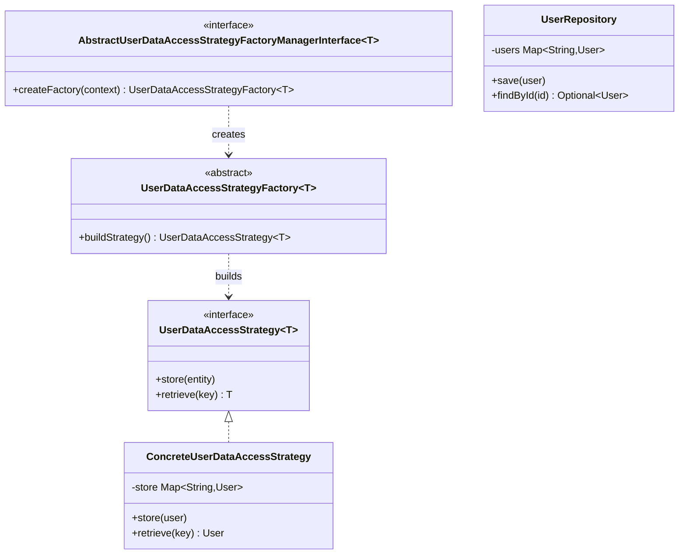
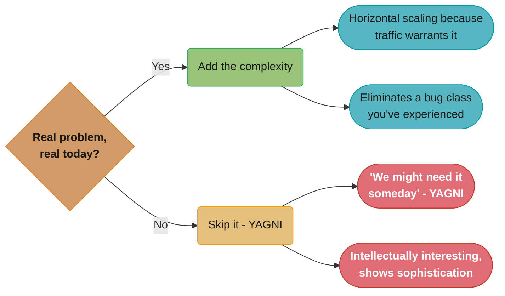

# KISS — Keep It Simple, Stupid
## Origins

Coined by **Kelly Johnson**, lead engineer at Lockheed's Skunk Works (advanced development division), in the 1960s. His design principle for the U-2 and SR-71 aircraft:

> "A jet aircraft ought to be repairable by an average mechanic in the field with these tools."

The insight: a system that cannot be understood and maintained by a typical practitioner under real-world conditions is a poorly designed system — regardless of how technically sophisticated it is.

---

## Intuition

> **One-line analogy**: KISS is like the field mechanic's rule — design a jet that a mechanic can fix in the field with basic tools, not one that requires a PhD and a factory to maintain.

**Mental model**: Complexity is the enemy of reliability and maintainability. Every abstraction, pattern, and framework you add is complexity someone must understand, debug, and maintain. KISS asks: "Is this complexity solving a real, current problem?" If the answer is no, remove it. The simplest code that correctly solves the problem is the best code.

**Why it matters**: Complex code has more failure modes, is harder to debug under production pressure, and takes longer for new team members to understand. Simple code is faster to test, easier to modify, and more resilient to bugs. The correlation between code complexity and bug density is well-established empirically.

**Key insight**: Simplicity is not the same as naivety. A simple, well-named function that does one clear thing is sophisticated. A "clever" 3-line function that uses bit manipulation instead of a clear conditional is complex, not simple. Prefer clarity over cleverness; the next reader might be you at 2 AM debugging a production incident.

---

## Definition

Systems work best when kept simple. Unnecessary complexity should be avoided. Complexity that does not serve a genuine requirement is a liability, not an asset.

KISS does not mean "write dumb code." It means: **find the appropriate level of abstraction for the problem at hand**. Not simpler than necessary, not more complex than necessary.

---

## Motivation

- Complexity is the root cause of most software bugs.
- Complex code takes longer to read, understand, review, and debug.
- Every layer of abstraction or indirection is cognitive overhead for the next developer.
- Simpler systems are easier to test, monitor, and operate.
- Over-engineered systems have high maintenance costs even when they "work."

---

## Java Violation Example

A simple requirement: store a user's name and retrieve it. Over-engineered with 5 design patterns:

```java
// AbstractUserDataAccessStrategyFactoryManagerInterface.java
public interface AbstractUserDataAccessStrategyFactoryManagerInterface<T> {
    UserDataAccessStrategyFactory<T> createFactory(UserDataAccessContext context);
}

// UserDataAccessStrategyFactory.java
public abstract class UserDataAccessStrategyFactory<T> {
    public abstract UserDataAccessStrategy<T> buildStrategy();
}

// UserDataAccessStrategy.java
public interface UserDataAccessStrategy<T> {
    void store(T entity);
    T retrieve(String key);
}

// ConcreteUserDataAccessStrategy.java
public class ConcreteUserDataAccessStrategy implements UserDataAccessStrategy<User> {
    private final Map<String, User> store = new HashMap<>();
    public void store(User user) { store.put(user.getId(), user); }
    public User retrieve(String key) { return store.get(key); }
}

// ... plus 3 more Factory and Manager classes to wire it together
```

To understand what this does, a developer must navigate 6+ classes for what is fundamentally: **a map with put and get**.

---

## Compliant Example

```java
// UserRepository.java
public class UserRepository {
    private final Map<String, User> users = new HashMap<>();

    public void save(User user) {
        users.put(user.getId(), user);
    }

    public Optional<User> findById(String id) {
        return Optional.ofNullable(users.get(id));
    }
}
```

Same behavior. One class. Immediately understandable. Easy to test. Easy to replace when requirements change.



*Three dependency/realization arrows chain four classes — the interface, its abstract factory, the strategy interface, and `ConcreteUserDataAccessStrategy` — before the three more Factory/Manager classes the code comment mentions even join the picture; `UserRepository` sits alone, with no arrows, because there is nothing left to indirect through.*

---

## Simple is NOT Simplistic

There is a difference between:

- **Simplistic:** ignoring real complexity, hacking something together that will break under real conditions.
- **Simple:** understanding the problem deeply enough to find the most direct, clear solution.

True simplicity is hard. It requires understanding both the problem and the solution space well enough to strip away everything unnecessary while keeping everything essential.

As **Einstein** (attributed) put it: "Everything should be made as simple as possible, but not simpler."

---

## Complexity Types

Understanding what kind of complexity you're dealing with guides the response:

| Type | Description | Response |
|------|-------------|----------|
| **Essential complexity** | Inherent in the problem domain. You cannot eliminate it. | Manage it — good abstractions, clear naming, documentation. |
| **Accidental complexity** | Self-inflicted by the solution. Not required by the problem. | Eliminate it ruthlessly. |

Examples:
- A distributed system has essential complexity (network failures, consistency).
- Using an enterprise service bus to coordinate two services in the same process is accidental complexity.

---

## When to Add Complexity

Add complexity only when driven by **genuine, current requirements**, not hypothetical future needs:

- **Yes:** the problem requires it (e.g., horizontal scaling is needed because traffic warrants it).
- **No:** "we might need it someday" (see YAGNI).
- **Yes:** a proven pattern eliminates a class of bugs you have actually experienced.
- **No:** a pattern was used because it's intellectually interesting or shows technical sophistication.

The question to ask: **"What real problem does this complexity solve, and is that problem real today?"**



*Every yes/no example above collapses to the same gate: does a real, current requirement justify this, or is it a hypothetical "someday" or self-indulgent "interesting" add — the same test YAGNI applies to features.*

---

## Measuring Complexity

Useful metrics as signals (not absolute rules):

- **Cyclomatic complexity:** number of independent paths through a function. High values (>10) indicate hard-to-test, hard-to-understand code.
- **Lines of code (LOC):** not a perfect metric, but functions exceeding ~30 lines or classes exceeding ~300 lines often violate SRP and KISS together.
- **Number of dependencies:** a class with 10 injected dependencies is doing too much.
- **Depth of inheritance hierarchy:** beyond 3 levels, inheritance becomes hard to reason about.
- **Number of layers / indirection:** each additional layer requires context-switching.

---

## Real-World Examples

- **Unix philosophy:** "Do one thing and do it well." Each tool is simple; power comes from composition.
- **REST over SOAP:** REST won adoption partly because it was dramatically simpler to understand and implement.
- **SQLite:** intentionally simple, embedded, no server — handles the vast majority of use cases for data storage with minimal complexity.
- **Go language design:** deliberately excludes features (no generics for years, no inheritance) to keep the language simple and programs readable by any Go developer.

---

## Related Principles

- **YAGNI:** Don't add functionality until it's needed — the temporal application of KISS.
- **Rule of Three (DRY):** Don't abstract until you have three instances — prevents premature abstraction complexity.
- **Single Responsibility Principle:** Each class does one thing — limits the complexity of any individual unit.

---

## Cross-Perspective: HLD Connections

**HLD View — Where KISS Appears in Distributed Systems**

- **REST over GraphQL for simple APIs** — GraphQL adds schema, resolver, and query complexity that is often unnecessary for straightforward CRUD APIs. REST with well-named endpoints is simpler to understand, cache, and debug.
- **Read-aside caching over complex invalidation** — Cache-aside (check cache → miss → load from DB → populate cache) is simpler and more debuggable than elaborate write-through or cache invalidation schemes. Start simple; add complexity only when measured latency requires it.
- **Stateless services** — Stateless services are simpler to scale (just add replicas), deploy (any request can go to any instance), and debug (no session affinity issues). Stateful services add significant distributed coordination complexity.
- **Synchronous over async for simple workflows** — Direct service calls are simpler than message queues for low-volume, low-latency workflows. Introduce async messaging when decoupling or throughput requirements justify the added operational complexity.

---

## Interview Questions and Answers

**Q: What is the difference between essential and accidental complexity, and why does that distinction matter for applying KISS?**
**Short:** Essential complexity comes from the problem itself; accidental complexity is self-inflicted by the solution.
Essential complexity is inherent to the domain — network failures and consistency tradeoffs in a distributed system cannot be designed away, only managed with clear abstractions and documentation. Accidental complexity is complexity the solution adds on top, like routing two in-process services through an enterprise service bus, and it should be eliminated ruthlessly rather than managed. The distinction matters because KISS never asks you to under-engineer the essential part — it targets only the complexity you introduced yourself.

**Q: How does KISS distinguish "simple" from "simplistic," and why is that distinction the crux of the principle?**
**Short:** Simplistic ignores real complexity; simple understands the problem deeply enough to strip away only what's unnecessary.
A simplistic solution hacks something together that ignores real complexity and breaks under real conditions, like validating email with a single `contains("@")` check. A simple solution requires understanding both the problem and solution space well enough to find the most direct approach while keeping everything the problem actually demands. This is why the module insists true simplicity is hard — it requires more understanding than an over-engineered solution, not less.

**Q: In the over-engineered UserRepository example, what did five design patterns actually buy for a "store and retrieve a user" requirement?**
**Short:** Nothing — the six-class factory/strategy/manager chain and the one-class HashMap wrapper do the same thing.
The violation example chains an abstract factory manager interface, an abstract strategy factory, a strategy interface, and a concrete strategy just to put and get from a map. The compliant version collapses all of that into one `UserRepository` class with a `save()` and `findById()` method backed by a `HashMap`. Since the requirement never asked for interchangeable storage strategies, the extra layers added navigation cost with zero behavioral benefit — the definition of accidental complexity.

**Q: What five signals does the module offer for measuring whether code has become too complex?**
**Short:** Cyclomatic complexity over 10, functions over ~30 lines, more than a handful of dependencies, deep inheritance, and excess indirection layers.
High cyclomatic complexity (over 10 independent paths through a function) signals code that's hard to test and reason about. Functions exceeding roughly 30 lines or classes exceeding roughly 300 lines often violate SRP and KISS together, and a class needing ten injected dependencies is usually doing too much. Inheritance hierarchies deeper than three levels become hard to reason about, and each additional layer of indirection forces a context switch — none of these are hard rules, but each is a signal worth investigating.

**Q: What is the single question KISS asks before adding any complexity?**
**Short:** "What real problem does this complexity solve, and is that problem real today?"
The test rejects hypothetical justifications like "we might need it someday" and accepts only complexity driven by a requirement that exists right now — for example, adding horizontal scaling because measured traffic actually warrants it. A pattern adopted because it's intellectually interesting or "shows sophistication" fails this test even if it happens to work. This question is deliberately the same one YAGNI applies to features, just aimed at complexity generally rather than only at unbuilt functionality.

**Q: Why does the module warn that "clever" code is not the same as simple code?**
**Short:** A clever bit-manipulation trick replacing a clear conditional is complex, not simple, despite being shorter.
Simplicity is measured by how easily the next reader — possibly you, at 2 a.m. during an incident — can understand the code, not by line count or syntactic terseness. A three-line bit-manipulation hack can be objectively harder to read than a longer, clearly-named conditional, even though it looks "simpler" on the page. KISS asks for clarity over cleverness, because cleverness optimizes for the author's satisfaction while clarity optimizes for the reader's speed under pressure.

**Q: How does the module connect Kelly Johnson's original U-2/SR-71 design philosophy to software KISS?**
**Short:** A jet repairable by an average field mechanic with basic tools is the same standard as code any team member can maintain.
Johnson's rule was that sophistication which cannot be maintained under real-world conditions by a typical practitioner is poor design, regardless of its technical merit. Applied to software, this becomes: code should be understandable and modifiable by an average engineer on the team, not just by the person who wrote it or a specialist. The insight generalizes past aircraft — impressive complexity that only its author can operate is a liability, not an asset, in both domains.

**Q: Why does the module treat REST over GraphQL for simple CRUD APIs as a KISS example rather than a technology preference?**
**Short:** GraphQL's schema, resolver, and query-flexibility machinery is unnecessary complexity when the API is straightforward CRUD.
REST with well-named endpoints is simpler to understand, cache, and debug for CRUD workloads, while GraphQL's flexible querying adds real infrastructure — a schema, resolvers, and query parsing — that pays off only when clients genuinely need to shape heterogeneous queries. Choosing REST for a simple API is not a technology fashion choice; it is declining to pay a complexity cost the current requirement doesn't demand. If client query needs grow complex enough later, that is the moment the tradeoff flips.

**Q: Why does cache-aside get preferred over write-through or elaborate invalidation schemes under KISS?**
**Short:** Cache-aside's check-miss-load-populate flow is simpler to reason about and debug than complex invalidation logic.
Cache-aside is a small, predictable sequence: check the cache, on a miss load from the database, then populate the cache — every step is debuggable in isolation. Write-through and custom invalidation schemes add coordination complexity to keep the cache and source of truth in lockstep, which pays off only when staleness is measurably unacceptable. KISS says start with the simpler pattern and introduce the more complex one only when measured latency or staleness requirements actually demand it.

**Q: Why are stateless services considered simpler under KISS than stateful ones, specifically?**
**Short:** Stateless services scale by adding replicas and can route any request to any instance, with no session affinity to manage.
A stateless service can be scaled horizontally just by adding more identical instances, since no instance holds request-specific data that must be preserved. It can also be deployed and debugged more easily, because any request can go to any instance without sticky sessions or replication concerns. Stateful services add real distributed-coordination complexity — session affinity, state replication — that KISS says to accept only when the workload genuinely requires holding state.

**Q: What relationship does the module draw between KISS and the DRY Rule of Three?**
**Short:** The Rule of Three prevents the premature-abstraction complexity that KISS warns against.
KISS's broader goal is avoiding complexity that doesn't serve a genuine need, and premature abstraction — extracting a shared abstraction from just one or two occurrences — is exactly that kind of unnecessary complexity. The Rule of Three delays abstraction until a third occurrence supplies enough signal to know the abstraction is real, which keeps the codebase at the appropriate level of complexity for what's actually known. The two principles converge on the same practical habit: don't build structure ahead of demonstrated need.

**Q: How does the module distinguish KISS from YAGNI, given they sound similar?**
**Short:** KISS governs how complex any given piece of code should be; YAGNI governs whether a feature should be built at all.
KISS is about implementation-level complexity — for a requirement you are building right now, use the simplest structure that solves it correctly. YAGNI is about scope — don't build a feature or abstraction until a real requirement calls for it, regardless of how simply it could be implemented. The module explicitly lists YAGNI as "the temporal application of KISS," meaning YAGNI is KISS's rule extended across time to decide what to build at all, not just how to build what's already decided.

**Q: What does the Go language design example illustrate about KISS at the language level?**
**Short:** Go deliberately excluded features like generics and inheritance for years to keep programs simple and universally readable.
Go's designers chose to omit language features that other languages considered standard, accepting some expressiveness loss in exchange for programs that any Go developer could read and reason about without specialized knowledge. This is KISS applied at the tooling level: fewer ways to express the same idea means less cognitive variance across a codebase written by different engineers. The tradeoff is real — some problems are more verbose to solve in Go — but the module cites it as a deliberate, successful complexity-budget decision.

**Q: What is the practical risk of over-engineered systems even when they technically "work"?**
**Short:** Over-engineered systems carry high maintenance costs regardless of whether they currently function correctly.
"Working" measures correctness at a point in time, but every layer of unnecessary abstraction still has to be read, understood, and kept consistent by every engineer who touches the code afterward. Complex code also has more failure modes and takes longer to debug under production pressure, which raises the operational cost even when nothing is currently broken. KISS's motivation is explicitly this: complexity is a cost paid continuously, not a one-time tax absorbed at write time.

**Q: According to the module, what does the correlation between code complexity and bug density imply for KISS as an engineering practice?**
**Short:** Higher code complexity is empirically associated with more bugs, making simplicity a reliability practice, not just a style preference.
The module states this correlation is well-established, which reframes KISS from an aesthetic preference into a defect-prevention discipline: reducing unnecessary complexity is a way of reducing the surface area where bugs can hide. This is also why KISS pairs with testability — simpler code is faster to test and monitor, catching regressions earlier. The practical takeaway is that "keep it simple" is a risk-management argument, not merely a readability one.

---

## Quick Summary

| Aspect | Summary |
|--------|---------|
| Core idea | Avoid unnecessary complexity; find the appropriate level of abstraction |
| Not the same as | Simplistic or naive — simple requires deep understanding |
| Complexity types | Essential (unavoidable) vs accidental (self-inflicted) |
| Key question | "What real problem today does this complexity solve?" |
| Measuring it | Cyclomatic complexity, dependencies, indirection layers |
| Related | YAGNI, Rule of Three, SRP |
