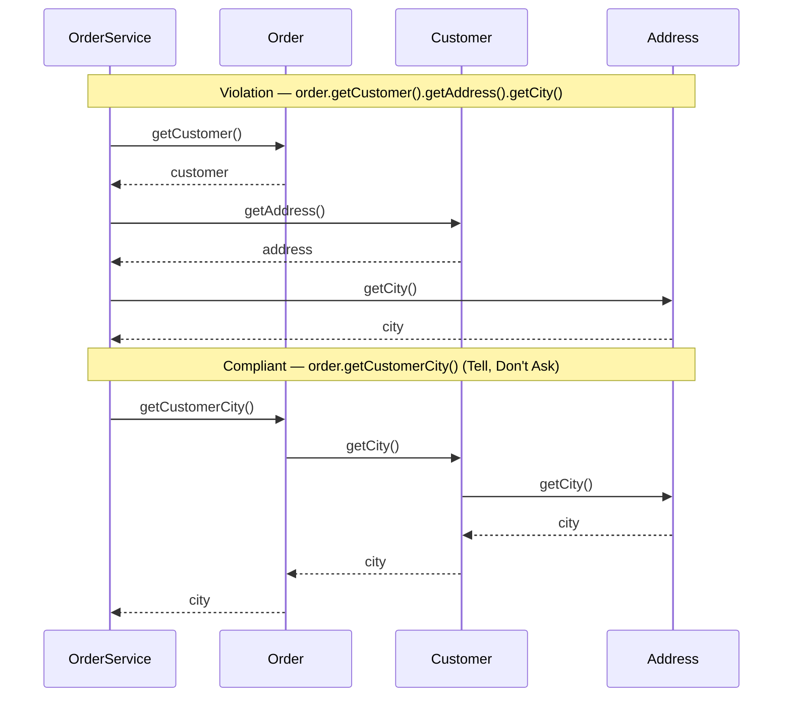
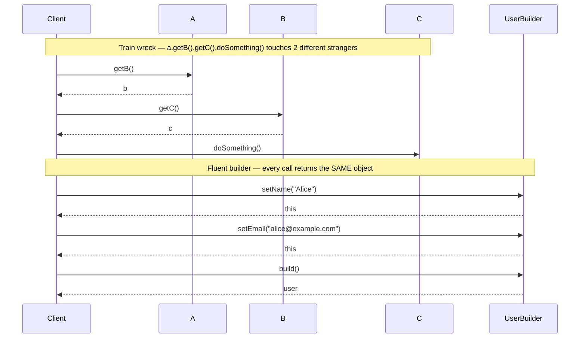

# Law of Demeter (Principle of Least Knowledge)
## Origins

Formulated at **Northeastern University in 1987** during the Demeter project (a software development project studying adaptive programming). Authors: **Ian Holland**, Karl Lieberherr, and colleagues.

The name "Demeter" comes from the Greek goddess of agriculture — the project was named after her, and the principle took the project's name.

---

## Intuition

> **One-line analogy**: Law of Demeter says "talk to your friends, not strangers" — if you need something from a stranger, ask your friend who knows them to get it for you.

**Mental model**: `customer.getWallet().getCard().charge(amount)` violates Demeter — you're navigating three levels of relationships to reach `Card`. This creates tight coupling: if Wallet changes how it stores cards, your code breaks even though you were dealing with a Customer. Demeter says: add `customer.charge(amount)` — Customer knows about Wallet; you don't need to. Chain of dots is a code smell.

**Why it matters**: Violating Demeter creates "train wreck" code with long dot chains, making every object aware of the internals of objects it doesn't directly own. Changes deep in the chain ripple outward unexpectedly. Systems with Demeter violations are hard to test (you need to mock the entire chain) and hard to refactor.

**Key insight**: The "one dot" guideline is a heuristic — `object.field.method()` is often a violation; `stream.filter().map().collect()` is not (fluent builders chain the same object type). The real test: "Am I reaching through an object to its internal structure?" If yes, encapsulate that operation in the intermediate object.

---

## Definition

An object should only call methods on its **immediate friends** — objects it has a direct relationship with. Specifically, a method `M` on object `O` may only call methods on:

1. `O` itself (`this`)
2. Objects passed as parameters to `M`
3. Objects that `O` creates or instantiates
4. `O`'s direct component objects (fields of `O`)
5. Global objects accessible to `O` (use with care)

**What it forbids:** navigating through a chain of objects to call a method on a distant object — an object that `O` only knows about indirectly.

The informal statement: **"Only talk to your immediate friends. Don't talk to strangers."**

---

## Motivation

When an object reaches deeply into another object's structure, it:
- Becomes tightly coupled to the internal structure of that other object.
- Must change whenever the intermediate structure changes — even if the ultimate behavior needed is the same.
- Reveals that responsibility is misplaced: the asking object is doing work that one of the intermediate objects should own.

---

## The "Train Wreck" Violation

The classic smell: a long chain of method calls, each accessing the innards of the previous result:

```java
// Each dot is a potential Law of Demeter violation if it's accessing state of a "stranger"
double amount = customer.getWallet().getMoney().getAmount();
```

This line says: "I need an amount. I'll ask the customer for its wallet. Then ask the wallet for its money. Then ask the money for its amount."

The calling code now knows:
- That `Customer` has a `Wallet`.
- That `Wallet` has a `Money` object.
- That `Money` has an `amount` field.

This is far more knowledge than the calling code should have. It is coupled to three layers of internal structure.

---

## Java Violation Example

An order processing service reaching through the object graph to get a city name:

```java
public class OrderService {

    public String getShippingLabel(Order order) {
        // Violation: reaching through Customer -> Address -> city
        String city = order.getCustomer().getAddress().getCity();
        return "Ship to: " + city;
    }
}
```

**The problem:** `OrderService` must know that `Order` has a `Customer`, that `Customer` has an `Address`, and that `Address` has a `city` field. If `Address` is refactored to have a `Location` object containing the city, `OrderService` breaks — even though the behavior it needs (get the city for an order) hasn't changed.

---

## Compliant Example

Apply the principle **"Tell, Don't Ask"** — instead of asking an object for its internals to do work, tell it to do the work:

```java
// Order.java — knows its customer
public class Order {
    private Customer customer;

    // Delegate method: hides internal structure
    public String getCustomerCity() {
        return customer.getCity();
    }
}

// Customer.java — knows its address
public class Customer {
    private Address address;

    // Delegate method: hides internal structure
    public String getCity() {
        return address.getCity();
    }
}

// OrderService.java — only talks to Order (its immediate friend)
public class OrderService {
    public String getShippingLabel(Order order) {
        String city = order.getCustomerCity(); // One dot — immediate friend only
        return "Ship to: " + city;
    }
}
```

Now `OrderService` only knows about `Order`. The internal structure of `Customer` and `Address` can change freely without affecting `OrderService`.



Same four classes, same ultimate call to `Address.getCity()` — but in the violation `OrderService` is the direct caller of all three hops (two of them strangers), while in the compliant version `OrderService` calls only its immediate friend `Order`, which delegates one hop at a time down the chain it already owns.

---

## Consequences of Violations

| Consequence | Description |
|-------------|-------------|
| **Tight coupling** | The calling class is coupled to every intermediate class in the chain. |
| **Brittle code** | Refactoring any intermediate class breaks all callers that traverse through it. |
| **Hard to test** | To test the calling class in isolation, you must set up a deep object graph of mocks and stubs. |
| **Misplaced responsibility** | The calling class is doing navigation work that intermediate objects should own. |
| **Violated encapsulation** | Internal structure is exposed through the public API of each intermediate class. |

---

## Tell, Don't Ask

The Law of Demeter is closely related to the **Tell, Don't Ask** principle:

- **Ask (violation):** "Give me your internals so I can do something with them."
- **Tell (compliant):** "Do this thing with your internals and give me the result."

```java
// Ask (violation): get internals, do work outside
if (order.getCustomer().getMembershipLevel() == PREMIUM) {
    applyPremiumDiscount(order);
}

// Tell (compliant): push the decision into the object that has the knowledge
order.applyApplicableDiscounts(discountEngine);
// or
if (order.isEligibleForPremiumDiscount()) {
    applyPremiumDiscount(order);
}
```

---

## When to Relax the Law

The Law of Demeter applies to **method chains that navigate through object state**. It does NOT apply to all chains. There are legitimate cases for chaining:

### Fluent Builders

```java
// Builder chains are not LoD violations — each call returns the SAME builder
User user = new UserBuilder()
    .setName("Alice")
    .setEmail("alice@example.com")
    .setAge(30)
    .build();
```

Each call returns `this` (the builder). You are not traversing through different objects.

### Stream / Functional Pipelines

```java
// Stream chains are not LoD violations — they are transformations on a pipeline
List<String> names = users.stream()
    .filter(u -> u.isActive())
    .map(User::getName)
    .sorted()
    .collect(Collectors.toList());
```

This is a data pipeline, not navigation through an object graph to extract hidden state.

**The distinction:** the Law of Demeter targets chains that **access state through multiple layers of object ownership**. Builders and streams are operating on a single logical thing (the builder, the stream) throughout the chain.



The train-wreck chain lands on three different objects (`A`, `B`, `C`); the builder chain calls the same `UserBuilder` instance every time because each setter returns `this` — no stranger's internals are ever touched, which is why fluent builders (and `stream.filter().map().collect()`) are exempt from the Law of Demeter.

---

## How to Detect Violations

Look for:
- Multiple consecutive dots where each dot accesses a different domain object.
- Code that must create elaborate mock chains to write unit tests.
- Cascade changes: a refactoring of a low-level class requires changes in high-level classes that "shouldn't care."
- Methods whose names describe what they're navigating to, not what they're doing: `getCustomerAddressCity()` suggests the caller is doing too much navigation.

---

## Real-World Examples

- **Java Collections API:** `Map.Entry` exposes both key and value directly — you don't navigate `map.getEntrySet().getEntry(key).getValue()`. The API is flat.
- **JPA/Hibernate:** lazy-loading violations often manifest as LoD violations — services reach through entity relationships in ways that cause N+1 query problems.
- **Domain-Driven Design:** aggregate boundaries enforce the Law of Demeter. You interact with an aggregate through its root; you don't reach into child entities directly from outside the aggregate.

---

## Related Concepts

- **Tell, Don't Ask:** The behavioral complement to LoD. Push logic into the object that has the data.
- **Information Expert (GRASP):** Assign responsibility to the class that has the information needed to fulfill it — the same insight from the GRASP pattern language.
- **Encapsulation:** LoD is a practical enforcement of encapsulation at the object graph level.
- **Demeter Principle violations and testing:** if setting up a test requires deep nested mock chains, the Law of Demeter is being violated in the production code.

---

## Cross-Perspective: HLD Connections

**HLD View — Where Law of Demeter Appears in Distributed Systems**

- **Direct service dependencies only** — A service should call only its immediate dependencies, not chain through multiple services (A → B → C → D). Deep call chains increase latency, create distributed transaction complexity, and propagate failures across the chain.
- **API gateway as the single contact point** — Clients talk to the gateway; the gateway talks to downstream services. Clients don't need to know which downstream services exist or how to call them — LoD applied to the client-service boundary.
- **Event-driven decoupling** — Publishing events avoids reaching through a service's dependencies: Order Service publishes `OrderPlaced`; Inventory Service reacts. Order Service never calls Inventory Service directly — reducing coupling between distant parts of the system.
- **Aggregate boundaries in DDD** — Domain-Driven Design aggregates enforce LoD: external code can only call the aggregate root, not reach into child entities directly. This maps to service API design: expose only the root resource's endpoints, not internal sub-resources.

---

## Interview Questions and Answers

**Q: Why does `a.getB().getC().doSomething()` violate the Law of Demeter but `stream.filter().map().collect()` does not, despite both being method chains?**
**Short:** The train wreck touches different strangers at each dot; the stream chain calls the same logical pipeline object throughout.
In the train wreck, each dot lands on a genuinely different object — `A`, then `B`, then `C` — so the caller ends up knowing about and depending on the internal structure of objects it has no direct relationship with. In a stream pipeline, every call transforms and returns the same logical pipeline, so no stranger's internal state is ever reached into. The real test is not "how many dots" but "am I reaching through an object to access another object's internal structure."

**Q: Why are fluent builder chains exempt from the Law of Demeter even though they also chain many method calls?**
**Short:** Every setter in a builder returns `this`, so the chain never leaves the same object.
`new UserBuilder().setName("Alice").setEmail(...).setAge(30).build()` calls the identical `UserBuilder` instance at every step, because each setter returns `this` rather than a different collaborator. The Law of Demeter forbids navigating through a chain of *different* objects to reach a distant object's state — it says nothing about calling many methods on one object you already have a direct relationship with. This is the same distinction that exempts the stream pipeline example.

**Q: What is "Tell, Don't Ask," and how does it operationalize the Law of Demeter?**
**Short:** Push logic into the object that has the data instead of pulling the data out to act on it externally.
"Ask" style code reaches into an object's internals to retrieve data and then acts on that data externally, as in `if (order.getCustomer().getMembershipLevel() == PREMIUM)`. "Tell" style code pushes the decision into the object that already has the knowledge, as in `order.isEligibleForPremiumDiscount()`, so the caller never needs to know the object graph shape at all. Tell, Don't Ask is the behavioral discipline that naturally produces Law-of-Demeter-compliant code, because it eliminates the reason to reach through an object in the first place.

**Q: In the OrderService violation example, what exactly does OrderService need to know about, and why does that knowledge become a liability?**
**Short:** OrderService must know Order has a Customer, Customer has an Address, and Address has a city field.
`order.getCustomer().getAddress().getCity()` requires `OrderService` to understand three layers of object structure it has no direct relationship with, purely to extract one string. If `Address` is later refactored to wrap city inside a `Location` object, `OrderService` breaks even though the behavior it actually needs — get the city for an order — never changed. The liability is that a refactor deep in the object graph ripples outward to code that shouldn't have needed to know about that layer at all.

**Q: How does the compliant fix in the module resolve the OrderService violation, and what does OrderService end up depending on?**
**Short:** Order and Customer each add a delegate method, so OrderService calls only `order.getCustomerCity()`.
`Order` gets a `getCustomerCity()` method that internally calls `customer.getCity()`, and `Customer` gets a `getCity()` method that internally calls `address.getCity()` — each class only reaches into its own immediate field. `OrderService` now calls exactly one method on exactly one immediate friend, `Order`, and has no knowledge that `Customer` or `Address` even exist. The internal structure of `Customer` and `Address` can now change freely without ever touching `OrderService`.

**Q: What are the five categories of objects a method is allowed to call, under the formal statement of the Law of Demeter?**
**Short:** Itself, its parameters, objects it creates, its own fields, and global objects — nothing reached through those.
The formal rule permits calls on `this`, on objects passed as parameters to the method, on objects the method itself instantiates, and on the object's own direct component fields, plus (with care) global objects. What it explicitly forbids is navigating through any of those to reach a further, indirectly-known object — that indirect object is a "stranger," not a "friend." The informal summary is "only talk to your immediate friends, don't talk to strangers."

**Q: What consequence of Law of Demeter violations makes unit testing specifically harder, beyond general coupling?**
**Short:** Testing the calling class in isolation requires mocking an entire chain of intermediate objects, not just the one you care about.
To test `OrderService.getShippingLabel()` under the violating version, you must construct or mock a `Customer` that itself returns a working `Address` that itself returns a city — three layers of setup for one assertion. Under the compliant version, you mock only `Order` and stub its single `getCustomerCity()` method, since `OrderService` never reaches past its immediate friend. Elaborate mock-chain setup in a test is itself a diagnostic signal that the production code under test is violating the Law of Demeter.

**Q: Why does the module say a method name like `getCustomerAddressCity()` is itself a symptom of a Demeter violation?**
**Short:** A method name describing what it navigates through, rather than what it does, reveals the caller is doing too much traversal.
A well-designed delegate method describes a piece of behavior or data the object legitimately owns, like `getCustomerCity()` on `Order`. A name that spells out the traversal path — `getCustomerAddressCity` — reveals that the caller (or the class exposing this method) is thinking in terms of object-graph navigation rather than in terms of a cohesive responsibility. Spotting this naming pattern is one of the concrete detection heuristics the module lists for finding violations.

**Q: How do JPA/Hibernate lazy-loading problems connect to the Law of Demeter, according to the module?**
**Short:** Services reaching through entity relationships to satisfy N+1 queries are exhibiting Law-of-Demeter violations at the ORM layer.
When a service reaches through `order.getCustomer().getAddress()` on lazy-loaded JPA entities, each hop can trigger a separate database query, producing the classic N+1 query problem. The module treats this as a concrete instance of the same underlying issue: the service is navigating through objects it doesn't have a direct relationship with, and the ORM's lazy-loading behavior makes the cost of that navigation immediately visible as extra queries. Applying Tell, Don't Ask (letting the entity expose the composed data directly) avoids both the coupling and the query explosion.

**Q: How do Domain-Driven Design aggregate boundaries enforce the Law of Demeter?**
**Short:** External code may only call the aggregate root; it cannot reach directly into the aggregate's child entities.
In DDD, an aggregate's root entity is the sole entry point external code is allowed to interact with — child entities inside the aggregate are only reachable through the root's own methods. This is a direct application of "only talk to your immediate friends": the root is the friend, and the internal entities are strangers whose structure the outside world should never depend on. The module maps this directly onto service API design: expose only the root resource's endpoints, not internal sub-resource endpoints.

**Q: How does the API gateway pattern reflect the Law of Demeter at the distributed-systems level?**
**Short:** Clients talk only to the gateway; they never need to know which downstream services exist or how to reach them.
A client that called individual downstream services directly would need to know the existence, location, and API of every one of those services — the equivalent of a train-wreck chain at the system level. Routing everything through a gateway means the client has exactly one immediate friend, and the gateway (not the client) owns the knowledge of how to reach and coordinate the downstream services. This is explicitly the Law of Demeter applied to the client-service boundary rather than to object references.

**Q: Why does the module call event-driven decoupling (Order Service publishing OrderPlaced, Inventory Service reacting) a Law-of-Demeter pattern?**
**Short:** Publishing an event avoids Order Service needing to know about or call Inventory Service directly.
In a direct-call design, Order Service would need to know Inventory Service exists and how to invoke it — a dependency reaching past its own concerns. By publishing an `OrderPlaced` event instead, Order Service only "talks to" the event bus, its immediate collaborator, and never needs any knowledge of who reacts to the event or how. This reduces coupling between distant parts of the system exactly the way a delegate method reduces coupling between distant objects in the OrderService/Customer/Address example.

**Q: What is the difference between a legitimate use of chaining and a Demeter violation, stated as a single test?**
**Short:** Ask whether the chain accesses state through multiple layers of object ownership, or transforms one logical thing throughout.
If each call in the chain returns a *different* object whose internal state you are progressively drilling into — Customer's Address's city — that is navigation through ownership layers and a violation. If each call returns the *same* logical thing being transformed or configured — a builder returning `this`, a stream returning a new stream stage — no stranger's internals are ever exposed, and it is not a violation. This single test replaces the informal and sometimes-misleading "count the dots" heuristic.

**Q: Why does the Law of Demeter call for direct service dependencies only, rejecting a call chain like A calls B calls C calls D?**
**Short:** Deep call chains increase latency, create distributed-transaction complexity, and propagate failures across every hop.
A service that calls only its immediate dependencies keeps failure and latency contained to a single hop, and keeps the caller ignorant of anything beyond its direct collaborator's contract. A chain where A calls B which calls C which calls D means a failure or slowdown anywhere in that chain propagates back to A, and A implicitly depends on the existence and correctness of services it never directly talks to. This is the Law of Demeter's coupling argument transplanted to network calls instead of method calls — the same brittleness, at a larger blast radius.

**Q: What does "Information Expert" from GRASP have to do with the Law of Demeter?**
**Short:** Both principles assign responsibility to whichever object already holds the information needed to fulfill it.
GRASP's Information Expert pattern says: give a responsibility to the class that has the data needed to carry it out, rather than pulling that data out to a class that doesn't own it. This is the same insight that motivates Tell, Don't Ask and the Law of Demeter's delegate-method fix — `Order` owning `getCustomerCity()` is Information Expert in action, since `Order` (via `Customer`) is closer to the information than `OrderService` is. The module lists Information Expert as a directly related concept because both principles push logic toward the data rather than pulling data toward the logic.

---

## Quick Summary

| Aspect | Summary |
|--------|---------|
| Core idea | Only talk to your immediate friends; don't navigate through object graphs |
| Allowed calls | self, parameters, objects you created, your direct fields |
| Classic violation | `a.getB().getC().doSomething()` — train wreck |
| Fix | Add delegate methods; tell don't ask |
| Consequences of violation | Tight coupling, brittle code, hard to test |
| Legitimate chaining | Fluent builders, stream/functional pipelines |
| Detection | Multiple domain-crossing dots, complex mock setups in tests |
