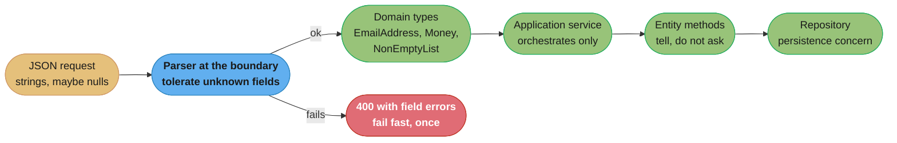
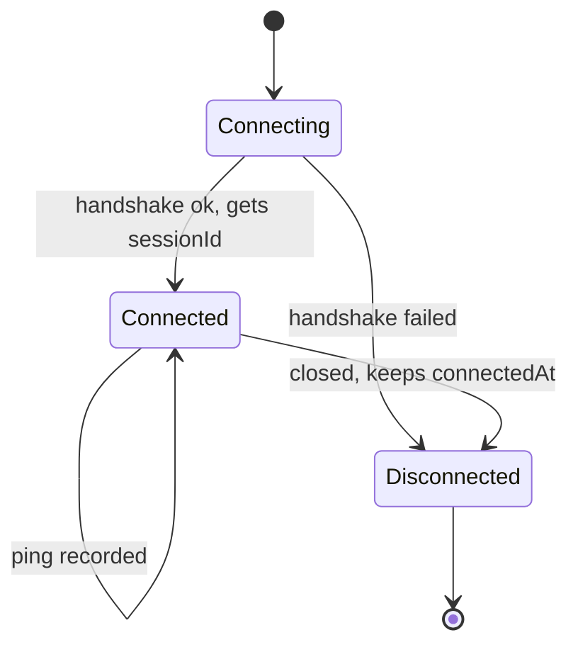

# Principles Beyond SOLID: Tell-Don't-Ask, Command-Query Separation, Least Astonishment, Postel's Law, Separation of Concerns, Fail-Fast, Parse Don't Validate

Seven design principles that interviewers name without defining, each with its source, the Java form that applies it, the failure it prevents, and the principle it collides with.

## 1. Concept Overview

[SOLID](../solid_principles/solid_principles.md) and the core set on the [Design Principles](design_principles.md) page (DRY, KISS, YAGNI, Composition over Inheritance, Program to an Interface, [Law of Demeter](LawOfDemeter.md), [GRASP](GRASP.md)) cover how to split classes and depend on abstractions. A second set covers questions those leave open: where behaviour lives, what a method may do besides return a value, how an API should surprise nobody, how strict to be with input, when to stop on an error, and how to make the type system carry the rules.

| Principle | Source | One-line rule | Java form |
|-----------|--------|---------------|-----------|
| Tell, Don't Ask | Andy Hunt and Dave Thomas, IEEE Software column, January 2003; Martin Fowler, bliki, 2013-09-05 | Tell an object to do the work instead of asking for its data and deciding outside | Behaviour methods on the entity, not getters plus logic in a service |
| Command-Query Separation (CQS) | Bertrand Meyer, *Object-Oriented Software Construction* | A method either changes state (command) or returns a result (query), not both | `void` mutators, side-effect-free getters |
| Principle of Least Astonishment | Long-standing design folklore, no single author | A component behaves the way its name, signature and neighbours lead a reader to expect | Names that match effects; consistent `equals`, nulls and exceptions |
| Postel's Law (Robustness Principle) | RFC 760 and RFC 761, January 1980; reassessed in RFC 9413, June 2023 | "Be conservative in what you do, be liberal in what you accept from others" | Tolerant reading of unknown fields, strict writing |
| Separation of Concerns (SoC) | Edsger W. Dijkstra, EWD 447, "On the role of scientific thought", 1974-08-30 | Study and build each aspect in isolation for the sake of its own consistency | Layers, ports and adapters, one module per concern |
| Fail-Fast | Jim Shore, "Fail Fast", IEEE Software, 2004 | Fail immediately and visibly when an error occurs, not later and mysteriously | `Objects.requireNonNull`, validating constructors, startup config checks |
| Parse, Don't Validate / Make Illegal States Unrepresentable | Alexis King, blog post 2019-11-05; Yaron Minsky, Jane Street "Effective ML", 2010 talk, 2011-03-09 post | Turn unstructured input into a type that cannot hold invalid values, once, at the boundary | Records with validating compact constructors (Java 16), sealed interfaces (Java 17), exhaustive `switch` (Java 21) |

These principles meet the rest of the repo at three boundaries. CQS at method level is not CQRS at architecture level; the architectural form is on [Event Sourcing and CQRS](../../hld/event_sourcing_cqrs/event_sourcing_cqrs.md). Postel's Law at the network edge is the subject of API evolution on [REST API Design](../../backend/rest_api_design/rest_api_design.md) and [API Contracts and Schema Governance](../../backend/api_contracts_and_schema_governance/api_contracts_and_schema_governance.md). Parse-don't-validate in other type systems is taught on [TypeScript Runtime Validation](../../typescript/runtime_validation_and_parse_dont_validate/runtime_validation_and_parse_dont_validate.md), [Pydantic v2](../../fastapi/pydantic_v2_deep_dive/pydantic_v2_deep_dive.md) and [Rust enums and type-driven design](../../rust/enums_pattern_matching_and_type_driven_design/enums_pattern_matching_and_type_driven_design.md); this page gives the Java form.

---

## 2. Intuition

> **One-line analogy**: Tell-Don't-Ask is telling a waiter "bring me the soup" instead of asking for the kitchen keys. CQS is a thermometer that never changes the temperature. Least Astonishment is a light switch that goes up for on, like every other switch in the house. Postel is a post office that delivers a letter with a smudged postcode but always writes clean addresses itself. Separation of Concerns is a kitchen where the person tasting the sauce is not also doing the accounts. Fail-Fast is a smoke alarm, not a smell you notice next week. Parse-don't-validate is a passport: checked once at the border, trusted everywhere inside.

**Mental model**: Each principle moves knowledge to one place. Tell-Don't-Ask moves decisions to the data. CQS moves side effects to methods that say so. Least Astonishment moves meaning into names. Postel moves leniency to the outer edge and strictness to the inside. SoC moves each concern into its own module. Fail-Fast moves the discovery of an error to the moment it happens. Parse-don't-validate moves validation to the boundary and makes the type remember the result.

**Why it matters**: These are the vocabulary of code review. "This getter has a side effect" is CQS. "Why does the service reach into the order's line items to compute a total?" is Tell-Don't-Ask. "We validated the email in the controller, so why does the repository check it again, and why did a bad one still get through the batch import?" is parse-don't-validate. Naming the principle turns a taste argument into a checkable claim.

**Key insight**: The principles conflict, and that is the useful part. Postel says accept liberally; Fail-Fast says reject early. Tell-Don't-Ask says push behaviour into the entity; Separation of Concerns and layering say keep persistence and formatting out of it. CQS forbids `pop()` returning the element; every stack library ships it anyway. A senior answer names the principle, the principle it fights, and which one wins in this place and why.

---

## 3. Core Principles

- **Knowledge has one home.** Every principle here is a rule for where a piece of knowledge lives: a decision with its data (TDA), a side effect in a command (CQS), an expectation in a name (Least Astonishment), a format rule at the edge (Postel, parsing), a concern in its module (SoC), a broken assumption at the point of failure (Fail-Fast).
- **Strict inside, deliberate at the edge.** The boundary of a system (HTTP, files, queues, user input) is where untrusted, varied data arrives. Parse it there into strict types. Inside, assume nothing invalid exists, because the types make it impossible.
- **Make effects visible in the signature.** A `void` method changes something. A method returning a value and taking no action is safe to call twice, reorder, cache or log. Mixing the two hides effects from the reader.
- **A principle is a default, not a law.** Each one has a named exception: `pop()` for CQS, query methods for TDA (Fowler warns against "getter eradicators"), tolerant reading of extension fields for Postel's critics, graceful degradation at the edge for Fail-Fast.
- **Prefer the compiler to the reviewer.** A rule enforced by a type (sealed interface, record invariant, `final` field) cannot regress. A rule enforced by a comment or a code-review checklist will.

---

## 4. Types / Architectures / Strategies

### 4.1 What each principle governs

| Principle | Unit it applies to | Question it answers | Typical violation |
|-----------|-------------------|--------------------|-------------------|
| Tell, Don't Ask | Object collaboration | Who makes the decision? | Service reads five getters and decides; the entity is a data bag |
| CQS | Single method | May this method both change state and return data? | `getNextId()` that increments a counter |
| Least Astonishment | API surface | Does it behave as its name and neighbours suggest? | `isValid()` that also saves to the database |
| Postel's Law | Protocol or format boundary | How strict are we on input and output? | Rejecting a whole payload for one unknown optional field |
| Separation of Concerns | Module, layer, system | Which aspects are mixed in one place? | One method that parses HTTP, applies rules and writes SQL |
| Fail-Fast | Error timing | When does a broken assumption surface? | `null` stored in a field and dereferenced three calls later |
| Parse, Don't Validate | Data types | Does the type guarantee the rule, or only a past check? | `String email` validated in the controller, trusted everywhere |

### 4.2 The tension map

| Pair | Where they collide | Usual resolution |
|------|-------------------|------------------|
| Postel vs Fail-Fast | Accept a malformed field, or reject the request? | Be tolerant of *unknown* fields and versions you can ignore; fail fast on *known* fields that are wrong |
| Tell-Don't-Ask vs Separation of Concerns | Should `Order` know how to render itself as HTML or save itself? | Tell the entity business decisions; keep persistence and presentation in their own layers |
| Tell-Don't-Ask vs CQS | "Tell" methods often want to return a result | Return a value describing the outcome only when it is pure data about the command, or split into command plus query |
| CQS vs atomicity | `pop()`, `getAndIncrement()`, `putIfAbsent()` | Under concurrency the combined form is required: two separate calls would race |
| Least Astonishment vs backward compatibility | A surprising old behaviour has callers | Keep it, document it, add a correctly named alternative, deprecate on a schedule |
| Parse-don't-validate vs YAGNI | A value type for every string field | Wrap values that carry rules (email, money, id, non-empty list); leave free text as `String` |

### 4.3 Where each principle sits in a request

| Stage | Principle doing the work |
|-------|--------------------------|
| Bytes arrive (HTTP, Kafka, file) | Postel: tolerate unknown fields and harmless variation |
| Deserialize and convert | Parse, Don't Validate: produce domain types or a structured error |
| Reject what cannot be parsed | Fail-Fast: one clear error at the edge, with the field name |
| Application service | Separation of Concerns: orchestration only, no rules, no SQL |
| Domain object | Tell, Don't Ask: the entity decides; CQS: commands mutate, queries report |
| Response | Postel (conservative half): emit exactly the documented format |
| Whole API | Least Astonishment: names, status codes and errors that match the reader's expectations |

---

## 5. Architecture Diagrams

**Strict core, deliberate edge.** Input is parsed once into types that cannot be invalid; nothing inside re-validates:



*Postel and Fail-Fast stop fighting once they are placed: tolerance for what can be ignored lives in the parser, rejection of what is wrong also lives in the parser, and the core never sees either.*

**Ask versus Tell.** In the ask style, the decision lives in the service and the entity's invariant can be bypassed; in the tell style the entity owns both:

```mermaid
sequenceDiagram
    participant S as TransferService
    participant A as Account

    rect rgb(40, 44, 52)
    Note over S,A: Ask: service reads state and decides
    S->>A: getBalance()
    A-->>S: 100
    S->>S: 100 minus 30 is not negative, ok
    S->>A: setBalance(70)
    end

    rect rgb(40, 44, 52)
    Note over S,A: Tell: account decides and protects its invariant
    S->>A: withdraw(30)
    A->>A: check overdraft rule, update balance
    A-->>S: Withdrawn or Rejected
    end
```



**Make illegal states unrepresentable.** A connection modelled as one class with a status enum and nullable fields admits dozens of combinations; only three are legal:

```
 class Connection { State state; Instant connectedAt; String sessionId;
                    Instant lastPingAt; Instant disconnectedAt; }

                  connectedAt  sessionId  lastPingAt  disconnectedAt
 CONNECTING  ->     null         null       null         null          legal: 1 of 16
 CONNECTED   ->     set          set        set|null     null          legal: 2 of 16
 DISCONNECTED->     set|null     null       null         set           legal: 2 of 16

 representable: 3 states x 2^4 null patterns = 48      legal: 5      illegal: 43

 sealed interface Connection permits Connecting, Connected, Disconnected
   record Connecting()                                           -> 1 shape
   record Connected(Instant at, String sessionId, Optional<Instant> lastPing)
   record Disconnected(Optional<Instant> wasConnectedAt, Instant at)
 representable: 5 shapes      legal: 5      illegal: 0
```

*The sealed version is not shorter, it is smaller in the number of things it can mean. Every check that "connected implies sessionId != null" disappears, because the illegal 43 combinations cannot be constructed.*

**Connection lifecycle as a type**, with the transitions the sealed hierarchy allows:



---

## 6. How It Works: Detailed Mechanics

### 6.1 Tell, Don't Ask

Hunt and Thomas framed it in their January 2003 IEEE Software column; Fowler's 2013 summary is that object orientation bundles data with the functions that operate on it, so rather than asking an object for data and acting on it, tell the object what to do.

```java
// BROKEN: ask style. The overdraft rule lives in every caller, and one caller forgot it.
class Account {
    private long balanceCents;
    private long overdraftLimitCents;
    long getBalanceCents() { return balanceCents; }
    long getOverdraftLimitCents() { return overdraftLimitCents; }
    void setBalanceCents(long v) { balanceCents = v; }
}

class TransferService {
    void transfer(Account from, Account to, long cents) {
        if (from.getBalanceCents() + from.getOverdraftLimitCents() >= cents) {
            from.setBalanceCents(from.getBalanceCents() - cents);
            to.setBalanceCents(to.getBalanceCents() + cents);
        }
    }
}

class RefundJob {                                  // second caller, rule forgotten
    void reverse(Account acc, long cents) {
        acc.setBalanceCents(acc.getBalanceCents() - cents);   // can go past the limit
    }
}

// FIX: tell style. The account owns the rule; no setter exists to bypass it.
final class Account {
    private long balanceCents;
    private final long overdraftLimitCents;

    Account(long openingCents, long overdraftLimitCents) {
        this.balanceCents = openingCents;
        this.overdraftLimitCents = overdraftLimitCents;
    }

    WithdrawResult withdraw(long cents) {
        if (cents <= 0) throw new IllegalArgumentException("amount must be positive: " + cents);
        if (balanceCents - cents < -overdraftLimitCents) return WithdrawResult.REJECTED;
        balanceCents -= cents;
        return WithdrawResult.WITHDRAWN;
    }

    void deposit(long cents) {
        if (cents <= 0) throw new IllegalArgumentException("amount must be positive: " + cents);
        balanceCents += cents;
    }

    long balanceCents() { return balanceCents; }   // a query is fine; a public setter is not
}

enum WithdrawResult { WITHDRAWN, REJECTED }
```

Three points keep TDA honest:

- **It is about decisions, not about getters.** Fowler explicitly warns against "getter eradicators". `balanceCents()` for a statement screen is fine. What breaks TDA is a caller that reads state *in order to decide what to do to that same object*.
- **It is the cure for the [Anemic Domain Model](../anti_patterns/Anemic_Domain_Model.md).** Objects with only getters and setters push every rule into services, where the rules are duplicated and drift.
- **It does not mean the entity does everything.** Telling an `Order` to `confirm()` is TDA. Telling it to `saveToDatabase()` or `renderHtml()` breaks Separation of Concerns. Tell the entity business decisions; let other layers handle infrastructure.

### 6.2 Command-Query Separation

Meyer's rule, as Fowler summarises it: queries return a result and do not change observable state; commands change state and do not return a value. The payoff is that queries can be called anywhere, in any order, any number of times.

```java
// BROKEN: a query with a hidden command. Logging or a debugger watch changes behaviour.
class TicketCounter {
    private int next = 1;
    int getNextTicket() { return next++; }        // "get" that mutates
}
// log.debug("next ticket {}", counter.getNextTicket());   // skips a ticket when DEBUG is on

// FIX: separate the command from the query, or name the command honestly.
class TicketCounter {
    private int next = 1;
    int peekNextTicket() { return next; }         // query
    int issueTicket() { return next++; }          // command that returns its result, named as such
}
```

The exceptions are as important as the rule:

- **Stack `pop()`.** Fowler's own example: popping a stack is a useful query that modifies state, and he keeps it.
- **Atomic operations under concurrency.** `AtomicInteger.getAndIncrement()`, `Map.putIfAbsent()`, `Queue.poll()` and `Iterator.next()` combine a command and a query on purpose. Split into `peek()` then `remove()`, two threads can both see the same element. When atomicity matters, the combined form is the correct design.
- **Commands that report outcome.** `Set.add()` returns `boolean` ("was it added?"). This bends CQS but returns data about the command itself, not about unrelated state, and avoids a racy `contains()` first.
- **CQS is not CQRS.** CQS is a rule for methods on one object. CQRS splits a whole system into a write model and separate read models, usually with asynchronous projection between them. A codebase can follow CQS everywhere without any CQRS infrastructure.

### 6.3 Principle of Least Astonishment

A component should behave the way a competent reader expects from its name, its signature and the conventions around it. The JDK is the best source of examples because its surprises are permanent:

| JDK behaviour | Why it surprises | Lesson for your own API |
|---------------|------------------|-------------------------|
| `new BigDecimal("2.0").equals(new BigDecimal("2.00"))` is `false` | `equals` compares scale as well as value; `compareTo` returns 0 | If two notions of equality exist, name them; do not hide one in `equals` |
| `Arrays.asList(...)` returns a fixed-size list | `add()` throws `UnsupportedOperationException` at runtime | Return types should not promise operations that throw |
| `List<Integer>.remove(1)` removes index 1, not the value 1 | Overloads `remove(int)` and `remove(Object)` differ only by boxing | Do not overload on types that convert implicitly |
| `Integer a = 127, b = 127; a == b` is `true`; with 128 it is `false` | The `Integer` cache covers -128 to 127 by default | Never let identity leak where value equality is expected |
| `java.net.URL.equals` may resolve host names | An equality check performs network I/O | `equals`, `hashCode` and getters must be cheap and side-effect free |
| `java.util.Date` months run 0 to 11 and years count from 1900 | Off-by-one-month bugs for decades | Use the domain's own conventions; `java.time` fixed this with `Month` |

For your own code the rule reduces to a checklist: names say what happens (`findUser` may return empty, `getUser` must not, `loadUser` may hit I/O), methods named like queries have no side effects (that is CQS again), null and exception behaviour is consistent across an API, collections returned are either clearly mutable or clearly immutable, and units are in names or types (`timeoutMillis`, `Duration`).

### 6.4 Postel's Law and its reassessment

The first form in the RFC series is in RFC 760; RFC 761 (TCP, January 1980, section 2.10 "Robustness Principle") says "be conservative in what you do, be liberal in what you accept from others". RFC 9413 (Thomson and Schinazi, IAB, June 2023) records the cost of reading it too generously: lenient receivers let senders ship malformed data, the malformations become de facto requirements that every new implementation must copy, and the protocol's real specification drifts away from its written one. Its remedy is active maintenance: specifications and implementations evolve to remove ambiguity, rather than tolerating it forever.

The modern reading separates two kinds of liberal:

| Liberal about | Good or bad | Example |
|---------------|-------------|---------|
| Unknown fields and extensions | Good: this is how formats evolve without lockstep deploys | A consumer ignores a new `loyaltyTier` field added by the producer |
| Optional fields being absent | Good, if the default is documented | Missing `pageSize` means 50 |
| Known fields with wrong values | Bad: this hides bugs and freezes them in | Accepting `"amount": "12,50"` and guessing the decimal separator |
| Malformed syntax | Bad | Accepting JSON with trailing commas because one client sends them |

```java
// BROKEN: liberal about the wrong thing. Guessing turns a client bug into a silent data bug.
static long parseAmountCents(String raw) {
    String cleaned = raw.replace(",", ".").replaceAll("[^0-9.]", "");
    return Math.round(Double.parseDouble(cleaned) * 100);   // "1,234.50" becomes 1.2345
}

// FIX: strict on the known field, tolerant only where tolerance is specified.
static long parseAmountCents(String raw) {
    if (!raw.matches("-?\\d{1,12}(\\.\\d{1,2})?")) {
        throw new IllegalArgumentException("amount must look like 1234.50, got: " + raw);
    }
    return new java.math.BigDecimal(raw).movePointRight(2).longValueExact();
}
```

In a Java service, tolerance for unknown JSON properties is a deserializer setting (Jackson's `DeserializationFeature.FAIL_ON_UNKNOWN_PROPERTIES`). Set it explicitly and deliberately per boundary rather than relying on whichever default your Jackson major version ships.

### 6.5 Separation of Concerns

Dijkstra's 1974 note describes studying "an aspect of one's subject matter in isolation for the sake of its own consistency", for example correctness one day and efficiency on another, and calls it the separation of concerns, "even if not perfectly possible". In code, concerns are the things that change for different reasons and are tested in different ways: transport, validation, business rules, persistence, presentation, security, logging.

```java
// BROKEN: four concerns in one method. Changing the DB schema means touching HTTP code.
@PostMapping("/orders")
public ResponseEntity<String> create(@RequestBody Map<String, Object> body) throws SQLException {
    String sku = (String) body.get("sku");
    int qty = (Integer) body.get("qty");
    if (qty <= 0) return ResponseEntity.badRequest().body("bad qty");          // validation
    long price = jdbc.queryForObject("select price from sku where id=?", Long.class, sku);
    long total = qty >= 10 ? price * qty * 90 / 100 : price * qty;              // business rule
    jdbc.update("insert into orders(sku, qty, total) values (?,?,?)", sku, qty, total); // persistence
    return ResponseEntity.ok("{\"total\":" + total + "}");                       // presentation
}

// FIX: one concern per layer; each is testable without the others.
@PostMapping("/orders")
public OrderResponse create(@RequestBody CreateOrderRequest req) {      // transport + parsing
    return OrderResponse.from(placeOrder.handle(req.toCommand()));
}

final class PlaceOrder {                                                  // orchestration
    Order handle(PlaceOrderCommand cmd) {
        Order order = Order.place(cmd.sku(), cmd.quantity(), catalog.priceOf(cmd.sku()));
        orders.save(order);
        return order;
    }
}

final class Order {                                                       // business rule
    static Order place(Sku sku, Quantity qty, Money unitPrice) {
        Money total = unitPrice.times(qty.value());
        return new Order(sku, qty, qty.value() >= 10 ? total.percentOff(10) : total);
    }
}
```

SoC is the root that layered, hexagonal and clean architecture grow from; see [Architecture Patterns](../architecture_patterns/architecture_patterns.md). It is also cross-cutting: logging, metrics and security are concerns that touch everything, which is why they are usually moved into filters, interceptors and aspects rather than repeated in every method.

### 6.6 Fail-Fast

Shore's 2004 article contrasts code that works around errors, and then fails in mysterious ways later, with code that fails immediately and visibly when an error occurs. The distance between where an error is introduced and where it is detected is what makes bugs expensive.

```java
// BROKEN: fail-slow. The null is stored at 09:00 and explodes at 17:00 in a report job.
final class Customer {
    private final String email;
    Customer(String email) { this.email = email; }        // accepts null silently
    String domain() { return email.substring(email.indexOf('@') + 1); }   // NPE, hours later
}

// FIX: fail fast in the constructor, with a message that names the field.
final class Customer {
    private final String email;
    Customer(String email) {
        this.email = Objects.requireNonNull(email, "email");
        if (email.indexOf('@') <= 0) throw new IllegalArgumentException("email has no local part: " + email);
    }
    String domain() { return email.substring(email.indexOf('@') + 1); }
}
```

Fail-fast tools in Java, from cheapest to broadest:

- **Constructor checks** with `Objects.requireNonNull` (Java 7) and explicit `IllegalArgumentException`s, so an object is valid from birth.
- **Immutable value objects** (records, `final` fields), so a valid object cannot become invalid later.
- **Fail-fast iterators.** `ArrayList` and `HashMap` iterators throw `ConcurrentModificationException` on a structural change made outside the iterator. The JDK documents this as best-effort: it detects bugs, it is not a concurrency guarantee.
- **Startup validation.** Check configuration, required secrets and reachable dependencies at boot, so a bad deploy fails its readiness probe instead of failing the first customer request at 3 a.m. Spring Boot's `@ConfigurationProperties` with `@Validated` fails startup on invalid configuration.
- **Assertions** (`assert`, enabled with `-ea`) for internal invariants in tests and staging.

Fail-fast is an *internal* rule. At a system boundary that must stay up, the caller of a failing component degrades gracefully: a recommendation widget that cannot load shows nothing rather than failing the checkout page. The component fails fast and loudly; its caller decides how to degrade. The resilience half is covered by [Fault Tolerance Patterns](../../backend/fault_tolerance_patterns/fault_tolerance_patterns.md).

### 6.7 Parse, Don't Validate, and Make Illegal States Unrepresentable

King's 2019 post distinguishes a *validator*, which checks input and throws the knowledge away (`boolean isValidEmail(String)`), from a *parser*, which checks input and returns a more precise type that remembers the result (`EmailAddress parse(String)`). Once parsed, no later code needs to check again, because a value of the precise type cannot be invalid. Minsky's "make illegal states unrepresentable" (Jane Street, 2010 talk, 2011 blog post) is the same idea applied to state: shape the types so that invalid combinations cannot be constructed at all.

```java
// BROKEN: validate and forget. Every layer re-checks, and the batch importer did not.
boolean isValidEmail(String s) { return s != null && s.matches("[^@\\s]+@[^@\\s]+\\.[^@\\s]+"); }

void register(String email, List<String> roles) {          // any String, any List, even empty
    if (!isValidEmail(email)) throw new IllegalArgumentException(email);
    if (roles.isEmpty()) throw new IllegalArgumentException("no roles");
    repository.save(email, roles);
}

// FIX: parse once into types that carry the rule.
record EmailAddress(String value) {
    EmailAddress {                                         // compact constructor, Java 16
        Objects.requireNonNull(value, "email");
        value = value.trim().toLowerCase(java.util.Locale.ROOT);
        if (!value.matches("[^@\\s]+@[^@\\s]+\\.[^@\\s]+")) {
            throw new IllegalArgumentException("not an email address: " + value);
        }
    }
}

record NonEmptyList<T>(T head, List<T> tail) {
    NonEmptyList { Objects.requireNonNull(head, "head"); tail = List.copyOf(tail); }
    static <T> java.util.Optional<NonEmptyList<T>> of(List<T> items) {
        return items.isEmpty() ? java.util.Optional.empty()
                : java.util.Optional.of(new NonEmptyList<>(items.get(0), items.subList(1, items.size())));
    }
}

void register(EmailAddress email, NonEmptyList<Role> roles) {   // nothing left to check
    repository.save(email, roles);
}
```

For state, sealed interfaces plus records plus exhaustive `switch` (pattern matching for `switch`, final in Java 21) give the sum types the ASCII diagram in §5 describes:

```java
sealed interface PaymentState permits Pending, Authorized, Captured, Failed {}
record Pending(Instant createdAt) implements PaymentState {}
record Authorized(String authCode, Instant expiresAt) implements PaymentState {}
record Captured(String authCode, long capturedCents, Instant capturedAt) implements PaymentState {}
record Failed(String reason) implements PaymentState {}

static String describe(PaymentState s) {
    return switch (s) {                                    // compiler checks all 4 cases
        case Pending p     -> "waiting since " + p.createdAt();
        case Authorized a  -> "authorized " + a.authCode() + " until " + a.expiresAt();
        case Captured c    -> "captured " + c.capturedCents() + " cents";
        case Failed f      -> "failed: " + f.reason();
    };                                                     // no default: a 5th state breaks the build
}
```

A `Captured` without an `authCode` cannot exist, so no code checks for it. Adding a fifth state, `Refunded`, turns every non-exhaustive `switch` into a compile error, which is exactly the list of places to update. The [State pattern](../behavioral/state/state.md) is the behavioural cousin: it moves per-state behaviour into per-state classes; sealed records move per-state *data* into per-state types.

---

## 7. Real-World Examples

- **`java.time`** is parse-don't-validate in the JDK. `LocalDate.parse("2026-02-30")` throws `DateTimeParseException`; there is no `isValidDate(String)` to forget to call, and a `LocalDate` value is always a real date. `Duration` and `Instant` put units in types, which is least astonishment for time.
- **JDK collection iterators** are fail-fast by documented design, throwing `ConcurrentModificationException` on a best-effort basis when they detect a structural modification made outside the iterator; most `java.util.concurrent` collections use weakly consistent iterators instead.
- **The Internet protocol stack** is the long-running experiment in Postel's Law. RFC 9413 (2023) is the IAB's account of where liberal acceptance helped interoperability and where it made protocols harder to maintain.
- **Spring Boot** applies fail-fast to configuration (`@ConfigurationProperties` with `@Validated` fails startup) and SoC to the request path (filters, interceptors, controller advice, AOP for cross-cutting concerns).
- **Records and sealed types** (Java 16, Java 17) are now the idiomatic Java form of value objects and closed state machines, replacing hand-written `equals`/`hashCode` classes and `enum`-plus-nullable-fields designs.
- **Event-sourced systems** generalise CQS into CQRS: commands append events and return little or nothing; queries read projections built from those events.
- **Yaron Minsky's "Effective ML" talk** (Jane Street, given at Harvard in 2010 and posted with code in 2011) is where the phrase "make illegal states unrepresentable" comes from; its example is a connection-state record much like the one in §5.

---

## 8. Tradeoffs

| Principle | What it buys | What it costs | Stop applying it when |
|-----------|--------------|---------------|-----------------------|
| Tell, Don't Ask | Rules live with data; no duplicate checks | Entities grow; risk of entities doing infrastructure work | The "tell" method would need a database, HTTP client or template engine |
| CQS | Queries are safe to repeat, reorder, cache | Two calls where one would do; races under concurrency | Atomic read-and-modify is required (`pop`, `poll`, `getAndIncrement`) |
| Least Astonishment | Lower onboarding cost, fewer misuse bugs | Sometimes a more verbose API | Never, but "astonishing" depends on the audience; follow the platform's conventions |
| Postel's Law | Independent evolution of producers and consumers | Hidden bugs ossify into de facto spec | The field is known and its value is wrong |
| Separation of Concerns | Each concern testable and replaceable | More files, more indirection | A layer adds a hop without adding a decision |
| Fail-Fast | Short distance between cause and symptom | More visible failures in the short term | At an outer boundary where partial service beats no service |
| Parse, Don't Validate | Rules checked once, impossible to bypass | A type per rule-carrying value, mapping code at boundaries | The value is genuinely free-form (comments, display names) |

**Validation placement:**

| Strategy | Checks per request | Bypass risk | Error quality |
|----------|-------------------|-------------|---------------|
| Validate in every layer | Many, duplicated | Low, but drift between copies | Inconsistent messages |
| Validate in the controller only | One | High: batch jobs, consumers and tests skip it | Good for HTTP, absent elsewhere |
| Parse into domain types at every entry point | One per entry point | None: invalid values cannot be constructed | Precise, from the type's constructor |

---

## 9. When to Use / When NOT to Use

**Use them when:**
- **Tell, Don't Ask:** a caller reads an object's state to decide what to do to that object, or the same rule appears in two services.
- **CQS:** a method name starts with `get`, `is`, `has` or `find`. It must not change observable state.
- **Least Astonishment:** you design any public API, library or method that others call without reading its body.
- **Postel:** you consume formats produced by other teams or other organisations, and need to evolve without lockstep deploys.
- **Separation of Concerns:** a change in one kind of requirement (schema, UI, pricing rule) forces edits in unrelated code.
- **Fail-Fast:** you construct objects, load configuration, or accept arguments whose invalid values would cause damage later.
- **Parse, Don't Validate:** a value carries rules (email, money, currency, identifier, non-empty collection, a state with required fields).

**Do NOT apply them when:**
- **Tell, Don't Ask:** the object is a DTO or a read model whose job is to carry data; forcing behaviour into it is ceremony.
- **CQS:** atomicity under concurrency requires the combined form.
- **Postel:** the input is security-sensitive (authentication tokens, signatures, parsers of untrusted binary formats). Lenient parsing here is how request smuggling and signature bypasses happen.
- **Separation of Concerns:** the code is a 40-line script or a prototype; layers would be most of the code.
- **Fail-Fast:** you are at the outermost layer of a user-facing page where one optional widget should not take down the whole page.
- **Parse, Don't Validate:** the value has no rules beyond "is a string".

---

## 10. Common Pitfalls

1. **Getter eradication in the name of Tell-Don't-Ask.** A team removed every getter from `Order`, so the PDF invoice renderer had to be passed into `order.renderInvoice(pdfWriter)`, pulling a PDF library into the domain module. Queries for display are fine; TDA is about decisions.
2. **A query that mutates.** `getNextSequence()` incremented a counter. Enabling DEBUG logging, which called it inside a log statement, skipped every second invoice number for a day and broke the gapless numbering an auditor required.
3. **Splitting an atomic operation to satisfy CQS.** `if (!queue.isEmpty()) item = queue.remove();` on a shared queue threw `NoSuchElementException` under load; `poll()` combines the query and the command atomically and is the correct design.
4. **Postel applied to known fields.** An API accepted dates as `dd/MM/yyyy` or `MM/dd/yyyy` "for robustness" and guessed. `03/04/2026` was stored as 4 March for some clients and 3 April for others; untangling it took a manual review of 18,000 bookings.
5. **Validation in the controller only.** Email format was checked in the REST controller; the CSV import job called the service directly and loaded 2,300 rows with blank emails, which then failed in the email-sending job a week later. Parsing into `EmailAddress` in the domain makes every entry point equally strict.
6. **Fail-fast without a message.** `Objects.requireNonNull(x)` with no message produces an NPE that names no field; on a constructor with nine parameters, the first on-call responder could not tell which one. Always pass the field name.
7. **Separation by file, not by concern.** Splitting a 900-line class into `OrderService1`, `OrderService2` and `OrderServiceHelper` separates code, not concerns. Each new file still mixed pricing, persistence and formatting.
8. **Surprising overload.** A `remove(long id)` and `remove(Object entity)` pair on a repository: a caller passing an `int` id boxed to `Integer` matched `remove(Object)` and silently did nothing. Name methods differently when argument types can convert.

One more, as a full pair, because it is the principle interviewers probe hardest:

```java
// BROKEN: illegal states representable. status=SHIPPED with trackingNumber=null happened in prod.
class Shipment {
    Status status;               // CREATED, SHIPPED, DELIVERED
    String trackingNumber;       // required when SHIPPED or DELIVERED
    Instant deliveredAt;         // required when DELIVERED
}

// FIX: one type per state; the compiler enforces the required fields.
sealed interface Shipment permits Created, Shipped, Delivered {}
record Created(OrderId order) implements Shipment {}
record Shipped(OrderId order, TrackingNumber tracking) implements Shipment {}
record Delivered(OrderId order, TrackingNumber tracking, Instant at) implements Shipment {}
```

---

## 11. Technologies & Tools

| Tool | Principle it supports | Notes |
|------|----------------------|-------|
| Java records | Parse don't validate, Fail-Fast | Compact constructors validate once; final in Java 16 |
| Java sealed classes | Make illegal states unrepresentable | Closed hierarchies; final in Java 17 |
| Pattern matching for `switch` | Make illegal states unrepresentable | Exhaustiveness checked by the compiler; final in Java 21 |
| `Objects.requireNonNull` | Fail-Fast | Pass the parameter name as the message |
| `java.time` | Parse don't validate, Least Astonishment | Parsing returns typed values; units are types |
| Jackson | Postel's Law | `FAIL_ON_UNKNOWN_PROPERTIES` controls tolerance of unknown fields |
| Jakarta Bean Validation | Fail-Fast at the boundary | Annotations on request DTOs; pair with domain types inside |
| ArchUnit | Separation of Concerns | Unit tests that fail when a layer depends on the wrong layer |
| Error Prone | CQS, Least Astonishment | `@CheckReturnValue` flags ignored results of query-like methods |
| Spring Boot `@ConfigurationProperties` | Fail-Fast | With `@Validated`, invalid configuration stops startup |

---

## 12. Interview Questions with Answers

**Q: What is the difference between validating and parsing input?**
**Short:** A validator checks input and returns nothing more than yes or no, so the knowledge is lost; a parser checks it and returns a more precise type that proves the check happened.

A: `boolean isValidEmail(String)` leaves the caller holding the same `String`, and every later function must either trust that someone checked or check again. `EmailAddress.parse(String)` returns a value that can only exist if the input was valid, so downstream signatures take `EmailAddress` and need no checks. Alexis King's 2019 post "Parse, don't validate" made this the slogan for type-driven design. In Java, records with validating compact constructors are the cheapest way to do it.

**Q: What does "make illegal states unrepresentable" mean in Java?**
**Short:** Shape the types so invalid combinations cannot be constructed, typically a sealed interface with one record per state, each holding exactly the fields that state requires.

A: A class with a `status` enum and nullable fields can represent "SHIPPED with no tracking number", so every reader must check. A sealed interface `Shipment permits Created, Shipped, Delivered`, where `Shipped` has a non-null `TrackingNumber`, cannot. Pattern matching for `switch` (final in Java 21) then checks that every state is handled, and adding a state turns every non-exhaustive switch into a compile error. The phrase comes from Yaron Minsky's Effective ML talk at Jane Street.

**Q: What is Tell, Don't Ask, and what is its most common misapplication?**
**Short:** Tell an object to perform an action on its own data instead of reading its state and deciding outside; the misapplication is deleting every getter, even ones used only for display.

A: When a service reads `getBalance()` and `getOverdraftLimit()` to decide whether to call `setBalance()`, the rule lives in the service and every other caller can skip it. `account.withdraw(amount)` puts the rule where the data is. Martin Fowler's 2013 note supports co-locating data and behaviour but warns against "getter eradicators": queries that inform a UI or a report are legitimate. TDA is about who makes decisions, not about removing reads.

**Q: Why might `getNextId()` violate Command-Query Separation, and what is the failure it causes?**
**Short:** A method named like a query that also increments state is a command in disguise; calling it from a log statement, debugger or retry silently consumes IDs.

A: CQS, from Bertrand Meyer, says a method either changes observable state or returns a result. Readers assume a `get` method can be called freely, so it ends up in debug logging, assertions and watch expressions, each of which now changes behaviour. Rename it `issueId()` so the effect is visible, or split it into `peekNextId()` and `allocateId()`. Callers of a query should be able to call it twice and get the same answer.

**Q: When is breaking CQS the correct design?**
**Short:** When the read and the write must be atomic, as in Stack.pop, Queue.poll, AtomicInteger.getAndIncrement or Map.putIfAbsent; splitting them lets two threads act on the same observed state.

A: `if (!queue.isEmpty()) queue.remove();` has a gap in which another consumer can take the last element. `poll()` combines the query and the command in one atomic step and is the right API. Fowler uses stack `pop()` as the classic case where he is prepared to break the principle. Commands that return data about their own outcome (`Set.add` returning whether the element was new) are a similar, acceptable bend.

**Q: How is CQS different from CQRS?**
**Short:** CQS is a rule for individual methods on one object; CQRS is an architecture that uses separate write and read models, usually with asynchronous projection between them.

A: CQS asks whether `order.total()` mutates anything. CQRS splits a system so that commands go to a write model, often event-sourced, and queries go to one or more read models optimised for each screen, updated by projections. A codebase can follow CQS strictly with a single database and no CQRS. CQRS brings eventual consistency between write and read models and is justified by very different read and write loads or shapes, not by method hygiene.

**Q: What is Postel's Law, and why did RFC 9413 push back on it?**
**Short:** "Be conservative in what you do, be liberal in what you accept"; RFC 9413 (2023) argues that tolerating malformed input lets bugs become de facto requirements and makes protocols harder to maintain.

A: The principle appears in RFC 760 and RFC 761 (TCP, January 1980). Liberal acceptance helped early interoperability, but each tolerated deviation lets non-conforming senders spread, and every new implementation must copy the tolerance to interoperate. RFC 9413 (Thomson and Schinazi, IAB) recommends active maintenance of specifications and implementations instead. The practical reading: tolerate unknown extensions and absent optional fields; reject known fields with wrong values.

**Q: How do you reconcile Postel's Law with Fail-Fast in a REST API?**
**Short:** Be tolerant of what you can safely ignore, such as unknown fields and absent optional ones, and fail fast with a 400 on known fields with invalid values; do both in the parser at the edge.

A: Ignoring an unknown `loyaltyTier` field lets the producer deploy before the consumer, which is the evolution Postel protects. Guessing what `"amount": "12,50"` means is the ossification RFC 9413 warns about, and silently storing a wrong amount is the slow failure Fail-Fast exists to prevent. Put both behaviours in one place, the request parser, so the domain core sees only valid typed values and never has to choose.

**Q: What is the Principle of Least Astonishment, and give a JDK example that violates it?**
**Short:** A component should behave the way its name, signature and conventions lead a reader to expect; BigDecimal.equals treating 2.0 and 2.00 as unequal is a classic JDK surprise.

A: `BigDecimal.equals` compares both value and scale, so `new BigDecimal("2.0").equals(new BigDecimal("2.00"))` is `false` while `compareTo` returns 0; a `HashSet<BigDecimal>` therefore holds both. Other examples: `Arrays.asList` returning a list whose `add` throws, `List<Integer>.remove(1)` removing an index, `URL.equals` resolving host names. In your own APIs, keep getters side-effect free, avoid overloads that differ only by implicitly converting types, and put units in names or types.

**Q: Is Separation of Concerns the same thing as having layers?**
**Short:** No: layers are one way to separate concerns along the request path, but concerns such as security, logging or pricing rules can cut across layers and need their own modules or aspects.

A: Dijkstra's 1974 note describes studying one aspect of a problem in isolation for the sake of its own consistency, for example correctness separately from efficiency. A controller-service-repository stack separates transport from rules from persistence, but a layered codebase can still smear a pricing rule across three services, or repeat authorization checks in every method. Cross-cutting concerns go into filters, interceptors or aspects; domain concerns go into their own modules; ArchUnit tests keep the boundaries from eroding.

**Q: What does Fail-Fast mean for constructors, and why pass a message to `Objects.requireNonNull`?**
**Short:** A constructor rejects invalid arguments immediately so an object is valid from birth; the message names the field, otherwise the NullPointerException does not say which argument was null.

A: Storing a `null` at 09:00 that is dereferenced at 17:00 in a batch job separates cause from symptom by hours and several call stacks. Checking in the constructor puts the failure at the line that introduced it, which is Jim Shore's argument in his 2004 "Fail Fast" article. `Objects.requireNonNull(email, "email")` throws an NPE whose message is "email". With nine constructor parameters and no messages, the on-call engineer has to guess.

**Q: Does Fail-Fast conflict with building resilient systems?**
**Short:** No: components fail fast and loudly on broken assumptions, and their callers decide how to degrade, with fallbacks, timeouts or circuit breakers, at the system boundary.

A: A pricing component that receives a negative quantity should throw, not return a guessed price. The checkout page that calls an optional recommendation service should time out and render without recommendations, not fail. Both are true at once because they apply at different levels. Hiding errors inside components (catch, log, return a default) is what makes systems fragile: failures become silent data corruption instead of visible incidents that resilience patterns can handle.

**Q: How does Tell, Don't Ask relate to the Law of Demeter and to the Anemic Domain Model?**
**Short:** Demeter limits whom a method may talk to, TDA says to tell those collaborators what to do rather than query and decide; an anemic model, all getters and setters, is the result of ignoring both.

A: `order.getCustomer().getAddress().getCountry()` breaks Demeter by navigating a chain; deciding a discount from that country in a service breaks TDA by moving the decision away from the data. Both push logic into services and leave entities as data bags, the Anemic Domain Model anti-pattern, where rules are duplicated across services and drift apart. The fix for all three is the same: give the entity a method that performs the decision with its own data.

**Q: Why do sealed interfaces plus exhaustive `switch` beat an enum plus a `default` branch?**
**Short:** Without a default, the compiler proves every state is handled and flags every switch when a state is added; a default branch silently swallows the new state at runtime.

A: With `switch (status) { ... default -> throw ... }`, adding `REFUNDED` compiles cleanly and fails only when that state reaches the code in production. With a sealed `PaymentState` and a pattern `switch` that lists every permitted record and has no default, adding `Refunded` makes each non-exhaustive switch a compile error: the compiler hands you the list of places to update. Records also give each state its own fields, which an enum cannot do without nullable side fields.

**Q: Should every `String` field become a value type to follow parse-don't-validate?**
**Short:** No: wrap values that carry rules, such as email, money, identifiers or non-empty collections, and leave genuinely free-form text as String to avoid ceremony without benefit.

A: The cost of a value type is a class, mapping at each boundary, and some friction with frameworks. The benefit appears only when the type enforces something: a format, a range, a unit, non-emptiness, or distinctness from another id type so that `transfer(fromId, toId)` cannot be called with arguments swapped. A comment field or a display name has no rule to enforce. Apply YAGNI to the wrapping itself: introduce the type the first time a rule needs to hold everywhere.

**Q: How do Least Astonishment and backward compatibility interact when an API already behaves surprisingly?**
**Short:** Keep the old behaviour for existing callers, add a clearly named alternative with the expected behaviour, document the difference, and deprecate the old method on a published schedule.

A: Changing the behaviour of an existing method astonishes every current caller, which is worse than the original surprise. The JDK's handling of `java.util.Date` is the model: the old class stayed, its confusing constructors were deprecated, and `java.time` arrived with correct conventions. For an internal API with few callers, a coordinated rename may be cheaper; for a public library, add, document, deprecate, then remove in a major version.

**Q: Where in a request should parsing, validation, business rules and persistence each happen?**
**Short:** Parse and validate once at the entry point into domain types, keep business rules in domain objects, keep orchestration in application services, and keep persistence behind a repository.

A: The controller or message listener converts transport data into domain types and rejects bad input with a precise error. The application service orchestrates: loads aggregates, calls domain methods, saves results, with no rules of its own. Domain objects make decisions on their own data (Tell, Don't Ask) and expose side-effect-free queries (CQS). The repository owns SQL. Each layer is testable alone, and a batch job entering through a different adapter gets the same parsing for free.

**Q: A reviewer says your `validate()` method violates Least Astonishment. What might they mean?**
**Short:** A method named validate that also normalizes, saves or sends something has effects its name does not promise; callers will call it freely, twice, or in tests, and trigger those effects.

A: `validate()` reads like a query that returns or throws. If it also trims and lowercases fields in place, writes an audit row, or emits an event, a caller who validates twice writes two audit rows, and a test that validates a fixture mutates it. Either make it pure and return a parsed value (`Registration parse(RawRegistration)`), or name the side effect (`validateAndRecord`). This is CQS and Least Astonishment pointing at the same defect.

---

## 13. Best Practices

- Name the principle and the principle it trades against when you argue for a design change.
- Put business decisions in the object that owns the data; keep query methods for display and reporting.
- Keep `get`, `is`, `has` and `find` methods free of observable side effects; name commands as verbs.
- Break CQS deliberately, and only where atomicity under concurrency requires it.
- Parse every external input once, at its entry point, into types that carry the rules.
- Use records with validating compact constructors for value objects and sealed interfaces for state.
- Write exhaustive `switch` expressions with no `default` over sealed types.
- Fail fast in constructors and at startup, always with a message naming the field or setting.
- Be tolerant of unknown fields and absent optional fields; be strict about known fields.
- Keep transport, rules, persistence and presentation in separate modules, and enforce it with ArchUnit.
- Follow the platform's conventions for names, units, nulls and exceptions; surprise is a bug.

---

## 14. Case Study: The Shipment Table That Allowed 43 Impossible States

**Context.** An order-fulfilment service modelled shipments as one JPA entity: a `status` enum (`CREATED`, `PACKED`, `SHIPPED`, `DELIVERED`, `RETURNED`) and eight nullable columns that were "required in some states". Validation lived in two REST controllers. A nightly CSV import from a third-party warehouse and a Kafka consumer for carrier events called the `ShipmentService` directly.

**Symptoms.** Over one quarter, customer support logged 1,900 tickets for "shipped but no tracking link". The carrier-event consumer occasionally marked a shipment `DELIVERED` that had never been `SHIPPED`. A report of "delivered in under one hour" turned out to be shipments with `deliveredAt` set and `shippedAt` null, defaulting to the epoch in the report's arithmetic.

**Diagnosis.**
1. **Validate-and-forget.** The controllers checked "SHIPPED requires trackingNumber"; the CSV import and the Kafka consumer did not, because they never went through a controller.
2. **Ask instead of tell.** Four services read `getStatus()` and called `setStatus(...)` directly, each with its own idea of the allowed transitions.
3. **Liberal in the wrong place.** The CSV parser mapped unknown status strings to `CREATED` "for robustness", so a warehouse typo silently reset shipments.
4. **Fail-slow.** Nothing failed at write time; the defects surfaced days later in support tickets and reports.

```java
// BROKEN: anything can set any status with any combination of fields.
@Entity
class Shipment {
    @Enumerated(EnumType.STRING) Status status;
    String trackingNumber;      // "required" when SHIPPED, DELIVERED
    Instant shippedAt;          // "required" when SHIPPED, DELIVERED
    Instant deliveredAt;        // "required" when DELIVERED
    void setStatus(Status s) { this.status = s; }
}

// carrier-event consumer
shipment.setStatus(Status.DELIVERED);           // from CREATED, no tracking, no shippedAt
```

```java
// FIX 1: the state is a closed set of types; each holds exactly what it requires.
sealed interface ShipmentState permits Created, Packed, Shipped, Delivered, Returned {}
record Created() implements ShipmentState {}
record Packed(Instant packedAt) implements ShipmentState {}
record Shipped(TrackingNumber tracking, Instant shippedAt) implements ShipmentState {}
record Delivered(TrackingNumber tracking, Instant shippedAt, Instant deliveredAt)
        implements ShipmentState {
    Delivered {
        if (deliveredAt.isBefore(shippedAt)) {
            throw new IllegalArgumentException("delivered before shipped");   // fail fast
        }
    }
}
record Returned(TrackingNumber tracking, Instant returnedAt, String reason) implements ShipmentState {}

// FIX 2: tell the aggregate; it owns the transition rules (Tell, Don't Ask + CQS).
final class Shipment {
    private ShipmentState state = new Created();

    void ship(TrackingNumber tracking, Instant at) {
        state = switch (state) {
            case Packed p -> new Shipped(tracking, at);
            case Created _, Shipped _, Delivered _, Returned _ ->      // unnamed patterns, Java 22
                    throw new IllegalStateException("cannot ship from " + state);
        };
    }

    void deliver(Instant at) {
        state = switch (state) {
            case Shipped s -> new Delivered(s.tracking(), s.shippedAt(), at);
            case Created _, Packed _, Delivered _, Returned _ ->
                    throw new IllegalStateException("cannot deliver from " + state);
        };
    }

    ShipmentState state() { return state; }      // query, no side effects
}

// FIX 3: every entry point parses into domain types; unknown statuses are rejected, not guessed.
static WarehouseRow parseRow(String[] cols) {
    TrackingNumber tracking = TrackingNumber.parse(cols[2]);          // throws with column name
    WarehouseStatus status = switch (cols[1].trim().toUpperCase(java.util.Locale.ROOT)) {
        case "PACKED" -> WarehouseStatus.PACKED;
        case "SHIPPED" -> WarehouseStatus.SHIPPED;
        default -> throw new IllegalArgumentException("unknown status column 1: " + cols[1]);
    };
    return new WarehouseRow(status, tracking);
}
```

**Persistence.** The table kept its columns, but the repository mapped rows to `ShipmentState` through one function that threw on any row that matched no state, and a migration added database `CHECK` constraints mirroring the record invariants (for example `status <> 'SHIPPED' OR tracking_number IS NOT NULL`). Rows failing the constraint were quarantined to a review table on import rather than silently fixed.

**Result.** Across the next quarter, "shipped with no tracking" tickets fell from 1,900 to 0, and the import rejected 312 rows with a column-level error instead of corrupting them; the warehouse fixed its export within two weeks because the rejection report named the exact rows. The carrier consumer's invalid `DELIVERED` events became `IllegalStateException`s on a dead-letter topic, which exposed a carrier that sent delivery scans before pickup scans. Adding a `LOST` state later produced 11 compile errors, each a place that needed a decision, and no production surprise.
