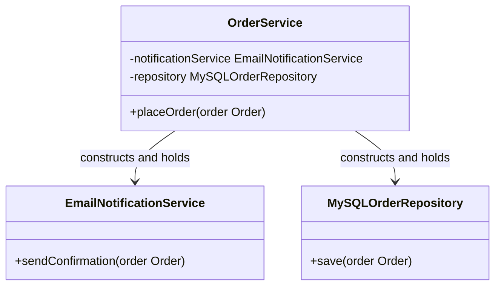
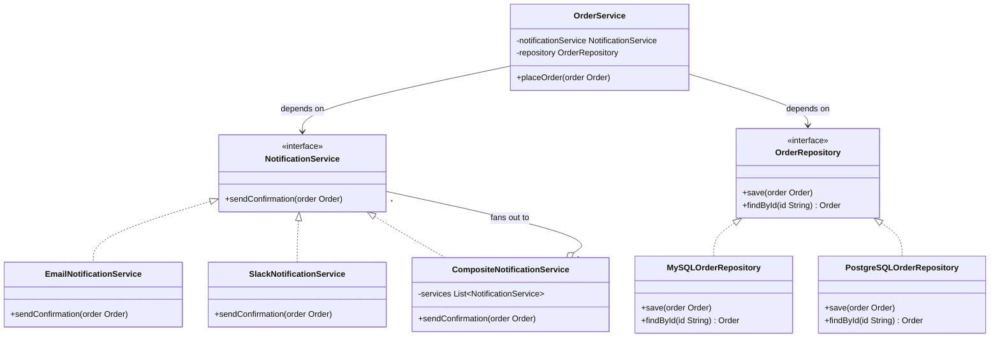

# Program to Interface, Not Implementation
## Origins

The **first design principle** stated in the Gang of Four's "Design Patterns: Elements of Reusable Object-Oriented Software" (1994):

> "Program to an interface, not an implementation."

The GoF observed that designs which depend on concrete classes are inherently rigid — they cannot be changed without modifying the code that depends on them. Designs that depend on abstractions remain flexible because the abstraction (the contract) can be satisfied by any number of concrete implementations.

---

## Intuition

> **One-line analogy**: Programming to an interface is like using standard electrical outlets — you plug in any device that follows the standard, not just devices from one manufacturer.

**Mental model**: `List<String> names = new ArrayList<>()` declares names as `List` (interface) even though you create `ArrayList` (concrete). Later, if you need a `LinkedList` (for frequent insertions), you change one line — the creation — not every usage. The code that uses `names` doesn't know or care whether it's an ArrayList or LinkedList; it just knows it's a `List` and can call list operations.

**Why it matters**: Code that depends on concrete classes is tightly coupled to implementation details — changing the implementation requires changing all the code that depends on it. Code that depends on interfaces is coupled only to contracts — implementation changes are invisible to dependent code. This is what makes large systems maintainable and testable.

**Key insight**: This principle is what makes Dependency Injection work — Spring injects the concrete implementation at runtime, while your code declares dependencies as interface types. It's also why `Mockito.mock(UserRepository.class)` works — mock implements the interface, satisfying all dependencies without real database connections.

---

## Definition

When writing code, declare variables, parameters, and return types using **interface or abstract class types**, not concrete class types. Depend on **what something does** (its contract), not **what something is** (its concrete class).

More broadly: the objects you collaborate with should be known to you only through their interface — the set of messages they respond to — not through their concrete implementation details.

---

## Motivation

- **Flexibility:** if code depends on `List`, you can pass `ArrayList`, `LinkedList`, `CopyOnWriteArrayList`, or any future `List` implementation. If it depends on `ArrayList`, you are locked in.
- **Testability:** you can substitute a mock or stub that implements the interface in tests, isolating the class under test.
- **Replaceability:** swap one implementation for another without changing the client code.
- **Separation of concerns:** the client doesn't need to know (and shouldn't care) about the concrete behavior details of its collaborators.

---

## Java Violation Example: The Simple Case

```java
// Violation: declaring with concrete type
ArrayList<String> names = new ArrayList<>();
names.add("Alice");

// Every method that receives this variable must also accept ArrayList,
// locking the caller into knowing about the concrete type.
public void processNames(ArrayList<String> names) { ... }
```

```java
// Compliant: declaring with interface type
List<String> names = new ArrayList<>();
names.add("Alice");

// The method accepts any List implementation
public void processNames(List<String> names) { ... }
```

The concrete type (`ArrayList`) is mentioned once, at the point of construction. Everywhere else, only the abstraction (`List`) is used.

---

## Java Violation Example: The Bigger Problem

The simple case above is a minor concern. The **real, consequential violation** is when service classes directly instantiate their dependencies:

```java
// OrderService.java — directly depends on concrete EmailNotificationService
public class OrderService {

    // Violation: hardcoded dependency on concrete class
    private EmailNotificationService notificationService = new EmailNotificationService();
    private MySQLOrderRepository repository = new MySQLOrderRepository("jdbc:mysql://localhost/orders");

    public void placeOrder(Order order) {
        repository.save(order);
        notificationService.sendConfirmation(order);
    }
}
```

**Problems:**
- Cannot test `OrderService` in isolation — it always creates real email and database connections.
- Cannot swap `MySQLOrderRepository` for a `PostgreSQLOrderRepository` without modifying `OrderService`.
- Cannot add a `SlackNotificationService` alongside email without modifying `OrderService`.
- `OrderService` depends on the concrete construction details of its collaborators.

**The resulting class structure — tightly coupled, nothing to substitute:**



There is no interface layer — `OrderService` is wired straight to `EmailNotificationService` and `MySQLOrderRepository`, so swapping in `PostgreSQLOrderRepository` or adding `SlackNotificationService` means editing `OrderService` itself.

---

## Compliant Example: Dependency Injection + Interfaces

```java
// Define interfaces — the contracts
public interface NotificationService {
    void sendConfirmation(Order order);
}

public interface OrderRepository {
    void save(Order order);
    Optional<Order> findById(String id);
}

// Concrete implementations
public class EmailNotificationService implements NotificationService {
    public void sendConfirmation(Order order) {
        // Send email
    }
}

public class SlackNotificationService implements NotificationService {
    public void sendConfirmation(Order order) {
        // Send Slack message
    }
}

public class MySQLOrderRepository implements OrderRepository {
    public void save(Order order) { /* MySQL */ }
    public Optional<Order> findById(String id) { /* MySQL */ }
}

// OrderService depends ONLY on interfaces — never on concrete classes
public class OrderService {

    private final NotificationService notificationService;
    private final OrderRepository repository;

    // Dependencies are injected — not created here
    public OrderService(NotificationService notificationService, OrderRepository repository) {
        this.notificationService = notificationService;
        this.repository = repository;
    }

    public void placeOrder(Order order) {
        repository.save(order);
        notificationService.sendConfirmation(order);
    }
}

// In a test:
OrderService service = new OrderService(
    mock(NotificationService.class),  // no real emails in tests
    mock(OrderRepository.class)        // no real database in tests
);

// In production with Spring:
// @Autowired automatically injects the registered implementation
```

`OrderService` has zero knowledge of what concrete class satisfies its dependencies. Any class implementing the interface will work.

---

## Benefits in Detail

### Testability

With interface-based dependencies:
- Replace real implementations with mocks/stubs in tests.
- Test `OrderService` logic without a database or email server.
- Verify that `notificationService.sendConfirmation(order)` was called without actually sending an email.

### Flexibility — Swapping Implementations

```java
// Switch from MySQL to PostgreSQL: one line changes at composition root
OrderRepository repository = new PostgreSQLOrderRepository(dataSource);
OrderService service = new OrderService(notificationService, repository);
// OrderService code: unchanged
```

### Extensibility (Open/Closed Principle)

Add a new notification channel without modifying `OrderService`:
```java
// Composite notification — notifies via multiple channels
public class CompositeNotificationService implements NotificationService {
    private final List<NotificationService> services;

    public CompositeNotificationService(List<NotificationService> services) {
        this.services = services;
    }

    public void sendConfirmation(Order order) {
        services.forEach(s -> s.sendConfirmation(order));
    }
}
// OrderService: unchanged
```

**The resulting class structure — one interface, many interchangeable collaborators:**



`OrderService` now couples only to `NotificationService` and `OrderRepository`. Every concrete class shown here — including `SlackNotificationService`, `CompositeNotificationService`, and `PostgreSQLOrderRepository`, all introduced above without touching `OrderService` — satisfies one of the two contracts.

---

## Interface vs Abstract Class: Decision Guide

| Use Interface When | Use Abstract Class When |
|-------------------|------------------------|
| You want multiple unrelated classes to implement the contract | You have a partial implementation to share |
| You need to implement multiple contracts (Java's multiple interface implementation) | You want to enforce a template algorithm (Template Method) |
| The contract is purely behavioral — no shared state | Subclasses share state or common initialization |
| You're defining a capability that cuts across the hierarchy | There is a genuine IS-A relationship in a closed hierarchy |
| You want the most flexibility for future change | You're designing an extension point in a framework |

In practice: **default to interfaces**. Reach for abstract classes only when you have shared implementation to offer.

---

## How This Principle Enables Design Patterns

Nearly every design pattern depends on this principle:

| Pattern | How it uses Program to Interface |
|---------|----------------------------------|
| **Strategy** | Client holds a `Strategy` interface; concrete strategies are interchangeable. |
| **Observer** | Subject holds a list of `Observer` interfaces; any observer can be registered. |
| **Decorator** | Decorator implements the same interface as the wrapped component. |
| **Factory Method** | Returns an interface type; the concrete class created is hidden. |
| **Command** | Invoker holds `Command` interface; any command can be executed or queued. |
| **Proxy** | Proxy implements the same interface as the real subject. |
| **Composite** | Leaf and Composite both implement the same `Component` interface. |

Without programming to interfaces, none of these patterns achieve their flexibility. The interface IS the seam that makes patterns work.

---

## Related Principles

- **Dependency Inversion Principle (SOLID-D):** "High-level modules should not depend on low-level modules. Both should depend on abstractions." DIP is the formal SOLID statement of this principle.
- **Dependency Injection:** the mechanism by which you provide concrete implementations to code that depends on interfaces. DI frameworks (Spring, Guice) automate the wiring.
- **Open/Closed Principle (SOLID-O):** once you program to interfaces, you can add new implementations (extend) without modifying the client code (closed for modification).

---

## Cross-Perspective: HLD Connections

**HLD View — Where Program to Interface Appears in Distributed Systems**

- **OpenAPI / Protobuf contracts** — Services depend on API specifications, not on specific service implementations. The contract (interface) is the artifact; the implementation can change without breaking consumers — the foundational principle of microservice interoperability.
- **Storage port abstraction** — Hexagonal architecture: application code depends on `StoragePort` and `MessagePort` interfaces; infrastructure adapters implement them. Swapping from MySQL to DynamoDB means writing a new adapter, not touching business logic.
- **Feature toggle abstraction** — Code depends on a `FeatureFlag` interface rather than a specific feature-flag SDK (LaunchDarkly, Split). Migrating SDKs means writing a new adapter — the application code is unchanged.
- **Cloud-agnostic infrastructure** — CDK/Pulumi abstractions let infrastructure code program to `Bucket`, `Queue`, and `Function` interfaces. Cloud-specific implementations are injected per deployment environment — program to the abstraction, not the AWS/GCP SDK directly.

---

## Interview Questions and Answers

**Q: What is the real, consequential violation of "program to an interface," beyond the trivial `ArrayList` versus `List` example?**
**Short:** A service class directly instantiating its own dependencies with `new`, like `new EmailNotificationService()`.
Declaring `ArrayList<String>` instead of `List<String>` is a minor concern that costs you a swap of collection implementation. The consequential violation is `OrderService` writing `private EmailNotificationService notificationService = new EmailNotificationService();` inside itself — this hardcodes the dependency's concrete construction and makes the class impossible to test in isolation or extend with a new implementation. The module is explicit that this bigger case, not the collection-type case, is what actually breaks systems.

**Q: What does programming to interfaces cost you when you have exactly one implementation and no plans for a second?**
**Short:** An extra interface file and one layer of indirection, in exchange for testability via mocks even with a single real implementation.
Even with only `EmailNotificationService` in existence, declaring the dependency as `NotificationService` still lets `OrderService` be unit-tested with `mock(NotificationService.class)` instead of a real email connection. The cost is a small amount of indirection — a reader must open the interface to see the contract — paid regardless of whether a second implementation ever arrives. This is the practical middle ground: the payoff (testability, decoupling from construction details) starts on day one, not only once a second implementation exists.

**Q: Why can't `OrderService` be unit-tested in isolation in the violation example, specifically?**
**Short:** Because it constructs `EmailNotificationService` and `MySQLOrderRepository` directly with `new`, so every test triggers real connections.
Since `OrderService` hardcodes `new EmailNotificationService()` and `new MySQLOrderRepository("jdbc:mysql://localhost/orders")` as field initializers, there is no seam at which a test can substitute a fake collaborator. Any test that exercises `placeOrder()` will attempt a real database connection and attempt to send a real email, which is both slow and unreliable as a unit test. The compliant fix injects both dependencies through the constructor as interface types, so a test passes `mock(NotificationService.class)` and `mock(OrderRepository.class)` instead.

**Q: How does constructor injection combined with interfaces let you add a new notification channel without touching OrderService at all?**
**Short:** `OrderService` depends only on the `NotificationService` interface, so any new implementing class plugs in without any change to it.
Because `OrderService` never names `EmailNotificationService` directly — only the `NotificationService` interface — adding `SlackNotificationService` or a `CompositeNotificationService` that fans out to multiple channels requires writing only the new class. Whoever wires up the application (the composition root) chooses which implementation to inject; `OrderService`'s own source code is unchanged. This is the module's concrete demonstration of the Open/Closed Principle riding on top of programming to interfaces.

**Q: What is the module's decision rule for choosing an interface versus an abstract class?**
**Short:** Default to interfaces; reach for an abstract class only when you have shared implementation to offer.
Interfaces suit purely behavioral contracts with no shared state, cases where a class needs multiple unrelated contracts, and capabilities that cut across an existing hierarchy. Abstract classes suit cases with a genuine IS-A relationship in a closed hierarchy, shared state or initialization logic, or when you're enforcing an algorithm skeleton via Template Method. The module states the practical default explicitly: default to interfaces, and only step up to an abstract class when you actually have implementation, not just contract, to share.

**Q: What is the mechanism by which Dependency Injection frameworks like Spring rely on "program to interface"?**
**Short:** Application code declares dependencies as interface types, and Spring injects whichever concrete implementation is registered.
`OrderService`'s constructor takes `NotificationService` and `OrderRepository` as parameter types, never naming the concrete classes, which is exactly what lets `@Autowired` supply whatever bean is registered for that interface at runtime. Without programming to interfaces, there would be nothing for the framework to inject against — the dependency would already be hardwired inside the class. This is also explicitly why `Mockito.mock(UserRepository.class)` works in tests: the mock implements the interface, satisfying every place that interface type is expected.

**Q: How does the Strategy pattern depend on "program to interface" to achieve its interchangeability?**
**Short:** The client holds a reference to the Strategy interface type, so any concrete strategy can be swapped in without client changes.
If the client held a reference to a concrete strategy class instead of the `Strategy` interface, swapping payment methods or sorting algorithms would require changing the client's field type and its instantiation code. Because the client only knows the interface, any class implementing it — a new payment method, a new sorting algorithm — can be substituted at the composition point with zero change to the client's logic. The module lists this as one of several patterns whose flexibility collapses entirely without this principle underneath it.

**Q: Why does the module say "the interface IS the seam that makes patterns work," and what does that mean concretely for Decorator?**
**Short:** A Decorator only works because it implements the same interface as the object it wraps, letting callers treat both identically.
A `BufferedInputStream` wrapping a `FileInputStream` only functions as a drop-in enhancement because both implement `InputStream` — the caller holding an `InputStream` reference cannot tell, or need to care, whether it's talking to the raw stream or three layers of decorators. If code depended on the concrete `FileInputStream` type instead, no decorator could be substituted transparently. This is the general shape the module attributes to every GoF pattern in its table: the interface is what makes objects of different concrete classes interchangeable to the client.

**Q: What is the relationship between "program to an interface" and the Dependency Inversion Principle from SOLID?**
**Short:** DIP is the formal SOLID statement of the same idea — high-level modules and low-level modules should both depend on abstractions.
"Program to an interface, not an implementation" is the GoF's original 1994 phrasing of the principle; DIP restates it more formally as "high-level modules should not depend on low-level modules, both should depend on abstractions." `OrderService` (high-level) depending on `NotificationService` and `OrderRepository` (abstractions) rather than on `EmailNotificationService` and `MySQLOrderRepository` (low-level concrete implementations) is DIP applied directly. The module treats the GoF principle as the intuitive precursor and DIP as its formal SOLID-letter articulation.

**Q: How does swapping `MySQLOrderRepository` for `PostgreSQLOrderRepository` work under the compliant design, and what has to change in OrderService?**
**Short:** Nothing in OrderService changes — only the object constructed at the application's composition root changes.
Because `OrderService`'s constructor accepts an `OrderRepository` interface, replacing the concrete database implementation is a one-line change where the application wires up its dependencies: `OrderRepository repository = new PostgreSQLOrderRepository(dataSource);`. `OrderService`'s own code has zero knowledge of which database backs the repository, so it requires no edit, no recompilation of its logic, and no new test beyond re-running the existing ones against the new wiring. This is the module's direct illustration of "flexibility" as a benefit, distinct from testability.

**Q: What does OpenAPI/Protobuf contract-first design have to do with "program to an interface" at the HLD level?**
**Short:** Services depend on the API specification, not on any particular service's implementation behind it.
A consumer of a REST or gRPC API programs against the documented contract — the OpenAPI spec or `.proto` file — rather than against a specific implementation's internal behavior. This lets the implementation behind the contract change freely, or even be replaced by a different team's service entirely, as long as the contract is honored, which the module calls the foundational principle of microservice interoperability. It is the same substitution guarantee as programming to a Java interface, just enforced across a network boundary instead of a JVM boundary.

**Q: How does hexagonal architecture's port/adapter pattern apply "program to an interface" to storage and messaging?**
**Short:** Application code depends on `StoragePort`/`MessagePort` interfaces; infrastructure adapters implement them underneath.
Business logic in a hexagonal architecture is written entirely against ports — interfaces like `StoragePort` — with no knowledge of whether the concrete adapter behind it is MySQL, DynamoDB, or an in-memory fake used in tests. Migrating from MySQL to DynamoDB means writing a new adapter that implements the same port; the application's business logic is untouched. This mirrors `OrderService`'s relationship to `OrderRepository` almost exactly, just named with the hexagonal architecture's own vocabulary.

**Q: Why does depending on a `FeatureFlag` interface rather than a specific SDK like LaunchDarkly matter in practice?**
**Short:** Migrating feature-flag vendors becomes writing one new adapter instead of rewriting every call site that checks a flag.
If application code called the LaunchDarkly SDK directly everywhere a flag check was needed, switching vendors — say to Split — would require touching every one of those call sites. Programming to a `FeatureFlag` interface means only the adapter implementing that interface needs to change; every caller of the interface is unaffected. This is the same "swap the implementation, not the caller" benefit demonstrated by the `OrderRepository` MySQL-to-PostgreSQL example, applied to a third-party SaaS dependency instead of a database.

**Q: What problem does `CompositeNotificationService` solve, and what design principle does it demonstrate together with "program to an interface"?**
**Short:** It fans a single `sendConfirmation()` call out to multiple channels while itself satisfying the same `NotificationService` interface.
`CompositeNotificationService` holds a `List<NotificationService>` and, on `sendConfirmation()`, forwards the call to every service in that list — meaning it can wrap Email, Slack, and any future channel behind one object that itself looks like an ordinary `NotificationService` to `OrderService`. This demonstrates that programming to an interface composes: because the interface is the contract, an aggregator of several implementations can itself implement that same contract and be indistinguishable from a single implementation to any caller. It is also a live instance of the Composite pattern the module's own table lists as depending on this principle.

**Q: In the class diagram sequence the module builds, why does `OrderService` end up with arrows only to two interfaces rather than to five concrete classes?**
**Short:** Because every concrete collaborator — Email, Slack, Composite, MySQL, PostgreSQL — satisfies one of exactly two interfaces `OrderService` depends on.
`OrderService` declares dependencies on `NotificationService` and `OrderRepository` only; `EmailNotificationService`, `SlackNotificationService`, `CompositeNotificationService`, `MySQLOrderRepository`, and `PostgreSQLOrderRepository` all sit below those two interfaces without `OrderService` ever referencing them by name. The diagram makes visible what "program to interface" buys structurally: five interchangeable concrete classes were introduced across the compliant example, and `OrderService`'s own dependency count never grew past two.

---

## Quick Summary

| Aspect | Summary |
|--------|---------|
| Core idea | Depend on what something does (interface), not what it is (concrete class) |
| Simple case | `List<String>` not `ArrayList<String>` |
| Big case | Inject `NotificationService` interface, not `new EmailNotificationService()` |
| Benefits | Testability (mocks), flexibility (swap impl), extensibility (new impl without change) |
| Interface vs abstract class | Default to interface; use abstract class for shared implementation |
| Enables | Every structural and behavioral design pattern |
| Related | Dependency Inversion Principle, Dependency Injection, Open/Closed Principle |
