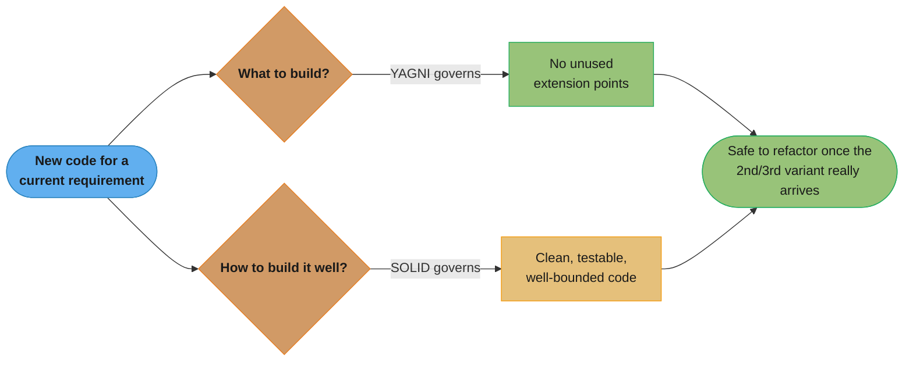

# YAGNI — You Aren't Gonna Need It
## Origins

YAGNI comes from **Extreme Programming (XP)**, articulated by **Ron Jeffries** (one of XP's founders) and popularized by **Kent Beck** in "Extreme Programming Explained" (1999).

The principle emerged as a direct response to the observation that software developers consistently over-build — implementing features and abstractions based on speculation about future needs that often never materialize.

Ron Jeffries' formulation:
> "Always implement things when you actually need them, never when you just foresee that you need them."

---

## Intuition

> **One-line analogy**: YAGNI is like packing for a trip — bring what you need for the actual trip, not everything you might possibly need if unpredictable things happen.

**Mental model**: Engineers naturally over-engineer — "we'll probably need a plugin system," "let's make this configurable," "what if we need this later?" YAGNI says: don't build it until you actually need it. Speculative features are built based on incomplete knowledge of future requirements. They add complexity now, may never be used, and often get in the way when the actual requirement arrives (which is usually different from what was imagined).

**Why it matters**: Unneeded features cost maintenance time even when unused — they must be tested, documented, understood, and updated alongside features people actually use. The cost of speculative features compounds over time.

**Key insight**: YAGNI doesn't mean "never design for extensibility." It means: make today's requirements work cleanly (which naturally produces extensible design via SOLID), but don't implement tomorrow's speculative requirements today. If tomorrow's requirement actually arrives, implement it then — you'll know more about it when it's real.

---

## Definition

Do not add functionality, abstraction, or infrastructure until it is needed by a **current, real requirement**. Features implemented speculatively:

1. May never be needed.
2. Are built based on incomplete knowledge of what will actually be needed.
3. Cost maintenance time even while unused.
4. Make the system harder to understand right now.
5. Often need to be redesigned when the real requirement finally arrives (because it differs from the speculation).

---

## Motivation

Studies and practitioner experience consistently show:
- A large percentage of features in software systems are rarely or never used.
- Every line of code is a liability — it must be read, understood, tested, debugged, and maintained.
- Premature abstractions lock in design decisions before the full picture is known, making the eventual real requirement harder to implement, not easier.

---

## Java Violation Examples

### Example 1: Over-abstracted Infrastructure

```java
// For a "Hello World" web app that just needs to return a greeting:

public interface AbstractStrategyFactoryFacadeManagerInterface<T, R> {
    StrategyFactory<T, R> createStrategyFactory(ExecutionContext<T> context);
}

public abstract class AbstractStrategyFactoryFacadeManager<T, R>
        implements AbstractStrategyFactoryFacadeManagerInterface<T, R> {
    protected abstract StrategyFactory<T, R> buildFactory();
    // ... 200 more lines
}

public class GreetingStrategyFactoryFacadeManager
        extends AbstractStrategyFactoryFacadeManager<GreetingRequest, GreetingResponse> {
    // ... all of this to return "Hello, World!"
}
```

The developer imagined the system might need pluggable greeting strategies, configurable factories, and extensible response types — none of which were requirements.

### Example 2: Configuration Premature Generalization

```java
// The requirement: read application config from a JSON file.

// YAGNI violation — built for JSON, XML, YAML, TOML, and environment variables "just in case":
public interface ConfigurationReader {
    Map<String, Object> read(InputStream source);
}

public class JsonConfigurationReader implements ConfigurationReader { ... }
public class XmlConfigurationReader implements ConfigurationReader { ... }
public class YamlConfigurationReader implements ConfigurationReader { ... }
public class TomlConfigurationReader implements ConfigurationReader { ... }
public class EnvVarConfigurationReader implements ConfigurationReader { ... }

public class ConfigurationReaderFactory {
    public static ConfigurationReader forFormat(String format) { ... }
}
```

Three months later: only JSON is ever used. The XML, YAML, TOML, and env var implementations are dead code that must be maintained and tested — or rot unnoticed.

---

## Compliant Example

```java
// Requirement: read config from a JSON file.

public class AppConfig {
    private final Map<String, Object> properties;

    public AppConfig(Path configFile) throws IOException {
        String json = Files.readString(configFile);
        this.properties = new ObjectMapper().readValue(json, Map.class);
    }

    public String get(String key) {
        return (String) properties.get(key);
    }
}
```

Simple. Does what's needed. If YAML support is needed later, add it then — with full knowledge of the actual requirement.

---

## The Real Costs of Premature Features

| Cost | Description |
|------|-------------|
| **Maintenance cost** | Every unused code path must still be tested, understood, and updated when surrounding code changes. |
| **Opportunity cost** | Developer time spent on speculative features is time not spent on features users actually need. |
| **Wrong abstractions** | Built without a real use case, premature abstractions almost always need to be redesigned when the real case arrives. The redesign is harder than starting fresh because the wrong abstraction is entangled with the rest of the system. |
| **Cognitive load** | Other developers reading the code must understand unused code paths, increasing the mental overhead of working in the codebase. |
| **Increased risk** | More code = more potential bugs, more surface area for security vulnerabilities. |

---

## YAGNI vs SOLID: The Tension and the Balance

These principles can appear to conflict:

- **YAGNI** says: don't add an abstraction until you need it. A concrete class is fine for now.
- **SOLID** (specifically OCP and DIP) says: depend on abstractions, design for extension without modification.

**The resolution:**

YAGNI and SOLID operate at different scopes:

- YAGNI governs **what to build**: don't build features or abstractions before they are needed by a real requirement.
- SOLID governs **how to build it well**: once you're building something, structure it with good principles so it can be changed safely later.

Practical balance:
1. When writing new code for a current requirement, don't add unused extension points (YAGNI).
2. When the second or third variant of something arrives, refactor to a clean abstraction (DRY's Rule of Three + SOLID).
3. Trust that good code — well-tested, well-named, with clear boundaries — can be refactored when the real requirement appears.



*YAGNI and SOLID answer two different questions about the same new code — what to build (nothing speculative) and how to build it well (clean, testable boundaries) — and together they are what makes refactoring safe and cheap once the Rule of Three actually fires.*

The key: **SOLID enables safe refactoring later; YAGNI says don't refactor before the need exists**.

---

## How to Practice YAGNI

**Defer decisions:**
- Treat architectural and design decisions as things to be deferred until the last responsible moment — when you have maximum information.
- "What if we need X?" is a question, not a requirement. Requirements come from users and product decisions, not developer imagination.

**Trust refactoring:**
- YAGNI is only safe in a codebase with good test coverage and clean code. If refactoring is expensive (no tests, high coupling), teams compensate by over-building upfront. The solution is better tests and cleaner code, not more speculation.
- A well-factored codebase makes adding the real feature later cheap.

**Use TDD:**
- Test-Driven Development naturally enforces YAGNI. You write a test for a current requirement, then write the minimum code to pass it. There is no mechanism for writing speculative production code.

**Recognize the signals:**
- "We might need..."
- "Just in case..."
- "Someday we could..."
- "What if the requirements change to..."

These are YAGNI warning phrases. They indicate speculation, not requirement.

---

## Real-World Examples

- **Twitter's early architecture:** Started with a simple Rails monolith. Did not design for 100M users from day one. When scale requirements became real, they were solved with actual data (not speculation).
- **SQLite vs PostgreSQL decision:** Many apps start with SQLite (simple, embedded) and migrate to PostgreSQL when real scale requirements appear — rather than building for distributed scale from day one.
- **Amazon's microservices:** Amazon did not start with microservices. They evolved from a monolith as specific scaling and team autonomy requirements became real.

---

## Related Principles

- **KISS:** YAGNI is KISS applied to feature scope — don't add complexity (features) before needed.
- **Premature Optimization:** "Premature optimization is the root of all evil" (Knuth) — the same principle applied to performance. Don't optimize until you have measured a real bottleneck.
- **Rule of Three (DRY):** Abstract on the third occurrence — don't abstract on the first.

---

## Cross-Perspective: HLD Connections

**HLD View — Where YAGNI Appears in Distributed Systems**

- **Don't shard prematurely** — Sharding adds cross-shard query complexity, resharding pain, and operational overhead. Don't add it before a single-node database is actually at capacity. Premature sharding is YAGNI at infrastructure scale.
- **Don't add a message queue speculatively** — Message queues are powerful but add producer/consumer coupling, schema management, and operational overhead. Add one when synchronous calls are measured to be a bottleneck — not because "we might need async someday."
- **Don't design for multi-region before launch** — Multi-region adds latency management, data residency, conflict resolution, and deployment complexity. Most products never need it. Build for single-region; design the data model to be extendable, but don't implement multi-region upfront.
- **Simple HTTP before gRPC** — gRPC offers performance advantages but adds tooling, protobuf schema management, and observability complexity. For internal services with moderate traffic, REST is simpler and sufficient until measured evidence says otherwise.

---

## Interview Questions and Answers

**Q: What is Ron Jeffries' original formulation of YAGNI, and what does it actually forbid?**
**Short:** Implement things when you actually need them, never merely because you foresee needing them.
Jeffries' rule targets the gap between "I can imagine a future need" and "a current requirement demands this now" — YAGNI forbids building for the former. It does not forbid designing well for what you're building today; well-factored code for a real requirement naturally stays extensible. The rule exists because developers consistently over-build based on speculation about needs that often never materialize.

**Q: How does the module resolve the apparent conflict between YAGNI and SOLID (specifically OCP/DIP)?**
**Short:** YAGNI governs what to build now; SOLID governs how to build it well once you're building it.
YAGNI says don't add an abstraction or extension point before a real requirement calls for it — a concrete class is fine today. SOLID says that whatever you do build should be structured so it can be changed safely later, via clean boundaries and dependencies on abstractions. The resolution is that SOLID is what makes YAGNI safe: because well-tested, well-bounded code is cheap to refactor, you can defer the abstraction without fear, trusting refactoring instead of speculating upfront.

**Q: Why does the module call "wrong abstractions" the most expensive cost of violating YAGNI, worse than merely writing unused code?**
**Short:** A premature abstraction built without a real use case is usually redesigned when the real case arrives, and untangling it is harder than starting fresh.
Speculative abstractions lock in a shape based on guesses, and when the actual requirement finally appears it is almost always different from what was imagined. Untangling the wrong abstraction from the rest of the system is harder than building fresh, because other code has since grown to depend on its specific (wrong) shape. This is why the module lists it separately from plain maintenance cost — it isn't just wasted code, it actively obstructs the eventual real implementation.

**Q: In the ConfigurationReader violation example, what was actually needed versus what was built, and what happened three months later?**
**Short:** Only JSON config reading was ever needed; XML, YAML, TOML, and env-var readers were built "just in case" and went unused.
The requirement was to read application config from a JSON file, but the implementation added a `ConfigurationReader` interface with five implementations and a factory to select between formats. Three months later only the JSON reader was ever exercised, leaving the other four as dead code that still had to be tested, maintained, or left silently rotting. The compliant fix collapses this to a single `AppConfig` class that reads JSON directly, with no interface until a second format is actually needed.

**Q: What four warning phrases does the module list as YAGNI red flags, and why are they red flags rather than legitimate reasoning?**
**Short:** "We might need," "just in case," "someday we could," and "what if requirements change to" all signal speculation, not requirement.
Each of these phrases describes an imagined future scenario rather than something a user or product decision has actually asked for. The module's point is that "what if we need X?" is a question, not a requirement — requirements come from real product decisions, and speculative phrasing is the tell that no such decision exists yet. Recognizing these phrases in a design discussion is the practical trigger to stop and ask what concrete requirement is driving the proposed feature.

**Q: Why does the module say YAGNI is "only safe in a codebase with good test coverage and clean code"?**
**Short:** Deferring a decision is safe only if refactoring later is cheap, which requires tests and low coupling.
If refactoring is expensive — no tests, high coupling — teams rationally compensate by over-building upfront, because the alternative (retrofitting the feature later) is too costly to risk. The fix for that fear is better tests and cleaner code, not more speculative design, because speculation doesn't actually reduce future risk, it just moves the guesswork earlier. This is why YAGNI and disciplined testing practices like TDD are presented as a package rather than independent choices.

**Q: How does Test-Driven Development enforce YAGNI mechanically, according to the module?**
**Short:** TDD only lets you write the minimum code needed to pass a test for a current requirement.
In TDD you write a failing test for a real requirement first, then write just enough production code to make it pass — there is no step in the cycle where you write code for a requirement that doesn't yet have a test. This structurally prevents speculative production code, because anything not backed by a current test simply has no place to go. The module presents TDD as the practical enforcement mechanism for a principle that is otherwise easy to violate under design-discussion pressure.

**Q: What is "premature optimization is the root of all evil" doing in a module about YAGNI, and how are the two related?**
**Short:** Premature optimization is YAGNI applied to performance instead of features — don't build for an unmeasured bottleneck.
Just as YAGNI says don't add a feature before a real requirement demands it, Knuth's dictum says don't add complexity for performance before a measured bottleneck demands it. Both principles reject optimizing for an imagined future state; both require waiting for real evidence — a real user request or a real profiler measurement — before paying the complexity cost. The module places them side by side as the same discipline applied to two different axes: functionality and performance.

**Q: Why does the module call premature sharding "YAGNI at infrastructure scale"?**
**Short:** Sharding adds cross-shard query and resharding complexity that shouldn't be paid before a single node is actually at capacity.
Sharding is a significant architectural commitment — it complicates queries that must span shards and makes resharding painful once data has grown around the current shard key. Adding it before a single-node database is measurably at capacity means paying that operational cost for a problem that doesn't exist yet, exactly the pattern YAGNI targets for features. The guidance is to scale vertically or optimize first, and shard only once real capacity data forces the decision.

**Q: What does the Twitter early-architecture example illustrate about applying YAGNI at the system-design level?**
**Short:** Twitter started as a simple Rails monolith and solved scale problems with real data once they became real, not upfront.
Twitter did not design for 100 million users from day one; it began as a straightforward monolith sized for its actual early usage. When scale requirements became real and measurable, they were solved using the actual traffic patterns and bottlenecks observed, rather than architecture guessed at in advance. This mirrors the module's broader claim that speculative infrastructure decisions are usually wrong anyway, because the real requirement, once it arrives, differs from what was imagined.

**Q: How does the module argue against adding a message queue "just in case we need async later"?**
**Short:** Message queues add producer/consumer coupling and schema management overhead that should be justified by a measured bottleneck, not anticipation.
A message queue is a real piece of operational infrastructure — it requires schema agreements between producer and consumer and ongoing operational management — not a free architectural upgrade. The module's guidance is to add one when synchronous calls are actually measured to be a bottleneck, not preemptively "because we might need async someday," which is explicitly listed among the warning phrases. This keeps the system's complexity proportional to demonstrated need rather than anticipated need.

**Q: What five distinct costs does the module attribute to premature/speculative features?**
**Short:** Maintenance cost, opportunity cost, wrong abstractions, cognitive load, and increased risk.
Maintenance cost means unused code paths must still be tested and updated as surrounding code changes; opportunity cost means the time spent building them wasn't spent on features users actually need. Wrong abstractions are the hardest to reverse, since they must be redesigned once the real requirement arrives and differs from the guess. Cognitive load means every future reader must understand code paths nobody uses, and increased risk means more code is simply more surface area for bugs and security issues.

**Q: Why does the module recommend deferring architectural decisions to "the last responsible moment" rather than deciding early for clarity?**
**Short:** Waiting until the last responsible moment means deciding with the maximum information actually available.
Deciding early feels like progress, but it locks in a choice made with the least information you'll ever have about the real requirement. The "last responsible moment" is the latest point at which delaying the decision would start causing real cost — up to that point, more information keeps arriving that could change the right answer. This directly opposes the instinct to "just pick an architecture now to be safe," which is exactly the instinct YAGNI is designed to check.

**Q: How does the multi-region infrastructure example show YAGNI's cost/benefit reasoning in a concrete HLD tradeoff?**
**Short:** Multi-region adds latency management, data residency, and conflict resolution complexity that most products never actually need.
Building multi-region support before launch means paying for cross-region data replication, conflict resolution, and deployment complexity against a requirement — global low-latency access, regulatory data residency — that may never materialize for that product. The YAGNI-consistent approach is to build single-region while keeping the data model extendable, and add multi-region only once real usage or compliance requirements force it. This mirrors the sharding example: architecturally significant complexity deferred until a real, current requirement demands it.

**Q: What is the practical difference between "designing for extensibility" and violating YAGNI, since both sound like planning ahead?**
**Short:** Designing well for today's requirement is fine; implementing tomorrow's speculative requirement today is the violation.
YAGNI does not forbid writing clean, well-bounded code — good design for the current requirement naturally produces code that is easier to extend later, via SOLID principles like DIP. What it forbids is building the extension itself — the second implementation, the configuration flag, the plugin hook — before any concrete requirement calls for it. The module's practical rule is: solve today's problem cleanly, and trust that clean code can be extended when tomorrow's requirement actually arrives.

---

## Quick Summary

| Aspect | Summary |
|--------|---------|
| Core idea | Don't implement until there is a real, current requirement |
| Not the same as | Ignoring good design — design well for what you're building now |
| Key costs | Maintenance, opportunity cost, wrong abstractions, cognitive load |
| YAGNI vs SOLID | YAGNI: what to build. SOLID: how to build it well. Trust refactoring. |
| How to practice | Defer decisions, trust refactoring, use TDD |
| Warning phrases | "We might need...", "Just in case...", "Someday..." |
