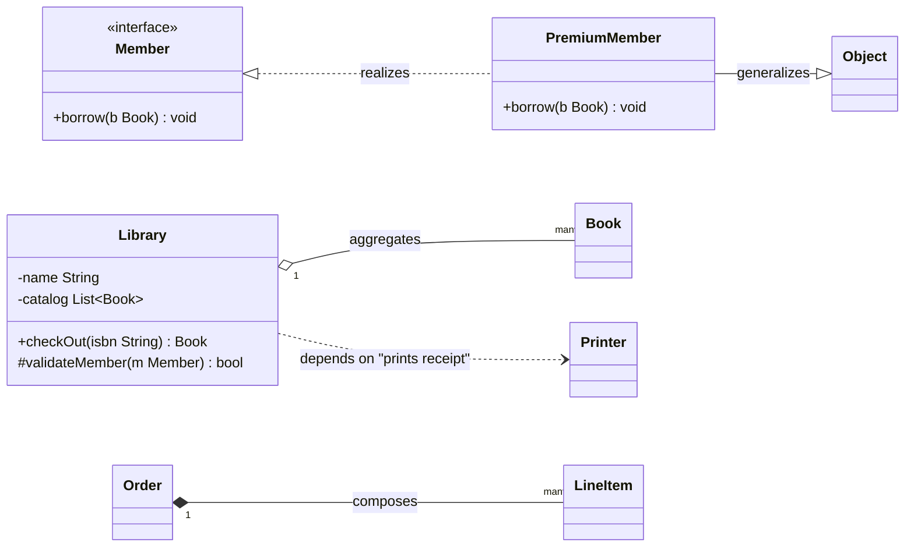
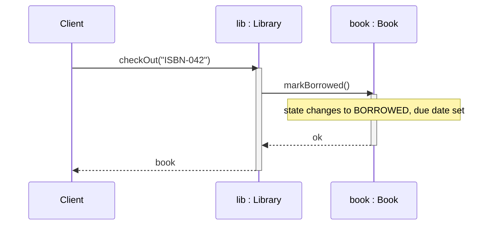
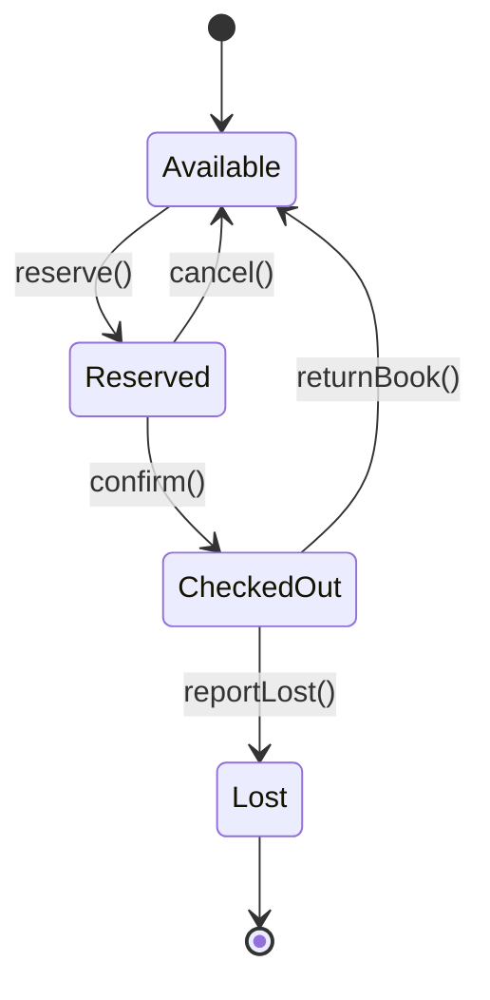
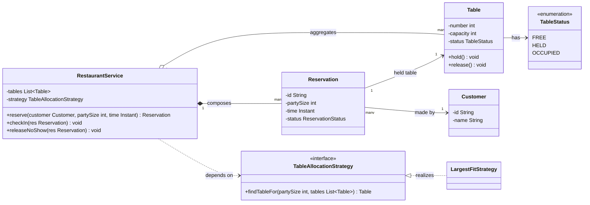
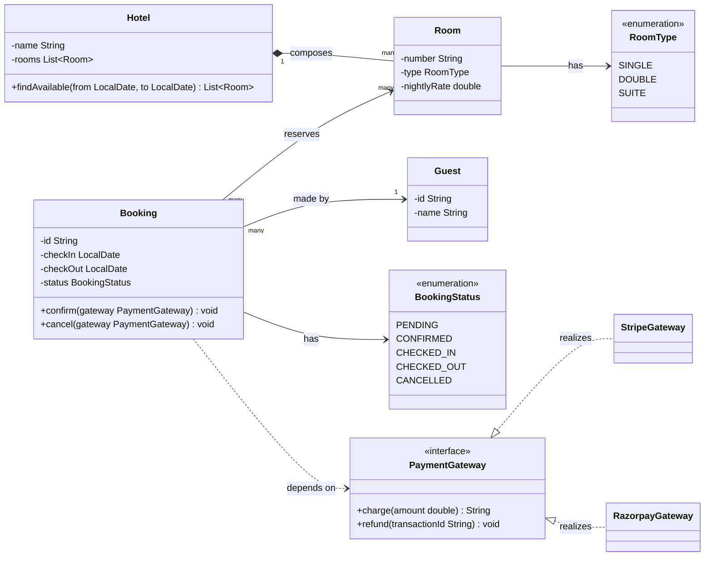

# OOP and UML Foundations

The vocabulary every pattern page in this section assumes you already have — objects, class relationships, and the UML notation used to draw them.

---

## 1. Concept Overview

Object-oriented design (OOD) is not "using classes." A program can be wall-to-wall classes and still be procedural in spirit — one class with forty fields and a hundred static-feeling methods that reach into each other's state. OOD is the discipline of deciding **who owns what responsibility**, **who is allowed to know about whom**, and **how those relationships are drawn so another engineer can review the decision before any code exists**. The 23 Gang-of-Four patterns catalogued in `creational/`, `structural/`, and `behavioral/` are named solutions to recurring versions of that decision; every one of their pages opens with a UML class diagram and assumes you can read `-->` versus `--|>` versus a hollow diamond without looking it up.

This module is the missing prerequisite. It covers what an object is (§2), the four pillars used correctly and abused (§3), the class relationships UML exists to distinguish (§4), the exact Mermaid notation the rest of this section relies on (§5), and a worked example turning prose into a diagram (§6) — the skill every "design a parking lot"-style interview question tests before a single pattern is chosen.

---

## 2. Intuition

> **One-line analogy**: A class diagram is a floor plan, not a photograph — it shows which rooms exist and which walls are load-bearing, not what is happening inside them right now.

**Mental model**: An object is a bundle of state plus the operations that are allowed to touch that state. Design is not "what fields does this need" — it is "what is this thing responsible for, and what does it refuse to know about anything else." Two objects that call each other's methods are coupled; the entire discipline of OOD is deciding which couplings are necessary and drawing the rest out as interfaces.

**Why it matters**: Every GoF pattern is a named shape of relationships between a small number of classes. Without the vocabulary — association, aggregation, composition, dependency, realization, generalization — you cannot tell Decorator's class diagram apart from Proxy's by eye, even though the diagrams differ in exactly one arrow. Interviewers read the diagram you draw before they read a line of your code; a wrong diamond changes what you claimed the ownership rules are.

**Key insight**: Composition over inheritance (see `../design_principles/Composition_over_Inheritance.md`) is not a slogan you memorize — it falls directly out of correctly applying the LIFETIME test in §4. Once you can tell aggregation from composition by asking "does the part outlive the whole," half of the "prefer composition" debates in an interview answer themselves.

---

## 3. Core Principles

The four pillars are not independent — each one is a rule about what a class is allowed to expose, and each has a canonical Java violation.

### Encapsulation

**Definition:** Hide internal state behind a controlled interface; nothing outside the class touches its fields directly. Encapsulation is about protecting invariants, not about writing getters — a class with a public setter for every private field is not encapsulated, it is a struct wearing a disguise.

```java
// BROKEN: fields are private but every invariant is exposed through unguarded setters
class BankAccount {
    private double balance;
    public void setBalance(double balance) { this.balance = balance; } // negative balance? nobody stops you
    public double getBalance() { return balance; }
}

// FIX: the class owns the only operations that can change balance, and each one enforces the invariant
class SafeBankAccount {
    private double balance;
    public void deposit(double amount) {
        if (amount <= 0) throw new IllegalArgumentException("deposit must be positive");
        balance += amount;
    }
    public void withdraw(double amount) {
        if (amount <= 0 || amount > balance) throw new IllegalArgumentException("invalid withdrawal");
        balance -= amount;
    }
    public double getBalance() { return balance; }
}
```

`SafeBankAccount` never has a negative balance, because there is no code path — inside or outside the class — that can set it to one. That guarantee is the entire point; `SafeBankAccount(-50)` is not merely discouraged, it is impossible to express.

### Abstraction

**Definition:** Expose *what* an object does, not *how*. A caller of `List.add(x)` never needs to know whether the backing store is an array or a linked node — that is the difference between `ArrayList` and `LinkedList`, and abstraction is precisely what lets you swap one for the other without touching a single call site.

```java
// BROKEN: caller is coupled to the concrete algorithm, not the capability
class ReportGenerator {
    ArrayList<String> rows; // callers that iterate must know ArrayList's iteration cost profile
    void addRow(String r) { rows.add(r); }
}

// FIX: caller depends on the interface; the concrete choice is an implementation detail
class ReportGenerator {
    List<String> rows = new ArrayList<>(); // could become a LinkedList tomorrow with zero call-site changes
    void addRow(String r) { rows.add(r); }
}
```

### Inheritance

**Definition:** A subclass acquires the interface and (optionally) the implementation of a superclass, modeling an **is-a** relationship. Inheritance is the most misused pillar in this list — it is reached for as a code-reuse shortcut when the real relationship is "has-a," which is what §4's aggregation/composition distinction and `../design_principles/Composition_over_Inheritance.md` exist to correct.

```java
// BROKEN: Square is-a Rectangle structurally, but not behaviorally — this is the classic LSP break
class Rectangle {
    protected int width, height;
    void setWidth(int w) { width = w; }
    void setHeight(int h) { height = h; }
    int area() { return width * height; }
}
class Square extends Rectangle {
    @Override void setWidth(int w) { width = w; height = w; }  // silently changes height too
    @Override void setHeight(int h) { width = h; height = h; } // caller assuming independent setters breaks
}

// FIX: Square and Rectangle are siblings behind a Shape interface — no inheritance between them at all
sealed interface Shape permits Rectangle, Square {
    int area();
}
record Rectangle(int width, int height) implements Shape {
    public int area() { return width * height; }
}
record Square(int side) implements Shape {
    public int area() { return side * side; }
}
```

The fix is more than a code-reuse trick: it uses a Java 17 `sealed interface` (JEP 409) to make the exhaustive set of shapes a compile-time fact, and Java 16 `record`s (JEP 395) to make each shape an immutable value with no setters to break in the first place — the LSP violation is unrepresentable, not merely avoided by discipline.

### Polymorphism

**Definition:** The same message sent to different objects produces behavior appropriate to each object's actual type, resolved at runtime through dynamic dispatch. This is what lets `for (Shape s : shapes) total += s.area();` work without a single `instanceof` check.

```java
// BROKEN: type-switching defeats polymorphism and must be edited for every new type
double totalArea(List<Object> shapes) {
    double total = 0;
    for (Object o : shapes) {
        if (o instanceof Rectangle r) total += r.width() * (double) r.height();
        else if (o instanceof Square sq) total += (double) sq.side() * sq.side();
        // every new shape requires editing this method — violates Open/Closed
    }
    return total;
}

// FIX: each shape answers for its own area; the loop never branches on type
double totalArea(List<Shape> shapes) {
    double total = 0;
    for (Shape s : shapes) total += s.area();
    return total;
}
```

See `../solid_principles/OpenClosed.md` — the fixed `totalArea` is closed for modification (never edited again) and open for extension (a new `Shape` implementation needs no change here at all).

---

## 4. Types / Architectures / Strategies — The Class Relationships

UML defines six relationships between classes. Every GoF pattern's class diagram is built from exactly these six arrows.

| Relationship | Meaning | UML Notation | Strength |
|---|---|---|---|
| **Association** | "Uses / knows about" — a general structural link | Solid line, no diamond, optional arrowhead | Weakest owning relationship |
| **Aggregation** | Whole-part, but the part can outlive the whole | Solid line, **hollow** diamond at the whole | Weak "has-a" |
| **Composition** | Whole-part, and the part's lifetime is bound to the whole | Solid line, **filled** diamond at the whole | Strong "has-a" (ownership) |
| **Dependency** | "Uses temporarily" — a parameter, local variable, or return type, not a stored reference | Dashed line, open arrowhead | Weakest of all — no stored reference |
| **Realization** | A class implements an interface's contract | Dashed line, hollow triangle arrowhead | Contract fulfillment |
| **Generalization** | A subclass extends a superclass ("is-a") | Solid line, hollow triangle arrowhead | Inheritance |

### The Diamond Rule

The diamond always sits at the **whole/owner** end of the line, never at the part. A hollow diamond at `Library` in `Library o-- Book` reads "a `Library` aggregates `Book`s" — the diamond marks who does the aggregating. Reversing it is the single most common UML mistake this repo's pattern pages avoid: get it backward and you have drawn "a `Book` owns a `Library`."

### The LIFETIME Test — telling aggregation from composition

Ask one question: **if the whole is destroyed, does the part die with it, or does it go on existing?**

- A `Department` has `Employee`s. Delete the `Department` — the `Employee`s still exist, they just transfer elsewhere. **Aggregation** (hollow diamond).
- An `Order` has `LineItem`s. Delete the `Order` — the `LineItem`s are meaningless without it and are deleted too. **Composition** (filled diamond).
- A `Car` has an `Engine`. In most domain models the engine is manufactured with the car and scrapped with it — **composition**. But model a garage that swaps engines between cars, and the same pair becomes **aggregation** — the relationship is a modeling decision about *this* domain, not an inherent property of "car" and "engine" as English nouns.

The test resolves the aggregation/composition confusion flagged as a top pitfall in §10: when in doubt, ask whether deleting the container's row in your data model should cascade-delete the part's row. `ON DELETE CASCADE` is composition; `ON DELETE SET NULL` (or no cascade at all) is aggregation.

### Realization vs Generalization — the two hollow-triangle arrows

Both use a hollow (unfilled) triangle arrowhead, and both are read "is-a" in some sense — the difference is what sits on the other end of the line:

- **Realization** (dashed line): a class fulfills an **interface's** contract. `ArrayList ..|> List` — `ArrayList` promises to do everything `List` requires, with its own implementation.
- **Generalization** (solid line): a class extends a **concrete or abstract class**, inheriting both interface and implementation. `Square --|> Shape` (the abstract-class version, not the sealed-interface fix above) — `Square` inherits whatever code `Shape` already wrote.

---

## 5. Architecture Diagrams — Notation Cheat-Sheets

### classDiagram cheat-sheet



*`Library` aggregates `Book` (hollow diamond — books outlive the library), `Order` composes `LineItem` (filled diamond — line items die with the order), `Library` merely depends on `Printer` for one call (dashed open arrow, no stored field), and `PremiumMember` realizes the `Member` interface (dashed hollow triangle).*

**Visibility markers** (prefix on every field and method):

| Marker | Visibility |
|---|---|
| `+` | `public` |
| `-` | `private` |
| `#` | `protected` |
| `~` | package-private (default) |

**Other markers:** an underlined member is `static`; an italicized member (or one under an `<<abstract>>`/`<<interface>>` stereotype) is abstract. Common stereotypes: `<<interface>>`, `<<abstract>>`, `<<enumeration>>`. Generics use the tilde form — `List~Room~` renders as `List<Room>`; a literal `<`/`>` in a Mermaid label misparses as HTML.

**Every arrow form, side by side:**

| Arrow | Mermaid syntax | Meaning |
|---|---|---|
| `-->` | plain solid, filled arrowhead | Directed association |
| `--` | plain solid, no arrowhead | Undirected association |
| `o--` | solid, hollow diamond | Aggregation |
| `*--` | solid, filled diamond | Composition |
| `..>` | dashed, open arrowhead | Dependency |
| `..|>` | dashed, hollow triangle | Realization (implements) |
| `--|>` | solid, hollow triangle | Generalization (extends) |

### sequenceDiagram cheat-sheet



*Solid arrow with filled head (`->>`) is a synchronous call; dashed arrow with filled head (`-->>`) is the return. `activate`/`deactivate` draw the lifeline bar showing how long a call is "in flight." Never put a `;` inside a `Note` or message body — it is a statement separator and silently truncates the text.*

### stateDiagram-v2 cheat-sheet



*`[*]` marks the pseudo-start and pseudo-end states. Every edge is labeled with the triggering event, not the resulting state — this is the diagram form behind the State pattern (`../behavioral/state/state.md`) and every "design a vending machine" / "design an elevator" problem in `../system_design_problems/system_design_problems.md`.*

---

## 6. How It Works — Detailed Mechanics: Prose to Class Diagram

**Problem statement (as given in an interview):** "Design a system for a restaurant to manage table reservations. Customers call to reserve a table for a party size at a given time; the restaurant has tables of different capacities. When a customer arrives, the host checks them in and assigns them to a held table; if they no-show past a grace period, the hold is released. A manager should be able to see which tables are currently free."

### Step 1 — Noun/verb extraction (the wrong turn first)

A first pass lists every noun as a class: `Restaurant`, `Customer`, `Table`, `Reservation`, `Host`, `Manager`, `PartySize`, `Time`, `GracePeriod`. This is the mistake almost everyone makes on the first attempt — `PartySize`, `Time`, and `GracePeriod` are not entities, they are attributes or value types masquerading as nouns because they were nouns in the English sentence. Modeling them as classes with their own identity (a `PartySize` class holding an `int`) produces the "modeling data instead of behavior" pitfall in §10 before the design has even started.

### Step 2 — Filter to entities with identity and behavior

An entity earns a class only if it has an identity that persists across state changes AND behavior (verbs) attached to it:

| Candidate | Entity? | Why |
|---|---|---|
| `Table` | Yes | Has identity (table #7 is always table #7) and behavior (`hold()`, `release()`) |
| `Reservation` | Yes | Has identity, a lifecycle (pending → confirmed → checked-in → completed/no-show), and behavior |
| `Customer` | Yes | Identity persists across multiple reservations |
| `PartySize` | No | Just an `int` — becomes a field, not a class |
| `Time`/`GracePeriod` | No | Use `java.time.Instant`/`Duration` — the JDK already models these |
| `Host`, `Manager` | Maybe | Only if the system needs to distinguish *who* performed an action for audit/authorization; otherwise they are just callers of the API, not domain classes |

For this problem, `Host` and `Manager` are cut — nothing in the statement requires tracking which staff member did what. That cut is itself a design decision worth stating out loud in an interview: it shows you are not modeling the org chart, you are modeling the domain.

### Step 3 — Extract interfaces from behavior, not from nouns

The verbs "reserve," "check in," "release" describe a `Reservation` lifecycle — that maps to a state machine (§5's `stateDiagram-v2`), not to separate classes. The one genuine interface boundary is *how a table gets found for a party size* — today it is a simple linear scan, but "the restaurant has tables of different capacities" hints the allocation strategy may later need to change (largest-fit vs. smallest-fit vs. adjacent-table-merging), which is exactly the Strategy pattern's trigger condition (`../behavioral/strategy/strategy.md`):

```java
interface TableAllocationStrategy {
    Optional<Table> findTableFor(int partySize, List<Table> tables);
}
```

### Step 4 — The class diagram



*`RestaurantService` **aggregates** `Table`s (tables outlive any given service instance — they exist independent of the reservation system) but **composes** `Reservation`s (a reservation has no meaning outside the service that created it). `Reservation`'s link to `Table` and `Customer` is plain association — a reservation references a table and a customer without owning either's lifecycle. The strategy link is a dependency, not a stored aggregation, because `RestaurantService` calls through the interface without caring which concrete strategy it received.*

---

## 7. Real-World Examples — How the JDK Models These Relationships

The JDK is the largest UML class diagram you already have memorized without knowing it:

- **Realization**: `ArrayList implements List` — `List` is the interface (contract), `ArrayList` and `LinkedList` are two unrelated realizations of it. `class ArrayList~E~ ..|> List~E~` in a diagram.
- **Dependency**: `Thread` depends on `Runnable` — a `Thread` takes a `Runnable` in its constructor and calls `run()` once, but does not store it as a long-lived owned part the way composition would imply; the relationship is closer to "uses to configure behavior" than "owns."
- **Composition**: `HashMap` and its internal `Node<K,V>` entries — a `Node` has no meaning and no accessible identity outside the `HashMap` that created it; when the map is garbage collected, every node goes with it. Filled diamond.
- **Aggregation**: a `ThreadPoolExecutor` holding a `BlockingQueue<Runnable>` — the queue can be constructed independently and handed to the executor, and swapping executors does not require destroying the queue's contents. Hollow diamond.
- **Decoration as a relationship, not a diamond**: `Collections.unmodifiableList(list)` wraps a `List` inside another `List` that forwards reads and rejects writes — this is the Decorator pattern (`../structural/structural.md`) expressed as plain association: the wrapper holds a reference to the wrapped object and both satisfy the same `List` interface.

---

## 8. Tradeoffs — Inheritance vs. Composition vs. Delegation

| Dimension | Inheritance (`extends`) | Composition (has-a field) | Delegation (composition + explicit forwarding) |
|---|---|---|---|
| Coupling | Tight — subclass depends on superclass internals (fragile base class problem) | Loose — depends only on the held object's public interface | Loose, plus explicit control over which calls forward |
| Reuse granularity | Whole class, fixed at compile time | Any object, swappable at runtime | Any object, swappable at runtime |
| Multiple behaviors | Java allows only single class inheritance | Compose as many held objects as needed | Same — compose freely |
| Testability | Must subclass (or use a real base) to substitute behavior in a test | Inject a mock/stub implementing the same interface | Same as composition |
| When it breaks | Silently, via LSP violations (the `Square`/`Rectangle` case in §3) | Compile-time — a missing method is a compile error, not a runtime surprise | Same as composition |
| Boilerplate | None — behavior is inherited for free | None if you only need a few methods | One forwarding method per exposed operation |

Effective Java's guidance (Item 18, "Favor composition over inheritance") is the default answer, not a universal one: inheritance is still correct when the relationship is genuinely "is-a" *and* the subclass will not violate the superclass's contract — `IllegalStateException extends RuntimeException` is inheritance used correctly, because an `IllegalStateException` really is a kind of `RuntimeException` in every observable way.

---

## 9. When to Use / When NOT to Use a UML Diagram

**Draw a diagram when:**
- The interviewer explicitly asks for a design before code ("design a parking lot" style questions in `../system_design_problems/system_design_problems.md` are graded partly on this artifact).
- The relationships between 4+ classes are not obvious from names alone — a diagram surfaces a wrong diamond (aggregation modeled as composition) before it becomes a bug.
- You are choosing between two or more GoF patterns and want to compare their shapes side by side.

**Skip the diagram when:**
- The design is 1-2 classes with an obvious relationship — drawing `Cache o-- CacheEntry` costs more interview minutes than it returns.
- Time pressure means the diagram would come out of coding time rather than thinking time — a rough box-and-arrow sketch on a whiteboard (or said aloud: "Order composes LineItems, references a Customer") captures the same decision in a fraction of the time a full Mermaid-quality diagram takes.
- You are mid-implementation and the diagram would just restate code the interviewer can already read.

The failure mode to avoid is symmetric: skipping the diagram on a genuinely multi-class design reads as not having thought about ownership; over-drawing a two-class design reads as stalling. Match the diagram's weight to the design's actual complexity.

---

## 10. Common Pitfalls

**Modeling data instead of behavior.** A class with only getters/setters and no methods that enforce an invariant is not an object — it is a struct with extra ceremony. This is the same failure as the "anaemic entities" pitfall below, caught earlier: if every field has a public setter, ask what invariant the class is supposed to protect, and move the logic that protects it into the class.

**Aggregation/composition confusion.** Drawing every has-a relationship as composition (filled diamond) because it looks "more correct" is the single most common diagram mistake reviewed in this section. Run the §4 LIFETIME test explicitly rather than guessing — "if I delete the parent row, should the child row cascade-delete?" resolves it every time.

**Deep inheritance hierarchies.** A hierarchy more than 2-3 levels deep (`Animal → Mammal → Carnivore → Feline → BigCat → Lion`) means every level is a place a subclass can violate an ancestor's contract, and understanding `Lion`'s behavior requires reading five classes. Prefer flattening with composition or an interface + a handful of leaf implementations.

**Anaemic entities.** A domain object with all data public (or all-getter/all-setter) and all logic living in a separate `*Service`/`*Manager`/`*Util` class scatters the rules that should belong to the entity across the codebase, and makes the entity trivially inconsistent (nothing stops `order.setStatus(SHIPPED)` before `order.setLineItems(...)` is populated).

**The is-a test failing under Liskov.** "A `Square` is-a `Rectangle`" is true geometrically and false behaviorally — see the §3 example. Before extending a class, ask: "can every caller of the superclass substitute my subclass without checking what type it actually got?" If the answer is ever no, the relationship is not generalization.

*Broken:* a `Stack` implemented by extending `ArrayList`, because "a stack is just a list with push/pop":

```java
// BROKEN: extends ArrayList, so every List method — including add(index, elem),
// remove(index), and Collections.sort() — is still callable and silently breaks
// stack discipline (elements can be inserted or removed out of LIFO order).
class BrokenStack<E> extends ArrayList<E> {
    void push(E e) { add(e); }
    E pop() { return remove(size() - 1); }
}
```

*Fix:* compose an `ArrayDeque`, exposing only stack operations:

```java
// FIX: composition — FixedStack has-a Deque, and exposes only push/pop/peek.
// Callers cannot reach add(index, elem) because FixedStack never implements List.
class FixedStack<E> {
    private final Deque<E> data = new ArrayDeque<>();
    void push(E e) { data.push(e); }
    E pop() { return data.pop(); }
    E peek() { return data.peek(); }
    boolean isEmpty() { return data.isEmpty(); }
}
```

`BrokenStack` fails Liskov the moment a caller has a `List<E> l = brokenStack; l.add(0, x);` — an insert at the bottom that no stack contract permits. `FixedStack` makes that call impossible to write, because `FixedStack` was never a `List` to begin with.

---

## 11. Technologies & Tools

| Tool | What it's for |
|---|---|
| **Mermaid** | Text-based diagrams that render natively on GitHub and in this repo's reader; the notation used throughout this section (see §5). Preferred for anything checked into a Markdown file. |
| **PlantUML** | Text-based UML with the widest notation coverage of any tool here (every UML diagram type, not just class/sequence/state) — common in enterprise design-doc pipelines and IDE plugins, but does not render natively on GitHub. |
| **draw.io / diagrams.net** | Free-form drag-and-drop diagramming, browser-based or desktop; good for whiteboard-style sketches during an interview or design review, weaker for keeping a diagram in sync with code since nothing generates it from source. |
| **Excalidraw** | Hand-drawn-style free-form sketching; popular for quick, informal architecture and interaction sketches, not UML-notation-strict. |
| **IDE class-diagram generators** (IntelliJ IDEA's Diagrams view, Eclipse's UML plugins) | Generate an as-built class diagram directly from source — useful for understanding an unfamiliar codebase's actual relationships, as opposed to designing new ones. |

---

## 12. Interview Questions with Answers

**Q: What is the actual difference between aggregation and composition — not the diamond shape, the semantic one?**
**Short:** Composition binds the part's lifetime to the whole; aggregation lets the part outlive the whole it is currently attached to.
A: The diamond is just notation — the real distinction is lifecycle ownership. In composition, the part has no independent existence: create the whole and the part comes with it (or is created by it), delete the whole and the part is deleted too (`Order` and its `LineItem`s). In aggregation, the part existed before the relationship, could be reassigned to a different whole, and survives the whole's deletion (`Department` and its `Employee`s). Apply the LIFETIME test from §4: "if I delete the parent, does the child die too?" Yes is composition (filled diamond), no is aggregation (hollow diamond).

**Q: When should you use inheritance instead of composition?**
**Short:** Only when the relationship is genuinely is-a and the subclass cannot violate the superclass's behavioral contract.
A: Use inheritance when a true is-a relationship holds behaviorally, not just structurally — `IllegalStateException extends RuntimeException` is correct because every `IllegalStateException` really behaves like a `RuntimeException` in every context that matters. Reach for composition whenever you catch yourself inheriting purely to reuse a method or two ("I'll extend `ArrayList` to get `add()` for free") — that is a has-a relationship wearing an is-a costume, and it leaks every method of the superclass you didn't want, exactly like the `BrokenStack` example in §10. Effective Java Item 18 states the default; the is-a/behavioral-substitutability test is how you check whether this case is the exception.

**Q: Your class diagram shows a hollow diamond pointing the wrong way — what actually goes wrong at runtime?**
**Short:** Nothing at runtime — the diamond is a documentation error, but it inverts what the diagram claims about ownership, which misleads reviewers and future maintainers.
A: A misplaced diamond compiles and runs identically either way — UML diagrams are not executable, so the mistake is purely communicative. The cost shows up later: a reviewer reading `Book o-- Library` (diamond on the wrong end) concludes that individual books own libraries, and either approves a design based on a wrong mental model or wastes review time untangling the notation instead of the actual design. In an interview this reads as "doesn't actually understand UML," which is a worse outcome than not drawing the diagram at all — memorize that the diamond sits at the whole/container end, never the part.

**Q: How is a dependency different from an association if both are "one class uses another"?**
**Short:** An association is a stored, long-lived reference; a dependency is a transient use through a parameter, local variable, or return type with no stored field.
A: Association implies the using class holds a reference as a field — it persists across method calls (`Order` has a `Customer` field it can reference anytime). Dependency is momentary: a class depends on another if it merely receives it as a method parameter, creates it as a local variable, or returns it, with no field storing it beyond that one call. `RestaurantService.reserve(Customer customer, ...)` — if `Customer` is stored on the created `Reservation` but never on `RestaurantService` itself, `RestaurantService`'s relationship to `Customer` is a dependency, not an association, even though it "uses" `Customer` in an obvious sense.

**Q: What's wrong with modeling every noun in a problem statement as a class?**
**Short:** Most nouns in a problem statement are attributes or value types, not entities with identity and independent behavior.
A: It produces classes for things that are really just data — a `PartySize` class wrapping an `int`, a `Time` class reinventing `java.time.Instant`. The test in §6 is identity plus behavior: does this concept persist as itself across state changes, and does it have verbs of its own? `Table` and `Reservation` pass (identity persists, they have a lifecycle); `PartySize` and `Time` fail (they're values, and the JDK already has `Duration`/`Instant` for the latter). Extracting entities correctly is the actual skill being tested when an interviewer says "design a parking lot" — the first ten minutes deciding what is and isn't a class matter more than the code that follows.

**Q: How does encapsulation differ from just making fields private?**
**Short:** Private fields are a mechanism; encapsulation is the invariant those fields are protected from ever violating.
A: Making a field `private` and adding a public getter/setter for it satisfies the Java compiler but not the principle — `SafeBankAccount` in §3 is encapsulated because there is no way to reach an invalid balance through its public API, not merely because `balance` has the `private` keyword. A class with a private field and an unconditional public setter for it has the same bug surface as a public field; the setter is a bypass, not a guard. Ask what invariant the encapsulation is supposed to enforce, and check the public methods actually enforce it rather than just wrapping the field.

**Q: Two classes both point at each other with an association arrow — is that legal, and what does it mean?**
**Short:** Yes, bidirectional association is legal UML and means each class holds a reference to the other; it usually signals tight coupling worth reconsidering.
A: Bidirectional association (a plain line with no arrowhead, or arrowheads on both ends) is legal and common — `Order` referencing `Customer` while `Customer` also holds a list of their `Order`s. It is legal but worth a second look: bidirectional references mean neither side can be understood, tested, or serialized in isolation, and they are the most common source of infinite-loop bugs in naive `toString()`/`equals()`/JSON serialization. Prefer a unidirectional association unless both traversal directions are genuinely needed by the domain, and if you do need it, keep one side authoritative (e.g. only `Order.setCustomer()` updates both collections, `Customer` never mutates the back-reference directly).

**Q: What's the difference between realization and generalization — they're both a hollow triangle?**
**Short:** Realization is a dashed line to an interface (implements); generalization is a solid line to a class (extends).
A: Both use a hollow (unfilled) triangle arrowhead pointing at the parent, but the line style tells you which relationship it is: realization is a dashed line from a class to the interface it implements (`ArrayList ..|> List`), generalization is a solid line from a subclass to the superclass it extends (`Square --|> Shape`, using the abstract-class version). Interfaces have no state and (mostly) no implementation to inherit, so realization is purely a contract promise; generalization inherits both the interface and whatever concrete implementation the superclass already wrote.

**Q: In Mermaid classDiagram syntax, why does `List<Room>` break and `List~Room~` work?**
**Short:** Mermaid's lexer treats a raw angle bracket as HTML markup, so generics must use the tilde form instead.
A: Mermaid's classDiagram parser reads `<` and `>` as the start/end of an HTML-like tag rather than as generic type syntax, which either silently mangles the label or throws a parse error depending on context. The tilde form `List~Room~` is Mermaid's own escape for generics and renders on screen as `List<Room>` — always use it inside a `classDiagram` fence, and remember it does not apply outside classDiagram (a `flowchart` label with literal square brackets has its own, unrelated escaping rule using `#quot;` for embedded quotes).

**Q: How would you model a `Person` who can be both a `Customer` and an `Employee` at different times, without inheritance?**
**Short:** Give `Person` two optional role associations — `Customer` and `Employee` — rather than inheriting from both, since a person can gain or lose either role independently.
A: Do not model this with inheritance (`Customer extends Person`, `Employee extends Person`) — Java has no multiple inheritance of classes, and a real person can be a customer today, an employee tomorrow, and both simultaneously, which a fixed subclass cannot express. Instead, `Person` holds optional associations to `Customer` and `Employee` role objects (or a `Set<Role>`), each carrying only the state relevant to that role. This is the classic "role object" pattern: composition again beats inheritance, because roles are added and removed at runtime while a class hierarchy is fixed at compile time.

**Q: What does the LIFETIME test say about a `Playlist` and the `Song`s in it?**
**Short:** Aggregation — deleting a playlist does not delete the songs, which remain in the music library and other playlists.
A: A `Song` exists independently in the music catalog, can belong to many `Playlist`s simultaneously, and survives deletion of any one playlist — every signal points to aggregation (hollow diamond), the same shape as `Department`/`Employee`. Contrast with a `Playlist`'s ordered `PlaylistEntry` rows if the domain tracks per-position metadata (added-by, added-at) — those entries typically are composed, because a `PlaylistEntry` has no identity or meaning outside the specific playlist it belongs to, even though the `Song` it references does.

**Q: A junior engineer asks why they can't just draw every relationship as a plain association and skip the diamonds — what do you tell them?**
**Short:** Plain association loses ownership information a reviewer needs, like whether deleting the parent should cascade-delete the child.
A: A plain line answers "does A know about B," but not "who is responsible for B's lifecycle" — and that second question is exactly what drives real decisions like cascade-delete rules in a database schema, whether a constructor is allowed to leave a field null, and whether a setter needs to defensively copy or can just store the reference. Skipping the diamonds produces a diagram that looks complete but silently drops the one piece of information the rest of the design depends on; it is the diagram equivalent of writing code with no comments where they were actually load-bearing.

**Q: Why does the JDK's `Thread`/`Runnable` pair count as a dependency and not a composition, when `new Thread(runnable)` clearly stores it?**
**Short:** Thread does store the Runnable as a field, so by the strict field-storage test it is closer to association than dependency — the deciding factor is that Thread never owns the Runnable's lifecycle.
A: This is a genuinely debatable case, and it is worth knowing why reasonable UML modelers land differently: `Thread` does keep a field reference to its `Runnable` (favoring association), but it never manages the `Runnable`'s creation or destruction, doesn't require exclusive ownership (the same `Runnable` instance is routinely handed to a `ThreadPoolExecutor` and submitted many times, or run directly without ever touching a `Thread`), and the relationship is best read as "configured with," not "owns." Treat it as association in practice (there is a stored field), and reserve strict "dependency" for cases with no stored reference at all, like a method parameter used once and discarded. The exam-answer categories (association/aggregation/composition/dependency) are a spectrum of ownership strength, not four airtight boxes — real code sits at the boundary sometimes, and being able to argue the tradeoff is worth more than picking the "right" label.

**Q: What Java 17+ language feature makes the `Square`/`Rectangle` LSP fix in §3 stronger than just splitting them into siblings under an abstract class?**
**Short:** A `sealed interface` makes the set of permitted shapes a compile-time-checked, exhaustive list instead of an open-ended hierarchy anyone can extend.
A: `sealed interface Shape permits Rectangle, Square` (JEP 409, finalized in Java 17) restricts which classes may implement `Shape` to an explicit, compiler-checked list — no third party can add a rogue `Triangle implements Shape` without editing the `permits` clause, and a `switch` over `Shape` can be exhaustive without a `default` branch, because the compiler knows every possible case. An ordinary abstract class or unsealed interface leaves the hierarchy open, so `totalArea`'s `for (Shape s : shapes)` loop is safe today but nothing stops a future class from adding a `Shape` implementation whose `area()` is wrong in a way the type system can't catch; sealing turns "we intend this to be a closed set" from a comment into an enforced contract.

**Q: How would you use Java 21's pattern matching for switch to replace the `instanceof` chain in the polymorphism example, and when would you actually want to?**
**Short:** JEP 441's pattern-matching switch gives an exhaustive, compiler-checked switch over a sealed hierarchy — right only when logic lives outside the type itself.
A: With `Shape` sealed as in §3, `switch (shape) { case Rectangle r -> r.width() * r.height(); case Square sq -> sq.side() * sq.side(); }` (JEP 441) replaces the `instanceof` cascade with an exhaustive switch the compiler verifies covers every permitted subtype — no `default` needed, and adding a new `Shape` implementation to the `permits` clause makes every such switch a compile error until it's updated. But this is the *wrong* tool when each type can simply answer for itself, as `totalArea`'s polymorphic loop does — reach for pattern-matching switch only when the logic genuinely depends on the type from *outside* the object (e.g., a serializer choosing a format per type), not as a substitute for adding a method to the type itself, which is still the more OOP-idiomatic choice for `area()`.

**Q: What's the practical difference between a class diagram and a sequence diagram, and when do you draw each in an interview?**
**Short:** A class diagram shows static structure and ownership; a sequence diagram shows the order of calls for one specific scenario.
A: A class diagram answers "what exists and who owns whom" — draw it once, early, to establish the domain model (this is what §6 walks through). A sequence diagram answers "in what order do these objects talk to each other for this one use case" — draw it when the interviewer probes a specific flow ("walk me through what happens when a reservation no-shows") or when a design has a non-obvious call order (who calls whom first matters, e.g. in a two-phase-commit-style flow). Drawing a sequence diagram for every method call is overkill; drawing zero diagrams when asked "walk me through the flow" leaves the ownership questions from §4 unanswered on the whiteboard while you talk through code instead.

**Q: A design review flags that your `Order` class has 40 fields and 60 methods — what's the diagnosis, and what UML relationship fixes it?**
**Short:** A God Object doing too many jobs — split responsibilities into separate classes connected by association or composition instead of one class holding everything.
A: This is the God Object anti-pattern (see `../anti_patterns/`) — a class accumulating unrelated responsibilities because it was the easiest place to add "just one more field." The UML fix is to ask, for clusters of related fields/methods, "is this actually a separate concept with its own identity?" — shipping details become a `ShippingInfo` value object referenced by association, payment logic becomes a `PaymentProcessor` collaborator, line items become the composed `LineItem` list from §6's diagram. Each extraction is a Single Responsibility Principle fix (`../solid_principles/SingleResponsibility.md`) expressed as a new box and a new arrow on the diagram, rather than a paragraph of "should probably refactor this someday."

**Q: In a class diagram, what does an italicized class or method name mean, and where does that show up in real Java?**
**Short:** Italics mark something abstract — an abstract class or an abstract method with no body, to be supplied by a subclass.
A: An italicized class name in UML denotes an abstract class (cannot be instantiated directly); an italicized method name denotes an abstract method (declared but with no implementation, deferred to subclasses). In Java this maps directly to the `abstract` keyword — `abstract class Shape { abstract double area(); }`. Template Method (`../behavioral/behavioral.md`) is the pattern built entirely around this notation: the class diagram shows a base class with a mix of italicized (abstract, subclass-supplied) and non-italicized (concrete, shared) methods, and that visual mix is the whole point of the pattern.

---

## 13. Best Practices

- **Run the LIFETIME test explicitly** rather than guessing at aggregation vs. composition — "does the part outlive the whole" resolves it in one question every time.
- **Extract entities by identity + behavior, not by scanning for nouns** — a noun that is only ever read and never has its own verbs is a field, not a class (§6).
- **Default new relationships to the weakest form that is still true** — association before aggregation, aggregation before composition, dependency before association. Upgrading later costs nothing; a diagram that over-claims ownership misleads a reviewer immediately.
- **Prefer composition over inheritance unless the is-a relationship survives the Liskov substitutability test** — if you cannot swap the subclass in everywhere the superclass is used without checking its concrete type, it is not generalization.
- **Keep entities behavior-rich, not data-rich** — if you can list every method on a class and every one is a getter or setter, the invariant that class exists to protect has moved somewhere else (usually a `*Service` class), and that is the anaemic-entity pitfall from §10.
- **Draw the diagram to scale with the design's complexity** — 2 classes with an obvious relationship do not need a diagram; 5+ classes with a mix of relationship types do (§9).
- **Use `sealed` + pattern matching for closed hierarchies in Java 17+/21+** rather than an open abstract class, when the set of subtypes is genuinely fixed and known at compile time.
- **State the relationship type out loud when you draw it in an interview** ("this is composition, because a `LineItem` has no meaning outside its `Order`") — the diagram is worth little if the reviewer has to infer your reasoning from the arrow alone.

---

## 14. Case Study: Modeling a Hotel Booking Domain

**Prose given:** "Design the core domain for a hotel booking system. A hotel has many rooms, each with a room type (single, double, suite) and a nightly rate. A guest can search for available rooms by date range and book one or more rooms for a stay; a booking has a check-in date, a check-out date, and a status (pending, confirmed, checked-in, checked-out, cancelled). Payment is processed separately by a third-party payment gateway once a booking is confirmed, and a booking can be cancelled before check-in, which triggers a refund through the same gateway."

### Entity extraction (applying §6's method)

| Candidate | Entity? | Reasoning |
|---|---|---|
| `Hotel` | Yes | Identity, owns `Room`s |
| `Room` | Yes | Identity (room number), independent existence, has a `RoomType` and rate |
| `RoomType` | Enum, not a class | Closed set of values (SINGLE, DOUBLE, SUITE) with no behavior of its own — `<<enumeration>>` |
| `Guest` | Yes | Identity persists across many bookings |
| `Booking` | Yes | Identity, lifecycle (pending → confirmed → checked-in → checked-out, or → cancelled), owns dates |
| `PaymentGateway` | Interface, not a concrete class | "Third-party" signals an external boundary — model it as an interface `Booking` depends on, never a class this domain owns |
| check-in/check-out dates | Fields on `Booking` | Value types (`java.time.LocalDate`), not entities |

### Relationship decisions (applying the LIFETIME test)

- `Hotel` and `Room`: delete the hotel record and the rooms are meaningless (they belong to that physical building) — **composition**.
- `Booking` and `Room`: a booking references rooms it reserved, but deleting a `Booking` must not delete the `Room` itself — **association** (many-to-many: a booking can reserve several rooms, and a room is referenced by many bookings over time).
- `Guest` and `Booking`: deleting a `Booking` should not delete the `Guest` (they may have other bookings) — **association**.
- `Booking` and `PaymentGateway`: the booking calls the gateway to charge/refund but does not store it as a long-lived field — **dependency**.
- Concrete gateway implementations (`StripeGateway`, `RazorpayGateway`) **realize** the `PaymentGateway` interface.

### Wrong turn worth naming

A first pass often puts `processPayment()` and `refund()` directly on `Booking`, coupling the domain entity to a specific payment vendor's API. The fix is the same dependency-inversion move seen throughout this section: `Booking` calls `PaymentGateway.charge(amount)` through the interface, and which concrete gateway is injected is a decision made outside `Booking` entirely (see `../solid_principles/DependencyInversion.md`).



*Every relationship type from §4 appears exactly once: composition (`Hotel`/`Room`, rooms don't survive the hotel record), plain association (`Booking`/`Room` and `Booking`/`Guest`, neither side owns the other's lifecycle), dependency (`Booking`/`PaymentGateway`, called through an interface with no stored field), and realization (`StripeGateway`/`RazorpayGateway` implementing `PaymentGateway`). This diagram is also the entry point for a Strategy-pattern discussion (`../behavioral/strategy/strategy.md`) — swapping `PaymentGateway` implementations at runtime is the same shape as swapping payment strategies in `../system_design_problems/OnlineBookingSystem.md`, which builds directly on this domain model.*
