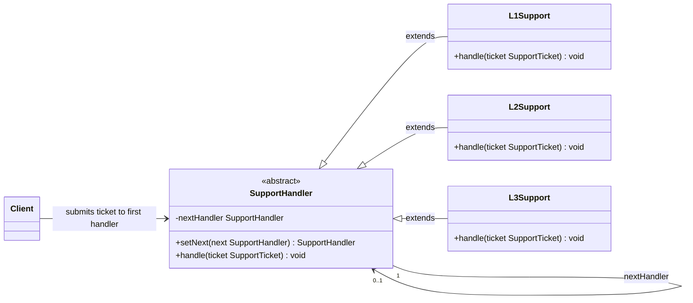
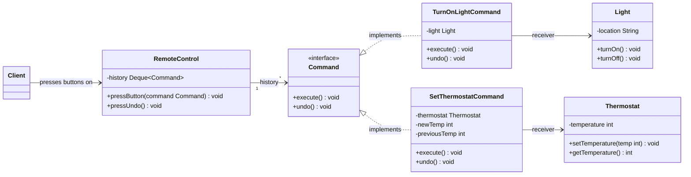
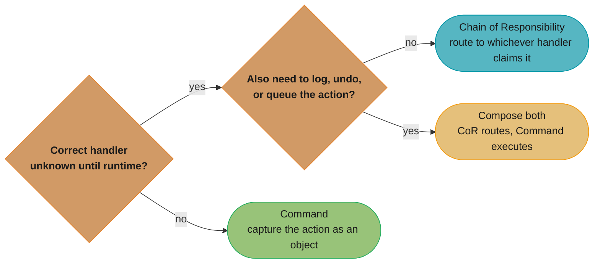
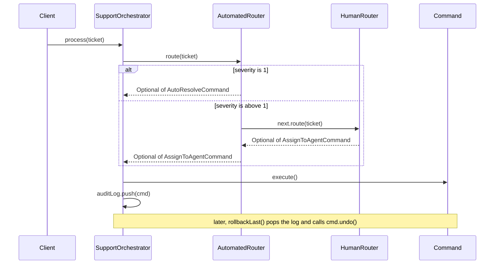
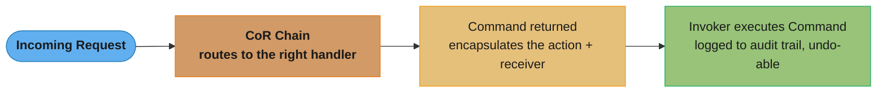

# Chain of Responsibility vs Command Pattern

## Quick Summary

- **Chain of Responsibility (CoR)**: Passes a request along a chain of handlers; each handler decides to process or forward it.
- **Command**: Encapsulates a request as an object; an invoker triggers execution on a known receiver.

---

## Intuition

> **One-line analogy**: Chain of Responsibility is a help desk escalation chain (your issue bounces from tier 1 to tier 2 to manager until someone handles it); Command is a written work order (a specific action captured for a known executor).

**Mental model**: CoR is about *routing* — the sender doesn't know which handler will process the request; it fires into the chain and trusts the chain to route it correctly (or ignore it). Command is about *encapsulation* — a known invoker fires a specific command at a known receiver; the value is that the action is an object (queued, undoable, loggable). CoR is dynamic dispatch through a chain; Command is explicit delegation to a receiver.

**Why it matters**: Both decouple sender from receiver, but differently. CoR is for flexible, cascading decision logic (middleware pipelines, event bubbling). Command is for action history, undo/redo, and task queues.

**Key insight**: CoR — multiple potential handlers, one will respond (or none). Command — one intended receiver, but the action is captured as a replayable object. If the key feature is "pass along the chain," use CoR. If the key feature is "capture and replay the action," use Command.

---

## Side-by-Side Comparison

| Aspect             | Chain of Responsibility                              | Command                                              |
|--------------------|------------------------------------------------------|------------------------------------------------------|
| **Intent**         | Decouple sender from receiver by giving multiple handlers a chance to handle the request | Encapsulate a request as an object to parameterize, queue, log, or undo it |
| **Structure**      | Linked list / chain of handlers; each holds a next-handler reference | Invoker → Command interface → ConcreteCommand → Receiver |
| **Key Difference** | About ROUTING — who should handle this request?      | About ENCAPSULATION — what is the request, and can it be reversed? |
| **Use When**       | The handler is not known ahead of time and must be determined dynamically | You need undo/redo, request queuing, logging, or sender-receiver decoupling |

---

## Java Code Examples

### Chain of Responsibility — Support Ticket Escalation

```java
// Handler interface
public abstract class SupportHandler {
    protected SupportHandler nextHandler;

    public SupportHandler setNext(SupportHandler next) {
        this.nextHandler = next;
        return next;   // enables fluent chaining: l1.setNext(l2).setNext(l3)
    }

    public abstract void handle(SupportTicket ticket);
}

// Request object
public class SupportTicket {
    private final String id;
    private final int severity;   // 1 = low, 2 = medium, 3 = high
    private final String description;

    public SupportTicket(String id, int severity, String description) {
        this.id = id;
        this.severity = severity;
        this.description = description;
    }

    public int getSeverity() { return severity; }
    public String getId()    { return id; }

    @Override
    public String toString() {
        return "Ticket[" + id + ", severity=" + severity + ": " + description + "]";
    }
}

// Concrete Handler 1 — handles low severity tickets
public class L1Support extends SupportHandler {
    @Override
    public void handle(SupportTicket ticket) {
        if (ticket.getSeverity() == 1) {
            System.out.println("L1 Support resolved: " + ticket);
        } else if (nextHandler != null) {
            System.out.println("L1 cannot handle severity " + ticket.getSeverity() + " — escalating...");
            nextHandler.handle(ticket);
        } else {
            System.out.println("No handler available for: " + ticket);
        }
    }
}

// Concrete Handler 2 — handles medium severity tickets
public class L2Support extends SupportHandler {
    @Override
    public void handle(SupportTicket ticket) {
        if (ticket.getSeverity() <= 2) {
            System.out.println("L2 Support resolved: " + ticket);
        } else if (nextHandler != null) {
            System.out.println("L2 cannot handle severity " + ticket.getSeverity() + " — escalating...");
            nextHandler.handle(ticket);
        } else {
            System.out.println("No handler available for: " + ticket);
        }
    }
}

// Concrete Handler 3 — handles all remaining tickets (including high severity)
public class L3Support extends SupportHandler {
    @Override
    public void handle(SupportTicket ticket) {
        System.out.println("L3 Engineering resolved: " + ticket);
    }
}

// Client
public class CoRDemo {
    public static void main(String[] args) {
        // Build the chain
        L1Support l1 = new L1Support();
        L2Support l2 = new L2Support();
        L3Support l3 = new L3Support();
        l1.setNext(l2).setNext(l3);

        l1.handle(new SupportTicket("T001", 1, "Password reset"));
        l1.handle(new SupportTicket("T002", 2, "Application crash"));
        l1.handle(new SupportTicket("T003", 3, "Data breach investigation"));
    }
}
```

**Output:**
```
L1 Support resolved: Ticket[T001, severity=1: Password reset]
L1 cannot handle severity 2 — escalating...
L2 Support resolved: Ticket[T002, severity=2: Application crash]
L1 cannot handle severity 3 — escalating...
L2 cannot handle severity 3 — escalating...
L3 Engineering resolved: Ticket[T003, severity=3: Data breach investigation]
```

---

### Command Pattern — Home Automation Remote Control

```java
// Command interface
public interface Command {
    void execute();
    void undo();
}

// Receivers
public class Light {
    private final String location;
    public Light(String location) { this.location = location; }
    public void turnOn()  { System.out.println(location + " light ON"); }
    public void turnOff() { System.out.println(location + " light OFF"); }
}

public class Thermostat {
    private int temperature = 20;
    public void setTemperature(int temp) {
        System.out.println("Thermostat set to " + temp + "°C");
        this.temperature = temp;
    }
    public int getTemperature() { return temperature; }
}

// Concrete Commands
public class TurnOnLightCommand implements Command {
    private final Light light;

    public TurnOnLightCommand(Light light) { this.light = light; }

    @Override
    public void execute() { light.turnOn(); }

    @Override
    public void undo()    { light.turnOff(); }
}

public class SetThermostatCommand implements Command {
    private final Thermostat thermostat;
    private final int newTemp;
    private int previousTemp;

    public SetThermostatCommand(Thermostat thermostat, int newTemp) {
        this.thermostat = thermostat;
        this.newTemp = newTemp;
    }

    @Override
    public void execute() {
        previousTemp = thermostat.getTemperature();
        thermostat.setTemperature(newTemp);
    }

    @Override
    public void undo() {
        thermostat.setTemperature(previousTemp);
    }
}

// Invoker — holds command slots and an undo stack
public class RemoteControl {
    private final Deque<Command> history = new ArrayDeque<>();

    public void pressButton(Command command) {
        command.execute();
        history.push(command);
    }

    public void pressUndo() {
        if (!history.isEmpty()) {
            System.out.print("[UNDO] ");
            history.pop().undo();
        } else {
            System.out.println("Nothing to undo.");
        }
    }
}

// Client
public class CommandDemo {
    public static void main(String[] args) {
        Light livingRoomLight = new Light("Living Room");
        Thermostat thermostat = new Thermostat();
        RemoteControl remote = new RemoteControl();

        remote.pressButton(new TurnOnLightCommand(livingRoomLight));
        remote.pressButton(new SetThermostatCommand(thermostat, 24));

        remote.pressUndo();  // undo thermostat change
        remote.pressUndo();  // undo light on
        remote.pressUndo();  // nothing left
    }
}
```

**Output:**
```
Living Room light ON
Thermostat set to 24°C
[UNDO] Thermostat set to 20°C
[UNDO] Living Room light OFF
Nothing to undo.
```

---

## Key Structural Differences — ASCII Class Diagrams

### Chain of Responsibility



Request travels along the chain until a handler claims it (or it falls off the end).

### Command



The Invoker (`RemoteControl`) never references `Light` or `Thermostat` directly — it only calls `Command.execute()`/`undo()`, so new receiver types can be added without touching the invoker.

---

## Decision Guide



*The two questions above collapse the detailed criteria below into a single path — the "compose both" leaf is exactly the combination shown later in [Can They Work Together?](#can-they-work-together).*

Use **Chain of Responsibility** when:
- More than one handler may be able to handle a request and the correct one is determined at runtime
- You want to decouple the sender from knowing which specific object handles it
- The set of handlers or their order may change dynamically (middleware pipelines, filter chains)
- A request might legitimately go unhandled (fall through the chain)

Use **Command** when:
- You need to parameterize actions (store, pass, and invoke them later)
- You need undo/redo capability
- You need to queue, schedule, or log operations
- You want to support macro commands (composite of commands)
- The receiver is known and fixed — the question is WHEN to execute, not WHO handles it

---

## Common Confusion Points

1. **Both decouple sender from receiver** — but differently. CoR decouples by not knowing *who* will handle. Command decouples by not knowing *when* the request will be executed.

2. **CoR may not process the request at all** — In Command, execute() is always called (eventually). In CoR, the request can fall off the end of the chain with no handler claiming it.

3. **CoR handlers are ordered** — the sequence matters. Command objects are typically independent and unordered (though undo stack order matters).

4. **Request object in CoR vs Command** — In CoR the request is passed as a parameter. In Command, the request *is* the object, with its parameters baked in.

5. **Only one handler acts in CoR (typically)** — Once a handler claims the ticket, it stops. Command's Invoker can call many commands in sequence.

---

## Real-World Examples

| Chain of Responsibility | Command |
|-------------------------|---------|
| HTTP middleware / filter chains (`jakarta.servlet.Filter`) | Menu items and toolbar buttons in GUIs |
| Spring Security filter chain | Database transaction log (replay / rollback) |
| Exception handling chains (try-catch nesting) | Job queues (Celery, Sidekiq, RabbitMQ tasks) |
| Logging level hierarchy (DEBUG → INFO → WARN → ERROR) | Git commits (reversible history) |
| Help desk ticket escalation (L1 → L2 → L3) | `java.awt.event` action listeners |
| AWS API Gateway authorizer chain | Macro recording in IDEs and spreadsheets |

---

## Can They Work Together?

Yes — this is a powerful and common combination. Use **CoR to route** the request to the right handler, then use a **Command to execute** the action in an undoable, loggable way.

```java
// Combined: CoR routes, Command executes

public abstract class RequestRouter {
    protected RequestRouter next;

    public RequestRouter setNext(RequestRouter next) {
        this.next = next;
        return next;
    }

    // Returns a Command if this handler can process the request, else delegates
    public abstract Optional<Command> route(SupportTicket ticket);
}

public class AutomatedRouter extends RequestRouter {
    @Override
    public Optional<Command> route(SupportTicket ticket) {
        if (ticket.getSeverity() == 1) {
            // Return a Command that encapsulates the auto-resolve action
            return Optional.of(new AutoResolveCommand(ticket));
        }
        return next != null ? next.route(ticket) : Optional.empty();
    }
}

public class HumanRouter extends RequestRouter {
    private final AgentQueue queue;

    public HumanRouter(AgentQueue queue) { this.queue = queue; }

    @Override
    public Optional<Command> route(SupportTicket ticket) {
        // Return a Command that enqueues the ticket for a human agent
        return Optional.of(new AssignToAgentCommand(ticket, queue));
    }
}

// Orchestrator
public class SupportOrchestrator {
    private final RequestRouter routerChain;
    private final Deque<Command> auditLog = new ArrayDeque<>();

    public SupportOrchestrator(RequestRouter routerChain) {
        this.routerChain = routerChain;
    }

    public void process(SupportTicket ticket) {
        routerChain.route(ticket).ifPresent(cmd -> {
            cmd.execute();          // Command executes the routed action
            auditLog.push(cmd);     // Logged for undo / audit trail
        });
    }

    public void rollbackLast() {
        if (!auditLog.isEmpty()) auditLog.pop().undo();
    }
}
```



`AutomatedRouter` either resolves the ticket itself (severity 1) or delegates down the chain to `HumanRouter`; either way `SupportOrchestrator` only ever calls `execute()` on whatever `Command` comes back, then logs it so `rollbackLast()` can undo it later.

**Flow summary:**


This pattern is common in event-driven architectures, workflow engines, and API gateway implementations where requests must first be routed and then reliably executed.

---

## Interview Questions with Answers

**Q: Both Chain of Responsibility and Command decouple sender from receiver — what's the real distinguishing question?**
**Short:** CoR decouples by not knowing WHO will handle the request; Command decouples by not knowing WHEN it executes.

CoR's sender fires a request into a chain without knowing which handler, if any, will claim it — the decoupling is about identity of the handler. Command's invoker knows exactly which receiver a command targets, but the command object can be stored, queued, or delayed before `execute()` ever runs — the decoupling is about timing. Confusing the two leads to using CoR when you actually need deferred execution, or Command when you actually need dynamic routing. Ask "does my sender know the target?" — if no, CoR; if yes but timing is flexible, Command.

**Q: What happens in Chain of Responsibility if no handler in the chain claims the request?**
**Short:** The request falls off the end of the chain unhandled, unlike Command where execute() always runs once invoked.

In CoR, each handler either processes the request or forwards it to `nextHandler`; if the chain runs out of handlers, the request is silently dropped or logged as unhandled — this is a legitimate, designed-for outcome. Command has no equivalent gap: once `pressButton(command)` is called, `execute()` always fires against a known receiver. This asymmetry is why CoR chains typically end in a catch-all handler (like `L3Support` in the escalation example) to guarantee something eventually happens.

**Q: Why does the Command pattern's invoker never reference concrete receiver types like Light or Thermostat directly?**
**Short:** The invoker only depends on the Command interface, so new receiver types never require invoker changes.

`RemoteControl` stores commands in a `Deque<Command>` and calls only `execute()`/`undo()` — it has no knowledge of `Light`, `Thermostat`, or any future receiver. Each `ConcreteCommand` holds its own reference to the specific receiver it targets and translates the generic `execute()` call into the receiver-specific method (`light.turnOn()`, `thermostat.setTemperature()`). This is what lets you add a new smart-home device without touching `RemoteControl` at all — pure Open/Closed compliance.

**Q: What structural feature lets Command support undo when a plain method call cannot?**
**Short:** A Command object can capture prior state before execute() runs, so undo() can restore exactly that state.

A plain method call like `thermostat.setTemperature(24)` discards the previous temperature the moment it runs. `SetThermostatCommand` instead stores `previousTemp` inside `execute()` before mutating the receiver, giving `undo()` something concrete to restore. This is only possible because Command turns the action into a stateful object with a lifetime longer than a single call — a bare method invocation has nowhere to keep that state.

**Q: When would you compose Chain of Responsibility with Command instead of using CoR alone?**
**Short:** Combine them when you need CoR's dynamic routing plus Command's execute/undo/audit capability.

If all you need is "find the right handler," plain CoR is enough. But when the routed action also needs to be logged, replayed, or undone — like the `SupportOrchestrator` example where `AutomatedRouter`/`HumanRouter` return a `Command` instead of handling the ticket directly — composing the two gives you dynamic handler selection AND a reversible audit trail. The orchestrator only ever calls `execute()` on whatever Command comes back, then pushes it onto an `auditLog` for later rollback.

**Q: What is the key ordering difference between how CoR handlers behave and how an Invoker calls Commands?**
**Short:** CoR handlers are strictly sequenced and typically only one acts; an Invoker can execute many independent Commands.

A CoR chain enforces a fixed traversal order (L1 -> L2 -> L3), and once a handler claims the request, traversal stops — only one handler acts per request. An Invoker like `RemoteControl` has no such constraint: it can call `execute()` on many unrelated commands in any sequence the client chooses, and each command runs independently of the others. This is why CoR is described as "routing to exactly one," while Command is "executing however many, in whatever order."

**Q: Give a real system example each of Chain of Responsibility and Command that are easy to confuse.**
**Short:** Servlet/Spring Security filter chains use Chain of Responsibility, while job queues like Sidekiq use Command.

`jakarta.servlet.Filter` chains and Spring Security's filter chain are canonical CoR — each filter decides to handle the request or call `chain.doFilter()` to forward it. Job queues (Celery tasks, Sidekiq jobs, RabbitMQ messages) are canonical Command — each job is a serialized object with parameters baked in, executed later by a worker, and often loggable or retryable. Both "handle a request" conceptually, but one is about routing through middleware and the other is about capturing deferred work.

**Q: In the combined CoR + Command example, what does AutomatedRouter return when it can't resolve the ticket itself?**
**Short:** It delegates to the next handler by calling next.route(ticket) and returns whatever that produces.

`AutomatedRouter.route()` only auto-resolves severity-1 tickets by returning an `AutoResolveCommand`; for anything else it calls `next != null ? next.route(ticket) : Optional.empty()`, forwarding the decision down the chain to `HumanRouter`. This preserves normal CoR semantics — delegation on non-match — while still returning a `Command` object as the eventual payload instead of directly performing an action. The chain decides WHO handles it; the returned Command decides WHAT happens.

**Q: Why is a macro command (composite of commands) a capability unique to Command, not CoR?**
**Short:** Command objects can be grouped and replayed together as one unit; CoR handlers only ever route one request each.

Because a Command is a first-class object, several of them can be collected into a list and executed as a single logical operation — a macro. CoR handlers have no equivalent: each handler processes a single incoming request and either claims or forwards it, with no notion of bundling multiple requests into one replayable unit. This is a direct consequence of Command's "encapsulate the action as an object" intent versus CoR's "route a single request" intent.

**Q: What does the request object represent differently in CoR versus Command?**
**Short:** In CoR the request is a parameter handlers inspect; in Command the request IS the object with parameters baked in.

`SupportTicket` in the CoR example is passed as an argument to `handle(ticket)` — handlers read it but don't own it. In the Command example, `SetThermostatCommand` doesn't receive a separate request object at all; the command instance itself is the request, with `newTemp` and `previousTemp` stored as its own fields. This is why Command objects can be queued and replayed later — the request has been absorbed into the object's identity, whereas a CoR request is just transient input to a method call.

**Q: Why might a Chain of Responsibility be hard to debug once it grows large in production?**
**Short:** A long or dynamically reordered chain hides which handler actually processed a request without extra logging.

As more handlers are added or reordered at runtime, tracing which handler ultimately claimed (or dropped) a given request requires stepping through every intermediate `nextHandler.handle()` call. Unlike a Command's single, self-contained `execute()`, a CoR chain's behavior is emergent from the combination and order of all handlers, so a bug can hide in handler ordering rather than in any one handler's logic. Production systems mitigate this by logging every escalation step, as the `L1Support`/`L2Support` example does with its "escalating..." messages.

**Q: What's the risk of using Command purely for queueing without designing undo() from the start?**
**Short:** The state needed for undo may already be discarded by the time undo() is retrofitted later.

If a command's `execute()` only performs the forward action and never captures prior state, adding `undo()` afterward has nothing to restore from — the previous value is gone the moment `execute()` overwrote it. `SetThermostatCommand` avoids this by capturing `previousTemp` inside `execute()` itself, before mutating the receiver. The lesson generalizes: design `execute()` and `undo()` together, because undo's data dependency is created at execution time, not afterward.

**Q: How would you decide between CoR and Command when the correct handler is always known in advance?**
**Short:** If the handler is always known, skip CoR's dynamic routing and use Command directly against a fixed receiver.

CoR's entire value proposition is resolving an unknown handler at runtime by trying candidates in sequence; if you already know which receiver should act, that machinery is pure overhead. In that case, wrap the action as a Command targeting the known receiver directly — you get encapsulation, undo, and logging without paying for chain traversal you'll never need. Reach for CoR only when "who handles this" is genuinely a runtime decision.

**Q: What is the practical difference between how CoR and Command achieve testability?**
**Short:** CoR is tested by feeding requests through the whole chain; Command is tested by invoking one object in isolation.

Testing a CoR handler in isolation is awkward because its behavior includes "does it forward correctly to the next handler," which requires either a real or mock `nextHandler` in the chain. A Command object, by contrast, is self-contained — you can construct one directly with a mock receiver and assert on `execute()`/`undo()` without any invoker or chain involved. This is one reason Command-based designs (job objects, macro recording) tend to have simpler unit tests than deep CoR chains.

**Q: Why does Command support logging and replay more naturally than Chain of Responsibility does?**
**Short:** A Command is a serializable object capturing exactly what happened, while a CoR request is transient input.

Because a `ConcreteCommand` bundles the action, its parameters, and (via `undo()`) enough state to reverse it, the whole object can be serialized, persisted, and replayed later — this is exactly how event-sourced systems and job queues work. A CoR request, once it passes through the chain, leaves no durable trace unless a handler explicitly logs it; the chain itself has no notion of "this is a record I could replay." That durability gap is the practical reason audit trails and undo/redo systems are built on Command, not CoR.
