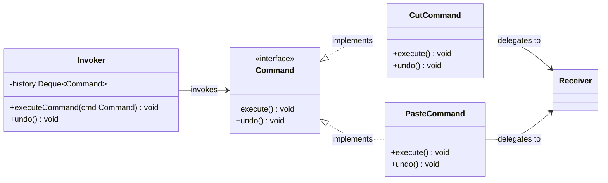
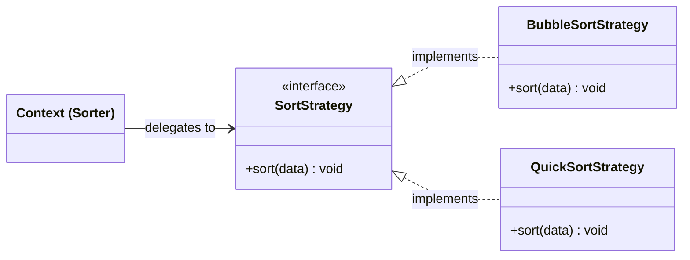
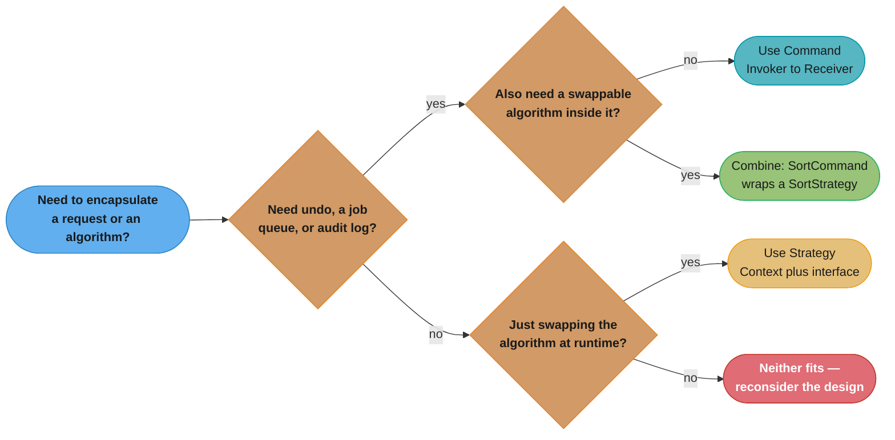
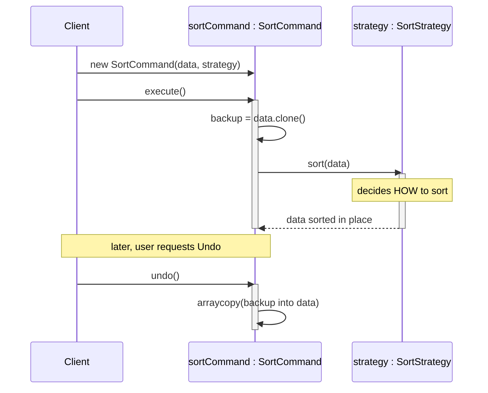

# Command vs Strategy Pattern

## Quick Summary

- **Command**: Encapsulates a *request* as an object — enables queuing, logging, and undo/redo.
- **Strategy**: Encapsulates an *algorithm* as an object — enables runtime algorithm switching.

---

## Intuition

> **One-line analogy**: Command is a written order slip at a restaurant (the request is captured, queued, and can be cancelled); Strategy is a recipe card (defines how to cook, swappable, stateless).

**Mental model**: Command encapsulates a *specific action* with its parameters as an object — enabling queuing, logging, undo, and replay. Strategy encapsulates an *algorithm* — a reusable, stateless way to accomplish something. A `SaveFileCommand` is a Command: it captures state (which file, what content, when). A `CompressionStrategy` is a Strategy: it's a pure function with no captured state, interchangeable at runtime.

**Why it matters**: Both use the same "encapsulate in an object" move but for different purposes. Confusing them leads to bloated Command objects that try to be algorithms, or stateless Strategies that accumulate request-specific state.

**Key insight**: Command has identity and state (what was requested, when, by whom). Strategy is stateless and interchangeable. If you need undo, history, or queuing → Command. If you need runtime algorithm swapping → Strategy.

---

## Side-by-Side Comparison

| Aspect           | Command                                      | Strategy                                        |
|------------------|----------------------------------------------|-------------------------------------------------|
| **Intent**       | Turn a request/action into a first-class object | Turn an algorithm into a first-class object   |
| **Structure**    | Invoker → Command → Receiver                 | Context → Strategy interface → ConcreteStrategy |
| **Key Difference** | About WHAT (the operation, its params, and who receives it) | About HOW (the algorithm used to do something) |
| **Use When**     | You need undo/redo, queuing, logging, or macro recording | You need to swap algorithms at runtime without changing the client |

---

## Java Code Examples

### Command Pattern — Text Editor with Undo Stack

```java
// Command interface
public interface Command {
    void execute();
    void undo();
}

// Receiver
public class TextBuffer {
    private StringBuilder text = new StringBuilder();

    public void insert(String s, int pos) {
        text.insert(pos, s);
        System.out.println("Buffer: " + text);
    }

    public void delete(int pos, int length) {
        text.delete(pos, pos + length);
        System.out.println("Buffer: " + text);
    }

    public String getText() { return text.toString(); }
}

// Concrete Commands
public class CutCommand implements Command {
    private TextBuffer buffer;
    private int pos, length;
    private String cutText;

    public CutCommand(TextBuffer buffer, int pos, int length) {
        this.buffer = buffer;
        this.pos = pos;
        this.length = length;
    }

    @Override
    public void execute() {
        cutText = buffer.getText().substring(pos, pos + length);
        buffer.delete(pos, length);
    }

    @Override
    public void undo() {
        buffer.insert(cutText, pos);
    }
}

public class PasteCommand implements Command {
    private TextBuffer buffer;
    private String text;
    private int pos;

    public PasteCommand(TextBuffer buffer, String text, int pos) {
        this.buffer = buffer;
        this.text = text;
        this.pos = pos;
    }

    @Override
    public void execute() {
        buffer.insert(text, pos);
    }

    @Override
    public void undo() {
        buffer.delete(pos, text.length());
    }
}

// Invoker — holds undo stack
public class TextEditor {
    private final Deque<Command> history = new ArrayDeque<>();

    public void executeCommand(Command cmd) {
        cmd.execute();
        history.push(cmd);
    }

    public void undo() {
        if (!history.isEmpty()) {
            history.pop().undo();
        }
    }
}

// Client
public class CommandDemo {
    public static void main(String[] args) {
        TextBuffer buffer = new TextBuffer();
        TextEditor editor = new TextEditor();

        buffer.insert("Hello World", 0);

        Command cut = new CutCommand(buffer, 6, 5);   // cut "World"
        editor.executeCommand(cut);

        Command paste = new PasteCommand(buffer, "Java", 6);
        editor.executeCommand(paste);

        editor.undo(); // undo paste
        editor.undo(); // undo cut — "Hello World" restored
    }
}
```

---

### Strategy Pattern — Sorter with Pluggable Algorithms

```java
// Strategy interface
public interface SortStrategy {
    void sort(int[] data);
}

// Concrete Strategies
public class BubbleSortStrategy implements SortStrategy {
    @Override
    public void sort(int[] data) {
        System.out.println("Sorting with BubbleSort");
        int n = data.length;
        for (int i = 0; i < n - 1; i++)
            for (int j = 0; j < n - i - 1; j++)
                if (data[j] > data[j + 1]) {
                    int tmp = data[j]; data[j] = data[j + 1]; data[j + 1] = tmp;
                }
    }
}

public class QuickSortStrategy implements SortStrategy {
    @Override
    public void sort(int[] data) {
        System.out.println("Sorting with QuickSort");
        quickSort(data, 0, data.length - 1);
    }

    private void quickSort(int[] data, int low, int high) {
        if (low < high) {
            int pi = partition(data, low, high);
            quickSort(data, low, pi - 1);
            quickSort(data, pi + 1, high);
        }
    }

    private int partition(int[] data, int low, int high) {
        int pivot = data[high], i = low - 1;
        for (int j = low; j < high; j++)
            if (data[j] <= pivot) { i++; int t = data[i]; data[i] = data[j]; data[j] = t; }
        int t = data[i + 1]; data[i + 1] = data[high]; data[high] = t;
        return i + 1;
    }
}

// Context
public class Sorter {
    private SortStrategy strategy;

    public Sorter(SortStrategy strategy) {
        this.strategy = strategy;
    }

    // Switch algorithm at runtime
    public void setStrategy(SortStrategy strategy) {
        this.strategy = strategy;
    }

    public void sort(int[] data) {
        strategy.sort(data);
    }
}

// Client
public class StrategyDemo {
    public static void main(String[] args) {
        int[] data = {5, 3, 8, 1, 9, 2};

        Sorter sorter = new Sorter(new BubbleSortStrategy());
        sorter.sort(data);

        // Switch strategy at runtime — no change to client code
        sorter.setStrategy(new QuickSortStrategy());
        sorter.sort(data);
    }
}
```

---

## Key Structural Differences — ASCII Class Diagrams

### Command



*`Invoker` only ever holds the `Command` interface in its `history` stack; `CutCommand`/`PasteCommand` each stash a `Receiver` (the `TextBuffer`) so `execute()`/`undo()` can act on it directly.*

### Strategy



*`Sorter` (the Context) holds only the `SortStrategy` interface — swapping in `QuickSortStrategy` for `BubbleSortStrategy` at runtime, exactly as `StrategyDemo` does, never touches `Sorter` itself.*

**Structural note**: Both patterns look similar in UML. The distinction is semantic:
- Command holds a *Receiver* reference and encapsulates *who* and *what*.
- Strategy holds only *how* — no concept of a separate receiver.

---

## Decision Guide

Use **Command** when you need:
- Undo/redo functionality
- Request queuing or scheduling (e.g., job queues)
- Logging or auditing of operations
- Macro recording (composing multiple commands)
- Decoupling the *sender* from the *receiver* of a request

Use **Strategy** when you need:
- Multiple algorithms that are interchangeable
- Removing large if/else or switch blocks that select behavior
- Runtime algorithm selection based on context (e.g., device, load, user preference)
- Unit testing algorithms in isolation

As a decision tree, the two lists above collapse to three questions:



*The two branches mirror the bullets above: reversibility/queuing/logging routes to Command, pure algorithm-swapping routes to Strategy, and needing both — exactly what `SortCommand` does further below — means composing one inside the other.*

---

## Common Confusion Points

1. **Both encapsulate behavior** — The key tell: does your object need `undo()`, a history stack, or a Receiver? That's Command. Does your object only swap the *algorithm*? That's Strategy.

2. **Strategy has no undo concept** — Strategy just selects HOW to do something. Command remembers WHAT was done so it can be reversed.

3. **Command carries state** — A `CutCommand` stores the text that was cut. A Strategy is usually stateless.

4. **Invoker ≠ Context** — Command's Invoker triggers execution and manages history. Strategy's Context uses the strategy directly without history.

---

## Real-World Examples

| Command | Strategy |
|---------|----------|
| Menu items / toolbar buttons in GUIs | `java.util.Comparator` for sorting |
| Database transaction log (replay / rollback) | Payment processors (credit card, PayPal, crypto) |
| Job queues (e.g., Celery tasks, Sidekiq) | Tax calculators per region/country |
| Git commits (each commit is a reversible command) | Route finding (Dijkstra vs A* vs BFS) |
| Macro recording in spreadsheets | Compression algorithms (zip, gzip, lz4) |

---

## Can They Work Together?

Yes — and this is a powerful combination.

A **Command** can use a **Strategy** internally to decide *how* to perform its action:

```java
public class SortCommand implements Command {
    private int[] data;
    private int[] backup;
    private SortStrategy strategy;  // Strategy inside Command

    public SortCommand(int[] data, SortStrategy strategy) {
        this.data = data;
        this.strategy = strategy;
    }

    @Override
    public void execute() {
        backup = data.clone();
        strategy.sort(data);   // Strategy decides HOW to sort
    }

    @Override
    public void undo() {
        System.arraycopy(backup, 0, data, 0, backup.length);
    }
}
```

Here's that collaboration playing out at runtime — `execute()` snapshots `data` into `backup` before handing it to the Strategy, and `undo()` restores that snapshot without ever calling back into the Strategy:



The Command handles *what happened and reversibility*; the Strategy handles *how the sort is performed*.

---

## Interview Questions with Answers

**Q: Both Command and Strategy encapsulate behavior as an object — what's the real tell that separates them?**
**Short:** Command captures a stateful request with a Receiver; Strategy is a stateless, interchangeable algorithm.

The surface similarity is real: both wrap behavior behind an interface and let a caller swap implementations. The tell is whether the object carries state and identity — a `CutCommand` remembers what text it cut and where, so it can undo itself, while a `QuickSortStrategy` has no memory of any particular sort call and is fully reusable across contexts. Ask "does this object need `undo()`, a history stack, or a captured Receiver?" — if yes, it's Command; if it only swaps HOW something is done, it's Strategy.

**Q: Why is a Strategy object typically stateless while a Command object typically isn't?**
**Short:** Strategy only defines HOW to do something and can be shared; Command remembers WHAT was requested.

`SortStrategy.sort(data)` has no fields describing a particular invocation — the same `QuickSortStrategy` instance can sort any array handed to it, which is why one Strategy instance is safely reused across many calls. `CutCommand`, by contrast, stores `pos`, `length`, and after execution the `cutText` it removed — that per-invocation state is exactly what makes `undo()` possible. Mixing the two up produces either a bloated Command that behaves like a stateless utility, or a Strategy that accidentally accumulates request-specific state between calls.

**Q: What does Command's Invoker do that Strategy's Context does not?**
**Short:** The Invoker manages an execution history for undo; the Context just delegates directly with no history.

`TextEditor` (the Invoker) keeps a `Deque<Command> history` and pushes every executed command onto it so `undo()` can pop and reverse the most recent one. `Sorter` (the Context) holds only a single `SortStrategy` reference and calls `strategy.sort(data)` directly — there is no history, no stack, nothing to undo, because Strategy was never designed to be reversible. This is the structural signature of "Command has identity and state; Strategy is stateless and interchangeable."

**Q: When would you use a Command that internally delegates to a Strategy?**
**Short:** Use it when you need both reversibility and a swappable algorithm, like a SortCommand wrapping a SortStrategy.

`SortCommand` snapshots `data` into `backup` before calling `strategy.sort(data)`, then restores that snapshot on `undo()` — the Command owns reversibility while the Strategy owns the actual sorting algorithm. This composition lets you swap in `BubbleSortStrategy` or `QuickSortStrategy` without changing how undo works, and change the undo mechanism without touching any sort algorithm. It's the natural answer whenever "I need undo AND runtime algorithm choice" shows up in the same requirement.

**Q: Why can't you swap a Command at runtime the way you swap a Strategy?**
**Short:** A Command targets one specific receiver and action; swapping means constructing a different Command, not reassigning a field.

`Sorter.setStrategy(new QuickSortStrategy())` reassigns one field on an existing `Sorter`, immediately changing future behavior with no new object needed elsewhere. There's no equivalent "swap the command" operation — each Command instance is already bound to a specific receiver and specific parameters, so "switching" means constructing an entirely new Command object and invoking it. This reflects that Strategy is about swapping *how*, while Command is about capturing *one particular what*.

**Q: What real-world example shows Command being used purely for its undo capability, without Strategy involved?**
**Short:** Git commits are Command objects — each is a reversible unit of change with no algorithm-swapping involved.

Every Git commit captures a specific, self-contained change (the "what") and can be reverted (`git revert`) without any notion of interchangeable algorithms — there's nothing analogous to a Strategy in play. Database transaction logs work the same way: each logged operation is a Command-like record that can be replayed or rolled back. Neither example needs Strategy because neither involves choosing between multiple ways to perform the same task — only capturing and possibly reversing one specific action.

**Q: What real-world example shows Strategy being used with no undo or history involved?**
**Short:** java.util.Comparator is a pure Strategy — swappable, stateless, and with no concept of reversing a comparison.

Passing different `Comparator` implementations to `Collections.sort()` is textbook Strategy: each comparator defines HOW two elements compare, comparators are freely interchangeable, and there is no `undo()` because a comparison isn't an action that needs reversing. The same applies to payment-processor selection or compression-algorithm choice — you're picking an algorithm, not recording a reversible event. This is why Strategy implementations rarely define any history-tracking machinery.

**Q: Why does mixing up Command and Strategy tend to produce bloated Command objects?**
**Short:** Trying to make a Command act like a swappable algorithm adds unnecessary interchangeability to a stateful object.

If a Command is designed to also handle "which algorithm should I use internally," without delegating that decision to a Strategy, the Command class accumulates conditional logic or multiple execution paths that really belong in separate Strategy implementations. This couples the request-capturing logic (parameters, undo state) to algorithm-selection logic that has nothing to do with reversibility. The fix is exactly the "Can They Work Together" pattern: keep Command thin and let it hold a Strategy reference for the parts that genuinely vary algorithmically.

**Q: How does testing a Strategy differ from testing a Command?**
**Short:** A Strategy is tested by asserting on its output for given input; a Command is tested by asserting execute() then undo() restores state.

Testing `QuickSortStrategy` means calling `sort(data)` and asserting the array ends up sorted — no setup beyond the input array is required, and the same test works for any Strategy implementation. Testing `CutCommand` requires asserting both that `execute()` performs the mutation AND that `undo()` restores the pre-execute state exactly, which means the test must inspect the Command's captured internal state, not just a return value. This extra obligation is the direct cost of Command's stateful design.

**Q: What's the risk of building a Strategy interface with too many methods, as opposed to Command?**
**Short:** A bloated Strategy interface with many methods risks becoming request-shaped, which is Command's job, not Strategy's.

A `ProcessingStrategy` interface that grew methods for `readData()`, `processData()`, AND `saveData()` (as seen in the related Template-vs-Strategy comparison) starts to resemble a full pipeline rather than a single swappable algorithm — the more methods it carries, the more it looks like it's capturing a whole workflow instead of one interchangeable "how." When a Strategy interface starts accumulating request-specific parameters or sequencing concerns, that's often a signal the design actually wants Command (or Template Method) instead.

**Q: Can a single Command object use more than one Strategy internally?**
**Short:** Yes — nothing prevents a Command from composing multiple Strategy objects for different parts of its action.

Command's only structural requirement is `execute()`/`undo()`; internally it's free to hold and delegate to as many Strategy references as the action needs — for example, a `SaveReportCommand` could hold both a `FormattingStrategy` and a `CompressionStrategy`. The `SortCommand` example shows the single-strategy case, but the composition scales to multiple strategies without changing the underlying relationship: Command owns the "what happened," Strategies own each "how."

**Q: What does "Command carries state, Strategy doesn't" imply about thread safety?**
**Short:** A shared Strategy instance is generally safe to reuse across threads; a Command instance usually isn't, once executed.

Because a stateless `SortStrategy` has no per-call fields, the exact same instance can be handed to many concurrent `Sorter` contexts without coordination. A `CutCommand`, once constructed and executed, holds mutable per-invocation state (`cutText`) that isn't safe to share or reuse concurrently without synchronization — each execution effectively needs its own Command instance. This is a direct consequence of the state-vs-stateless distinction, and it matters when designing command queues that may be processed by a thread pool.

**Q: Why is "Invoker ≠ Context" an important distinction even though both hold a reference to an interface?**
**Short:** The Invoker manages execution history and undo; the Context simply forwards calls with no history tracking.

Both `TextEditor` (Invoker) and `Sorter` (Context) hold a single field pointing at an interface and delegate work to it, which is why the two patterns look almost identical structurally. But `TextEditor.executeCommand()` also pushes onto a `history` stack, giving it responsibilities — sequencing, undo — that `Sorter.sort()` never needs. Naming them differently in the two patterns (Invoker vs Context) reflects that the Invoker actively orchestrates a sequence of reversible operations, while the Context is a passive pass-through.

**Q: If a payment system needs both "choose a payment method" and "log every transaction for refund," which pattern handles which concern?**
**Short:** Strategy picks the payment method algorithm; Command wraps the transaction so it can be logged and reversed (refunded).

Choosing between credit card, PayPal, or crypto processing is a Strategy decision — each processor implements the same interface and is freely interchangeable at runtime. Wrapping "charge this customer $50" as a reversible, loggable unit of work — so it can be replayed for auditing or refunded later — is Command's job, since it needs to capture the specific amount, customer, and enough state to reverse the charge. A production payment flow typically uses both together: a `ChargeCommand` that internally delegates to whichever `PaymentStrategy` was selected.

**Q: Why does a job queue like Celery or Sidekiq map naturally onto Command rather than Strategy?**
**Short:** A queued job is a captured, parameterized request awaiting execution, exactly what Command was built to model.

Each task enqueued in Celery or Sidekiq bundles a specific function reference plus its arguments into a serializable unit that a worker executes later — that is precisely Command's "encapsulate a request as an object" intent, including the ability to log, retry, or delay execution. Strategy has no equivalent concept of deferred or queued invocation; it only defines interchangeable algorithms invoked synchronously by whatever Context holds them. This is why job-queue frameworks are cited as Command's textbook real-world example, never Strategy's.
