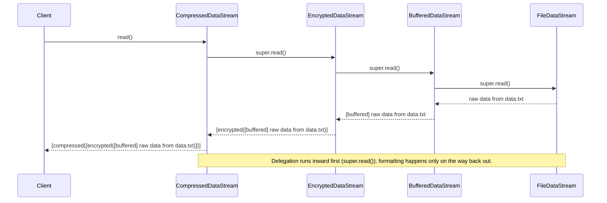
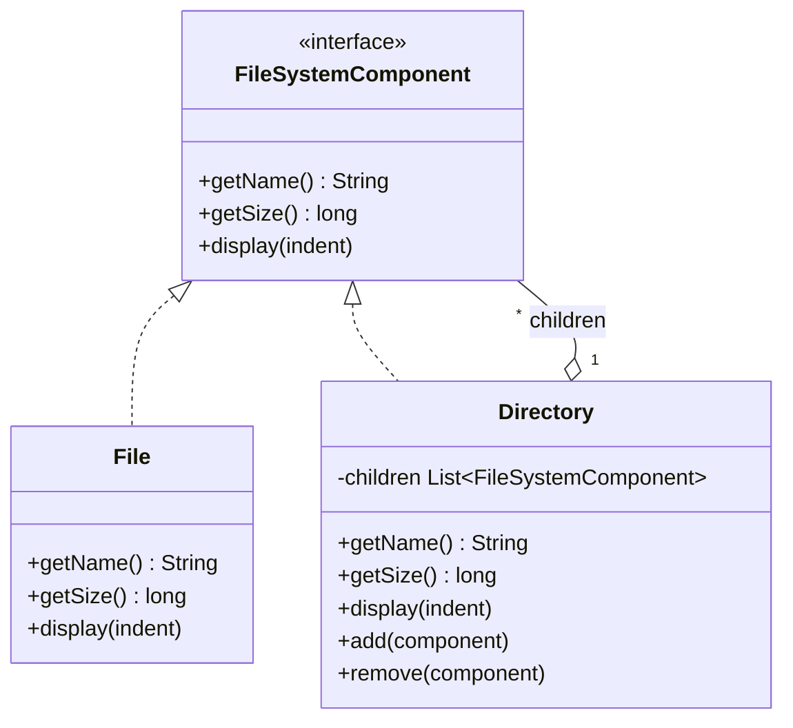
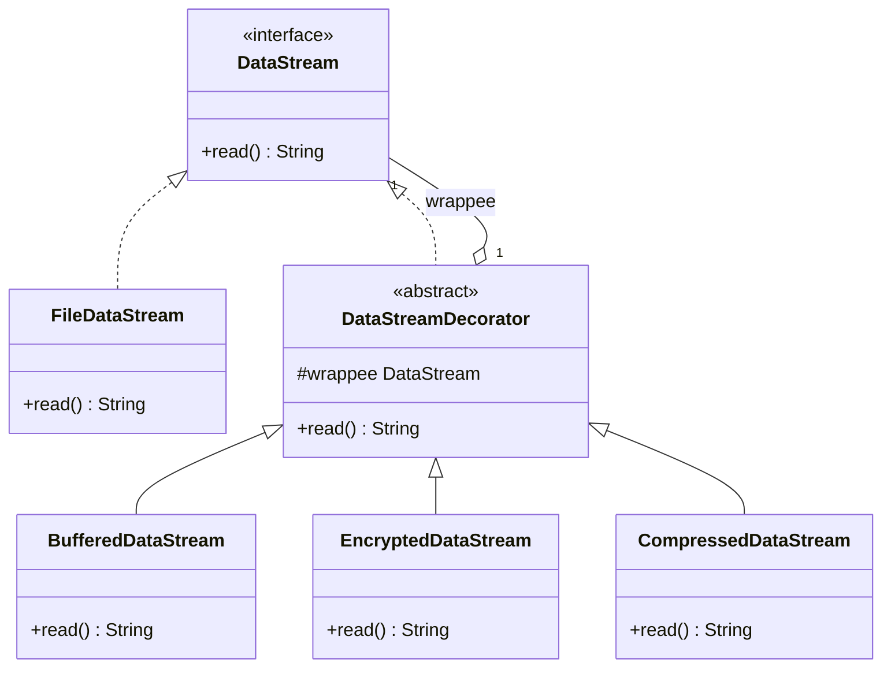
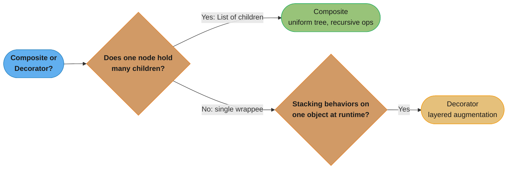

# Composite vs Decorator Pattern

## Quick Summary

- **Composite**: Builds a tree of objects — treats individual items and groups uniformly (part-whole hierarchy).
- **Decorator**: Wraps an object to add behavior dynamically — extends responsibility without subclassing.

---

## Intuition

> **One-line analogy**: Composite is a company org chart (managers and employees treated the same way through one interface); Decorator is a gift wrap station (each layer adds something, but you're still wrapping the same gift).

**Mental model**: Composite builds a *tree* — nodes and leaves both implement the same interface, so `calculateCost()` on a folder recursively sums its files. Decorator builds a *chain* — each wrapper adds behavior and delegates to the next, with exactly one leaf at the center. The structural difference: Composite nodes have *multiple* children; Decorator wrappers have exactly *one* wrapped component.

**Why it matters**: Both use the same interface-wrapping trick. The confusion arises because Decorator could be misread as a two-node tree. The key: if you need arbitrary tree depth with multiple children, use Composite. If you need layered augmentation of a single object, use Decorator.

**Key insight**: Children count is the structural tell — Composite: `List<Component> children`. Decorator: `Component wrappee`. If you're adding capabilities to one thing, Decorator. If you're building a hierarchy of things, Composite.

---

## Side-by-Side Comparison

| Aspect             | Composite                                          | Decorator                                          |
|--------------------|----------------------------------------------------|----------------------------------------------------|
| **Intent**         | Compose objects into tree structures to represent part-whole hierarchies | Attach additional responsibilities to an object dynamically |
| **Structure**      | Component interface; Leaf and Composite both implement it; Composite holds children | Component interface; ConcreteComponent and Decorator both implement it; Decorator wraps a Component |
| **Key Difference** | About STRUCTURE — modeling a hierarchy of objects  | About BEHAVIOR — augmenting a single object's capabilities |
| **Use When**       | You need to treat a single object and a group of objects the same way | You need to add/remove behaviors at runtime without changing the class |

---

## Java Code Examples

### Composite Pattern — File System

```java
import java.util.ArrayList;
import java.util.List;

// Component interface — uniform interface for files and directories
public interface FileSystemComponent {
    String getName();
    long getSize();
    void display(String indent);
}

// Leaf — cannot contain children
public class File implements FileSystemComponent {
    private final String name;
    private final long size;

    public File(String name, long size) {
        this.name = name;
        this.size = size;
    }

    @Override
    public String getName() { return name; }

    @Override
    public long getSize() { return size; }

    @Override
    public void display(String indent) {
        System.out.println(indent + "File: " + name + " (" + size + " bytes)");
    }
}

// Composite — contains children (files or subdirectories)
public class Directory implements FileSystemComponent {
    private final String name;
    private final List<FileSystemComponent> children = new ArrayList<>();

    public Directory(String name) {
        this.name = name;
    }

    public void add(FileSystemComponent component) {
        children.add(component);
    }

    public void remove(FileSystemComponent component) {
        children.remove(component);
    }

    @Override
    public String getName() { return name; }

    @Override
    public long getSize() {
        // Recursively sum children — works uniformly for files and subdirs
        return children.stream().mapToLong(FileSystemComponent::getSize).sum();
    }

    @Override
    public void display(String indent) {
        System.out.println(indent + "Directory: " + name + "/");
        for (FileSystemComponent child : children) {
            child.display(indent + "  ");
        }
    }
}

// Client
public class CompositeDemo {
    public static void main(String[] args) {
        File readme = new File("README.md", 1024);
        File main   = new File("Main.java", 2048);
        File util   = new File("Utils.java", 512);

        Directory src = new Directory("src");
        src.add(main);
        src.add(util);

        Directory project = new Directory("project");
        project.add(readme);
        project.add(src);

        project.display("");
        System.out.println("Total size: " + project.getSize() + " bytes");
        // Client treats File and Directory identically via FileSystemComponent
    }
}
```

**Output:**
```
Directory: project/
  File: README.md (1024 bytes)
  Directory: src/
    File: Main.java (2048 bytes)
    File: Utils.java (512 bytes)
Total size: 3584 bytes
```

---

### Decorator Pattern — InputStream Style I/O

```java
// Component interface
public interface DataStream {
    String read();
}

// Concrete Component — the base object being decorated
public class FileDataStream implements DataStream {
    private final String filename;

    public FileDataStream(String filename) {
        this.filename = filename;
    }

    @Override
    public String read() {
        return "raw data from " + filename;
    }
}

// Abstract Decorator — wraps a DataStream and delegates to it
public abstract class DataStreamDecorator implements DataStream {
    protected final DataStream wrappee;

    public DataStreamDecorator(DataStream wrappee) {
        this.wrappee = wrappee;
    }

    @Override
    public String read() {
        return wrappee.read();  // delegate by default
    }
}

// Concrete Decorator 1: adds buffering
public class BufferedDataStream extends DataStreamDecorator {

    public BufferedDataStream(DataStream wrappee) {
        super(wrappee);
    }

    @Override
    public String read() {
        return "[buffered] " + super.read();
    }
}

// Concrete Decorator 2: adds encryption
public class EncryptedDataStream extends DataStreamDecorator {

    public EncryptedDataStream(DataStream wrappee) {
        super(wrappee);
    }

    @Override
    public String read() {
        String data = super.read();
        return "[encrypted(" + data + ")]";
    }
}

// Concrete Decorator 3: adds compression
public class CompressedDataStream extends DataStreamDecorator {

    public CompressedDataStream(DataStream wrappee) {
        super(wrappee);
    }

    @Override
    public String read() {
        String data = super.read();
        return "[compressed(" + data + ")]";
    }
}

// Client
public class DecoratorDemo {
    public static void main(String[] args) {
        // Stack decorators like Java's InputStream wrappers
        DataStream stream = new FileDataStream("data.txt");
        stream = new BufferedDataStream(stream);
        stream = new EncryptedDataStream(stream);
        stream = new CompressedDataStream(stream);

        System.out.println(stream.read());
        // Output: [compressed([encrypted([buffered] raw data from data.txt)])]
    }
}
```

**Runtime call chain**: the demo nests four objects, but `read()` doesn't evaluate outside-in — each decorator's `super.read()` first delegates to the object it wraps, and only formats the string on the way back out, which is why `FileDataStream` supplies the raw data first and `CompressedDataStream` is the last to wrap it.



---

## Key Structural Differences — ASCII Class Diagrams

### Composite



`File` and `Directory` both realize `FileSystemComponent`; `Directory` aggregates a list of `FileSystemComponent` — which can itself include more `Directory` nodes — so `getSize()` recurses through the whole subtree via one polymorphic call.

### Decorator



`FileDataStream` and the abstract `DataStreamDecorator` both realize `DataStream`; `DataStreamDecorator` aggregates exactly one wrapped `DataStream` (`wrappee`), and `BufferedDataStream`, `EncryptedDataStream`, and `CompressedDataStream` each extend it to layer one behavior around `read()`.

**Key structural tell:**
- Composite holds a *collection* of the same component type (children list).
- Decorator holds a *single* reference to one component (its wrappee).

---

## Decision Guide

Use **Composite** when:
- You are modeling a part-whole hierarchy (trees, org charts, menus, UI component trees)
- Clients should treat leaf nodes and containers identically
- You need recursive operations (calculate total size, render all children, find all nodes)
- The structure is primarily about *containment*

Use **Decorator** when:
- You need to add responsibilities to individual objects, not to a class
- You want combinations of behaviors that would create an explosion of subclasses if done via inheritance
- Behaviors should be stackable and removable at runtime
- The structure is primarily about *augmenting* a single object

Both checklists collapse into one branching question:



---

## Common Confusion Points

1. **Both wrap a component** — The difference is purpose: Composite wraps *many* to model a tree; Decorator wraps *one* to add behavior.

2. **Composite's `add()`/`remove()` are not in the component interface** (typically) — Leaf nodes do not have children. Type safety vs. transparency is a design tension in Composite.

3. **Decorator chain order matters** — Wrapping `Encrypted(Buffered(File))` is different from `Buffered(Encrypted(File))`. The innermost decorator executes first during delegation.

4. **Both are Structural in the Gang of Four classification** — the split is not category but question: Composite answers "what is the shape of the object graph?" Decorator answers "what can this object do?"

5. **Decorator is not subclassing** — Even though it implements the same interface as the component, it does so by delegation, not by inheritance of behavior.

---

## Real-World Examples

| Composite | Decorator |
|-----------|-----------|
| `java.awt.Container` (contains `Component` children) | `java.io.BufferedInputStream` wrapping `FileInputStream` |
| HTML/XML DOM tree (element contains child elements) | `java.io.GZIPOutputStream` wrapping `FileOutputStream` |
| GUI widget trees (panel contains buttons, labels) | `jakarta.servlet.http.HttpServletRequestWrapper` |
| Organization charts (department contains employees or sub-departments) | Java logging handlers with formatters |
| Menu systems (menu contains menu items or sub-menus) | HTTP middleware chains (authentication → rate-limiting → logging) |

---

## Can They Work Together?

Yes — Decorator can be applied to nodes in a Composite tree:

```java
// A logged directory that reports every access
public class LoggedDirectory extends DataStreamDecorator {

    private final String dirName;

    public LoggedDirectory(DataStream wrappee, String dirName) {
        super(wrappee);
        this.dirName = dirName;
    }

    @Override
    public String read() {
        System.out.println("[LOG] Accessing: " + dirName);
        return super.read();
    }
}

// Usage: wrap a specific node in the Composite tree with a Decorator
FileSystemComponent sensitiveDir = new Directory("confidential");
// ... add files ...
// Now decorate just this node with logging behavior
// (shown conceptually — adapt interfaces as needed)
```

A concrete real-world example is the GoF's own document editor: a page is a Composite of glyphs (rows containing columns containing characters), and any node in that tree — leaf or container — can be wrapped in a `BorderDecorator` or `ScrollDecorator` because both realize the same `Glyph` interface. `java.io` is Decorator only (`BufferedReader` wrapping `InputStreamReader` wrapping `FileInputStream`); its stream classes form no part-whole tree, so it is not an example of the combination.

---

## Interview Questions with Answers

**Q: Composite and Decorator both wrap a component behind the same interface — what single structural field tells them apart?**
**Short:** Composite holds a List of children; Decorator holds exactly one wrappee reference.

`Directory` declares `private final List<FileSystemComponent> children`, meaning any node can hold arbitrarily many children of the same interface type. `DataStreamDecorator` declares `protected final DataStream wrappee` — a single reference, never a collection. That one field's cardinality (many vs. one) is the fastest way to tell the two apart in an unfamiliar codebase, faster than reasoning about intent.

**Q: Why does a filesystem need Composite rather than Decorator?**
**Short:** A filesystem is a tree where directories contain many children, which is exactly Composite's shape, not Decorator's.

A `Directory` must hold an arbitrary number of `File` and nested `Directory` children and answer recursive questions like total size uniformly across leaves and containers — that's Composite's part-whole hierarchy by definition. Decorator has no notion of "many children"; a decorator wraps exactly one component to add behavior to it. If you tried to model a filesystem with Decorator, you'd have no way to represent a directory with three files without three separate wrapper chains, which doesn't match the domain at all.

**Q: In the Decorator I/O example, why does FileDataStream supply the raw data first even though CompressedDataStream is called first by the client?**
**Short:** Each decorator's super.read() delegates inward before formatting, so the innermost object always resolves first.

The client calls `stream.read()` on the outermost `CompressedDataStream`, but its `read()` implementation calls `super.read()` before doing any compression formatting — that delegation cascades all the way down to `FileDataStream`, which has no wrappee and returns the raw data immediately. Only then does each decorator format the string on the way back out, which is why the output nests as `[compressed([encrypted([buffered] raw data...)])]`. This inward-then-outward evaluation order is the core mechanic of chained delegation in Decorator.

**Q: Why does decorator wrapping order matter, but composite child order usually doesn't (for size calculations)?**
**Short:** Decorators transform output sequentially so order changes the result; Composite's sum-based operations are order-independent.

Wrapping `Encrypted(Buffered(File))` produces a different string than `Buffered(Encrypted(File))` because each decorator's formatting step operates on whatever the previous layer already produced — order is semantically significant. `Directory.getSize()`, by contrast, sums its children with `mapToLong(...).sum()`, and addition doesn't care what order the children are summed in, so reordering `src.add(main)` and `src.add(util)` doesn't change the total. Order-sensitivity is specific to what each pattern's recursive operation actually does, not a general rule of either pattern.

**Q: Are add() and remove() typically part of the shared Component interface in Composite?**
**Short:** Usually not — leaf nodes can't hold children, so add()/remove() create a type-safety versus transparency tradeoff.

Putting `add()`/`remove()` on the shared `FileSystemComponent` interface would force `File` (a leaf) to implement methods that make no sense for it, usually by throwing `UnsupportedOperationException`. Keeping them only on `Directory` is type-safe but breaks the "treat leaf and composite uniformly" promise, since callers must downcast to add children. This is a well-known open design tension in Composite with no universally correct answer — GoF explicitly calls it out as a transparency-vs-safety tradeoff.

**Q: Why is Decorator not considered a form of subclassing, even though it implements the same interface as the wrapped component?**
**Short:** Decorator achieves its effect through delegation to a held reference, not through inheriting the component's behavior.

`BufferedDataStream extends DataStreamDecorator`, which itself only implements `DataStream` — none of the decorators inherit behavior from `FileDataStream`; they call its methods through the `wrappee` reference at runtime. This is composition, not inheritance of behavior, and it's precisely what lets decorators be stacked in any combination without a combinatorial explosion of subclasses. Confusing Decorator for a subclassing technique misses why it exists: to avoid exactly that explosion.

**Q: How can Decorator be applied to a node inside a Composite tree, and what does that combination buy you?**
**Short:** Wrap an individual Composite node in a Decorator to add behavior like logging to just that node, without touching the tree structure.

Because both patterns realize the same component interface, a decorator like `LoggedDirectory` can wrap one specific `Directory` node (or `File` leaf) to add cross-cutting behavior — logging every access — while every other node in the tree remains untouched and the tree's overall shape is unaffected. The GoF's own document-editor example does exactly this: a page built as a Composite of glyphs can have any single node wrapped in a `BorderDecorator` or `ScrollDecorator`. This combination is common in UI component trees, where individual widgets need borders or scrollbars without changing the containment hierarchy.

**Q: Is java.io a real-world example of Composite, Decorator, or both?**
**Short:** java.io is Decorator only — its stream classes chain wrapping but form no part-whole tree.

`BufferedReader(new InputStreamReader(new FileInputStream(...)))` is a textbook Decorator chain: each wrapper adds one capability (buffering, character decoding) around exactly one inner stream. There's no analog of "one stream containing many child streams" the way a `Directory` contains many `File`s, so `java.io` never functions as Composite. Citing `java.io` as an example of "Composite and Decorator working together" is a common interview mistake worth correcting.

**Q: What does the "Structural" GoF category split into once you compare Composite and Decorator directly?**
**Short:** Composite answers "what is the shape of the object graph"; Decorator answers "what can this object do."

Both patterns are classified Structural in the Gang of Four taxonomy, but that shared category obscures that they answer entirely different design questions. Composite is concerned with modeling containment — how objects relate to each other in a tree. Decorator is concerned with capability — what a single object can do, layered dynamically. Recognizing this split is what separates knowing the category from understanding the pattern.

**Q: Why would stacking too many Decorators become a debugging problem, and what's the fix?**
**Short:** Deep decorator chains make the active call stack hard to trace; the fix is limiting depth or using an explicit pipeline.

Each additional decorator layer adds another indirection that `read()` must pass through, and when something misbehaves, tracing exactly which layer is responsible means stepping through the whole chain. Beyond a handful of layers this becomes what practitioners call "Decorator hell" — hard to trace, with subtle ordering bugs. The fix is capping decorator depth or replacing an unordered stack of decorators with an explicit Chain of Responsibility / pipeline that makes ordering visible in one place.

**Q: How does Composite's recursive getSize() rely on polymorphism rather than type-checking?**
**Short:** getSize() calls the same interface method on every child regardless of whether it's a File or Directory, no instanceof needed.

`Directory.getSize()` calls `children.stream().mapToLong(FileSystemComponent::getSize).sum()` — it never checks whether a given child is a `File` or another `Directory`; it simply invokes `getSize()` polymorphically and lets each type's own implementation handle the recursion (a `File` returns its stored size directly; a `Directory` sums its own children). This is the essence of "treating individual objects and groups uniformly" — the client code that walks the tree contains zero conditional branching on node type.

**Q: What real-world Java class demonstrates Composite the way java.io demonstrates Decorator?**
**Short:** java.awt.Container is the textbook Composite — it holds child Component objects the same way Directory holds children.

`java.awt.Container` extends `Component` and internally maintains a list of child `Component` objects, which can themselves be `Container`s — precisely mirroring `Directory` containing `FileSystemComponent` children that may themselves be `Directory`s. This lets GUI code call `container.paint()` and have it recurse uniformly through every nested panel and widget, the same way `project.display("")` recurses through nested directories. HTML/XML DOM trees and organization-chart models follow the identical shape.

**Q: Why can't a single Decorator instance be shared across multiple wrapped objects the way a Flyweight might be?**
**Short:** A Decorator holds a specific wrappee reference at construction, binding it permanently to one wrapped object.

`DataStreamDecorator`'s constructor takes and stores one specific `wrappee`, so a `BufferedDataStream` instance is permanently associated with the exact `DataStream` it was built around — it cannot be repointed at a different stream later without constructing a new decorator. This is unlike a stateless Strategy, which can be freely reused across many contexts. It's a direct consequence of Decorator modeling "this specific object, augmented," not a generic reusable behavior.

**Q: What's the interview signal for choosing Decorator over subclassing when adding features to FileDataStream-like classes?**
**Short:** Choose Decorator whenever combining features via subclassing would require one subclass per combination.

If you needed `BufferedEncryptedCompressedDataStream`, `EncryptedDataStream`, `CompressedDataStream`, and every other combination as separate subclasses, you'd face combinatorial explosion — three optional features already require up to eight subclasses. Decorator collapses that to three small wrapper classes that compose freely at runtime in any combination or order the client chooses. This "avoids subclass explosion for combinable features" framing is the sharpest way to justify Decorator in an interview answer.

**Q: How would you explain the Composite vs Decorator choice to someone confused by their near-identical UML?**
**Short:** Ask "am I building a hierarchy of things, or adding capabilities to one thing?" — the answer picks the pattern.

Both patterns wrap a component behind a shared interface and can look structurally interchangeable at a glance. The disambiguating question is about intent, not shape: if the goal is representing containment — folders holding files, departments holding employees — that's Composite. If the goal is layering optional behavior onto one object — buffering, encryption, logging — that's Decorator. Once framed this way, the "one wrappee vs. many children" structural tell (see above) becomes the confirming detail, not the starting point.
