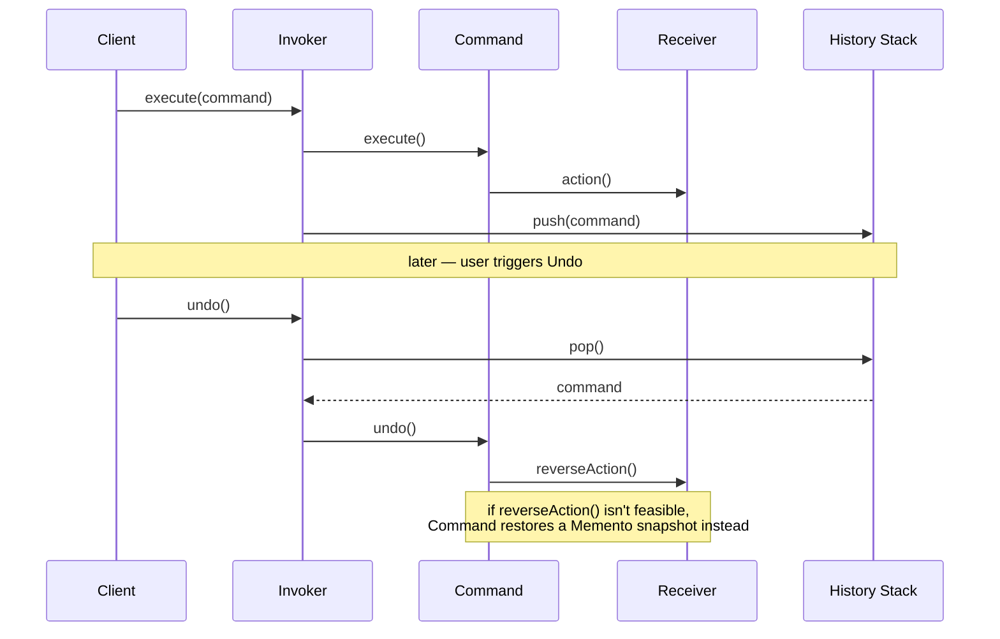
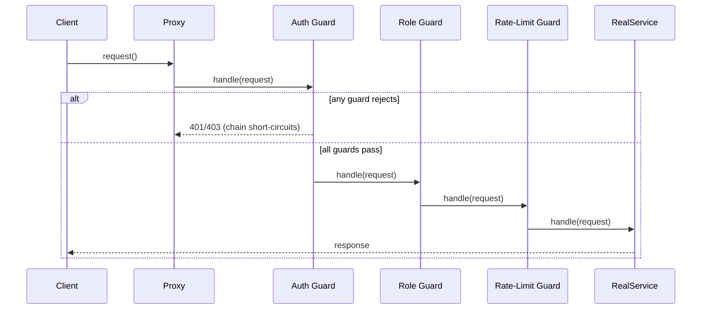

# Design Pattern Decision Flowchart
A comprehensive guide to choosing the right design pattern for your problem.

---

## Intuition

> **One-line analogy**: The pattern decision flowchart is like a field guide for identifying plants — you answer a series of distinguishing questions and converge on the right species.

**Mental model**: Before reaching for a pattern name, answer three questions: (1) What's my primary concern — creation, structure, or behavior? (2) Who varies — the object being created, how objects are composed, or how objects communicate? (3) What changes at runtime vs compile time? These three dimensions map cleanly to the 23 GoF patterns. The flowchart makes implicit pattern-selection reasoning explicit.

**Why it matters**: Pattern application without a decision framework leads to Golden Hammer — using the patterns you know regardless of fit. The flowchart builds the habit of starting from the problem, not the solution.

**Key insight**: If two patterns seem equally applicable, pick the simpler one. Patterns are tools, not goals. The code that works and is readable beats the code that's theoretically "correct."

---

## 1. Pattern Selection Decision Tree

```mermaid
flowchart LR
    classDef io      fill:#61afef,stroke:#2e86c1,color:#1a1a1a,font-weight:bold
    classDef frozen  fill:#c678dd,stroke:#9b59b6,color:#fff
    classDef train   fill:#98c379,stroke:#27ae60,color:#1a1a1a
    classDef mathOp  fill:#d19a66,stroke:#e67e22,color:#1a1a1a,font-weight:bold
    classDef lossN   fill:#e06c75,stroke:#c0392b,color:#fff,font-weight:bold
    classDef req     fill:#56b6c2,stroke:#0097a7,color:#1a1a1a
    classDef base    fill:#e5c07b,stroke:#f39c12,color:#1a1a1a

    Root(["What is your<br/>primary concern?"])
    Root --> Creation
    Root --> Structure
    Root --> Behavior

    subgraph Creation["OBJECT CREATION"]
        direction LR
        C1{"Need only ONE instance<br/>across the application?"} --> CP1(["Singleton"])
        C2{"Create objects, defer exact<br/>class to subclasses?"} --> CP2(["Factory Method"])
        C3{"Create FAMILIES of related<br/>objects, no concrete classes?"} --> CP3(["Abstract Factory"])
        C4{"Build COMPLEX objects step<br/>by step, many optional parts?"} --> CP4(["Builder"])
        C5{"Create a new object by<br/>COPYING an existing one?"} --> CP5(["Prototype"])
    end

    subgraph Structure["OBJECT STRUCTURE"]
        direction LR
        S1{"Make an INCOMPATIBLE<br/>interface work with yours?"} --> SP1(["Adapter"])
        S2{"Separate ABSTRACTION from<br/>IMPLEMENTATION, vary both?"} --> SP2(["Bridge"])
        S3{"Treat individual objects and<br/>GROUPS uniformly (tree)?"} --> SP3(["Composite"])
        S4{"ADD RESPONSIBILITIES to an<br/>object dynamically, no subclass?"} --> SP4(["Decorator"])
        S5{"Provide a SIMPLIFIED interface<br/>to a complex subsystem?"} --> SP5(["Facade"])
        S6{"Share many FINE-GRAINED<br/>objects to save memory?"} --> SP6(["Flyweight"])
        S7{"CONTROL ACCESS to an object<br/>(lazy, security, remote)?"} --> SP7(["Proxy"])
    end

    subgraph Behavior["OBJECT BEHAVIOR"]
        direction LR
        B1{"Pass a request along a CHAIN<br/>of handlers until handled?"} --> BP1(["Chain of Responsibility"])
        B2{"ENCAPSULATE a request as an<br/>object (queue, log, undo)?"} --> BP2(["Command"])
        B3{"Define a GRAMMAR and<br/>interpret sentences in it?"} --> BP3(["Interpreter"])
        B4{"ACCESS elements SEQUENTIALLY<br/>without exposing internals?"} --> BP4(["Iterator"])
        B5{"Reduce DEPENDENCIES between<br/>many communicating objects?"} --> BP5(["Mediator"])
        B6{"CAPTURE and RESTORE state<br/>without breaking encapsulation?"} --> BP6(["Memento"])
        B7{"NOTIFY multiple objects when<br/>one object changes state?"} --> BP7(["Observer"])
        B8{"Let an object ALTER behavior<br/>when INTERNAL STATE changes?"} --> BP8(["State"])
        B9{"Define a FAMILY OF ALGORITHMS,<br/>make them interchangeable?"} --> BP9(["Strategy"])
        B10{"Fix an algorithm's SKELETON,<br/>subclasses fill in steps?"} --> BP10(["Template Method"])
        B11{"Perform an OPERATION on elements<br/>without changing their classes?"} --> BP11(["Visitor"])
    end

    class Root io
    class C1,C2,C3,C4,C5,S1,S2,S3,S4,S5,S6,S7,B1,B2,B3,B4,B5,B6,B7,B8,B9,B10,B11 mathOp
    class CP1,CP2,CP3,CP4,CP5,SP1,SP2,SP3,SP4,SP5,SP6,SP7,BP1,BP2,BP3,BP4,BP5,BP6,BP7,BP8,BP9,BP10,BP11 train
```

The tree mirrors the file's own structure: pick a concern (creation, structure, or behavior — blue root, gold clusters), then follow the first orange question that fits — the green leaf is your starting pattern. If two leaves seem equally applicable, prefer the simpler pattern (see Intuition above).

---

## 2. Problem-to-Pattern Mapping Table

| Problem Statement | Recommended Pattern | Why |
|---|---|---|
| "I need only one instance of a class (e.g., config, logger)" | Singleton | Guarantees a single global instance and provides a global access point |
| "I need to create objects but don't know the exact class at compile time" | Factory Method | Defers instantiation to subclasses; decouples creation from usage |
| "I need to create families of related objects that must work together" | Abstract Factory | Ensures product compatibility across a family without coupling to concrete classes |
| "I need to construct a complex object with many optional fields or steps" | Builder | Separates construction from representation; avoids telescoping constructors |
| "I need a new object that is a copy of an existing one with slight modifications" | Prototype | Cloning is cheaper than re-instantiation; useful when class is unknown at runtime |
| "I need to use a third-party class but its interface doesn't match mine" | Adapter | Wraps an incompatible interface so it looks like the expected one |
| "I need my abstraction and implementation to evolve independently" | Bridge | Decouples hierarchy; avoids O(m*n) subclass explosion |
| "I need to work with tree structures and treat leaves and composites uniformly" | Composite | Allows recursive composition; client code works with any node the same way |
| "I need to add features to an object at runtime without modifying its class" | Decorator | Wraps objects in layers; respects Open/Closed Principle |
| "I need to hide the complexity of a subsystem behind a simple interface" | Facade | Reduces coupling between client and subsystem; simplifies API surface |
| "I need to support a huge number of similar objects efficiently in memory" | Flyweight | Shares intrinsic state; stores extrinsic state outside the object |
| "I need to control access to an object (security, caching, lazy init, remote)" | Proxy | Intercepts calls; adds a layer between client and real subject |
| "I need multiple handlers to process a request without the sender knowing which one" | Chain of Responsibility | Decouples sender from receiver; allows dynamic handler chains |
| "I need to parameterize, queue, log, or undo operations" | Command | Encapsulates requests as objects; supports undoable operations |
| "I need to parse and evaluate sentences in a simple language or grammar" | Interpreter | Defines grammar as a class hierarchy; each class interprets one rule |
| "I need to traverse a collection without knowing its internal structure" | Iterator | Provides a uniform traversal interface; hides the collection's implementation |
| "I need to coordinate multiple objects that would otherwise be tightly coupled" | Mediator | Centralizes communication; reduces many-to-many dependencies to one-to-many |
| "I need to save and restore an object's state (undo, snapshots)" | Memento | Captures internal state externally without violating encapsulation |
| "I need multiple objects to react when another object changes" | Observer | Establishes a one-to-many dependency; decouples publishers from subscribers |
| "I need an object to behave differently based on its current state" | State | Replaces conditional logic with polymorphic state objects |
| "I need to swap algorithms or behaviors at runtime" | Strategy | Encapsulates algorithms behind an interface; interchangeable at runtime |
| "I need an algorithm with fixed steps but some steps should be overridable by subclasses" | Template Method | Defines skeleton in base class; lets subclasses override specific steps |
| "I need to add a new operation to a class hierarchy without modifying the classes" | Visitor | Separates algorithm from object structure; easy to add new operations |

---

## 3. Common Design Scenarios

### Undo/Redo Functionality
- **Patterns:** Command + Memento
- **Command** encapsulates each operation as an object with `execute()` and `undo()` methods.
- **Memento** captures the full state snapshot before an operation if fine-grained undo is not feasible.
- Keep a history stack (list of Commands); pop to undo, re-execute to redo.

The Invoker never inspects a Command's internals — it just pushes onto the history stack on `execute()` and pops + calls `undo()` on undo, which is why Command composes so cleanly with Memento for undo/redo.

### Plugin Architecture
- **Patterns:** Strategy + Factory Method (or Abstract Factory)
- **Strategy** defines the plugin interface; each plugin is a concrete strategy.
- **Factory Method** (or a registry map) instantiates the correct plugin by name/type at runtime.
- Optionally wrap with **Decorator** for cross-cutting concerns like logging or metrics.

### Event System
- **Patterns:** Observer + Command
- **Observer** handles the pub/sub wiring: subjects notify registered listeners.
- **Command** wraps each event payload so it can be serialized, queued, replayed, or logged.
- Combine with **Mediator** to avoid direct coupling between producers and consumers.

### Permission / Authorization System
- **Patterns:** Proxy + Chain of Responsibility
- **Proxy** intercepts every call to the real service and delegates to the auth layer.
- **Chain of Responsibility** passes the request through a series of guards (auth check, role check, rate limit) before reaching the real handler.

Proxy is the single entry point that intercepts every call; internally it delegates into a Chain of Responsibility of guards, any one of which can short-circuit with a rejection before the request ever reaches RealService.

### UI Component Tree
- **Patterns:** Composite + Decorator
- **Composite** models the component hierarchy: containers hold children, leaves are primitives; both implement the same `render()` interface.
- **Decorator** layers behavior (borders, scroll bars, shadows) onto any component without subclassing.

### Application Configuration
- **Patterns:** Singleton + Builder
- **Singleton** ensures there is one config object application-wide.
- **Builder** constructs the config from multiple sources (env vars, files, CLI args) in a controlled, step-by-step manner.

### Logging / Monitoring
- **Patterns:** Proxy + Observer
- **Proxy** wraps service calls to intercept and log entry/exit automatically.
- **Observer** publishes log/metric events to multiple sinks (file, stdout, monitoring dashboard) without coupling the source to any sink.

### State Machines
- **Patterns:** State + Command
- **State** represents each machine state as a class; transitions are polymorphic method calls.
- **Command** encapsulates each transition/action so it can be queued, logged, or replayed.

---

## 4. Pattern Combinations Matrix

| Pattern | Works Well With | Notes |
|---|---|---|
| Singleton | Builder, Facade, Proxy | Builder constructs the singleton; Facade or Proxy often implemented as singletons |
| Factory Method | Template Method, Prototype, Abstract Factory | Factory Method uses Template Method internally; can return Prototypes |
| Abstract Factory | Factory Method, Singleton, Builder | Abstract Factory is often a Singleton; uses Factory Methods internally |
| Builder | Composite, Strategy, Prototype | Builder assembles Composites; Strategy selects the build algorithm |
| Prototype | Factory Method, Composite, Memento | Prototype clones complex Composites; Memento stores prototype snapshots |
| Adapter | Facade, Decorator, Proxy | Adapter + Facade simplifies legacy integration; Adapter vs Proxy differs in intent |
| Bridge | Abstract Factory, Strategy | Bridge's implementation side is often injected via Factory; Strategy is a degenerate Bridge |
| Composite | Visitor, Iterator, Decorator | Visitor operates over Composite trees; Iterator traverses them; Decorator wraps leaf nodes |
| Decorator | Strategy, Composite, Chain of Responsibility | Decorator wraps; Strategy replaces — often interchangeable; Chain is a linear Decorator |
| Facade | Singleton, Mediator, Abstract Factory | Facade is often a Singleton; both Facade and Mediator simplify interactions |
| Flyweight | Composite, Factory Method | Factory ensures Flyweights are shared; Flyweight is often used as Composite leaves |
| Proxy | Decorator, Chain of Responsibility, Observer | Proxy and Decorator have similar structure but different intent |
| Chain of Responsibility | Command, Composite | Each handler is a Command; chain can be built as a Composite |
| Command | Memento, Observer, Chain of Responsibility | Command + Memento = undo/redo; Command + Observer = event bus |
| Interpreter | Composite, Visitor, Iterator | AST is a Composite; Visitor interprets it; Iterator traverses tokens |
| Iterator | Composite, Factory Method, Visitor | Iterator traverses Composites; Factory creates the right Iterator |
| Mediator | Observer, Command, Facade | Mediator uses Observer to wire components; resembles a bi-directional Facade |
| Memento | Command, State, Prototype | Command uses Memento for undo; State saves snapshots via Memento |
| Observer | Command, Mediator, Strategy | Observer notifies; Command carries the notification payload |
| State | Command, Strategy, Singleton | Each State can be a Singleton; Strategy vs State differs in who drives change |
| Strategy | Template Method, Bridge, Factory Method | Strategy replaces conditional logic; Template Method uses inheritance instead |
| Template Method | Factory Method, Strategy | Factory Method is a specialization of Template Method for object creation |
| Visitor | Composite, Iterator, Strategy | Visitor + Composite is the canonical double-dispatch over a tree |

---

## 5. Anti-Pattern Warnings

### Singleton Overuse
- **Misuse:** Using Singleton as a global variable bag for everything.
- **Problem:** Hidden dependencies, tight coupling, untestable code, concurrency issues.
- **Instead:** Use Dependency Injection. Pass dependencies explicitly; let a DI container manage lifetimes.

### Factory for Simple Objects
- **Misuse:** Creating a Factory class for objects that only have one implementation and never change.
- **Problem:** Unnecessary indirection; adds complexity with no benefit.
- **Instead:** Use a simple constructor or a static factory method on the class itself.

### Decorator Hell
- **Misuse:** Stacking so many Decorators that the call stack becomes impossible to debug.
- **Problem:** Hard to trace which Decorator is active; ordering bugs are subtle.
- **Instead:** Limit Decorator depth; consider a Pipeline/Chain of Responsibility with explicit ordering.

### God Mediator
- **Misuse:** Putting all business logic inside the Mediator, making it a God Object.
- **Problem:** The Mediator becomes the bottleneck and violates SRP.
- **Instead:** Keep the Mediator thin — only coordination logic; push business logic into the components.

### Strategy When Template Method Is Enough
- **Misuse:** Using Strategy (object composition) when only one or two steps vary and subclassing is simpler.
- **Problem:** Forces the caller to instantiate and inject a strategy object unnecessarily.
- **Instead:** Use Template Method when the algorithm skeleton is fixed and variation is limited to a few hook methods.

### Observer Without Back-Pressure
- **Misuse:** Allowing slow observers to be notified synchronously without any throttling or async handling.
- **Problem:** One slow subscriber blocks all others; event queues grow unbounded.
- **Instead:** Use an async event bus, apply back-pressure strategies, or a dead-letter queue for failed deliveries.

### Composite With Mixed Types
- **Misuse:** Forcing very different objects into a Composite just because they are in a tree.
- **Problem:** The common interface becomes bloated with methods that only make sense for some nodes.
- **Instead:** Use a narrower interface; push type-specific operations to subclasses; consider the Visitor pattern for type-specific operations.

### Proxy as a Decorator
- **Misuse:** Adding behavior via a Proxy when a Decorator is the correct abstraction.
- **Problem:** Proxy is intended for access control / indirection, not feature layering — confuses intent.
- **Instead:** Use Decorator for behavior addition; reserve Proxy for access control, caching, remote access.

### Command Without Undo Design
- **Misuse:** Using Command purely for queueing without designing `undo()` from the start, then retrofitting it.
- **Problem:** State needed for undo is already discarded by execution time.
- **Instead:** Design `execute()` and `undo()` together from day one; capture pre-state in the Command before executing.

---

## 6. Quick Reference Card

| # | Pattern | Category | Intent (one line) | Key Participants |
|---|---|---|---|---|
| 1 | Singleton | Creational | Ensure one instance; provide global access | Singleton class |
| 2 | Factory Method | Creational | Let subclasses decide which class to instantiate | Creator, ConcreteCreator, Product |
| 3 | Abstract Factory | Creational | Create families of related objects | AbstractFactory, ConcreteFactory, AbstractProduct |
| 4 | Builder | Creational | Construct complex objects step by step | Builder, ConcreteBuilder, Director, Product |
| 5 | Prototype | Creational | Clone existing objects instead of constructing | Prototype, ConcretePrototype |
| 6 | Adapter | Structural | Convert one interface into another expected by clients | Target, Adapter, Adaptee |
| 7 | Bridge | Structural | Decouple abstraction from implementation | Abstraction, Implementor, RefinedAbstraction |
| 8 | Composite | Structural | Compose objects into tree structures; treat uniformly | Component, Leaf, Composite |
| 9 | Decorator | Structural | Attach responsibilities dynamically | Component, Decorator, ConcreteDecorator |
| 10 | Facade | Structural | Provide a simplified interface to a subsystem | Facade, Subsystem classes |
| 11 | Flyweight | Structural | Share fine-grained objects to reduce memory | Flyweight, FlyweightFactory, Context |
| 12 | Proxy | Structural | Provide a surrogate to control object access | Subject, Proxy, RealSubject |
| 13 | Chain of Responsibility | Behavioral | Pass request along a handler chain | Handler, ConcreteHandler, Client |
| 14 | Command | Behavioral | Encapsulate a request as an object | Command, ConcreteCommand, Invoker, Receiver |
| 15 | Interpreter | Behavioral | Define a grammar and interpret sentences | AbstractExpression, TerminalExpression, Context |
| 16 | Iterator | Behavioral | Sequential access to collection elements | Iterator, ConcreteIterator, Aggregate |
| 17 | Mediator | Behavioral | Centralize complex communications | Mediator, ConcreteMediator, Colleague |
| 18 | Memento | Behavioral | Capture and restore object state | Originator, Memento, Caretaker |
| 19 | Observer | Behavioral | Notify dependents of state changes | Subject, Observer, ConcreteObserver |
| 20 | State | Behavioral | Alter behavior when internal state changes | Context, State, ConcreteState |
| 21 | Strategy | Behavioral | Define interchangeable algorithms | Context, Strategy, ConcreteStrategy |
| 22 | Template Method | Behavioral | Define algorithm skeleton; defer steps to subclasses | AbstractClass, ConcreteClass |
| 23 | Visitor | Behavioral | Add operations to objects without changing their classes | Visitor, ConcreteVisitor, Element, ObjectStructure |

---

## 7. Technologies and Tools — Where the Platform Already Gives You the Pattern

The last node in every decision tree above should be the same question: **does the platform already implement this?** Hand-writing a pattern that the JDK, Spring, or a mature library already provides means giving up its lifecycle management, ordering guarantees, and observability in exchange for code you now own.

| Pattern | Already implemented in | Reach for your own only when |
|---------|-----------------------|------------------------------|
| Singleton | `enum`; Spring singleton bean scope; Guice `@Singleton`; Jakarta CDI `@ApplicationScoped` | Never in a DI application — let the container own the instance |
| Factory Method | `List.of`, `Optional.of`, `Executors`, `ServiceLoader`; Spring `@Bean` and `FactoryBean` | The creation rule is domain logic, not wiring |
| Abstract Factory | `DocumentBuilderFactory`, `FileSystems`, `SSLContext`, `EntityManagerFactory`; Jackson `JsonFactory` | You own several product families that must never be mixed |
| Builder | `HttpRequest.newBuilder()`, `Stream.builder()`; Lombok `@Builder`, Immutables, AutoValue, protobuf | A record would not do, and no generator fits the validation you need |
| Prototype | Copy constructors; records with withers; Jackson or Kryo deep copy; MapStruct | Deep copy of a graph with cycles and custom semantics |
| Adapter | `InputStreamReader`, `Arrays.asList`; MapStruct; SLF4J bindings; Micrometer registries | Adapting two of your own types |
| Bridge | JDBC, SLF4J, `java.security.Provider`, `FileSystemProvider`, OpenTelemetry API and SDK | Both dimensions are yours and both really vary |
| Composite | `java.awt.Container`, Jackson `JsonNode`; Spring `Composite*` beans; Micrometer `CompositeMeterRegistry` | Your own domain tree |
| Decorator | `java.io` streams, `Collections.unmodifiable*`; Guava `Forwarding*`; Resilience4j `Decorators` | Domain behaviour that no framework advice covers |
| Facade | SLF4J; Spring `JdbcTemplate` and `RestClient`; `java.net.http.HttpClient`; Boot starters | Simplifying your own subsystem for one client archetype |
| Flyweight | `Integer.valueOf` cache, compact strings; Guava `Interners`; Eclipse Collections primitives | Profiling proved duplicate domain objects dominate the heap |
| Proxy | `java.lang.reflect.Proxy`, Byte Buddy; Spring AOP; Hibernate lazy proxies; Mockito | A domain concern the container's advice model cannot express |
| Chain of Responsibility | `jakarta.servlet.Filter`; Spring `SecurityFilterChain` and `HandlerInterceptor`; Netty `ChannelPipeline`; OkHttp interceptors | The chain is over domain objects, not requests |
| Command | `Runnable` and `Callable` plus `ExecutorService`; Quartz `Job`; `UndoManager`; Axon command bus | You need undo with custom state capture |
| Interpreter | ANTLR 4; SpEL; Apache Commons JEXL; MVEL; Drools | A frozen grammar of under roughly ten rules |
| Iterator | `Iterator`, `Spliterator`, `DirectoryStream`; Guava `AbstractIterator`; Reactor `Flux` | A custom traversal order over your own structure |
| Mediator | Spring `ApplicationEventPublisher`; Guava `EventBus`; Spring Integration; Vert.x event bus | Coordination rules that are themselves domain logic |
| Memento | Records; `UndoManager`; Jackson or Kryo deep copy; Axon or EventStoreDB snapshots | Delta-based history with domain-specific compaction |
| Observer | Spring `@EventListener` and `@TransactionalEventListener`; Guava `EventBus`; `java.util.concurrent.Flow`; Reactor | A tight in-object callback where a bus would be overkill |
| State | `enum` with per-constant bodies; sealed interfaces plus `switch` patterns; Temporal; AWS Step Functions | The FSM is small, in-memory, and needs no durability |
| Strategy | `java.util.function`, `Comparator`, `ServiceLoader`; Spring `Map<String, Strategy>` injection | Always fine to write — this is the cheapest pattern to own |
| Template Method | `AbstractList`, `HttpServlet`; Spring `JdbcTemplate` and Batch; JUnit 6 lifecycle | Your own algorithm skeleton, and only when a callback will not do |
| Visitor | Sealed types plus `switch` patterns (Java 21+); `FileVisitor`; ASM; ANTLR generated visitors | A closed hierarchy predating sealed types |

---

## 8. Tradeoffs — What Choosing a Pattern Costs

The decision tree tells you which pattern fits. This table tells you what you pay for it, which is the half of the answer interviewers actually score. Every entry below is a structural cost you can count before writing any code, not a benchmark.

| Family | Structural cost of applying it | Runtime cost | What you lose |
|--------|-------------------------------|-------------|---------------|
| Singleton | 1 type | None | Testability and per-tenant scoping, unless the container owns the instance |
| Factory Method | 1 creator interface + 1 concrete creator per product | One virtual call | Nothing significant — the cheapest pattern here |
| Abstract Factory | 1 factory interface + N concrete factories + M product interfaces; every new product type edits all N factories | One virtual call | Cheap addition of product types, in exchange for cheap addition of families |
| Builder | 1 extra nested type, roughly one method per field | One extra object per construction | Compile-time detection of a missing required field, unless the generator checks it |
| Prototype | 1 copy method per type, recursive for a deep graph | Proportional to the graph size | Safety around cycles and mutable shared references |
| Adapter / Facade | 1 type per adapted boundary | One delegation | Direct access to capabilities you chose not to expose |
| Bridge | 1 abstraction hierarchy + 1 implementor hierarchy, wired at runtime | One delegation | Implementation-specific capabilities that do not fit the implementor interface |
| Composite | 1 component interface + leaf and composite types | Traversal proportional to tree size and depth | Either type safety or uniformity — you must choose one |
| Decorator | 1 type per behaviour, plus a factory that fixes the order | One delegation per layer | A readable stack trace, and safety against order-dependent bugs |
| Flyweight | 1 factory + a split of state into intrinsic and extrinsic | Cache lookup per creation | Mutability of the shared state, permanently |
| Proxy | 1 type per proxied subject, or a container that generates it | One dispatch, plus generation at startup | Correspondence between the code you read and the behaviour you get |
| Chain of Responsibility | 1 handler per concern + explicit ordering | One call per link | Any compile-time guarantee that the request is handled |
| Command | 1 type per operation, plus stored state if undo is required | One object per invocation | Nothing, until the class count outgrows the operations that need it |
| Interpreter | 1 type per grammar rule | Tree-walking evaluation, slow for real grammars | Maintainability past roughly ten rules — use a parser generator |
| Mediator | 1 mediator that knows every colleague | One indirection per interaction | Locality: the interaction rules now live away from the participants |
| Memento | 1 snapshot type + a caretaker | A full state copy per snapshot | Bounded memory, unless you cap the history or store deltas |
| Observer | 1 listener interface + a registry on the subject | Dispatch per listener | Deterministic ordering, and a call stack showing who reacted |
| State | 1 type or enum constant per state | One virtual call per action | A single place to read the whole transition graph |
| Strategy | 1 interface + 1 type per algorithm | One virtual call | Very little — prefer lambdas to keep the class count down |
| Template Method | 1 abstract base + 1 subclass per variant | One virtual call per hook | The subclass's only inheritance slot, and independent testability of the hook |
| Visitor | 1 visitor interface + `accept` on every element; each new element type edits every visitor | Double dispatch | Cheap addition of element types, in exchange for cheap addition of operations |

Read the table for the two structural inversions, because they are the classic interview question. **Abstract Factory** makes adding a family cheap and adding a product type expensive; **Visitor** makes adding an operation cheap and adding an element type expensive. In both cases the pattern is right only if the axis it makes cheap is the axis your system actually changes along — and choosing the wrong axis leaves you with the full class-count cost and none of the benefit.

---

## Interview Questions with Answers

**Q: What is the classic interview question hiding in the Abstract Factory and Visitor rows of the Tradeoffs table?**
**Short:** Both make one axis of change cheap and the opposite axis expensive — you must match the axis to what actually changes.

Abstract Factory makes adding a new product FAMILY cheap (one new concrete factory) but adding a new product TYPE expensive (every existing factory must be edited). Visitor inverts this exactly: adding a new OPERATION is cheap (one new visitor), but adding a new ELEMENT TYPE is expensive (every existing visitor must be edited). The pattern is only the right choice if the axis it makes cheap is the axis your system genuinely changes along — picking either pattern for the wrong axis gets you the full structural cost with none of the benefit.

**Q: According to the Technologies and Tools table, when should you still hand-write a Singleton in a DI-managed application?**
**Short:** Never — in a DI application, let the container own the instance instead of hand-rolling Singleton.

The table's guidance for Singleton is blunt: "Never in a DI application — let the container own the instance," pointing instead to Spring's singleton bean scope, Guice's `@Singleton`, or Jakarta CDI's `@ApplicationScoped`. Hand-rolled Singletons resist mocking and testing, while container-managed singletons remain injectable and swappable in tests. This is the same anti-pattern flagged separately under "Singleton + Dependency Injection" clashes elsewhere in this directory.

**Q: Why does the Technologies table say Strategy is "always fine to write — the cheapest pattern to own"?**
**Short:** Strategy costs just one interface plus one type per algorithm and one virtual call at runtime, with almost nothing to lose.

Looking at the Tradeoffs table, Strategy's structural cost is "1 interface + 1 type per algorithm," runtime cost is "One virtual call," and what you lose is "Very little — prefer lambdas to keep the class count down." Compare that to Abstract Factory or Visitor, which both carry real structural liabilities on one axis. This is why Strategy is the pattern interviewers expect you to reach for readily, while patterns like Abstract Factory or Interpreter warrant more justification before use.

**Q: When does the Technologies table say you should still write your own Command instead of using Runnable/Callable plus ExecutorService?**
**Short:** Write your own Command when you need undo with custom state capture, which ExecutorService cannot provide.

`Runnable`/`Callable` plus `ExecutorService`, Quartz `Job`, `UndoManager`, and Axon's command bus already cover most queued/deferred-execution needs. The table's stated exception is "You need undo with custom state capture" — none of those platform tools capture the domain-specific pre-state a custom `undo()` would need to reverse a business operation. This mirrors the general rule across the table: reach for your own implementation only when the domain logic genuinely can't be expressed by the platform's built-in tool.

**Q: What does the Pattern Combinations Matrix in this file say about combining Command with Chain of Responsibility?**
**Short:** Each handler in the chain can itself be a Command, and the chain can be structured as a Composite.

The matrix entry for Chain of Responsibility lists "Command, Composite" with the note "Each handler is a Command; chain can be built as a Composite." This means a CoR pipeline's individual handlers can be represented as executable Command objects (making them loggable/replayable), and the chain's own structure — a sequence of handlers — can itself be modeled as a Composite tree if handlers need to be grouped or nested. It's a distinct combination from the "CoR routes, Command executes" idiom shown in the dedicated `ChainOfResponsibility_vs_Command.md` file.

**Q: According to the Common Design Scenarios, which two patterns combine for a Permission/Authorization system, and what does each contribute?**
**Short:** Proxy intercepts every call as the single entry point; Chain of Responsibility runs the request through a series of guards.

Proxy acts as the sole entry point that intercepts every call to the real service, while internally it delegates to a Chain of Responsibility of guards — auth check, role check, rate limit — any one of which can short-circuit the chain with a rejection before the real service is ever reached. This division of labor mirrors the Permission/Authorization sequence diagram in this file: the client only ever talks to the Proxy, and the guard chain's internal structure stays invisible to the caller.

**Q: What does "Golden Hammer" have to do with the Pattern Selection Decision Tree's structure?**
**Short:** The tree exists specifically to force starting from the problem (creation/structure/behavior), preventing habitual pattern reuse.

The Intuition section explicitly names Golden Hammer — using familiar patterns regardless of fit — as the failure mode the decision tree is built to prevent. By requiring you to first classify your concern (creation, structure, or behavior) and then answer a specific yes/no question about the problem, the tree structurally blocks jumping straight to a favorite pattern before establishing whether it actually matches the requirement.

**Q: Why does the "Decorator Hell" anti-pattern warning recommend limiting stack depth rather than banning Decorator outright?**
**Short:** Decorator itself is sound; the problem is unbounded stacking making the active call chain impossible to trace.

The anti-pattern warning identifies the misuse as "stacking so many Decorators that the call stack becomes impossible to debug," not the use of Decorator itself. The fix offered is to limit decorator depth or switch to a Pipeline/Chain of Responsibility with explicit, visible ordering once the number of layers grows unmanageable. This distinguishes a legitimate pattern used carelessly from the pattern being wrong for the job.

**Q: What does the "God Mediator" anti-pattern warn against, and how does the fix relate to SRP?**
**Short:** God Mediator warns against putting all business logic inside the Mediator, which the fix corrects by keeping it thin.

The misuse described is loading the Mediator with business logic until it becomes a God Object and a bottleneck, which directly violates the Single Responsibility Principle by making one class responsible for both coordination AND domain logic. The prescribed fix is to keep the Mediator strictly to coordination — routing messages between colleagues — and push business logic back into the components themselves, restoring each class's single responsibility.

**Q: According to the anti-pattern warnings, why is "Command Without Undo Design" a design-order problem rather than an implementation bug?**
**Short:** Retrofitting undo() after execute() already discarded prior state is a design-sequencing mistake, not a coding error.

The misuse is using Command purely for queueing without designing `undo()` from the start, and the stated problem is that "state needed for undo is already discarded by execution time" — no amount of careful coding after the fact can recover data that was never captured. The fix is to design `execute()` and `undo()` together from day one, capturing pre-state in the Command before executing, which is a sequencing decision made at design time, not something fixable by better implementation later.

**Q: Why does the file's Problem-to-Pattern Mapping route "share a huge number of similar objects efficiently in memory" to Flyweight and not Prototype?**
**Short:** Flyweight shares intrinsic state across many objects to save memory; Prototype clones a full object, which doesn't save memory.

Flyweight's mapping entry states it "shares intrinsic state; stores extrinsic state outside the object" — the whole point is memory efficiency through sharing, achieved by splitting state into what's common (shared) and what's per-instance (kept external). Prototype instead solves "I need a new object that is a copy of an existing one," which creates a full independent copy rather than sharing anything — cloning is about avoiding expensive re-instantiation, not about reducing the memory footprint of many similar objects. Confusing the two is a common interview trap because both involve "many similar objects."

**Q: What is the Event System scenario's three-pattern combination, and what does each pattern own?**
**Short:** Observer wires pub/sub, Command wraps event payloads for replay, and Mediator can decouple producers from consumers further.

Observer handles the raw pub/sub mechanics — subjects notifying registered listeners. Command wraps each individual event's payload so it can be serialized, queued, replayed, or logged independently of the notification mechanism. Optionally, Mediator is layered on top to avoid direct coupling between event producers and consumers when the wiring itself grows complex. This three-pattern stack shows how a single "event system" requirement decomposes into three genuinely distinct concerns.

**Q: Per the Technologies table, what is the platform-native replacement for hand-writing Visitor in modern Java, and when should you still write your own?**
**Short:** Sealed types plus switch pattern matching (Java 21+) replace hand-written Visitor; write your own for a closed hierarchy predating sealed types.

The table lists "Sealed types plus `switch` patterns (Java 21+); `FileVisitor`; ASM; ANTLR generated visitors" as what the platform already provides, since exhaustive `switch` over a sealed hierarchy achieves double-dispatch-like behavior without a separate Visitor interface. The stated exception for writing your own is "a closed hierarchy predating sealed types" — legacy code that can't be migrated to sealed interfaces still benefits from the classic Visitor structure.

**Q: How does the Pattern Combinations Matrix explain why State often coexists with Command, using the ATM example logic?**
**Short:** The current State determines which Commands are valid, while Commands trigger the actual state transitions.

The matrix entry for State lists "Command, Strategy, Singleton" with the note "Each State can be a Singleton; Strategy vs State differs in who drives change." Applied to an ATM, `PINVerifiedState.process(cmd)` checks whether the incoming `Command` (withdrawal, balance check) is valid in the current state before executing it — State provides the context-sensitive validation gate, and Command supplies the actual unit of work to run once validated.

**Q: Why does the file caution against combining Factory, Abstract Factory, and Builder all at once for a single object?**
**Short:** Mixing all three creation patterns for one object adds confusion; pick the simplest pattern that solves the actual problem.

The anti-combination warning states this directly: use Builder if the object has many optional fields, use Factory if you need polymorphism, and use Abstract Factory only if you need whole families of related objects — but never reach for all three simultaneously on the same object, since each addresses a distinct axis of complexity (assembly steps, subclass selection, family consistency) that rarely all apply to one type at once. Picking the single pattern that matches the actual axis of variation keeps the design legible.
