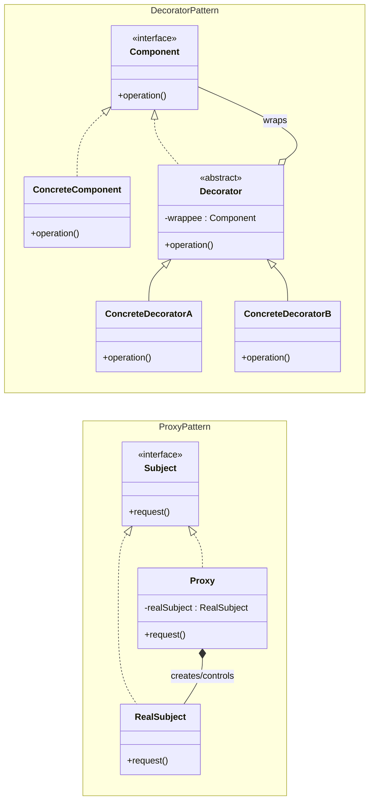
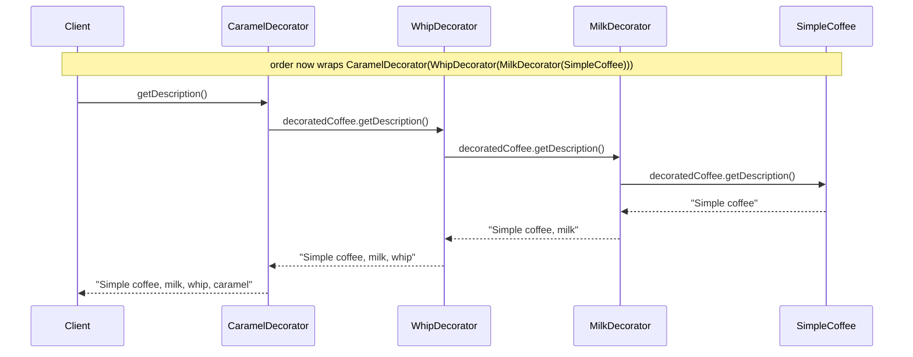
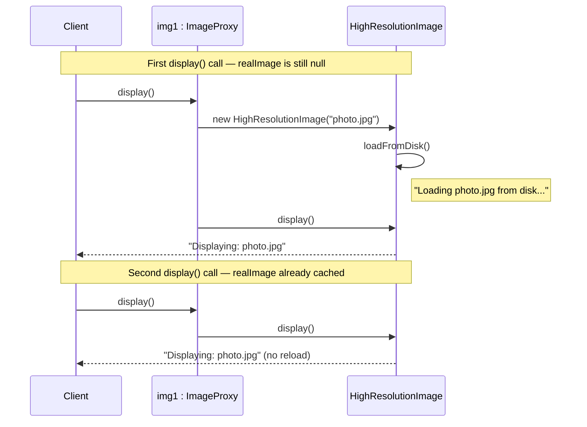

# Decorator vs Proxy
## Overview

Both Decorator and Proxy wrap a target object and implement the same interface. The structural similarity is almost perfect. The difference is in **intent** and **who manages the wrapped object's lifecycle**.

---

## Intuition

> **One-line analogy**: Decorator is like adding toppings to a pizza (you're enriching what's already there); Proxy is like a receptionist who decides whether you even get to see the pizza chef.

**Mental model**: Both wrap the same interface. Decorator adds new behavior on top of the real object — you always reach the real object, but with something extra attached. Proxy controls access to the real object — it might delay creation, check permissions, cache results, or log — and the caller may not even know a proxy is involved.

**Why it matters**: Decorator and Proxy are structurally nearly identical. The distinction is intent: enrichment vs access control. Real examples: Java I/O streams are Decorators; Spring's `@Transactional` proxies are Proxies.

**Key insight**: Ask "does this wrapper add behavior or guard access?" — add behavior → Decorator. Guard/intercept access → Proxy.

---

## Side-by-Side UML



Both hierarchies wrap the same interface, but the wrapping edge differs in kind: `Decorator` only aggregates a `Component` it never created (`wrappee`) — matching "Who creates the wrapped object: Client creates the component, wraps externally" below — while `Proxy` typically composes its `RealSubject`, creating and owning it directly (`realSubject`), matching "Lifecycle control: Often yes — lazy init, pooling, caching." `ConcreteDecoratorA`/`ConcreteDecoratorB` each layer one new behavior around `super.operation()`; `Proxy.request()` wraps `realSubject.request()` with pre-/post-processing instead of changing what the call does.

---

## Key Differences Table

| Dimension | Decorator | Proxy |
|-----------|-----------|-------|
| **Primary intent** | Add or enhance behavior dynamically | Control access to an object |
| **Who creates the wrapped object** | Client creates the component, wraps externally | Proxy often creates/manages the real subject |
| **Stacking** | Designed to stack multiple layers | Typically one proxy around one subject |
| **Client awareness** | Client assembles the decoration chain | Client usually unaware a proxy exists |
| **Transparency** | Client may know about decorators | Client should be fully transparent to proxy |
| **Lifecycle control** | No — just adds behavior | Often yes — lazy init, pooling, caching |
| **Typical variations** | One type: add behavior | Many types: remote, virtual, protection, logging |
| **Change to subject's behavior** | Extends/adds behavior | Usually does not change core behavior |

---

## Common Confusion Points

1. **Identical structure** — The UML is nearly the same. The tell is intent and who creates the inner object.
2. **Proxy doesn't add behavior** (usually) — A logging proxy adds logging infrastructure, but doesn't change what the method does. A Decorator fundamentally adds new behavior to the operation.
3. **Decorator is additive and stackable** — You can wrap a coffee in milk, then whipped cream, then caramel. Each adds to the previous. Proxies are not typically stacked.
4. **Proxy may be invisible** — The client code for `subject.request()` should be identical whether using a proxy or not. With Decorator, the client often explicitly wraps: `new MilkDecorator(new Coffee())`.
5. **Virtual Proxy vs Decorator**: A virtual proxy delays object creation. A decorator adds behavior immediately upon creation.

---

## Proxy Variants

| Proxy Type | Purpose | Example |
|------------|---------|---------|
| Virtual Proxy | Lazy initialization, defer expensive creation | Loading image placeholders |
| Remote Proxy | Represents object in another address space | RMI stub, gRPC client stub |
| Protection Proxy | Access control | Role-based method guards |
| Caching Proxy | Cache results of expensive operations | Database query cache |
| Logging Proxy | Audit trail without modifying target | AOP-style method logging |
| Smart Reference | Extra actions on access/dereference | Reference counting, null checks |

---

## When to Use Which

### Use Decorator when:
- You want to add responsibilities to individual objects without affecting other objects of the same class
- You want to add behavior that can be combined and stacked in different ways
- Subclassing would lead to a class explosion for every combination of features
- You want to be able to add and remove responsibilities at runtime

### Use Proxy when:
- You need lazy initialization — delay expensive object creation until first use
- You need access control — restrict who can use the object
- You need a local representative for a remote object
- You want to log/audit method calls transparently
- You need smart reference behavior (e.g., caching expensive operations)

---

## Code Examples

### Decorator — Coffee customization

```java
// Component interface
interface Coffee {
    String getDescription();
    double getCost();
}

// Concrete component
class SimpleCoffee implements Coffee {
    public String getDescription() { return "Simple coffee"; }
    public double getCost()        { return 1.00; }
}

// Abstract Decorator
abstract class CoffeeDecorator implements Coffee {
    protected final Coffee decoratedCoffee;

    public CoffeeDecorator(Coffee coffee) {
        this.decoratedCoffee = coffee;
    }

    public String getDescription() { return decoratedCoffee.getDescription(); }
    public double getCost()        { return decoratedCoffee.getCost(); }
}

// Concrete Decorators — each adds something
class MilkDecorator extends CoffeeDecorator {
    public MilkDecorator(Coffee coffee) { super(coffee); }

    @Override
    public String getDescription() { return decoratedCoffee.getDescription() + ", milk"; }

    @Override
    public double getCost() { return decoratedCoffee.getCost() + 0.25; }
}

class WhipDecorator extends CoffeeDecorator {
    public WhipDecorator(Coffee coffee) { super(coffee); }

    @Override
    public String getDescription() { return decoratedCoffee.getDescription() + ", whip"; }

    @Override
    public double getCost() { return decoratedCoffee.getCost() + 0.50; }
}

class CaramelDecorator extends CoffeeDecorator {
    public CaramelDecorator(Coffee coffee) { super(coffee); }

    @Override
    public String getDescription() { return decoratedCoffee.getDescription() + ", caramel"; }

    @Override
    public double getCost() { return decoratedCoffee.getCost() + 0.75; }
}

// Client stacks decorators — order matters and is controlled by client
Coffee order = new SimpleCoffee();
System.out.println(order.getDescription() + " $" + order.getCost());

order = new MilkDecorator(order);
order = new WhipDecorator(order);
order = new CaramelDecorator(order);
System.out.println(order.getDescription() + " $" + order.getCost());
// "Simple coffee, milk, whip, caramel $2.5"  (1.00 + 0.25 + 0.50 + 0.75)

// Different combination — mix and match freely
Coffee latte = new MilkDecorator(new MilkDecorator(new SimpleCoffee()));
System.out.println(latte.getDescription() + " $" + latte.getCost());
// "Simple coffee, milk, milk $1.5"  (1.00 + 0.25 + 0.25)
```



Each decorator delegates first and appends its own text on the way back up — `order.getDescription()` reaches all the way down to `SimpleCoffee` before any decorator adds a word, producing the `"Simple coffee, milk, whip, caramel"` result from the stacking above.

---

### Proxy — Virtual Proxy for expensive resource

```java
// Subject interface
interface Image {
    void display();
}

// Real subject — expensive to create
class HighResolutionImage implements Image {
    private final String filename;
    private byte[] imageData;

    public HighResolutionImage(String filename) {
        this.filename = filename;
        loadFromDisk();  // expensive operation
    }

    private void loadFromDisk() {
        System.out.println("Loading " + filename + " from disk...");
        // Simulate expensive loading
        this.imageData = new byte[1024 * 1024]; // 1MB
    }

    @Override
    public void display() {
        System.out.println("Displaying: " + filename);
    }
}

// Virtual Proxy — delays creation until first use
class ImageProxy implements Image {
    private final String filename;
    private HighResolutionImage realImage;  // null until needed

    public ImageProxy(String filename) {
        this.filename = filename;
        // Note: does NOT create HighResolutionImage here
    }

    @Override
    public void display() {
        if (realImage == null) {
            realImage = new HighResolutionImage(filename);  // lazy init
        }
        realImage.display();
    }
}

// Protection Proxy — adds access control
class SecureImageProxy implements Image {
    private final Image target;
    private final String userRole;

    public SecureImageProxy(Image target, String userRole) {
        this.target   = target;
        this.userRole = userRole;
    }

    @Override
    public void display() {
        if (!userRole.equals("ADMIN") && !userRole.equals("VIEWER")) {
            throw new SecurityException("Access denied for role: " + userRole);
        }
        target.display();
    }
}

// Logging Proxy — transparent audit trail
class LoggingImageProxy implements Image {
    private final Image target;

    public LoggingImageProxy(Image target) { this.target = target; }

    @Override
    public void display() {
        System.out.println("[LOG] display() called at " + System.currentTimeMillis());
        target.display();
        System.out.println("[LOG] display() completed");
    }
}

// Usage — client code is identical whether proxy or real object
Image img1 = new ImageProxy("photo.jpg");
Image img2 = new ImageProxy("landscape.png");

// Only photo.jpg is loaded — landscape.png proxy never triggers loading
img1.display();
// Loading photo.jpg from disk...
// Displaying: photo.jpg

img1.display();
// Displaying: photo.jpg  (no reload — already in memory)

// Proxy chain (less common but possible)
Image secured = new SecureImageProxy(
    new LoggingImageProxy(new ImageProxy("secret.jpg")),
    "ADMIN"
);
secured.display();
```



The expensive `HighResolutionImage` construction — and its `loadFromDisk()` call — runs exactly once, on the first `display()`; the second call skips straight to the cached `realImage`, which is "lazy initialization" from the Key Differences table in action. `img2` (never displayed) never triggers loading at all.

---

## Java Standard Library Examples

| Pattern | Java Example |
|---------|-------------|
| Decorator | `java.io.BufferedReader(new FileReader(...))` — wraps with buffering |
| Decorator | `Collections.unmodifiableList(list)` — wraps with immutability |
| Decorator | `Collections.synchronizedList(list)` — wraps with thread-safety |
| Proxy | `java.lang.reflect.Proxy` — dynamic proxy for interfaces |
| Proxy | Spring AOP `@Transactional` — transparent proxy around service beans |
| Proxy | Hibernate lazy-loaded entities — virtual proxy for DB records |

---

## Interview Questions with Answers

**Q: Both Decorator and Proxy wrap an object with the same interface. What's the difference?**
**Short:** Decorator adds new behavior to the wrapped object, while Proxy controls access to it without changing what it does.

> The structural similarity is real — they're nearly identical in UML. The difference is intent.
>
> Decorator's job is to **add or enhance behavior** — it extends what the wrapped object does. You can stack multiple decorators. The client often explicitly creates the decoration chain. A coffee with milk and whip is a concrete example.
>
> Proxy's job is to **control access** — it acts as a gatekeeper or stand-in. It typically doesn't change what the method does; it decides whether and when to call it. Proxies are usually transparent to the client. Examples: lazy initialization, access control, caching, remote access.
>
> The diagnostic question: "Is the pattern adding new behavior, or managing *how* the original behavior is invoked?" Adding behavior = Decorator. Managing invocation = Proxy.

**Q: In the ImageProxy example, why does img2 never trigger loading even though both img1 and img2 are constructed the same way?**
**Short:** ImageProxy's constructor deliberately does not create the real HighResolutionImage — loading only happens on the first display() call.

`ImageProxy`'s constructor stores only the `filename` and explicitly does NOT construct a `HighResolutionImage` — that's the "lazy initialization" the Key Differences table calls out. Since `display()` is never called on `img2` in the example, `realImage` stays `null` and the expensive `loadFromDisk()` work never happens for it, while `img1.display()` triggers construction exactly once and caches the result for subsequent calls. This demonstrates Proxy's lifecycle-control responsibility, which plain Decorator never takes on.

**Q: What distinguishes a Protection Proxy from a Decorator that also happens to check permissions before delegating?**
**Short:** Intent — Protection Proxy's job IS access control; a permission-checking Decorator would be repurposing enrichment for gatekeeping.

`SecureImageProxy.display()` throws a `SecurityException` when the caller's role doesn't match, then delegates to `target.display()` only if the check passes — it never adds new behavior to what `display()` does, it only decides WHETHER the call proceeds. A Decorator that performed the same check would be misusing the pattern: Decorator's contract is to add or enhance behavior, not to gate access, which is exactly the "Proxy as a Decorator" anti-pattern the pattern_comparisons directory warns about.

**Q: Why can Decorator and Proxy both be chained, as shown by SecureImageProxy(LoggingImageProxy(ImageProxy(...)))), and does that violate either pattern's typical usage?**
**Short:** Proxies are typically single-layer, but chaining several proxy TYPES for different concerns is a recognized, if less common, usage.

The example wraps a `SecureImageProxy` around a `LoggingImageProxy` around an `ImageProxy`, combining protection, logging, and lazy-loading concerns as three distinct proxy layers rather than one proxy trying to do everything. The Key Differences table notes Proxy's "Stacking" as "Typically one proxy around one subject," so this three-layer chain is the less common case, called out explicitly in the code comment as "less common but possible" — each layer still individually respects Proxy's single-purpose intent (access control, logging, laziness), unlike Decorator's design-for-stacking.

**Q: What is a Smart Reference proxy, and how does it differ from the other Proxy Variants listed?**
**Short:** A Smart Reference performs extra bookkeeping actions on access or dereference, like reference counting or null checks — not access control or laziness.

The Proxy Variants table lists Smart Reference separately from Virtual, Remote, Protection, Caching, and Logging Proxy, describing it as taking "extra actions on access/dereference" such as reference counting or null-safety checks. Unlike a Protection Proxy (which blocks access) or a Virtual Proxy (which delays creation), a Smart Reference doesn't change whether or when the real object is used — it just performs bookkeeping side effects around every access, which is a subtler form of "controlling access" than an outright gate.

**Q: Why does Spring's @Transactional proxy count as Proxy and not Decorator, even though it "adds" transaction behavior around a method?**
**Short:** @Transactional intercepts the call to manage a transaction boundary around it; the client is fully unaware a proxy exists.

The client calling a `@Transactional` service method has no idea a proxy sits in front of the real bean — the proxy transparently opens a transaction, delegates to the real method, and commits or rolls back based on the outcome, matching Proxy's "client usually unaware a proxy exists" row exactly. Even though it looks like "added behavior" on the surface, the intent is managing HOW and WHEN the call happens (within a transaction boundary) rather than enriching WHAT the method does — which is the diagnostic question ("adding behavior vs. managing invocation") this file's closing paragraph poses.

**Q: How does Hibernate's lazy-loaded entity proxy map onto the Virtual Proxy variant specifically?**
**Short:** Hibernate returns a proxy standing in for a database row and only issues the actual query on first real access.

When Hibernate returns a lazily-loaded entity association, it hands back a proxy object rather than the fully populated entity — the real SELECT query against the database only fires the moment a field is actually accessed, mirroring `ImageProxy`'s "does NOT create HighResolutionImage here" comment exactly. This is the Virtual Proxy variant's canonical enterprise example: deferring an expensive resource (a database round-trip) until it's provably needed, rather than paying for it eagerly on every object graph traversal.

**Q: Why is "the client explicitly creates the decoration chain" a meaningful difference from Proxy's typical construction?**
**Short:** Decorator chains are usually assembled visibly by the client; proxies are often constructed transparently behind a factory or container.

The Key Differences table's "Client awareness" row states the client assembles the decoration chain for Decorator, matching how `new CompressedDataStream(new EncryptedDataStream(new BufferedDataStream(stream)))` is built explicitly, layer by layer, in calling code. A Proxy, by contrast, is frequently constructed behind the scenes — Spring's AOP proxy or `java.lang.reflect.Proxy.newProxyInstance()` — so the calling code never writes out "wrap this in a proxy," reinforcing why Proxy is described as usually invisible to its client.

**Q: What would go wrong if you tried to implement caching as a Decorator instead of a Caching Proxy?**
**Short:** Framing caching as "added behavior" obscures that its real job is deciding whether to bypass the expensive call entirely.

A caching Decorator would technically work — wrap the real object, check a cache, return a stored value or delegate — but naming it a Decorator misrepresents its intent: it isn't enhancing what the operation does, it's deciding WHETHER the expensive operation runs at all, which is squarely a Proxy's access-management responsibility. Naming it correctly as a Caching Proxy also signals to future maintainers that swapping the underlying implementation should be transparent, whereas "Decorator" implies stackable behavior addition that isn't really what caching does.

**Q: In the Key Differences table, why does "Change to subject's behavior" read differently for Decorator versus Proxy?**
**Short:** Decorator's row reads "Extends/adds behavior," while Proxy's reads "Usually does not change core behavior."

This is the most direct summary of the entire comparison: a `BufferedReader` genuinely changes what reading gives you (buffered chunks instead of raw reads), while a `java.lang.reflect.Proxy`-based AOP interceptor generally still returns exactly what the real method would have returned — it just wraps the invocation with cross-cutting concerns like logging or transactions. When you're unsure which pattern you're looking at, checking whether the wrapped method's actual RESULT changes (Decorator) versus whether only the circumstances of the CALL change (Proxy) is a fast, concrete test.

**Q: Why does the Java Standard Library table list Collections.synchronizedList() as Decorator rather than Proxy, even though it's "controlling" concurrent access?**
**Short:** It adds new behavior — thread-safe synchronization — around every method, rather than deciding whether the call happens at all.

`Collections.synchronizedList(list)` wraps every method call with a `synchronized` block, which is new behavior layered onto the list's normal operations — the list still does exactly what it did before, just now safely under concurrent access, matching Decorator's "Extends/adds behavior" row rather than Proxy's access-gating role. It doesn't decide whether to skip, delay, or reject the underlying call the way a Protection or Virtual Proxy would; it always delegates, just with an added synchronization wrapper around the delegation.

**Q: How would you defend classifying java.lang.reflect.Proxy as the "purest" form of the Proxy pattern in Java?**
**Short:** It generates a dynamic stand-in implementing an interface entirely through reflection, with total control over whether/how each call proceeds.

`java.lang.reflect.Proxy.newProxyInstance()` builds a class at runtime that implements a given interface by routing every method call through an `InvocationHandler`, which has complete discretion over whether to delegate to a real object, transform the call, or reject it outright — this is Proxy's "surrogate for controlling access" role with no other responsibility mixed in. Because it's generated purely from an interface with no concrete "real" implementation baked into the generated class itself, it's a cleaner illustration of the pattern's structure than a hand-written wrapper class would be.

**Q: What signal in a design review suggests a "Decorator" is actually misnamed and should be a Proxy?**
**Short:** If removing the wrapper changes only WHETHER/WHEN a call happens rather than WHAT the call returns, it's really a Proxy.

Ask what breaks if the wrapper is removed and the client calls the real object directly: if the answer is "nothing is missing except some access control, caching, or lazy initialization," the class is functioning as a Proxy no matter what it's named. If instead removing it means the client genuinely gets a DIFFERENT result — no more buffering, no more encryption — it's correctly a Decorator. This "what breaks on removal" test is a fast, concrete way to catch a misnamed class in review.

**Q: Why does the Proxy Variants table separate Remote Proxy from Virtual Proxy even though both "stand in" for something not immediately present?**
**Short:** Remote Proxy stands in for an object in a different address space; Virtual Proxy stands in for an object that's merely expensive to create locally.

A Remote Proxy (an RMI stub or gRPC client stub) represents an object that physically lives on a different machine or process, and every call involves network marshaling regardless of cost — the "not present" is about location. A Virtual Proxy represents an object that exists locally but is expensive to construct — like `HighResolutionImage`'s disk load — and the "not present" is purely about deferred timing, with no network boundary involved at all. Both defer full access to the real object, but for structurally different reasons, which is why the table lists them as separate variants rather than one.

**Q: Why does "Virtual Proxy delays object creation, Decorator adds behavior immediately upon creation" matter when reasoning about performance?**
**Short:** A Virtual Proxy can avoid expensive work entirely if never used, while a Decorator's added behavior always runs at wrap time.

Because `ImageProxy` defers `HighResolutionImage` construction until `display()` is actually called, an application that creates a thousand `ImageProxy` objects but only displays ten pays the loading cost for just those ten. A Decorator provides no equivalent deferral — `new BufferedDataStream(stream)` and every other wrapper layer is fully constructed and ready the moment the chain is assembled, so its setup cost (however small) is paid immediately regardless of whether the wrapped operation is ever invoked. This is a direct performance consequence of the two patterns' differing lifecycle-control responsibilities.
