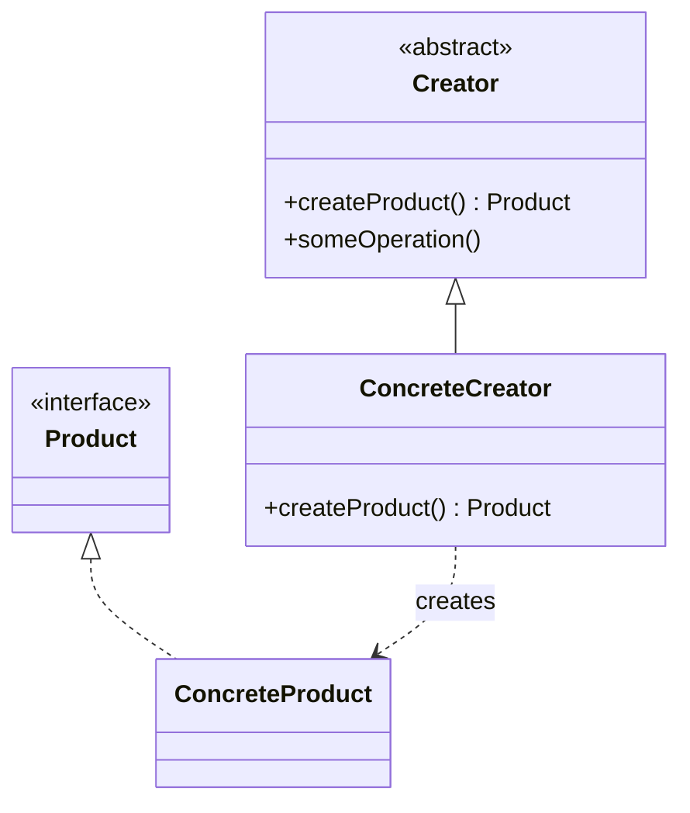
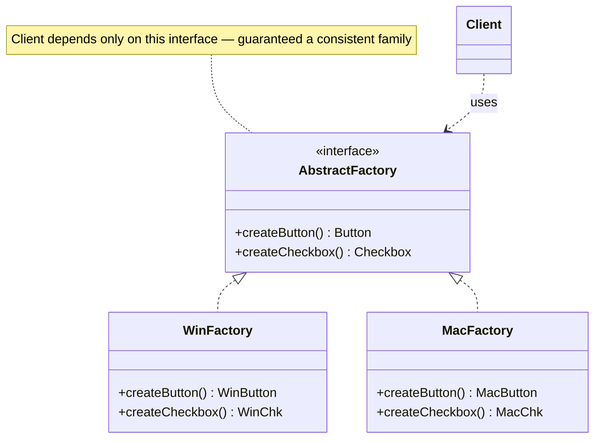
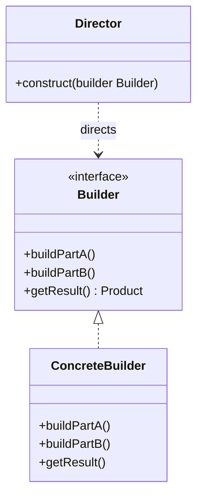
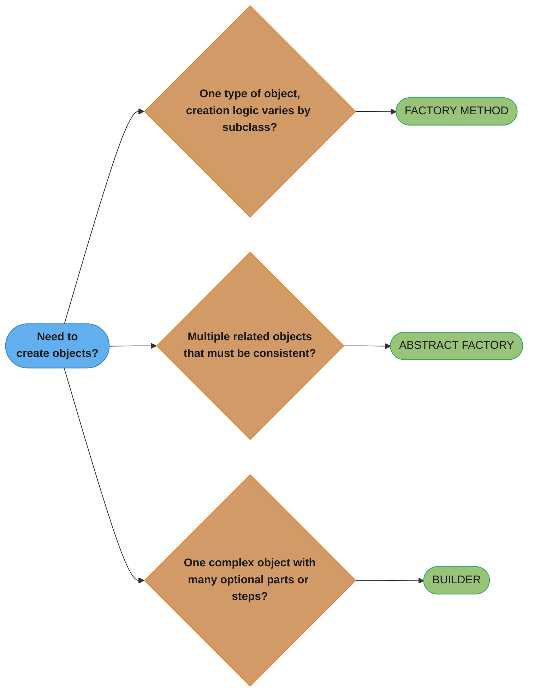

# Factory Method vs Abstract Factory vs Builder
## Overview

All three are creational patterns that hide object construction from the client. They differ in **complexity**, **what they create**, and **how much the client participates in construction**.

---

## Intuition

> **One-line analogy**: Factory Method is a cookie cutter (one type at a time); Abstract Factory is a matching cookie-cutter set (coordinated family); Builder is a recipe (step-by-step construction of one complex thing).

**Mental model**: Factory Method hides which concrete class is created — subclasses decide. Abstract Factory hides which *family* of related objects is created — you get a complete, consistent set (WinButton + WinCheckbox, not WinButton + MacCheckbox). Builder separates the construction *process* from the representation — the same director can build a simple house or a mansion by using a different builder. Builder's hallmark is the optional step-by-step configuration that culminates in a `build()` call.

**Why it matters**: These three are the most frequently confused creational patterns. Choosing wrong leads to either over-engineering (Abstract Factory when Factory Method suffices) or under-engineering (Factory Method when you need coordinated families).

**Key insight**: If you need one object → Factory Method. If you need a family of related objects → Abstract Factory. If you need one complex object with many optional parts → Builder.

---

## Side-by-Side UML

Three independent class hierarchies — read left to right as Factory Method → Abstract Factory → Builder, then compare against the table below.

**Factory Method** — `ConcreteCreator` overrides `createProduct()` to decide the concrete type; the inherited `someOperation()` never changes.



**Abstract Factory** — one factory interface produces an entire family of related products; swapping `WinFactory` for `MacFactory` swaps the whole family at once.



**Builder** — the optional `Director` drives a `Builder` through the same step sequence to assemble a product incrementally, ending in `getResult()`.



---

## Key Differences Table

| Dimension | Factory Method | Abstract Factory | Builder |
|-----------|---------------|------------------|---------|
| **Creates** | One product type | Families of related products | One complex product |
| **Mechanism** | Inheritance (subclass overrides) | Composition (factory object injected) | Step-by-step method calls |
| **Product complexity** | Simple, single type | Multiple related types | Complex, optional parts |
| **Consistency guarantee** | None | Products from same family fit together | N/A |
| **Director** | None | None | Optional Director class |
| **Client involvement** | Calls factory method | Gets products from factory | Calls build steps or uses Director |
| **Extensibility** | Add new subclass | Add new factory implementation | Add new builder implementation |
| **Typical use** | Framework hooks for subclasses | UI toolkits, platform-specific families | Reports, queries, HTTP requests |

---

## Common Confusion Points

1. **Factory Method vs Abstract Factory scope**: Factory Method creates *one* product via a subclass. Abstract Factory creates *multiple* related products via an injected factory object.
2. **Abstract Factory is often a collection of Factory Methods**: An AbstractFactory implementation internally uses Factory Methods to create each product type.
3. **Builder vs Telescoping Constructor**: Builder solves the same problem as telescoping constructors (`new Pizza(size, cheese, peppers, olives, ...)`) but far more readably.
4. **Builder's Director is optional**: You can call builder methods directly from the client. The Director just encapsulates common recipes.
5. **Factory vs Builder for complex objects**: Factory (any variant) creates the whole object in one call. Builder builds it incrementally across multiple calls.

---

## When to Use Which

### Use Factory Method when:
- A framework needs to define the creation interface but let subclasses decide which class to instantiate
- You don't know upfront what class needs to be created
- You want subclasses to control the types of objects created

### Use Abstract Factory when:
- You need to create families of related or dependent objects that must be used together
- You want the system to be independent of how its products are created
- You need to swap out an entire product family (e.g., Windows UI vs Mac UI)

### Use Builder when:
- An object has many optional configuration parameters
- You need to create different representations of the same construction process
- The construction process needs to be separated from the final representation
- You want to build objects step-by-step, possibly with validation between steps

---

## Code Examples

### Factory Method

```java
// Framework defines the hook
abstract class Dialog {
    // Template Method using Factory Method
    public void render() {
        Button btn = createButton();   // factory method call
        btn.render();
    }

    // Factory Method — subclasses override this
    protected abstract Button createButton();
}

interface Button {
    void render();
    void onClick(Runnable f);
}

// Windows-specific Dialog
class WindowsDialog extends Dialog {
    @Override
    protected Button createButton() {
        return new WindowsButton();
    }
}

class WebDialog extends Dialog {
    @Override
    protected Button createButton() {
        return new HtmlButton();
    }
}

class WindowsButton implements Button {
    public void render()            { System.out.println("Windows Button"); }
    public void onClick(Runnable f) { f.run(); }
}

class HtmlButton implements Button {
    public void render()            { System.out.println("<button>"); }
    public void onClick(Runnable f) { f.run(); }
}

// Client just picks the right Dialog subclass
Dialog dialog = new WindowsDialog();
dialog.render();
```

---

### Abstract Factory

```java
// Family of related products
interface Button    { void render(); }
interface Checkbox  { void render(); }

// Factory interface — creates a consistent family
interface GUIFactory {
    Button   createButton();
    Checkbox createCheckbox();
}

// Windows family
class WinButton   implements Button   { public void render() { System.out.println("Win Button");   } }
class WinCheckbox implements Checkbox { public void render() { System.out.println("Win Checkbox"); } }

class WindowsFactory implements GUIFactory {
    public Button   createButton()   { return new WinButton();   }
    public Checkbox createCheckbox() { return new WinCheckbox(); }
}

// Mac family
class MacButton   implements Button   { public void render() { System.out.println("Mac Button");   } }
class MacCheckbox implements Checkbox { public void render() { System.out.println("Mac Checkbox"); } }

class MacFactory implements GUIFactory {
    public Button   createButton()   { return new MacButton();   }
    public Checkbox createCheckbox() { return new MacCheckbox(); }
}

// Application uses only the factory interface — never concrete classes
class Application {
    private Button   button;
    private Checkbox checkbox;

    public Application(GUIFactory factory) {
        this.button   = factory.createButton();
        this.checkbox = factory.createCheckbox();
    }

    public void render() {
        button.render();
        checkbox.render();
    }
}

// Swap entire family by changing one line
GUIFactory factory = System.getProperty("os.name").startsWith("Windows")
    ? new WindowsFactory()
    : new MacFactory();
Application app = new Application(factory);
app.render();
```

---

### Builder

```java
// Complex product with many optional parts
class Pizza {
    private final String size;           // required
    private final String crust;          // required
    private final boolean cheese;        // optional
    private final boolean pepperoni;     // optional
    private final boolean mushrooms;     // optional
    private final String sauce;          // optional

    private Pizza(Builder builder) {
        this.size       = builder.size;
        this.crust      = builder.crust;
        this.cheese     = builder.cheese;
        this.pepperoni  = builder.pepperoni;
        this.mushrooms  = builder.mushrooms;
        this.sauce      = builder.sauce;
    }

    @Override
    public String toString() {
        return size + " pizza, " + crust + " crust" +
               (cheese     ? ", cheese"     : "") +
               (pepperoni  ? ", pepperoni"  : "") +
               (mushrooms  ? ", mushrooms"  : "") +
               (sauce != null ? ", " + sauce + " sauce" : "");
    }

    // Static inner Builder
    public static class Builder {
        private final String size;
        private final String crust;
        private boolean cheese    = false;
        private boolean pepperoni = false;
        private boolean mushrooms = false;
        private String  sauce     = null;

        public Builder(String size, String crust) {
            this.size  = size;
            this.crust = crust;
        }

        public Builder cheese()           { this.cheese    = true;  return this; }
        public Builder pepperoni()        { this.pepperoni = true;  return this; }
        public Builder mushrooms()        { this.mushrooms = true;  return this; }
        public Builder sauce(String s)    { this.sauce     = s;     return this; }

        public Pizza build() { return new Pizza(this); }
    }
}

// With Director encapsulating common recipes
class PizzaDirector {
    public Pizza margherita(Pizza.Builder builder) {
        return builder.cheese().sauce("tomato").build();
    }

    public Pizza meatLover(Pizza.Builder builder) {
        return builder.cheese().pepperoni().sauce("bbq").build();
    }
}

// Usage
Pizza custom = new Pizza.Builder("large", "thin")
    .cheese()
    .mushrooms()
    .sauce("pesto")
    .build();

PizzaDirector director = new PizzaDirector();
Pizza margherita = director.margherita(new Pizza.Builder("medium", "thick"));

System.out.println(custom);
System.out.println(margherita);
```

---

## Interview Questions with Answers

**Q: When would you choose Builder over Factory?**
**Short:** Choose Builder when an object has many optional parameters or multi-step construction; choose Factory for single-step creation.

> Use Factory (any variant) when you need a single-step creation of an object and the client doesn't need to configure individual parts. Use Builder when the object has many optional parameters, when construction is multi-step, or when you want to prevent invalid intermediate states. The rule of thumb: if a constructor would need more than 3-4 parameters, consider Builder.

**Q: What is the difference between Factory Method and Abstract Factory?**
**Short:** Factory Method is a class-based override that produces one product, while Abstract Factory is an injected object that produces a related family.

> Factory Method is class-based: a single method in a base class is overridden by subclasses to produce one type of product. Abstract Factory is object-based: an entire factory object is injected, and it creates multiple related products that belong to the same family. Abstract Factory is essentially a collection of Factory Methods behind an interface.

**Q: Why is Abstract Factory useful?**
**Short:** Abstract Factory guarantees that related products created together stay consistent, such as matching Windows-style widgets.

> It guarantees consistency across related products. If you ask a Windows factory for a button and a checkbox, you're guaranteed to get Windows-style versions of both — they'll look and feel consistent. Without it, you might accidentally mix a Mac button with a Windows checkbox.

**Q: All three patterns hide object construction — what's the fastest question to pick between them in an interview?**
**Short:** Ask how many products and how many steps: one product/one step is Factory Method, a family is Abstract Factory, many steps is Builder.

Factory Method answers "I need one object, but the exact class varies" — a single method call, single product. Abstract Factory answers "I need several related objects that must be consistent with each other" — still one call per product, but coordinated across a family. Builder answers "I need one complex object assembled across many steps" — the product count is one, but the construction is spread over multiple calls. Counting products and counting construction steps resolves the choice faster than reasoning about class diagrams.

**Q: Why does the Key Differences table list "Consistency guarantee: None" for Factory Method but "Products from same family fit together" for Abstract Factory?**
**Short:** Factory Method produces one independent product with nothing to be inconsistent with; Abstract Factory's whole job is cross-product consistency.

A single `ConcreteCreator.createProduct()` call has no sibling products in the same operation to be consistent WITH — there's nothing to guarantee. `AbstractFactory.createButton()` and `createFactory.createCheckbox()` called on the SAME concrete factory instance are guaranteed to belong to the same family (both Windows-style or both Mac-style) precisely because one factory object is responsible for the whole set — that cross-product guarantee is the entire reason Abstract Factory exists over calling several independent Factory Methods.

**Q: What does it mean structurally that Abstract Factory is "often a collection of Factory Methods behind an interface"?**
**Short:** Each createX() method on an AbstractFactory is itself a Factory Method; Abstract Factory just groups several of them under one object.

`WinFactory.createButton()` and `WinFactory.createCheckbox()` are each, individually, ordinary Factory Methods — a single method that returns a family-consistent concrete type. What makes the whole thing an Abstract Factory rather than two unrelated Factory Methods is that both methods live on the same factory interface and the same concrete implementation, so swapping `WinFactory` for `MacFactory` swaps every product in the family simultaneously. This is why the file states Abstract Factory implementations "internally use Factory Methods to create each product type."

**Q: Why is the Director in Builder described as optional, and what does skipping it cost you?**
**Short:** The Director just encapsulates common build recipes; skipping it means the client calls builder steps directly and owns the sequencing.

`Director.construct(builder)` exists purely to capture a reusable sequence of builder calls — "always build a house this way" — so multiple clients don't duplicate that sequencing logic. Calling `builder.buildPartA()` then `buildPartB()` then `getResult()` directly from client code works exactly the same functionally; you simply lose the reuse of a named, shared construction recipe, and each call site must independently get the step order right. This is why the Common Confusion Points note "You can call builder methods directly from the client — the Director just encapsulates common recipes."

**Q: Per the "rule of thumb" in this file, at what constructor parameter count should you start considering Builder?**
**Short:** Consider Builder once a constructor would need more than three or four parameters.

The stated rule of thumb is explicit: "if a constructor would need more than 3-4 parameters, consider Builder." Below that threshold, a plain constructor or a small set of overloaded constructors stays perfectly readable; above it, telescoping constructors (`new Pizza(size, cheese, peppers, olives, ...)`) become error-prone because callers can easily transpose same-typed arguments. Builder's named `buildX()` calls make each parameter's purpose explicit at the call site, which is what actually fixes the readability problem, not just the parameter count itself.

**Q: Why can't Factory Method (in any variant) prevent invalid intermediate object states the way Builder can?**
**Short:** Factory Method returns a fully-formed object in one call, so there's no intermediate state to validate between steps.

A Factory Method's `createProduct()` either returns a complete, valid object or it doesn't return at all — there's no window during which the object exists in a partially configured state that needs guarding. Builder, by contrast, builds incrementally across multiple calls (`buildPartA()`, `buildPartB()`, `getResult()`), which creates real intermediate states — and lets each step validate what's been configured so far before allowing the next step or the final `build()` to proceed. This incremental-validation capability is unique to Builder among the three patterns.

**Q: How would Abstract Factory prevent the specific bug of a Mac button appearing next to a Windows checkbox?**
**Short:** By making both calls route through the SAME concrete factory instance, so both products necessarily come from the same family.

If a client held two separate factories — one for buttons, one for checkboxes — nothing would stop it from accidentally instantiating `WinButton` and `MacCheckbox` side by side. Abstract Factory closes that gap structurally: the client depends on exactly one `AbstractFactory` reference (say, injected as `WinFactory`), and every product it requests — `createButton()`, `createCheckbox()` — necessarily comes from that same concrete implementation, making a mismatched pair a compile-time impossibility rather than a runtime bug to catch.

**Q: Why does adding a new product type to an existing Abstract Factory family cost more than adding a new family?**
**Short:** A new product type requires editing EVERY existing concrete factory; a new family only requires ONE new concrete factory class.

Introducing a new family — say, a `LinuxFactory` — means writing exactly one new class implementing the existing `AbstractFactory` interface, with no changes to `WinFactory` or `MacFactory`. Introducing a new PRODUCT TYPE — say, `createScrollbar()` — means adding that method to the `AbstractFactory` interface itself, which then requires every existing concrete factory (`WinFactory`, `MacFactory`, and any others) to implement it. This is the structural inversion the broader `DecisionFlowchart.md` file calls out as a classic interview question: Abstract Factory makes adding families cheap and adding product types expensive.

**Q: What's the practical difference in testability between a class built with Abstract Factory versus one built with Builder?**
**Short:** Abstract Factory testing swaps in a fake factory for a whole family; Builder testing constructs test objects directly via a fluent chain.

Testing code that depends on an `AbstractFactory` typically means injecting a test double implementing the same interface, so the whole family of products returned during the test is controlled at once — useful when you need consistent fake widgets across a UI test. Testing Builder-constructed objects is usually simpler: you call the builder's fluent methods directly with whatever combination of optional fields the test case needs (`Pizza.builder().size(LARGE).build()`), with no factory injection or family consistency concern at all.

**Q: Why would a database query builder (e.g., a fluent SQL query API) be classified as Builder rather than Factory Method?**
**Short:** A query builder assembles one complex object across many chained method calls, exactly matching Builder's step-by-step construction.

Constructing a SQL query with `.select("*").from("users").where("age > 18").orderBy("name")` mirrors the `DocumentBuilder`'s `.setTitle().addSection().build()` chain exactly — each call configures one optional part of a single complex object (the query), and the final call materializes it. Factory Method has no equivalent notion of incremental configuration; it would only apply if the choice being made was "which KIND of query object class to instantiate," not "how to progressively assemble one query's clauses."

**Q: How does the file's guidance distinguish "you don't know the exact class to create" (Factory Method) from "you need a whole family of classes" (Abstract Factory)?**
**Short:** Factory Method varies which ONE class gets created; Abstract Factory varies which SET of related classes gets created together.

Factory Method's guidance is "you don't know upfront what class needs to be created" — singular, one product whose concrete type is decided by a subclass. Abstract Factory's guidance is "you need to create families of related or dependent objects that must be used together" — plural, a coordinated set. The word "family" is the load-bearing distinction: if swapping implementations means swapping ONE class, it's Factory Method; if it means swapping an entire coordinated SET, it's Abstract Factory.

**Q: Why might mixing Builder with Abstract Factory make sense for a document generation system?**
**Short:** Abstract Factory picks which family of document components to use; Builder assembles one document from those components step by step.

A `DocumentFactory.createBuilder(DocumentType.PDF)` (shown in the related `PatternCombinations.md` file) uses a factory to select which concrete `DocumentBuilder` implementation to hand back — PDF, Word, or HTML — and then the returned builder is used fluently (`.setTitle().addSection().build()`) to assemble one specific document. This combination lets the family-selection concern (which document format) and the incremental-assembly concern (which sections, in what order) stay cleanly separated, each handled by the pattern actually suited to it.

---

## Summary Decision Tree

Answer one question about what you're creating and the branch below names the pattern to reach for.


