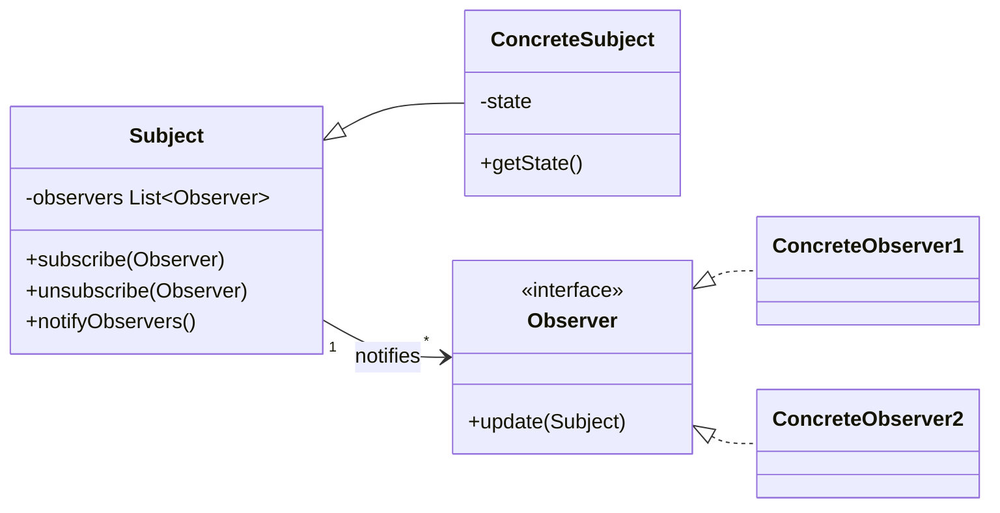
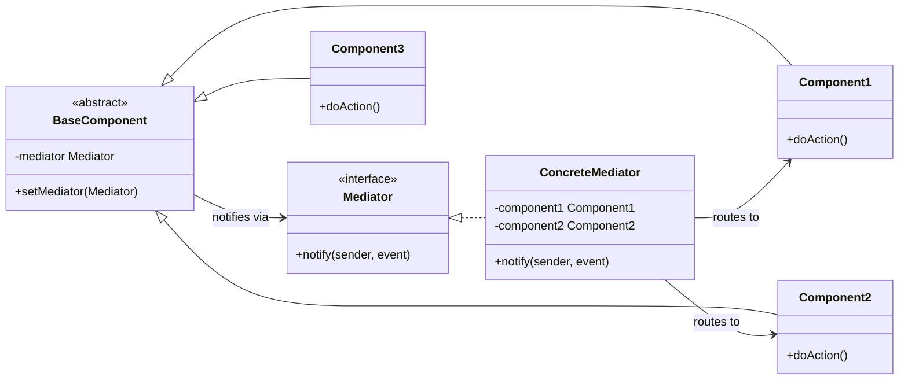
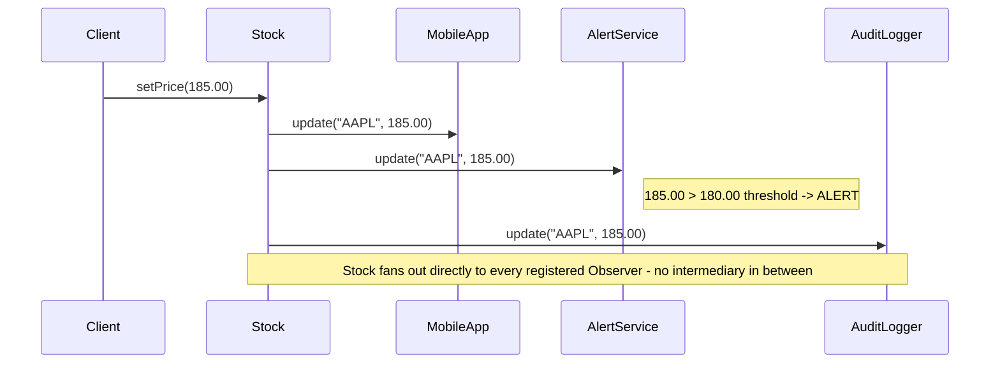
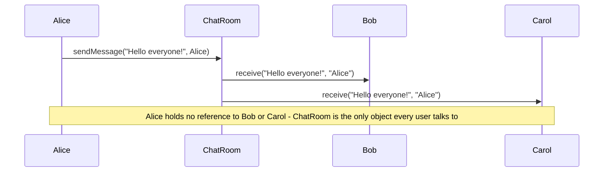

# Observer vs Mediator
## Overview

Both Observer and Mediator address communication between multiple objects. Observer creates a direct publish-subscribe relationship between objects. Mediator introduces a central hub to eliminate direct dependencies between objects.

---

## Intuition

> **One-line analogy**: Observer is a newsletter subscription (publisher sends, subscribers receive directly); Mediator is an air traffic control tower (no plane talks directly to another — all communication routes through the center).

**Mental model**: Observer allows objects to react to events in another object without tight coupling — but each observer still knows about the subject. Mediator goes further: it eliminates direct knowledge between peer objects entirely. In a chat room (Mediator), users don't send messages directly to each other; they send to the chat room, which routes to the right recipients. This prevents an O(n²) mesh of connections from forming as the number of participants grows.

**Why it matters**: Observer is simpler and the right choice for one-to-many event broadcasting. Mediator is right when many objects need to coordinate and direct references between them would create a tangled web.

**Key insight**: If observers know who they're observing, use Observer. If you want to eliminate all direct references between collaborating objects, use Mediator — at the cost of the mediator becoming a bottleneck if not designed carefully.

---

## Side-by-Side UML

Both patterns replace scattered peer-to-peer wiring with one clear point of contact, but the class shapes differ: Observer's Subject depends only on the Observer interface, while Mediator's components depend only on the Mediator interface and never see each other.

**Observer**



Subject owns the observer list, and `notifyObservers()` loops straight over it calling `update(this)` on every registered Observer — each observer is one hop from the subject.

**Mediator**



Every component's `doAction()` calls `mediator.notify(this, "event")` and knows nothing else; only ConcreteMediator holds references to the components and decides how to route between them.

---

## Key Differences Table

| Dimension | Observer | Mediator |
|-----------|----------|----------|
| **Communication topology** | One-to-many (subject to observers) | Many-to-many (all-to-all via hub) |
| **Coupling** | Observers know the Subject interface | Components only know the Mediator interface |
| **Central coordinator** | None — subject notifies directly | Yes — Mediator contains all routing logic |
| **Who knows what** | Observers depend on Subject for data | Components are fully decoupled from each other |
| **Event routing** | Fixed — subject notifies all subscribers | Dynamic — mediator routes based on sender/event |
| **Complexity growth** | Linear — add more observers | Mediator can become god object if complex |
| **Direction** | Primarily one-way: Subject -> Observers | Bidirectional: any component can trigger anything |
| **Typical scale** | Many independent listeners | Many interdependent components |

---

## Common Confusion Points

1. **Both handle events, but the topology differs**: Observer is a star from the subject outward. Mediator is a hub where all spokes connect to the center, and nothing connects directly to another spoke.
2. **Mediator can use Observer internally**: A common implementation has components fire events that the mediator subscribes to.
3. **Observer can lead to update storms**: Observers can themselves be subjects, causing cascading updates. Mediator avoids this by centralizing all logic.
4. **Mediator can become a God Object**: If the mediator knows too much about components' internals, it becomes a maintenance burden. Keep components responsible for their own state.
5. **Event bus vs Observer**: A global event bus is a special case of Mediator, not Observer — it decouples publishers from subscribers completely.

---

## When to Use Which

### Use Observer when:
- One object's state change should trigger updates in multiple independent objects
- The subject doesn't need to know who or how many observers it has
- You want a clean event-driven architecture where listeners are added/removed freely
- Typical: UI event listeners, data binding, event sourcing

### Use Mediator when:
- A set of objects communicate in complex, many-to-many ways that are hard to follow
- Reusing an object is difficult because it refers to many others
- You want to customize behavior distributed across several classes without lots of subclassing
- Typical: Chat rooms (users don't message each other directly), air traffic control, UI dialog coordination

---

## Code Examples

### Observer — Stock price notifications

```java
import java.util.ArrayList;
import java.util.List;

// Subject interface
interface StockSubject {
    void addObserver(StockObserver o);
    void removeObserver(StockObserver o);
    void notifyObservers();
}

// Observer interface
interface StockObserver {
    void update(String stockSymbol, double price);
}

// Concrete Subject
class Stock implements StockSubject {
    private final String symbol;
    private double price;
    private final List<StockObserver> observers = new ArrayList<>();

    public Stock(String symbol, double price) {
        this.symbol = symbol;
        this.price  = price;
    }

    @Override
    public void addObserver(StockObserver o)    { observers.add(o); }

    @Override
    public void removeObserver(StockObserver o) { observers.remove(o); }

    @Override
    public void notifyObservers() {
        for (StockObserver o : observers) {
            o.update(symbol, price);
        }
    }

    public void setPrice(double newPrice) {
        this.price = newPrice;
        notifyObservers();  // push notification on change
    }
}

// Concrete Observers — independent, don't know about each other
class MobileApp implements StockObserver {
    private final String userId;

    public MobileApp(String userId) { this.userId = userId; }

    @Override
    public void update(String symbol, double price) {
        System.out.println("[Mobile:" + userId + "] " + symbol + " = $" + price);
    }
}

class AlertService implements StockObserver {
    private final double threshold;

    public AlertService(double threshold) { this.threshold = threshold; }

    @Override
    public void update(String symbol, double price) {
        if (price > threshold) {
            System.out.println("[ALERT] " + symbol + " exceeded threshold! $" + price);
        }
    }
}

class AuditLogger implements StockObserver {
    @Override
    public void update(String symbol, double price) {
        System.out.println("[AUDIT] " + symbol + " price changed to $" + price);
    }
}

// Usage
Stock apple = new Stock("AAPL", 150.00);
apple.addObserver(new MobileApp("user_123"));
apple.addObserver(new MobileApp("user_456"));
apple.addObserver(new AlertService(180.00));
apple.addObserver(new AuditLogger());

apple.setPrice(175.00);
// [Mobile:user_123] AAPL = $175.0
// [Mobile:user_456] AAPL = $175.0
// [AUDIT] AAPL price changed to $175.0

apple.setPrice(185.00);
// [Mobile:user_123] AAPL = $185.0
// [Mobile:user_456] AAPL = $185.0
// [ALERT] AAPL exceeded threshold! $185.0
// [AUDIT] AAPL price changed to $185.0
```



Stock (the Subject) walks its observer list inside `notifyObservers()` and pushes `update()` straight to MobileApp, AlertService, and AuditLogger — each is one hop from the subject, the direct star topology from the Key Differences Table above.

---

### Mediator — Chat room (users don't message each other directly)

```java
// Mediator interface
interface ChatMediator {
    void sendMessage(String message, User sender);
    void addUser(User user);
}

// Abstract colleague
abstract class User {
    protected final ChatMediator mediator;
    protected final String name;

    public User(ChatMediator mediator, String name) {
        this.mediator = mediator;
        this.name     = name;
    }

    public String getName() { return name; }

    public abstract void send(String message);
    public abstract void receive(String message, String from);
}

// Concrete Mediator — contains all routing logic
class ChatRoom implements ChatMediator {
    private final List<User> users = new ArrayList<>();

    @Override
    public void addUser(User user) { users.add(user); }

    @Override
    public void sendMessage(String message, User sender) {
        // Route to all users except the sender
        for (User user : users) {
            if (!user.equals(sender)) {
                user.receive(message, sender.getName());
            }
        }
    }
}

// Concrete Colleagues — only know about the mediator
class ChatUser extends User {
    public ChatUser(ChatMediator mediator, String name) {
        super(mediator, name);
        mediator.addUser(this);
    }

    @Override
    public void send(String message) {
        System.out.println(name + " sends: " + message);
        mediator.sendMessage(message, this);
    }

    @Override
    public void receive(String message, String from) {
        System.out.println(name + " received from " + from + ": " + message);
    }
}

// Usage — users don't have direct references to each other
ChatMediator room = new ChatRoom();
User alice = new ChatUser(room, "Alice");
User bob   = new ChatUser(room, "Bob");
User carol = new ChatUser(room, "Carol");

alice.send("Hello everyone!");
// Alice sends: Hello everyone!
// Bob received from Alice: Hello everyone!
// Carol received from Alice: Hello everyone!

bob.send("Hey Alice!");
// Bob sends: Hey Alice!
// Alice received from Bob: Hey Alice!
// Carol received from Bob: Hey Alice!
```



Alice never calls Bob or Carol directly; every message passes through ChatRoom (the Mediator), which is what keeps adding a fourth user a one-line change instead of the N*(N-1) direct-connection mesh described above.

---

### Mediator — UI Dialog coordination

```java
// Dialog acts as mediator between UI components
interface DialogMediator {
    void componentChanged(String componentId);
}

class LoginDialog implements DialogMediator {
    private TextField usernameField;
    private TextField passwordField;
    private CheckBox rememberMe;
    private Button   loginButton;

    public void setComponents(TextField username, TextField password,
                               CheckBox remember, Button login) {
        this.usernameField = username;
        this.passwordField = password;
        this.rememberMe    = remember;
        this.loginButton   = login;
    }

    @Override
    public void componentChanged(String componentId) {
        // Centralized logic: login button only enabled when both fields have text
        if (componentId.equals("username") || componentId.equals("password")) {
            loginButton.setEnabled(
                !usernameField.getText().isEmpty() &&
                !passwordField.getText().isEmpty()
            );
        }
        if (componentId.equals("rememberMe")) {
            // Adjust session timeout based on checkbox state
            System.out.println("Remember me: " + rememberMe.isChecked());
        }
    }
}

// Simplified UI components that notify mediator on change
class TextField {
    private final DialogMediator mediator;
    private final String id;
    private String text = "";

    public TextField(DialogMediator mediator, String id) {
        this.mediator = mediator;
        this.id       = id;
    }

    public void setText(String text) {
        this.text = text;
        mediator.componentChanged(id);   // notify mediator, not other components
    }

    public String getText() { return text; }
}

class CheckBox {
    private final DialogMediator mediator;
    private final String id;
    private boolean checked = false;

    public CheckBox(DialogMediator mediator, String id) {
        this.mediator = mediator;
        this.id       = id;
    }

    public void setChecked(boolean checked) {
        this.checked = checked;
        mediator.componentChanged(id);
    }

    public boolean isChecked() { return checked; }
}

class Button {
    private boolean enabled = false;

    public void setEnabled(boolean enabled) {
        this.enabled = enabled;
        System.out.println("Login button enabled: " + enabled);
    }
}
```

---

## Interview Questions with Answers

**Q: When would you use Mediator over Observer?**
**Short:** Use Observer for one-to-many broadcast and Mediator for many-to-many coordination that would otherwise need direct connections.

> Observer works well for one-to-many relationships where one subject pushes updates to independent subscribers. Mediator works well for many-to-many relationships where multiple objects need to coordinate with each other, and you want to prevent the N*(N-1) direct connections that would otherwise form.
>
> The diagnostic question: "How many objects need to communicate with how many?" If it's one object broadcasting to many listeners, use Observer. If it's many objects that need to react to each other in complex ways, use Mediator to put all the routing logic in one place.
>
> A chat room is the classic example: if users had direct references to each other, adding one user would require updating all others. The mediator (chat room) absorbs all that complexity.

**Q: Why does the Key Differences table describe Observer's communication topology as "one-to-many" but Mediator's as "many-to-many"?**
**Short:** One Subject notifies many Observers in Observer; in Mediator, any of many components can trigger any other through the hub.

`Subject.notifyObservers()` loops over its own observer list and pushes updates outward — the direction and the source are fixed, always from the one subject to its many listeners. `ConcreteMediator.notify(sender, event)` instead accepts calls FROM any component and can route TO any other component, meaning both source and destination vary per call — that's the "many-to-many" shape. This is why Observer fits a single event source with multiple reactors, while Mediator fits a set of peers that all need to potentially trigger each other.

**Q: How does BaseComponent's dependency on Mediator differ from ConcreteObserver's dependency on Subject?**
**Short:** BaseComponent depends only on the Mediator interface and knows nothing about siblings; ConcreteObserver depends on Subject for its data.

`BaseComponent` holds a `mediator` field and calls `mediator.notify(this, "event")` — it has zero knowledge of `Component2` or `Component3`, and the Mediator interface is its ONLY external dependency. `ConcreteObserver1`/`ConcreteObserver2` implement `update(Subject)`, which typically means calling back into the Subject to read its current state — so observers still depend on the Subject's interface for the data they react to, even though they don't know about each other. This is the "Coupling" row difference: Mediator achieves fuller decoupling than Observer does.

**Q: Why is "Mediator can use Observer internally" not a contradiction between the two patterns?**
**Short:** A common Mediator implementation has each component fire events the Mediator itself subscribes to, nesting Observer inside Mediator.

Components under a Mediator often still use an Observer-style callback to notify the Mediator that something happened — `BaseComponent`'s `doAction()` firing an event that `ConcreteMediator` listens for. The key is that this Observer relationship exists only between each component and the CENTRAL Mediator, never directly between two components — so the overall topology is still Mediator's hub-and-spoke shape, just implemented with Observer-style callbacks as the plumbing between each spoke and the hub.

**Q: What specifically causes an "update storm" in Observer-based systems, and why does Mediator avoid it structurally?**
**Short:** Observers that are themselves subjects can cascade notifications; Mediator avoids this by centralizing all routing logic in one place.

If `ConcreteObserver1` reacts to an update by mutating its own state and is itself observed by other objects, that mutation triggers another wave of notifications, which can cascade unpredictably through a chain of subject/observer relationships with no central point controlling the fan-out. Mediator sidesteps this by design — because every interaction routes through `ConcreteMediator.notify()`, the mediator can see and control the entire chain of consequences from one place, rather than the cascade being an emergent property of many independently-wired subject/observer pairs.

**Q: Why does a poorly designed Mediator risk becoming a "God Object," and what's the corrective principle?**
**Short:** A Mediator that absorbs too much component-internal knowledge and business logic violates SRP and becomes a maintenance bottleneck.

If `ConcreteMediator.notify()` starts making decisions based on deep internal knowledge of each component's state — rather than just routing "component X did Y" to the components that care — the Mediator accumulates responsibilities that rightfully belong to the individual components, and every change to any component's behavior risks touching the shared Mediator class. The corrective principle from the Common Confusion Points is to keep components responsible for their own state and keep the Mediator's job strictly to coordination — knowing WHO to notify, not WHAT the notified components should do internally.

**Q: How does a global event bus relate to Mediator rather than Observer, according to this file?**
**Short:** An event bus is described as a special case of Mediator, since it fully decouples publishers from subscribers through a central router.

The Common Confusion Points state directly: "A global event bus is a special case of Mediator, not Observer — it decouples publishers from subscribers completely." A plain Observer still has the Subject holding a direct reference to its observer list, so the subject knows exactly who's listening. An event bus goes further: publishers and subscribers never reference each other at all, only the bus itself — matching Mediator's promise that components "only know the Mediator interface" rather than any structural coupling to their eventual notification targets.

**Q: Why does the file cite Kafka as an example of Observer rather than Mediator, given it also decouples producers from consumers?**
**Short:** Kafka's producer/consumer model is a direct push-subscribe relationship without a central component actively routing between peers.

The Real-World Mapping table lists Kafka as Observer because producers push messages to a topic and consumers subscribe to receive them — a straightforward one-to-many broadcast pattern, structurally closer to `Subject.notifyObservers()` than to a Mediator actively deciding which peer talks to which. This is a nuanced boundary case worth noting: decoupling publishers from subscribers alone doesn't make something Mediator — what matters is whether there's an active hub making routing DECISIONS (Mediator) versus a straightforward broadcast channel (Observer).

**Q: What does the note "setState() may be called by the active State itself" in an unrelated pattern have in common with Mediator's dashed "notifies via" edge?**
**Short:** Both diagrams show a participant that can trigger side effects back through the coordinating object it was called by, not just downward.

Similar to how a State object can call back into its Context to trigger a transition, `BaseComponent --> Mediator : notifies via` shows components initiating calls back INTO the coordinator, not just receiving calls FROM it. In Mediator, this bidirectionality is the whole point — `Component1.doAction()` triggers `mediator.notify()`, which the mediator may use to trigger `Component2`'s behavior in response, making the mediator both a receiver and a dispatcher, never a one-way broadcaster like a plain `Subject`.

**Q: Why is UI dialog coordination (checkbox enabling a button) a canonical Mediator use case rather than Observer?**
**Short:** Multiple UI widgets need to react to and trigger each other's state, which is many-to-many coordination, not one subject broadcasting.

If checking a checkbox should enable a text field, and typing in that text field should enable a submit button, a plain Observer wiring would require each widget to directly reference and update the next one — checkbox knows about text field, text field knows about button — creating exactly the tangled peer-to-peer mesh Mediator exists to eliminate. A `DialogMediator` instead lets each widget notify the mediator of its own state change, and the mediator alone decides how that ripples through the rest of the dialog's widgets, with no widget referencing another directly.

**Q: How would you refactor an Observer-heavy system that has quietly become an "Event Spaghetti" anti-pattern?**
**Short:** Consolidate the tangled publish/subscribe relationships behind a single Mediator that owns all the routing logic explicitly.

If tracing what happens after one event has become difficult because dozens of objects both publish and subscribe to each other with no central visibility, introducing a Mediator that all those objects report to — rather than reporting to each other — recovers a single place where the full routing logic can be read and reasoned about. This trades Observer's minimal coupling for Mediator's centralized (but explicit) coordination, which is the right tradeoff once the "who reacts to what" question can no longer be answered by reading any single class.

**Q: Why does the Key Differences table describe Mediator's complexity growth as risking a "god object" while Observer's is merely "linear"?**
**Short:** Adding observers scales linearly with no shared bottleneck; adding components to a Mediator concentrates all new routing logic in one class.

Adding a new `ConcreteObserver` to a `Subject` costs exactly one new class implementing `update()`, with no change required to the Subject or any existing observer — genuinely linear growth. Adding a new component to a Mediator-coordinated system, by contrast, usually means the `ConcreteMediator.notify()` method itself grows a new branch or case to handle routing involving the new component, so the mediator's own complexity compounds with every addition — which is exactly how a Mediator can slide into becoming a God Object if left unchecked.

**Q: In what sense is Observer described as "primarily one-way" while Mediator is "bidirectional"?**
**Short:** A Subject pushes updates outward to Observers, who rarely push state back to change the Subject; Mediator routes freely in both directions.

`Subject.notifyObservers()` establishes a fixed direction: state flows from the subject outward to each observer's `update()` call, and observers typically only read from the subject, rarely writing back to trigger new subject behavior. In Mediator, `Component1.doAction()` can trigger `mediator.notify()`, which can then trigger `Component2.doAction()`, which can trigger further mediator calls — any component can be both the initiator and the target of coordination, with no fixed "publisher" role the way Observer's Subject has.

**Q: Why would you choose Observer over Mediator even when Mediator's decoupling seems strictly better on paper?**
**Short:** Observer is simpler when relationships are genuinely one-directional; Mediator's central hub is unnecessary overhead for that case.

If the real relationship is "many independent listeners react to one thing changing" — no listener ever needs to trigger another listener or influence the source back — introducing a Mediator adds an unneeded indirection layer and a new class that owns routing logic nobody needs, since there was never any peer-to-peer coordination to eliminate in the first place. Observer's simplicity (a list plus a notify loop) is the better fit whenever the topology is genuinely one-to-many and stays that way, which is most UI event-listener and simple pub/sub scenarios.

**Q: What real risk does "reducing coupling between clients and subsystem internals" via Mediator share with Facade, and how do the two differ?**
**Short:** Both centralize access to reduce direct coupling, but Facade simplifies a subsystem's INTERFACE while Mediator coordinates PEER interactions.

Facade provides one simplified entry point over several subsystem objects that remain independently usable and don't communicate with each other through the Facade. Mediator's components actively communicate WITH EACH OTHER through the mediator — the mediator's job is coordinating interaction, not just simplifying access to independent services. The `pattern_comparisons.md` master file notes this resemblance directly: "Mediator resembles a bi-directional Facade," bidirectional being the key qualifier that distinguishes active coordination from passive simplification.

---

## Real-World Mapping

| System | Pattern | Why |
|--------|---------|-----|
| Event bus (Spring `ApplicationEventPublisher`) | Mediator-like | Fully decouples publishers and subscribers |
| UI data binding | Observer | View observes ViewModel state |
| React useState + useEffect | Observer | Component re-renders when state changes |
| Air traffic control | Mediator | Planes don't communicate directly |
| Kafka topic | Observer | Producers push, consumers subscribe |
| MVC Controller | Mediator | Coordinates View and Model interactions |
