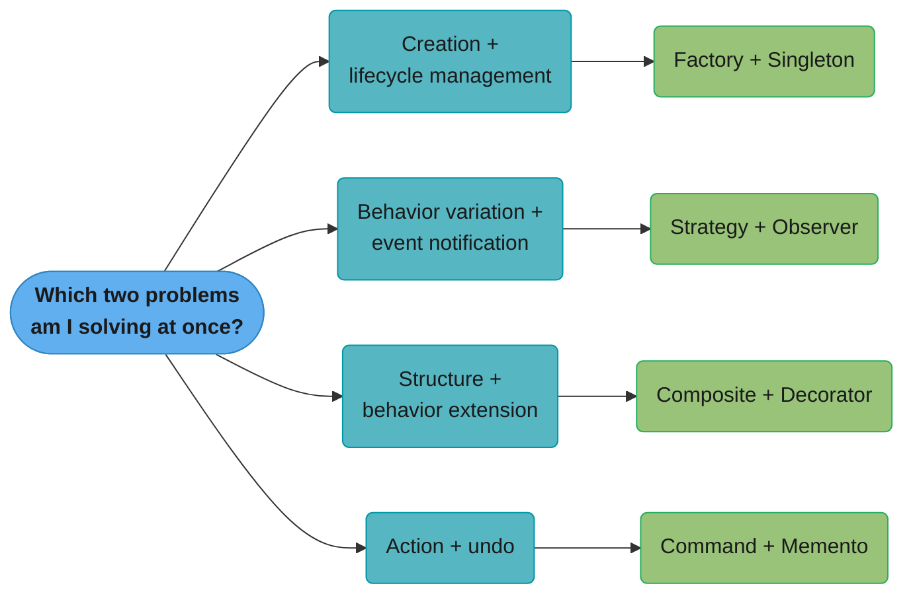
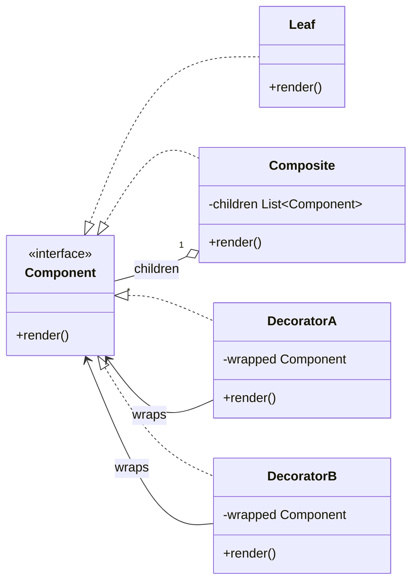
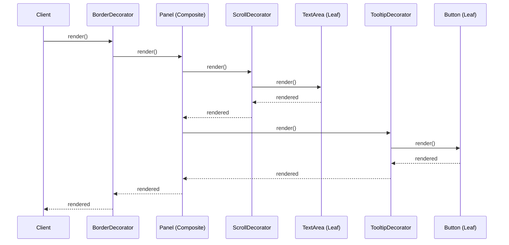

# Pattern Combinations Guide
Design patterns rarely appear in isolation. Real systems use them together — some combinations are so common they're practically standard idioms. This guide documents the most powerful pattern pairs, how they interact, and warns about combinations that cause problems.

---

## Intuition

> **One-line analogy**: Pattern combinations are like chord progressions in music — individual notes (patterns) are useful, but the real craft is knowing which ones harmonize and which ones clash.

**Mental model**: Real systems solve multiple problems simultaneously: create objects (Factory), ensure one instance (Singleton), react to changes (Observer), vary behavior (Strategy). The combinations are not accidental — they emerge naturally from design requirements. Factory + Singleton ensures one factory manages all objects. Strategy + Observer lets behavior changes trigger notifications. Command + Memento gives you a full undo/redo stack.

**Why it matters**: Knowing individual patterns is necessary but not sufficient. Understanding which patterns naturally combine — and why — separates engineers who can design from engineers who can only implement.

**Key insight**: Problematic combinations (Singleton + Strategy, deep Decorator chains) arise when one pattern's characteristic (global state, wrapping depth) conflicts with another's requirements. Learn the warning signs alongside the winning combinations.

---

## Why Patterns Combine

Each pattern solves one specific problem. Real systems have multiple problems:
- **Creation** + **lifecycle management** → Factory + Singleton
- **Behavior variation** + **event notification** → Strategy + Observer
- **Structure** + **behavior extension** → Composite + Decorator
- **Action** + **undo** → Command + Memento



*Each branch pairs two simultaneous concerns with the combination that resolves both at once — these four pairings recur constantly in production code, and each gets its own worked example below.*

---

## Classic Combinations

### 1. Factory + Singleton
**How they combine**: A Singleton factory creates and manages object instances.

**Use case**: Spring IoC container, JDBC `DriverManager`, logging frameworks

```java
// The factory itself is a Singleton
public class ConnectionFactory {
    private static final ConnectionFactory INSTANCE = new ConnectionFactory();
    private ConnectionFactory() {}
    public static ConnectionFactory getInstance() { return INSTANCE; }

    // Factory creates the right implementation
    public DatabaseConnection create(DatabaseType type) {
        return switch (type) {
            case MYSQL    -> new MySQLConnection(config);
            case POSTGRES -> new PostgresConnection(config);
        };
    }
}
// Usage:
DatabaseConnection conn = ConnectionFactory.getInstance().create(DatabaseType.MYSQL);
```

**Why they work together**: Factory handles object creation logic; Singleton ensures one consistent factory.

---

### 2. Observer + Strategy
**How they combine**: Events from Observer trigger different algorithms via Strategy.

**Use case**: Event-driven pricing, rule engines, UI event handlers with pluggable behavior

```java
interface PriceChangeListener {
    void onPriceChange(Stock stock, double newPrice);
}

class AlertTrigger implements PriceChangeListener {
    private final AlertStrategy alertStrategy; // Strategy

    public AlertTrigger(AlertStrategy strategy) { this.alertStrategy = strategy; }

    @Override
    public void onPriceChange(Stock stock, double newPrice) {
        // Strategy decides HOW to alert
        alertStrategy.sendAlert(stock, newPrice);
    }
}

// Registering:
stockMarket.addListener(new AlertTrigger(new EmailAlertStrategy()));
stockMarket.addListener(new AlertTrigger(new SMSAlertStrategy()));
```

**Why they work together**: Observer decouples event source from handlers; Strategy decouples the algorithm from the handler.

---

### 3. Decorator + Composite
**How they combine**: Decorators add behavior to individual components; Composite organizes them into trees. Both share the same Component interface.

**Use case**: UI component trees (Java Swing, HTML DOM), middleware pipelines



*Leaf and Composite both realize `Component`, so a caller never needs to know which one it holds; Composite aggregates any number of `Component` children while `DecoratorA`/`DecoratorB` each wrap a single `Component` instance — the shared interface is what lets trees and wrappers nest inside each other freely.*

```java
// A tree of components, each individually decorated
Component root = new BorderDecorator(
    new Panel(List.of(
        new ScrollDecorator(new TextArea("content")),
        new TooltipDecorator(new Button("Submit"))
    ))
);
root.render();
```



*A single `root.render()` call cascades through the decorator (`BorderDecorator` forwards to its wrapped `Panel`), then fans out across the composite's children — two of which are themselves decorated (`ScrollDecorator`, `TooltipDecorator`) — before the results bubble back up the same chain.*

**Why they work together**: Both use the same Component interface. You can decorate leaves, composites, or even other decorators.

---

### 4. Command + Memento
**How they combine**: Command executes the action; Memento captures state before execution, enabling undo.

**Use case**: Text editors, Photoshop history, git commits, database transactions

```java
class TextEditor {
    private StringBuilder text = new StringBuilder();
    private final Deque<Memento> history = new ArrayDeque<>();

    public void executeCommand(Command cmd) {
        history.push(new Memento(text.toString())); // save state BEFORE
        cmd.execute(this);                           // apply change
    }

    public void undo() {
        if (!history.isEmpty()) {
            Memento prev = history.pop();
            text = new StringBuilder(prev.getState()); // restore
        }
    }

    public StringBuilder getText() { return text; }
}

class TypeCommand implements Command {
    private final String text;
    TypeCommand(String text) { this.text = text; }

    @Override
    public void execute(TextEditor editor) {
        editor.getText().append(text);
    }
}
```

**Why they work together**: Command is about *what action*; Memento is about *state before the action*. They're complementary — one for action, one for rollback.

---

### 5. Command + Chain of Responsibility
**How they combine**: CoR determines which handler should process a request; Command encapsulates the request for execution.

**Use case**: Middleware pipelines, servlet filters, authorization + action execution

```java
// Chain determines if/how to handle; Command is the payload
interface Handler {
    boolean handle(Command cmd);
}

class AuthHandler implements Handler {
    private Handler next;

    @Override
    public boolean handle(Command cmd) {
        if (!isAuthenticated()) return false;       // reject
        return next == null || next.handle(cmd);    // pass forward
    }
}

class RateLimitHandler implements Handler { /* same shape as AuthHandler */ }
class LoggingHandler   implements Handler { /* same shape as AuthHandler */ }

class ExecutionHandler implements Handler {
    @Override
    public boolean handle(Command cmd) {
        cmd.execute();  // finally execute the Command
        return true;
    }
}
```

**Why they work together**: CoR for routing/filtering; Command for encapsulating the work.

---

### 6. Factory + Strategy
**How they combine**: Factory creates the right Strategy based on configuration or context.

**Use case**: Payment processors, compression algorithms, authentication methods

```java
class PaymentStrategyFactory {
    public static PaymentStrategy create(String method) {
        return switch (method) {
            case "CREDIT_CARD" -> new CreditCardStrategy();
            case "PAYPAL"      -> new PayPalStrategy();
            case "CRYPTO"      -> new CryptoStrategy();
            default -> throw new IllegalArgumentException("Unknown method: " + method);
        };
    }
}

// Clean usage:
PaymentStrategy strategy = PaymentStrategyFactory.create(user.getPreferredPayment());
order.checkout(strategy);
```

**Why they work together**: Factory hides the Strategy selection logic; client just uses the Strategy.

---

### 7. Builder + Factory
**How they combine**: Factory decides which Builder to use; Builder handles complex construction.

**Use case**: Document generation (PDF vs Word vs HTML), vehicle assembly

```java
interface DocumentBuilder {
    DocumentBuilder setTitle(String t);
    DocumentBuilder addSection(String content);
    Document build();
}

class DocumentFactory {
    public static DocumentBuilder createBuilder(DocumentType type) {
        return switch (type) {
            case PDF  -> new PDFDocumentBuilder();
            case WORD -> new WordDocumentBuilder();
            case HTML -> new HTMLDocumentBuilder();
        };
    }
}

// Usage:
Document doc = DocumentFactory.createBuilder(DocumentType.PDF)
    .setTitle("Annual Report")
    .addSection("Executive Summary")
    .build();
```

---

### 8. State + Command
**How they combine**: Current State determines which Commands are valid. Commands trigger State transitions.

**Use case**: ATM, vending machine, workflow engines

```java
interface ATMState {
    void process(Command cmd); // State validates and executes Commands
}

class PINVerifiedState implements ATMState {
    @Override
    public void process(Command cmd) {
        if (cmd instanceof WithdrawalCommand || cmd instanceof BalanceCommand) {
            cmd.execute();
        } else {
            throw new InvalidOperationException("Not valid in this state");
        }
    }
}
```

**Why they work together**: State provides context validation; Command provides the action to execute.

---

### 9. Proxy + Observer
**How they combine**: Proxy intercepts method calls and fires Observer notifications as a side effect.

**Use case**: Audit logging, metrics collection, reactive programming (Spring Data JPA, Hibernate)

```java
class AuditingProxy<T> implements InvocationHandler {
    private final T target;
    private final List<AuditObserver> observers;

    AuditingProxy(T target, List<AuditObserver> observers) {
        this.target    = target;
        this.observers = observers;
    }

    @Override
    public Object invoke(Object proxy, Method method, Object[] args) throws Throwable {
        long start = System.currentTimeMillis();
        Object result = method.invoke(target, args);
        long elapsed = System.currentTimeMillis() - start;

        // Notify observers without changing target
        AuditEvent event = new AuditEvent(method.getName(), args, elapsed);
        observers.forEach(o -> o.onEvent(event));

        return result;
    }
}
```

**Why they work together**: Proxy is transparent to clients; Observer is transparent to the target. Neither the client nor the target needs to know about auditing.

---

### 10. Prototype + Factory
**How they combine**: Factory uses cloning (Prototype) instead of `new` to create objects.

**Use case**: Game enemies, document templates, configuration presets

```java
class EnemyFactory {
    private final Map<String, Enemy> prototypes = new HashMap<>();

    public void registerPrototype(String type, Enemy enemy) {
        prototypes.put(type, enemy);
    }

    public Enemy create(String type) {
        Enemy prototype = prototypes.get(type);
        return prototype.clone(); // Prototype pattern
    }
}

// Register once:
factory.registerPrototype("GOBLIN", new Goblin(50, 10, Speed.FAST));   // health, damage, speed
factory.registerPrototype("TROLL",  new Troll(200, 40, Speed.SLOW));

// Create many — no expensive re-initialization:
for (int i = 0; i < 100; i++) {
    Enemy e = factory.create("GOBLIN"); // fast clone
    level.spawn(e);
}
```

---

## Real-World System Pattern Maps

### Spring Framework
```
ApplicationContext (Bean Factory)    → Factory Method + Singleton
AOP (aspect weaving)                 → Proxy
JdbcTemplate                         → Template Method
ApplicationEventPublisher            → Observer
@Autowired constructor injection     → Dependency Injection (enabled by Strategy + Factory)
```

### Java I/O
```
InputStream/OutputStream hierarchy   → Decorator
InputStreamReader                    → Adapter
Scanner                              → Iterator
BufferedReader(new FileReader(...))  → Decorator wrapping Adapter
```

### Android Framework
```
AlertDialog.Builder          → Builder
LiveData / RxJava            → Observer
Intent/Handler               → Command
RecyclerView.Adapter         → Adapter
Fragment                     → Composite (contains views)
```

---

## Anti-Combinations (Patterns That Clash)

### Singleton + Dependency Injection
Singletons are hard to mock, hard to replace, and couple code to a concrete class. DI frameworks (Spring, Guice) provide managed singletons that ARE injectable and mockable. Avoid hand-rolled Singletons when using a DI framework.

### Decorator vs Deep Inheritance
Don't use inheritance hierarchies when Decorator would work. `BorderedScrollableResizablePanel extends ScrollablePanel extends BorderedPanel extends Panel` → use Decorator instead.

### Observer Everywhere (Event Spaghetti)
Overusing Observer creates invisible coupling. When everything publishes and subscribes to events, tracing execution flow becomes nearly impossible. Use direct method calls when the relationship is clear and stable; use Observer for genuinely loose coupling across module boundaries.

### Factory + Abstract Factory + Builder Together
Mixing all creation patterns for one object adds confusion. Pick the simplest that solves the problem: Builder if it has many optional fields; Factory if you need polymorphism; Abstract Factory only if you need whole families of related objects.

---

## Pattern Combinations Matrix

|   | Singleton | Factory | Builder | Prototype | Observer | Strategy | Command | State | Decorator | Proxy |
|---|:---------:|:-------:|:-------:|:---------:|:--------:|:--------:|:-------:|:-----:|:---------:|:-----:|
| **Singleton** | — | ✓✓ | | | | | | | | |
| **Factory** | ✓✓ | — | ✓✓ | ✓✓ | | ✓✓ | | | | |
| **Observer** | | | | | — | ✓✓ | ✓✓ | | | ✓✓ |
| **Strategy** | | ✓✓ | | | ✓✓ | — | ✓ | ✓ | | |
| **Command** | | | | | ✓✓ | ✓ | — | ✓✓ | | |
| **State** | | | | | | ✓ | ✓✓ | — | | |
| **Decorator** | | | | | | | | | — | |
| **Composite** | | | | | | | | | ✓✓ | |

✓✓ = very common combination | ✓ = occasional combination

---

## Interview Questions with Answers

**Q: Why is "Singleton + Dependency Injection" listed as an anti-combination rather than a normal pairing?**
**Short:** Hand-rolled Singletons are hard to mock and replace, while a DI container's managed singleton scope is both injectable and mockable.

Hand-rolled Singletons (a private constructor plus a static `getInstance()`) couple every caller directly to one concrete class, which makes substituting a test double or a per-tenant instance nearly impossible without reworking the class itself. DI frameworks like Spring or Guice already provide managed singleton scope that gives you the same "one instance" guarantee while remaining fully injectable and mockable in tests. The guidance is explicit: avoid hand-rolled Singletons entirely once a DI framework is in play, letting the container own the lifecycle instead.

**Q: How does BorderedScrollableResizablePanel illustrate the "Decorator vs Deep Inheritance" anti-combination?**
**Short:** Stacking each optional feature as another subclass in a hierarchy produces a rigid class explosion Decorator avoids.

`BorderedScrollableResizablePanel extends ScrollablePanel extends BorderedPanel extends Panel` bakes every combination of border, scroll, and resize behavior into a fixed, single inheritance chain — adding a fourth optional feature means deciding where in that chain it slots, and every combination needs its own named subclass. Decorator replaces this with composable wrapper objects — `new ResizeDecorator(new ScrollDecorator(new BorderDecorator(panel)))` — that can be combined in any order at runtime without a single new subclass. This is the textbook justification for choosing Decorator over deep inheritance whenever features need to combine.

**Q: What specifically goes wrong in "Observer Everywhere / Event Spaghetti," and what's the corrective rule?**
**Short:** Overusing Observer creates invisible coupling that makes tracing execution flow through the system nearly impossible.

When every component publishes and every other component subscribes, following what happens after a single state change means chasing an unbounded, implicit web of listener callbacks rather than a readable call stack — the coupling still exists, it's just hidden behind the pub/sub mechanism instead of a direct reference. The corrective rule given is to use direct method calls when the relationship between two components is clear and stable, and reserve Observer specifically for genuinely loose coupling across module boundaries, not as a default communication style.

**Q: Why does Command + Memento work well together for undo/redo, and what does each pattern specifically own?**
**Short:** Command owns WHAT action happened; Memento owns the STATE snapshot needed to reverse it — complementary, not overlapping.

In the `TextEditor` example, `executeCommand()` pushes a `Memento` capturing the text's state BEFORE the command runs, then applies the command's change — `undo()` simply pops the most recent Memento and restores that snapshot directly, without needing the Command to implement its own reverse logic. This split matters when an operation's reverse isn't cleanly algorithmic (e.g., "delete random substring" has no obvious inverse operation) — Memento supplies a state-based fallback that Command's own `undo()` method might not be able to compute.

**Q: How does the Proxy + Observer combination stay transparent to both the client and the target object?**
**Short:** The client only sees the Subject interface, and the target has no idea observers exist — the proxy silently bridges both.

`AuditingProxy` implements `InvocationHandler` and wraps a target object; when the client calls a method through the proxy, it measures elapsed time, invokes the real method, and then notifies registered `AuditObserver`s with the resulting event — all without the client needing to know auditing is happening, and without the target class containing a single line of observer-related code. Neither party needs to know about the other's role, which is exactly why the combination is cited for audit logging, metrics collection, and reactive frameworks like Hibernate/Spring Data JPA.

**Q: Why does Prototype + Factory outperform plain object construction for something like a game's enemy spawning system?**
**Short:** Cloning a pre-configured prototype avoids repeating expensive initialization for every new enemy instance.

`EnemyFactory.registerPrototype("GOBLIN", new Goblin(50, 10, Speed.FAST))` is set up once; every subsequent `factory.create("GOBLIN")` call clones that prototype rather than re-running whatever expensive setup (asset loading, stat computation) originally constructed it. This matters at scale — spawning 100 goblins via `new Goblin(...)` 100 times repeats all that initialization, while cloning a single pre-built prototype 100 times is comparatively cheap. The Factory in this combination hides the cloning mechanism behind a familiar `create(type)` call, so client code looks identical to a plain factory.

**Q: In the Spring Framework pattern map, why is ApplicationContext described as "Factory Method + Singleton" rather than just Factory Method?**
**Short:** The container both creates beans (Factory Method) and, by default, ensures each bean has exactly one instance (Singleton scope).

`ApplicationContext` (backed by a Bean Factory) is responsible for instantiating beans on request — the Factory Method half — but Spring's default bean scope is singleton, meaning the container also guarantees that a `getBean()` call for a given bean name returns the same instance every time, which is the Singleton half. Neither pattern alone fully describes the behavior: dropping "Singleton" would miss that repeated lookups return the same object, and dropping "Factory Method" would miss that the container decides how to construct beans in the first place.

**Q: Per the Spring pattern map, why is AOP aspect weaving classified as Proxy rather than Decorator?**
**Short:** AOP intercepts and controls method invocation transparently, matching Proxy's intent, not Decorator's behavior-adding intent.

Spring AOP generates a proxy object around a bean and intercepts every method call to apply advice (transactions, security checks, logging) before or after the real method runs — the client calls the bean as normal and is unaware a proxy sits in between, which is Proxy's defining transparency. It isn't classified as Decorator because the intent is controlling and intercepting invocation (often without changing what the method fundamentally does), not layering new, client-visible behavior the way stacking I/O decorators does.

**Q: Why does the Java I/O pattern map list BufferedReader(new FileReader(...)) as "Decorator wrapping Adapter" rather than two Decorators?**
**Short:** FileReader itself adapts a byte-based InputStream into a character-based Reader before BufferedReader decorates it with buffering.

`FileReader` bridges the byte-oriented underlying file stream into the character-oriented `Reader` interface — that conversion between two genuinely different interface shapes (bytes vs. characters) is Adapter's job, not Decorator's. `BufferedReader` then wraps the resulting `Reader` purely to add buffering behavior without changing the interface at all, which is Decorator's job. Recognizing that `FileReader` is doing interface translation, not behavior addition, is what correctly splits this chain into "Decorator wrapping Adapter" instead of two decorators.

**Q: What does the Pattern Combinations Matrix's "✓✓" between Factory and Prototype signal, and what does that combination look like in practice?**
**Short:** ✓✓ marks Factory + Prototype as a very common pairing where the factory clones registered prototypes instead of constructing from scratch.

The matrix uses ✓✓ for "very common combination" and ✓ for "occasional" — Factory/Prototype earns ✓✓ because factories frequently use cloning internally as an optimization, exactly as shown in the `EnemyFactory` example where `create(type)` calls `prototype.clone()` rather than `new Enemy(...)`. This lets a factory's public API stay identical to a plain constructing factory while gaining Prototype's performance benefit under the hood — callers never need to know cloning is happening.

**Q: Why is Command + Chain of Responsibility a natural fit for middleware pipelines like servlet filters?**
**Short:** CoR determines whether/how to route the request through guards; Command encapsulates the actual work to be executed at the end.

In the `AuthHandler`/`RateLimitHandler`/`LoggingHandler`/`ExecutionHandler` chain, each guard implements `handle(Command cmd)` and either rejects the request or forwards it via `next.handle(cmd)` — only the final `ExecutionHandler` actually calls `cmd.execute()`. This means the routing/filtering logic (CoR) and the encapsulated unit of work (Command) are cleanly separated: any guard can reject a Command without knowing anything about what executing it would actually do, and the Command itself never needs to know which guards it passed through.

**Q: How does State + Command differ from a plain switch statement for something like an ATM's operation validation?**
**Short:** State encapsulates per-state validity rules as objects instead of one large switch, while Command still represents the requested operation.

`PINVerifiedState.process(cmd)` checks `if (cmd instanceof WithdrawalCommand || cmd instanceof BalanceCommand)` and only then executes — the validity rule ("what operations are allowed here") lives inside the State object itself, meaning adding a new state doesn't require touching a giant central switch statement scattered across the whole ATM class. Each `ATMState` implementation independently owns its own list of valid Commands, which is the same "replace conditional logic with polymorphic objects" benefit State provides on its own, now applied specifically to gating which Commands are legal per state.

**Q: What is the risk the "Factory + Abstract Factory + Builder Together" anti-combination warns against, and how do you choose correctly?**
**Short:** Mixing all three creation patterns on one object adds confusion; pick Builder for optional fields, Factory for polymorphism, Abstract Factory for families.

Combining all three creational mechanisms for constructing a single type means a caller has to reason about which layer decided what — is the concrete class chosen by Factory, is the family consistency enforced by Abstract Factory, and are the optional fields being assembled by Builder, all at once? The corrective guidance is to identify the single dominant axis of complexity for the object at hand: many optional fields points to Builder, needing polymorphic subclass selection points to Factory, and needing whole families of related objects together points to Abstract Factory — apply only the one that matches.

**Q: Why does RecyclerView.Adapter in the Android pattern map earn the name "Adapter" even though it also involves data binding?**
**Short:** It converts a data source's shape into the view-holder interface RecyclerView expects, which is exactly Adapter's translation role.

`RecyclerView.Adapter` takes an arbitrary data collection (a list of domain objects) and translates it into the specific `ViewHolder` binding calls RecyclerView's rendering engine expects — the data source's native shape is incompatible with what RecyclerView can directly consume, so the Adapter bridges that gap. The data-binding behavior on top doesn't change the underlying pattern classification; the core responsibility is still interface translation between an incompatible data shape and what the client (RecyclerView) requires.

**Q: Why does the Android pattern map classify Fragment as Composite despite Fragment being a lifecycle-heavy Android-specific concept?**
**Short:** A Fragment can contain child Fragments and views uniformly, forming a part-whole hierarchy just like any Composite tree.

Despite carrying Android-specific lifecycle machinery, structurally a `Fragment` can host nested child Fragments and view hierarchies, and code that manipulates the fragment tree (adding, removing, querying) can treat a leaf view and a container Fragment through largely uniform operations — the defining shape of Composite. The lifecycle concerns (onCreate, onResume, etc.) are an orthogonal Android platform detail layered on top; they don't change the fact that the containment structure itself is a classic tree-of-components.
