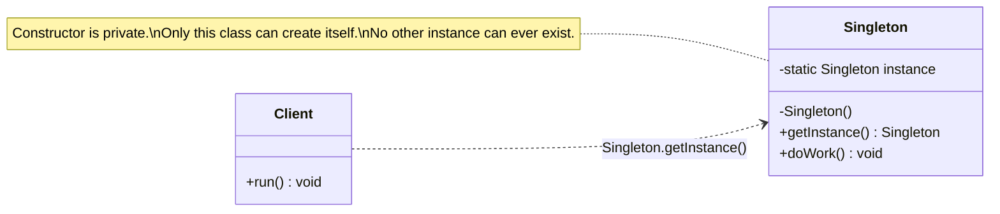
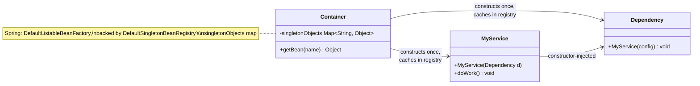
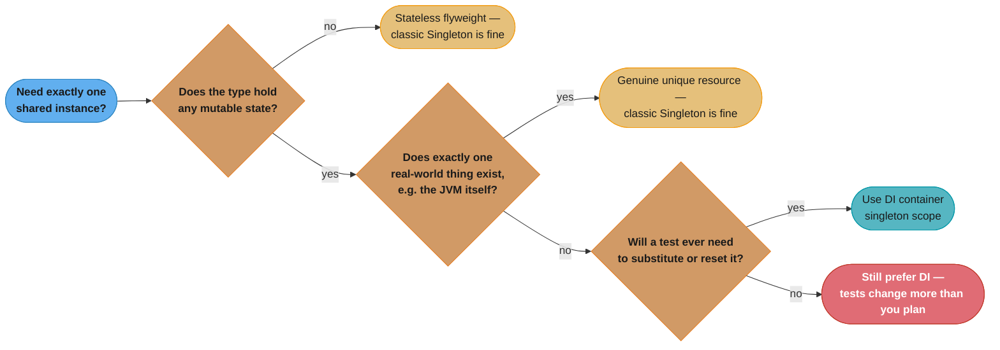

# Singleton vs DI Container
## Overview

Both give you "one instance, reused everywhere." That surface similarity is exactly what makes this the highest-frequency old-pattern-vs-modern-answer trap in interviews: a candidate who answers "use Singleton" for a problem the interviewer meant to be answered "inject a singleton-scoped bean" has just demonstrated the gap this file exists to close. The two are not the same mechanism, and confusing them is the single most common reason enterprise Java code becomes untestable — see [`creational/singleton/singleton.md`](../creational/singleton/singleton.md) for the pattern itself and [`anti_patterns/Singleton_Abuse.md`](../anti_patterns/Singleton_Abuse.md) for what goes wrong when it is misapplied. This file is the disambiguation surface between them.

---

## Intuition

> **One-line analogy**: A classic Singleton is a fixture bolted into the wall by the class itself — you can never move it, and every renovation has to work around it. A DI container's singleton scope is a shared tool the workshop manager hands out from a labeled shelf — still one copy in circulation, but the manager can swap it, lend a different one for a fire drill, or hand out a second labeled copy if the workshop grows.

**Mental model**: The GoF Singleton pattern makes uniqueness the class's own responsibility — a private constructor and a static field mean the class can *only ever* be constructed one way, and that decision is baked into the source. A DI container's singleton **scope** makes uniqueness a *policy the container applies from outside* — the class itself has an ordinary public constructor, knows nothing about being a singleton, and the container simply chooses to construct it once and hand back the same reference to every injection point. The class is identical either way; only where the "there shall be one" decision lives has moved.

**Why it matters**: This is the pattern-recognition trap interviewers reach for most, because "one instance, globally reused" describes both, and only one of the two survives contact with a real test suite, a multi-tenant deployment, or a second environment that needs a different instance.

**Key insight**: **Singleton scope is not the Singleton pattern.** A class under singleton scope can be constructed a hundred times with a hundred different mock dependencies in a hundred different tests — the container just chooses, in production, to construct it once. A classic `getInstance()` Singleton cannot be constructed any other way, ever, by design. That one word — *chooses* versus *cannot* — is the entire answer.

---

## Side-by-Side UML

### Classic Singleton (GoF pattern)



*`Client` has no constructor seam to hand in a substitute — it reaches into the class by name and calls a static method. The uniqueness guarantee and the object's own source code are the same file.*

### DI Container — Singleton Scope



*`MyService` has a public constructor that takes `Dependency` as a plain parameter — nothing about the class says "I am a singleton." A test calls `new MyService(mockDependency)` directly. Only the container, at a layer entirely outside the class, decides to construct it once and reuse the reference.*

---

## Key Differences Table

| Dimension | Classic Singleton | DI Container Singleton Scope |
|-----------|-------------------|-------------------------------|
| **Who enforces uniqueness** | The class itself (private constructor + static field) | The container, from outside the class |
| **Constructor visibility** | Private — cannot be called except by the class | Public — any caller, including a test, can call it |
| **Global access point** | `Foo.getInstance()`, reachable from anywhere in the JVM | Only reachable through the container's injected reference graph |
| **Testability** | Cannot substitute a mock; the dependency is looked up, not passed in | `new MyService(mock)` works with zero framework involvement |
| **Multiple named instances** | Structurally impossible — one class, one instance, forever | Trivial — two beans of the same class under different names (e.g., `primaryDataSource`, `readOnlyDataSource`) |
| **Initialization ordering** | Whatever order static references happen to trigger — fragile, can deadlock | Container resolves a dependency graph and constructs in topological order |
| **Lifecycle hooks** | None by default — nothing calls a `close()` | Container-managed `@PreDestroy`/`DisposableBean` hooks on shutdown |
| **Scope flexibility** | Fixed at compile time — always one instance, forever | Changeable in config — `singleton`, `prototype`, `request`, `session` without touching the class |
| **Thread-safety burden** | On the class author (volatile, holder idiom, enum) | On the container (already solved once, correctly, for every bean) |

---

## Common Confusion Points

1. **"One instance" sounds like the same guarantee** — It is not. Classic Singleton guarantees uniqueness *for all time, everywhere the class is loaded*. Singleton scope guarantees uniqueness *within one container's bean registry* — a second `ApplicationContext` in the same JVM (a second microservice module, a test slice, a plugin) gets its own separate "singleton."
2. **"The class looks the same either way"** — It does not, and that is the tell. A singleton-scoped bean's class has a normal public constructor. A classic Singleton's class has a private constructor. If you can call `new Foo(...)` from a test with no framework running, you are looking at DI; if you cannot, you are looking at the pattern.
3. **"DI just hides a Singleton behind an interface"** — No: DI removes the uniqueness decision from the class entirely. A DI-managed class does not know or care how many instances the container decides to create; the class itself would work fine if the container created ten.
4. **"Enum singletons are the same problem as getInstance() singletons"** — Not quite; see When to Use Which below. An enum constant shares the "hard-coded uniqueness" property, but it is also JVM-guaranteed thread-safe and reflection/serialization-proof in a way hand-rolled `getInstance()` never is.

---

## What Actually Breaks in Practice

### Test isolation

```java
// Classic Singleton with mutable state — the anti-pattern
public class RequestCounter {
    private static final RequestCounter INSTANCE = new RequestCounter();
    private int count = 0;

    private RequestCounter() {}
    public static RequestCounter getInstance() { return INSTANCE; }

    public void increment() { count++; }
    public int getCount() { return count; }
}

// Test A — passes alone
class HandlerATest {
    @Test
    void firstRequestIsCountedAsOne() {
        RequestCounter.getInstance().increment();
        assertEquals(1, RequestCounter.getInstance().getCount()); // passes in isolation
    }
}

// Test B — passes alone, FAILS when run after Test A in the same JVM/fork
class HandlerBTest {
    @Test
    void firstRequestIsCountedAsOne() {
        RequestCounter.getInstance().increment();
        assertEquals(1, RequestCounter.getInstance().getCount()); // sees 2, fails
    }
}
```

Nothing resets `INSTANCE.count` between test classes, because nothing owns the Singleton's lifecycle — it lives for as long as the classloader does. A build tool that forks a fresh JVM per test class (Surefire's default `forkCount`) hides this completely: each class gets a clean static field, the suite is green, and the bug ships. It resurfaces the moment CI is tuned for speed and starts reusing forks across test classes, and the failure looks like flakiness rather than the ordering bug it actually is.

With a DI container, the equivalent class has a constructor: `new RequestCounter()` in each test gets its own instance, and there is no shared static field to leak between test runs at all.

### ThreadLocal bleed

```java
// A Singleton holding request context in a ThreadLocal — used behind a thread pool
public class RequestContextHolder {
    private static final RequestContextHolder INSTANCE = new RequestContextHolder();
    private static final ThreadLocal<String> currentUser = new ThreadLocal<>();

    public static RequestContextHolder getInstance() { return INSTANCE; }

    public void setUser(String userId) { currentUser.set(userId); }
    public String getUser() { return currentUser.get(); }
    // no clear() called anywhere — the bug
}
```

A web server's request-handling thread pool reuses OS threads across unrelated HTTP requests. If `setUser()` is called for request A and nothing calls `currentUser.remove()` before the thread is returned to the pool, request B — served by the same pooled thread — reads request A's user ID. This is not hypothetical: it is one of the most common production data-leak classes in servlet-based Java, and it is a direct consequence of pairing a Singleton's globally reachable mutable state with a thread that outlives any single request. The fix is either an explicit `finally { currentUser.remove(); }` in a filter, or — the DI-shaped answer — a request-scoped bean the container constructs and discards per request, so there is no long-lived field to forget to clear.

---

## When to Use Which

### A real Singleton is still the right call when:
- The type is a **stateless flyweight** — no mutable fields, so there is nothing to leak between tests or threads regardless of how many "instances" exist. `Comparator.naturalOrder()` returns a JDK-internal shared instance for exactly this reason.
- The type is an **enum constant** representing one fixed, immutable value — the JLS guarantees enum construction happens once under a thread-safe class-initialization lock, and enum instances cannot be created a second time via reflection or deserialization the way a plain class can.
- The type genuinely has **exactly one real-world referent** — `java.lang.Runtime.getRuntime()` represents the one JVM process actually running; no constructor argument could ever produce a second, meaningfully different `Runtime`, so injecting it would be ceremony around a fact that is already singular by nature.

### Use a DI container's singleton scope when:
- The class has any mutable state that a test needs to control or reset.
- More than one instance might legitimately exist somewhere — a second bean under a different name, a per-tenant instance, a test double.
- Initialization order depends on other objects — let the container's dependency graph handle it instead of hand-ordering static field construction.
- You might need a different scope later (`prototype`, `request`, `session`) — that is a config change under DI, and a rewrite under a hand-rolled Singleton.



*The only branch that reaches a classic Singleton and stays there is "no mutable state, and no test will ever need to swap it out" — every other path lands on the container.*

---

## Same Class, Both Ways: AppConfig

### Classic Singleton — uniqueness is the class's own job

```java
public class AppConfig {
    private static AppConfig instance;
    private final Properties props = new Properties();

    private AppConfig() {
        try {
            props.load(new FileInputStream("config.properties")); // hardcoded path
        } catch (IOException e) {
            throw new RuntimeException(e);
        }
    }

    public static synchronized AppConfig getInstance() {
        if (instance == null) instance = new AppConfig();
        return instance;
    }

    public String get(String key) { return props.getProperty(key); }
}

// A test has no seam — it either hits the real config.properties file or fails
class ReportServiceTest {
    @Test
    void usesConfiguredCurrency() {
        ReportService svc = new ReportService(); // internally calls AppConfig.getInstance()
        assertEquals("USD", svc.currencyCode());  // reads whatever config.properties says
    }
}
```

### DI Container — uniqueness is a policy applied to an ordinary class

```java
@Component // Spring default scope is singleton — no getInstance() needed
public class AppConfig {
    private final Properties props;

    public AppConfig(String configPath) {           // public constructor, plain parameter
        props = new Properties();
        try (FileInputStream in = new FileInputStream(configPath)) {
            props.load(in);
        } catch (IOException e) {
            throw new RuntimeException(e);
        }
    }

    public String get(String key) { return props.getProperty(key); }
}

@Component
public class ReportService {
    private final AppConfig config;

    public ReportService(AppConfig config) { this.config = config; } // constructor-injected
    public String currencyCode() { return config.get("report.currency"); }
}

// The test supplies its own instance — no container, no file on disk
class ReportServiceTest {
    @Test
    void usesConfiguredCurrency() {
        AppConfig testConfig = new AppConfig("fixtures/test-config.properties");
        ReportService svc = new ReportService(testConfig);
        assertEquals("EUR", svc.currencyCode()); // deterministic, isolated, no shared state
    }
}
```

Same responsibility, same "one config, shared everywhere" outcome in production — but the DI version's `AppConfig` constructor is public and takes its path as a parameter, so the test controls exactly which file gets loaded instead of silently depending on whatever `config.properties` happens to contain in the working directory the test runs from.

---

## Real-World Examples

| Concern | Classic Singleton | DI Container Singleton Scope |
|---------|--------------------|-------------------------------|
| Shared config | `Config.getInstance()` scattered through a codebase, hardcoded file path | A `@ConfigurationProperties` bean, constructor-injected, path supplied per environment |
| Database access | `DatabaseConnection.getInstance()`, one hardcoded JDBC URL | A `DataSource` bean, singleton-scoped, swappable to an in-memory database in tests |
| Logging | `Logger.getInstance()` with a hardcoded file handle | A logging facade bean, or (legitimately) a stateless static logger with no mutable fields |
| Bean registry itself | N/A — the pattern has no registry concept | Spring's `DefaultListableBeanFactory`, whose `DefaultSingletonBeanRegistry` superclass holds every singleton-scoped bean in a `singletonObjects` map keyed by bean name |
| JVM process handle | `Runtime.getRuntime()` — legitimately unique | N/A — nothing to inject a second copy of |

---

## Interview Questions with Answers

**Q: What is the single distinction that separates the Singleton pattern from a DI container's singleton scope?**
**Short:** The GoF pattern enforces its own uniqueness inside the class; singleton scope is a lifecycle policy the container applies from outside.

The Singleton pattern bakes "there shall be exactly one" into the class's own source — a private constructor plus a static field mean no other construction path exists. A DI container's singleton scope leaves the class with an ordinary public constructor and applies the "construct once, reuse the reference" decision entirely from the outside, as a policy over an otherwise unremarkable class. The class under DI would work fine if the container decided to construct it ten times; the classic Singleton's class would not even compile that way.

**Q: Why does a Spring singleton-scoped bean stay easy to unit test while a classic getInstance() Singleton does not?**
**Short:** A Spring bean has an ordinary public constructor a test can call directly with mocks; getInstance() Singletons hide a private constructor behind static state.

`new MyService(mockDependency)` works with zero framework involvement, because `MyService`'s constructor is public and takes its dependency as a plain parameter — the class has no idea it will be singleton-scoped in production. A classic `MyService.getInstance()` Singleton has no such seam: the constructor is private, so a test has no way to hand in a substitute, and it is stuck exercising whatever the Singleton constructed for itself.

**Q: What test-isolation failure specifically comes from a hand-rolled Singleton holding mutable state?**
**Short:** Static state persists across test methods in the same JVM, so one test's mutation leaks into the next test's assertions.

A Singleton's static field lives for as long as the classloader that loaded it, which typically means the entire duration of a test run. If `RequestCounter.getInstance()` increments a shared `count` field, a test that asserts `count == 1` only passes if it happens to run first — every subsequent test inherits whatever earlier tests left behind, with no mechanism resetting it between them.

**Q: Why can a Singleton-dependent test suite pass when run alone but fail when run with the full suite?**
**Short:** Static fields live for the lifetime of the classloader, so execution order determines what state earlier tests left behind.

Run in isolation, a single test class gets a freshly loaded Singleton with default state, so its assertions hold. Run as part of the full suite, the same Singleton has already accumulated mutations from every test that ran before it in that JVM/fork, so an assertion written assuming a clean starting state now fails — not because the test is flaky, but because it was never actually isolated from its neighbors.

**Q: How does assuming "one JVM per test" mask a Singleton test-isolation bug until CI changes its fork strategy?**
**Short:** A build tool that forks a fresh JVM per test class resets static state automatically, hiding a bug that reappears once tests share a JVM/fork.

Maven Surefire's default behavior can fork a new JVM per test class, which resets every static field — including a Singleton's — between classes, so the isolation bug never manifests locally or in that CI configuration. The moment someone tunes CI for speed and switches to reusing forks across test classes (a common, reasonable optimization), the same Singleton now carries state across class boundaries, and tests that were "always green" start failing in a way that looks like new flakiness rather than a pre-existing design defect.

**Q: What is ThreadLocal bleed, and why does it specifically implicate Singletons used inside a thread pool?**
**Short:** A pooled thread keeps a ThreadLocal value across requests, so one Singleton's thread-scoped state leaks into the next unrelated request on that same thread.

A `ThreadLocal` field inside a Singleton is meant to hold data scoped to "the current unit of work," but a web server's request-handling threads are pooled and reused across many unrelated HTTP requests. If nothing explicitly calls `.remove()` on the `ThreadLocal` after a request finishes, the value set for request A remains attached to that OS thread and is silently visible to whichever unrelated request B happens to be served next by the same pooled thread.

**Q: Give a concrete example of how ThreadLocal bleed would corrupt production data.**
**Short:** A request-scoped user-context ThreadLocal set by request A stays on the pooled thread and is read by request B if never cleared.

A `RequestContextHolder` Singleton calls `currentUser.set(userId)` at the start of handling a request. If the request-processing filter never calls `currentUser.remove()` in a `finally` block, the next HTTP request served by that same pooled thread calls `getUser()` and receives the *previous* request's user ID — potentially attaching one user's identity, permissions, or audit trail to a completely different user's operation.

**Q: Name three legitimate reasons to still use a real Singleton pattern rather than DI.**
**Short:** A stateless flyweight, an enum constant representing a fixed value, or a resource with exactly one real-world instance like Runtime.

A stateless flyweight has no mutable fields, so there is nothing that could leak between tests or threads no matter how the instance count is managed. An enum constant gets JVM-guaranteed thread-safe, reflection-proof, single construction for free. And a type like `java.lang.Runtime` represents something that is already singular in reality — the one JVM process — so injecting an abstraction over it would add ceremony without adding any flexibility that could ever be exercised.

**Q: Why is java.lang.Runtime a defensible classic Singleton rather than an anti-pattern?**
**Short:** There is exactly one JVM process to represent, so no constructor parameter could ever produce a meaningfully different instance.

Dependency injection earns its keep by letting a test or a different environment supply a *different* instance — a mock, a second configuration, a per-tenant variant. `Runtime.getRuntime()` has no such axis of variation: every call in the same JVM refers to the same actual operating-system process, so there is no meaningfully different "other" `Runtime` a test could ever want to inject instead.

**Q: Why is an enum constant considered a safer form of Singleton even for shared, testable code?**
**Short:** Enum instances are constructed once under a JVM-guaranteed thread-safe class-initialization lock and cannot be reflectively or serialization-attacked into a second instance.

The JLS guarantees enum values are created exactly once, during class initialization, under a lock the JVM itself manages — no double-checked-locking bug is possible. Unlike a hand-rolled `getInstance()` Singleton, an enum constant also cannot be forced into a second instance through reflection (`Constructor.newInstance()` explicitly rejects enum types) or through naive Java deserialization, both of which can silently break a plain-class Singleton's uniqueness guarantee.

**Q: What does "DefaultListableBeanFactory" concretely do with a singleton-scoped bean that the GoF pattern's static field cannot do?**
**Short:** It stores the instance in a registry keyed by bean name, so multiple distinct singleton-scoped beans of the same class can coexist.

Spring's `ApplicationContext` is backed by a `DefaultListableBeanFactory`, which inherits a `singletonObjects` map from `DefaultSingletonBeanRegistry` — singleton-scoped beans are cached there keyed by *bean name*, not by class. A classic Singleton has exactly one storage location: the class's own static field, which structurally allows only one instance of that class to ever exist in the entire JVM.

**Q: Why can a Spring application have two different singleton-scoped beans of the same class, something the classic Singleton pattern cannot express?**
**Short:** The uniqueness lives in the container's registry entry per bean name, not hardcoded into the class itself, so two named beans can each be a "singleton" independently.

A `DataSource` class can back both a `primaryDataSource` bean and a `readOnlyDataSource` bean, each singleton-scoped, each a distinct instance the container constructed once and caches under its own name. A classic Singleton could never do this — the uniqueness constraint is a static field on the class itself, so the class fundamentally cannot have two "the one instance" simultaneously, regardless of how differently each might need to be configured.

**Q: What breaks specifically when two hand-rolled Singletons have a circular initialization dependency, versus two DI-managed beans with the same circularity?**
**Short:** Static initializers can deadlock or produce a null field silently; a DI container detects the cycle and fails fast with a clear error.

If Singleton A's static initializer calls `B.getInstance()` while B's static initializer calls `A.getInstance()`, the JVM's per-class initialization locks can deadlock two threads racing to initialize each, or — in a single-threaded startup — silently hand back a partially-constructed object with a null field, since a class re-entering its own initialization is permitted and simply proceeds. A DI container builds an explicit dependency graph before constructing anything, so a circular constructor dependency between two singleton-scoped beans is detected and reported as a clear `BeanCurrentlyInCreationException` rather than a silent null or a hang.

**Q: Why doesn't classloader isolation save you from Singleton test pollution in most real test suites?**
**Short:** A typical test run shares one classloader across a JVM/fork, so static state persists across every test in that run regardless of test class boundaries.

Classloader isolation only resets static state at a classloader boundary, and a normal test run — even across many test classes — loads each class exactly once into a single shared classloader for the life of that JVM or fork. There is no per-test-method or even per-test-class classloader boundary by default, so a Singleton's static field accumulates state across the entire run unless something explicitly resets it, which nothing does unless a test author remembers to add that reset themselves.

**Q: What ordering problem is specific to hand-rolled Singletons that a DI container's dependency graph resolves automatically?**
**Short:** A container topologically orders bean construction from declared dependencies; static getInstance() calls have no such guarantee and can run before their target is ready.

A DI container inspects every bean's declared dependencies and constructs them in an order guaranteed to satisfy those dependencies before anything that needs them runs. A hand-rolled Singleton has no such coordination — whichever code path happens to call `getInstance()` first triggers construction, and if that path runs before some other Singleton it silently depends on is ready, the bug shows up as a fragile, order-dependent startup failure rather than a declared, checkable graph.

**Q: If a class only holds immutable, stateless behavior, does it matter whether it is a classic Singleton or DI-managed?**
**Short:** Not for testability, since a stateless class has nothing to leak between tests or requests either way.

A class with no mutable fields cannot carry state from one test, thread, or request into another regardless of how many "instances" the JVM happens to have of it — there is simply nothing to leak. This is exactly the "stateless flyweight" exception in When to Use Which: the harm classic Singleton causes is specifically about hidden, shared, *mutable* state, and a genuinely stateless type sidesteps that harm by construction, making the pattern-versus-DI choice for it closer to a style preference than a correctness question.

**Q: What is the one-sentence answer to give in an interview when asked "is Singleton scope the Singleton pattern?"**
**Short:** No — singleton scope is a container-managed lifecycle policy; the Singleton pattern is a class enforcing its own uniqueness.

The Singleton pattern is a design decision baked into a class's own source code — a private constructor and a static field that make any other construction path impossible. Singleton scope is a lifecycle policy a DI container applies to an otherwise ordinary class from the outside, and the class itself remains constructible however a test needs it to be. Conflating the two is the single most common reason a candidate's "use Singleton here" answer draws a follow-up question in an interview.
