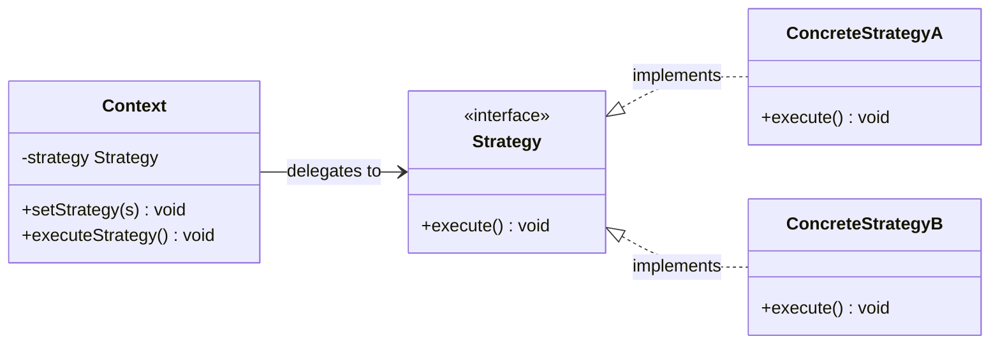
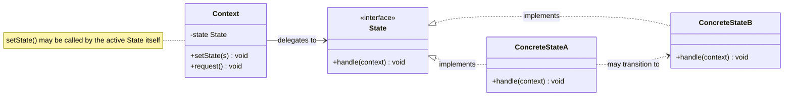
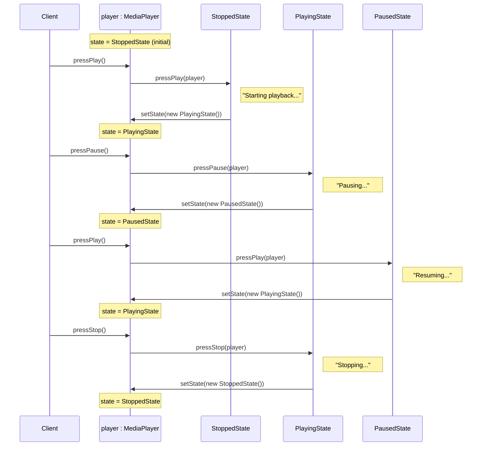
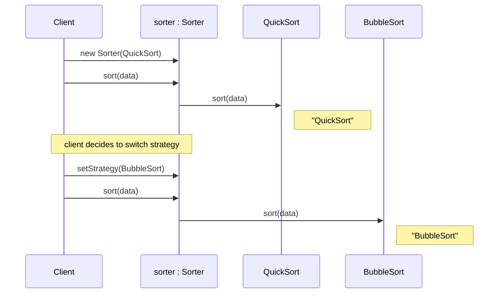

# Strategy vs State Pattern
## Overview

Both patterns delegate behavior to a separate object and look nearly identical in their class diagrams. The key difference lies in **who controls transitions** and **what the pattern is trying to solve**.

---

## Intuition

> **One-line analogy**: Strategy vs State is like a car's driving mode (Sport/Eco/Normal — you choose) vs a traffic light's phase (Red/Yellow/Green — it progresses on its own schedule).

**Mental model**: Both delegate to an interface. Strategy is chosen externally — the client or context picks the algorithm and it stays until changed. State transitions internally — the state object itself (or the context) decides when to move to the next state based on what happens. If your vending machine's "idle" state transitions to "has money" after `insertCoin()`, that's State. If your sorter switches between `QuickSort` and `MergeSort` based on input size, that's Strategy.

**Why it matters**: This is the most common pattern confusion in interviews. Getting it right demonstrates you understand intent, not just structure.

**Key insight**: Ask "who decides to switch?" — if it's the client/user, it's Strategy. If the pattern itself governs transitions based on events, it's State.

---

## Side-by-Side UML

Both patterns produce almost the same shape — a `Context` holding a reference to an interface, with concrete implementations behind it. The diagrams below are structural near-twins; each is captioned with the one difference that actually matters.

### Strategy



*`Context` only ever holds the `Strategy` interface; `setStrategy()` is an external call the client makes, and `ConcreteStrategyA`/`ConcreteStrategyB` never reference each other.*

### State



*The one structural tell versus Strategy: the dashed `ConcreteStateA ..> ConcreteStateB` arrow. A state implementation can construct a sibling state and hand it back to `Context.setState()` — strategies never do this to each other.*

---

## Key Differences Table

| Dimension | Strategy | State |
|-----------|----------|-------|
| **Primary intent** | Choose algorithm at runtime | Change behavior as internal state changes |
| **Who drives the switch** | Client / external code | State objects themselves OR Context |
| **States aware of each other** | No — strategies are independent | Yes — states often trigger transitions to other states |
| **Context awareness** | Strategy usually doesn't hold a Context reference | State usually receives Context to trigger transitions |
| **Number of "states"** | Typically few, user-controlled | Can be many; transitions form a state machine |
| **Pattern models** | "How to do something" | "What phase the object is in" |
| **Replaceability** | Strategies are freely interchangeable | States follow a defined lifecycle/graph |
| **Client knowledge** | Client knows and chooses the strategy | Client usually doesn't manage state transitions |

---

## Common Confusion Points

1. **They look identical in code** — Both have a context with a reference to an interface, and concrete implementations. The structural difference is nearly zero.
2. **State can look like Strategy with extra steps** — If you don't need auto-transitions, a State object behaves exactly like a Strategy.
3. **The key tell**: Does the encapsulated object know about *other* objects of the same type and switch between them? If yes, it's State. If no, it's Strategy.
4. **Mutability**: In Strategy, the context's algorithm field is set by the client and rarely changes mid-operation. In State, transitions happen continuously as the system runs.

---

## When to Use Which

### Use Strategy when:
- You have multiple algorithms for the same task and want to swap them (sort algorithms, compression codecs, payment methods)
- The client knows which algorithm to use and selects it explicitly
- Algorithms are completely independent of each other
- You want to eliminate conditional branches that select algorithm behavior

### Use State when:
- An object must change its behavior based on its internal state (e.g., a vending machine, traffic light, order lifecycle)
- You have state-specific behavior spread across many if/else or switch statements
- State transitions happen automatically based on events or internal logic
- The object passes through a defined lifecycle with predictable transitions

---

## Same Problem Solved Both Ways

### Problem: A media player that can Play, Pause, and Stop

---

### Solution with Strategy (wrong fit — included for comparison)

```java
// Strategy approach — client controls which "mode" is active
interface PlayerStrategy {
    void pressPlay();
    void pressPause();
}

class PlayingStrategy implements PlayerStrategy {
    public void pressPlay()  { System.out.println("Already playing"); }
    public void pressPause() { System.out.println("Pausing..."); }
}

class PausedStrategy implements PlayerStrategy {
    public void pressPlay()  { System.out.println("Resuming..."); }
    public void pressPause() { System.out.println("Already paused"); }
}

class MediaPlayer {
    private PlayerStrategy strategy;

    public void setStrategy(PlayerStrategy s) { this.strategy = s; }
    public void pressPlay()  { strategy.pressPlay(); }
    public void pressPause() { strategy.pressPause(); }
}

// Client is responsible for managing the switch — awkward
MediaPlayer player = new MediaPlayer();
player.setStrategy(new PausedStrategy());
player.pressPlay();
player.setStrategy(new PlayingStrategy()); // client must do this manually
```

---

### Solution with State (correct fit)

```java
// State approach — transitions happen automatically inside state objects
interface PlayerState {
    void pressPlay(MediaPlayer player);
    void pressPause(MediaPlayer player);
    void pressStop(MediaPlayer player);
}

class MediaPlayer {
    private PlayerState state;

    public MediaPlayer() { this.state = new StoppedState(); }

    public void setState(PlayerState state) { this.state = state; }

    public void pressPlay()  { state.pressPlay(this); }
    public void pressPause() { state.pressPause(this); }
    public void pressStop()  { state.pressStop(this); }
}

class PlayingState implements PlayerState {
    public void pressPlay(MediaPlayer p)  {
        System.out.println("Already playing");
    }
    public void pressPause(MediaPlayer p) {
        System.out.println("Pausing...");
        p.setState(new PausedState());   // auto-transition
    }
    public void pressStop(MediaPlayer p) {
        System.out.println("Stopping...");
        p.setState(new StoppedState());  // auto-transition
    }
}

class PausedState implements PlayerState {
    public void pressPlay(MediaPlayer p)  {
        System.out.println("Resuming...");
        p.setState(new PlayingState());  // auto-transition
    }
    public void pressPause(MediaPlayer p) {
        System.out.println("Already paused");
    }
    public void pressStop(MediaPlayer p) {
        System.out.println("Stopping...");
        p.setState(new StoppedState());
    }
}

class StoppedState implements PlayerState {
    public void pressPlay(MediaPlayer p)  {
        System.out.println("Starting playback...");
        p.setState(new PlayingState());
    }
    public void pressPause(MediaPlayer p) {
        System.out.println("Nothing to pause");
    }
    public void pressStop(MediaPlayer p) {
        System.out.println("Already stopped");
    }
}

// Usage — client just fires events, state machine handles transitions
MediaPlayer player = new MediaPlayer();
player.pressPlay();   // Starting playback...
player.pressPause();  // Pausing...
player.pressPlay();   // Resuming...
player.pressStop();   // Stopping...
```

Here's that trace playing out at runtime — the client only ever fires `pressPlay()`/`pressPause()`/`pressStop()`; each state object decides for itself which state comes next:



*The state object swaps itself out mid-call (`ST->>P: setState(new PlayingState())`) — this self-directed transition is exactly what Strategy's client-driven `setStrategy()` never does.*

---

### Strategy in its natural habitat: Sorting

```java
interface SortStrategy {
    void sort(int[] data);
}

class QuickSort implements SortStrategy {
    public void sort(int[] data) { System.out.println("QuickSort"); }
}

class MergeSort implements SortStrategy {
    public void sort(int[] data) { System.out.println("MergeSort"); }
}

class BubbleSort implements SortStrategy {
    public void sort(int[] data) { System.out.println("BubbleSort"); }
}

class Sorter {
    private SortStrategy strategy;

    public Sorter(SortStrategy strategy) { this.strategy = strategy; }

    public void setStrategy(SortStrategy s) { this.strategy = s; }

    public void sort(int[] data) { strategy.sort(data); }
}

// Client explicitly chooses the algorithm
Sorter sorter = new Sorter(new QuickSort());
sorter.sort(new int[]{3,1,2});

// Switch strategy for small datasets
sorter.setStrategy(new BubbleSort());
sorter.sort(new int[]{3,1});
```

This is the mirror image of the State trace above — the client, never the strategy, drives every switch:



*`QuickSort` and `BubbleSort` never call back into `Sorter` — the client calls `setStrategy()` explicitly whenever it wants a different algorithm, matching the "who decides to switch?" test from the Key Insight above.*

---

## Interview Questions with Answers

**Q: What is the difference between Strategy and State?**
**Short:** Strategy is a client-chosen, independent algorithm, while State models a lifecycle where the object itself drives transitions.

> Both Strategy and State encapsulate behavior in a separate object and allow a context to delegate work to that object. The structural difference is minimal, but the intent is fundamentally different.
>
> Strategy is about **choosing an algorithm** — the client selects which concrete strategy to use, and the strategies are completely independent of each other. Think of payment methods: the user picks PayPal or credit card, and those options don't know about each other.
>
> State is about **modeling a lifecycle** — the object itself drives transitions between states, and state objects often know about other states. Think of a vending machine: it moves through Idle, HasMoney, Dispensing, and OutOfStock states automatically as events occur.
>
> The diagnostic question: "Does the encapsulated object trigger transitions to a sibling object?" If yes, it's State. If not, it's Strategy.

**Q: Strategy and State have nearly identical UML — what single arrow in the class diagrams is the structural tell?**
**Short:** The dashed `ConcreteStateA ..> ConcreteStateB` "may transition to" arrow exists only in State's diagram, never Strategy's.

State's class diagram carries a dashed arrow from `ConcreteStateA` to `ConcreteStateB` annotated "may transition to," showing that a state implementation can construct or reference a sibling state and hand it to `Context.setState()`. Strategy's diagram has no equivalent edge — `ConcreteStrategyA` and `ConcreteStrategyB` never reference each other, because strategies are independent and interchangeable, not participants in a lifecycle. If you're staring at a diagram trying to tell the two apart, that one arrow (or its absence) is the fastest confirming detail.

**Q: Why does the note "setState() may be called by the active State itself" only appear on the State diagram's Context, never Strategy's?**
**Short:** State objects are expected to drive their own transitions by calling back into the Context; Strategy objects never call setStrategy().

`Context.setState()` in the State pattern is designed to be invoked from WITHIN a `ConcreteState`'s own `handle(context)` method — the currently active state decides when it's time to move to the next one and makes that call itself. `Context.setStrategy()` in Strategy is exclusively an EXTERNAL call made by client code; a `ConcreteStrategy.execute()` implementation has no reason and no expectation to ever call `context.setStrategy()` on itself. This directionality difference — who initiates the switch — is the semantic core of "who drives the switch" from the Key Differences table.

**Q: In the vending machine example implied by this file, why does Idle transitioning to HasMoney after insertCoin() count as State, not Strategy?**
**Short:** The transition is triggered by an event (insertCoin) and decided by the pattern itself, not chosen externally by client code.

If the vending machine's current state object decides, upon receiving `insertCoin()`, to construct a `HasMoneyState` and hand it to the context via `setState()`, that's the state governing its own lifecycle progression based on an event — nobody outside the machine is choosing to "switch to HasMoney mode." Contrast this with a Strategy-based sorter, where the CLIENT explicitly calls `sorter.setStrategy(new QuickSortStrategy())` — an external decision, not an internal reaction to an event. Event-driven, self-governed transitions are State's signature; externally-chosen swaps are Strategy's.

**Q: Why is the media player Play/Pause/Stop example in this file described as "wrong fit" when solved with Strategy?**
**Short:** Because play/pause/stop naturally form a lifecycle with valid transitions, which Strategy has no mechanism to enforce.

A Strategy-based media player would let the client freely call any operation regardless of the player's actual condition, since Strategy has no concept of "which strategy is valid right now" — nothing stops calling `play()` twice in a row or `pause()` before anything is playing. State naturally enforces this, since each `ConcreteState` (Playing, Paused, Stopped) only exposes the transitions that are actually valid from that phase, and illegal calls can be rejected or ignored by the specific state object handling them. The file uses this contrast specifically to show why picking the "structurally similar" pattern without checking intent produces a design that silently accepts invalid operations.

**Q: What does "states follow a defined lifecycle/graph" mean concretely, and how does the vending machine or TCP connection illustrate it?**
**Short:** Each state only permits transitions to specific next states, forming a directed graph rather than an arbitrary free-for-all.

A TCP connection's states (`LISTEN`, `SYN_RECEIVED`, `ESTABLISHED`, `FIN_WAIT`, `CLOSED`) each allow only a fixed, specific set of next states per the protocol's state machine — you can't jump from `LISTEN` directly to `FIN_WAIT`. Strategy has no equivalent structure: `Comparator` implementations for ascending vs. descending sort have no defined "graph" connecting them, because there's no lifecycle at all — any strategy can be selected at any time with no ordering constraint. This "defined graph of legal transitions" is precisely what "Replaceability" in the Key Differences table means by "States follow a defined lifecycle/graph" versus Strategy's "freely interchangeable."

**Q: Why does State typically hold a reference to Context while Strategy usually doesn't need one?**
**Short:** A State often needs to call back into Context to trigger its own transition; a Strategy just executes its algorithm and returns.

The Key Differences table's "Context awareness" row states State "usually receives Context to trigger transitions," matching `State.handle(context)`'s signature, which explicitly passes the context in so the state implementation can call `context.setState(nextState)` when appropriate. `Strategy.execute()` typically needs no such reference because its job ends when the algorithm finishes — there's no follow-up action like "now switch to a different strategy" for it to trigger. This is a direct consequence of State's self-governing transition responsibility versus Strategy's purely computational role.

**Q: How would you explain "State can look like Strategy with extra steps" as a common confusion point?**
**Short:** If a State implementation never triggers a transition, it behaves exactly like a stateless Strategy with no observable difference.

A `ConcreteState` that only implements `handle()` without ever calling `context.setState()` to move to a different state is functionally indistinguishable from a Strategy — both just execute some behavior when invoked. The pattern only earns the name "State" once auto-transitions are actually happening; absent that, calling it State versus Strategy is purely a naming choice with no behavioral consequence, which is why this file calls it out as the most common confusion point rather than a hard rule.

**Q: Why does a payment method selector (PayPal vs. credit card) clearly belong to Strategy and never State?**
**Short:** The user explicitly picks a payment method, and the options never trigger transitions to each other — no lifecycle exists between them.

Selecting PayPal over a credit card is an external, one-time choice made by the user (or client code) for a specific transaction — `PayPalStrategy` never decides to hand control to `CreditCardStrategy` mid-transaction, and there's no notion of "the payment method progresses through phases." This is the clean Strategy case the file references: independent, client-chosen algorithms with zero cross-awareness, contrasted directly against the vending machine's self-governing state progression.

**Q: What does "mutability" mean as a distinguishing factor between Strategy and State, per the Key Differences table?**
**Short:** A Strategy's algorithm field is set once by the client and rarely changes mid-operation; a State's field changes continuously as the system runs.

`sorter.setStrategy(new QuickSortStrategy())` is typically called once, perhaps at construction or configuration time, and the same strategy instance handles every subsequent `sort()` call until explicitly reconfigured — a relatively static assignment. A vending machine's `state` field, by contrast, is expected to change on nearly every user interaction (insert coin, select item, dispense, return to idle) — continuous, ongoing mutation driven by the system's own operation is the normal case for State, not the exception.

**Q: In the "Same Problem Solved Both Ways" section's Strategy version (marked wrong fit), what specifically breaks if two operations are called out of order?**
**Short:** Nothing in a Strategy-based design prevents calling operations out of order, since Strategy has no concept of validity per current condition.

Because `Sorter`-style Strategy contexts hold only a reference to the currently selected strategy with no notion of "what's currently allowed," a media-player-as-Strategy design would let a client call `stop()` before ever calling `play()`, or call `play()` twice consecutively with no error — there's no structural guard against operation sequences that don't make sense. This is exactly what the file's "wrong fit" framing highlights: the code compiles and superficially works, but the pattern provides zero protection against invalid state sequences, which State would naturally enforce through each state only implementing its own legal responses.

**Q: Why is "who decides to switch" a more reliable diagnostic than counting the number of concrete implementations?**
**Short:** Both patterns can have few or many implementations; only the initiator of a switch (client vs. the pattern itself) reliably separates them.

A Strategy-based system could have a dozen `ConcreteStrategy` implementations (many payment gateways) or just two (ascending/descending comparator) — the count says nothing about which pattern is in play. Similarly, a State machine could have two states or twenty. What never varies is WHO initiates a change: if it's always external client code calling `setX()`, it's Strategy; if the pattern's own objects initiate the change from within, it's State. This is why the file's "Key insight" leads with "who decides to switch," not with structural complexity.

**Q: How does eliminating conditional branches serve as motivation for both Strategy and State, but for different underlying problems?**
**Short:** Strategy eliminates branches that SELECT an algorithm; State eliminates branches that check WHICH PHASE the object is currently in.

Strategy's "Use Strategy when" guidance lists "you want to eliminate conditional branches that select algorithm behavior" — replacing an if/else picking between sort algorithms with polymorphic dispatch. State's guidance lists "you have state-specific behavior spread across many if/else or switch statements" — replacing conditionals that check `if (currentState == PLAYING)` scattered throughout a class with polymorphic state objects that each know their own valid behavior. Both patterns replace conditionals with polymorphism, but the conditionals they replace are answering different questions: "which algorithm" versus "which phase am I in."

**Q: Why would testing a State-based media player require more setup than testing a Strategy-based sorter?**
**Short:** Testing transitions requires driving the object through a sequence of states, while testing a Strategy needs just one call with fixed input.

Verifying `QuickSortStrategy` works correctly requires only calling `sort(data)` once with a known input array and asserting on the output — no setup beyond constructing the strategy. Verifying a media player's State machine correctly transitions from `Stopped` to `Playing` on `play()`, and then correctly rejects a second `play()` call while already `Playing`, requires exercising a SEQUENCE of calls and asserting on intermediate states along the way, since the bug surface includes not just individual operations but the transitions between them. This additional sequencing complexity is a direct cost of modeling a lifecycle rather than a swappable algorithm.

**Q: What real-world confusion arises when an order lifecycle (Placed -> Shipped -> Delivered -> Returned) is implemented as Strategy instead of State?**
**Short:** Nothing prevents an order from jumping straight from Placed to Delivered, since Strategy enforces no legal transition graph.

An order lifecycle modeled with State naturally restricts each phase to its legal next steps — a `PlacedState` might only allow transitioning to `Shipped` or `Cancelled`, never directly to `Delivered`. If the same lifecycle were mistakenly modeled as Strategy — treating each phase as an interchangeable "algorithm" selected externally — a caller could freely reassign the order straight to a `DeliveredStrategy` with no structural objection, silently permitting a business-invalid transition the State pattern would have prevented by construction.

---

## Real-World Examples

| Pattern | Example |
|---------|---------|
| Strategy | Compression algorithm (zip, gzip, bzip2), Sort algorithm, Payment gateway |
| State | Order lifecycle (Placed > Shipped > Delivered > Returned), TCP connection, Vending machine, Traffic light |
| Both misidentified | UI rendering mode — looks like State but is actually Strategy if transitions are client-driven |
