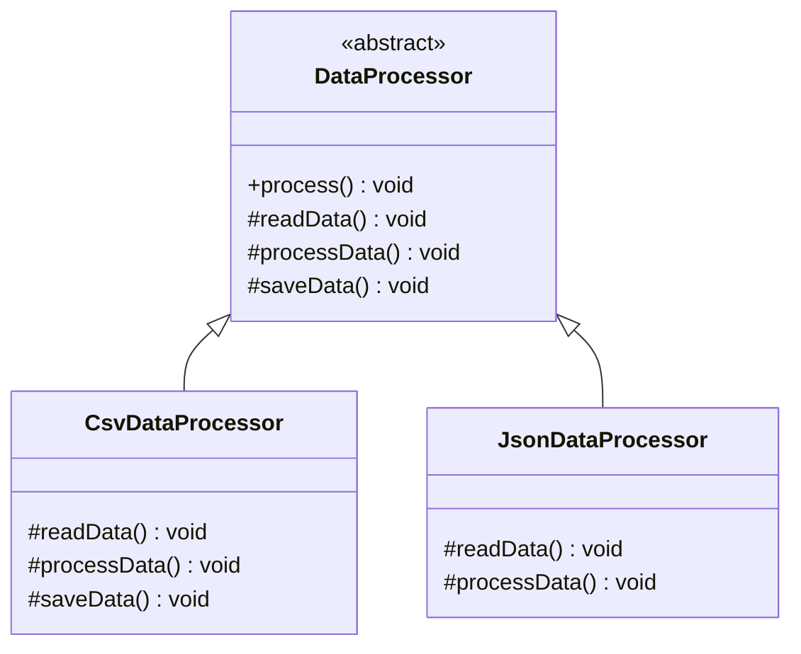
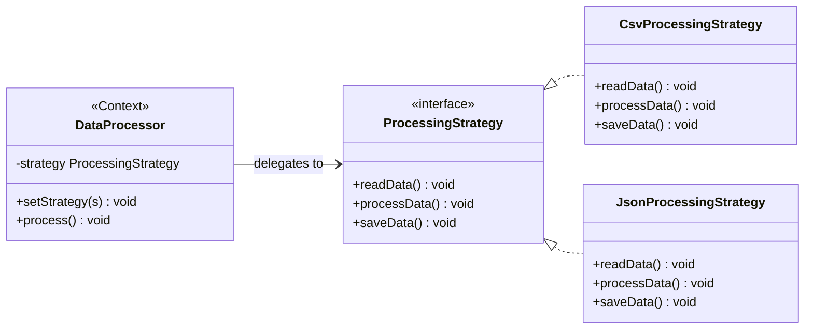
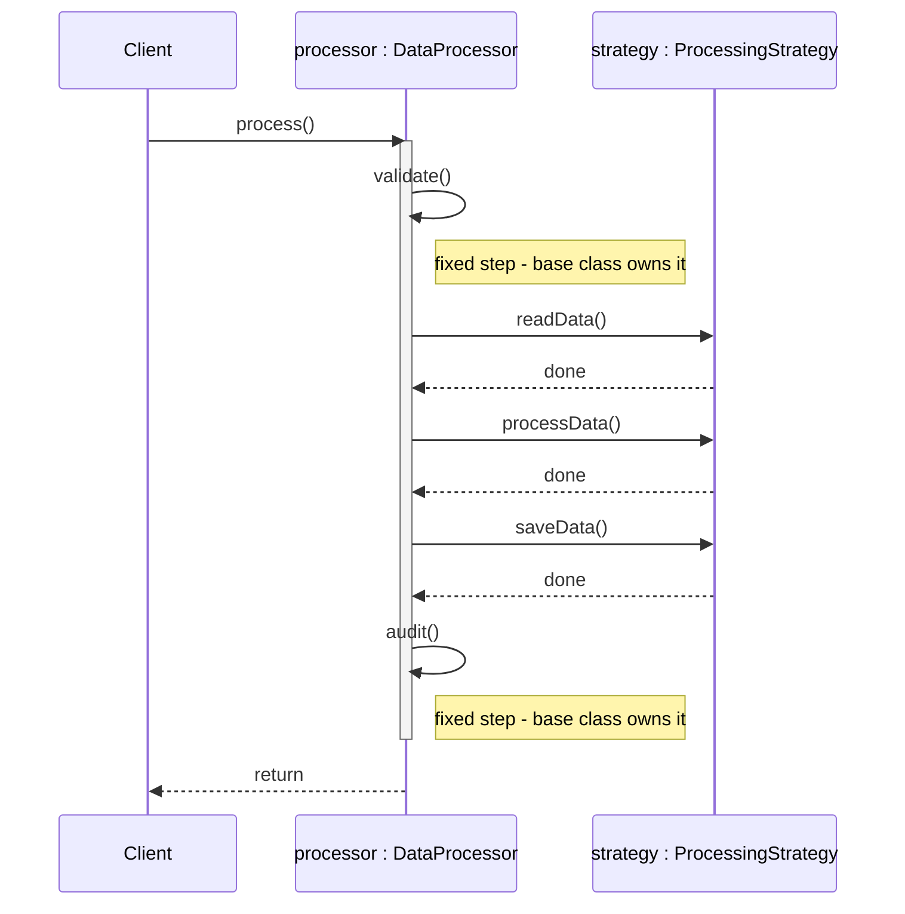

# Template Method vs Strategy Pattern
## Quick Summary

- **Template Method**: Defines the *skeleton* of an algorithm in a base class; subclasses override specific steps (uses inheritance).
- **Strategy**: Defines a *family of algorithms*; the client injects the desired implementation (uses composition).

---

## Intuition

> **One-line analogy**: Template Method is a franchise recipe (the headquarters defines the process; franchisees fill in local ingredients); Strategy is a plugin slot (you swap the entire cooking approach at runtime).

**Mental model**: Template Method fixes the *structure* of an algorithm in a base class and lets subclasses override specific steps — using inheritance. The "template" (order of steps) never changes; only the details do. Strategy replaces the entire algorithm via composition — the context holds a reference and you swap it at runtime, no subclassing needed. Template Method is compile-time extension; Strategy is runtime extension.

**Why it matters**: Template Method is simpler when the algorithm structure is fixed and variation is limited to a few well-defined hooks. Strategy is more flexible (no inheritance tax) but requires an explicit interface and more indirection.

**Key insight**: "Prefer composition over inheritance" usually points you toward Strategy. Use Template Method when the algorithm skeleton must be enforced and subclass override is the natural extension mechanism (e.g., `AbstractList` in Java).

---

## Side-by-Side Comparison

| Aspect             | Template Method                                   | Strategy                                           |
|--------------------|---------------------------------------------------|----------------------------------------------------|
| **Intent**         | Fix the algorithm structure; let subclasses fill in steps | Define interchangeable algorithms; inject at runtime |
| **Structure**      | Abstract base class with a final template method  | Context class holds a Strategy interface reference |
| **Key Difference** | Inheritance — subclass IS-A variant               | Composition — context HAS-A strategy              |
| **Use When**       | The overall algorithm steps are fixed but individual steps vary | The entire algorithm (or large part of it) varies and must be swappable |

---

## Java Code Examples

### Template Method Pattern — Data Processor with Fixed Pipeline

```java
// Abstract class defines the algorithm skeleton
public abstract class DataProcessor {

    // Template method — final to prevent overriding the skeleton
    public final void process() {
        readData();
        processData();
        saveData();
        System.out.println("--- Pipeline complete ---");
    }

    // Steps subclasses MUST implement
    protected abstract void readData();
    protected abstract void processData();

    // Hook — subclasses MAY override (default behavior provided)
    protected void saveData() {
        System.out.println("Saving data to default storage");
    }
}

// Concrete implementation 1: CSV pipeline
public class CsvDataProcessor extends DataProcessor {

    @Override
    protected void readData() {
        System.out.println("Reading data from CSV file");
    }

    @Override
    protected void processData() {
        System.out.println("Parsing and transforming CSV rows");
    }

    @Override
    protected void saveData() {
        System.out.println("Writing processed rows to database");
    }
}

// Concrete implementation 2: JSON pipeline
public class JsonDataProcessor extends DataProcessor {

    @Override
    protected void readData() {
        System.out.println("Reading data from JSON API endpoint");
    }

    @Override
    protected void processData() {
        System.out.println("Deserializing JSON and applying business rules");
    }
    // Uses default saveData() — saves to default storage
}

// Client
public class TemplateMethodDemo {
    public static void main(String[] args) {
        DataProcessor csv = new CsvDataProcessor();
        csv.process();

        System.out.println();

        DataProcessor json = new JsonDataProcessor();
        json.process();
    }
}
```

**Output:**
```
Reading data from CSV file
Parsing and transforming CSV rows
Writing processed rows to database
--- Pipeline complete ---

Reading data from JSON API endpoint
Deserializing JSON and applying business rules
Saving data to default storage
--- Pipeline complete ---
```

---

### Strategy Pattern — Data Processor with Injected Algorithm

```java
// Strategy interface — the full processing algorithm is abstracted
public interface ProcessingStrategy {
    void readData();
    void processData();
    void saveData();
}

// Concrete Strategy 1: CSV
public class CsvProcessingStrategy implements ProcessingStrategy {
    @Override
    public void readData()    { System.out.println("Reading from CSV file"); }
    @Override
    public void processData() { System.out.println("Transforming CSV rows"); }
    @Override
    public void saveData()    { System.out.println("Saving CSV result to DB"); }
}

// Concrete Strategy 2: JSON
public class JsonProcessingStrategy implements ProcessingStrategy {
    @Override
    public void readData()    { System.out.println("Reading from JSON API"); }
    @Override
    public void processData() { System.out.println("Deserializing JSON objects"); }
    @Override
    public void saveData()    { System.out.println("Saving JSON result to DB"); }
}

// Context — NOT a base class; it delegates entirely to the strategy
public class DataProcessor {
    private ProcessingStrategy strategy;

    public DataProcessor(ProcessingStrategy strategy) {
        this.strategy = strategy;
    }

    // Swap strategy at runtime — impossible with Template Method
    public void setStrategy(ProcessingStrategy strategy) {
        this.strategy = strategy;
    }

    public void process() {
        strategy.readData();
        strategy.processData();
        strategy.saveData();
        System.out.println("--- Pipeline complete ---");
    }
}

// Client
public class StrategyDemo {
    public static void main(String[] args) {
        DataProcessor processor = new DataProcessor(new CsvProcessingStrategy());
        processor.process();

        System.out.println();

        // Switch strategy at runtime — no subclassing needed
        processor.setStrategy(new JsonProcessingStrategy());
        processor.process();
    }
}
```

---

## Key Structural Differences — ASCII Class Diagrams

### Template Method (Inheritance)



*`process()` is `final` — the skeleton that always calls `readData → processData → saveData`. `readData()`/`processData()` are abstract primitive operations every subclass must supply; `saveData()` is a hook with a default body, so `JsonDataProcessor` inherits it unchanged instead of overriding it.*

### Strategy (Composition)



*`DataProcessor` (the Context) holds a `ProcessingStrategy` reference and delegates every step to it — unlike Template Method, there is no shared base implementation, so `setStrategy()` lets the client swap in `JsonProcessingStrategy` at runtime without subclassing.*

---

## The "Favor Composition Over Inheritance" Tradeoff

| Factor                          | Template Method          | Strategy                    |
|---------------------------------|--------------------------|-----------------------------|
| Code reuse                      | Easy — inherit base class| Requires more boilerplate   |
| Runtime switching               | Not possible             | Yes — call `setStrategy()`  |
| Adding a new variant            | New subclass             | New class implementing interface |
| Testing algorithm in isolation  | Hard — tied to base class| Easy — inject a mock strategy|
| Multiple inheritance concerns   | Yes (Java single inherit)| None                        |
| Algorithm structure flexibility | Fixed by base class      | Each strategy owns its own flow |

**Rule of thumb**: If the algorithm *structure* (the sequence of steps) is invariant and only the *details* of steps vary, use Template Method. If the entire algorithm — or even the structure — may vary between clients, prefer Strategy.

---

## Decision Guide

Use **Template Method** when:
- You have an invariant algorithm skeleton with well-defined extension points
- Code reuse across variants is high and inheritance is acceptable
- You want to enforce a specific pipeline order (e.g., lifecycle methods)
- The number of variants is small and known at compile time

Use **Strategy** when:
- Algorithms need to be swapped at runtime
- You want to avoid a deep inheritance hierarchy
- Each variant may have a completely different internal structure
- You are writing a library/framework and want clients to inject behavior
- You need to unit test algorithms independently

---

## Common Confusion Points

1. **Both solve the same surface problem** (varying behavior) but with different mechanisms. The interview signal is: does the algorithm *structure* change, or just the *steps*?

2. **Hooks in Template Method** — A hook is an optional step in the base class with a default (possibly empty) implementation. Subclasses override only if needed. This is more nuanced than pure abstract methods.

3. **Strategy does not share code** — Unlike Template Method, there is no shared base implementation. If strategies share code, you may need an abstract base strategy class or a utility class.

4. **Template Method creates tight coupling to the base class** — Changes to the abstract class can ripple into all subclasses. Strategy's Context is only coupled to the interface.

---

## Real-World Examples

| Template Method | Strategy |
|-----------------|----------|
| `jakarta.servlet.http.HttpServlet` (`doGet`, `doPost` override) | `java.util.Comparator` |
| `Spring JdbcTemplate` (callback hooks) | `java.util.Collections.sort()` accepting a `Comparator` |
| `AbstractList` in Java Collections Framework | `LayoutManager` in Java AWT/Swing |
| JUnit `setUp` / `tearDown` test lifecycle | Payment gateway selection (Stripe, PayPal, Braintree) |
| Android `Activity` lifecycle callbacks | Compression strategy (gzip, deflate, brotli) |

---

## Can They Work Together?

Yes — a Template Method in the base class can delegate individual steps to Strategy objects:

```java
public abstract class DataProcessor {

    private final ProcessingStrategy strategy;

    public DataProcessor(ProcessingStrategy strategy) {
        this.strategy = strategy;
    }

    // Template method: fixed pipeline
    public final void process() {
        validate();              // fixed step in base class
        strategy.readData();     // delegated to strategy
        strategy.processData();  // delegated to strategy
        strategy.saveData();     // delegated to strategy
        audit();                 // fixed step in base class
    }

    private void validate() { System.out.println("Validating configuration"); }
    private void audit()    { System.out.println("Writing audit log entry"); }
}
```

Reading the hybrid as a runtime sequence makes the alternation between fixed and delegated steps explicit — `validate()` and `audit()` never move, while the three middle steps bind to whichever strategy was injected:



*`validate()` and `audit()` are invariant — implemented once in the base class — while `readData()`/`processData()`/`saveData()` are delegated to whichever `ProcessingStrategy` was injected at construction; swap in a different strategy and this diagram is unchanged except for what `S` binds to.*

This hybrid keeps the pipeline structure locked (Template Method) while making each step independently replaceable (Strategy) — the best of both worlds.

---

## Interview Questions with Answers

**Q: Template Method and Strategy solve the same problem of varying behavior — what makes you pick inheritance over composition here?**
**Short:** Pick Template Method when the algorithm's step sequence is fixed and only individual steps vary; otherwise pick Strategy.

Template Method locks the overall order of steps in a `final` method and lets subclasses fill in specific hooks — appropriate when that sequence must never change and reuse across variants matters more than runtime flexibility. Strategy hands the entire algorithm to composition, letting the client inject or swap it at runtime with no inheritance tax. "Prefer composition over inheritance" generally points toward Strategy, but Template Method remains the right call whenever enforcing a fixed pipeline order is itself a requirement, as in `AbstractList` or JUnit's `setUp`/`tearDown` lifecycle.

**Q: Why is DataProcessor.process() declared final in the Template Method version?**
**Short:** Marking process() final prevents subclasses from overriding the skeleton itself, only the individual steps.

If `process()` weren't `final`, a subclass could override the entire pipeline order — reading data after processing it, or skipping `saveData()` altogether — defeating the whole point of enforcing a fixed algorithm structure. By making the template method `final` and only the individual steps (`readData()`, `processData()`) abstract or overridable, the base class guarantees every subclass follows the same sequence: read, process, save. This is the mechanism that makes Template Method fundamentally about the skeleton, not the steps.

**Q: What is a "hook" in Template Method, and how does it differ from an abstract step?**
**Short:** A hook has a default implementation subclasses may override; an abstract step has no default and must be overridden.

`saveData()` in `DataProcessor` is a hook — it provides default behavior ("Saving data to default storage") that `JsonDataProcessor` simply inherits unchanged, while `CsvDataProcessor` overrides it to save to a database instead. `readData()` and `processData()` are abstract steps with no default body — every subclass MUST supply an implementation or the class won't compile. This distinction (optional hook vs. mandatory step) is what gives Template Method more nuance than "just override everything."

**Q: Why can't Strategy enforce a fixed sequence of sub-steps the way Template Method can?**
**Short:** Strategy's Context has no shared base implementation, so nothing constrains how a strategy internally orders its work.

`DataProcessor` (the Strategy Context) calls `strategy.readData()`, `strategy.processData()`, `strategy.saveData()` in a fixed order from the CONTEXT's perspective, but each `ConcreteStrategy` implements all three methods independently with zero shared code enforcing consistency between implementations. A rogue strategy could technically do all its work inside `readData()` and leave the other two empty — nothing in the Strategy pattern prevents that, because there's no shared base class dictating internal structure. Template Method's base class is what closes this gap.

**Q: What does it cost to unit-test an algorithm built with Template Method versus Strategy?**
**Short:** Testing a Template Method variant requires the whole base class; testing a Strategy means injecting a mock directly.

Testing `CsvDataProcessor` in isolation still requires exercising it through the inherited `process()` skeleton, since the algorithm's entry point lives on the base class — you can't test the CSV-specific step logic without the full pipeline running. `CsvProcessingStrategy`, being just an object implementing `ProcessingStrategy`, can be tested standalone or injected as a mock into `DataProcessor` in a unit test with no inheritance chain involved. This testability gap is one of the concrete costs listed for Template Method in the tradeoff table.

**Q: Why does Template Method create tighter coupling to its base class than Strategy creates to its interface?**
**Short:** Subclasses inherit and depend on the base class's internal structure; Strategy implementations depend only on the interface.

Any change to `DataProcessor`'s base class — say, adding a new mandatory step to the `process()` skeleton — ripples into every subclass, which must now implement that new abstract method or accept whatever default is provided. A `ProcessingStrategy` implementation, by contrast, is coupled only to the interface's method signatures; changes to how `DataProcessor` (the Context) orchestrates those calls don't require any change to `CsvProcessingStrategy` itself as long as the interface is unchanged. This is the concrete meaning of "Template Method creates tight coupling to the base class."

**Q: Why is Java's single inheritance a real constraint for Template Method but not for Strategy?**
**Short:** A subclass extending an abstract Template Method base class can't also extend anything else; Strategy has no such limit.

`CsvDataProcessor extends DataProcessor` uses up Java's one inheritance slot, so if `CsvDataProcessor` also needed to extend some other useful base class, it couldn't — it would need to refactor to interfaces or composition instead. A class implementing `ProcessingStrategy` has no such constraint since interfaces can be implemented alongside any class hierarchy, and Java permits implementing multiple interfaces freely. This "multiple inheritance concerns" row is a real practical cost of Template Method in Java specifically.

**Q: How does the hybrid example in this file combine Template Method and Strategy, and why does it keep validate()/audit() fixed?**
**Short:** The hybrid keeps validate() and audit() as fixed base-class steps while delegating the variable middle steps to an injected Strategy.

The hybrid `DataProcessor.process()` is still `final` and still enforces a strict order — `validate()`, then the strategy's three steps, then `audit()` — but the middle steps are delegated to whichever `ProcessingStrategy` was injected at construction rather than being subclass overrides. `validate()` and `audit()` stay in the base class because they're invariant across every variant (every pipeline must validate config and write an audit log), while the domain-specific read/process/save logic is exactly what benefits from runtime swappability. This gets Template Method's enforced skeleton and Strategy's runtime flexibility in one design.

**Q: What's the practical difference between adding a new variant under Template Method versus under Strategy?**
**Short:** Template Method requires a new subclass; Strategy requires a new class implementing the interface — similar cost, different mechanism.

Adding an XML pipeline under Template Method means creating `XmlDataProcessor extends DataProcessor` and overriding the required abstract steps, inheriting the fixed skeleton automatically. Adding it under Strategy means creating `XmlProcessingStrategy implements ProcessingStrategy` and registering/injecting it wherever strategies are selected — no inheritance, no automatic skeleton, since the Context must call all three steps itself. Both are roughly the same amount of new code; the difference is whether the new class extends a base class or merely implements an interface, which determines whether Java's single-inheritance slot gets consumed.

**Q: Why is Factory Method described as "a specialization of Template Method for object creation"?**
**Short:** Factory Method fixes the overall creation flow in a base class while letting subclasses override which concrete object gets created.

A `Creator` base class defines `someOperation()` as fixed logic that calls the overridable `createProduct()` — subclasses like `ConcreteCreator` only decide WHICH product class gets instantiated, while the surrounding operation's structure is inherited unchanged. That's the exact same shape as Template Method: a fixed skeleton (`someOperation()`) with one or more overridable steps (`createProduct()`). This is why Factory Method is grouped as Template Method applied specifically to the "which class do I instantiate" problem.

**Q: What signal in a code review suggests a Template Method hierarchy should be refactored to Strategy?**
**Short:** A signal is deep or wide subclass hierarchies existing only to vary one or two hook methods.

If a `DataProcessor` hierarchy grows to a dozen subclasses that differ only in how they implement `saveData()`, while `readData()`/`processData()` stay identical across all of them, the inheritance hierarchy is paying a heavy structural cost (one class per combination, tight coupling to the base) for what's really a single swappable concern. That's the signal to extract just the varying piece into a `SaveStrategy` interface injected into a single concrete class, collapsing N subclasses into one class plus N strategy implementations. This mirrors the general "prefer composition over inheritance" guidance from a concrete, observable code smell.

**Q: Why does JUnit's setUp/tearDown lifecycle use Template Method rather than Strategy?**
**Short:** JUnit needs to enforce a fixed pipeline (setUp, then test, then tearDown) that test authors cannot reorder.

The JUnit test runner calls lifecycle methods in a strictly fixed order for every test, and test authors are only meant to fill in the content of `setUp()`/`tearDown()`/the test method itself — never to change the ORDER those run in. That fixed, enforced sequencing is precisely Template Method's use case; if JUnit instead exposed test lifecycle as an injectable Strategy, individual test authors could accidentally reorder setup and teardown relative to the test body, which would be far more error-prone. Android's `Activity` lifecycle callbacks follow the identical rationale.

**Q: How would you explain "Template Method is compile-time extension, Strategy is runtime extension" with a concrete consequence?**
**Short:** A Template Method variant is fixed once compiled into a subclass; a Strategy can be swapped at runtime via setStrategy().

Which concrete subclass of `DataProcessor` you're using is determined by `new CsvDataProcessor()` or `new JsonDataProcessor()` at construction time and cannot change afterward — the choice is baked into the object's class. `processor.setStrategy(new JsonProcessingStrategy())`, by contrast, changes the active algorithm on an already-constructed `DataProcessor` object at any point during its lifetime. This concrete consequence — "can I change behavior on a live object without replacing it" — is the sharpest practical test for which pattern a design actually needs.

**Q: Why would using Strategy be overkill when only one or two steps of an algorithm ever vary?**
**Short:** Strategy forces callers to construct and inject an object for variation that a simple subclass override handles more directly.

If a pipeline has five fixed steps and only `saveData()` ever changes across two known variants, converting the whole thing to Strategy means defining a `ProcessingStrategy` interface with all five methods, even though four of them will be implemented identically everywhere — pure duplication with no benefit. Template Method handles this case for free: the four identical steps live once in the base class, and only the one varying hook needs subclass-specific code. This is the concrete version of the file's own anti-pattern warning: "Strategy When Template Method Is Enough."

**Q: Why is LayoutManager in Java AWT/Swing cited as Strategy rather than Template Method?**
**Short:** LayoutManager implementations are fully interchangeable algorithms injected into a container, with no shared base class enforcing structure.

`LayoutManager` defines a single family of interchangeable layout algorithms (`FlowLayout`, `BorderLayout`, `GridLayout`) that a `Container` holds and delegates to via composition — swapping the layout manager at runtime immediately changes how children are arranged, with no subclassing of `Container` required. There is no fixed skeleton being filled in by hooks the way `DataProcessor.process()` fixes a step order; each layout manager owns its entire positioning algorithm independently. That full ownership of the algorithm, plus runtime swappability, is what marks it as Strategy rather than Template Method.
