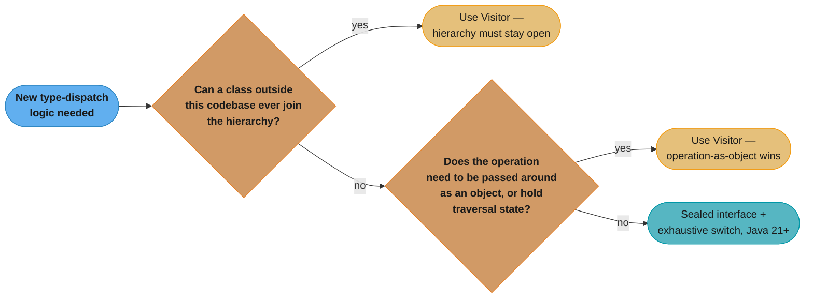

# Visitor vs Pattern Matching (switch)
## Overview

[`behavioral/visitor/visitor.md`](../behavioral/visitor/visitor.md) already covers Visitor's mechanics — double dispatch, the migration story, and a solid answer on whether modern `switch` replaces it — in depth. This file is a narrower disambiguation surface: given a new hierarchy today, which do you reach for, and why does the honest answer depend on who owns the hierarchy rather than which construct is "more modern." Sealed interfaces plus record patterns plus exhaustive `switch` is the current default for a closed, self-owned hierarchy; Visitor remains correct — not legacy, correct — for an open one.

**The features, verified against their JEPs, not memory:**

| Feature | JEP | Finalized in |
|---------|-----|---------------|
| Sealed Classes | [JEP 409](https://openjdk.org/jeps/409) | Java 17 |
| Record Patterns | [JEP 440](https://openjdk.org/jeps/440) | Java 21 |
| Pattern Matching for `switch` | [JEP 441](https://openjdk.org/jeps/441) | Java 21 |
| Primitive types in patterns, `instanceof`, and `switch` | [JEP 532](https://openjdk.org/jeps/532) | Not final: preview since JDK 23 (JEP 455), fifth preview in JDK 27 |

The first three are final in Java 21. The Java 21 floor covers reference types only: a `switch` on a `long`, `float`, `double`, or `boolean` selector, or a primitive type pattern that tests a narrowing conversion such as `case int i` on a `double`, still needs `--enable-preview` in JDK 27.

---

## Intuition

> **One-line analogy**: Visitor is a delivery service that visits every house on a street and lets each resident decide how to react — the street can add a new house tomorrow without asking the delivery service's permission. A sealed `switch` is a roll call in a locked room — the compiler already knows every name on the list, and it refuses to let you leave without addressing every one of them, but nobody new gets into the room without unlocking the door first.

**Mental model**: Both solve the same core problem — "run type-specific logic across a family of types without an `instanceof` chain" — but they make opposite bets about who is allowed to grow the family. Visitor's `accept()`/`visit()` double dispatch means any class, anywhere, including one you never wrote, can implement the element interface and plug into the existing visitor infrastructure. A sealed hierarchy's `permits` clause is a fixed, closed list the compiler checks at compile time — the exhaustive `switch` over it is only exhaustive because no thirteenth subtype can appear without editing the sealed declaration itself.

**Why it matters**: This is where "just use the modern feature" answers go wrong in an interview. Sealed types and pattern matching are not a strictly better replacement for Visitor — they are the right tool for a hierarchy you own and intend to keep closed, and the wrong tool the moment a plugin author needs to add a fourteenth node type you never anticipated.

**Key insight**: Ask "can a class outside this codebase ever need to join this hierarchy?" If yes, Visitor (or an equivalent open-dispatch mechanism) is structurally required — sealing the hierarchy would make that impossible by design. If no, sealed types plus exhaustive `switch` deletes the `accept`/`visit` boilerplate entirely and turns "forgot to handle the new case" from a runtime bug into a compile error.

---

## Side-by-Side: Same Operation, Two Mechanisms

### Visitor — double dispatch over an open hierarchy

```java
interface Expr {
    <R> R accept(ExprVisitor<R> v);
}
final class Literal implements Expr {
    final int value;
    Literal(int value) { this.value = value; }
    public <R> R accept(ExprVisitor<R> v) { return v.visitLiteral(this); }
}
final class Add implements Expr {
    final Expr left, right;
    Add(Expr left, Expr right) { this.left = left; this.right = right; }
    public <R> R accept(ExprVisitor<R> v) { return v.visitAdd(this); }
}
interface ExprVisitor<R> {
    R visitLiteral(Literal l);
    R visitAdd(Add a);
}
class Evaluator implements ExprVisitor<Integer> {
    public Integer visitLiteral(Literal l) { return l.value; }
    public Integer visitAdd(Add a)         { return a.left.accept(this) + a.right.accept(this); }
}

// Usage
Expr expr = new Add(new Literal(2), new Literal(3));
int result = expr.accept(new Evaluator()); // 5
```

### Sealed + switch — exhaustive pattern matching over a closed hierarchy

```java
sealed interface Expr permits Literal, Add {}
record Literal(int value) implements Expr {}
record Add(Expr left, Expr right) implements Expr {}

static int eval(Expr expr) {
    return switch (expr) {
        case Literal(int value)      -> value;
        case Add(Expr left, Expr right) -> eval(left) + eval(right);
        // no default needed — the compiler proves every Expr subtype is handled
    };
}

// Usage
Expr expr = new Add(new Literal(2), new Literal(3));
int result = eval(expr); // 5
```

The switch version deletes the `accept` method, the `ExprVisitor` interface, and the `Evaluator` class entirely — `eval` is one function. Adding a second operation (`print(Expr)`) means writing one more function the same shape, with no interface to implement and no existing class to touch. That is genuinely less code for a hierarchy you own — see [visitor.md's own answer on this](../behavioral/visitor/visitor.md#16-interview-questions-with-answers) for the deeper mechanical walkthrough of why.

---

## Broken, Then Fixed: Why "No Default" Is the Whole Point

```java
// BROKEN: a default clause silently swallows a forgotten case
sealed interface Expr permits Literal, Add, Multiply {}
record Literal(int value) implements Expr {}
record Add(Expr left, Expr right) implements Expr {}
record Multiply(Expr left, Expr right) implements Expr {} // added later

static int eval(Expr expr) {
    return switch (expr) {
        case Literal(int value)         -> value;
        case Add(Expr l, Expr r)        -> eval(l) + eval(r);
        default -> throw new IllegalStateException("unreachable"); // compiles, hides the bug
    };
}
// Multiply silently falls into "unreachable" at runtime — the compiler said nothing.
```

```java
// FIX: remove the default. The compiler now refuses to compile until Multiply is handled.
static int eval(Expr expr) {
    return switch (expr) {
        case Literal(int value)         -> value;
        case Add(Expr l, Expr r)        -> eval(l) + eval(r);
        case Multiply(Expr l, Expr r)   -> eval(l) * eval(r); // compiler forced this
    };
}
```

Adding a `default` branch to a pattern-matching `switch` over a sealed type throws away the one property that makes the whole exercise worth it — exhaustiveness checking. The same failure mode in Visitor is an abstract `visit()` method with no body, or a base visitor class supplying a silent no-op default for every type: both let a forgotten case compile clean and fail (or do nothing) at runtime instead of at build time.

---

## The Expression Problem, Framed Honestly

The **expression problem** asks for a way to add both new *types* and new *operations* to a data model, without modifying existing code and without losing static type safety. Neither Visitor nor sealed-`switch` solves it for free — each picks a different half to make easy, and it is worth stating plainly which half each one gives up:

- **Adding a new operation** is cheap in both. Visitor: write one new `ConcreteVisitor` class; nothing existing changes. Sealed `switch`: write one new function with a case per type; nothing existing changes. On this axis they tie.
- **Adding a new type** is where they diverge, and this is the axis interview answers usually gloss over. Visitor over an **open** (unsealed) hierarchy genuinely allows it — a third party can define a new `Element` implementation, implement `accept()`, and plug into the system, though every *existing* visitor must now be revisited to add a case for it (or inherit a default). A **sealed** hierarchy explicitly forbids it: the `permits` clause is a closed, compile-time-checked list, so a new subtype cannot be added without editing the sealed type's own declaration — which, for a published library, is a breaking, major-version change, not an extension.

So the honest framing is not "sealed types solve the expression problem better." It is: **sealed types deliberately opt out of the expression problem's extensibility goal in exchange for compiler-checked completeness**, while Visitor keeps the hierarchy genuinely open at the cost of every visitor needing a touch point for every type. Neither is a strictly dominant choice — they are answers to different questions ("must this stay open to strangers?" vs. "do I want the compiler to prove I handled everything?").

---

## Key Differences Table

| Dimension | Visitor | Sealed + exhaustive `switch` |
|-----------|---------|-------------------------------|
| **Hierarchy** | Open — any class can implement the element interface | Closed — `permits` enumerates every subtype at compile time |
| **Adding an operation** | New `ConcreteVisitor` class, zero edits to existing code | New function, zero edits to existing code |
| **Adding a type** | New element class + one method per existing visitor (or an inherited default) | Edit the sealed declaration's `permits` list — a breaking change for consumers |
| **Exhaustiveness check** | Manual — a forgotten `visit()` override compiles silently unless the visitor is abstract with no default | Automatic — the compiler rejects a non-exhaustive `switch` with no `default` |
| **Boilerplate** | `accept()` on every element, a visitor interface, one method per type per visitor | None — a `switch` expression and record deconstruction patterns |
| **Operation as first-class object** | Yes — a `ConcreteVisitor` instance can be passed, stored, composed | No — a `switch`-based function is not itself an object unless wrapped in one |
| **Accumulating state across a traversal** | Natural — the visitor instance holds fields across the whole walk | Awkward — an exhaustive `switch` is naturally one-shot per call; state needs an explicit accumulator parameter |
| **Third-party extensibility** | Yes, by design | No, by design |
| **Java version** | Any (pattern predates generics) | Java 21+ for full pattern matching (`switch` patterns final via JEP 441; record deconstruction final via JEP 440) |

---

## Common Confusion Points

1. **"Java 21 pattern matching replaces Visitor" is only true for closed hierarchies.** For a plugin architecture, a public API's element types, or any hierarchy other code depends on being able to extend, sealing it is not an option — the whole point of a plugin system is that the author does not know every subtype in advance.
2. **Both look similarly compact once written.** The line-count win for `switch` comes from deleting `accept`/`visit`/the visitor interface, not from the operation logic itself being shorter — the `visitAdd`/`case Add` branches are nearly identical.
3. **Sealed does not mean small.** A sealed interface can `permits` dozens of record types; the ceiling is "do you control the full list," not "is the list short."
4. **Exhaustiveness is a compile-time property of the closed set, not a runtime check.** A sealed `switch` with no `default` fails to *compile* if a case is missing — it never reaches production with a silently unhandled type the way a Visitor's inherited no-op default can.
5. **You do not need record patterns to get exhaustiveness.** A plain `sealed interface Shape permits Circle, Square` with `switch (shape) { case Circle c -> ...; case Square s -> ...; }` (type patterns, JEP 441) is already exhaustive-checked; record deconstruction (JEP 440, `case Circle(double r) -> ...`) is a separate, additive convenience for pulling fields out of record types.

---

## When to Use Which

### Use Visitor when:
- The element hierarchy is **not sealed and not yours to modify** — a library's public types, a plugin's contribution, a domain model consumers are expected to extend.
- Operations need to be **first-class objects** — passed around, composed, configured, stored, or selected at runtime rather than called directly by name.
- The traversal itself is **non-trivial and belongs with the elements** — skip-subtree logic, ordering control, or a shared walking algorithm multiple operations reuse (`java.nio.file.FileVisitor`'s `FileVisitResult` is exactly this).
- The **operation count keeps growing** against a genuinely stable set of types — the case Visitor was invented for.

### Use sealed types + exhaustive `switch` when:
- You **own the entire hierarchy** and have no requirement for third parties to extend it.
- You want the **compiler, not a runtime `instanceof` chain or a forgotten visitor override**, to catch a missing case the moment a new type is added.
- The operation is naturally a **single function**, not something that needs to hold traversal state across a walk.
- You are writing **new Java code today** — this is the default starting point per [visitor.md's own guidance](../behavioral/visitor/visitor.md), reserving Visitor for the cases above rather than reaching for it by habit.



*The first "yes" answer — third-party extensibility — ends the decision immediately, because sealing is structurally incompatible with that requirement, not merely less convenient for it.*

---

## Real-World Examples

| Concern | Visitor | Sealed + switch |
|---------|---------|-------------------|
| Compiler AST with third-party plugin passes | `javac`'s tree visitor API, ANTLR-generated visitors — plugin authors add new tree-walking passes without javac's team touching node classes | N/A — the JDK's own `com.sun.source.tree` hierarchy predates sealed types and stays open by necessity |
| File-system walking | `java.nio.file.FileVisitor` — third-party tools implement it over a directory tree the JDK does not control the contents of | N/A — the set of files on disk is not a closed Java type hierarchy |
| A closed expression/AST you fully own | Only if operations need to be pluggable objects | An interpreter's own `Expr` sealed hierarchy — see the eval example above; new operations are one function each |
| A REST API's response variants (success, validation error, not found) | Rare — usually a fixed, self-owned set | `sealed interface ApiResult permits Success, ValidationError, NotFound` with an exhaustive `switch` mapping each to an HTTP status — the common modern shape |
| A plugin-extensible design-tool node hierarchy | Visitor, so third-party plugin nodes can implement `accept()` | N/A — sealing would block the plugin model entirely |

---

## Interview Questions with Answers

**Q: Is pattern matching for switch a strictly better replacement for Visitor?**
**Short:** No — it is strictly better only when you own and can seal the entire type hierarchy.

Sealed types plus exhaustive `switch` deletes Visitor's `accept`/`visit` boilerplate and gives compile-time exhaustiveness, which is a real win for a hierarchy you fully control. But sealing a hierarchy is an explicit closure: no class outside the `permits` list can ever join it. Any design where a plugin, a library consumer, or unknown future code needs to add a new type to the hierarchy cannot use this approach at all, and Visitor remains the structurally correct choice there.

**Q: What JEP finalized sealed classes, and in which Java version?**
**Short:** JEP 409 finalized sealed classes in Java 17.

Sealed classes and interfaces, which let a type declare a fixed, compiler-checked list of permitted subtypes via `permits`, became a final (non-preview) language feature in Java 17 under JEP 409. This is the mechanism that makes an exhaustive `switch` provably complete — the compiler can enumerate every possible subtype because the `permits` list is closed and known at compile time.

**Q: What JEPs finalized record patterns and pattern matching for switch, and in which Java version?**
**Short:** JEP 440 (record patterns) and JEP 441 (pattern matching for switch) both finalized in Java 21.

Record Patterns (JEP 440) let a `switch` case deconstruct a record's components directly, as in `case Add(Expr left, Expr right) -> ...`. Pattern Matching for `switch` (JEP 441) is the broader feature enabling type patterns and exhaustiveness checking as `case` labels in `switch` statements and expressions. Both went from preview through several JDK releases and were finalized together in Java 21, which is why "Java 21+" is the practical version floor for the full sealed-plus-pattern-matching style shown in this file.

**Q: Can a Java 21 `switch` match on a `long` or `double` value, or narrow a `double` record component to `int` in a pattern?**
**Short:** No. Primitive selectors beyond int-like types and converting primitive patterns are JEP 532, still a preview (fifth, JDK 27).

JEP 441 limits `switch` selectors to `byte`, `short`, `char`, `int`, their boxes, `String`, enums, and reference types, and JEP 440 lets a nested pattern on a primitive record component use only the exact component type. JEP 455 (JDK 23) first previewed primitive type patterns in every pattern context and `switch` on `boolean`, `long`, `float`, and `double`. A pattern such as `case int i` on a `double` matches only when the conversion loses no information. JEP 532 previews it a fifth time in JDK 27 with no change from JEP 530 (JDK 26), so the sealed-plus-switch style in this file is GA on reference hierarchies only.

**Q: What specifically does "exhaustiveness checking" mean for a switch over a sealed type, and what error does the compiler give if it fails?**
**Short:** The compiler proves every permitted subtype has a case, and refuses to compile a switch expression missing one.

Because a sealed type's full set of subtypes is known at compile time via its `permits` clause, the compiler can statically verify that a `switch` expression's cases cover every one of them; if a subtype is missing and there is no `default`, compilation fails with an error that the switch expression does not cover all possible input values. This converts what would be a Visitor's silently-inherited no-op default, or an `instanceof` chain's forgotten branch, into a build failure instead of a runtime surprise.

**Q: Why does adding a `default` branch to an exhaustive switch defeat the purpose of using sealed types at all?**
**Short:** A default swallows any future unhandled subtype silently, which is exactly what exhaustiveness checking exists to prevent.

The entire benefit of pairing sealed types with pattern matching is that the compiler forces every case to be handled explicitly. Adding a catch-all `default` branch reintroduces the exact failure mode sealing was meant to eliminate: a new subtype added later falls into the `default` branch, compiles cleanly, and does whatever the default does (often throw, or silently do nothing) instead of forcing the author to write a deliberate case for it.

**Q: What does the expression problem ask for, and does either Visitor or sealed-switch actually solve it?**
**Short:** It asks for easy new types AND new operations without modifying existing code; neither construct achieves both simultaneously.

The expression problem wants a data model where you can add new types and new operations freely, without editing existing code, while keeping static type safety. Visitor makes adding operations cheap (a new visitor class) but adding types expensive (every existing visitor needs a new method). Sealed-plus-switch makes adding operations cheap the same way, but makes adding types not just expensive but structurally forbidden without editing the sealed declaration itself. Neither solves the problem in the classic sense; they each trade away one of its two goals.

**Q: In what specific situation does Visitor genuinely outperform sealed types plus switch, even in Java 21+?**
**Short:** When the hierarchy is open to extension by code outside your control, such as a plugin or library consumer.

If a third party — a plugin author, a downstream library consumer, a separate team — needs to introduce a new element type without your codebase's cooperation, sealing the hierarchy is not an option, since `permits` must name every subtype at the point the sealed type is declared. Visitor's `accept()`/`visit()` mechanism keeps the hierarchy genuinely open: any class implementing the element interface participates, at the acknowledged cost that every existing visitor must add a case for it.

**Q: Why is "the operation needs to be a first-class object" a reason to prefer Visitor over a switch-based function?**
**Short:** A ConcreteVisitor instance can be passed, stored, and composed; a switch expression embedded in a function cannot.

A `ConcreteVisitor` is an ordinary object — it can be constructed with configuration, passed into other methods, stored in a collection of pending operations, or composed with another visitor via delegation. A `switch`-based `eval(Expr)` function is just a function; making it passable as a value requires wrapping it in a functional interface or a class, at which point you have re-derived something visitor-shaped anyway. When an operation genuinely needs to be treated as data (a pluggable strategy, a queued job), Visitor's object-based structure is the more natural fit.

**Q: Why is accumulating state across a tree traversal more natural with Visitor than with an exhaustive switch?**
**Short:** A visitor instance holds fields across the whole walk; a switch-based recursive function needs an explicit accumulator parameter threaded through every call.

A stateful `ConcreteVisitor` (say, one counting nodes by type as it walks) simply increments its own instance fields inside each `visit()` method, and the accumulated result is read off the visitor object once the traversal finishes. A `switch`-based recursive `eval`-style function has no implicit place to accumulate state — the recursive calls would each need an accumulator parameter threaded through and returned back up, which works but is more plumbing than a visitor's mutable fields for this specific shape of problem.

**Q: What does "sealing a hierarchy is a breaking change for library consumers" mean concretely?**
**Short:** Adding a new permitted subtype to a published sealed type forces every existing exhaustive switch in consumer code to be edited or it fails to compile.

If a library publishes `sealed interface Shape permits Circle, Square` and a consumer writes an exhaustive `switch (shape) { case Circle c -> ...; case Square s -> ...; }` against it, adding `Triangle` to the `permits` list in a later library version makes every one of those consumer switches fail to compile until a `Triangle` case is added. This is the same "every visitor must be touched" cost Visitor has when a new element type appears — sealed types do not eliminate that cost, they just move where it is paid: from a silently-passing visitor with an inherited default to a compile error in every downstream consumer.

**Q: How would you migrate an existing Visitor-based AST evaluator to sealed types plus switch, and when would you decide NOT to?**
**Short:** Convert element classes to sealed records, replace each ConcreteVisitor with one function, and stop if any element type is externally extensible.

The mechanical migration is: turn each element class into a `record` implementing a `sealed interface`, replace each `ConcreteVisitor` class's logic with a `switch` expression over the sealed type doing the same per-case work, and delete the `accept`/`visit` machinery entirely. The reason to stop partway through is if any single element type in the hierarchy is known to be extended by code you do not control — at that point the hierarchy cannot be sealed at all, and the migration should not proceed for that type, even if every other type in the same codebase is a good candidate.

**Q: Why does `java.nio.file.FileVisitor` remain Visitor-shaped rather than being redesigned around pattern matching in modern Java?**
**Short:** The set of files on a real filesystem is not a closed, compile-time-known type hierarchy, so sealing is not applicable.

`FileVisitor` walks an actual directory tree at runtime — files and directories are not Java types with a fixed, compile-time-enumerable set of subtypes the way an AST's node classes are. There is nothing to seal, because "every possible file path" is not a closed set the compiler can check; pattern matching over sealed types solves a fundamentally different problem (exhaustive dispatch over a fixed, known type hierarchy) than filesystem traversal (dispatch over runtime-discovered, unbounded data).

**Q: Give a modern example of a self-owned hierarchy that is a strong candidate for sealed types plus switch instead of Visitor.**
**Short:** A REST API's response variants — success, validation error, not found — modeled as a sealed interface with an exhaustive status mapping.

`sealed interface ApiResult permits Success, ValidationError, NotFound` fully owned by the service, with a `switch` mapping each variant to an HTTP status code and response body, is the common modern shape: the set of outcomes is fixed by the service's own design, no external code needs to add a fourth variant, and the compiler guarantees every variant maps to a status before the code ships. This is a clean contrast to the AST-with-plugins case, where the same closed-set property does not hold.

**Q: What is lost, specifically in terms of code volume, when converting a Visitor-based evaluator to a sealed switch, and what is NOT saved?**
**Short:** The accept methods, visitor interface, and ConcreteVisitor classes disappear; the actual per-type logic inside each branch stays roughly the same size.

Deleted entirely: the `accept()` method on every element class, the `Visitor` interface itself, and the wrapper class structure of each `ConcreteVisitor`. Not saved: the actual computation inside `visitAdd`/`case Add` — evaluating an addition still requires the same two recursive calls and a `+`, whether it lives in a `ConcreteVisitor` method or a `switch` case body. The size win is entirely in removed infrastructure, not in the domain logic itself, which is why "less boilerplate" rather than "shorter algorithm" is the accurate framing.

**Q: When asked in an interview to design a new closed AST for a small interpreter, which should you propose by default in 2026, and what one follow-up question should you ask?**
**Short:** Propose sealed types plus exhaustive switch by default, and ask whether any node type must be extensible by code outside your control.

For new Java code over a hierarchy you own, sealed types plus pattern-matching `switch` is the correct default — less boilerplate, compiler-enforced completeness, no `accept`/`visit` machinery. The one question that should come before committing to that default is whether any part of the hierarchy needs to accept contributions from outside code (a plugin system, a public extension point); if the answer is yes for even one node type, that portion needs Visitor's open-dispatch shape instead, and the two can coexist in the same codebase for different parts of the hierarchy.

**Q: Can Visitor and sealed-plus-switch coexist in the same codebase, and what does that split look like in practice?**
**Short:** Yes — seal the node types you own, keep Visitor only for the one node type a plugin is allowed to extend.

A design tool's core node types (`Rectangle`, `Circle`, `Group`) can be a sealed hierarchy handled with exhaustive `switch` for every built-in operation, while a separate `PluginNode` extension point stays outside the sealed set and is dispatched through a small Visitor interface just for that one open boundary. The split is deliberate: most of the hierarchy gets compile-time completeness, and only the genuinely extensible edge pays Visitor's boilerplate cost, rather than forcing the whole hierarchy into one mechanism because it is simpler to reason about.

**Q: Why doesn't wrapping an exhaustive switch inside a lambda or functional interface make it equivalent to Visitor?**
**Short:** Wrapping a switch gives a passable object, but not open extensibility or the double-dispatch mechanism sealed types deliberately forbid.

`Function<Expr, Integer> evaluator = e -> switch (e) { case Literal(int v) -> v; case Add(var l, var r) -> ...; };` does make the operation passable as a value, addressing the "first-class object" gap on its own — but the underlying `switch` is still exhaustive-checked against a *sealed* type, so the hierarchy itself remains closed to outside extension. The two properties are independent: passability is about how the operation is packaged, and openness is about who can add new element types. Wrapping a switch fixes the first without touching the second, so it is not a substitute for Visitor whenever the actual requirement is an open hierarchy.
