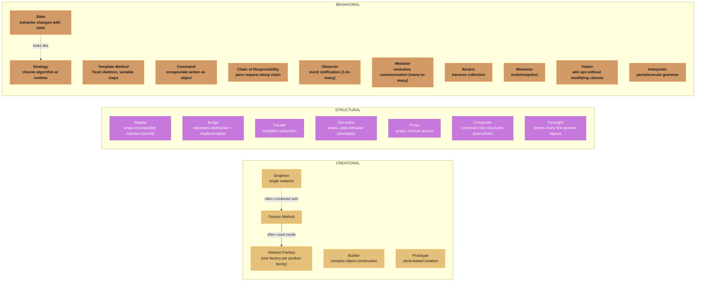
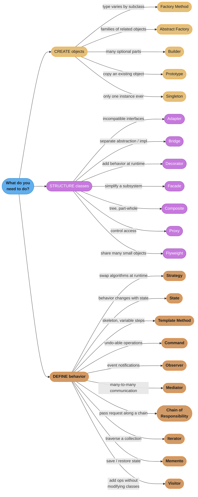

# Design Pattern Comparisons - Master Reference

This directory contains deep-dive comparisons of commonly confused GoF design patterns. Each file provides side-by-side analysis, code examples, and interview guidance.

---

## Intuition

> **One-line analogy**: Pattern comparisons are like knowing not just the tools in your toolbox but which job each one was designed for — a screwdriver and a drill both turn things, but they're not interchangeable.

**Mental model**: Many GoF patterns look structurally identical (Strategy and State both delegate to an interface; Decorator and Proxy both wrap an object). The confusion clears when you ask "what problem is this solving?" — Strategy swaps algorithms; State encodes lifecycle. Decorator adds behavior; Proxy controls access. The distinction always lives in intent, not structure.

**Why it matters**: Interviewers often deliberately present confusable patterns. Knowing their structural similarity AND the intent difference is the sign of genuine understanding versus memorization.

**Key insight**: When stuck between two patterns, ask: "Who controls the switch?" and "What changes over the object's lifetime?" The answers usually disambiguate immediately.

---

## Master Comparison Matrix - All 23 GoF Patterns

| Pattern | Category | Intent | Scope | Key Mechanism |
|---------|----------|--------|-------|---------------|
| Abstract Factory | Creational | Create families of related objects | Object | Delegates to factory objects |
| Builder | Creational | Construct complex objects step by step | Object | Separates construction from representation |
| Factory Method | Creational | Define interface for object creation | Class | Subclasses decide which class to instantiate |
| Prototype | Creational | Clone existing objects | Object | Copies an existing object |
| Singleton | Creational | Ensure only one instance exists | Object | Controls instance creation |
| Adapter | Structural | Convert interface to another | Class/Object | Wraps an object/class with a new interface |
| Bridge | Structural | Separate abstraction from implementation | Object | Composition over inheritance |
| Composite | Structural | Tree structure of objects | Object | Recursive composition |
| Decorator | Structural | Add responsibilities dynamically | Object | Wraps object, adds behavior |
| Facade | Structural | Simplified interface to subsystem | Object | Delegates to subsystem objects |
| Flyweight | Structural | Share fine-grained objects | Object | Shared state between many small objects |
| Proxy | Structural | Surrogate or placeholder | Object | Wraps object, controls access |
| Chain of Responsibility | Behavioral | Pass request along handler chain | Object | Linked list of handlers |
| Command | Behavioral | Encapsulate request as object | Object | Encapsulates action + receiver |
| Interpreter | Behavioral | Language grammar interpretation | Class | Composite of terminal/nonterminal expressions |
| Iterator | Behavioral | Sequential access to collection | Object | Cursor over aggregate |
| Mediator | Behavioral | Centralize object communication | Object | Central hub coordinates colleagues |
| Memento | Behavioral | Capture and restore object state | Object | Originator/Caretaker/Memento trio |
| Observer | Behavioral | Notify dependents of state change | Object | Subject notifies list of observers |
| State | Behavioral | Alter behavior when state changes | Object | Delegates to current state object |
| Strategy | Behavioral | Encapsulate interchangeable algorithms | Object | Delegates to strategy object |
| Template Method | Behavioral | Define algorithm skeleton in base class | Class | Inheritance, hook methods |
| Visitor | Behavioral | Add operations without changing classes | Object | Double dispatch |

---

## Pattern Relationship Map

*Patterns cluster by GoF category — gold for Creational, purple for Structural, orange for Behavioral. The two dashed edges are the classic look-alike traps: Singleton is frequently paired with Factory Method, and State's structure is often confused with Strategy's — exactly the pairs the comparison table below digs into.*

---

## Commonly Confused Pairs (Files in this directory)

| File | Patterns Compared | Core Confusion |
|------|-------------------|----------------|
| [Strategy_vs_State.md](Strategy_vs_State.md) | Strategy vs State | Both delegate to an object; differ in *who* drives change |
| [Factory_vs_AbstractFactory_vs_Builder.md](Factory_vs_AbstractFactory_vs_Builder.md) | Factory Method vs Abstract Factory vs Builder | All create objects; differ in complexity and structure |
| [Adapter_vs_Bridge_vs_Facade.md](Adapter_vs_Bridge_vs_Facade.md) | Adapter vs Bridge vs Facade | All wrap; differ in intent and timing |
| [Decorator_vs_Proxy.md](Decorator_vs_Proxy.md) | Decorator vs Proxy | Both wrap objects; differ in purpose |
| [Observer_vs_Mediator.md](Observer_vs_Mediator.md) | Observer vs Mediator | Both handle communication; differ in topology |
| [Command_vs_Strategy.md](Command_vs_Strategy.md) | Command vs Strategy | Both encapsulate behavior; differ in purpose |
| [Template_vs_Strategy.md](Template_vs_Strategy.md) | Template Method vs Strategy | Both vary steps; inheritance vs composition |
| [Composite_vs_Decorator.md](Composite_vs_Decorator.md) | Composite vs Decorator | Both use recursive composition |
| [ChainOfResponsibility_vs_Command.md](ChainOfResponsibility_vs_Command.md) | Chain of Responsibility vs Command | Both handle requests |

---

## Quick Selection Guide

*Triage first by job type (colors matching the relationship map above), then follow the branch whose condition matches your situation to the recommended pattern. The checklists below spell out the same 22 rules in prose — use whichever you scan faster.*

### "I need to CREATE objects"
- Single object, type varies by subclass -> **Factory Method**
- Families of related objects -> **Abstract Factory**
- Complex object with many optional parts -> **Builder**
- Copy an existing object -> **Prototype**
- Only one instance ever -> **Singleton**

### "I need to STRUCTURE classes/objects"
- Make incompatible interfaces work together -> **Adapter**
- Separate abstraction from implementation -> **Bridge**
- Add behavior dynamically at runtime -> **Decorator**
- Simplify a complex subsystem -> **Facade**
- Tree structure (part-whole) -> **Composite**
- Control access to an object -> **Proxy**
- Share many small objects -> **Flyweight**

### "I need to define BEHAVIOR / communication"
- Swap algorithms at runtime -> **Strategy**
- Behavior changes with object state -> **State**
- Skeleton algorithm with variable steps -> **Template Method**
- Undo-able operations -> **Command**
- Event notifications -> **Observer**
- Decouple many-to-many communication -> **Mediator**
- Pass request along a chain -> **Chain of Responsibility**
- Traverse a collection -> **Iterator**
- Save and restore state -> **Memento**
- Add operations to class hierarchy without modifying it -> **Visitor**

---

## Pattern Frequency in Real Systems

| Frequency | Patterns |
|-----------|----------|
| Very Common | Singleton, Factory Method, Observer, Strategy, Decorator, Facade |
| Common | Builder, Adapter, Proxy, Command, Iterator, Template Method |
| Moderate | Abstract Factory, Composite, State, Chain of Responsibility, Mediator |
| Less Common | Bridge, Flyweight, Prototype, Memento, Visitor, Interpreter |

---

## Files in This Directory

- [pattern_comparisons.md](pattern_comparisons.md) — This file (master matrix + quick guide)
- [Strategy_vs_State.md](Strategy_vs_State.md)
- [Factory_vs_AbstractFactory_vs_Builder.md](Factory_vs_AbstractFactory_vs_Builder.md)
- [Adapter_vs_Bridge_vs_Facade.md](Adapter_vs_Bridge_vs_Facade.md)
- [Decorator_vs_Proxy.md](Decorator_vs_Proxy.md)
- [Observer_vs_Mediator.md](Observer_vs_Mediator.md)
- [Command_vs_Strategy.md](Command_vs_Strategy.md)
- [Template_vs_Strategy.md](Template_vs_Strategy.md)
- [Composite_vs_Decorator.md](Composite_vs_Decorator.md)
- [ChainOfResponsibility_vs_Command.md](ChainOfResponsibility_vs_Command.md)
- [DecisionFlowchart.md](DecisionFlowchart.md)
- [PatternCombinations.md](PatternCombinations.md)
- [InterviewQuestions.md](InterviewQuestions.md)

---

## Interview Questions with Answers

**Q: When two GoF patterns look structurally identical, what question should you ask to disambiguate them?**
**Short:** Ask what problem is being solved — intent, not structure, always disambiguates confusable patterns.

Strategy and State both delegate to an interface and look nearly the same in UML, as do Decorator and Proxy. The structural similarity is a red herring; the real distinction always lives in intent. Strategy swaps algorithms chosen externally; State encodes an object's own lifecycle. Decorator adds behavior; Proxy controls access. Interviewers deliberately present confusable patterns to test whether you understand intent or just memorized diagrams.

**Q: What are the two dashed "looks like" edges in the pattern relationship map, and why do they matter?**
**Short:** Singleton is often paired with Factory Method, and State's structure is frequently confused with Strategy's.

The relationship map marks `SIN -.->|often combined with| FM` and `STA -.->|looks like| STR` as dashed edges distinct from the solid composition/usage edges elsewhere in the diagram. The Singleton-Factory Method pairing is a common COMBINATION (a factory that also enforces one instance), while the State-Strategy edge is a common CONFUSION (near-identical structure, different intent) — the diagram deliberately uses dashed lines to flag both as traps worth double-checking, not endorsements to blindly combine or conflate them.

**Q: Which patterns does the Pattern Frequency table rank as "Very Common" in real systems?**
**Short:** Singleton, Factory Method, Observer, Strategy, Decorator, and Facade rank as very common.

These six patterns appear across virtually every nontrivial codebase: Singleton for shared resources, Factory Method for object creation flexibility, Observer for event-driven UI and pub/sub, Strategy for swappable algorithms, Decorator for I/O and cross-cutting behavior, and Facade for simplifying subsystem APIs. Contrast this with the "Less Common" tier (Bridge, Flyweight, Prototype, Memento, Visitor, Interpreter), which solve narrower problems that arise less frequently in day-to-day application code. This frequency ranking is a useful prioritization guide for what to study deepest before an interview.

**Q: According to the Master Comparison Matrix, what single-word distinguishes Composite's Scope from Facade's, even though both are Structural and Object-scoped?**
**Short:** Both are Object-scoped, but their Key Mechanism differs — Composite recursively composes, Facade delegates to a subsystem.

The Matrix lists both Composite and Facade as `Structural` category with `Object` scope, so scope alone doesn't separate them. The distinguishing column is Key Mechanism: Composite's is "Recursive composition" (building a tree), while Facade's is "Delegates to subsystem objects" (flattening access to existing objects, no tree). This is a good illustration of why the Matrix's Scope column alone is insufficient for pattern selection — Intent and Key Mechanism carry the real signal.

**Q: Per the matrix, which patterns are Class-scoped rather than Object-scoped, and what does that distinction mean?**
**Short:** Factory Method, Interpreter, and Template Method are Class-scoped — their variation point is fixed via inheritance at compile time.

Class scope in the GoF taxonomy means the pattern's relationships are established through inheritance and fixed at compile time (subclassing), whereas Object scope means relationships are established at runtime through composition and can change dynamically. Factory Method varies which subclass creates an object; Template Method varies which subclass overrides algorithm steps; Interpreter's grammar hierarchy is a fixed class structure. Every other pattern in the 23 is Object-scoped, which is why composition-based patterns dominate the "prefer composition over inheritance" conversation.

**Q: How does the Quick Selection Guide's three-branch root question help before naming a specific pattern?**
**Short:** It first asks whether you need to CREATE objects, STRUCTURE classes, or DEFINE behavior, then narrows within that category.

Rather than jumping straight to "is this Strategy or State," the guide's root question — CREATE, STRUCTURE, or DEFINE behavior — filters out roughly two-thirds of the 23 patterns immediately, since each pattern belongs to exactly one GoF category. Only after committing to a category do the more granular disambiguating questions (families vs. single object, tree vs. wrapper, algorithm vs. lifecycle) apply. This two-stage triage mirrors how the file recommends starting from the problem rather than a remembered pattern name.

**Q: What does the "Common Confusion Points" summary imply about the difference between Decorator and Proxy at a glance?**
**Short:** Decorator adds behavior; Proxy controls access — the pairing appears in the file's own commonly-confused-pairs table.

The master file's table of commonly confused pairs lists `Decorator_vs_Proxy.md` with the core confusion "Both wrap objects; differ in purpose" — decoration enriches what an object does, while a proxy gates or intercepts access to it without necessarily changing its behavior. This file doesn't resolve the pair itself; it exists specifically to route you to the dedicated comparison file for the full treatment, which is the master file's role for every pair it lists.

**Q: Why does the master file list Observer vs Mediator as differing in "topology" specifically?**
**Short:** Observer is one-to-many broadcast; Mediator is many-to-many coordination through a central hub — different network shapes.

Both patterns manage communication between objects, but the master file's confusion summary singles out topology as the axis that separates them: Observer connects one subject outward to many independent observers (a star from the subject), while Mediator centralizes many-to-many communication through a hub so that peer objects never reference each other directly. This framing — "topology," not "purpose" — is a distinct disambiguation angle from the intent-based framing used for Decorator vs Proxy.

**Q: Per the master matrix, what is shared between Chain of Responsibility and Command that makes them a commonly confused pair?**
**Short:** Both handle requests as first-class concerns, but CoR routes them while Command encapsulates them for later execution.

The matrix lists Chain of Responsibility's Key Mechanism as "Linked list of handlers" and Command's as "Encapsulates action + receiver" — both are Behavioral, Object-scoped patterns that involve a "request" as a central concept, which is exactly why they get grouped as a commonly confused pair in the file's own table ("Both handle requests"). The dedicated `ChainOfResponsibility_vs_Command.md` file resolves the confusion along the ROUTING (who handles it) versus ENCAPSULATION (what is the request, can it be reversed) axis.

**Q: What is the Golden Hammer anti-pattern in the context of this file's pattern-selection philosophy?**
**Short:** Golden Hammer is using the patterns you already know regardless of whether they actually fit the problem.

The file frames pattern selection as starting from the problem, not the solution — a decision framework that answers "what am I trying to do" before naming a pattern. Golden Hammer is the failure mode of skipping that framework and instead reaching for a familiar pattern (often Singleton or Factory) out of habit, whether or not it's the best structural fit. The antidote is the same three-question triage (creation/structure/behavior, who varies, runtime vs compile time) the file recommends throughout.

**Q: According to the Quick Reference Card, what are the key participants shared between Command and Memento, and why does that matter for undo/redo?**
**Short:** Command has Invoker/Receiver while Memento has Originator/Caretaker — combined, they give both the action and a state snapshot.

Command's participants (Command, ConcreteCommand, Invoker, Receiver) capture WHAT operation happened and who it targets, while Memento's (Originator, Memento, Caretaker) capture a snapshot of state that can be restored. Neither alone gives complete undo/redo: Command's `undo()` may not always be able to reverse an operation purely algorithmically, so pairing it with a Memento snapshot as a fallback restore mechanism is a standard combination the file cross-references in its own comparison directory.

**Q: How would you use the Master Comparison Matrix to justify choosing Bridge over Adapter in a design review?**
**Short:** Point to Bridge's Intent ("separate abstraction from implementation") versus Adapter's ("convert interface to another").

The matrix rows for Adapter and Bridge share Category (Structural) and Scope (Class/Object for Adapter, Object for Bridge), but their Intent column differs sharply: Adapter's is retrofitting compatibility between an existing interface and what a client expects, while Bridge's is deliberately separating two independent hierarchies (abstraction and implementation) so both can vary. In a design review, citing that Intent difference — plus the timing distinction from `Adapter_vs_Bridge_vs_Facade.md` (retrofit vs. upfront design) — is the concrete justification for picking one over the other.

**Q: Why does the file caution that "if two leaves seem equally applicable, pick the simpler pattern"?**
**Short:** Patterns are tools for a problem, not goals in themselves — the simplest pattern that fits should win.

This principle, repeated in the Intuition section, guards against over-engineering: when a design ambiguously fits two patterns (e.g., a single hook could be Template Method or a trivial Strategy), adding the more complex machinery buys nothing if the simpler one solves the actual problem. Code that works and reads clearly beats code that is theoretically "more correct" by pattern-purity standards. This is the same philosophy echoed in the anti-pattern warnings elsewhere in this directory (Factory for Simple Objects, Strategy When Template Method Is Enough).

**Q: What does it mean that Interpreter and Template Method are both Class-scoped but solve completely different problems?**
**Short:** Class scope only describes the mechanism (compile-time inheritance); it says nothing about what problem the pattern solves.

Both patterns fix relationships via inheritance at compile time rather than runtime composition, which is what "Class" scope means in the matrix. But Interpreter's intent is language grammar interpretation via a composite of terminal/nonterminal expressions, while Template Method's intent is defining an algorithm's skeleton with overridable steps — entirely unrelated problem domains. This shows why Scope alone is never sufficient for pattern selection; it's a mechanism classification, not an intent classification, and the two must be read together.

**Q: Given the "Commonly Confused Pairs" table's coverage, which pattern pair is notably absent from a dedicated comparison file in this directory?**
**Short:** Visitor and Iterator are not paired with a dedicated file despite both traversing structures, unlike the nine pairs that are.

The directory documents nine dedicated comparison files (Strategy vs State, Factory family, Adapter/Bridge/Facade, Decorator vs Proxy, Observer vs Mediator, Command vs Strategy, Template vs Strategy, Composite vs Decorator, CoR vs Command), but Visitor and Iterator — both of which traverse an object structure and are commonly confused in practice — have no dedicated file here. Recognizing which confusable pairs the directory does and doesn't cover is itself useful: it tells you which distinctions the rest of this reference material assumes you already understand.
