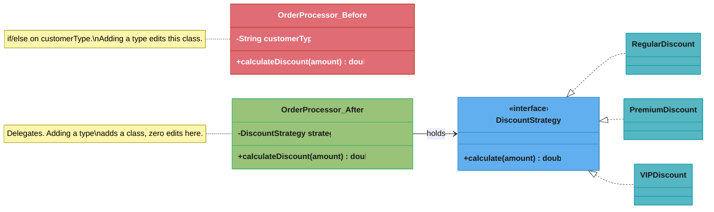
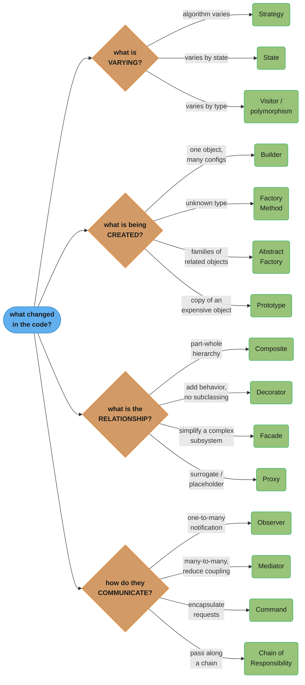
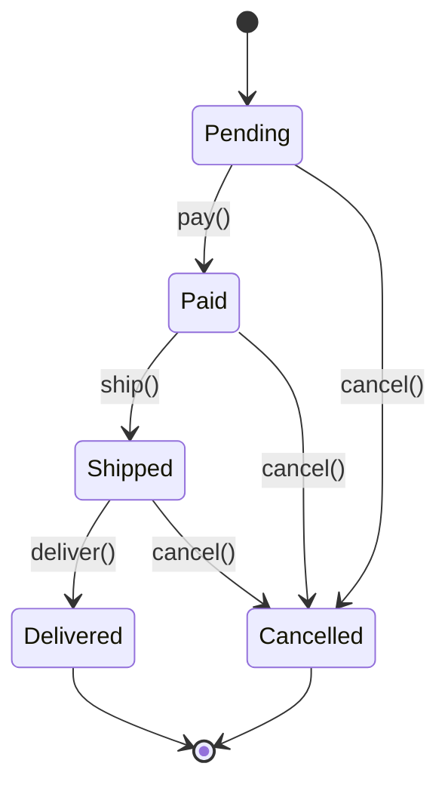

# Refactoring

> "Patterns are not about clever code. They are about communicating solutions to recurring problems in a way that other developers will understand."

Refactoring to patterns — recognizing the code smell that signals a pattern is needed, and changing the design safely, one small verified step at a time.

---

## 1. Concept Overview

Refactoring is a disciplined technique for restructuring existing code — changing its internal structure without changing its observable behavior. Martin Fowler's *Refactoring: Improving the Design of Existing Code* (2nd ed., Addison-Wesley, 2018, with Kent Beck) is the canonical reference: it names roughly 70 individual refactorings and 20+ code smells that signal when to apply them. This module is the companion to [Anti-Patterns](../anti_patterns/anti_patterns.md) — anti-patterns name what went wrong, refactoring is how you get out. Where an anti-pattern page shows a single before/after cure, this page teaches the underlying *technique*: how to spot the smell, which named refactoring fixes it, and how to perform it in small, test-covered, reversible steps rather than a risky rewrite.

The core discipline is: **refactor to patterns, not away from problems.** Patterns are destinations you arrive at through incremental refactoring, not starting points you design up front. You write the simplest code that works, and when a specific kind of pain shows up — duplication, rigidity, an if-else chain that grows every sprint — a named refactoring moves the code toward a GoF pattern that removes that specific pain. Refactoring without a target smell is just code churn; a pattern applied without a smell driving it is speculative generality — the two failure modes this page exists to prevent.

---

## 2. Intuition

> **One-line analogy**: Refactoring is renovating a house while people still live in it — you replace the wiring wall by wall, keeping the lights on after every step, instead of gutting the building and hoping the new one comes out right.

**Mental model**: Every refactoring is a small, behavior-preserving transformation with a test suite as the safety net. You never refactor and add a feature in the same step — that conflates "did I break something" with "does the new thing work," which is the fastest way to lose track of both. The unit of work is not "clean up the `OrderProcessor` class"; it is "Extract Method on this 40-line block," verified green, committed, repeat.

**Why it matters**: The gap between "I know the Strategy pattern" and "I can turn this if-else chain into Strategy without breaking production" is refactoring skill. Interviewers who ask you to "refactor this live" are testing exactly this gap — not pattern recall, but whether you sequence the change safely.

**Key insight**: A code smell is a *symptom*, not a *diagnosis*. "This method is 200 lines" is a smell; "this violates Single Responsibility because it mixes discount calculation with tax calculation" is the diagnosis a specific refactoring targets. Naming the smell precisely is what tells you which of the ~70 named refactorings to reach for — see [SOLID Principles](../solid_principles/solid_principles.md) for the violation vocabulary that names most diagnoses.

---

## 3. Core Principles

1. **Behavior preservation is non-negotiable.** A refactoring changes structure, never observable output. If a "refactor" changes what the code returns, it is not a refactoring — it is an untested feature change wearing a refactoring's name.
2. **Small steps, each independently safe.** One refactoring, one test run, one commit. A 40-file "big bang" refactor cannot be bisected when it breaks; five 8-file commits can.
3. **Tests come before the change, not after.** If the code has no tests, write [characterization tests](#6-how-it-works--detailed-mechanics) first — tests that pin down *current* behavior, bugs included, so you have a baseline to preserve.
4. **Refactor for the change you're about to make, not every change you might ever make.** Kent Beck's framing: "for each desired change, make the change easy (warning: this may be hard), then make the easy change." You refactor toward the shape today's feature needs, not toward every hypothetical future feature — the latter is how [Speculative Generality](#4-types--architectures--strategies) gets built.
5. **Separate refactoring commits from feature commits.** The "Boy Scout Rule" (leave the code cleaner than you found it) operates in small, reviewable diffs; the "Renovation Rule" (rewrite everything while you're in there) hides a feature change inside an unreviewable structural change, and vice versa.
6. **The compiler and the type system are your first safety net, tests are the second.** Rename a method and let every non-compiling call site show you the blast radius before you run anything.

---

## 4. Types / Architectures / Strategies

### 4.1 Fowler's smell → refactoring catalog (2nd edition)

The table below extends the original smell→pattern mapping with Fowler's fuller smell taxonomy. Each smell names the *named refactoring(s)* that cure it — not a design pattern, because most smells are cured by restructuring, and only some restructurings terminate in a GoF pattern (noted in the last column where they do).

| Code Smell | Symptom | Named Refactoring(s) — Fowler 2nd ed. | Pattern it can lead to |
|---|---|---|---|
| **Data Clumps** | The same 3-4 fields (`street`, `city`, `zip`) travel together as parameters everywhere | Extract Class, Introduce Parameter Object | — |
| **Message Chains** | `order.getCustomer().getAddress().getCity()` — a train of getters | Hide Delegate | Facade |
| **Refused Bequest** | A subclass overrides most inherited methods to throw or no-op | Replace Subclass with Delegate / Replace Superclass with Delegate | Strategy (composition over inheritance) |
| **Divergent Change** | One class is edited for many unrelated reasons (pricing changes AND shipping changes both touch `Order`) | Split Phase, Extract Class | — |
| **Shotgun Surgery** | One conceptual change requires editing many classes | Move Method, Move Field, Combine Functions into Class | Facade, Mediator |
| **Primitive Obsession** | A `String` or `int` stands in for a domain concept (`String email`, `int cents`) instead of a type | Replace Primitive with Object, Replace Type Code with Subclasses | State (for type codes with behavior) |
| **Speculative Generality** | Abstract classes, hooks, and parameters that exist "in case we need them," with one real caller | Collapse Hierarchy, Inline Class, Inline Function, Remove Dead Code | — |
| **Middle Man** | A class exists only to delegate every call to another class | Remove Middle Man | — |
| **Temporary Field** | An instance field is only meaningful during one method call and is `null`/unset otherwise | Extract Class, Introduce Special Case | — |
| **Feature Envy** | A method uses another object's data more than its own | Move Method (Move Function) | — |
| **Long Parameter List** | A method takes 5+ parameters, several of which travel together | Introduce Parameter Object, Preserve Whole Object, Replace Parameter with Query | Builder |
| **Mysterious Name** | A method or variable name doesn't say what it does | Change Function Declaration (Rename Method), Rename Variable, Rename Field | — |

### 4.2 The original smell → pattern mapping (preserved)

This is the pattern-facing complement to the table above: which GoF pattern a smell tends to resolve into once the refactoring is complete.

| Code Smell | Description | Pattern(s) to Consider |
|------------|-------------|------------------------|
| Long if-else chain on type | `if (type == A) ... else if (type == B)` | Strategy, State, Factory |
| Same condition repeated in multiple methods | Type-checking scattered everywhere | Polymorphism, Visitor |
| Conditional with state flags | `if (isPaid && !isShipped)` ... | State |
| Hard-coded `new` everywhere | `new MySQLConnection()` in every service | Factory Method, Abstract Factory |
| Objects with many optional fields | 10-parameter constructors or setters | Builder |
| Duplicated algorithm with minor variations | 3 report generators, same skeleton | Template Method, Strategy |
| God class | 2000-line class doing everything | Multiple: SRP + Observer + Facade |
| Tightly coupled collaborators | Class A calls Class B calls Class C | Mediator, Observer, Facade |
| No way to undo | User asks "can we have undo?" | Command + Memento |
| Inheritance explosion | 50 subclasses | Decorator, Strategy |
| Expensive object creation | `new HeavyObject()` called repeatedly | Prototype, Flyweight, Singleton |
| Missing extension points | Every new feature requires modifying existing class | Observer, Strategy, Decorator |

### 4.3 Refactoring strategies by scope

- **Composing methods** — Extract Method, Inline Method, Extract Variable. The smallest, safest, highest-frequency refactorings; almost every larger refactoring is built from these.
- **Moving features between objects** — Move Method, Move Field, Extract Class, Inline Class, Hide Delegate, Remove Middle Man. Fixes misplaced responsibility (Feature Envy, Shotgun Surgery).
- **Organizing data** — Replace Primitive with Object, Encapsulate Variable, Replace Type Code with Subclasses, Introduce Parameter Object. Fixes Primitive Obsession and Data Clumps; the natural home for Java 25 `record` types (see §6.4).
- **Simplifying conditional logic** — Decompose Conditional, Replace Conditional with Polymorphism, Replace Nested Conditional with Guard Clauses. The most common live-coding interview ask.
- **Making method calls simpler** — Rename Method, Introduce Parameter Object, Replace Constructor with Factory Method, Separate Query from Modifier. Fixes Mysterious Name and Long Parameter List.
- **Dealing with generalization** — Pull Up Method, Push Down Method, Extract Superclass, Replace Subclass with Delegate, Collapse Hierarchy. Fixes Refused Bequest and inheritance misuse.

---

## 5. Architecture Diagrams



*Replace Conditional with Polymorphism, drawn as class shapes: the left class owns the type-check and every branch's logic; the right class owns nothing but a reference — each branch became a class that owns itself. This is Example 1 in §7, structurally.*



*A single decision tree distilling four questions — trace root to leaf to go from "what's changing in this code" to the specific pattern to reach for. This is the destination; §6 covers the mechanics of the journey there.*

```
 SAFE REFACTORING SEQUENCE (each row = one commit, tests green between rows)

 characterization  extract   extract    introduce      replace conditional
 tests written     method    class      parameter obj  with polymorphism
      |                |         |            |                |
      v                v         v            v                v
  [ RED-safety ]--[ shrink ]--[ split ]--[ bundle args ]--[ terminal: Strategy/State ]
      captures        method    god        long param        pattern now
      current         body      class      list               in place
      behavior        first     next
```

*Order matters: characterization tests come first because every later step needs a baseline to check against; Extract Method comes before Extract Class because you cannot cleanly relocate a responsibility you have not yet isolated into its own method.*

---

## 6. How It Works — Detailed Mechanics

Six refactorings account for most of what an interviewer will ask you to perform live. Each below is shown as a numbered mechanical sequence — the exact order IntelliJ IDEA or Eclipse execute internally when you invoke the automated version (see §11) — followed by real Java before/after.

### 6.1 Extract Method

**Mechanics**: (1) identify a cohesive code fragment; (2) create a new method named for *what* the fragment does, not *how*; (3) copy the fragment into the new method; (4) find every local variable the fragment reads — pass as parameters; (5) find every local variable the fragment writes and reads later — return it, or extract multiple methods; (6) replace the original fragment with a call to the new method; (7) run tests.

```java
// BROKEN: one method doing three things — hard to name, hard to test in isolation
class InvoiceReport {
    String print(Invoice invoice) {
        StringBuilder sb = new StringBuilder();
        sb.append("Invoice for ").append(invoice.customerName()).append("\n");

        double total = 0;
        for (LineItem item : invoice.items()) {
            total += item.quantity() * item.unitPrice();
        }
        sb.append("Total due: $").append(total).append("\n");

        if (total > 10_000) {
            sb.append("** Requires manager approval **\n");
        }
        return sb.toString();
    }
}

// FIX: three named methods, each independently testable
class InvoiceReport {
    String print(Invoice invoice) {
        StringBuilder sb = new StringBuilder();
        sb.append(printHeader(invoice));
        double total = calculateTotal(invoice);
        sb.append("Total due: $").append(total).append("\n");
        sb.append(printApprovalNotice(total));
        return sb.toString();
    }

    private String printHeader(Invoice invoice) {
        return "Invoice for " + invoice.customerName() + "\n";
    }

    private double calculateTotal(Invoice invoice) {
        double total = 0;
        for (LineItem item : invoice.items()) {
            total += item.quantity() * item.unitPrice();
        }
        return total;
    }

    private String printApprovalNotice(double total) {
        return total > 10_000 ? "** Requires manager approval **\n" : "";
    }
}
```

### 6.2 Extract Class

**Mechanics**: (1) decide which responsibility is splitting off (find the Feature Envy or Divergent Change boundary); (2) create the new class; (3) create a link from the old class to the new one; (4) move each relevant field, one at a time, running tests after each move; (5) move each relevant method the same way; (6) review and tighten both classes' remaining interfaces.

```java
// BROKEN: Employee owns phone-number formatting logic that has nothing to do with employment
class Employee {
    private String name;
    private String officeAreaCode;
    private String officeNumber;

    String getOfficeTelephone() {
        return "(" + officeAreaCode + ") " + officeNumber;
    }
}

// FIX: TelephoneNumber is its own class — Employee delegates
class TelephoneNumber {
    private final String areaCode;
    private final String number;

    TelephoneNumber(String areaCode, String number) {
        this.areaCode = areaCode;
        this.number = number;
    }

    @Override
    public String toString() {
        return "(" + areaCode + ") " + number;
    }
}

class Employee {
    private String name;
    private final TelephoneNumber officeTelephone;

    String getOfficeTelephone() {
        return officeTelephone.toString();
    }
}
```

### 6.3 Replace Conditional with Polymorphism

**Mechanics**: (1) for each condition branch, create a subclass or implementation of a common type; (2) copy the branch's logic into an override in that subclass; (3) declare the method abstract (or in an interface) on the shared supertype; (4) delete the conditional and each branch, one at a time, letting the compiler catch missed call sites; (5) select the correct implementation once, at construction time, via a factory.

This is Example 1 from §7 restated as pure mechanics — see §7 for the full walkthrough with the factory that selects the strategy.

### 6.4 Replace Conditional with Polymorphism — the Java 25 target

Where the varying data has no behavior of its own (just a label plus a few fields), a `sealed` interface with exhaustive pattern-matching `switch` is now the leaner target than a class-per-branch hierarchy — no separate `.java` files, and the compiler enforces exhaustiveness at compile time instead of a `default: throw`.

- `record` — finalized in JDK 16 (JEP 395, previewed in 14 and 15). The direct cure for **Primitive Obsession** and **Data Clumps**: replace a `(String street, String city, String zip)` triple traveling through five method signatures with `record Address(String street, String city, String zip) {}`.
- `sealed` interfaces/classes — finalized in JDK 17 (JEP 409, previewed in 15 and 16). Declares the exhaustive, closed set of implementations up front.
- Pattern matching for `switch` — finalized in JDK 21 (JEP 441, previewed from 17 through 20). Lets a `switch` destructure a sealed hierarchy without instanceof-casts, and the compiler rejects the `switch` if a permitted subtype is left unhandled.

```java
// FIX, Java 25 idiom: sealed hierarchy + exhaustive switch replaces a class-per-branch Strategy
// when each branch is pure data-in, value-out with no independent lifecycle.
sealed interface DiscountRule permits Regular, Premium, VIP, Employee, Student {}
record Regular() implements DiscountRule {}
record Premium() implements DiscountRule {}
record VIP() implements DiscountRule {}
record Employee() implements DiscountRule {}
record Student(double orderAmount) implements DiscountRule {}

class OrderProcessor {
    double calculateDiscount(DiscountRule rule, double orderAmount) {
        return switch (rule) {
            case Regular r -> 0.0;
            case Premium p -> orderAmount * 0.10;
            case VIP v -> orderAmount * 0.20;
            case Employee e -> orderAmount * 0.30;
            case Student s -> s.orderAmount() > 100 ? 15.0 : orderAmount * 0.05;
            // no default: the compiler rejects this switch if DiscountRule ever
            // gains a sixth permitted type and this arm isn't added.
        };
    }
}
```

Reach for the Strategy-interface form of §6.3 when a branch needs its own dependencies, its own lifecycle, or must be swapped at runtime by DI. Reach for the sealed+switch form here when the branches are closed, data-shaped, and the whole point is a compiler-enforced exhaustiveness check.

### 6.5 Introduce Parameter Object

**Mechanics**: (1) identify a group of parameters that travel together across multiple method signatures (a Data Clump); (2) create a class or record holding them; (3) use Change Function Declaration to replace the group with the new type in one method signature; (4) update call sites; (5) repeat for every method sharing the same clump; (6) look for logic that could move onto the new type itself.

```java
// BROKEN: dateRange clump traveling through three method signatures
class ReportGenerator {
    List<Sale> salesBetween(Date start, Date end) { ... }
    double revenueBetween(Date start, Date end) { ... }
    boolean overlapsPromotion(Date start, Date end, Promotion promo) { ... }
}

// FIX: one type, and the logic that belongs to the range moves onto it
record DateRange(Date start, Date end) {
    boolean includes(Date d) {
        return !d.before(start) && !d.after(end);
    }
}

class ReportGenerator {
    List<Sale> salesBetween(DateRange range) { ... }
    double revenueBetween(DateRange range) { ... }
    boolean overlapsPromotion(DateRange range, Promotion promo) { ... }
}
```

### 6.6 Replace Constructor with Factory Method

**Mechanics**: (1) create the factory method, initially just calling the constructor; (2) find every caller of `new X(...)` and redirect it to the factory method; (3) make the constructor as private/package-private as visibility rules allow; (4) let the factory method grow the selection logic (subclass choice, caching, validation) that a constructor cannot express.

```java
// BROKEN: callers everywhere say "new", so switching implementation means
// touching every call site (this is Example 2 from the original guide, restated)
DatabaseConnection conn = new MySQLConnection("localhost", 3306, "users");

// FIX: one factory method owns the decision
interface DatabaseConnection { void connect(); void query(String sql); }
class MySQLConnection    implements DatabaseConnection { /* ... */ }
class PostgresConnection implements DatabaseConnection { /* ... */ }

class ConnectionFactory {
    private static final String DB_TYPE = System.getProperty("db.type", "mysql");

    static DatabaseConnection create(String schema) {
        return switch (DB_TYPE) {
            case "mysql"    -> new MySQLConnection(getHost(), getPort(), schema);
            case "postgres" -> new PostgresConnection(getHost(), getPort(), schema);
            default -> throw new IllegalArgumentException("Unknown DB type: " + DB_TYPE);
        };
    }
}
```

### 6.7 Move Method

**Mechanics**: (1) examine every feature the method uses from its current class versus its target class; (2) if it uses more from the target, that confirms Feature Envy; (3) declare the method on the target class, adjusting `this` references to a parameter; (4) turn the old method into a one-line delegator, or delete it and fix call sites directly; (5) run tests after the move, before deleting the delegator.

```java
// BROKEN: calculateOverdueFee lives on Loan but reads almost nothing from Loan —
// it reads dueDate and rate from Account. Feature Envy.
class Loan {
    double calculateOverdueFee(Account account, int daysLate) {
        return account.getDueBalance() * account.getLateFeeRate() * daysLate;
    }
}

// FIX: moved onto Account, where the data it uses actually lives
class Account {
    private double dueBalance;
    private double lateFeeRate;

    double calculateOverdueFee(int daysLate) {
        return dueBalance * lateFeeRate * daysLate;
    }
}

class Loan {
    double calculateOverdueFee(Account account, int daysLate) {
        return account.calculateOverdueFee(daysLate); // delegator, can be deleted once callers move
    }
}
```

### 6.8 Characterization tests, and "make the change easy, then make the easy change"

When code has no tests, you cannot safely refactor it — you have no way to know a transformation preserved behavior. A **characterization test** is not a spec of *correct* behavior; it is a snapshot of *current* behavior, run against the untouched code, bugs and all:

```java
// A characterization test pins down what the legacy method ACTUALLY does today,
// not what it should do. This test may look wrong — that's the point; it documents
// the baseline you are refactoring against, and a real bug fix is a SEPARATE commit
// with its own test change, made only after refactoring is done and committed.
@Test
void legacyDiscountCalculator_currentBehavior_isPinnedDownBeforeTouchingIt() {
    LegacyDiscountCalculator calc = new LegacyDiscountCalculator();
    // Observed today: a null customerType silently returns 0, it does not throw.
    // Whether that's "correct" is a separate question from "does this refactor
    // preserve it" — characterization tests answer only the second.
    assertEquals(0.0, calc.calculate(null, 100.0));
}
```

Kent Beck's sequencing rule for adding a feature to code that isn't shaped for it: **"for each desired change, make the change easy (warning: this may be hard), then make the easy change."** Concretely: if adding a sixth discount type means editing a ten-branch if-else, do not add the branch. First refactor the if-else into Strategy (the "make the change easy" commit, behavior-preserving, tested against characterization tests). Then add `SeniorDiscount` as one new class (the "easy change" commit, a genuine feature, reviewed and tested on its own). Two commits, two intents, each independently revertable — never one commit that is both.

---

## 7. Real-World Examples

### Example 1: if-else Chain → Strategy

**Smell**: Switch-on-type / long if-else for algorithm selection

**Before** (hard to extend, violates Open/Closed):
```java
public class OrderProcessor {
    public double calculateDiscount(String customerType, double orderAmount) {
        if (customerType.equals("REGULAR")) {
            return orderAmount * 0.0;
        } else if (customerType.equals("PREMIUM")) {
            return orderAmount * 0.10;
        } else if (customerType.equals("VIP")) {
            return orderAmount * 0.20;
        } else if (customerType.equals("EMPLOYEE")) {
            return orderAmount * 0.30;
        } else if (customerType.equals("STUDENT")) {
            if (orderAmount > 100) return 15.0;
            return orderAmount * 0.05;
        }
        return 0.0;
        // Adding a new type requires modifying this method!
    }
}
```

**Smell signals**:
- Adding "SENIOR" discount requires modifying `calculateDiscount()`
- Violates Open/Closed Principle — see [SOLID Principles](../solid_principles/solid_principles.md)
- Unit tests must cover all branches in one method

**After** (Strategy pattern):
```java
interface DiscountStrategy {
    double calculate(double orderAmount);
}

class RegularDiscount  implements DiscountStrategy { public double calculate(double a) { return 0; } }
class PremiumDiscount  implements DiscountStrategy { public double calculate(double a) { return a * 0.10; } }
class VIPDiscount      implements DiscountStrategy { public double calculate(double a) { return a * 0.20; } }
class EmployeeDiscount implements DiscountStrategy { public double calculate(double a) { return a * 0.30; } }
class StudentDiscount  implements DiscountStrategy {
    public double calculate(double amount) {
        return amount > 100 ? 15.0 : amount * 0.05;
    }
}

public class OrderProcessor {
    private final DiscountStrategy discountStrategy;  // injected

    public double calculateDiscount(double orderAmount) {
        return discountStrategy.calculate(orderAmount);  // no if-else!
    }
}
```

**Refactoring steps**:
1. Create `DiscountStrategy` interface with `calculate(double)` method
2. Extract each `else if` branch into a separate class
3. Replace the field that tracked `customerType` with a `DiscountStrategy` field
4. Remove the if-else method
5. Move strategy selection to a Factory or configuration

**Result**: Adding "SENIOR" → create one class, no existing code changes. See [Strategy](../behavioral/strategy/strategy.md) for the full pattern page.

---

### Example 2: Scattered `new` → Factory Method

**Smell**: Hard-coded instantiation scattered throughout the codebase

**Before**:
```java
// In UserService:
DatabaseConnection conn = new MySQLConnection("localhost", 3306, "users");

// In ProductService:
DatabaseConnection conn = new MySQLConnection("localhost", 3306, "products");

// In OrderService:
DatabaseConnection conn = new MySQLConnection("localhost", 3306, "orders");

// Need to switch to PostgreSQL? Find and replace 47 occurrences...
```

**After** (Factory Method — full mechanics in §6.6):
```java
interface DatabaseConnection { void connect(); void query(String sql); }
class MySQLConnection    implements DatabaseConnection { /* ... */ }
class PostgresConnection implements DatabaseConnection { /* ... */ }

class ConnectionFactory {
    private static final String DB_TYPE = System.getProperty("db.type", "mysql");

    public static DatabaseConnection create(String schema) {
        return switch (DB_TYPE) {
            case "mysql"    -> new MySQLConnection(getHost(), getPort(), schema);
            case "postgres" -> new PostgresConnection(getHost(), getPort(), schema);
            default -> throw new IllegalArgumentException("Unknown DB type: " + DB_TYPE);
        };
    }
}

// Everywhere:
DatabaseConnection conn = ConnectionFactory.create("users");
// Switch to PostgreSQL: change one property, not 47 files.
```

**Refactoring steps**: see [Factory Method](../creational/factory_method/factory_method.md) for the pattern; §6.6 above for the step-by-step mechanics of getting there from scattered `new`.

---

### Example 3: Polling → Observer

**Smell**: Service actively checking for changes instead of reacting to them

**Before** (polling — wasteful, high latency):
```java
class OrderStatusChecker {
    public void startPolling() {
        ScheduledExecutorService scheduler = Executors.newSingleThreadScheduledExecutor();
        scheduler.scheduleAtFixedRate(() -> {
            List<Order> orders = orderRepo.findPendingOrders();
            for (Order order : orders) {
                if (order.isPaid()) {
                    emailService.sendConfirmation(order);
                    warehouseService.pickAndPack(order);
                    analyticsService.recordSale(order);
                }
            }
        }, 0, 5, TimeUnit.SECONDS); // check every 5 seconds
    }
}
```

**Smell signals**:
- Artificial 5-second delay before action
- Unnecessary DB load even when nothing changed
- Adding "notify accounting" requires modifying this method (Shotgun Surgery in miniature)

**After** (Observer):
```java
interface OrderObserver {
    void onOrderPaid(Order order);
}

class EmailConfirmationObserver implements OrderObserver {
    @Override public void onOrderPaid(Order order) { emailService.sendConfirmation(order); }
}

class WarehouseObserver implements OrderObserver {
    @Override public void onOrderPaid(Order order) { warehouseService.pickAndPack(order); }
}

class AnalyticsObserver implements OrderObserver {
    @Override public void onOrderPaid(Order order) { analyticsService.recordSale(order); }
}

class Order {
    private final List<OrderObserver> observers = new ArrayList<>();

    public void addObserver(OrderObserver o) { observers.add(o); }

    public void markAsPaid() {
        this.status = OrderStatus.PAID;
        observers.forEach(o -> o.onOrderPaid(this)); // immediate notification
    }
}
```

**Refactoring steps**:
1. Create `OrderObserver` interface with `onOrderPaid(Order)`
2. Extract each action in the polling loop into an Observer implementation
3. Add `addObserver()` / `notifyObservers()` to `Order`
4. Call `markAsPaid()` where payment is confirmed
5. Register observers at startup / configuration time
6. Delete the polling scheduler

See [Observer](../behavioral/observer/observer.md) for the full pattern page.

---

### Example 4: Mixed Responsibilities → Decorator + SRP

**Smell**: A class doing its core job PLUS cross-cutting concerns (logging, metrics, rate limiting)

**Before**:
```java
class UserService {
    public User getUser(String userId) {
        // Rate limiting logic mixed in
        if (rateLimiter.isExceeded(userId)) throw new TooManyRequestsException();

        // Logging mixed in
        long start = System.currentTimeMillis();
        log.info("getUser called for userId=" + userId);

        // Metrics mixed in
        metrics.increment("getUser.calls");

        // Actual business logic
        User user = userRepository.findById(userId);

        // More logging
        log.info("getUser completed in " + (System.currentTimeMillis()-start) + "ms");
        metrics.record("getUser.latency", System.currentTimeMillis()-start);

        return user;
    }
    // Same pattern repeated in every method!
}
```

**After** (Decorator pattern):
```java
interface UserServiceInterface {
    User getUser(String userId);
    void updateUser(User user);
}

class UserServiceImpl implements UserServiceInterface {
    // ONLY business logic
    @Override
    public User getUser(String userId) {
        return userRepository.findById(userId);
    }
}

class LoggingUserService implements UserServiceInterface {
    private final UserServiceInterface delegate;
    @Override
    public User getUser(String userId) {
        log.info("getUser({})", userId);
        long start = System.currentTimeMillis();
        User result = delegate.getUser(userId);
        log.info("getUser completed in {}ms", System.currentTimeMillis()-start);
        return result;
    }
}

class RateLimitedUserService implements UserServiceInterface {
    private final UserServiceInterface delegate;
    @Override
    public User getUser(String userId) {
        if (rateLimiter.isExceeded(userId)) throw new TooManyRequestsException();
        return delegate.getUser(userId);
    }
}

// Compose at startup:
UserServiceInterface userService =
    new RateLimitedUserService(
        new LoggingUserService(
            new MetricsUserService(
                new UserServiceImpl(repo)
            )
        )
    );
```

**Refactoring steps**:
1. Extract `UserServiceInterface` from `UserService`
2. Create `UserServiceImpl` with ONLY business logic
3. Create `LoggingDecorator`, `MetricsDecorator`, `RateLimitingDecorator`
4. Compose them in configuration / DI setup

See [Decorator](../structural/decorator/decorator.md) for the full pattern page.

---

### Example 5: Flag-Based State → State Pattern

**Smell**: Boolean flags representing mutually exclusive states with nested if-else

**Before**:
```java
class Order {
    private boolean isPending;
    private boolean isPaid;
    private boolean isShipped;
    private boolean isCancelled;
    private boolean isDelivered;

    public void pay() {
        if (!isPending) throw new IllegalStateException("Can only pay pending orders");
        isPending = false;
        isPaid = true;
    }

    public void ship() {
        if (!isPaid) throw new IllegalStateException("Can only ship paid orders");
        if (isCancelled) throw new IllegalStateException("Cannot ship cancelled order");
        isPaid = false;
        isShipped = true;
    }

    public void cancel() {
        if (isDelivered) throw new IllegalStateException("Cannot cancel delivered order");
        if (isCancelled) throw new IllegalStateException("Already cancelled");
        isPending = false; isPaid = false; isShipped = false;
        isCancelled = true;
    }
    // What if someone sets isPaid=true AND isCancelled=true? Invalid state!
}
```

**After** (State pattern):
```java
interface OrderState {
    void pay(Order order);
    void ship(Order order);
    void cancel(Order order);
    void deliver(Order order);
    String getStatus();
}

class PendingState implements OrderState {
    @Override public void pay(Order o)    { o.setState(new PaidState()); }
    @Override public void cancel(Order o) { o.setState(new CancelledState()); }
    @Override public void ship(Order o)   { throw new IllegalStateException("Pay first"); }
    @Override public void deliver(Order o){ throw new IllegalStateException("Not shipped"); }
    @Override public String getStatus()   { return "PENDING"; }
}

class PaidState implements OrderState {
    @Override public void ship(Order o)   { o.setState(new ShippedState()); }
    @Override public void cancel(Order o) { o.setState(new CancelledState()); }
    @Override public void pay(Order o)    { throw new IllegalStateException("Already paid"); }
    @Override public void deliver(Order o){ throw new IllegalStateException("Not shipped"); }
    @Override public String getStatus()   { return "PAID"; }
}

// ... ShippedState, DeliveredState, CancelledState

class Order {
    private OrderState state = new PendingState();

    public void setState(OrderState state) { this.state = state; }
    public void pay()    { state.pay(this); }
    public void ship()   { state.ship(this); }
    public void cancel() { state.cancel(this); }
    public String getStatus() { return state.getStatus(); }
}
```



**Result**: every arrow above is a method that only type-checks from its source state — `pay()` compiles solely from `Pending`, `cancel()` is unreachable once `Delivered` — so the Before code's impossible combination (`isPaid=true` and `isCancelled=true` at once) can no longer be represented.

**Refactoring steps**:
1. Create `OrderState` interface with all operations
2. Create one concrete state class per valid state
3. Each method in a state either handles the transition or throws `IllegalStateException`
4. Remove all boolean flags from `Order`
5. Initialize `Order` with `new PendingState()`

See [State](../behavioral/state/state.md) for the full pattern page.

### How to Identify the Right Pattern

Ask these questions about the code — the decision tree in §5 is this same logic, drawn:

**"What is VARYING?"**
→ If the algorithm varies: **Strategy**
→ If the behavior varies by state: **State**
→ If the behavior varies by type: **Visitor** or **polymorphism**

**"What is being CREATED?"**
→ One object with many configurations: **Builder**
→ Object of unknown type: **Factory Method**
→ Families of related objects: **Abstract Factory**
→ Copy of an expensive object: **Prototype**

**"What is the RELATIONSHIP?"**
→ Part-whole hierarchy: **Composite**
→ Add behavior without subclassing: **Decorator**
→ Simplify a complex subsystem: **Facade**
→ Surrogate/placeholder: **Proxy**

**"How do they COMMUNICATE?"**
→ One-to-many notification: **Observer**
→ Many-to-many (reduce coupling): **Mediator**
→ Encapsulate requests: **Command**
→ Pass along a chain: **Chain of Responsibility**

---

## 8. Tradeoffs

| Approach | You Gain | You Lose |
|---|---|---|
| Refactor incrementally, small steps | Bisectable history; each commit independently revertable; low risk | Slower to reach the target design; requires discipline to not skip ahead |
| Rewrite from scratch ("Renovation Rule") | Can reach the ideal design faster on paper | No safety net; regressions surface all at once; blocks feature work for the duration |
| IDE-automated refactoring | Fast, mechanically correct for the transformations the IDE supports | Only covers the transformations the IDE implements (see §11); still needs human judgment on *which* refactoring to apply |
| Manual refactoring | Handles anything, including transformations no tool automates | Slower; each step is a chance for a copy-paste or rename mistake the compiler won't always catch |
| Refactor toward a GoF pattern | Removes the specific pain the smell caused; well-known vocabulary for the team | A pattern applied without a driving smell is Speculative Generality — indirection with no payoff |
| Refactor toward `sealed` + `switch` (Java 21+) | Compiler-enforced exhaustiveness; no per-branch `.java` file; less boilerplate | Only fits closed, data-shaped variation — not a fit when a branch needs its own dependencies or runtime-swappable lifecycle |
| Characterization tests before refactoring | A verifiable baseline for messy, undocumented legacy code | Takes real time up front; the tests pin down bugs too, which must be fixed in a *separate*, later commit |

**The core tradeoff**: refactoring trades design-quality speed for safety. Every rule in §3 exists to keep that trade in your favor — small steps mean a bad step costs you one revert, not a week.

---

## 9. When to Use / When NOT to Use

**Use refactoring when**:
- A code smell (§4) is actively costing time — a change that should take an hour keeps taking a day because of the smell
- You are about to add a feature and the existing shape makes that feature hard (Kent Beck's "make the change easy" trigger)
- You inherited legacy code with no tests and need a safe way to start touching it (write characterization tests, then refactor)
- A pattern already fits the domain's actual variation — not a guess about future variation

**Do NOT refactor when**:
- There is no test coverage and no time budget to add characterization tests first — refactoring without a safety net is just risky editing
- The code is about to be deleted or replaced (refactoring code you're throwing away next sprint is wasted motion)
- You are mid-feature — interleaving structural and behavioral changes in one commit destroys bisectability; finish the feature, then refactor, or refactor first, then add the feature, never both in one diff
- The "smell" is actually a deliberate, documented tradeoff (a large parameter list on a public API a hundred callers depend on may not be worth an Introduce Parameter Object migration for a marginal readability gain)
- You'd be reaching for a pattern with no smell driving it — see Speculative Generality in §4.1 and §10

---

## 10. Common Pitfalls

- **Mixing refactoring and feature work in one commit.** If a diff both renames three methods and adds a new discount type, a bug introduced by either change is indistinguishable from the other, and the commit cannot be safely reverted without losing both. Split them.
- **Refactoring without running tests between steps.** A five-step refactor with tests run only at the end has the same blast-radius problem as a rewrite — you cannot tell which of the five steps broke something.
- **Applying a pattern with no smell behind it (Speculative Generality).** Introducing a `PaymentStrategy` interface for a system with exactly one payment method, "in case we add more later," adds a file, an interface, and a factory for zero current benefit — and a real second payment method may need a different interface shape than the guessed one anyway.
- **"Refused Bequest" masquerading as intentional design.** A subclass that overrides half its parent's methods to throw `UnsupportedOperationException` is not polymorphism — see the classic `Square extends Rectangle` case in [SOLID Principles](../solid_principles/solid_principles.md) §Liskov Substitution.
- **Skipping characterization tests on legacy code "because it'll take too long."** The refactor that follows then has no way to detect it broke a bug someone was silently depending on — and in production code, plenty of callers depend on documented bugs.

*Broken:*
```java
// A live-coding candidate is asked to "add a SENIOR discount." Under time pressure,
// they add a sixth if-else branch (feature work) AND rename customerType to type
// (refactoring) in the same edit — two changes tangled in one diff.
public double calculateDiscount(String type, double orderAmount) {
    if (type.equals("REGULAR")) return 0.0;
    else if (type.equals("PREMIUM")) return orderAmount * 0.10;
    else if (type.equals("SENIOR")) return orderAmount * 0.25; // new AND renamed param, same diff
    // ...
}
```

*Fix:*
```java
// Two commits. Commit 1 (pure refactor, tests unchanged, still green):
// if-else -> Strategy, per Example 1 in section 7. Commit 2 (pure feature, one new file,
// one new test):
class SeniorDiscount implements DiscountStrategy {
    public double calculate(double amount) { return amount * 0.25; }
}
// OrderProcessor is untouched by commit 2 — that's the payoff of doing commit 1 first.
```

---

## 11. Technologies & Tools

| Tool | What it automates | Notes |
|---|---|---|
| **IntelliJ IDEA** | Extract Method (`Ctrl+Alt+M`), Extract Class / Extract Delegate / Extract Method Object, Introduce Parameter Object, Move (`F6`, includes Move Instance Method), Rename, Change Signature, Inline | The refactor menu implements most of Fowler's catalog mechanically and updates every call site; it does **not** offer a single-click "Replace Conditional with Polymorphism" — that one is composed manually from Extract Method + Move Method + Pull Up. |
| **Eclipse JDT** | Extract Method, Extract Class, Move, Rename, Pull Up/Push Down, Introduce Parameter Object | Comparable automated coverage to IntelliJ for the mechanical, single-class-boundary refactorings; predates IntelliJ's refactor tooling and pioneered much of it in the Java ecosystem. |
| **SonarQube / SonarLint** | Static detection of smells, not refactoring itself | Rule `S3776` (Cognitive Complexity) flags methods whose control flow is too tangled to follow — the direct static-analysis signal for "Extract Method here." Other rules flag long parameter lists and duplicated blocks, feeding the same smell catalog in §4. |
| **OpenRewrite** | Automated, scriptable, repo-wide refactoring via recipes (LST-based, not text-based) | Ships migration recipes including "Adopt switch pattern matching (JEP 441)," which mechanically rewrites eligible `if`/`instanceof` chains to the sealed+switch form in §6.4 across an entire codebase in one run — the industrial-scale version of a refactoring an IDE does one file at a time. |
| **JUnit 5 / Mockito** | Characterization and regression test infrastructure | The safety net every refactoring in this page depends on; a refactor with no test suite behind it is an unverified edit wearing a refactoring's name. |
| **git** | Bisectability | Small, single-purpose refactoring commits are what makes `git bisect` useful when a regression is found weeks later. |

---

## 12. Interview Questions with Answers

**Q: What is the single hard rule that separates a "refactor" commit from a "feature" commit, and why does mixing them matter?**
**Short:** A refactor changes structure only, never behavior — mixing it with a feature change breaks bisectability and revertability.

A refactoring must never change observable behavior; a feature change is defined by changing it. Mixing them in one commit means a bug found later cannot be attributed to either change without manually re-deriving what each one did, and the commit cannot be reverted without losing both. The practical fix: refactor first as its own commit (tests unchanged, still green), then add the feature as a second, separate commit.

**Q: You're asked to "add a new discount type" to a ten-branch if-else in a live interview. What's the trap, and how do you avoid it?**
**Short:** The trap is adding the eleventh branch directly; the move is refactoring to Strategy first, then adding one class.

The trap is adding an eleventh `else if` branch, which is fast but leaves the method more tangled and does not demonstrate refactoring skill. The stronger move: refactor the if-else to Strategy first (a pure, behavior-preserving change you can narrate step by step), then add the new discount as one new class implementing the existing interface — zero edits to the original method. This sequencing is exactly Kent Beck's "make the change easy, then make the easy change."

**Q: What's wrong with numbering refactoring steps as "Extract Method, then immediately Extract Class, then immediately Replace Conditional with Polymorphism" without running tests between them?**
**Short:** Without a test run after each step, a failure can't be attributed to any single step, defeating the point of small steps.

Small steps only pay off if you verify after each one — the whole reason to take five small steps instead of one big rewrite is that a five-step sequence with tests run only at the end has the exact same undebuggable failure mode as the rewrite it was meant to avoid. Run tests, and ideally commit, after every individual refactoring, not after a batch of them.

**Q: What is a characterization test, and how is it different from a normal unit test?**
**Short:** A characterization test pins down current behavior, bugs included, rather than asserting what the code should do.

A normal unit test asserts what the code *should* do, derived from a spec. A characterization test records what the code *actually* does today, including any bugs, so you have a baseline you can refactor against without accidentally "fixing" a behavior someone downstream may be depending on. It's written by running the untouched legacy code and observing its output, not by reasoning from requirements. Fixing a bug the characterization test pinned down happens in a separate, later commit — never folded into the refactor.

**Q: A subclass overrides most of its parent's methods to throw `UnsupportedOperationException`. Name the smell and the fix.**
**Short:** That's Refused Bequest; the fix is Replace Subclass with Delegate or Replace Superclass with Delegate.

The smell is Refused Bequest — the subclass is reusing the parent's implementation but does not want to honor its interface, meaning the inheritance relationship itself is wrong (it fails Liskov Substitution). Fowler's cure (2nd ed.) is Replace Subclass with Delegate or Replace Superclass with Delegate: create a field referencing the "parent" instead of extending it, and delegate only to the specific methods you actually want, dropping every method you'd otherwise have had to override to reject.

**Q: `order.getCustomer().getAddress().getCity()` — name the smell and the refactoring that fixes it.**
**Short:** That's a Message Chain; Hide Delegate on Order exposes getCity() directly, hiding the intermediate objects.

This is a Message Chain — a "train wreck" of getters that couples the caller to the internal structure of every object in the chain. Fowler's cure is Hide Delegate: add a method directly on `Order`, e.g. `getCustomerCity()`, that does the chain internally. The caller now depends only on `Order`'s interface; if `Customer` later stops holding an `Address` directly, only `Order`'s implementation changes, not every caller.

**Q: What is the difference between Extract Method and Extract Function in Fowler's 2nd edition catalog, and why does the book use "Function" instead of "Method"?**
**Short:** They're the same refactoring; the 2nd edition renamed "Method" to "Function" for language-agnostic naming across the book's examples.

They are the same refactoring under two names. Fowler's 2nd edition (2018) rewrote the catalog's examples in JavaScript to be more language-agnostic, and renamed several refactorings accordingly — "Extract Method" became "Extract Function," "Replace Constructor with Factory Method" became "Replace Constructor with Factory Function." In Java-specific writing (including this page), "Method" is the correct and expected term; interviewers use both interchangeably.

**Q: Why is a `record` the correct Java refactoring target for Primitive Obsession, and which JDK version made it available?**
**Short:** record replaces a scattered primitive with a real type with structural equality; finalized in JDK 16 (JEP 395).

Primitive Obsession is a `String`/`int`/`double` standing in for a domain concept — an `int cents` instead of a `Money` type, a raw `String` instead of an `Email` type. A `record` is the lean Java fix: `record Money(long cents) {}` gives you a real type, structural `equals`/`hashCode`, and a place to add validation in a compact constructor, in one line instead of a full hand-written immutable class. `record` was finalized in JDK 16 via JEP 395, after previews in JDK 14 and 15.

**Q: When should you reach for `sealed` + pattern-matching `switch` instead of Replace Conditional with Polymorphism (a Strategy-style class hierarchy)?**
**Short:** Use sealed+switch when the variants are closed and data-only; use Strategy when a branch needs its own dependencies or runtime swapping.

Reach for `sealed` interfaces with an exhaustive `switch` (JEP 409 sealed types, finalized JDK 17; JEP 441 pattern matching for switch, finalized JDK 21) when the set of variants is fixed and known at compile time and each variant is essentially data with no independent lifecycle — the compiler then rejects the `switch` if a case is missing. Reach for the classic Strategy interface-and-implementation-classes form instead when a variant needs injected dependencies, needs to be swappable at runtime by a DI container, or when new variants are added by different teams/modules that shouldn't need to touch a shared `sealed` declaration's `permits` clause.

**Q: What does IntelliJ IDEA's "Move" refactoring (F6) actually do when applied to an instance method, and what decides its target?**
**Short:** Move Instance Method (F6) relocates a method to a class reachable from its parameters or fields, updating all callers.

Move Instance Method relocates a method from its current class to another class reachable from the method's parameters or the enclosing class's fields — IntelliJ presents a list of candidate target classes and lets you pick one. It rewrites the method body's `this` references into a parameter reference to the original object, and updates every call site automatically. It is the automated form of the Move Method mechanics in §6.7, and is the mechanical fix for Feature Envy once you've identified which class the method envies.

**Q: Give a concrete example of Shotgun Surgery and the refactoring that fixes it.**
**Short:** Shotgun Surgery is one change requiring edits across many classes; Move Method/Field consolidates the split logic.

Shotgun Surgery: adding a new tax jurisdiction requires editing `Order`, `Invoice`, `ShippingLabel`, and `ReceiptPrinter` — four files for one conceptual change, because tax-rate logic is duplicated (or partially duplicated) across all four. The fix is Move Method / Move Field to consolidate the scattered logic into a single `TaxCalculator` that the four classes call into, sometimes followed by Combine Functions into Class. After the fix, adding a jurisdiction is a change inside `TaxCalculator` alone.

**Q: What's the difference between Data Clumps and Long Parameter List as smells, even though both are cured partly by Introduce Parameter Object?**
**Short:** Data Clumps is fields traveling together anywhere in the code; Long Parameter List is specifically too many method arguments.

Data Clumps is the broader smell: the same group of values (e.g., `street`/`city`/`zip`) shows up together repeatedly, as fields, as parameters, or as a return tuple, anywhere in the codebase. Long Parameter List is the narrower, method-signature-specific case of it — 5+ arguments on one method, some of which happen to be a Data Clump. Introduce Parameter Object fixes both, but Data Clumps sometimes calls for Extract Class instead when the values belong together as object *state*, not just as one method's *arguments*.

**Q: What's the risk of applying Extract Class too aggressively, and what smell does over-application create?**
**Short:** Extracting a class for every small grouping produces Middle Man classes and a Speculative-Generality-like fragmentation.

Extracting a class for every small, plausible grouping of two or three fields produces a codebase of tiny classes that mostly delegate to each other — Middle Man in reverse: too many classes with too little independent responsibility, each one adding navigation overhead (jump to definition five times to read one flow) without adding cohesion. The test before extracting: does the new class have behavior of its own, or is it just data plus pass-through methods? If it's the latter, prefer a `record` (§6.4) over a full class extraction.

**Q: Why is "run the tests after every step" not enough on its own — what else has to be true about the tests?**
**Short:** The tests must already cover the code before refactoring starts, or a green run after a step proves nothing.

Running tests after every refactoring step only catches a regression if the tests already exercised the behavior the step touched. Tests that were green before the refactor and stay green after prove nothing if the code path was never covered. This is why characterization tests (§6.8) come first for legacy code with no coverage — writing them is refactoring's actual prerequisite, not an optional nicety, for any code you didn't write test coverage for yourself.

**Q: A method reads three fields from a parameter object and one field from `this`. Is that Feature Envy, and how do you decide?**
**Short:** Lean toward Feature Envy when it uses more of another object's data than its own — move it there.

Lean toward yes: Feature Envy is a matter of degree, not a strict count, but "reads more from another object than from itself" is the working heuristic. Move Method relocates it to the parameter's class; the one remaining field from `this` becomes a parameter of the moved method. If the method uses roughly equal amounts of both, it may instead belong on neither — consider Extract Class to give the shared concept its own home, or leave it if there's no clean split.

**Q: You inline a class with Inline Class and later find you need to split it again. Did the original Extract Class fail?**
**Short:** Not necessarily — refactoring toward the shape a feature needs is often reversible and expected, not a failure.

Not necessarily. §3's Principle 4 is explicitly "refactor for the change you're about to make, not every change you might ever make" — collapsing a class that turned out not to earn its separation, and re-extracting it later when a new feature does need the split, is the system working as designed, not a failed prediction. The failure mode to actually avoid is Speculative Generality: extracting the class the first time for a future need that never materializes and never gets inlined back.

**Q: What is Remove Middle Man, and how do you tell a legitimate Facade from a Middle Man that should be removed?**
**Short:** Remove Middle Man deletes a class that only forwards calls; a Facade earns its place by simplifying, not just forwarding.

Remove Middle Man deletes a class whose every method is a one-line delegation to another object, and redirects callers to call the delegate directly. The distinction from a legitimate [Facade](../structural/facade/facade.md): a Facade earns its place by collapsing a genuinely complex multi-object subsystem behind one simpler interface — it does real work simplifying the call. A Middle Man does none of that; it delegates one-to-one with no simplification, so removing it costs nothing and saves a hop.

**Q: In the Introduce Parameter Object mechanics, why move logic onto the new parameter object rather than stopping once the parameters are bundled?**
**Short:** Bundling alone is Data Clumps fixed halfway; moving related logic onto the object is what earns it as a real type.

Stopping at bundling — a record with fields and no methods — fixes the Data Clumps symptom but leaves behavior that operates on those fields scattered across the callers, which is itself a smell (Feature Envy on the new object). Fowler's full mechanics for Introduce Parameter Object explicitly include the follow-up step: look for logic in callers that only touches the bundled fields, and move it onto the new type as a method — e.g. `DateRange.includes(date)` in §6.5 — so the parameter object becomes a real domain type, not just a struct.

---

## 13. Best Practices

1. **Write characterization tests first** — capture the current behavior (even if messy) before refactoring untested legacy code.
2. **Small steps** — one refactoring at a time; run tests after each. A step you can't describe in one sentence is too big.
3. **Don't refactor AND add features in the same commit** — separate commits; "Boy Scout Rule" (leave it cleaner), not "Renovation Rule" (rewrite everything).
4. **Trust the type system** — rename and extract first, let the compiler catch every broken reference before you run a single test.
5. **Commit often** — every green test run is a safe checkpoint to roll back to.
6. **Measure before and after** — performance-critical refactors (introducing an extra indirection layer, e.g. Decorator or Proxy) need benchmarks, not just passing tests, since behavior-preservation covers correctness but not latency.
7. **Make the change easy, then make the easy change** — refactor to the shape a feature needs as its own commit, then add the feature as a second commit (§6.8).
8. **Let static analysis point at the smell, not decide the refactoring** — a SonarQube cognitive-complexity flag (§11) tells you *where*; the smell catalog in §4 tells you *which* named refactoring, and your judgment decides whether it's worth doing today.
9. **Prefer the IDE's automated refactoring over hand-editing when one exists** (§11) — it updates every call site atomically, which a manual find-and-replace cannot guarantee.
10. **Don't refactor toward a pattern with no smell behind it** — every refactoring in this page should be traceable to a row in the §4 tables, not to "this might be useful later."

---

## 14. Case Study: Refactoring a Legacy `OrderProcessor` from God Class to Strategy + State + Observer

A 600-line `OrderProcessor` class accumulated discount calculation (if-else chain), order lifecycle (five boolean flags), and side effects (email, warehouse, analytics called inline wherever payment was confirmed) over three years of "just add it here" changes. It has 40% test coverage, all of it on the happy path. The team needs to add a sixth discount tier and a "notify accounting" side effect, and the last two features each took a full sprint due to regressions in unrelated flags.

**Step 1 — characterization tests.** Before any structural change, the team wrote tests pinning down the *current* behavior of `calculateDiscount()` for all five existing customer types, including the undocumented edge case where a `null` customerType silently returns `0.0` rather than throwing — a decision nobody remembers making, but production code depends on it.

**Step 2 — Extract Method on the discount branches, then Replace Conditional with Polymorphism.** Following §6.3, each `else if` branch became a `DiscountStrategy` implementation (Example 1, §7). Tests from Step 1 stayed green throughout; each extraction was its own commit.

**Step 3 — Extract Class + State on the boolean flags.** The five booleans (`isPending`, `isPaid`, `isShipped`, `isCancelled`, `isDelivered`) were Refused-Bequest-adjacent: many method bodies existed only to guard against invalid combinations of them. Following §7 Example 5, they became an `OrderState` hierarchy — the invalid combination `isPaid=true && isCancelled=true` became structurally unrepresentable rather than merely guarded against.

**Step 4 — Move Method + Observer on the inline side effects.** `markAsPaid()` called `emailService`, `warehouseService`, and `analyticsService` directly inline (Shotgun Surgery: the "add notify accounting" feature would have meant a fourth inline call in the same spot). Following §7 Example 3, each side effect became an `OrderObserver` implementation, registered once at startup.

**Step 5 — the two originally-requested features, as two clean commits.** With the refactor done and merged, "add SENIOR discount" was one new `SeniorDiscount` class (§6.8's "easy change"); "notify accounting" was one new `AccountingObserver` class. Neither touched `OrderProcessor`, `Order`, or any existing state or discount class.

**Outcome**: `OrderProcessor` shrank from 600 lines to roughly 40 (orchestration only); the two features that previously took a sprint each took under a day, because the refactor — not the feature work — was where the real cost had been hiding. The lesson generalizes: a God Class is rarely one smell, it's several compounding (§4's Divergent Change, Refused Bequest via flags, and Shotgun Surgery, together) — and the fix is the smell catalog applied one row at a time, not one big rewrite.

**Related reading**: [Anti-Patterns — God Object](../anti_patterns/GodObject.md) for the smell this case study starts from; [Pattern Comparisons](../pattern_comparisons/pattern_comparisons.md) for how Strategy, State, and Observer relate to and differ from each other once all three are in play in one codebase.
