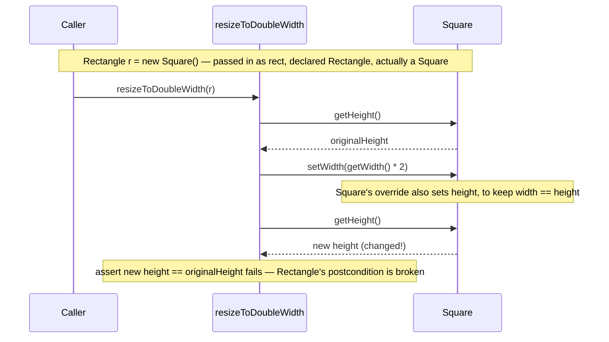
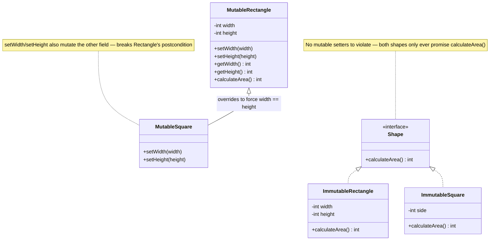

# Liskov Substitution Principle (LSP)
**Part of the SOLID series** | [Back to Overview](solid_principles.md)

---

## Definition and Intent

> "What is wanted here is something like the following substitution property: If for each object o1 of type S there is an object o2 of type T such that for all programs P defined in terms of T, the behavior of P is unchanged when o1 is substituted for o2, then S is a subtype of T."
> — Barbara Liskov, OOPSLA 1987 keynote *Data Abstraction and Hierarchy* (Turing Award 2008)

Liskov and Jeannette Wing formalized this as **behavioral subtyping** seven years later:

> "Let φ(x) be a property provable about objects x of type T. Then φ(y) should be true for objects y of type S where S is a subtype of T."
> — Liskov & Wing, *A Behavioral Notion of Subtyping*, ACM TOPLAS 16(6), November 1994

The familiar one-liner — "objects of type T may be replaced with objects of subtype S without altering the correctness of the program" — is a popular paraphrase of these two statements, not a direct quotation from either.

In plain terms: **anywhere your code uses a base class or interface, you should be able to plug in a subclass and have the program still work correctly — without the caller needing to know which subclass it is dealing with.**

This is a stronger statement than "it compiles." A subclass can override a method and still compile, but if it changes the behavior in a way that breaks the caller's assumptions, LSP is violated.

**Intent:** Make inheritance and polymorphism safe. OCP says "extend without modifying"; LSP ensures the extensions are actually correct and trustworthy.

---

## Intuition

> **One-line analogy**: LSP is like a promise that all plugs fit the same outlet — if you advertise a certain socket shape (interface), every plug (implementation) must actually work in it, not just fit physically but behave correctly.

**Mental model**: Polymorphism promises: "use any subclass wherever the base class is accepted." LSP ensures this promise isn't broken. If `Square extends Rectangle` and you pass a Square to `setWidth(5)`, should the height also change to 5? If it does, code assuming Rectangle behavior breaks — LSP is violated. Subtypes must honor the full behavioral contract of the base type, not just the method signatures.

**Why it matters**: LSP violations destroy polymorphism's value — if you can't trust substitutability, you end up writing `instanceof` checks everywhere, defeating the purpose of inheritance. It ensures the type hierarchy is semantically coherent, not just syntactically valid.

**Key insight**: "Is-a" in OOP requires behavioral compatibility, not just logical similarity. A Square IS-A rectangle geometrically, but it's NOT-A rectangle behaviorally in most OOP implementations. When in doubt, prefer composition over inheritance to avoid LSP violations.

---

## The Formal Contract

LSP is rooted in Design by Contract (Eiffel language concept). For a subclass to be a valid substitution:

1. **Preconditions cannot be strengthened.** The subclass cannot require more from its callers than the parent does.
2. **Postconditions cannot be weakened.** The subclass must deliver at least what the parent promised — it can deliver more, but not less.
3. **Invariants must be preserved.** Any property the base class guarantees about its state must hold in the subclass.
4. **The history constraint.** Subclass methods must not introduce mutations that the base class did not allow (a read-only parent should not have a mutable subclass that modifies shared state unexpectedly).
5. **Exceptions:** A subclass should not throw new exception types beyond those the base method declares, unless they are subtypes of exceptions the base already throws. Java's compiler enforces this for checked exceptions on overrides; unchecked exceptions slip through, which is why an added `UnsupportedOperationException` compiles cleanly and still breaks LSP.

---

## The Classic Problem: Rectangle and Square

This is the canonical LSP example, included in virtually every textbook and interview.

### The Naive Design (Violates LSP)

```java
// Seems reasonable: a Square IS-A Rectangle mathematically
public class Rectangle {
    protected int width;
    protected int height;

    public void setWidth(int width) { this.width = width; }
    public void setHeight(int height) { this.height = height; }
    public int getWidth() { return width; }
    public int getHeight() { return height; }

    public int calculateArea() {
        return width * height;
    }
}

// A square must keep width == height at all times
public class Square extends Rectangle {
    @Override
    public void setWidth(int width) {
        this.width = width;
        this.height = width; // Must override to keep invariant
    }

    @Override
    public void setHeight(int height) {
        this.height = height;
        this.width = height; // Must override to keep invariant
    }
}
```

Now look at this perfectly reasonable client code:

```java
// This client was written against Rectangle's contract
public void resizeToDoubleWidth(Rectangle rect) {
    int originalHeight = rect.getHeight();
    rect.setWidth(rect.getWidth() * 2);
    // ASSUMPTION (from Rectangle contract): height is unchanged after setWidth
    assert rect.getHeight() == originalHeight; // FAILS for Square!
}

// Caller
Rectangle r = new Square(); // LSP says this should work
resizeToDoubleWidth(r);      // It does NOT work — assertion fails
```



Tracing the exact call from the code above: `rect` answers `getHeight()` differently the second time, purely because its runtime type is `Square` — the assertion the caller trusted about `Rectangle` breaks at that instant, which is the substitution failure LSP forbids.

**Why LSP is violated:**
- `Rectangle` has an implicit postcondition: `setWidth` only changes width, not height
- `Square` violates this postcondition by changing both
- The caller `resizeToDoubleWidth` has a valid assumption about `Rectangle`, but `Square` breaks it
- A `Square` cannot be substituted for a `Rectangle` without breaking the caller

**The lesson:** The mathematical "is-a" relationship (a square is a rectangle) does not imply a valid behavioral subtype relationship. In OOP, "is-a" must be behavioral, not just definitional.

### LSP-Compliant Solution

```java
// Option 1: Use a shared interface without setters — immutable shapes
public interface Shape {
    int calculateArea();
}

public class Rectangle implements Shape {
    private final int width;
    private final int height;

    public Rectangle(int width, int height) {
        this.width = width;
        this.height = height;
    }

    public int getWidth() { return width; }
    public int getHeight() { return height; }

    @Override
    public int calculateArea() {
        return width * height;
    }
}

public class Square implements Shape {
    private final int side;

    public Square(int side) {
        this.side = side;
    }

    public int getSide() { return side; }

    @Override
    public int calculateArea() {
        return side * side;
    }
}

// Now both can substitute for Shape safely — no shared mutable state contract is broken
public void printArea(Shape shape) {
    System.out.println("Area: " + shape.calculateArea()); // Works for both
}
```



The naive hierarchy forces `MutableSquare` to override both setters just to preserve its own invariant, breaking `Rectangle`'s postcondition; the `Shape`-based redesign removes the shared mutable state entirely, so `ImmutableRectangle` and `ImmutableSquare` only ever promise `calculateArea()` — nothing left to violate.

**Option 2: Factory method approach**

```java
public class Rectangle {
    private final int width;
    private final int height;

    public Rectangle(int width, int height) {
        this.width = width;
        this.height = height;
    }

    // Returns a new rectangle — immutable approach
    public Rectangle withWidth(int newWidth) {
        return new Rectangle(newWidth, this.height);
    }

    public Rectangle withHeight(int newHeight) {
        return new Rectangle(this.width, newHeight);
    }

    public int calculateArea() {
        return width * height;
    }
}
```

---

## Additional LSP Violation Examples

### Violation: Throwing UnsupportedOperationException

```java
// BAD: ReadOnlyList violates List's contract
public class ReadOnlyList<T> extends ArrayList<T> {
    @Override
    public boolean add(T element) {
        throw new UnsupportedOperationException("This list is read-only!");
    }

    @Override
    public T remove(int index) {
        throw new UnsupportedOperationException("This list is read-only!");
    }
}

// Caller has no idea this will throw
public void addDefaultItem(List<String> list) {
    list.add("DEFAULT"); // Explodes at runtime if list is ReadOnlyList
}
```

**Fix:** Use composition, not inheritance. Or use a separate `ReadableList` interface that does not include mutation methods.

```java
public interface ReadableList<T> {
    T get(int index);
    int size();
    boolean contains(T element);
}

// No UnsupportedOperationException needed — the interface never promised mutation
public class ImmutableList<T> implements ReadableList<T> {
    private final List<T> internal;

    public ImmutableList(List<T> items) {
        this.internal = List.copyOf(items);
    }

    @Override public T get(int index) { return internal.get(index); }
    @Override public int size() { return internal.size(); }
    @Override public boolean contains(T element) { return internal.contains(element); }
}
```

### Violation: Strengthening Preconditions

```java
// Base class accepts any positive amount
public class BankAccount {
    protected double balance;

    public void deposit(double amount) {
        if (amount <= 0) throw new IllegalArgumentException("Amount must be positive");
        balance += amount;
    }
}

// Subclass strengthens the precondition — amounts must also be > 100
public class PremiumBankAccount extends BankAccount {
    @Override
    public void deposit(double amount) {
        // VIOLATION: strengthening precondition (parent only required > 0)
        if (amount <= 100) throw new IllegalArgumentException("Minimum deposit is $100");
        balance += amount;
    }
}

// Code written against BankAccount contract breaks when given PremiumBankAccount
public void depositFiveDollars(BankAccount account) {
    account.deposit(5); // Valid per BankAccount contract, throws for PremiumBankAccount
}
```

### Violation: Weakening Postconditions

```java
// Base class guarantees list is never null and is sorted
public class SortedDataProvider {
    protected List<Integer> fetchFromDB() {
        return new ArrayList<>(List.of(5, 1, 3));   // arrives in arbitrary order
    }

    public List<Integer> getData() {
        List<Integer> data = fetchFromDB();
        Collections.sort(data);
        return data; // Always sorted, never null
    }
}

// Subclass returns unsorted data — weakened postcondition
public class FastDataProvider extends SortedDataProvider {
    @Override
    public List<Integer> getData() {
        return fetchFromDB(); // Skips sort for "performance" — breaks caller's assumption
    }
}

// Caller depends on the postcondition
public void processData(SortedDataProvider provider, int targetValue) {
    List<Integer> data = provider.getData();
    // Relies on sorted order for binary search — breaks silently with FastDataProvider
    int idx = Collections.binarySearch(data, targetValue);
}
```

---

## Real-World Analogies

**Employee substitution:** You hire a contractor to fill in for your senior developer. If the contractor cannot attend meetings, cannot access the codebase, or refuses to review PRs (all things the senior developer did), the substitution fails. A valid substitute must honor the entire contract of the role, not just parts of it.

**Electrical devices:** A device that accepts 110V is the base type. Plugging in a device that accepts only 220V violates the substitution — the precondition (input voltage) has been strengthened beyond what the outlet guarantees.

**Bird analogy:** `Bird` has a method `fly()`. `Ostrich` is a `Bird` but cannot fly. Making `Ostrich extend Bird` and throwing `UnsupportedOperationException` from `fly()` is an LSP violation. The `Bird` type hierarchy should separate `FlyingBird` from `Bird`.

---

## How to Identify LSP Violations

- A subclass method throws `UnsupportedOperationException`
- A subclass overrides a method but does less than the parent promised
- Client code has `instanceof` checks before calling a method (implies the type is not safely substitutable)
- A subclass method ignores its arguments in a way the parent would not
- Tests written against the base class fail when run with a subclass

---

## Code Smell: The instanceof Check

When you see this pattern, LSP is likely violated:

```java
// This instanceof check is a red flag — why can't we treat all Animals as Animals?
public void makeSound(Animal animal) {
    if (animal instanceof Dog) {
        ((Dog) animal).bark();
    } else if (animal instanceof Cat) {
        ((Cat) animal).meow();
    }
}

// LSP-compliant version
public void makeSound(Animal animal) {
    animal.makeSound(); // Safe polymorphic dispatch
}
```

---

## Pros and Cons of Strict LSP Adherence

### Pros
- Polymorphism is actually safe — you can substitute freely without surprises
- Fewer runtime errors from unexpected behavior in subclasses
- Client code is simpler — no need for defensive `instanceof` checks
- Inheritance hierarchies are trustworthy and composable

### Cons
- Mathematical "is-a" and behavioral "is-a" often diverge — Square/Rectangle tension is genuinely hard
- Strict invariant preservation sometimes forces awkward designs (e.g., immutable shapes)
- Can push you toward composition over inheritance earlier than feels natural
- The formal precondition/postcondition analysis requires discipline and documentation

---

## Tradeoffs: When Is It OK to Bend the Rule?

- **Framework constraints:** Some frameworks require subclassing for extension, and the framework's own design may have mild LSP violations. Working within those constraints pragmatically is reasonable.
- **Internal code with full control:** If you own all callers, you can sometimes break LSP knowingly and add a note, as long as the violation is contained. But document it.
- **Sealed hierarchies (Java 17+):** When using sealed classes + pattern matching, you know all subtypes at compile time. The caller can handle all cases exhaustively rather than relying on substitution. This is a valid alternative to LSP when the hierarchy is intentionally closed.

---

## Relationship to Other Principles

| Principle | Relationship |
|---|---|
| OCP | OCP relies on safe substitution — LSP ensures the substitution is actually safe |
| SRP | SRP clarifies contracts; single-purpose classes have clearer postconditions to preserve |
| ISP | Narrow interfaces are easier to implement fully — reducing LSP violations via `UnsupportedOperationException` |
| DIP | Code that depends on abstractions (DIP) assumes substitutability — LSP makes that assumption valid |

---

## Cross-Perspective: HLD Connections

**HLD View — Where LSP Appears in Distributed Systems**

- **Multi-cloud storage** — S3, GCS, and Azure Blob Storage are substitutable implementations of a `BlobStorage` interface. Any service using the interface must work correctly with any provider — LSP as a cloud portability guarantee.
- **Database read replicas** — A read replica must be substitutable for the primary for read operations: same query, same results (eventually). If a replica returns stale data for queries that require current data, it violates LSP — callers cannot safely substitute it.
- **Service versioning** — A v2 API endpoint should be substitutable for v1 for all requests that v1 could handle. Breaking LSP at the API level (v2 rejects valid v1 requests, or changes response semantics) breaks backward compatibility and all existing clients.
- **Container images** — A new container image for a service must be substitutable for the old one: same API contract, same behavior for all valid inputs. A deployment that introduces contract-breaking changes violates LSP at the infrastructure level.

---

## Interview Questions and Answers

**Q: What is the Liskov Substitution Principle?**
**Short:** LSP requires that a subclass be substitutable for its base class without breaking the program's correctness.

A: LSP states that a subclass must be substitutable for its base class without breaking the program's correctness. This means the subclass must honor the full behavioral contract of the parent: not strengthening preconditions, not weakening postconditions, and not violating class invariants.

---

**Q: Explain the Rectangle/Square problem.**
**Short:** Square extending Rectangle breaks LSP because Square must violate Rectangle's implicit contract that width and height mutate independently.

A: Mathematically, a square is a rectangle. But in OOP, making `Square` extend `Rectangle` causes issues because `Rectangle` has an implicit contract: setting width does not change height. `Square` must break this to maintain its own invariant (all sides equal). Code written against `Rectangle` that assumes independent width/height mutation will break when given a `Square`. The fix is to use an interface or immutable design that does not involve mutable setters.

---

**Q: How is LSP different from polymorphism?**
**Short:** Polymorphism is the language mechanism, while LSP is the behavioral constraint that makes substituting a subtype actually safe.

A: Polymorphism is the mechanism; LSP is the constraint that makes polymorphism safe and correct. Polymorphism allows you to write `Shape s = new Circle()`. LSP says: if you do that, `Circle` must behave in a way consistent with what `Shape` promised. Without LSP, polymorphism compiles but produces surprising runtime failures.

---

**Q: What does `UnsupportedOperationException` tell you about LSP?**
**Short:** Throwing UnsupportedOperationException from an overridden method almost always signals an LSP violation.

A: Throwing `UnsupportedOperationException` from an overridden method is almost always an LSP violation. It means a subclass is inheriting a contract it cannot fulfill. The right fix is to redesign the hierarchy — either use a narrower interface that does not include the unsupported operation, or switch to composition.

---

**Q: What is behavioral subtyping?**
**Short:** Behavioral subtyping means honoring the base type's behavior contract, not merely sharing its structural fields and methods.

A: Behavioral subtyping means "is-a" in the sense of the behavior contract, not just the structural type. A `Square` is structurally a `Rectangle` (same fields and methods), but it is not a behavioral subtype because it cannot fulfill `Rectangle`'s contract. LSP defines when a subtype relationship is behaviorally valid.

---

**Q: What are the formal rules a subclass must satisfy to be a valid LSP substitution?**
**Short:** Preconditions can't strengthen, postconditions can't weaken, invariants must hold, and mutations and exceptions must stay within the base contract.

A: Five rules from Design by Contract: preconditions cannot be strengthened (the subclass can't require more from callers than the parent did); postconditions cannot be weakened (it must deliver at least what the parent promised); invariants must be preserved; the history constraint forbids mutations the base class's contract did not allow; and a subclass should not throw new exception types beyond what the base method already declares or its subtypes. Violating any one of these breaks substitutability even if the code compiles cleanly.

---

**Q: Give a concrete LSP violation involving strengthening a precondition.**
**Short:** A PremiumBankAccount that rejects deposits under $100 strengthens BankAccount's "any positive amount" rule.

A: `BankAccount.deposit()` accepts any amount greater than zero. `PremiumBankAccount` overrides `deposit()` to reject anything at or below $100 — a stricter precondition than the parent ever imposed. Code written against `BankAccount` that calls `account.deposit(5)`, valid per the base contract, now throws when given a `PremiumBankAccount`. The fix is to never require more from callers in an override than the base type promised to accept.

---

**Q: Give a concrete LSP violation involving weakening a postcondition.**
**Short:** A FastDataProvider that skips sorting breaks SortedDataProvider's promise that getData() always returns sorted data.

A: `SortedDataProvider.getData()` guarantees the returned list is always sorted. `FastDataProvider` overrides `getData()` to skip the sort "for performance," silently weakening that guarantee. A caller that relies on the sorted postcondition to run `Collections.binarySearch()` gets wrong results with no exception and no warning. The postcondition a base type promises must hold in every subtype, even when honoring it costs more.

---

**Q: Why can an override that compiles cleanly still violate LSP?**
**Short:** Compiling only checks the method signature; LSP is about whether the runtime behavior still honors the caller's assumptions.

A: The Java compiler only checks that an override's signature is compatible — return type, parameter types, checked exceptions. It says nothing about whether the new method's *behavior* still satisfies what callers assumed about the base type. `Square.setWidth()` compiles fine while silently also changing height, and a subclass throwing `UnsupportedOperationException` from an inherited method compiles fine while breaking every caller that could invoke it. LSP requires reasoning about the contract, not just the type signature.

---

**Q: Explain the Bird/Ostrich LSP violation and how you'd fix the hierarchy.**
**Short:** Making Ostrich extend Bird and throw from fly() violates LSP; separate FlyingBird from Bird instead.

A: If `Bird` declares a `fly()` method, making `Ostrich extends Bird` and throwing `UnsupportedOperationException` from its `fly()` override is an LSP violation — any code that treats an `Ostrich` as a `Bird` and calls `fly()` breaks at runtime. The fix is to separate the hierarchy: a `FlyingBird` subtype (or interface) declares `fly()`, while the base `Bird` type does not, so `Ostrich` can be a `Bird` without ever being asked to fly. This is the same shape as the ReadOnlyList/List problem — the fix is always to narrow the contract, not to fake compliance with an exception.

---

**Q: How does LSP treat checked exceptions differently from unchecked exceptions on an override?**
**Short:** The compiler blocks a broadened checked exception on override, but an added unchecked exception compiles and can still violate LSP.

A: Java's compiler enforces that an overriding method cannot declare a broader checked exception than the method it overrides, so that particular LSP violation is caught at compile time. Unchecked exceptions are not checked by the compiler at all — an override is free to throw a new `RuntimeException` subtype like `UnsupportedOperationException` that the base method never threw, and it compiles cleanly while still breaking every caller that didn't expect it. This is exactly why the `UnsupportedOperationException` pattern is such a common, compiler-invisible LSP violation.

---

**Q: Walk through the `ReadOnlyList extends ArrayList` example — what's wrong and what's the fix?**
**Short:** Overriding add()/remove() to throw breaks List's contract; the fix is a narrower interface with no mutators.

A: `ReadOnlyList` extends `ArrayList` and overrides `add()` and `remove()` to throw `UnsupportedOperationException`. Code written against the `List` interface — like a method that calls `list.add("DEFAULT")` — has no idea it might explode at runtime when handed a `ReadOnlyList`. The fix is composition instead of inheritance: define a separate `ReadableList` interface with only `get()`, `size()`, and `contains()`, so an `ImmutableList` implementing it never needs to throw, because the interface never promised mutation in the first place.

---

**Q: What does the "history constraint" mean in LSP's formal contract?**
**Short:** A subclass must not introduce mutations to shared state that the base class's contract did not allow.

A: The history constraint says a subclass's methods must not introduce state changes that the base class did not permit — for example, a read-only parent should not have a mutable subclass that unexpectedly modifies shared state. It's the least commonly cited of the five LSP rules but shows up whenever a subclass adds a setter or side effect the base type's contract implicitly forbade. Immutable base designs sidestep this rule entirely, since there is no mutable state left to violate.

---

**Q: How does service API versioning connect to LSP?**
**Short:** A v2 endpoint should handle every request v1 could handle, or it breaks LSP-style backward compatibility for existing clients.

A: A v2 API endpoint should be substitutable for v1 for every request that v1 could handle — same shape of LSP substitutability, applied to service contracts instead of class hierarchies. If v2 rejects a previously valid v1 request or changes the response's semantics, it breaks backward compatibility for every existing client, which is exactly the caller-assumption breakage LSP forbids at the class level. Container image rollouts have the same requirement: a new image must behave identically to the old one for every valid input, or the deployment itself is an LSP violation.

---

**Q: When is it pragmatic to knowingly bend LSP?**
**Short:** Inside code you fully control, or when a framework's own subclassing constraints force a mild violation — document it either way.

A: Two situations are reasonable: working within a framework that requires subclassing for extension, when the framework's own design has a mild LSP tension you didn't create; and internal code where you own every caller, so a knowing, contained violation can't surprise anyone outside your control. In both cases, document the violation explicitly rather than leaving it to be discovered the hard way. Sealed hierarchies (Java 17+) offer a cleaner alternative when the type set is intentionally closed — callers pattern-match exhaustively instead of relying on substitutability at all.

---

**Interview Tip:** The Rectangle/Square example is guaranteed to come up. Know it cold: the problem, why it violates LSP (broken postcondition), and two clean solutions (immutable design, shared interface without setters). Then be ready to give a second example from enterprise code — `ReadOnlyList extends ArrayList` throwing `UnsupportedOperationException` is equally well-known and more relatable to Java developers.
