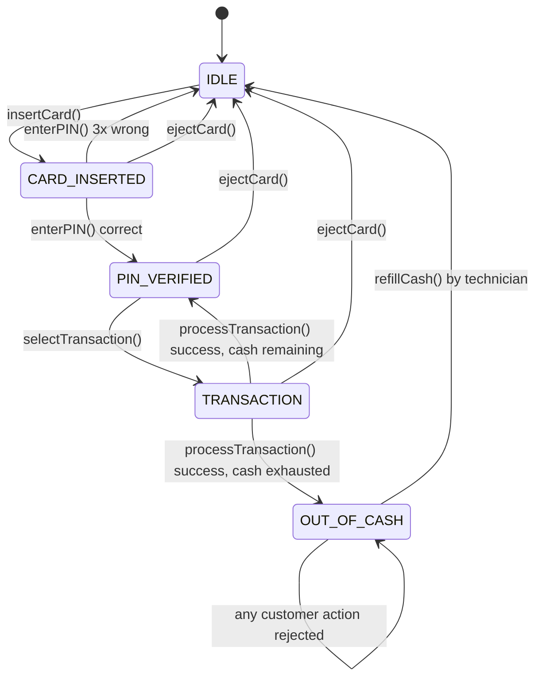
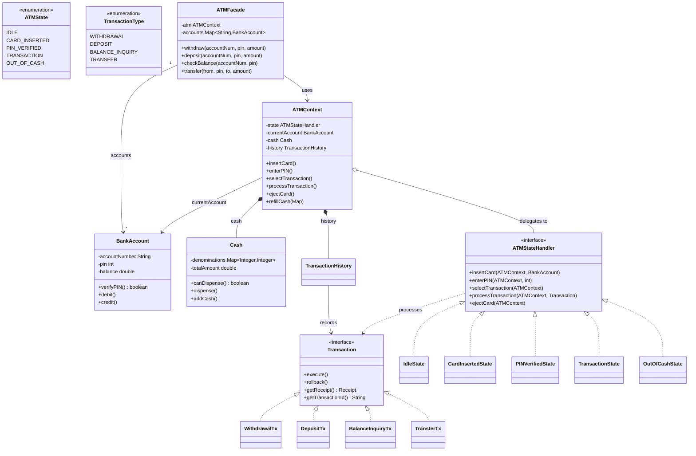
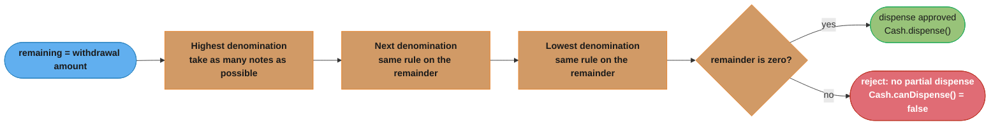
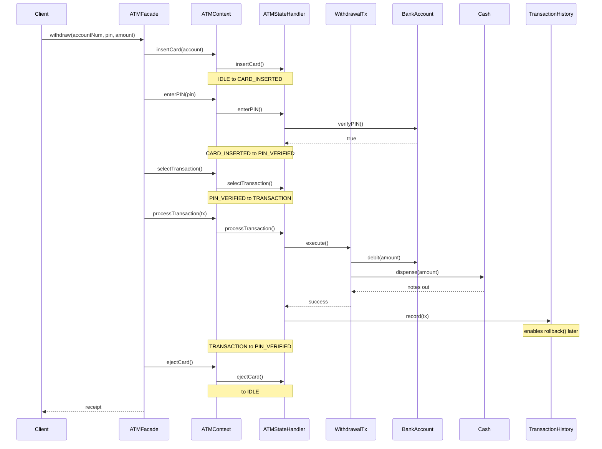

# ATM System — Low Level Design

## Intuition

> **One-line analogy**: ATM design is a state machine problem — the machine's response to every button press depends entirely on which state it's currently in, just like a traffic light ignores "go" requests when it's already green.

**Mental model**: An ATM has well-defined states (Idle → Card Inserted → PIN Verified → Transaction) and transitions between them are triggered by events (insertCard, enterPIN, selectTransaction). Without a State pattern, every operation becomes a maze of `if (state == X)` checks. With it, each state is an object that knows exactly what to do when any event fires — and invalid events are simply no-ops.

**Why it matters**: This problem exercises the State pattern (session phases), the Command pattern (reversible transactions with a rollback log), and Facade (collapsing the five-step protocol into one call). It's a rich pattern playground in a familiar real-world context.

**Key insight**: The cash dispensing algorithm (largest denomination first — greedy) and the lockout-after-3-failures logic are where most candidates stumble. Greedy is the *obvious* answer and it is not a complete one — say so before the interviewer does.

**Full runnable implementation:** [`ATM.java`](ATM.java) — 679 lines, one file, `main()` at the bottom. It demonstrates five `ATMStateHandler` states, four `Transaction` command implementations recorded in `TransactionHistory`, and `ATMFacade` collapsing the five-step protocol into `withdraw`/`deposit`/`transfer`/`checkBalance` — State, Command and Facade in one file.

---

## Problem Statement

Design an ATM (Automated Teller Machine) system that supports:
- Card insertion and PIN verification (with lockout after 3 failures)
- Withdrawals with denomination-aware cash dispensing
- Deposits, balance inquiries, and fund transfers
- Transaction receipts and an auditable transaction history with rollback capability
- Clean state management so invalid transitions (e.g., withdraw without a card) are silently rejected

The system must be extensible to support multi-currency ATMs, network timeouts, and card-skimming detection.

---

## State Transition Diagram (ASCII)

Five states: `ejectCard()` and three wrong PIN attempts always fall back to `IDLE`, `processTransaction()` forks to `OUT_OF_CASH` the instant the cassette empties, and `OUT_OF_CASH` rejects every *customer* action — only `ATMContext.refillCash()`, a technician action deliberately kept off the `ATMStateHandler` interface, returns the machine to `IDLE`. The table below is the authoritative version this diagram mirrors.

**Valid transitions summary:**

| Current State    | Action                  | Next State       |
|------------------|-------------------------|------------------|
| IDLE             | insertCard()            | CARD_INSERTED    |
| CARD_INSERTED    | enterPIN() [correct]    | PIN_VERIFIED     |
| CARD_INSERTED    | enterPIN() [3x wrong]   | IDLE             |
| CARD_INSERTED    | ejectCard()             | IDLE             |
| PIN_VERIFIED     | selectTransaction()     | TRANSACTION      |
| PIN_VERIFIED     | ejectCard()             | IDLE             |
| TRANSACTION      | processTransaction()    | PIN_VERIFIED / OUT_OF_CASH |
| TRANSACTION      | ejectCard()             | IDLE             |
| OUT_OF_CASH      | (any customer action)   | OUT_OF_CASH      |
| OUT_OF_CASH      | refillCash() [technician] | IDLE           |

---

## Class Diagram (ASCII)

State (`ATMStateHandler` + 5 handlers), Command (`Transaction` + 4 concrete transactions logged in `TransactionHistory` for rollback), and Facade (`ATMFacade`) collaborate here: the facade drives `ATMContext`, which delegates every call to whichever handler is currently active, and each concrete `Transaction` knows how to undo itself.

---

## Cash Dispensing Algorithm (greedy, largest denomination first)

The Intuition section flags denomination-aware dispensing as a place candidates stumble. `Cash` keeps its denominations in a `TreeMap` sorted high-to-low and walks it once, taking as many notes of each denomination as the remainder and the note count allow. It is a single greedy pass over a sorted map — *not* a Chain of Responsibility: there are no handler objects and no successor links, only loop iterations.

This is exactly the `Cash.canDispense()` / `Cash.dispense()` pair from the class diagram above, made concrete: the ATM never partially dispenses, so a pass that bottoms out with a nonzero remainder must reject the whole withdrawal rather than hand over an incomplete stack of notes.

**Greedy is not exhaustive — and this is the interview trap.** A single high-to-low pass finds a valid combination only when the denominations are *canonical* (each note divides evenly into the ones above it, as US $100/$50/$20/$10 nearly is) **and** every needed note is in stock. Once note counts are finite, greedy rejects amounts that are genuinely dispensable: with one $50 and three $20s in the cassettes, `canDispense(60)` takes the $50 first, is left with $10 it cannot make, and returns `false` — even though three $20s pay it exactly. An exhaustive answer needs a bounded-knapsack DP or backtracking over `(denomination, count)` pairs; state the greedy limitation explicitly rather than letting the interviewer find it.

---

## Design Patterns Used

### 1. State Pattern
**Where:** `ATMStateHandler` interface + `IdleState`, `CardInsertedState`, `PINVerifiedState`, `TransactionState`, `OutOfCashState`.

**Why:** The ATM has sharply distinct phases. Instead of a giant `if/else` or `switch` on an enum, each state class encapsulates the exact behavior legal in that phase. Invalid actions print a message and do nothing — no exceptions, no enum checks scattered across the codebase.

**Key insight:** State objects hold no long-lived data (except `CardInsertedState.failedAttempts`) — they are essentially singletons per session and can be replaced by sharing instances if memory matters.

### 2. Command Pattern (with Rollback)
**Where:** `Transaction` interface + four concrete commands + `TransactionHistory`.

**Why:** Each transaction is an object that carries both its forward action (`execute()`) and its compensating action (`rollback()`). `TransactionHistory` acts as a command log, enabling:
- Full audit trail
- Single-step or bulk rollback
- Easy addition of new transaction types without modifying existing code

**Rollback note:** In a real ATM, physical cash cannot be "un-dispensed." The `rollback()` on `WithdrawalTransaction` models the account correction only; a separate reconciliation process handles the physical discrepancy.

### 3. Facade Pattern
**Where:** `ATMFacade`

**Why:** The raw ATM protocol requires 5 steps (insert → PIN → select → process → eject). The facade collapses these into single intent-expressing calls (`withdraw`, `deposit`, `transfer`, `checkBalance`), making integration tests and demos readable.

---

## Runtime Collaboration: A Withdrawal Walkthrough

The class diagram shows structure; this sequence shows the five-step protocol the Facade Pattern section describes above — insert, PIN, select, process, eject — collapsed by a single `ATMFacade.withdraw()` call, with the State pattern re-delegating at every step and the Command pattern logging the transaction for rollback.

Every `Ctx->>St` call is dispatched to whichever `ATMStateHandler` is currently installed — `IdleState`, then `CardInsertedState`, then `PINVerifiedState`, then `TransactionState` — the same field reassigned after each step, which is exactly what keeps `ATMContext` free of `if/else` state checks.

---

## Security Considerations

| Concern | Mitigation in this design |
|---|---|
| PIN exposure in logs | `verifyPIN()` returns a boolean; the PIN value is never logged or stored in any Receipt/History object |
| Brute-force PIN | `CardInsertedState` tracks `failedAttempts`; card is blocked and session cleared after 3 failures |
| Transaction limits | Add a `TransactionLimitPolicy` strategy per `BankAccount` — checked inside each concrete `Transaction.execute()` |
| Session timeout | Add a `ScheduledExecutorService` in `ATMContext`; on timeout call `ejectCard()` |
| Receipt information leakage | `Receipt` stores only the last 4 digits of the account number (`maskedAccount`) |
| Concurrent sessions | `ATMContext` is not thread-safe by design (one card at a time); add `ReentrantLock` around state transitions for concurrent access |

---

## Cross-Perspective: HLD Connections

**HLD View — Where ATM Design Scales to Distributed Systems**

- **State machine → distributed transaction state** — The ATM state machine (IDLE → CARD_INSERTED → PIN_VERIFIED → TRANSACTION) maps to distributed transaction state in payment systems (INITIATED → AUTHORIZED → CAPTURED → SETTLED). The Saga pattern coordinates these states across services.
- **Cash dispensing → limited resource allocation** — Denomination-aware cash dispensing maps to distributed resource allocation with constraints: inventory reservation systems, ticket allocation, hotel room booking all solve the "allocate limited discrete resources optimally" problem.
- **PIN lockout → distributed auth state** — The 3-attempt lockout requires shared state across ATM terminals. At HLD scale, this is stored in a distributed cache (Redis) so a user locked at one ATM is locked at all terminals — the same distributed state problem solved locally by the Singleton.
- **Transaction rollback → compensating transactions** — The ATM's rollback capability maps to the Saga pattern's compensating transactions: if cash dispenses but receipt printing fails, a compensation transaction reverses the account debit.

---

## Follow-Up Extensions

### Multi-Currency Support
- Add a `Currency` enum and a `CurrencyConverter` service.
- `Cash` becomes `Map<Currency, Map<Integer, Integer>>`.
- `BankAccount.balance` becomes `Map<Currency, Double>`.

### Card Skimming Detection
- Add a `FraudDetectionService` observer that `TransactionState.processTransaction()` notifies.
- Heuristics: transaction velocity (>N withdrawals in M minutes), geographical anomalies, amount patterns.
- On suspicion: block the card, transition to `IdleState`, alert the bank.

### Network Timeout Handling
- Wrap `Transaction.execute()` in a `CompletableFuture` with a timeout.
- On timeout: call `rollback()` to cancel any partial state change.
- Expose ATM state as `NETWORK_ERROR`; display "Please try again" message.
- Implement idempotency keys so a re-submitted transaction is not double-processed.

### Additional Patterns to Consider
- **Decorator** on `Transaction` for logging, encryption, or rate-limiting without modifying core logic.
- **Singleton** on `ATMContext` (one ATM machine per JVM process).
- **Template Method** in an abstract `AbstractTransaction` to enforce execute-then-receipt boilerplate.

---

## Interview Questions with Answers

**Q: Why is greedy, largest-denomination-first cash dispensing not a complete algorithm?**
**Short:** with finite note counts, greedy can reject an amount that a different combination could pay exactly.

Greedy works only when denominations are canonical *and* every needed note is still in stock; once note counts are finite, a single high-to-low pass can strand a nonzero remainder even though a different combination of the same cassettes pays the amount exactly. The example on this page: one $50 and three $20s in stock, `canDispense(60)` takes the $50 first, is left needing $10 it cannot make, and rejects — despite three $20s covering it precisely. The exhaustive fix is a bounded-knapsack DP or backtracking over `(denomination, count)` pairs. State this limitation before the interviewer finds it — it's the single most valuable thing to say out loud on this problem.

**Q: `BankAccount.balance` is a `double` — what's the risk, and what's the fix?**
**Short:** binary floating point can't represent cents exactly, so balances drift after repeated debit/credit.

Binary floating point cannot exactly represent values like 0.10 or 0.25, so a long sequence of debits and credits accumulates rounding error, and an equality check against an expected balance can eventually fail even though the "real" amounts match. The fix is `BigDecimal` with a fixed scale, or a `long` count of cents — the same fix `VendingMachine.java` and `OnlineBookingSystem.java` need for the identical shortcut. This page names the shortcut explicitly rather than hiding it, and repeating that observation unprompted is a cheap, easy interview point.

**Q: Why can only a technician's `refillCash()` exit `OUT_OF_CASH`, and why is that method kept off `ATMStateHandler`?**
**Short:** every customer action is rejected in `OUT_OF_CASH`; only a non-customer, non-interface call recovers it.

`OUT_OF_CASH` rejects every action a customer could trigger through the normal state-handler interface — there is no customer-facing path back to `IDLE`. `ATMContext.refillCash()` is deliberately kept off the `ATMStateHandler` contract because it represents a privileged, out-of-band operation (a technician physically reloading the cassette), not a state-dependent customer action; putting it on the shared interface would force every other state to implement a meaningless no-op for it. This mirrors the same gap `VendingMachine.java`'s `OUT_OF_STOCK` state has for restocking — recovery from an exhausted-resource state is modeled as an administrative action outside the customer state machine, not a transition any customer request can trigger.

**Q: What does `WithdrawalTx.rollback()` actually undo, and what can it not undo?**
**Short:** it corrects the account balance only; physical cash already dispensed cannot be un-dispensed.

`rollback()` reverses the account-side effect of a transaction — crediting back a debited amount — because that's the only part of the operation that's still reversible in software once the transaction has run. Physical cash that has already left the dispenser cannot be "un-dispensed" by any method call; a real ATM handles that discrepancy through a separate reconciliation process (cash-count audits against the transaction log), not through the `Transaction` interface. This is exactly why `TransactionHistory` records every executed transaction — rollback is a software-state correction, and the audit trail is what lets a human resolve the physical-cash side afterward.

**Q: Why State pattern for the ATM's session phases instead of a `switch` on an `ATMState` enum?**
**Short:** each state's behavior lives in its own class, so invalid actions are simply absent, not error-branched.

The alternative — one giant method per action (`insertCard`, `enterPIN`, `ejectCard`, ...) each containing a `switch (currentState)` — spreads every state's logic across every method, so understanding what `IDLE` can do means reading five different switch statements instead of one class. With State, `IdleState` implements only the behavior legal in `IDLE`; an invalid action for that state either does nothing or is simply the class not overriding a meaningful response, with zero risk of one state's branch accidentally falling through into another's. Adding a sixth state later (e.g., `NETWORK_ERROR`) means writing one new class, not editing five existing switch statements — Open/Closed in the same way `VendingMachine` and `ElevatorSystem` apply it.

**Q: Why does `CardInsertedState.failedAttempts` living as instance state on a State object not break the "state objects hold no long-lived data" claim in the Key insight?**
**Short:** it's the one deliberate exception — session-scoped counters live on the state, not shared across sessions.

Most State-pattern implementations in this repo (VendingMachine, ElevatorSystem) share one instance of each state class across the entire lifetime of the context, which only works when the state object itself is stateless. `CardInsertedState.failedAttempts` breaks that assumption on purpose — it needs to count wrong PIN entries *within one card session*, so either a fresh `CardInsertedState` instance is created per session (not shared), or the counter is reset explicitly on every new `insertCard()`. This page calls the exception out directly: state objects "can be replaced by sharing instances if memory matters" for the *other* four states, but `CardInsertedState` is the one that genuinely needs per-session data, which is why it isn't a pure Flyweight candidate the way `VendingMachine`'s five states are.

**Q: Why Command with rollback for `Transaction` instead of executing each transaction type directly?**
**Short:** Command lets each transaction carry both its forward action and its own compensating undo.

Wrapping each transaction as an object implementing `execute()`/`rollback()` means `TransactionHistory` can log every operation uniformly and reverse any of them without `ATMContext` needing to know the specifics of what a withdrawal versus a transfer requires to undo. This also makes adding a fifth transaction type (say, a bill payment) additive — implement the interface, register it, nothing else in `ATMStateHandler` or `ATMContext` changes. The alternative, calling `account.debit()`/`account.credit()` directly from state classes, would scatter undo logic across every caller instead of keeping it colocated with the operation it reverses.

**Q: Why does `ATMFacade` exist when `ATMContext` already exposes each of the five protocol steps?**
**Short:** Facade collapses a 5-step protocol into one intent-expressing call for callers who don't need the steps.

`ATMContext` exposes `insertCard`/`enterPIN`/`selectTransaction`/`processTransaction`/`ejectCard` as five separate calls because that's the real state-machine protocol, but almost no caller wants to orchestrate all five manually — a test, a demo, or an integration wants to say "withdraw $200" and get a receipt back. `ATMFacade.withdraw(accountNum, pin, amount)` performs the full five-step sequence internally, so callers who don't care about the intermediate state transitions get a single readable call, while `ATMContext` remains available directly for callers (or tests) that specifically need to exercise state transitions one at a time. This is Facade's textbook justification — simplify the common case without removing access to the underlying subsystem.

**Q: `ATMContext` is explicitly not thread-safe — what breaks under concurrent access, and what's the fix?**
**Short:** two threads racing through state transitions on one context can corrupt which state is "current."

The design assumes one card session at a time; if two threads called methods on the same `ATMContext` concurrently, the field holding `currentState` could be read by one thread mid-transition by another, producing a state that neither thread expects — e.g., one thread believes it's in `TRANSACTION` while the object has already moved to `IDLE`. The page's own fix is a `ReentrantLock` (or `synchronized`) wrapped around every state transition, ensuring only one thread drives the state machine at a time. This is a genuinely different concern from the PIN-lockout problem below — this is about one physical machine handling truly concurrent calls, not about sharing lockout state across multiple machines.

**Q: How would you make the 3-attempt PIN lockout apply across all ATM terminals, not just the one where the attempts happened?**
**Short:** move lockout state out of the in-process ATM and into a shared store like Redis, keyed by account.

`CardInsertedState.failedAttempts` is per-session, per-machine state — a user who fails 2 PIN attempts at one ATM and walks to a different terminal starts that terminal's counter at zero, because nothing shares the count across machines. Fixing this at scale means moving the failed-attempt counter out of any single ATM's process and into a shared, low-latency store (Redis, keyed by account or card number) that every terminal checks and increments, the same distributed-state problem the page's own HLD Connections section names. This is structurally the same fix as the thread-safety question above, just at a different scale — local concurrency needs a lock, cross-machine consistency needs a shared, externally-visible store.

**Q: Why is `Cash`'s denomination map a `TreeMap` sorted high-to-low rather than a plain `HashMap`?**
**Short:** the greedy dispensing algorithm needs to walk denominations from largest to smallest in order.

The dispensing algorithm's core step is "take as many notes of the highest remaining denomination as possible, then move to the next," which requires iterating denominations in a defined descending order — a `HashMap`'s iteration order is unspecified and cannot be relied on for this. A `TreeMap<Integer, Integer>` with a reverse comparator gives that ordering for free via its natural iteration, letting `canDispense()`/`dispense()` walk the map once in a single pass rather than re-sorting keys on every call. This is a small but real data-structure choice: picking the ordered map here is what makes the greedy loop a straightforward `for` over `entrySet()` instead of an extra sort step.

**Q: How would you add multi-currency support without breaking the four existing `Transaction` implementations?**
**Short:** widen `Cash` and `BankAccount.balance` to per-currency maps; the `Transaction` interface itself is untouched.

The Follow-Up Extensions describe exactly this: `Cash` becomes `Map<Currency, Map<Integer, Integer>>` and `BankAccount.balance` becomes `Map<Currency, Double>` (ideally `BigDecimal`), plus a `CurrencyConverter` service for cross-currency transfers. None of this requires changing the `Transaction` interface's `execute()`/`rollback()`/`getReceipt()` contract — `WithdrawalTx`, `DepositTx`, `BalanceInquiryTx`, and `TransferTx` all still implement the same shape, they just now read/write a currency-keyed structure instead of a scalar. This is the payoff of the Command pattern's abstraction boundary: the *data* each transaction operates on can grow in dimensionality without the *interface* between `ATMStateHandler` and `Transaction` changing at all.

**Q: How would you add network-timeout handling around `Transaction.execute()`?**
**Short:** wrap execute() in a timed `CompletableFuture` and call rollback() on timeout, guarded by idempotency keys.

Wrapping `Transaction.execute()` in a `CompletableFuture` with a timeout lets the caller detect a hung network call to the bank's core system and react instead of blocking indefinitely; on timeout, the natural response is to call the same `rollback()` every transaction already implements, since the Command pattern's reversibility was built for exactly this kind of partial-failure recovery. The subtlety the page names explicitly: a timed-out call might have actually succeeded on the backend even though the response never arrived, so a naive retry could double-process the transaction — the fix is an idempotency key per transaction attempt, so a resubmission is recognized as "already done" rather than executed twice. Exposing a `NETWORK_ERROR` ATM state for the "please try again" message is the customer-facing half of the same fix.

**Q: Walk the greedy cash-dispensing flowchart — what causes it to reject a withdrawal outright rather than partially dispense?**
**Short:** the algorithm never hands over an incomplete stack of notes; a nonzero remainder rejects the whole request.

The flow takes the highest denomination first, subtracts as many notes as fit into the remainder, then repeats for each lower denomination in turn; if after the lowest denomination the remainder is still nonzero, `canDispense()` returns false and `dispense()` is never called at all. This "all or nothing" behavior is deliberate — a real ATM cannot physically dispense "$47 out of a requested $50," so any combination that can't reach exactly zero remainder must fail the entire request rather than short-change the customer. It's exactly this all-or-nothing property that makes the finite-inventory failure case (the $50-plus-three-$20s example) a genuine bug rather than a harmless edge case: a request that's actually satisfiable gets rejected outright because greedy explored only one combination.

**Q: How does the ATM's state machine map to distributed transaction state at HLD scale?**
**Short:** IDLE→CARD_INSERTED→PIN_VERIFIED→TRANSACTION mirrors INITIATED→AUTHORIZED→CAPTURED→SETTLED, coordinated by Saga.

The ATM's strict sequence of session states — each permitting a different set of operations, with invalid transitions rejected — is structurally the same shape as a distributed payment pipeline moving through `INITIATED -> AUTHORIZED -> CAPTURED -> SETTLED`. At HLD scale, the Saga pattern coordinates these states across independently-deployed services the way `ATMStateHandler` coordinates them within one process, with each step's compensating action (a Saga's rollback step) playing the same role `Transaction.rollback()` plays locally. What changes moving from this single-JVM design to the distributed one is *where* the state and the compensation logic live — here it's an in-memory field and a `Transaction` object; at scale it's an event log and a coordinated set of compensating transactions across service boundaries.
