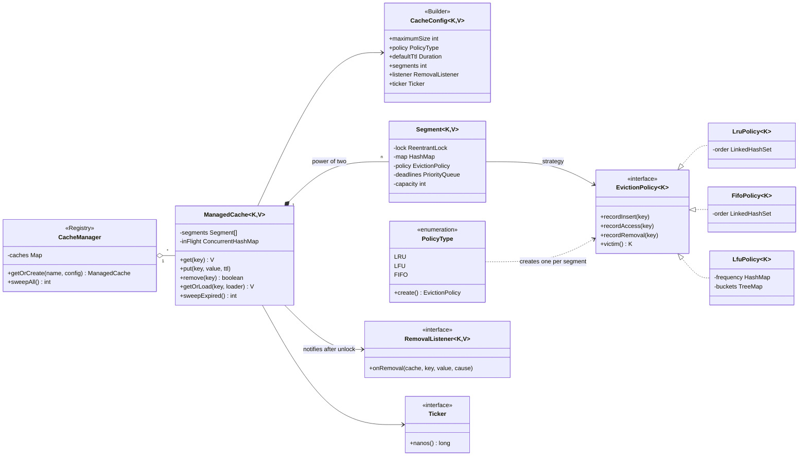
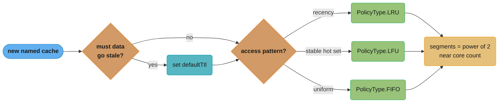
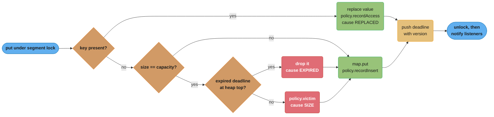
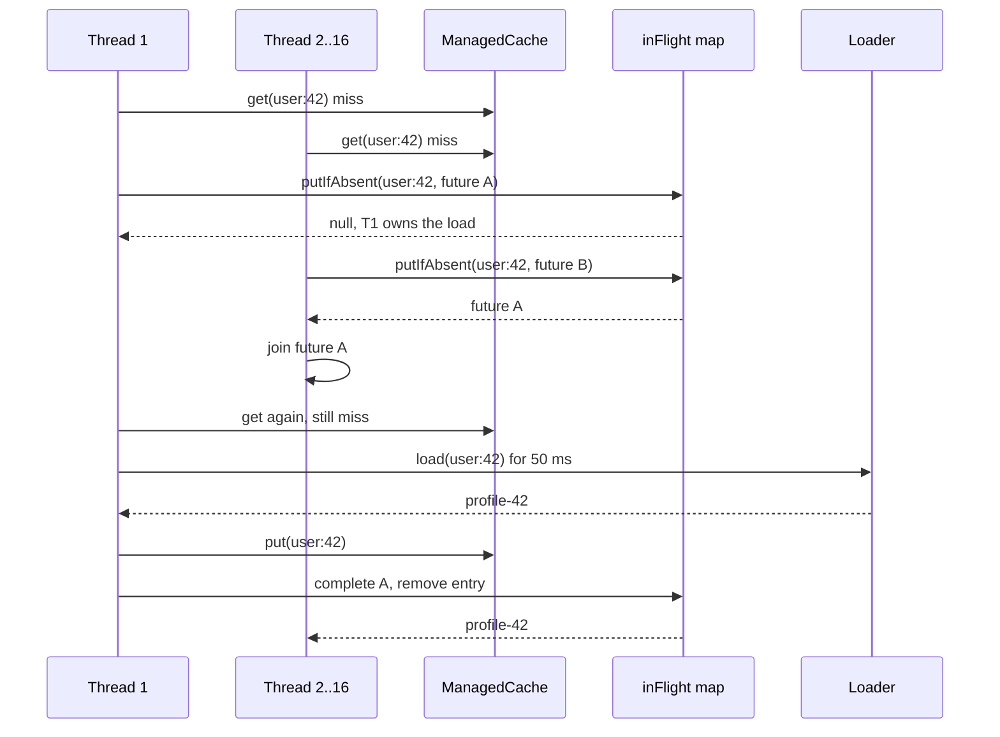

# Cache Manager (LRU + LFU + TTL, pluggable, thread-safe) — Low-Level Design
## Intuition

> **Design intuition**: [`LRUCache.md`](LRUCache.md) is the first half of this interview: build an exact LRU with a `HashMap` plus a doubly-linked list, then an LFU as a separate class. The second half is what interviewers at large companies actually grade: "Now make the eviction policy pluggable. Add per-entry TTL. Make it safe for 64 threads. Let one service own many named caches with different settings." This page starts exactly where `LRUCache.md` stops and does not repeat its pointer surgery.

**Key insight**: `LRUCache.md` argues, correctly, that a Strategy interface over LRU and LFU either leaks the node type or forces a slower shared structure. The way out is to **split storage from ordering**. Storage is a plain `HashMap<K, Entry<V>>`. Ordering is an `EvictionPolicy<K>` that owns its **own** key-indexed structure: a `LinkedHashSet<K>` for LRU and FIFO, frequency buckets for LFU. No node crosses the interface, and every policy stays O(1) or O(log F). The price is honest and measurable: every operation does two hash lookups instead of one, and every key is referenced twice. That is the same trade production libraries make in a different shape: Caffeine keeps one hash table plus separate access-order and write-order queues, a timer wheel for variable expiry, and buffers the reorder work instead of locking on every read ([Caffeine wiki: Design](https://github.com/ben-manes/caffeine/wiki/Design)).

**Full runnable implementation:** [`CacheManager.java`](CacheManager.java) — 773 lines, one file, all types nested, `main()` at the bottom. It demonstrates one access sequence run through LRU, LFU and FIFO with the same cache code (three different victims), TTL with lazy expiry on read and an active sweep that skips stale deadlines of replaced values, a stampede where a naive get-then-put loads 16 times while `getOrLoad` loads once, and an 8-thread, 160,000-operation stress run on an 8-segment LFU cache that ends with every segment's policy matching its map.

**Who owns what.** [`cs_fundamentals/case_studies/design_lru_cache.md`](../../cs_fundamentals/case_studies/design_lru_cache.md) owns the data structure and its complexity proof. [`LRUCache.md`](LRUCache.md) owns the single-policy class design (sentinels, the Decorator lock, the LRU vs LFU contrast). This page owns the multi-policy, TTL, concurrency and registry design. [`hld/caching`](../../hld/caching/caching.md) and [`database/redis_internals`](../../database/redis_internals/redis_internals.md) own caches that span machines.

---

## Problem Statement

Design an in-process cache library with a manager:
- A `CacheManager` creates and owns many named caches, each with its own configuration
- Each cache has a maximum size and an eviction policy chosen at creation: LRU, LFU or FIFO
- Entries can have a time-to-live, either a cache default or per `put`
- Expired entries must never be returned, and must not occupy memory forever if nobody reads them
- Listeners are told about every removal and why (size, expiry, replacement, explicit)
- The cache is safe under many concurrent readers and writers
- Concurrent misses for the same key trigger one load, not one per caller
- Hit, miss, eviction and expiration counts are available for tuning

---

## Requirements

### Functional
1. `getOrCreate(name, config)` on the manager; `get`, `put(k, v)`, `put(k, v, ttl)`, `remove`, `getOrLoad(k, loader)` on a cache
2. Eviction policy is a configuration value, not a code change
3. `put` on a full cache evicts first, then inserts; the new key is never its own victim
4. Lazy expiry: `get` treats an expired entry as a miss and removes it
5. Active expiry: a sweeper removes expired entries that nobody reads
6. Removal listeners receive `(cache, key, value, cause)` with cause in `{EXPLICIT, REPLACED, SIZE, EXPIRED}`

### Non-Functional
1. `get` and `put` are O(1) for LRU and FIFO, O(log F) for LFU where F is the number of distinct access counts
2. Memory bounded by the configured size, per segment
3. A slow loader or a slow listener must not block unrelated keys
4. Time is injected (a `Ticker`) so TTL is testable without sleeping
5. Null keys and values are rejected, so `null` can mean "miss"

---

## Class Diagram



*A `ManagedCache` is an array of `Segment`s. Each segment has its own lock, its own `HashMap` of entries, its own `EvictionPolicy` instance (made by the `PolicyType` factory) and its own min-heap of expiry deadlines. The `CacheManager` is only a registry plus a sweeper; it never touches an entry directly.*

---

## Patterns Used

### 1. Strategy — `EvictionPolicy<K>`
**Why**: The eviction decision is the part that changes between workloads: LRU for recency, LFU for a stable hot set, FIFO when access is uniform. The storage, locking, TTL and listener plumbing do not change.

**How**: The policy sees keys only. `recordInsert`, `recordAccess` and `recordRemoval` keep its private ordering in step with the segment's map; `victim()` answers "who goes next". `LruPolicy` uses a `LinkedHashSet<K>`: `remove(key)` then `add(key)` moves a key to the tail in O(1), and the iterator's first element is the least recently used. `FifoPolicy` is the same structure with `recordAccess` as a no-op. `LfuPolicy` keeps `key -> count` and `count -> LinkedHashSet<K>` buckets.

This is the resolution of the argument in `LRUCache.md`'s "Why not Strategy" section: the policy owns a parallel structure instead of the cache's nodes, so nothing leaks, at the cost of one extra hash lookup per operation.

### 2. Factory — `PolicyType.create()`
**Why**: Every segment needs its **own** policy instance; sharing one would put every segment's keys in one ordering guarded by many different locks.

**How**: `PolicyType` is an enum whose constants override a generic `<K> EvictionPolicy<K> create()`. The config stores the enum, and the cache calls `create()` once per segment.

### 3. Builder — `CacheConfig.Builder`
**Why**: Six optional settings with cross-field rules (segments must be a power of two and no larger than the size).

**How**: Fluent setters with defaults (size 1,000, LRU, no TTL, 1 segment, no-op listener, `System::nanoTime`) and a `build()` that validates once.

### 4. Observer — `RemovalListener` with a `RemovalCause`
**Why**: Metrics want eviction counts by cause; a write-back cache wants to flush on `SIZE` and `EXPIRED` but not on `REPLACED`; a session cache wants to log `EXPIRED`.

**How**: Removals are collected into a list while the segment lock is held, and the listener runs **after** the lock is released. A listener that blocks, throws or calls back into the cache cannot stall other threads or deadlock the segment. `LRUCache.md` notifies inside the lock, which is fine for one thread and one cache; it is not fine for a shared library.

### 5. Registry / Facade — `CacheManager`
**Why**: An application has many caches (sessions, profiles, feature flags) and one place should own their lifecycle and the background sweeper.

**How**: `getOrCreate` uses `ConcurrentHashMap.computeIfAbsent`, so two threads asking for `"sessions"` get the same instance. `sweepAll()` is what a `ScheduledExecutorService` would call every second in production.

### 6. Lock striping (concurrency pattern)
**Why**: One lock around the whole cache serializes every `get`, because an LRU `get` is a write to the ordering.

**How**: `hash(key) & (segments - 1)` picks a segment, using the same high-bit spread as `HashMap`. Eight segments give up to eight threads progress at once. The cost: each segment holds `maximumSize / segments` entries, so a key distribution skewed toward one segment evicts early while other segments have room, and there is no global LRU order. See [`concurrency_patterns/ReadWriteLock`](../concurrency_patterns/ReadWriteLock.md) for why a read-write lock does not help here (an LRU read mutates the order).

---

## Design Decisions & Tradeoffs

| Decision | Alternative | Reason chosen |
|----------|-------------|---------------|
| Policy owns a parallel key structure | Policy manipulates the cache's nodes (`LRUCache.md` style) | No node type leaks across the interface; policies are independently testable. Cost: two lookups and two key references per entry |
| LFU buckets in a `TreeMap<Integer, LinkedHashSet<K>>` | LeetCode-460 `minFreq` integer, O(1) | `minFreq` is only correct when keys leave by eviction. TTL expiry and `remove()` can empty the minimum bucket at any time; `firstEntry()` finds the next one in O(log F) |
| Evict before insert | Insert, then evict while over capacity | Under LFU the new key has count 1 and is the global minimum, so insert-then-evict evicts the key you just wrote (see the BROKEN/FIX in Extension Drills) |
| Lazy expiry on read plus an active sweep over a min-heap of deadlines | Lazy only | Lazy-only leaves expired entries that nobody reads in memory forever. The heap gives the sweeper O(log n) access to the next deadline instead of a full scan |
| Each deadline carries the entry's version | Remove the old deadline on replace | `PriorityQueue.remove(Object)` is O(n). Leaving the stale deadline and skipping it when its version does not match the live entry is O(log n) |
| Full segment prefers an already-expired victim | Always ask the policy | An expired entry is free to drop; evicting a live one instead lowers the hit ratio for no reason |
| Listener called after unlock | Listener inside the lock | A slow or re-entrant listener would block or deadlock the segment |
| `getOrLoad` single flight via `ConcurrentHashMap<K, CompletableFuture<V>>` | Load while holding the segment lock | Loading under the segment lock blocks every other key in that segment for the whole load |
| `ConcurrentHashMap.computeIfAbsent(key, loader)` as the cache | This design | `computeIfAbsent` gives single-flight for free, but the Javadoc warns that other updates may be blocked while the function runs, and it has no size bound, TTL or eviction |

**Choosing the policy per cache** — the same decision `LRUCache.md` draws, now a config value:



*TTL and eviction policy are independent axes: TTL bounds staleness, the policy bounds memory. A session cache needs both.*

---

## State / Flow

### `put(key, value, ttl)` inside one segment



*Eviction happens before the insert, so the policy is never asked to choose among a set that includes the newcomer. Listeners run only after the lock is gone.*

### Single-flight load (`getOrLoad`)



*One loader call for 16 callers. The double-check `get` after winning the race covers a thread that finished and removed its future between our first miss and our `putIfAbsent`.*

### TTL timeline from the demo

```
time (s)     0              5      6                     11                 30       36
             |--------------|------|---------------------|------------------|--------|
s1  put 30s  *........................................................... old deadline (stale)
s1  get                            * hit "alice"
s1  replace 5s                     *.....................X new deadline due at 11
s2  put 5s   *..............X      * get -> null, lazy expiry, cause EXPIRED
s3  put 5s   *..............X      * removed by sweepAll, cause EXPIRED
s4  put 5s   *..............X      * removed by sweepAll, cause EXPIRED
                                                                           sweep at 36:
                                                                           removes s1 once
```

*s2 is removed by the read that finds it expired; s3 and s4 are never read and are removed by the sweeper. At t=36 two deadlines for s1 are due, but only the one whose version matches the live entry removes anything.*

---

## Sample Output

```text
========================================
   Cache Manager - LLD Demo
========================================

--- 1. One access sequence, three policies, same cache code ---
  sequence: put a,b,c | get b x3 | get a x2 | get c | put d
    [removal] demo-LRU key=b cause=SIZE
  LRU keeps, next victim first: [a, c, d]
    [removal] demo-LFU key=c cause=SIZE
  LFU keeps, next victim first: [d, a, b]
    [removal] demo-FIFO key=a cause=SIZE
  FIFO keeps, next victim first: [b, c, d]

--- 2. TTL: lazy expiry on read, active expiry by the sweeper ---
    [removal] sessions key=s2 cause=EXPIRED
  t=6s  get(s2) -> null, size=3
    [removal] sessions key=s4 cause=EXPIRED
    [removal] sessions key=s3 cause=EXPIRED
  t=6s  sweepAll removed 2, size=1
  t=6s  get(s1) -> alice
    [removal] sessions key=s1 cause=REPLACED
    [removal] sessions key=s1 cause=EXPIRED
  t=36s sweepAll removed 1 (two s1 deadlines were due, the 30s one belonged to the replaced value)
  stats: hits=1 misses=1 hitRatio=50.0% evictions=0 expirations=4 loads=0

--- 3. Stampede: 16 threads miss the same key ---
  naive get-then-put: loader ran more than once = true
  getOrLoad single flight: loader ran 1 time(s), 16 of 16 callers got the value

--- 4. Stress: 8 threads x 20,000 mixed ops, 8 segments, cap 1,024 ---
  size <= capacity: true, every segment policy matches its map: true

========================================
              Demo complete
========================================
```

Section 1 is chosen so the three policies disagree. Of the 9 operations, b was last read at operation 6, a at operation 8 and c at operation 9. LRU drops b (oldest last access), LFU drops c (count 2 against a's 3 and b's 4), FIFO drops a (first inserted). Note the LFU line: the newcomer `d` is already the **next** victim, with count 1. That is the "new entry cannot compete" weakness of plain LFU, discussed below. Section 3's naive line prints a boolean because the exact number of duplicate loads depends on scheduling; section 4 prints only invariants for the same reason.

---

## Cross-Perspective: HLD Connections

- **Redis eviction is sampled, not exact** — Redis does not keep a global LRU list. It samples keys and evicts the best candidate among them, tuned by `maxmemory-samples` (default 5); since Redis 3.0 it also keeps a pool of good candidates, and its LFU mode uses a Morris counter in a few bits per key with `lfu-log-factor 10` and `lfu-decay-time 1` by default ([Redis docs: key eviction](https://redis.io/docs/latest/develop/reference/eviction/), checked 2026-11-25). The `volatile-*` policies are Redis's version of "only evict keys that have a TTL". Exact ordering is affordable in one process; across millions of keys it is not. Depth in [`database/redis_internals`](../../database/redis_internals/redis_internals.md).
- **Admission beats eviction for LFU** — Caffeine uses Window TinyLFU: a small LRU admission window in front of a segmented LRU main space, where a 4-bit count-min sketch decides whether a candidate is worth admitting over the victim ([Caffeine wiki: Efficiency](https://github.com/ben-manes/caffeine/wiki/Efficiency)). It solves exactly the `[d, a, b]` problem from section 1: a new key gets a short window to prove itself instead of being the next victim. The Java walk-through is in [`java/case_studies/design_lru_cache_java.md`](../../java/case_studies/design_lru_cache_java.md).
- **Lock striping vs buffered reads** — this design locks a segment on every `get`. Caffeine records reads in a striped, lossy ring buffer and replays them in batches under one lock, so a read rarely takes the lock at all ([Caffeine wiki: Design](https://github.com/ben-manes/caffeine/wiki/Design)). The trade is the same at both scales: exact ordering costs a write per read.
- **Single flight becomes request coalescing** — the `inFlight` map is the in-process version of the stampede defenses in [`hld/caching`](../../hld/caching/caching.md) and [`backend/caching_strategies_deep_dive`](../../backend/caching_strategies_deep_dive/caching_strategies_deep_dive.md): a lock on cache fill, probabilistic early expiry, serving stale while one caller refreshes.
- **One process becomes a cluster** — [`hld/case_studies/design_distributed_cache`](../../hld/case_studies/design_distributed_cache.md) is this cache spread across nodes: key-to-node routing, hot keys, fill leases instead of an `inFlight` map, invalidation and resharding.

---

## Follow-Up Extensions

1. **Weighted size** — evict by bytes, not entry count: a `Weigher<K,V>` returns a weight per entry and the segment loops `while (weight + newWeight > maxWeight)`. One large value may evict many small ones.
2. **Refresh-ahead** — `refreshAfterWrite(d)`: a read of an entry older than `d` returns the current value and triggers an async reload, so hot keys never expire under traffic.
3. **Time-to-idle** — `expireAfterAccess`: push a new deadline on every `get`. With a heap that means many stale deadlines; a timer wheel handles high-churn deadlines in O(1).
4. **W-TinyLFU admission** — a count-min sketch of recent access counts; on a full segment, admit the candidate only if its estimated count beats the victim's.
5. **Statistics export** — expose the `LongAdder` counters as metrics with the cache name as a label; alert on hit ratio drops and on `expirations` growing faster than `puts`.
6. **Write-behind** — a `RemovalListener` that flushes dirty entries on `SIZE` and `EXPIRED` but not on `REPLACED`; the cause enum makes that rule one `switch`.

---

## Extension Drills: Concurrency, Multi-Instance, Persistence

| Drill | What the interviewer adds | What breaks in a naive design | Change in this design |
|-------|---------------------------|-------------------------------|------------------------|
| Concurrency | "64 threads call `get` on the same cache" | One lock serializes everything, because an LRU `get` mutates the order | Segments with independent locks; or Caffeine-style buffered reads |
| Concurrency | "100 requests miss the same key at once" | 100 database loads (demo section 3 shows more than one) | `getOrLoad` with an `inFlight` future per key; loader runs outside every lock |
| Concurrency | "The removal listener calls `cache.put`" | Listener under the lock re-enters, or blocks the segment | Collect removals under lock, notify after unlock |
| Multi-instance | "The service runs on 20 pods, each with this cache" | A write on pod 3 leaves 19 stale copies until TTL | Keep a short TTL as the staleness bound; add invalidation messages over pub/sub; or move shared data to Redis and keep only a small near-cache here |
| Multi-instance | "A deploy restarts all pods at once" | Every pod starts cold and the database takes 20x the miss load | Stagger restarts, warm the cache from a snapshot, or put a shared cache tier behind the local one |
| Persistence | "Survive a restart" | In-memory entries are gone | Persist only what is expensive to recompute: write a snapshot of hot keys on shutdown and reload on start; a cache is never the source of truth, so loss must be safe |
| Persistence | "Write-behind to the database" | Dirty entries evicted or lost in a crash lose writes | Flush on `SIZE`/`EXPIRED` removal; a write-ahead log or a queue for durability; accept that a pure cache crash loses unflushed writes |

**The LFU newcomer bug, as code.** Insert-then-evict looks equivalent to evict-then-insert. It is not, under LFU:

```java
// BROKEN: insert first. The new key has count 1, the global minimum, so LFU picks it.
s.map.put(key, entry);
s.policy.recordInsert(key);
while (s.map.size() > s.capacity) {
    K victim = s.policy.victim();     // == key under LFU: the write you just made is gone
    s.unlink(victim, RemovalCause.SIZE);
}

// FIX: make room first, among the entries that were already there.
if (!s.map.containsKey(key)) {
    while (s.map.size() >= s.capacity) {
        evictOne(s, now);             // prefers an expired entry, else policy.victim()
    }
}
s.map.put(key, entry);
s.policy.recordInsert(key);
```

The first draft of this file had the broken order, and the demo caught it: the LFU line printed `key=d cause=SIZE`, the key just written.

---

## Interview Questions with Answers

**Q: `LRUCache.md` argues against a Strategy for eviction. How does this design make policies pluggable without the problem it describes?**
**Short:** The policy owns its own key-indexed ordering instead of the cache's nodes, so nothing leaks; the cost is a second hash lookup per operation.

The objection in `LRUCache.md` is that LRU's O(1) depends on the linked list being the primary structure and LFU's on frequency buckets being primary, so one interface over a shared node leaks or slows down. Here the map stores entries and each `EvictionPolicy<K>` keeps a separate structure keyed by `K`: a `LinkedHashSet` for LRU and FIFO, count buckets for LFU. Every cache operation calls the map and the policy, so each costs two hash lookups and each key is referenced twice. That is a fair price for a library; for one hot, fixed-policy cache, the hand-fused `LRUCache.md` structure is still faster.

**Q: Why does `put` evict before inserting rather than after?**
**Short:** Under LFU the new key has count 1, the minimum, so insert-then-evict evicts the key you just wrote.

After `map.put` and `recordInsert`, the new key sits in the count-1 bucket. If every older key has been read at least once, it is the unique minimum and `victim()` returns it: the write silently disappears. The first version of `CacheManager.java` did this and its LFU demo line evicted `d`, the key just inserted. Evicting first asks the policy to choose only among existing entries. LRU and FIFO hide the bug because the newcomer is the most recent and the last inserted, which is why it survives code review.

**Q: Why does the LFU policy use a `TreeMap` instead of the classic O(1) `minFreq` counter?**
**Short:** `minFreq` assumes keys leave only by eviction; TTL expiry and `remove` can empty the minimum bucket at any moment.

The LeetCode-460 trick keeps `minFreq` correct because the only ways it changes are an insert (reset to 1) and an access that empties the current minimum bucket (increment). With expiry and explicit removal, the key in the only count-1 bucket can disappear while count-5 is the next populated bucket, and nothing updates `minFreq`. A `TreeMap<Integer, LinkedHashSet<K>>` with empty buckets removed answers "smallest populated count" with `firstEntry()` in O(log F), where F is the number of distinct counts, usually small. This is the most common LFU-plus-TTL bug in interviews.

**Q: In the LFU demo the newly inserted `d` is already the next victim. Why is that a problem and what fixes it?**
**Short:** A new key starts at count 1 and is evicted before it can earn hits; an admission filter such as TinyLFU gives it a fair trial.

Plain LFU protects keys with long histories, so a new key that will become hot is evicted on the next insert unless it is read again first. Under churn the cache becomes frozen around old keys. Caffeine's Window TinyLFU puts new entries in a small LRU window and uses a frequency sketch to decide whether a candidate leaving the window beats the main-space victim ([Caffeine wiki: Efficiency](https://github.com/ben-manes/caffeine/wiki/Efficiency)). The sketch counts accesses for keys not in the cache too, so a key that keeps coming back is admitted.

**Q: How does TTL work here, and why are both lazy and active expiry needed?**
**Short:** `get` removes an expired entry it finds; a sweeper drains a min-heap of deadlines so unread entries do not stay in memory forever.

Lazy expiry alone guarantees correctness, since an expired value is never returned, but an entry nobody reads again keeps its memory until eviction pushes it out. In demo section 2, s2 is removed by the read that finds it expired, while s3 and s4 are removed only by `sweepAll`. The sweeper reads the heap top, which is the earliest deadline, so it does O(log n) work per removal and never scans live entries. Redis uses the same lazy-plus-active split for key expiry.

**Q: A key is replaced with a shorter TTL. Its old deadline is still in the heap. What stops the sweeper deleting the new value at the old time?**
**Short:** Each deadline carries the entry's version; the sweeper removes the entry only when the versions match.

Removing an arbitrary element from a `PriorityQueue` is O(n), so the old deadline is left in place. Every `put` assigns a new version from an `AtomicLong` and stores it in both the entry and its deadline. When a deadline comes due, the sweeper compares versions and skips stale ones. In the demo at t=36, two s1 deadlines are due (30 s for the old value, 11 s for the replacement); one removal happens. The skipped deadlines are garbage that the heap drains naturally.

**Q: Why call removal listeners after releasing the segment lock?**
**Short:** A listener can be slow, can throw, or can call back into the cache; inside the lock it would stall the segment or deadlock.

The listener is user code with unknown cost. A write-behind listener might do a 20 ms database write; holding the segment lock for that blocks every key hashed to the segment. A listener that calls `cache.put` for another key in the same segment would try to take the lock again. `ReentrantLock` would let the same thread in, which corrupts the half-finished operation's invariants instead of deadlocking. Collecting removals into a list and notifying after `unlock()` costs one small allocation per operation.

**Q: What does lock striping buy and what does it cost?**
**Short:** N segments let up to N threads work at once; the cost is per-segment capacity and no global eviction order.

With one lock, every `get` serializes because LRU must reorder on reads. Eight segments, chosen by a spread hash, give eight independent locks. Each segment holds `maximumSize / 8` entries, so if keys skew toward one segment it evicts while others have free space, and "least recently used" means least recent within that segment. Pick a power of two near the core count, and do not over-split a small cache: 1,024 entries in 64 segments is 16 per segment, where skew dominates.

**Q: How does `getOrLoad` prevent a cache stampede?**
**Short:** The first missing thread registers a future for the key; every other thread waits on that future, so the loader runs once.

`inFlight.putIfAbsent(key, future)` is atomic: one thread gets `null` and loads, the rest get the winner's future and `join()` it. The winner re-checks the cache after claiming, because another thread may have stored the value and removed its future in between. The loader runs outside every segment lock, so a 50 ms load does not block unrelated keys. Demo section 3 shows 1 load for 16 callers, while a naive get-then-put loads more than once.

**Q: If a loader throws, what happens to the waiting threads?**
**Short:** The winner completes the future exceptionally, so every waiter gets the same failure, and the entry is removed so the next call retries.

`getOrLoad` catches the `RuntimeException`, calls `completeExceptionally`, rethrows, and removes the in-flight entry in `finally`. Waiters see a `CompletionException` from `join()` and can decide whether to retry. Not caching the failure is deliberate: a transient database error should not poison the key. If failures are expensive (a slow downstream timing out), add negative caching with a short TTL so 1,000 callers do not each wait for the same timeout.

**Q: Why not just use `ConcurrentHashMap.computeIfAbsent` as the cache?**
**Short:** It gives single-flight loading but no size bound, no TTL and no eviction, and it can block other updates while the loader runs.

`computeIfAbsent` runs the mapping function atomically, and the Javadoc warns that other update operations on the map may be blocked while it runs, so a slow loader can stall unrelated keys that share its bin. It never evicts, so the map grows until the heap is exhausted. It is the right tool for a bounded, permanent memo table such as compiled regex patterns. For anything that must expire or be bounded, use a real cache.

**Q: Why are null values rejected?**
**Short:** So `get` returning `null` always means "not cached"; storing null would make a cached absence indistinguishable from a miss.

If `null` could be stored, `get(k) == null` would mean either "absent" or "present with value null", and `getOrLoad` would call the loader again for a key that was loaded. To cache "this user does not exist", store an explicit sentinel such as `Optional.empty()` with a short TTL. Caffeine and `ConcurrentHashMap` both reject null values for the same reason.

**Q: Why inject a `Ticker` instead of calling `System.nanoTime()`?**
**Short:** So TTL behavior is tested deterministically by advancing a fake clock, with no sleeps and no flaky timing.

Demo section 2 advances a `ManualTicker` by 6 s and 30 s and checks exactly which entries expire. A test that sleeps 6 real seconds is slow, and one that sleeps 10 ms against a 5 ms TTL fails under CI load. `nanoTime` is also the right production source: it is monotonic, unlike wall-clock time, which can jump backwards on an NTP correction and make entries live longer or die early.

**Q: The service runs on 20 pods, each with this cache. A user updates their profile. What happens?**
**Short:** The pod that served the write can update its copy; the other 19 serve the stale value until TTL expiry or an invalidation message.

A local cache has no idea other copies exist. The minimum fix is a TTL short enough that the staleness is acceptable, such as 30 s for a profile. A better one publishes an invalidation (`profile:42`) over Redis pub/sub or Kafka, and every pod calls `remove`. Delivery can still be delayed or lost, so keep the TTL as the bound. If no staleness is acceptable, the data should not be in a per-pod cache; use a shared cache or read the database.

**Q: How do Redis's eviction policies relate to the policies in this design?**
**Short:** Same ideas, approximated: Redis samples keys instead of keeping exact LRU or LFU order, because exact order costs memory per key.

Redis offers `allkeys-lru`, `allkeys-lfu`, `allkeys-random`, `volatile-ttl` and others, and the Redis documentation states that it does not use true LRU because true LRU costs more memory. It samples `maxmemory-samples` keys (default 5) and evicts the best candidate, keeping a pool of good candidates between rounds. Its LFU uses a logarithmic Morris counter in a few bits with time decay, so old popularity fades. This design's exact structures are right inside one process with thousands of entries per segment.

**Q: When would you not build this and use a library instead?**
**Short:** Almost always in production: Caffeine already provides W-TinyLFU, buffered reads, timer-wheel expiry and async refresh, tested at scale.

Building it in an interview proves you understand the moving parts: policy as strategy, TTL with stale deadlines, striping, single flight, listener placement. In a codebase, a hand-rolled cache is a maintenance cost and almost always has a lower hit ratio and more lock contention than Caffeine. Write your own only when the requirement is unusual, for example a weigher that must query an off-heap allocator, and even then wrap Caffeine with a custom `Weigher` first.
