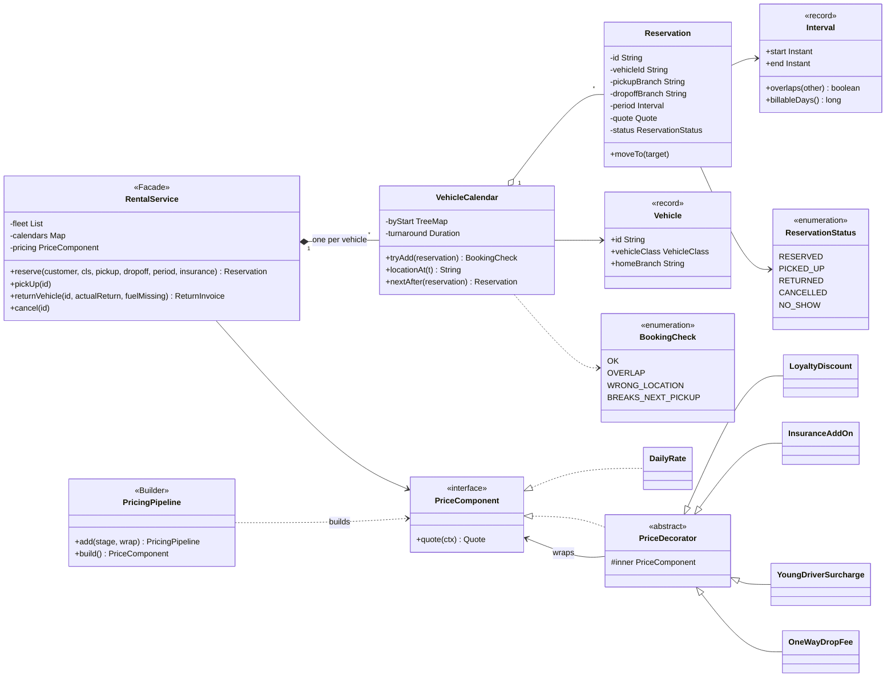
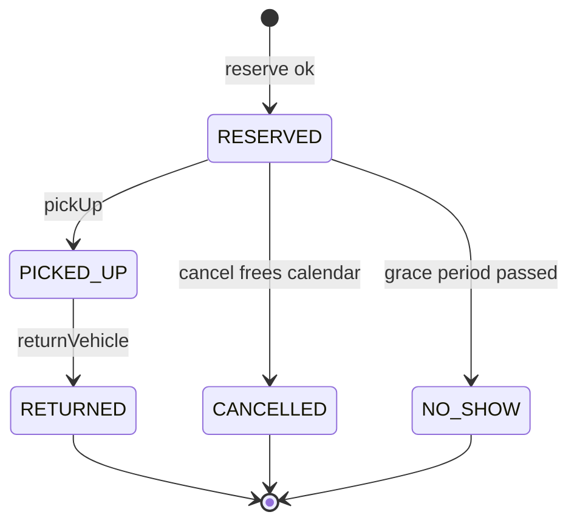
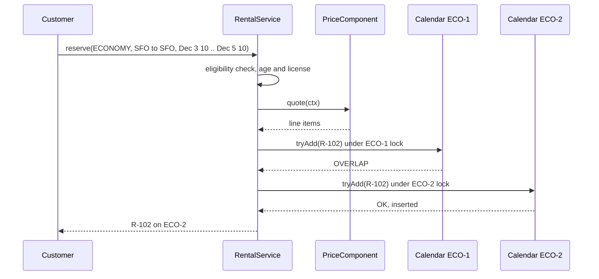
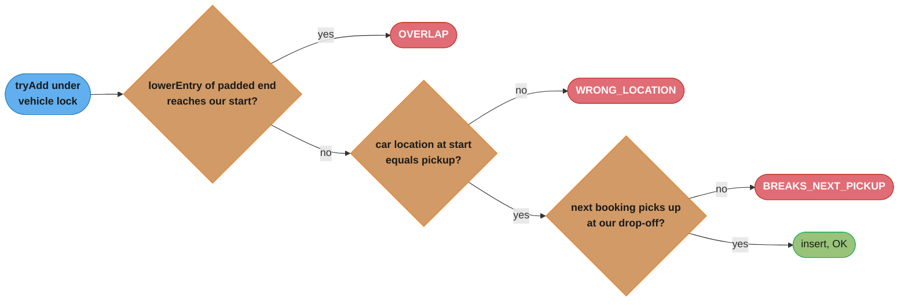

# Car Rental — Low-Level Design
## Intuition

> **Design intuition**: Car rental looks like [`OnlineBookingSystem.md`](OnlineBookingSystem.md) with cars instead of seats, and the first 15 minutes of the interview go that way. Then the interviewer adds three things a seat never has: the resource is booked over **time intervals** rather than a fixed show, the resource **moves** (a one-way rental ends in another city), and the price is a **stack of independent rules** (insurance, young-driver fee, drop fee, loyalty discount) whose order changes the total. Each twist maps to one structure in this design.

**Key insight**: Store each vehicle's bookings as disjoint half-open intervals `[start, end)` in a `TreeMap` keyed by start, padded by a turnaround buffer. Because stored blocks never overlap, their ends are sorted in the same order as their starts, so the only block that can overlap a new request is the last one starting before the request's padded end: one `lowerEntry()` call, O(log n), instead of scanning every booking. The same map answers "where is the car at time t?" (the drop-off branch of the last rental before t), which turns one-way rentals from a special case into a lookup. Pricing is a Decorator chain, assembled by a builder that sorts decorators into fixed stages so a discount can never apply to insurance by accident.

**Full runnable implementation:** [`CarRental.java`](CarRental.java) — 670 lines, one file, all types nested, `main()` at the bottom. It demonstrates a reservation with an itemized quote, an overlapping request that falls through to a second car, a request rejected by both cars, a back-to-back booking blocked by the 2-hour turnaround buffer and accepted 2 hours later, a one-way rental that moves an SUV to LAX (so an SFO request fails with `WRONG_LOCATION` and an earlier SFO-to-LAX booking fails with `BREAKS_NEXT_PICKUP`), the same three price components producing 256.50 or 261.00 depending on order, a late return that adds a day and a fuel charge and raises `NEXT_PICKUP_AT_RISK`, 16 threads racing for one SUV window with exactly one winner, and an 8-thread, 3,200-request stress run that leaves every calendar overlap-free.

---

## Problem Statement

Design the booking core of a car rental company:
- Branches hold vehicles of several classes (economy, SUV, luxury)
- Customers reserve a vehicle class at a pickup branch for a time window, optionally returning it to a different branch
- No vehicle may be booked twice for overlapping windows, including the cleaning and inspection time between rentals
- The price is a base daily rate plus independent add-ons, surcharges, fees and discounts
- A reservation is picked up, then returned; it can be cancelled or marked no-show before pickup
- Late returns and missing fuel are charged at return
- Many customers book concurrently

---

## Requirements

### Functional
1. `reserve(customer, class, pickupBranch, dropoffBranch, period, insurance)` returns a reservation with a quote, or fails with the reason per vehicle
2. Conflict detection with a configurable turnaround buffer (2 hours in the demo)
3. A car's location at any time is derived from its bookings; a booking must start where the car will be and must not strand the next booking
4. Price components: daily rate (ceil of 24-hour days, minimum 1), loyalty discount (10% of rental charges only), insurance (15.00/day), young driver under 25 (25.00/day), one-way drop fee (75.00)
5. Lifecycle: `RESERVED -> PICKED_UP -> RETURNED`, or `RESERVED -> CANCELLED / NO_SHOW`
6. Return charges: late beyond a 59-minute grace adds whole days at the class rate; fuel is 12.00 per missing eighth of a tank

### Non-Functional
1. Conflict check is O(log n) per vehicle, n = bookings on that vehicle
2. Check and insert are atomic per vehicle; no lock spans two vehicles
3. Adding a pricing rule is a new class plus one builder call
4. Money in `long` minor units

---

## Class Diagram



*The facade owns one `VehicleCalendar` per vehicle; each calendar is the unit of locking and of conflict detection. Pricing is a separate tree: `DailyRate` at the core, wrapped by decorators that `PricingPipeline` orders by stage.*

---

## Patterns Used

### 1. Decorator — the price components
**Why**: Price rules are independent, optional and numerous: insurance is chosen by the customer, the young-driver fee depends on age, the drop fee on branches, the discount on membership. A class per combination (`InsuredYoungOneWayLoyalQuote`) explodes; a method with a dozen `if`s turns every new rule into an edit to tested code.

**How**: `PriceComponent.quote(ctx)` returns a `Quote` of line items. `DailyRate` produces the base line; each `PriceDecorator` calls `inner.quote(ctx)` and appends zero or one line. Line items, not a bare total, make the bill explainable to the customer and testable rule by rule. See [`structural/decorator`](../structural/decorator/decorator.md).

### 2. Builder — `PricingPipeline` fixes the order of decorators
**Why**: Decorators compose, and composition order changes the answer when a rule is a percentage. Demo section 4 wraps a "10% of the running total" discount around insurance and gets 256.50; the business rule (10% of rental charges only) gives 261.00. Leaving the order to whoever wires the chain makes the price depend on code layout.

**How**: Each decorator is registered with a `Stage` (`DISCOUNT`, `ADD_ON`, `FEE`). `build()` sorts by stage, then by registration order, and wraps `DailyRate` in that order, so the demo registers `FEE, ADD_ON, DISCOUNT, ADD_ON` and still gets discount-first. `LoyaltyDiscount` also computes its 10% from the lines whose label starts with `rental`, so even a mis-staged discount cannot reach insurance. Two independent guards for the bug that costs real money.

### 3. State — `ReservationStatus`
**Why**: Picking up a returned car, cancelling after pickup and returning twice are all real support tickets.

**How**: The same enum-with-transition-table shape as [`PaymentProcessor.md`](PaymentProcessor.md): `RESERVED -> {PICKED_UP, CANCELLED, NO_SHOW}`, `PICKED_UP -> {RETURNED}`, three terminal states. Demo section 5 tries to pick up a returned reservation and gets `RETURNED -> PICKED_UP is not allowed`.



*Only `CANCELLED` removes the booking from the vehicle calendar in this design. A production system also frees the calendar on `NO_SHOW`, after a grace period.*

### 4. Strategy — the assembled `PriceComponent`
The service holds one `PriceComponent` and never knows what is inside it. A market with no young-driver rule, or a corporate account with negotiated rates, gets a different pipeline at construction time. The stress test in demo section 7 builds a pipeline with no decorators at all.

### 5. Observer — `ReservationListener`
Confirmation emails, fleet operations and the late-return alert subscribe to events. `returnVehicle` publishes `NEXT_PICKUP_AT_RISK` when the car comes back too late for the next customer's pickup, so operations can swap in another car before that customer arrives.

---

## Design Decisions & Tradeoffs

| Decision | Alternative | Reason chosen |
|----------|-------------|---------------|
| Half-open intervals `[start, end)` | Closed `[start, end]` | A rental ending at 10:00 and one starting at 10:00 do not overlap, which is the intended meaning. With closed intervals every back-to-back pair is a false conflict |
| Turnaround buffer added to the end of every interval for conflict checks | Store the buffer as a separate booking | One rule, applied in one method; changing it from 2 h to 90 min is a constructor argument |
| `TreeMap<Instant, Reservation>` per vehicle, check with `lowerEntry` | Scan all bookings, or a list per day | O(log n) per check; works for any interval length; the same map answers location and next-booking questions |
| Lock per vehicle calendar (`synchronized` methods) | One lock around the fleet | Bookings for different cars proceed in parallel; a request tries cars in turn, holding one car's lock at a time, so no deadlock is possible |
| Book a specific car at reservation time | Book a class, assign a car at pickup | Simpler to explain and to verify. Real rental companies usually reserve a class and assign the car at the counter; see Follow-Up Extensions |
| Location derived from the calendar | A mutable `vehicle.branch` field | A mutable field is right only for "now"; a reservation is about the future. The calendar knows where the car will be on any date |
| Line-item `Quote` | Return a `long` total | Customers dispute bills line by line; tests assert each rule; a refund can target one line |
| Discount stage before add-ons, plus a discount computed from rental lines only | Rely on wiring order | Two guards: the pipeline order and the discount's own base |
| Billable days = ceil(hours / 24), minimum 1 | Calendar days | A 10:00 to 10:00 rental over 3 days is 3 days; 10:00 to 11:00 the next day is 2. Grace for late returns is applied separately at return |

**Why one `lowerEntry()` call is enough** — stored blocks are disjoint, so starts and ends are both sorted:

```
time  -->    Dec 1      Dec 2      Dec 3      Dec 4      Dec 5      Dec 6
ECO-1        [==== R-101 alice ===========)++               [=== R-105 carol ==)++
ECO-2                              [==== R-102 bob =======)++

request A: Dec 2 09 .. Dec 3 09 (+2 h)     ECO-1: overlaps R-101      ECO-2: overlaps R-102
request B: Dec 4 10 .. Dec 6 10 (+2 h)     ECO-1: R-101 blocked to 12  ECO-2: R-102 to Dec 5 12
request C: Dec 4 12 .. Dec 6 10            ECO-1: R-101 ends at 12, half-open, OK

legend: [ start   ) end   ++ 2 h turnaround buffer
```

*For each car, `lowerEntry(requestEnd + buffer)` returns the last block that starts before the request ends. Every earlier block ends no later than that one, so if that one does not reach the request's start, none does.*

---

## State / Flow

### `reserve(...)`



*Check and insert happen inside one `synchronized` call on one calendar, so a second thread cannot pass the same check in between. The service never holds two calendar locks at once.*

### The three checks inside `tryAdd`



*Time first, then place, then the future: a booking must fit the gap, start where the car will be, and leave the car where the next customer expects it.*

---

## Sample Output

```text
========================================
   Car Rental - LLD Demo
========================================

--- 1. Reserve, then overlapping requests ---
    [event] RESERVED R-101[ECO-1 SFO->SFO 2026-12-01T10:00:00Z..2026-12-04T10:00:00Z]
      rental 3 day(s) x ECONOMY          135.00
      rental loyalty -10%                -13.50
      insurance 3 day(s) x 15.00         45.00
      TOTAL                              166.50
    [event] RESERVED R-102[ECO-2 SFO->SFO 2026-12-03T10:00:00Z..2026-12-05T10:00:00Z]
  rejected: no ECONOMY at SFO for 2026-12-02T09:00:00Z..2026-12-03T09:00:00Z [ECO-1=OVERLAP, ECO-2=OVERLAP]

--- 2. Back-to-back with a 2 h turnaround buffer ---
  04T10 rejected: no ECONOMY at SFO for 2026-12-04T10:00:00Z..2026-12-06T10:00:00Z [ECO-1=OVERLAP, ECO-2=OVERLAP]
    [event] RESERVED R-105[ECO-1 SFO->SFO 2026-12-04T12:00:00Z..2026-12-06T10:00:00Z]

--- 3. One-way rental moves the car ---
    [event] RESERVED R-106[SUV-1 SFO->LAX 2026-12-10T09:00:00Z..2026-12-12T09:00:00Z]
      rental 2 day(s) x SUV              160.00
      one-way SFO->LAX                   75.00
      TOTAL                              235.00
  SUV-1 on 13T09 is at LAX
  rejected: no SUV at SFO for 2026-12-14T09:00:00Z..2026-12-15T09:00:00Z [SUV-1=WRONG_LOCATION]
    [event] RESERVED R-108[SUV-1 LAX->LAX 2026-12-14T09:00:00Z..2026-12-15T09:00:00Z]
  rejected: no SUV at SFO for 2026-12-06T09:00:00Z..2026-12-07T09:00:00Z [SUV-1=BREAKS_NEXT_PICKUP]

--- 4. Decorator order: the same three components, two totals ---
  BROKEN, discount wraps insurance:
      rental 3 day(s) x SUV              240.00
      insurance 3 day(s) x 15.00         45.00
      loyalty -10% of running total      -28.50
      TOTAL                              256.50
  FIX, pipeline applies DISCOUNT before ADD_ON:
      rental 3 day(s) x SUV              240.00
      rental loyalty -10%                -24.00
      insurance 3 day(s) x 15.00         45.00
      TOTAL                              261.00

--- 5. Pick up, return 3 h late with 2/8 tank missing ---
    [event] PICKED_UP R-101[ECO-1 SFO->SFO 2026-12-01T10:00:00Z..2026-12-04T10:00:00Z]
    [event] RETURNED R-101[ECO-1 SFO->SFO 2026-12-01T10:00:00Z..2026-12-04T10:00:00Z]
    [event] NEXT_PICKUP_AT_RISK R-105[ECO-1 SFO->SFO 2026-12-04T12:00:00Z..2026-12-06T10:00:00Z]
      rental 3 day(s) x ECONOMY          135.00
      rental loyalty -10%                -13.50
      insurance 3 day(s) x 15.00         45.00
      late return 1 day(s)               45.00
      fuel 2/8 tank                      24.00
      TOTAL                              235.50
  rejected: R-101: RETURNED -> PICKED_UP is not allowed

--- 6. Sixteen customers race for the last SUV window ---
  winners=1, rejected=15

--- 7. Stress: 8 threads x 400 random requests on a 4-car fleet ---
  every calendar overlap-free: true, accepted == stored: true

========================================
              Demo complete
========================================
```

Reservation ids have gaps (R-103, R-104, R-107 are missing) because every `reserve` call takes the next id before trying cars, like a database sequence: failed attempts consume ids. Bob is 23, but his quote is not printed; it carries a 50.00 young-driver line. In section 5 the car returns at 13:00, and carol's pickup on the same car is at 12:00, which is why the alert fires: the 2-hour buffer absorbs lateness only up to the next booking's start minus the buffer. Section 7 prints invariants only, because which requests win depends on thread scheduling.

---

## Cross-Perspective: HLD Connections

- **Per-vehicle lock becomes a database exclusion constraint** — PostgreSQL can enforce "no two bookings of one vehicle overlap" in the schema: a `tstzrange` column (half-open `[)` by default) and `EXCLUDE USING gist (vehicle_id WITH =, period WITH &&)`, with the `btree_gist` extension for the equality part. Every instance can then insert concurrently and the database rejects the loser, the same role `synchronized tryAdd` plays in one JVM. See [`database/concurrency_control_and_locking`](../../database/concurrency_control_and_locking/concurrency_control_and_locking.md).
- **Search becomes a read model** — "which SUVs are free at SFO next weekend" across 50,000 cars is not answered by trying each calendar; an availability index per (branch, class, day) is updated from booking events and may be slightly stale, and the write path's constraint is the final arbiter. The same split appears in [`backend/case_studies/design_booking_system`](../../backend/case_studies/design_booking_system/design_booking_system.md).
- **Holds during checkout become leases** — a customer entering card details for 5 minutes needs the car held but not booked; a `HELD` booking with an expiry, swept by a scheduler, is the seat-hold pattern from [`OnlineBookingSystem.md`](OnlineBookingSystem.md). Payment for the booking reuses [`PaymentProcessor.md`](PaymentProcessor.md): authorize at reservation, capture at return with the final invoice.
- **Contention on one car is a hot key** — 16 threads racing for one SUV is the in-process version of the hot-row problem in [`hld/coordination_and_contention`](../../hld/coordination_and_contention/coordination_and_contention.md).

---

## Follow-Up Extensions

1. **Reserve a class, assign a car at pickup** — the reservation holds a class and a branch; a per-(branch, class) counter ensures bookings never exceed cars available at any instant; the assignment runs at pickup. More flexible, harder to prove correct (it is interval-graph coloring at assignment time).
2. **Cancellation policy as a Strategy** — free until 48 hours before pickup, then one day's charge; corporate accounts get a different policy object.
3. **Maintenance blocks** — a calendar entry with no customer, created by fleet operations, using the same conflict check; a service car is just an unavailable interval.
4. **Dynamic pricing** — a `UtilizationSurcharge` decorator in the `ADD_ON` stage that reads the branch's booked fraction for the period.
5. **Mileage limits** — `returnVehicle` takes the odometer reading and adds a per-km line beyond the allowance.
6. **Fleet rebalancing** — one-way rentals drain some branches; a nightly job proposes transfers, booked as no-customer one-way reservations so the calendar logic still applies.

---

## Extension Drills: Concurrency, Multi-Instance, Persistence

| Drill | What the interviewer adds | What breaks in a naive design | Change in this design |
|-------|---------------------------|-------------------------------|------------------------|
| Concurrency | "Two customers book the last SUV at the same moment" | `if (isFree(car, period)) book(car, period)` lets both pass the check | `tryAdd` runs check and insert under the calendar lock; demo section 6: 1 winner of 16 |
| Concurrency | "Lock the fleet while searching for a car" | A fleet-wide lock serializes every booking in every branch | One calendar lock at a time; a request moves to the next car on conflict |
| Concurrency | "Cancel while another thread books the same slot" | Cancel removes from a map another thread is iterating | `remove` is `synchronized` on the same calendar; the freed slot is visible to the next `tryAdd` |
| Multi-instance | "Run 8 booking instances" | Each JVM's calendar lock protects only its own copy | Make the database the arbiter: an exclusion constraint on `(vehicle_id, period)`, or `SELECT ... FOR UPDATE` on the vehicle row before inserting |
| Multi-instance | "Search is slow at 50,000 cars" | Trying every calendar per request | An availability read model per branch, class and day; the write path's constraint still decides |
| Persistence | "Store bookings in PostgreSQL" | Overlap check in application code, then insert: two instances race | `EXCLUDE USING gist` on a `tstzrange` column makes overlap a constraint violation |
| Persistence | "One-way rentals across restarts" | A mutable `vehicle.branch` field is lost or stale | Location is computed from persisted bookings, so it survives any restart |

**The overlap race, as code.** The naive version checks in one step and inserts in another:

```java
// BROKEN: two threads both see no conflict, both insert, the car is double booked.
boolean reserve(Vehicle v, Interval want) {
    for (Reservation r : bookings.get(v.id())) {
        if (r.period.overlaps(want)) return false;
    }
    bookings.get(v.id()).add(new Reservation(v.id(), want));    // too late: the check is stale
    return true;
}

// FIX: one synchronized method per vehicle does both, with an O(log n) check.
synchronized BookingCheck tryAdd(Reservation r) {
    BookingCheck check = check(r.period, r.pickupBranch, r.dropoffBranch);
    if (check == BookingCheck.OK) {
        byStart.put(r.period.start(), r);
    }
    return check;
}
```

**The database form of the same guarantee**, for the multi-instance drill:

```sql
CREATE EXTENSION IF NOT EXISTS btree_gist;

CREATE TABLE booking (
    id          bigserial PRIMARY KEY,
    vehicle_id  text      NOT NULL,
    period      tstzrange NOT NULL,          -- half-open [start, end + turnaround)
    EXCLUDE USING gist (vehicle_id WITH =, period WITH &&)
);
```

---

## Interview Questions with Answers

**Q: How do you detect that a new booking overlaps an existing one on the same car?**
**Short:** Two half-open intervals overlap when each starts before the other ends: `a.start < b.end && b.start < a.end`.

`Interval.overlaps` is that one line, and it handles every case (containment, partial overlap, identical) without branches. Half-open `[start, end)` makes a 10:00 return and a 10:00 pickup legal, which is the intended meaning. The bug to avoid is `<=`, which flags every back-to-back pair as a conflict. Add the turnaround buffer to each block's end before comparing, so the rule stays one expression.

**Q: Why is one `TreeMap.lowerEntry()` call enough to find a conflict?**
**Short:** Stored blocks never overlap, so their ends sort like their starts; only the last block starting before the request's end can reach into it.

Take every block starting before the request's padded end. Because they are disjoint and sorted by start, each ends no later than the next one starts, so the last of them has the latest end. If that block ends at or before the request's start, every earlier one does too. `lowerEntry(requestEnd + buffer)` returns exactly that block in O(log n). A linear scan is O(n) per car per request, which matters for a car booked 300 times a year with history kept.

**Q: Why include a turnaround buffer in the conflict check?**
**Short:** A returned car needs cleaning and inspection; without a buffer, a 10:00 return and a 10:00 pickup are legal on paper and impossible at the counter.

The calendar treats every booking as blocking `[start, end + turnaround)`. In demo section 2, carol's request at Dec 4 10:00 fails on ECO-1 because alice's booking blocks until 12:00, and succeeds at exactly 12:00. The buffer is a constructor parameter, so a branch with a car wash on site can use 45 minutes and an airport branch 3 hours, without touching the overlap logic.

**Q: How does a one-way rental affect availability?**
**Short:** It moves the car, so availability depends on place as well as time; the car is where its last earlier booking dropped it off.

`VehicleCalendar.locationAt(t)` returns the drop-off branch of the last booking before `t`, or the home branch if there is none. After erin's SFO-to-LAX rental, SUV-1 is at LAX from Dec 12, so an SFO request on Dec 14 fails with `WRONG_LOCATION` and a LAX request succeeds. A mutable `vehicle.currentBranch` field cannot answer this, because it describes now, and reservations are about future dates.

**Q: A new booking fits the time gap and starts where the car is. Can it still be invalid?**
**Short:** Yes, if it is one-way and the car's next booking picks up at the old branch; the new booking would strand the next customer.

In demo section 3, a Dec 6 SFO-to-LAX request fits the gap before erin's Dec 10 pickup at SFO, but it would leave the car in LAX. `check()` looks at the next booking with `higherEntry` and rejects with `BREAKS_NEXT_PICKUP` unless its pickup branch equals the new drop-off. The calendar must stay a continuous path through branches, not just a set of disjoint intervals.

**Q: Two customers try to book the last SUV at the same time. What guarantees only one succeeds?**
**Short:** The check and the insert run in one `synchronized` method on that vehicle's calendar, so the second thread checks after the first inserted.

If the check and the insert were separate calls, both threads could pass the check before either inserted. `tryAdd` holds the calendar's monitor for both steps. Demo section 6 starts 16 threads behind a latch on the same window and gets 1 winner and 15 `NoAvailabilityException`s. The lock is per vehicle, so bookings on other cars do not wait, and the service never holds two calendar locks, so lock ordering never comes up.

**Q: Why is pricing a Decorator rather than one method with conditions?**
**Short:** Each rule is optional and independent; decorators add one line item each, so a new rule is a new class instead of an edit to tested code.

The customer-visible output is a list of lines (`rental`, `insurance`, `young driver`, `one-way`), and each decorator owns exactly one. Testing a rule means wrapping a stub and asserting one line. A pricing method with 12 conditions grows a combinatorial test matrix and is edited for every promotion. The cost of decorators is that order can matter, which the next question covers.

**Q: The same three price components give 256.50 or 261.00. Why, and how do you stop it?**
**Short:** A percentage discount wrapped outside insurance discounts insurance too; the builder fixes stage order and the discount uses only rental lines.

`NaiveLoyaltyDiscount(InsuranceAddOn(DailyRate))` takes 10% of 285.00, the base plus insurance, giving -28.50 and 256.50. The rule is 10% of the rental charge, -24.00 and 261.00. `PricingPipeline` sorts decorators into `DISCOUNT`, `ADD_ON`, `FEE` stages regardless of registration order, and `LoyaltyDiscount` computes from lines labelled `rental` only. Either guard alone prevents this bug; having both means a future wiring mistake is still priced correctly.

**Q: How are billable days computed?**
**Short:** Ceiling of the rental hours divided by 24, with a minimum of one day; late returns are charged separately after a 59-minute grace.

Dec 1 10:00 to Dec 4 10:00 is 72 hours, so 3 days. 73 hours would be 4 days at reservation time; at return time, lateness is measured against the booked end, and anything beyond 59 minutes adds whole days at the class rate. Alice's 3-hour-late return in section 5 adds one 45.00 day. Using calendar days instead would charge a 10:00-to-09:00 overnight rental as two days, which customers dispute.

**Q: A car comes back late and the next customer's pickup is in an hour. What should the system do?**
**Short:** Detect it at return time and alert operations to swap in another car; the next booking stays valid, the car assignment changes.

`returnVehicle` finds the next booking on the same car with `nextAfter` and checks whether `actualReturn + turnaround` passes its start; if so it publishes `NEXT_PICKUP_AT_RISK`. In section 5, the 13:00 return collides with carol's 12:00 pickup. The fix is operational (move carol to another economy car), and it is why many companies reserve a class rather than a car: reassignment then costs nothing in the data model.

**Q: Should a reservation bind a specific car or a vehicle class?**
**Short:** This design binds a car for simple, provable conflicts; real systems often reserve a class and assign a car at pickup for flexibility.

Binding a car makes conflict detection a per-car interval check and makes "which car do I hand over" trivial. Its weakness is fragmentation: three short bookings spread over three cars can block a long booking that one well-chosen assignment would have allowed. Class-level reservation counts overlapping bookings per class and branch at every instant and defers assignment, which is interval-graph coloring at pickup. Mention both, build the first, and explain when to switch.

**Q: Why derive location from the calendar instead of storing `vehicle.currentBranch`?**
**Short:** A stored field describes only the present; reservations ask where the car will be on a future date.

A booking for Dec 14 needs the location on Dec 14, after the Dec 10 to 12 one-way rental that has not happened yet. The calendar already contains that answer. A stored field is still useful at the counter for "where is the car now" and can be updated at return, but it must agree with what the calendar implies, which is a reconciliation rule rather than a second source of truth.

**Q: How does this design change when bookings live in PostgreSQL and 8 instances serve requests?**
**Short:** The calendar lock stops protecting anything; an exclusion constraint on vehicle and period makes the database reject overlaps.

Each instance has its own in-memory calendar, so two instances can both accept the same slot. Store `period` as `tstzrange` padded by the turnaround and add `EXCLUDE USING gist (vehicle_id WITH =, period WITH &&)`. A concurrent conflicting insert fails with a constraint violation, and the service tries the next car. The location and next-pickup checks need the neighbouring rows, so read them with `SELECT ... FOR UPDATE` on the vehicle row inside the same transaction.

**Q: How do you test that the calendar never double books under concurrency?**
**Short:** Hammer it from many threads with random overlapping requests, then assert every calendar is overlap-free and accepted equals stored.

Demo section 7 runs 8 threads, 400 random requests each, on 4 cars over 60 days with 4 to 71 hour rentals. Afterwards `overlapFree()` walks each calendar in start order checking `prev.end + buffer <= next.start`, and the count of accepted reservations equals the count stored. An invariant check beats asserting specific winners, which change with scheduling. Run it in CI, and run it again after removing `synchronized` once to confirm it fails.

**Q: Where do the State pattern and the transition table pay off here?**
**Short:** They reject operations that make no business sense, such as picking up a returned car or returning a cancelled one, at one choke point.

`Reservation.moveTo` is the only place status changes, and it consults the enum's legal next states. Demo section 5 picks up a returned reservation and gets `RETURNED -> PICKED_UP is not allowed` instead of a second rental on a closed contract. Side effects attach to transitions in the service: `CANCELLED` frees the calendar slot, `RETURNED` produces the invoice. A new state such as `HELD` for checkout is one constant and one row in the table.

**Q: How would a cancellation fee work without editing the cancel method for each policy?**
**Short:** Make the cancellation policy a Strategy that maps (reservation, cancel time) to a fee; the service applies whichever policy the booking carries.

A `CancellationPolicy` interface with `long feeMinor(Reservation r, Instant cancelledAt)` covers "free until 48 hours before pickup, then one day" and "non-refundable prepaid rate" as two small classes. Store the policy type on the reservation at booking time, so a policy change next month does not alter existing contracts. The fee then becomes a line item on a cancellation invoice, reusing the `Quote` type the pricing chain already produces.
