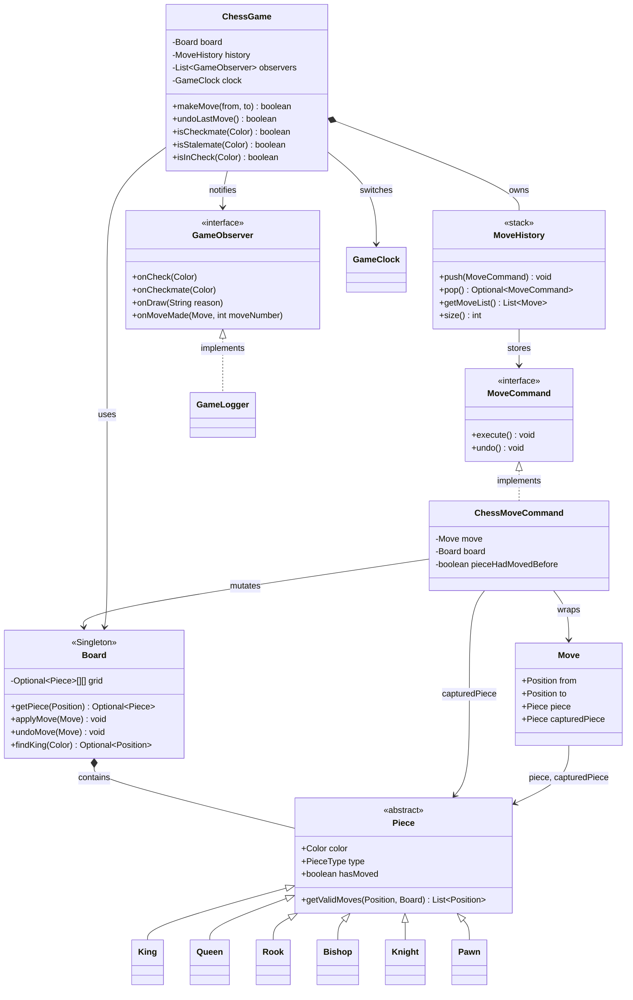
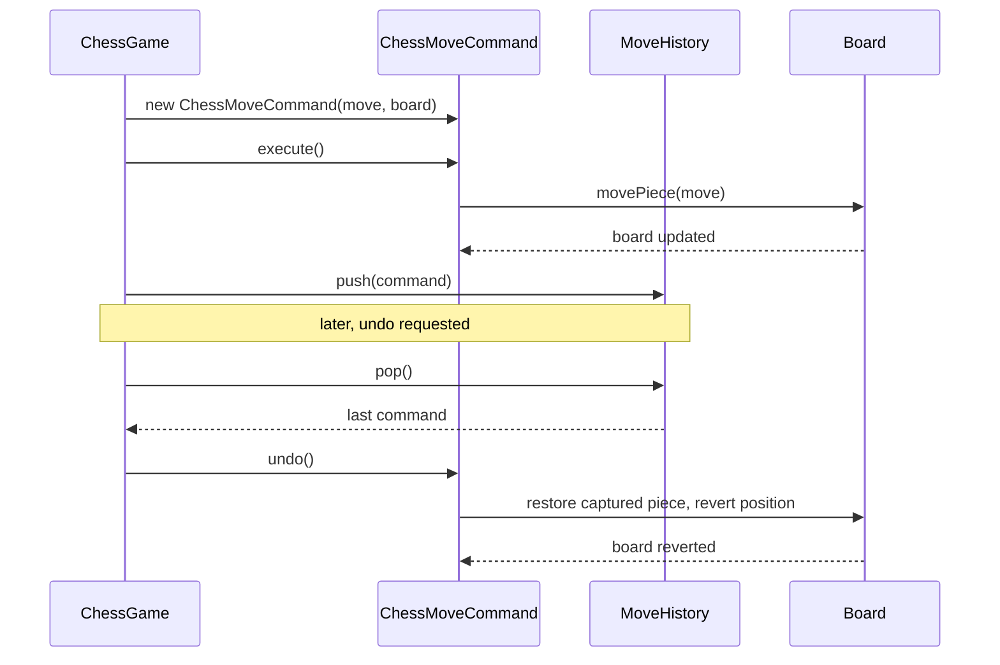
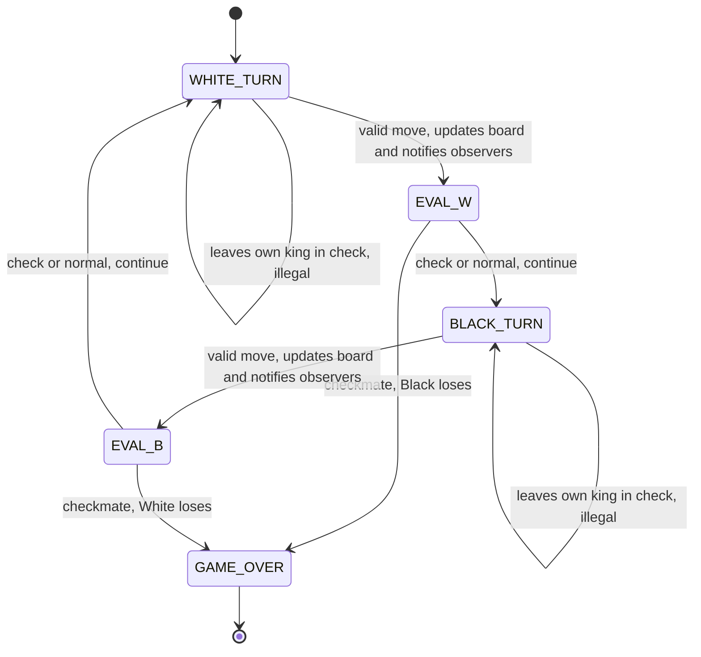

# Chess Game — Command + Observer + Singleton

## Intuition

> **One-line analogy**: Chess design is a Command pattern showcase — every move is an object that can be executed and undone, giving you a full undo stack for free.

**Mental model**: The board is a Singleton (one board per game). Each move (MoveCommand) encapsulates the source, destination, and captured piece — enough to both execute and undo the move. The move history is a stack of commands. Observers (game logger, clock, UI) react to events without being coupled to game logic. Piece subclasses (King, Queen, Rook, Bishop, Knight, Pawn) each implement their own `getValidMoves()` — the cleanest expression of polymorphism in the problem.

**Why it matters**: Chess exercises Command (undo/redo), Singleton (board), Observer (event notifications), and polymorphism (piece hierarchy) in a problem everyone understands. It's the go-to interview question for testing whether a candidate can model domain logic cleanly.

**Key insight**: The trickiest rules are special moves (castling, en passant, promotion) and check detection. In an interview, call them out explicitly and propose how you'd extend the design to support them — this signals design foresight without over-engineering upfront.

**Full runnable implementation:** [`ChessGame.java`](ChessGame.java) — 741 lines, one file, `main()` at the bottom. It demonstrates six `Piece` subclasses each validating their own movement, `ChessMoveCommand` plus `MoveHistory` giving undo, and `GameLogger` and `GameClock` attached as `GameObserver`s — Command, Observer and polymorphic dispatch instead of a piece-type `switch`.

---

## Problem Statement

Design a Chess game system that:
- Manages a standard 8x8 chess board
- Supports all piece types with valid move generation
- Records move history with full undo capability
- Detects check, checkmate, and stalemate
- Notifies observers (loggers, UI, clock) of game events
- Supports time controls

---

## Class Diagram



Board is the Singleton container for every `Piece` on the grid; `MoveCommand`/`ChessMoveCommand` form the Command pattern's execute/undo contract, `MoveHistory` is the undo stack, and `GameObserver` decouples `ChessGame` from `GameLogger`. `GameClock` is held directly by `ChessGame` (it is called, not notified) — making it a second `GameObserver` is one of the follow-up extensions below.

---

## Patterns Used

| Pattern | Where | Why |
|---------|-------|-----|
| **Command** | `MoveCommand`, `ChessMoveCommand`, `MoveHistory` | Encapsulates each move as an object; enables undo |
| **Observer** | `GameObserver`, `GameLogger` | Notifies UI and logger of events without coupling |
| **Singleton** | `Board` | Only one board per game; prevents duplicate state |

---

## Command Pattern — Undo Stack

```java
// Every move is wrapped in a Command. The Move value object carries the
// captured piece (or null), which is what makes undo() self-contained.
Piece captured = board.getPiece(to).orElse(null);
Move move = new Move(from, to, piece, captured);
MoveCommand cmd = new ChessMoveCommand(move, board);
cmd.execute();                   // applies the move
moveHistory.push(cmd);

// Undo: pops from stack and calls undo()
moveHistory.pop().ifPresent(MoveCommand::undo);   // pop() returns Optional
```

The `undo()` in `ChessMoveCommand`:
1. Move piece back from destination to source position
2. Restore any captured piece to its original position (or clear the square)
3. Restore the piece's `hasMoved` flag, so a pawn regains its two-square option
4. Update the board state

Pawn promotion, castling and en passant are **not** modelled by `Move`, so they are
not undoable here — see the Follow-Up Extensions for how to add them.



`ChessGame` drives execution through `ChessMoveCommand`, which mutates `Board` directly and is pushed onto `MoveHistory`; undo pops the same command and reverses it — the four steps listed above, made explicit as a call sequence.

---

## State Diagram: Piece Movement



Turns alternate between `WHITE_TURN` and `BLACK_TURN`; the same evaluation runs after **every** half-move — `makeMove` tests the opponent for check, then for checkmate, and only checkmate ends the game. Stalemate is detected by `isStalemate(Color)` but is not wired into `makeMove`, so the demo game never terminates on a draw.

---

## Move Validation Design

Each `Piece` subclass implements `getValidMoves(Position current, Board board)`, which
returns the destination squares reachable by that piece's movement rule alone — check is
deliberately ignored at this layer:

```
Rook   → horizontal + vertical rays, stops at first occupied square
Bishop → diagonal rays, stops at first occupied square
Queen  → Rook + Bishop combined
Knight → L-shapes (8 possible), can jump over pieces
King   → 1 step any direction (moving into check is filtered one layer up)
Pawn   → forward 1 (or 2 from the start square), captures diagonally
```

Castling, en passant and promotion are the deliberate omissions — see Key insight above.

Legal move filter (applied on top of piece movement):
- A move is **legal** only if it does not leave the moving player's king in check
- Achieved by executing the `ChessMoveCommand` on the real board, testing `isInCheck`,
  and calling `undo()` if the move turns out to be illegal — the Command pattern makes a
  defensive board copy unnecessary

---

## Check Detection

```java
/** Returns true if the given color's king is currently in check. */
public boolean isInCheck(Color color) {
    Optional<Position> kingPos = board.findKing(color);
    if (kingPos.isEmpty()) return false;              // king not on board
    return isSquareAttackedBy(kingPos.get(), color.opposite());
}

private boolean isSquareAttackedBy(Position square, Color attackerColor) {
    for (int r = 0; r < 8; r++) {
        for (int c = 0; c < 8; c++) {
            Position from = new Position(r, c);
            Optional<Piece> p = board.getPiece(from);
            if (p.isPresent() && p.get().getColor() == attackerColor
                    && p.get().getValidMoves(from, board).contains(square)) {
                return true;
            }
        }
    }
    return false;
}
```

---

## Interview Questions with Answers

**Q: Why Singleton for Board?**
**Short:** A chess game has exactly one board, so Singleton prevents duplicate, inconsistent instances.

A chess game has exactly one board. Using Singleton prevents multiple board instances and the consistency bugs that would cause. In tests, the Singleton is reset between games.

**Q: Why Command for moves instead of just calling methods directly?**
**Short:** Command lets each move reverse itself, giving undo/redo without a parallel board copy.

Command enables undo/redo without keeping a parallel copy of the board state. Each Command knows how to reverse itself. Also enables: move serialization (save/load), move replay, algebraic notation export.

**Q: Why Observer for game events?**
**Short:** Observer decouples logging, UI, and clock concerns from the core game logic.

The game logic should not know about logging, UI updates, or clock management. Observer decouples these cross-cutting concerns. New features (move sound effects, network broadcast) add a new Observer class without touching `ChessGame`.

**Q: Why does the demo game never end in a draw, even though `isStalemate(Color)` is implemented?**
**Short:** `makeMove` calls `isCheckmate` after every half-move but never calls `isStalemate`.

`isStalemate(Color)` exists and works, but nothing in `ChessGame.makeMove()` invokes it — the evaluation step in the State Transition Diagram only forks on checkmate. A genuinely stalemated position (no legal moves, king not in check) therefore keeps reporting `WHITE_TURN`/`BLACK_TURN` forever instead of transitioning to `GAME_OVER`. This is a real gap in the reference implementation, not a deliberate simplification like castling. The fix is one line: call `isStalemate(opponentColor)` alongside `isCheckmate` in the same choice node and transition to `GAME_OVER` on either.

**Q: Castling, en passant, and pawn promotion aren't modeled — what has to change to add castling without breaking undo?**
**Short:** `Move`/`ChessMoveCommand` must record the rook's move too, or undo only restores the king.

Today `Move` carries exactly one piece, one captured piece, one from/to pair — enough to reverse a normal move but not a compound one. Castling moves two pieces (king and rook) in a single turn, so `ChessMoveCommand.undo()` as written would only restore the king and leave the rook stranded at its new square. The fix is either a `CastlingMove` subtype that also records the rook's from/to, or making `Move` carry a list of (piece, from, to) triples instead of a single one. En passant has the same shape of problem: the captured pawn isn't on the destination square, so `Move.capturedPiece`'s implicit "sits at `to`" assumption breaks and needs its own captured-square field.

**Q: Why is check filtered out of each `Piece.getValidMoves()` instead of being handled inside the piece's own movement logic?**
**Short:** separating raw movement from check-legality keeps each piece class simple and testable in isolation.

`getValidMoves()` answers "where can this piece physically move," which is a pure function of the piece type and board occupancy — a Rook doesn't need to know anything about kings to compute its rays. Check-legality is a cross-cutting, board-wide concern (does *this* move leave *my* king exposed), so folding it into six different piece classes would duplicate the same "try it, check, undo" logic six times. Instead one shared filter sits one layer above `getValidMoves()`, applied uniformly regardless of which piece moved. This is Single Responsibility in practice — each `Piece` subclass answers one question, and `ChessGame` answers the other.

**Q: How does legal-move filtering avoid needing a defensive copy of the board?**
**Short:** it executes the real move via `ChessMoveCommand`, tests `isInCheck`, then calls `undo()` if illegal.

Because every move is already wrapped in a reversible `ChessMoveCommand`, testing legality doesn't require cloning the board first — you can just apply the candidate move for real, ask `isInCheck(movingColor)`, and unwind with `undo()` if the answer is yes. This reuses the exact same Command machinery that powers the undo stack, so there's no second code path to keep in sync with the first. The cost is that every candidate move briefly mutates real board state, which matters if `isInCheck` or the observers fire mid-test — in this design they don't, since notification happens only after a move is confirmed legal.

**Q: Why is `GameClock` held directly by `ChessGame` instead of being registered as a `GameObserver` like `GameLogger`?**
**Short:** the clock must be actively switched on each move, not just passively notified of one.

`GameObserver` methods are one-way notifications — `onMoveMade` tells a logger something happened, and the logger reacts. A clock needs more than that: it must be told *whose* turn just started so it can start counting down for that player, which is closer to an imperative call than a passive event. `ChessGame` therefore calls `clock.switchTurn(color)` directly rather than routing it through the generic `onMoveMade(Move, moveNumber)` signature. The class diagram flags this explicitly as a design choice, and folding `GameClock` into `GameObserver` is named as a follow-up extension precisely because it's a real, debatable tradeoff, not a settled one.

**Q: What's the time complexity of checkmate detection, and why is it more expensive than check detection?**
**Short:** O(L×P×M) — every legal move of every piece must be tried before concluding none escapes check.

Check detection alone is O(P×M): scan all P opponent pieces, and for each, check whether its M possible moves include the king's square. Checkmate detection has to go further — for every one of the current player's own legal moves (L of them), it must simulate that move and re-test whether the king is still in check afterward, which is another O(P×M) check nested inside the L loop. That gives O(L×P×M) total, versus O(1) for undo, which is just a stack pop plus pointer restoration. In an interview, naming this complexity gap up front shows you understand why checkmate detection is the expensive operation in a chess engine, not move validation itself.

**Q: Why is `MoveHistory` a stack with `pop()` returning `Optional<MoveCommand>` instead of a plain `List<Move>`?**
**Short:** a stack gives natural LIFO undo order, and `Optional` forces callers to handle an empty history.

Undo must always reverse the *most recent* move first — that's exactly what a stack's LIFO discipline gives you for free, versus a `List` where you'd have to manually track and remove the last index every time. `pop()` returning `Optional<MoveCommand>` rather than throwing or returning `null` forces the caller (`ChessGame.undoLastMove()`) to explicitly handle the "nothing to undo" case via `ifPresent`, which is exactly what happens at the start of a game or after the history is exhausted. `MoveHistory` also exposes `getMoveList()` for read-only traversal (move display, PGN export) without giving external callers push/pop access to the undo stack itself.

**Q: If you add an AI player via the `Strategy` pattern suggested in the Follow-Up Extensions, what stays untouched?**
**Short:** `Board`, `Piece`, `MoveCommand`, and `MoveHistory` are all unaffected by adding an AI player.

An AI player only needs to decide *which* legal move to make — it still calls the exact same `ChessGame.makeMove(from, to)` entry point a human player would, going through the same `ChessMoveCommand` execution, the same legal-move filter, and the same `MoveHistory` push. A `RandomStrategy` or `MinimaxStrategy` plugs into a new `AIPlayer` class that queries `getValidMoves()` across all of a color's pieces and picks one — none of `Board`, `Piece`, `Move`, `MoveCommand`, or the Observer wiring need to change. This is the same "isolate the seam" argument the page makes about the `ElevatorScheduler` interface in the Elevator problem: the pattern boundary is exactly where new behavior plugs in without touching existing, tested code.

**Q: Why is Memento suggested for save/load rather than reusing the existing `MoveCommand` history?**
**Short:** replaying moves from scratch is slow to resume; a Memento snapshot restores state in one step.

`MoveHistory` already lets you reconstruct any position by replaying commands from the start, but that means an O(number of moves) replay every time you load a saved game — fine for a handful of moves, wasteful for a long game reloaded repeatedly. A `Memento` capturing the full `Board` grid plus whose turn it is gives O(1) restoration for a specific point-in-time snapshot, at the cost of not preserving the move-by-move history the way the Command stack does. The two aren't mutually exclusive: a production design typically keeps the Command log as the source of truth (for replay/audit) and adds periodic Mementos as fast-restore checkpoints, the same pattern databases use with write-ahead logs plus snapshots.

**Q: Why does each `Piece` subclass implement its own `getValidMoves()` instead of one method with a `switch` on `PieceType`?**
**Short:** polymorphic dispatch means a new piece type needs one new class, not an edited switch.

A `switch (pieceType)` inside one shared method would put Rook's ray-tracing, Knight's L-shapes, and Pawn's asymmetric forward/diagonal rules all in one function, making it long, hard to test in isolation, and risky to edit — a bug fix for Bishop risks breaking the Queen case sitting right next to it in the same switch arm. Six `Piece` subclasses each overriding `getValidMoves(Position, Board)` means each piece's movement rule is self-contained, unit-testable on its own, and adding a new piece type (a custom variant piece) is Open/Closed — one new subclass, zero edits to existing ones. The Intuition section calls this out directly as "the cleanest expression of polymorphism in the problem."

**Q: How does the Command-based move history map to CQRS and event sourcing at HLD scale?**
**Short:** each move is an immutable event; replaying the event log from any point rebuilds board state.

The `MoveHistory` stack of reversible `ChessMoveCommand`s is a local, in-memory analogue of an event log — every move is a self-contained record of what changed and how to reverse it. At distributed scale, that becomes event sourcing: moves are appended as immutable events to a durable log (e.g., a Kafka topic), and the "current board" is a read-model projection rebuilt (or cached) by replaying events rather than being the single source of truth itself. CQRS then separates the write path (submit a move, validated and appended as an event) from the read path (query the current board or move history), which is exactly the Command/Query split the local `ChessGame.makeMove()` vs. board-display methods already hint at, just formalized across service boundaries.

**Q: Why is undo O(1) while checkmate detection is O(L×P×M) — what makes undo so much cheaper?**
**Short:** undo just pops a stack and restores four saved fields; it never has to search for anything.

`MoveHistory.pop()` retrieves the last-pushed `ChessMoveCommand` in constant time, and `undo()` then performs a fixed, small number of pointer and field restorations — move the piece back, restore any captured piece, reset the `hasMoved` flag — none of which requires searching, scanning, or evaluating any other piece's moves. Checkmate detection, by contrast, has to try every legal move of every piece and re-check whether the king remains in check after each one, which is inherently a search over the space of possible moves rather than a fixed-size restoration. The complexity table makes this contrast explicit precisely because it's easy to assume "undo" and "detect the game is over" are similarly expensive operations when they're actually opposite ends of the cost spectrum.

---

## Cross-Perspective: HLD Connections

**HLD View — Where Chess Design Scales to Distributed Systems**

- **Command + undo → CQRS + event sourcing** — The chess move history (a Command stack) maps to event sourcing at HLD scale. Every move is an immutable event; replaying the event log from any point reconstructs the board state. CQRS separates the command (make move) from the query (display current board).
- **Board Singleton → shared mutable state problem** — The Singleton board is fine for a local game. A distributed multiplayer game cannot use a local Singleton — the board state must be stored in a shared, consistent store (Redis, DynamoDB) with optimistic locking to prevent conflicting moves from concurrent players.
- **Observer → real-time game sync** — Move notifications to the logger, UI, and clock via Observer map to WebSocket push for real-time game state synchronization to both players' browsers and to spectators at HLD scale.
- **Move history → audit log** — The Command history is an audit log. At HLD scale, every game action is appended to an immutable audit log (Kafka topic, DynamoDB stream), enabling game replay, anti-cheat analysis, and undo-up-to-N-moves features.

---

## Follow-Up Extensions

1. **AI player**: `Strategy` pattern — `RandomStrategy`, `MinimaxStrategy`, `AlphaBetaStrategy`
2. **Save/Load game**: `Memento` pattern — serialize the full game state
3. **Online multiplayer**: Network proxy for remote player moves
4. **Opening book**: Pre-defined move sequences loaded from database
5. **PGN export**: Convert `MoveHistory` to Portable Game Notation
6. **Draw offers**: State machine for draw negotiation
7. **Time pressure**: `GameClock` Observer handles flag fall (time loss)

---

## Complexity

| Operation | Time Complexity |
|-----------|----------------|
| Move validation | O(P × M) where P=pieces, M=max moves per piece |
| Check detection | O(P × M) — check all opponent moves |
| Checkmate detection | O(L × P × M) where L=legal moves for all pieces |
| Undo | O(1) — pop from stack, restore state |

---

## Interview Discussion Points

- **How would you represent the board?** 2D array (8x8) with `Optional<Piece>` or nullable references. Alternatively, bitboards for performance (chess engines).
- **How do you prevent memory leaks in MoveHistory?** Cap history size or use WeakReferences if RAM is a concern.
- **How would you scale this to millions of concurrent games?** Stateless game logic, game state in Redis, horizontal scaling.
- **How do you test this system?** Unit test each piece's move generation, integration test check/checkmate detection with known positions.
