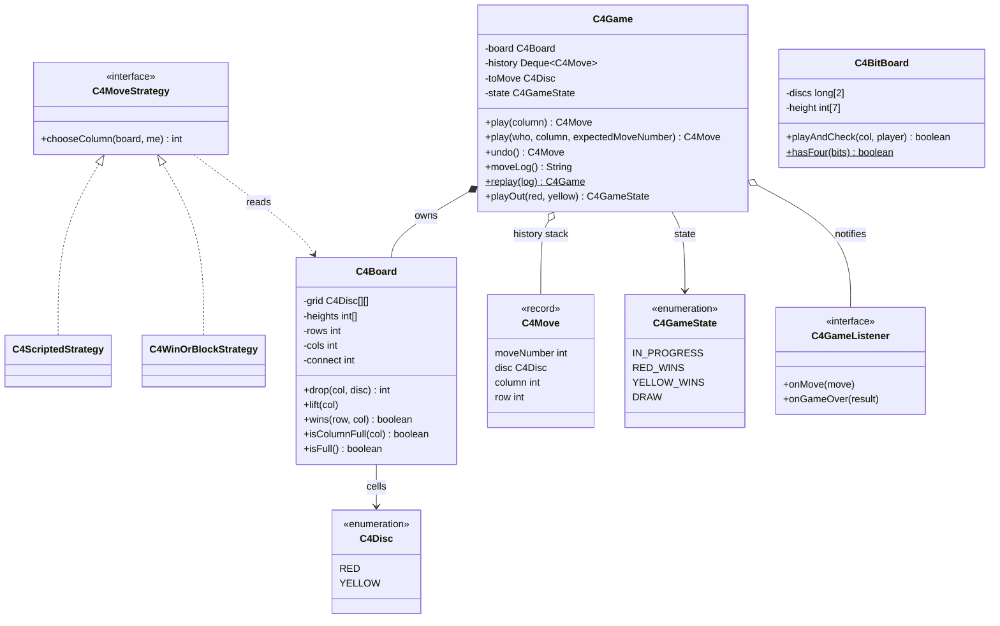
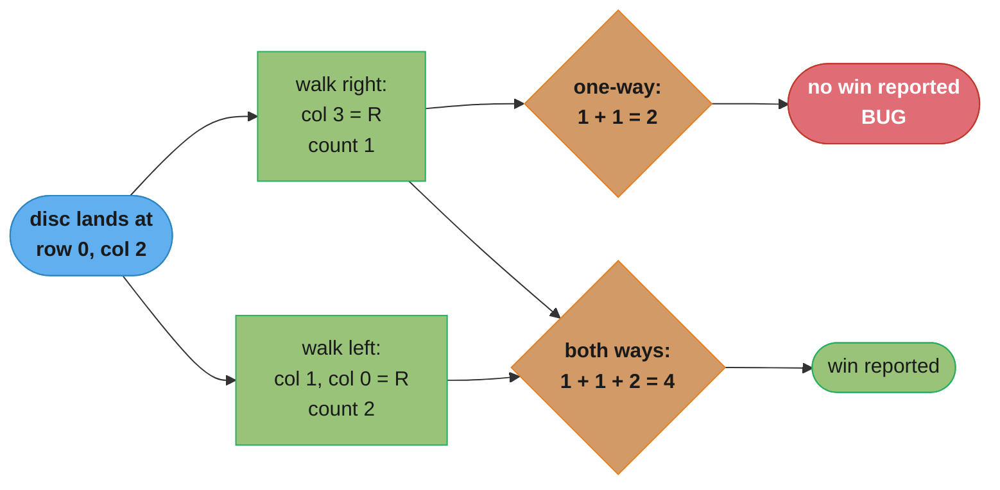
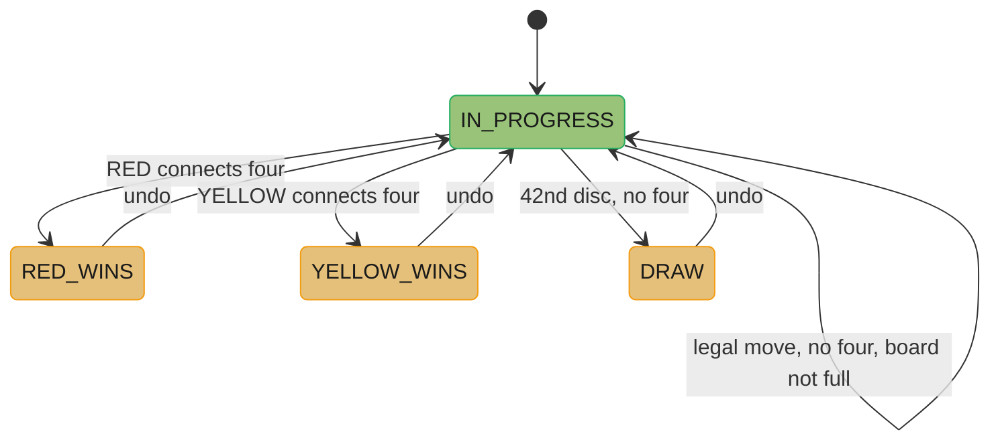
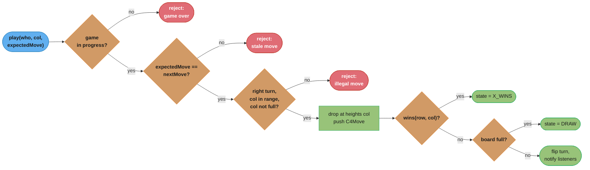

# Connect Four — Low-Level Design

A gravity grid game: the same board-plus-win-check question as Tic-Tac-Toe, with one twist that changes the data structure (a disc falls) and one that changes the win check (a line can be completed from the middle).

## Intuition

> **One-line analogy**: Connect Four is Tic-Tac-Toe where you choose a column and gravity chooses the row. Seven tubes, six slots each, and the disc always stops on top of the stack already in its tube.

**Mental model**: the board is seven stacks, not a 6x7 matrix of independent cells. The only legal move is "push onto stack c", so the state you really need per column is its height. The grid exists to answer one question after each push: does the disc that just landed sit on a line of four of its own colour?

**Why it matters**: interviewers pair this with [Tic-Tac-Toe](TicTacToe.md) and [Snake and Ladder](SnakeAndLadder.md) as the "game-rules warm-up". It is small enough to finish in 45 minutes, so the grade comes from the details: O(1) gravity, an O(k) win check that is actually correct, a turn and state model that rejects every illegal move, and a clean answer when the interviewer asks "now make it multiplayer over the network" or "now save the game".

**Key insight**: check only the lines through the last disc, and count **both ways** from it. The disc that completes a four can land at either end of the line or in the middle of it. A check that walks only rightwards from the new disc misses every horizontal win where the new disc is not the leftmost one, and a check that walks only upwards misses every vertical win, because a dropped disc is always the top of its column. The horizontal half of that bug passes most hand-written tests, because people test by building a line left to right.

**Full runnable implementation:** [`ConnectFour.java`](ConnectFour.java) — one file, `main()` in the `ConnectFour` class. It demonstrates a `C4Board` with per-column heights for O(1) gravity and a four-direction, both-way win check; a `C4Game` that owns turns, validation, `C4GameState`, undo and a move log; `C4ScriptedStrategy` (a stand-in for a human) and `C4WinOrBlockStrategy` behind one `C4MoveStrategy` interface; an observer for move events; a move-number token that rejects a stale second submit; replay of a saved move log into an identical board; and a 64-bit `C4BitBoard` whose shift-and-AND win test is cross-checked against the array board over 10,000 random games. The one-way-counting bug is run for real, not asserted. Every type carries a `C4` prefix because this package already has `Board`, `Player` and `GameState` in `TicTacToe.java`.

---

## Problem Statement

Design a two-player Connect Four game:

- A vertical grid of **7 columns and 6 rows** (the board Milton Bradley first sold in February 1974), with the size and the connect length configurable
- Players alternate dropping a disc into a column; the disc falls to the lowest empty row of that column
- A player wins by connecting **four** of their discs horizontally, vertically or diagonally
- The game is a **draw** when all 42 cells are filled and nobody has connected four
- Reject illegal moves: a full column, an out-of-range column, a move out of turn, any move after the game ended
- Support human players and computer players behind one abstraction
- Support undo, and saving and restoring a game in progress

---

## Requirements

### Functional
1. `play(column)` drops the current player's disc and returns where it landed
2. Validate every move: game still in progress, correct player's turn, column in range, column not full
3. Detect a win on the move that makes it, in all four directions
4. Detect a draw when the board fills with no winner
5. `undo()` removes the last disc and hands the turn back, even after a win
6. Persist a game as a list of columns and rebuild it exactly by replaying that list
7. Pluggable players: human input and AI strategies through one `C4MoveStrategy` interface

### Non-Functional
1. **Drop in O(1)**: find the landing row from a per-column height, never by scanning the column
2. **Win check in O(k)** per move, where k is the connect length (4): at most 4 directions x 2 walks x (k - 1) cells, independent of the board size
3. **No illegal state ever**: a rejected move leaves the board, the turn and the history unchanged
4. **Deterministic replay**: the same move list always produces the same board and the same result
5. **Safe under two clients**: a duplicate or stale submit for the same turn must not place a second disc

---

## Class Diagram



`C4Board` knows geometry only: where a disc lands and whether a line exists. It knows nothing about turns, players or whether the game is over. `C4Game` owns every rule that involves time: whose turn it is, whether the game has ended, the history for undo, and the move number that makes stale submits detectable. `C4BitBoard` is a separate encoding of the same 6x7 board, kept apart because it only works for that fixed size.

---

## Patterns Used

### 1. Strategy — `C4MoveStrategy`
**Where:** `C4ScriptedStrategy` (columns supplied from outside, the way a UI or a socket would supply them) and `C4WinOrBlockStrategy` (win now, else block the opponent's immediate win, else prefer the centre).

**Why:** the game loop must not care whether a column came from a mouse click, a network message or a search algorithm. A stronger AI (minimax with alpha-beta, or a solver) is a new class, not an edit to `C4Game`. This is the same seam as `MoveStrategy` in [Tic-Tac-Toe](TicTacToe.md).

### 2. State — `C4GameState`, as an enum
**Where:** `IN_PROGRESS`, `RED_WINS`, `YELLOW_WINS`, `DRAW`, checked at the top of `play()`.

**Why an enum and not State-pattern classes:** every state answers the same question ("can a move be made?") with yes or no. There is no state-specific behaviour to put in separate classes. Reach for full State only if, for example, a `PAUSED` state starts a timer or a `RESIGNED` state writes a rating change.

### 3. Command (lightweight) — `C4Move` on a stack
**Where:** each applied move is a `C4Move` record pushed onto `history`. `undo()` pops it and calls `board.lift(column)`.

**Why lightweight:** a disc can only be removed from the top of its column, so the inverse of every move is always "lift column c". The record does not need an `undo()` method of its own. The same stack is also the persistence format: written oldest first it is the move log.

### 4. Observer — `C4GameListener`
**Where:** `onMove` and `onGameOver`, fired after the state has been updated.

**Why:** a console renderer, a websocket push to the opponent and a rating service all react to the same events. The game loop calls listeners after it commits the move, so a listener never sees a half-applied move.

---

## Design Decisions & Tradeoffs

| Decision | Alternative | Why this choice |
|---|---|---|
| `heights[col]` gives the landing row in O(1) | Scan the column from the bottom for the first empty cell | The scan is O(rows) per move and is the first thing an interviewer asks you to remove. Heights also make "is the column full" a single comparison |
| Win check through the last disc only, 4 directions, both ways | Rescan the whole board after each move | A full rescan is O(rows x cols x k). Only lines through the new disc can have changed, so only they need checking |
| `grid[0]` is the bottom row | `grid[0]` is the top row (screen order) | Gravity becomes `heights[col]++` with no subtraction. The renderer flips it once, in one place |
| `C4Board` separate from `C4Game` | One class with grid, turns and state | The board is reusable by an AI that wants to try moves (`drop`, then `lift`) without touching turn order or firing events |
| Move number as an optimistic-concurrency token | A lock held while a player thinks | A player can think for minutes. A token costs nothing until the moment of the move, and the same check maps to a row version in a database |
| Persist the move list | Persist the 42-cell grid | The list is shorter, supports undo and replay, and contains the order of play, which the grid loses |
| Array board as the main model, bitboard as an optional fast path | Bitboard only | The array works for any size and is readable in an interview. The bitboard is the right answer once someone asks for a solver |

### Gravity: a height per column, not a scan

```
column:        0  1  2  3  4  5  6
row 5        | .  .  .  .  .  .  . |
row 4        | .  .  .  .  .  .  . |
row 3        | .  .  .  R  .  .  . |     heights = [1, 2, 3, 4, 0, 0, 1]
row 2        | .  .  R  R  .  .  . |
row 1        | .  R  R  Y  .  .  . |     drop(4, Y) lands at heights[4] = 0, then heights[4] = 1
row 0        | R  Y  Y  Y  .  .  Y |     drop(3, R) lands at heights[3] = 4, then heights[3] = 5
```

*The array `heights` is the whole answer to "where does the disc land". A column is full when its height equals the row count (6).*

### The win check: four directions, both ways from the last disc

The new disc at `(row, col)` can only create lines that pass through `(row, col)`. For each of the four directions, walk outward in the `+` direction and in the `-` direction, counting same-coloured discs, and add 1 for the new disc itself. A win is `run >= 4`.

```
direction      (dr, dc)    walk +             walk -
horizontal     (0, 1)      right              left
vertical       (1, 0)      up                 down   (only "down" can count: the new disc is on top)
diagonal       (1, 1)      up-right           down-left
anti-diagonal  (1, -1)     up-left            down-right

worst case per move: 4 directions x 2 walks x 3 cells = 24 cell reads, for any board size
```

*The cost is bounded by the connect length, not the board size. A 100x100 board still reads at most 24 cells per move for connect-4.*

The broken version walks only the `+` direction. The demo in [`ConnectFour.java`](ConnectFour.java) drops red discs into columns 0, 1 and 3, then into column 2. The last disc completes `0-1-2-3` from the inside. Walking right from column 2 finds one disc (column 3), so the one-way check sees a run of 2 and reports no win. The both-way check adds the two discs to the left and reports a run of 4.



*The middle-of-the-line case is the only one that separates the two checks, which is why tests that build lines left to right never catch the bug.*

### The bitboard: the fast path for solvers

John Tromp's Connect Four page describes the encoding that game solvers use: one 64-bit word per player, 7 bits per column (6 playable rows plus one always-empty sentinel bit), and a win test of 8 shifts and ANDs. The sentinel bit is what stops a vertical shift from carrying a line from the top of one column into the bottom of the next.

```java
static boolean hasFour(long b) {
    int[] steps = {1, 7, 6, 8};   // vertical, horizontal, diagonal \, diagonal /
    for (int d : steps) {
        long m = b & (b >> d);            // pairs
        if ((m & (m >> (2 * d))) != 0) {  // pairs of pairs = four in a row
            return true;
        }
    }
    return false;
}
```

The demo plays 10,000 random games on both encodings and compares every win verdict: 213,479 verdicts, 0 mismatches. The bitboard is not the interview answer for a playable game. It is the answer when the follow-up is "write an AI that searches millions of positions", because a position then fits in two `long`s and the win test has no loops over cells.

---

## State / Flow



*Only `IN_PROGRESS` accepts `play()`. Undo is the only way out of a terminal state, and it always lands back in `IN_PROGRESS` because removing one disc removes the only line it could have completed.*

**One `play()` call, in the order the checks run:**



*Every rejection happens before `drop()`, so a rejected move never needs to be rolled back. The win check runs before the draw check because the 42nd disc can also complete a four.*

---

## Implementation

The full listing is in [`ConnectFour.java`](ConnectFour.java). These are the parts that carry the design decisions.

**Gravity and undo are one array index each:**

```java
int drop(int col, C4Disc disc) {
    int row = heights[col];
    grid[row][col] = disc;
    heights[col]++;
    discCount++;
    return row;
}

void lift(int col) {          // the inverse of drop: the top disc is always the last one in
    heights[col]--;
    grid[heights[col]][col] = null;
    discCount--;
}
```

**BROKEN, then FIX: the win check:**

```java
// BROKEN -- walks only in the + direction from the new disc
boolean winsOneWay(int row, int col) {
    C4Disc disc = grid[row][col];
    for (int[] d : DIRECTIONS) {
        if (1 + countRun(row, col, d[0], d[1], disc) >= connect) {
            return true;
        }
    }
    return false;   // R R _ R, then R into the gap: reports false
}
```

```java
// FIX -- counts both ways and adds the new disc once
boolean wins(int row, int col) {
    C4Disc disc = grid[row][col];
    for (int[] d : DIRECTIONS) {
        int run = 1
                + countRun(row, col, d[0], d[1], disc)
                + countRun(row, col, -d[0], -d[1], disc);
        if (run >= connect) {
            return true;
        }
    }
    return false;
}
```

**The move entry point: validate everything, then mutate once:**

```java
synchronized C4Move play(C4Disc who, int column, int expectedMoveNumber) {
    if (state != C4GameState.IN_PROGRESS) throw new IllegalStateException("game is over: " + state);
    if (expectedMoveNumber != nextMoveNumber()) throw new C4IllegalMoveException("stale move ...");
    if (who != toMove) throw new C4IllegalMoveException("not " + who + "'s turn");
    if (!board.inBounds(column)) throw new C4IllegalMoveException("column out of range");
    if (board.isColumnFull(column)) throw new C4IllegalMoveException("column is full");

    int row = board.drop(column, who);
    C4Move move = new C4Move(nextMoveNumber(), who, column, row);
    history.push(move);
    if (board.wins(row, column)) state = who == C4Disc.RED ? C4GameState.RED_WINS : C4GameState.YELLOW_WINS;
    else if (board.isFull()) state = C4GameState.DRAW;
    toMove = who.opponent();
    listeners.forEach(l -> l.onMove(move));
    return move;
}
```

**BROKEN, then FIX: two clients and one turn:**

```java
// BROKEN as a network API -- the server fills in the token itself, so a double click
// (or a retried HTTP request) plays twice, and the second disc lands as the
// OPPONENT's move because the turn already flipped
synchronized C4Move play(int column) {
    return play(toMove, column, nextMoveNumber());
}
```

That overload is in [`ConnectFour.java`](ConnectFour.java) on purpose: it is the right call for a local game and for `replay()`, where there is only one caller. Exposed to remote clients, it is the bug.

```java
// FIX -- the client sends the move number it saw; anything else is stale
synchronized C4Move play(C4Disc who, int column, int expectedMoveNumber) {
    if (expectedMoveNumber != nextMoveNumber()) {
        throw new C4IllegalMoveException("stale move: client saw move " + expectedMoveNumber
                + " but the game is at move " + nextMoveNumber());
    }
    // ... the rest of the checks, then drop
}
```

The `synchronized` keyword alone does not fix the double submit. It makes the two calls run one after the other, and then the second call is a perfectly legal move for the other colour. The token is what lets the second call know it was meant for a board that no longer exists.

---

## Sample Output

Real output from `java ConnectFour.java`, pasted verbatim:

```text
=== Connect Four: gravity board, both-way win check, undo, replay ===

--- Broken: counting only one way from the last disc ---
  |.|.|.|.|.|.|.|
  |.|.|.|.|.|.|.|
  |.|.|.|.|.|.|.|
  |.|.|.|.|.|.|.|
  |.|.|.|.|.|.|.|
  |R|R|R|R|.|.|.|
   0 1 2 3 4 5 6
last disc: row 0, column 2
one-way check says win?  false   <- misses columns 0 and 1
both-way check says win? true

--- Step 1: scripted game, RED wins on a diagonal ---
  move  1: RED -> column 0 (lands row 0)
  move  2: YELLOW -> column 1 (lands row 0)
  move  3: RED -> column 1 (lands row 1)
  move  4: YELLOW -> column 2 (lands row 0)
  move  5: RED -> column 2 (lands row 1)
  move  6: YELLOW -> column 3 (lands row 0)
  move  7: RED -> column 2 (lands row 2)
  move  8: YELLOW -> column 3 (lands row 1)
  move  9: RED -> column 3 (lands row 2)
  move 10: YELLOW -> column 6 (lands row 0)
  move 11: RED -> column 3 (lands row 3)
  game over: RED_WINS
  |.|.|.|.|.|.|.|
  |.|.|.|.|.|.|.|
  |.|.|.|R|.|.|.|
  |.|.|R|R|.|.|.|
  |.|R|R|Y|.|.|.|
  |R|Y|Y|Y|.|.|Y|
   0 1 2 3 4 5 6
result: RED_WINS  after 11 moves

--- Step 2: illegal moves are rejected with a reason, board untouched ---
  rejected: column 0 is full
  rejected: column 7 is out of range 0..6
  rejected: not YELLOW's turn
move log unchanged after 3 rejected moves? true  (0,0,0,0,0,0)
  rejected: game is over: RED_WINS

--- Step 3: undo walks back a winning move and reopens the game ---
state after vertical four in column 0: RED_WINS
undo -> removed C4Move[moveNumber=7, disc=RED, column=0, row=3]; state now IN_PROGRESS, to move: RED
RED plays column 3 instead; state: IN_PROGRESS
  |.|.|.|.|.|.|.|
  |.|.|.|.|.|.|.|
  |.|.|.|.|.|.|.|
  |R|Y|.|.|.|.|.|
  |R|Y|.|.|.|.|.|
  |R|Y|.|R|.|.|.|
   0 1 2 3 4 5 6

--- Step 4: two clients, one stale move ---
tab A: RED -> column 3 with token 1 accepted
  rejected: stale move: client saw move 1 but the game is at move 2
discs on board: 1  (the double-submit never landed)

--- Step 5: persistence by move log, replayed into a fresh game ---
move log (18 moves): 0,3,3,3,3,3,3,2,0,2,2,2,2,2,6,4,1,5
original: YELLOW_WINS   restored: YELLOW_WINS
boards identical? true

--- Step 6: win-or-block AI vs win-or-block AI over 200 seeded games ---
RED (moves first) wins 108, YELLOW wins 71, draws 21

--- Step 7: bitboard win test cross-checked against the array board ---
10000 random games, 213479 move verdicts compared, mismatches: 0
```

**What to read in it.** The first block is the whole lesson of the page: the same four red discs, two checks, two answers. Step 1's final board shows a diagonal win where the last disc lands at the top-right end of the diagonal. The one-way check walks up-right from that disc, finds nothing, and would miss this win too; only the both-way check, which also walks down-left, sees `(0,0)` to `(3,3)`. Step 4 is the multiplayer answer in two lines: the second submit carried token 1 when the game was already at move 2. Step 6 is a property of this one-ply AI, not of the game: 108 to 71 measures two shallow players with different seeds and says nothing about perfect play (see the solved-game question below).

---

## Cross-Perspective: HLD Connections

- **The move-number token becomes a row version.** In one process, `synchronized` plus the token is enough. With two game servers behind a load balancer, store the game as a row with a `version` column and apply a move with `UPDATE games SET moves = ?, version = version + 1 WHERE id = ? AND version = ?`. Zero rows updated means a stale move, exactly the exception in Step 4. [Coordination and Contention](../../hld/coordination_and_contention/coordination_and_contention.md) covers the same compare-and-set idea at scale.
- **The move log becomes an event stream.** A game stored as an ordered list of moves is event sourcing in its smallest form: current state is a fold over the log, and the log gives replay, undo and spectating for free. [Event Sourcing and CQRS](../../hld/event_sourcing_cqrs/event_sourcing_cqrs.md) is the general version.
- **The listener becomes a push channel.** `onMove` is where a real system publishes to the opponent's websocket. The rule that listeners fire after the commit is the same rule as the transactional outbox: never announce a move that might still be rolled back. [Realtime Updates](../../hld/realtime_updates/realtime_updates.md) covers the delivery side.
- **Matchmaking and game sessions are a different system.** Pairing players, holding a session per game and routing both players to the server that owns it is an HLD question. This page is the state machine that each session runs.

---

## Follow-Up Extensions

### Extension drill: concurrency, multi-instance, persistence

Interviewers grade the follow-up step as heavily as the base design. Have one sentence ready for each row.

| Follow-up | What changes in the design | What stays the same |
|---|---|---|
| **Concurrency**: two clients (or a double click) submit for the same turn | `play()` takes the move number the client saw and rejects any other value; `synchronized` (or a per-game lock) serialises the check and the drop | `C4Board` and the win check; the board is never shared across games, so there is one lock per game, not a global lock |
| **Multi-instance**: games served by several servers | Store each game as a row (`id`, `moves`, `version`, `state`); a move is a conditional update on `version`; or route every request for a game to one owner by consistent hashing on the game id and keep the in-memory design | The validation order in `play()`; the token simply moves from memory into the row |
| **Persistence**: survive a restart, show a replay | Save the move log (`0,3,3,...`) after each move; rebuild with `C4Game.replay(log)`; store the final result for history queries | The rules: replay goes through the same `play()` path, so a corrupt log fails loudly instead of building an illegal board |
| **Timeouts**: a player walks away | A per-game deadline checked on each request (or a scheduled task) that sets a `FORFEIT` result; add the state to the enum | Everything else; a forfeit is one more terminal state |
| **Spectators**: thousands watch one game | Listeners publish moves to a topic; late joiners fetch the move log and then subscribe | The game itself; spectators never call `play()` |

### Other extensions

1. **Variable size and connect length.** `C4Board(rows, cols, connect)` already takes all three. Validate that at least one dimension is at least `connect`, or no game can ever be won.
2. **PopOut variant.** A player may remove one of their own discs from the bottom row instead of dropping. `heights` still works, but a pop shifts a whole column down, and a pop can complete lines for both players at once, so the win check must examine every disc in the column and the result can be a simultaneous win that the rules must resolve.
3. **A strong AI.** Replace `C4WinOrBlockStrategy` with negamax plus alpha-beta pruning over `C4BitBoard`, with a transposition table keyed on the position. Move ordering from the centre outwards prunes the most, because centre moves take part in the most lines.
4. **Hint mode.** Reuse the AI's search to suggest a column for a human. It is the same strategy object, called for a different player.

---

## Interview Questions with Answers

**Q: Why does a win check that counts only to the right (or only upwards) from the new disc fail?**
**Short:** the new disc can complete a line from the middle, so discs on its other side are never counted and the win is missed.

The disc that completes four can be the leftmost, the rightmost or one of the two middle discs of the line. A one-way walk from `(row, col)` sees only the discs on one side. With red discs in columns 0, 1 and 3, a red disc dropped into column 2 has one red neighbour to its right and two to its left; walking right gives a run of 2. Walking only upwards is worse: a dropped disc is always the top of its column, so that check misses every vertical win. The fix is to walk both directions along each of the four axes and add 1 for the new disc. The horizontal bug survives most tests because people build test lines from left to right, so always include a gap-filling case.

**Q: How do you find the landing row of a dropped disc in O(1)?**
**Short:** keep `heights[col]`, the next free row of each column; the disc lands there and the height increments.

Scanning a column from the bottom for the first empty cell costs O(rows) per move. An `int[] heights` of length `cols` holds the answer directly: the landing row is `heights[col]`, after which `heights[col]++`. The same array answers "is this column full" (`heights[col] == rows`) and makes undo a decrement. Storing `grid[0]` as the bottom row keeps the arithmetic free of `rows - 1 - h` conversions; the renderer flips the order once.

**Q: What is the time complexity of the win check, and why is it independent of the board size?**
**Short:** O(k) for connect length k: four directions, two walks each, at most k-1 cells per walk.

Only lines through the newly placed disc can have changed, so the check examines the four lines through `(row, col)` and nothing else. Each walk stops at the first cell that is empty, out of bounds or the other colour, and it never needs more than k-1 steps to decide. For connect-4 that is at most 24 cell reads per move whether the board is 7x6 or 100x100. A full-board rescan is O(rows x cols x k) and is the answer interviewers are trying to move you away from.

**Q: Why keep the board and the game in separate classes?**
**Short:** the board answers geometry, the game owns time and rules, and an AI needs to try moves without touching turns or events.

`C4Board` has `drop`, `lift`, `wins` and `isColumnFull`, nothing more. `C4Game` owns whose turn it is, the terminal state, the history and the listeners. The split pays off in `C4WinOrBlockStrategy`, which drops a trial disc, checks for a win and lifts it again. If the board fired events or flipped turns, every trial move would notify the opponent's screen and corrupt the turn order.

**Q: In what order should `play()` validate, and why does the order matter?**
**Short:** game over, stale token, turn, range, column full, all before any mutation, so a rejected move never needs a rollback.

Each check reads state and none writes it, so a failure leaves the board, the turn and the history exactly as they were. The game-over check comes first so a finished game gives one clear reason. The stale-token check comes before the turn check because a stale submit is often for the right colour at the wrong time, and "stale move" is the more useful message. Only after every check passes does `drop()` run. The Step 2 output shows three rejected moves and an unchanged move log.

**Q: Two browser tabs (or a double click) submit a move for the same turn. What goes wrong and how do you prevent it?**
**Short:** without a token the second submit is a legal move for the other colour; a move-number token rejects it as stale.

After the first move lands, the turn flips. If the second request carries only a column, `play()` sees a valid move for the opponent and places it, so one human made two moves for two colours. `synchronized` does not help, because it only orders the calls. The fix is optimistic concurrency: the client sends the move number it saw (`nextMoveNumber()` when it rendered the board), and `play()` rejects any request whose number is not the current one. The same check becomes `WHERE version = ?` in a database.

**Q: How would you persist a game in progress, and why store moves instead of the grid?**
**Short:** store the ordered column list; replaying it rebuilds the board exactly and also gives undo, history and spectating.

A grid snapshot loses the order of play, so you cannot undo, replay or audit it. A move list like `0,3,3,3,...` is at most 42 small integers, and `C4Game.replay(log)` pushes it through the same `play()` path, which re-validates every move. A tampered or corrupt log therefore fails with an illegal-move error instead of producing an impossible board. For long games in other domains you would add a snapshot every N events, but 42 moves never needs one.

**Q: How does undo work after a game has already been won?**
**Short:** pop the last move, lift that column's top disc, give the turn back and set the state to IN_PROGRESS.

The last disc placed is always the top disc of its column, so `lift(col)` is the exact inverse of `drop(col)`. Setting the state back to `IN_PROGRESS` is always correct: before the winning disc the game was in progress, because a game in a terminal state accepts no moves. The history stack gives the column; no grid search is needed. If the product forbids undo after a win, that is a rule in `C4Game.undo()`, not a change to the board.

**Q: Why is `C4GameState` an enum and not a set of State-pattern classes?**
**Short:** every state answers one yes-or-no question about accepting moves; there is no per-state behaviour to put in classes.

The State pattern pays off when the same event does different work in different states, as in [Vending Machine](VendingMachine.md) or [ATM](ATM.md). Here `IN_PROGRESS` accepts moves and the three terminal states reject them with the same exception. Four classes and an interface would add code with no behaviour behind it. Move to classes if a state gains real behaviour, for example a `PAUSED` state with its own timer.

**Q: Is the first player guaranteed to win Connect Four?**
**Short:** yes, with perfect play: the game was solved in 1988 as a first-player win that starts in the centre column.

James Dow Allen announced a solution on 1 October 1988 and Victor Allis announced an independent one on 16 October 1988. Both show that the first player can force a win on the standard 7x6 board by opening in the middle column. This matters for the design only in two places: a perfect AI makes the game uninteresting for a human, so products cap the search depth, and "who moves first" becomes a fairness rule (alternate it between games or decide it randomly).

**Q: What is a Connect Four bitboard, and when is it worth the complexity?**
**Short:** one 64-bit word per player with 7 bits per column; a win test is 8 shifts and ANDs, which pays off inside a search.

Bit `col * 7 + row` marks a disc, and row 6 of each column is an always-empty sentinel so a shift by 1 never joins the top of one column to the bottom of the next. For a direction step d (1 vertical, 7 horizontal, 6 and 8 diagonal), `m = b & (b >> d)` marks pairs and `m & (m >> 2d)` marks fours. A position is two `long`s, which makes transposition tables cheap. It is worth it for a solver that evaluates millions of positions; for a playable game the array board is easier to read and to change.

**Q: How do you test the win check properly?**
**Short:** cover all four directions, both ends and both middle positions of a line, the board edges, and cross-check against a second implementation.

The minimal table is: each direction x the new disc at each of the 4 positions in the line, plus lines that touch the board edges, plus near-misses (three in a row with a gap or an opponent's disc). The demo adds a property test: play 10,000 random games on the array board and on the bitboard and compare every verdict. Two independent implementations that agree on 213,479 verdicts are stronger evidence than any hand-written case list, because random play hits the gap-filling cases constantly.

**Q: How would you make the AI stronger than win-or-block?**
**Short:** negamax with alpha-beta pruning over the bitboard, centre-first move ordering and a transposition table.

`C4WinOrBlockStrategy` looks one move ahead for each side, so it loses to any two-move threat. Negamax searches the game tree to a depth, scoring positions from the side to move. Alpha-beta pruning skips branches that cannot change the result, and it prunes most when the best moves are tried first, which in Connect Four means the centre columns. A transposition table caches positions reached by different move orders. Because it is a new `C4MoveStrategy`, `C4Game` does not change.

**Q: How would you scale this to many concurrent games across servers?**
**Short:** keep one in-memory game per owner chosen by game id, or store each game as a versioned row and apply moves as conditional updates.

Option one: route every request for a game to one server by hashing the game id, so the in-memory design and its lock stay valid; a crash then loses only the games on that server, which are rebuilt from their persisted move logs. Option two: make servers stateless, store `moves` and `version` per game, and apply a move as an update that succeeds only if the version matches. Option one is faster per move; option two survives any server failure without a reroute. Both reuse the same `play()` validation.

**Q: What changes for the PopOut variant?**
**Short:** a pop shifts a whole column down, so the check must cover every disc in that column and can produce a simultaneous win.

In PopOut a player may remove one of their own discs from the bottom row instead of dropping a disc. Every disc above it falls one row, so many cells change at once and lines through any of them may have formed. The win check must run for every disc in the affected column, for both colours, and the rules need a decision for the case where both players connect four on one pop. `heights[col]--` still works, but "only lines through the last disc" no longer holds, which is the reason the variant is a good follow-up question.

**Q: Why should listeners be notified only after the move is committed?**
**Short:** a listener that sees a half-applied move can broadcast a disc that was then rejected or rolled back.

`play()` validates, drops, records the move and updates the state, and only then calls `onMove` and `onGameOver`. If notification came first, a listener could push "RED played column 3" to the opponent and then the state update could fail, leaving two screens that disagree. The distributed version of this rule is the transactional outbox: write the event in the same transaction as the state change, and publish only what was committed.
