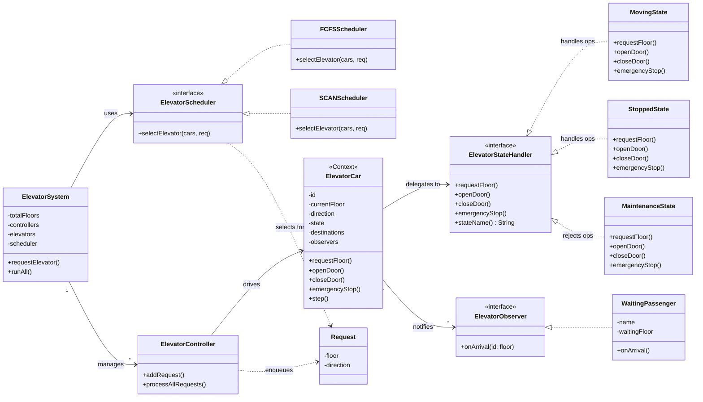
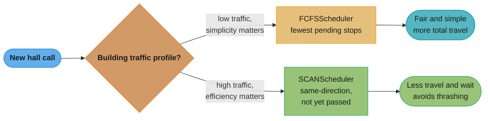
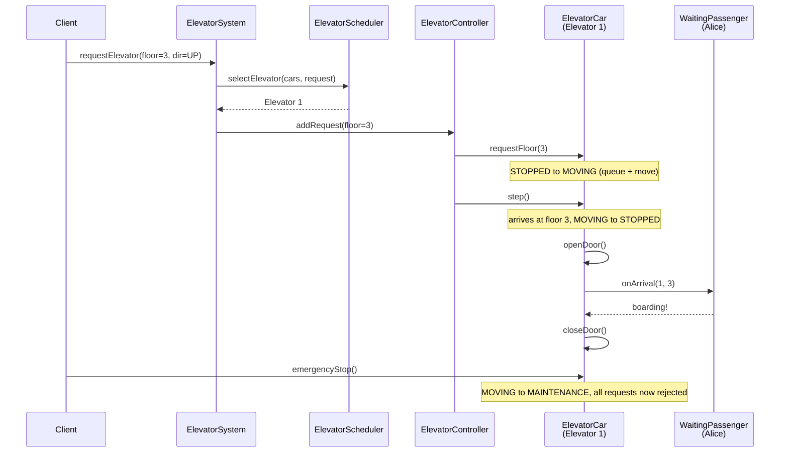
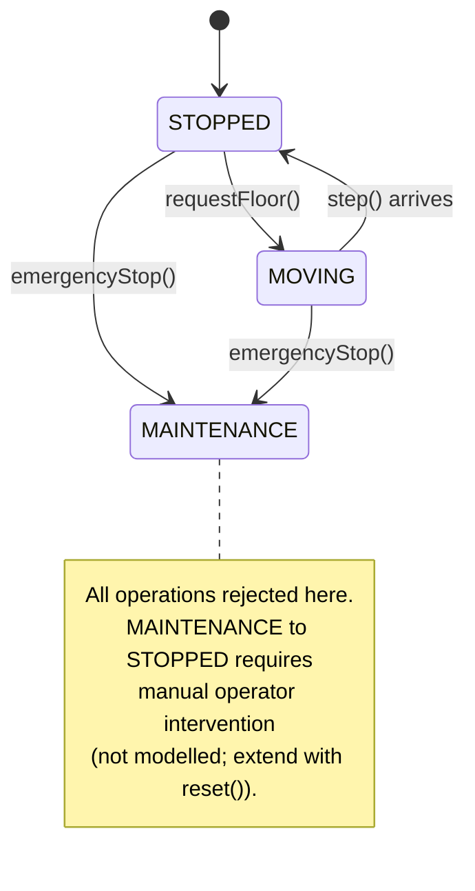

# Elevator System — Low-Level Design
## Intuition

> **One-line analogy**: Elevator design is a scheduling problem in a state machine costume — the real challenge isn't modeling the elevator, it's deciding which elevator should answer which call.

**Mental model**: Each elevator is a state machine (Stopped ↔ Moving ↔ Maintenance). Hall calls (floor buttons) and cabin calls (destination buttons) arrive as requests. The dispatcher must assign each hall call to the optimal elevator using a pluggable algorithm — FCFS (simple), SCAN (elevator algorithm — go in one direction until no more calls, then reverse), or Look (like SCAN but reverses early). The key insight is separating the elevator's own state from the scheduling strategy.

**Why it matters**: This problem exercises State pattern (elevator states), Strategy pattern (scheduling algorithms), Observer pattern (passenger notifications), and Command pattern (queued requests). It demonstrates how to combine multiple patterns coherently.

**Key insight**: The hardest design decision is the dispatch interface — `ElevatorScheduler.selectElevator(List<ElevatorCar>, Request)`. Get this abstraction right and swapping algorithms becomes trivial. Get it wrong and every algorithm change requires touching `ElevatorCar`.

**Full runnable implementation:** [`ElevatorSystem.java`](ElevatorSystem.java) — 476 lines, one file, `main()` at the bottom. It demonstrates three state handlers behind `ElevatorStateHandler` (Moving / Stopped / Maintenance), `FCFSScheduler` and `SCANScheduler` behind one `ElevatorScheduler` interface, and `ElevatorController` dispatching hall calls across cars — the scheduling seam is a strategy swap, exactly as the design argues.

---

## Problem Statement

Design an elevator system for an N-floor building with M elevators that can:
- Accept hall calls (person at a floor pressing UP/DOWN)
- Accept cabin calls (person inside pressing a destination floor)
- Dispatch the optimal elevator using a pluggable scheduling algorithm
- Model elevator lifecycle states (moving, stopped, maintenance)
- Notify waiting passengers when their elevator arrives
- Handle emergency stops gracefully

---

## Requirements

### Functional
1. Multiple elevators operating independently in the same building
2. Two types of requests: hall call (floor + direction) and cabin call (destination floor)
3. Pluggable scheduling: FCFS and SCAN (elevator algorithm) implementations
4. State machine per elevator: STOPPED ↔ MOVING, either can → MAINTENANCE
5. Observer notifications to passengers when elevator arrives at their floor
6. Reject requests to elevators in MAINTENANCE state

### Non-Functional
- Scheduler is swappable at runtime without restarting
- States are self-contained objects — adding a new state requires no changes to `ElevatorCar`
- Each elevator processes its queue sequentially (extensible to concurrent)

---

## ASCII Class Diagram



*`ElevatorSystem` uses a swappable `ElevatorScheduler` to pick a car, then hands the request down through `ElevatorController` to the chosen `ElevatorCar`; the car delegates every state-dependent call to its current `ElevatorStateHandler` (State pattern) and fans arrivals out to every registered `ElevatorObserver` (Observer pattern).*

---

## Patterns Used

### 1. State Pattern — `ElevatorCar`
**Why**: An elevator's behaviour depends heavily on its current state. Without the State pattern, `ElevatorCar` would be riddled with `if (state == MOVING) { ... } else if (state == STOPPED) { ... }` branches in every method.

**How**: `ElevatorStateHandler` interface defines `requestFloor`, `openDoor`, `closeDoor`, `emergencyStop`. Three concrete states each implement appropriate behaviour or log a refusal:

| Operation      | STOPPED           | MOVING              | MAINTENANCE       |
|----------------|-------------------|---------------------|-------------------|
| requestFloor   | Queue + → MOVING  | Queue only          | Reject            |
| openDoor       | Open + notify     | Reject (unsafe)     | Reject (locked)   |
| closeDoor      | Close             | Already closed      | Reject (locked)   |
| emergencyStop  | → MAINTENANCE     | Stop + MAINTENANCE  | No-op             |

---

### 2. Strategy Pattern — `ElevatorScheduler`
**Why**: Different buildings need different dispatch algorithms. SCAN reduces total travel distance for high-traffic buildings; FCFS is simpler and fairer for low-traffic scenarios. The algorithm should be swappable without touching `ElevatorSystem`.

| Scheduler    | Algorithm                                                       | Best for                |
|--------------|-----------------------------------------------------------------|-------------------------|
| FCFSScheduler| Assign to the available elevator with fewest pending stops      | Low traffic, simplicity |
| SCANScheduler| Cost = floor distance, +10 penalty if the car must reverse      | High traffic, efficiency|

**Name the policy honestly in an interview.** `FCFSScheduler` is the conventional label for the "no clever dispatch" baseline, but what it actually implements is **least-loaded / shortest-queue** selection: `min(pendingStops)` over available cars. Strict first-come-first-served would serve calls in arrival order regardless of car position, which is worse still. `SCANScheduler` likewise implements the *cost-function* flavour of SCAN — nearest car, plus a fixed 10-floor penalty when the car would have to reverse — rather than a literal sweep to the top of the shaft and back. Both are the right shape for an LLD answer; claiming they are the textbook algorithms verbatim is not.



*Same decision the "Best for" column states above, walked as a path: low-traffic buildings take the simpler FCFS branch, high-traffic buildings route to SCAN for the travel-distance win quantified in the SCAN vs FCFS scenario below.*

---

### 3. Observer Pattern — `ElevatorObserver` / `WaitingPassenger`
**Why**: Passengers waiting at a floor need to know when an elevator arrives. The elevator shouldn't depend on who is waiting.

**How**: `ElevatorCar` maintains a list of `ElevatorObserver`s. On each `openDoor()` call (from `StoppedState`), it calls `notifyObservers(currentFloor)`. Each `WaitingPassenger` checks if the arrived floor matches their waiting floor.

---

## Runtime Collaboration: Hall Call to Notification

The three patterns above are static structure; here is one hall call traced dynamically end-to-end, matching the `Sample Output` trace further down this file.



*Strategy (`ElevatorScheduler`) picks the car, State (`ElevatorCar`'s current handler) governs whether `requestFloor`/`openDoor`/`emergencyStop` are honoured at each step, and Observer (`onArrival`) fans the arrival out to `WaitingPassenger` Alice — the same three patterns from the class diagram, now shown collaborating at runtime.*

---

## State Transition Diagram



*STOPPED and MOVING cycle into each other on every `requestFloor()` queue-and-move and every arrival, but `emergencyStop()` from either one is a one-way trip into MAINTENANCE, where `ElevatorStateHandler` rejects every operation; recovery back to STOPPED is deliberately left unmodelled — extend with a `reset()` method gated by operator authentication.*

---

## SCAN vs FCFS Tradeoffs

```
Scenario: 3 elevators at floors 1, 5, 8. Request at floor 6 (UP).

FCFS: picks elevator with fewest pending stops → might pick E1 (floor 1)
      even though E2 (floor 5, moving UP) is already en route.
      Cost: 5 floors of unnecessary travel.

SCAN: detects E2 is moving UP and hasn't passed floor 6.
      Assigns to E2. Cost: 1 floor of travel.
      Result: significantly less energy and wait time.

Scenario: rush hour — many requests spread across all floors.
SCAN excels by batching same-direction stops (like a disk seek algorithm).
FCFS can cause thrashing (elevators reversing direction constantly).
```

---

## Cross-Perspective: HLD Connections

**HLD View — Where Elevator Design Scales to Distributed Systems**

- **Scheduling algorithm → distributed task scheduler** — The elevator scheduling strategy (FCFS, SCAN, Look) maps directly to distributed task scheduling (Kubernetes scheduler, AWS Batch, Celery). The core problem — assign work to the best available worker considering current load and proximity — is identical at both scales.
- **State machine per elevator → state per worker node** — Each elevator's state machine (STOPPED / MOVING / MAINTENANCE) maps to the state of a distributed worker: IDLE / PROCESSING / DRAINING / OFFLINE. The same transition logic (reject requests in MAINTENANCE) applies to worker draining during rolling deployments.
- **Observer notifications → event-driven service health** — Passenger notification when the elevator arrives maps to service health events in distributed systems: webhooks, WebSocket pushes, or SNS notifications when an asynchronous job completes.
- **Dispatcher interface → pluggable scheduler** — The `ElevatorScheduler` interface that the dispatcher uses maps to a pluggable scheduler interface in Kubernetes, allowing custom schedulers for specialized workloads (GPU, large memory, specific node pools).

---

## Follow-Up Extensions

1. **Emergency / Fire mode** — on fire alarm, all elevators ignore cabin calls, proceed to ground floor, open doors, and lock in MAINTENANCE state.

2. **Load balancing** — track passenger count (or weight sensor). Prevent elevators from accepting new hall calls above a load threshold.

3. **VIP floors** — certain floors (penthouse, executive) require keycard authentication before the cabin button is accepted. Model as a decorator around `requestFloor()`.

4. **Predictive dispatch** — use historical traffic patterns (rush hour models) to pre-position elevators before demand peaks.

5. **Concurrent requests** — use a `BlockingQueue<Request>` per elevator and a dedicated thread per `ElevatorController` for real-time simulation.

6. **Destination dispatch** — passengers enter their destination floor at the hall panel; the system groups passengers going to the same floor into one elevator, minimising stops.

---

## Sample Output

```
--- Hall calls ---
[System] Request(floor=3, dir=UP) → assigned to Elevator 1
  [Elevator 1 | STOPPED] Floor 3 added. Starting movement.
  [Elevator 1] State: STOPPED → MOVING
[System] Request(floor=7, dir=DOWN) → assigned to Elevator 2
  [Elevator 2 | STOPPED] Floor 7 added. Starting movement.
  [Elevator 2] State: STOPPED → MOVING
...

--- Processing all requests ---
[Controller] Elevator 1: processing queue — Elevator[id=1, floor=1, dir=UP, state=MOVING, pending=[2, 3, 6]]
  [Elevator 1] Arrived at floor 2 (dir=UP, remaining=[3, 6])
  [Elevator 1] State: MOVING → STOPPED
  [Elevator 1 | STOPPED] Doors opening at floor 2.
  [Elevator 1 | STOPPED] Doors closing.
  [Elevator 1] State: STOPPED → MOVING
  [Elevator 1] Arrived at floor 3 (dir=UP, remaining=[6])
  [Elevator 1] State: MOVING → STOPPED
  [Elevator 1 | STOPPED] Doors opening at floor 3.
  [Passenger Alice] Elevator 1 arrived at floor 3 — boarding!
  [Elevator 1 | STOPPED] Doors closing.
...

--- Emergency stop on Elevator 1 ---
  [Elevator 1 | STOPPED] Floor 8 added. Starting movement.
  [Elevator 1] State: STOPPED → MOVING
  [Elevator 1 | MOVING] EMERGENCY STOP at floor 6!
  [Elevator 1] State: MOVING → MAINTENANCE
  [Elevator 1 | MAINTENANCE] Cannot accept requests.

--- Switching to FCFS scheduler ---
[System] Request(floor=4, dir=UP) → assigned to Elevator 2
[Controller] Elevator 1: processing queue — Elevator[id=1, floor=6, dir=UP, state=MAINTENANCE, pending=[8]]
[Controller] Elevator 1: in MAINTENANCE, skipped
```

The last two lines are the point of the MAINTENANCE state: floor 8 is still queued, but the car stays out of service and the controller refuses to step it — the queue is frozen, not served.

---

## Interview Questions with Answers

**Q: Why is `FCFSScheduler`'s name misleading, and what does it actually implement?**
**Short:** it picks the least-loaded car by fewest pending stops, not the true arrival-order meaning of FCFS.

Strict first-come-first-served would serve hall calls in the order they arrived regardless of which car is closest, which would actually be worse than what's implemented here. `FCFSScheduler.selectElevator()` is really `min(pendingStops)` over available cars — a least-loaded / shortest-queue heuristic wearing the conventional "no clever dispatch" baseline label. Naming this precisely in an interview matters: claiming it implements textbook FCFS when it implements least-loaded selection is exactly the kind of imprecision that costs a point, even though the algorithm itself is reasonable.

**Q: Why is `SCANScheduler`'s name misleading, and what does its cost function actually compute?**
**Short:** it's nearest-car-plus-reversal-penalty, not a literal sweep to the top of the shaft and back.

The elevator algorithm called "SCAN" sweeps to one end of the shaft, serving every call along the way, before reversing — a literal disk-seek analogue. `SCANScheduler` here instead computes `cost = floor distance, +10 penalty if the car must reverse direction` and picks the minimum-cost car — the *cost-function flavor* of SCAN's spirit (prefer same-direction, not-yet-passed cars) without simulating an actual end-to-end sweep. Both scheduler names are the right shape of algorithm for an LLD interview answer; the honest move is naming what you actually built rather than claiming it's the textbook version verbatim.

**Q: Why is there no way back from `MAINTENANCE` to `STOPPED` in this design?**
**Short:** it's deliberately left unmodelled — recovery needs operator authentication, not a customer-triggered call.

The State Transition Diagram's note is explicit: recovery from `MAINTENANCE` "requires manual operator intervention (not modelled; extend with `reset()`)." This mirrors why `ATM.java`'s `OUT_OF_CASH` state can only be exited by a technician's `refillCash()`, kept off the customer-facing interface — an elevator that entered maintenance after an emergency stop shouldn't be reset by any ordinary request, only by an authenticated operator action. Adding it means a `reset()` method gated by an authorization check, not just another entry on `ElevatorStateHandler` that any caller could invoke.

**Q: Why does `openDoor()` get rejected while the elevator is `MOVING`?**
**Short:** opening doors on a moving car is a physical safety hazard, so the State table rejects it outright.

Per the State Pattern table, `openDoor` in `MOVING` is "Reject (unsafe)" — a car in motion cannot safely open its doors, so `MovingState.openDoor()` simply refuses the call rather than attempting it. This is exactly the value State pattern provides over a flag-based design: the illegality is structural (the method on `MovingState` just doesn't do the unsafe thing), not something that has to be remembered as an `if` check scattered through a shared `openDoor()` implementation. `StoppedState.openDoor()`, by contrast, opens the door and fires the Observer notification to waiting passengers — the same method name, completely different behavior, purely because of which state object is currently installed.

**Q: Why State pattern for `ElevatorCar` instead of `if (state == MOVING)` branches inside each method?**
**Short:** each state class owns its own behavior, so a new state needs one new class, not edits to every method.

Without State, every one of `ElevatorCar`'s methods (`requestFloor`, `openDoor`, `closeDoor`, `emergencyStop`) would need its own `if/else if` chain checking the current state, and the behavior for a given state would be scattered across every method instead of living in one place. `ElevatorStateHandler` collapses this: `MovingState`, `StoppedState`, and `MaintenanceState` each implement the full four-method contract, so understanding what's legal in `MOVING` means reading one class, not four scattered branches. This is the same Open/Closed argument the Vending Machine and ATM pages make — adding a fourth state later is one new class, zero edits to the existing three.

**Q: Why is scheduling kept as a separate Strategy from `ElevatorCar`'s State, rather than one combined abstraction?**
**Short:** scheduling decides *which car* answers a call; State governs what *one car* may do right now — different concerns.

`ElevatorScheduler` answers "given this hall call and these cars, which one should serve it" — a system-level decision made once, before dispatch. `ElevatorStateHandler` answers "given this car's current phase, is this operation legal right now" — a per-car, per-call decision made continuously. Merging them would force every scheduling algorithm to also know about door-safety rules, and every state class to know about fleet-wide car selection — two orthogonal responsibilities that happen to both live in an "elevator system" but change for entirely different reasons (a new dispatch algorithm vs. a new safety rule).

**Q: How does Observer decouple `ElevatorCar` from `WaitingPassenger`?**
**Short:** `ElevatorCar` only knows about the `ElevatorObserver` interface, never about a concrete passenger class.

`ElevatorCar` maintains a `List<ElevatorObserver>` and, on every `openDoor()` call from `StoppedState`, invokes `notifyObservers(currentFloor)` — it has no reference to `WaitingPassenger` specifically, only to the interface. Each registered `WaitingPassenger` independently checks whether the arrived floor matches the floor it's waiting at, deciding for itself whether to react. This means a UI display, a logging system, or a future push-notification service can all register as `ElevatorObserver`s alongside passengers without `ElevatorCar` changing at all — the same decoupling `ParkingLot`'s `DisplayBoard` and `ChessGame`'s `GameLogger` get from the same pattern.

**Q: Walk the SCAN vs FCFS scenario — why does FCFS pick a worse car than SCAN in the documented example?**
**Short:** FCFS optimizes only for fewest pending stops and ignores that a moving car is already headed toward the call.

With elevators at floors 1, 5, and 8 and a hall call at floor 6 (UP), FCFS picks whichever car has the fewest pending stops — which might be E1 at floor 1, five floors away, purely because it happens to be idle — even though E2 at floor 5 is already moving UP and hasn't passed floor 6 yet. SCAN's cost function explicitly checks direction and whether the car has already passed the requested floor, so it correctly assigns E2 and pays a cost of 1 floor instead of 5. The lesson generalizes to rush hour: SCAN batches same-direction stops the way a disk-seek algorithm does, while FCFS can cause "thrashing" — cars reversing direction repeatedly because it never accounts for a car's current trajectory.

**Q: Why is the `ElevatorScheduler` interface called "the hardest design decision" in this problem?**
**Short:** getting `selectElevator(cars, request)` right lets algorithms swap freely; getting it wrong forces `ElevatorCar` changes per algorithm.

If the scheduler's contract is exactly `selectElevator(List<ElevatorCar>, Request) -> ElevatorCar` — taking only what every algorithm could plausibly need and nothing implementation-specific — then FCFS, SCAN, or a future Look/destination-dispatch algorithm can all satisfy it without `ElevatorCar` or `ElevatorController` ever needing to change. Get the abstraction wrong (say, leak scheduler-specific state like "reversal penalty" into `ElevatorCar` itself) and every new algorithm requires touching the car class, defeating the entire point of Strategy. This is why the page frames it as the single decision that determines whether the rest of the design stays clean.

**Q: What data structure backs each elevator's pending-stops queue, and why does it matter for the scheduling algorithms?**
**Short:** `destinations` needs ordered, insertable storage so both FCFS's count and SCAN's directional check work cheaply.

`ElevatorCar.destinations` needs to support both a simple size check (what `FCFSScheduler` reads as "pending stops") and, for a more sophisticated scheduler, a directional query (has this car already passed floor X). A sorted structure or a simple list both work for the demo's linear-scan scale, but a production destination-dispatch system would want ordered insertion so stops are naturally visited in floor order rather than arrival order, avoiding needless direction reversals. The Follow-Up Extensions note a `BlockingQueue<Request>` per elevator for real-time concurrent simulation — a structural change from a plain list to a thread-safe queue, without altering the scheduler contract itself.

**Q: How would you add destination dispatch — grouping passengers going to the same floor into one elevator?**
**Short:** passengers enter their destination up front; the dispatcher groups by destination floor before assigning a car.

Instead of a passenger pressing an UP/DOWN hall button and only entering their real destination once inside the car, destination dispatch collects the destination floor at the hall panel itself. The scheduler can then group requests heading to the same or nearby floors onto the same car before assignment, minimizing total stops across the fleet rather than optimizing each hall call independently. This changes what `Request` carries (destination floor, not just direction) and how `ElevatorScheduler.selectElevator()` reasons about a batch of requests together, but doesn't require touching `ElevatorStateHandler` — the state machine for an individual car's motion is unaffected by how calls get grouped upstream.

**Q: How would you add VIP-floor keycard authentication without modifying the existing state classes?**
**Short:** wrap `requestFloor()` in a Decorator that checks authentication before delegating to the real state handler.

The Follow-Up Extensions suggest modeling this as a decorator around `requestFloor()` — an `AuthenticatedFloorRequest` wrapper that checks keycard authorization for restricted floors before delegating to whatever `ElevatorStateHandler` is currently installed, and rejects (or prompts for) authentication otherwise. This keeps the access-control concern entirely separate from the state machine: `MovingState`/`StoppedState`/`MaintenanceState` never need to know which floors are VIP-restricted, because the decorator intercepts before the call ever reaches them. It's the same "wrap, don't modify" principle `RateLimiter.java`'s `InstrumentedRateLimiter` and `LRUCache.java`'s `ThreadSafeLRUCache` use for their respective cross-cutting concerns.

**Q: How would you make `ElevatorController` thread-safe for real-time concurrent simulation?**
**Short:** back each car's queue with a `BlockingQueue<Request>` and run one dedicated thread per controller.

The Follow-Up Extensions call for a `BlockingQueue<Request>` per elevator plus a dedicated thread per `ElevatorController`, so hall calls and cabin calls arriving concurrently from multiple sources are safely enqueued without a shared mutable list being mutated from multiple threads at once. Each controller's thread then drains its own car's queue independently, meaning cars don't contend with each other for a shared lock — only the queue feeding a single car needs synchronization. This mirrors the concurrency fix pattern used throughout the section (RateLimiter's per-client `ConcurrentHashMap`, ParkingLot's per-floor locking): scope the synchronized resource to the smallest unit that actually needs it.

**Q: How does per-elevator state map to worker-node state in distributed systems?**
**Short:** STOPPED/MOVING/MAINTENANCE mirrors IDLE/PROCESSING/DRAINING/OFFLINE for a worker during rolling deployment.

An elevator's `MAINTENANCE` state, which rejects all new requests while letting nothing in-flight complete unexpectedly, is structurally identical to a worker node's `DRAINING` state during a rolling deployment — new work is refused, but the node isn't abruptly killed. The same transition-rejection logic ("reject requests in MAINTENANCE") that keeps `ElevatorStateHandler` consistent maps directly onto how a Kubernetes node cordoned for maintenance refuses new pod scheduling while existing pods finish. The pattern that generalizes is: any resource pool with discrete operational phases needs the same explicit state gating, whether the resource is a physical car or a compute node.

**Q: How does the `ElevatorScheduler` interface map to a pluggable scheduler in a system like Kubernetes?**
**Short:** both let a caller swap the assignment algorithm behind one interface without changing what consumes the assignment.

Kubernetes lets operators supply custom schedulers for specialized workloads (GPU-aware placement, large-memory nodes) behind the same `scheduler` interface the default scheduler implements — exactly the relationship `ElevatorSystem` has to `ElevatorScheduler`, where `FCFSScheduler` and `SCANScheduler` are interchangeable behind one contract. The core problem in both cases is identical: assign a unit of work (a hall call, a pod) to the best available resource (a car, a node) considering current load and locality, without the caller of the scheduler needing to know which algorithm is installed. This is Strategy at infrastructure scale — the interface boundary that lets `ElevatorSystem.requestElevator()` stay unchanged as algorithms are swapped is the same boundary that lets Kubernetes ship multiple scheduler implementations without touching the API server.
