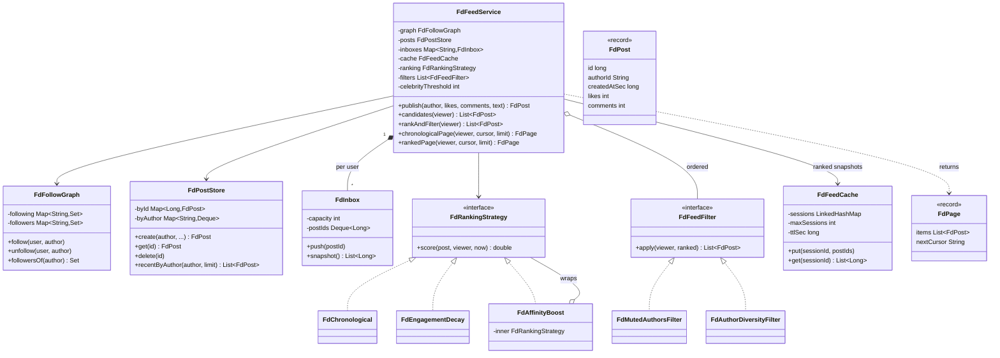
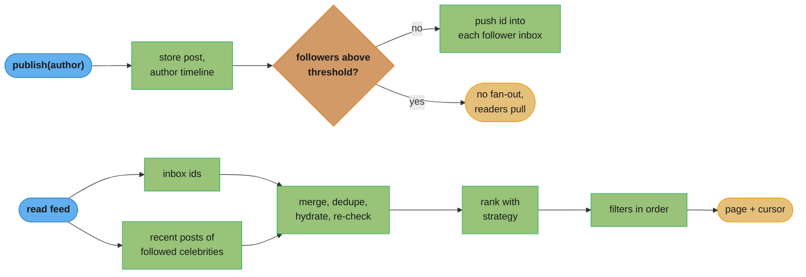
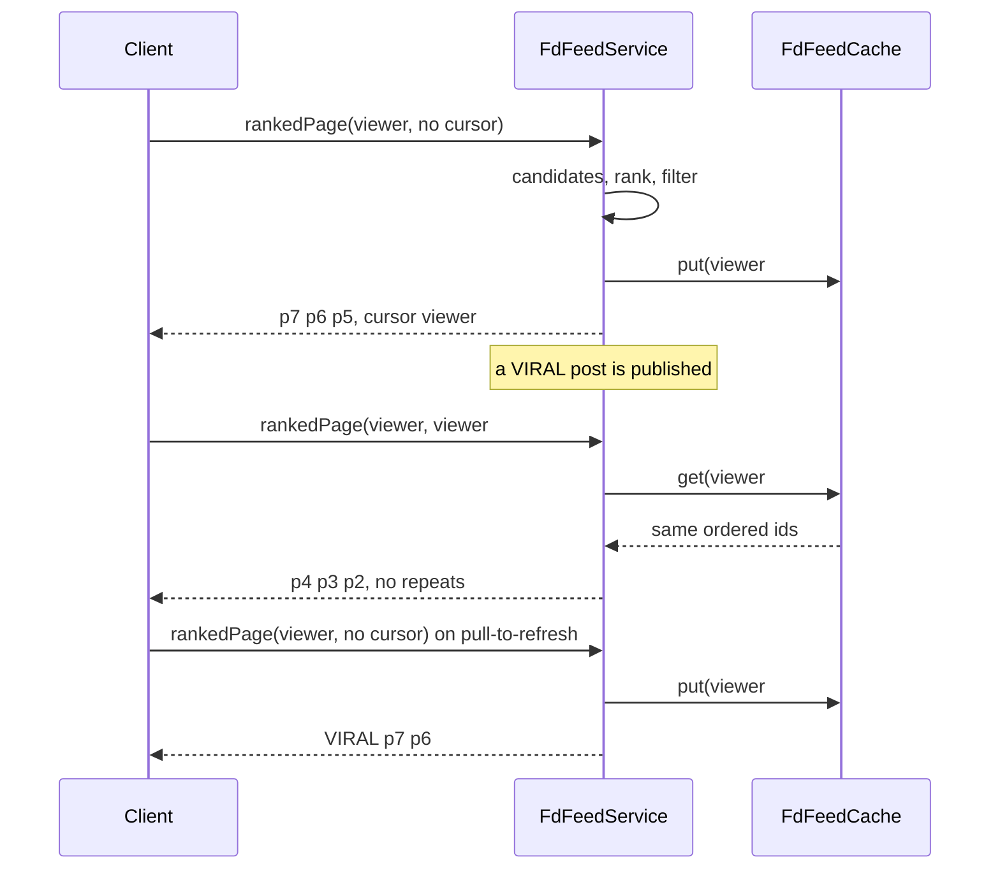

# Feed Generator — Low-Level Design

The class-level design behind a social home feed: who wrote what, who follows whom, which posts a user sees, in what order, and how a client scrolls through them while new posts keep arriving.

## Intuition

> **One-line analogy**: a feed is a newspaper printed for one reader. The press can print every follower's copy the moment a story is filed (push), or print the reader's copy when they open the door (pull). A good paper does both: local news goes to every doorstep at once, and the celebrity column is printed on demand.

**Mental model**: a feed is three steps in a fixed order. **Candidate generation** collects post ids the user may see (their inbox of pushed ids plus the recent posts of followed celebrities). **Ranking** scores and sorts them with a pluggable strategy. **Filtering** removes or reorders (muted authors, no five posts in a row from one author). Pagination then serves that ordered list one page at a time, and the hard part is keeping it stable while the world changes underneath.

**Why it matters**: the feed is the most asked "design X" behind Twitter, Instagram, LinkedIn and Facebook, and its LLD version tests a different set of skills from the HLD version. You need a ranking abstraction that a product team can swap, a fan-out choice with real numbers behind it, a pagination contract that does not repeat or skip posts, and a per-user cache with a TTL and a bound.

**Key insight**: a live feed cannot be paged by offset. Every new post shifts every position by one, so "page 2 = items 3 to 5" shows items the user already saw. A chronological feed is paged with a **keyset cursor** (`createdAt:postId` of the last item seen). A ranked feed cannot use a score as a cursor, because scores decay with time, so it is ranked **once per session**, the ordered id list is cached per user with a TTL, and the cursor points into that snapshot.

**Full runnable implementation:** [`FeedGenerator.java`](FeedGenerator.java) — one file, `main()` in the `FeedGenerator` class. It demonstrates a follow graph, a post store and bounded per-user inboxes; hybrid fan-out where authors above a follower threshold are pulled instead of pushed, with the inbox-write count for push, pull and hybrid; `FdChronological` and `FdEngagementDecay` behind `FdRankingStrategy`, plus an `FdAffinityBoost` decorator; a muted-author filter and an author-diversity filter applied in order; the offset-pagination bug (run for real, it repeats two posts) next to the keyset fix; ranked paging through a TTL and LRU snapshot cache, including expiry of an old cursor; a read path that re-checks unfollows and deletes; and 4 writer and 4 reader threads running at once with a duplicate check. Every type carries an `Fd` prefix because all files in this package are compiled together.

---

## Problem Statement

Design the feed component of a social network:

- Users publish posts and follow other users
- `getFeed(user)` returns the posts of the people the user follows, ordered by a **ranking strategy** that can be switched (newest first, or engagement with time decay)
- The feed is **paginated**: the client scrolls and asks for the next page, and must not see a post twice or miss one because new posts arrived in between
- Some authors have millions of followers; posting must not cost millions of synchronous writes
- Unfollowing an author or deleting a post must take effect on the next read
- Users can mute authors; no single author should fill the screen with consecutive posts
- Reads should be cheap: cache what you can per user, with a bound and an expiry

---

## Requirements

### Functional
1. `publish(author, ...)` stores a post and makes it visible to followers
2. `follow` / `unfollow` change what a user sees from the next read
3. `chronologicalPage(viewer, cursor, limit)` and `rankedPage(viewer, cursor, limit)` return a page and an opaque next cursor
4. Ranking is a strategy: chronological, engagement with time decay, and decorators such as affinity boosts
5. Filters run after ranking, in a configured order: mute, author diversity
6. Deleted posts and unfollowed authors never appear, even if their ids are still in an inbox or a cached snapshot

### Non-Functional
1. **Write cost bounded**: a post by an author with F followers costs at most F inbox writes, and zero for authors above the celebrity threshold
2. **Read cost bounded**: candidate generation reads one inbox (at most 500 ids) plus at most 50 recent posts per followed celebrity
3. **Stable pagination**: no post appears twice in one scroll session; new posts appear only on refresh
4. **Bounded memory**: inboxes have a fixed capacity; the snapshot cache has a maximum number of sessions (LRU) and a TTL
5. **Thread-safe**: concurrent publishes and reads never corrupt an inbox or produce a duplicate on a page

---

## Class Diagram



The store and the graph are the source of truth. Inboxes and cached snapshots are derived data that may go stale, which is why every read hydrates ids through `FdPostStore.get()` and re-checks `FdFollowGraph.follows()` before showing anything. Ranking and filters are the parts a product team changes every quarter; they sit behind interfaces so that changing them never touches the fan-out or pagination code.

---

## Patterns Used

### 1. Strategy — `FdRankingStrategy`
**Where:** `FdChronological` (score = creation time) and `FdEngagementDecay` (score = engagement divided by a power of age).

**Why:** "newest first" vs "most relevant" is a product decision that changes often and is A/B tested. The service sorts by `score()` and nothing else, so a new ranker is a new class. The same sort also breaks ties by post id, so equal scores still give a stable order.

### 2. Decorator — `FdAffinityBoost`
**Where:** wraps any `FdRankingStrategy` and multiplies its score by `1 + 0.5 x min(interactions, 10)`.

**Why:** boosts (affinity, freshness, "from your close friends") stack on top of a base ranker. A decorator composes them without a class per combination. In the demo the boost moves `quiet, 1h old` by cy from third to second for a viewer who interacted with cy ten times.

### 3. Chain of filters — `FdFeedFilter`
**Where:** `FdMutedAuthorsFilter` then `FdAuthorDiversityFilter`, applied in order after ranking.

**Why:** filters have an order that matters: mute first, then enforce diversity on what remains, or the diversity pass wastes its reordering on posts that will be removed. A list of filters keeps that order explicit and testable. Unlike Chain of Responsibility, every filter runs; none stops the chain.

### 4. Facade — `FdFeedService`
**Where:** `publish`, `chronologicalPage`, `rankedPage`.

**Why:** a controller should not know about inboxes, celebrity thresholds or snapshot sessions. Those are the parts that change when the system scales, and keeping them behind one class lets them change without touching callers.

---

## Design Decisions & Tradeoffs

| Decision | Alternative | Why this choice |
|---|---|---|
| Hybrid fan-out: push below a follower threshold, pull above it | Push for everyone; pull for everyone | Push makes reads cheap but a 20,000-follower post costs 20,000 writes. Pull makes writes free but every read merges every followed author. Hybrid keeps both bounded |
| Inbox stores post ids, bounded to 500, newest first | Store full posts; unbounded inbox | Ids are small and a post edit does not need re-fan-out. The bound caps memory per user; nobody scrolls past 500 posts in a session |
| Keyset cursor `createdAt:postId` for chronological feeds | Offset (`page x size`) | Offsets shift when posts arrive; the demo repeats 2 posts on page 2. A keyset says "strictly older than this one", which new posts never affect |
| Ranked feed: rank once per session, cache the id list, cursor = `session@position` | Score as a cursor; re-rank every page | Scores decay with time, so a score cursor drifts and skips or repeats. Re-ranking every page is costly and reorders what the user already passed |
| Snapshot cache: LRU by session, TTL 600 s | Cache forever; no cache | Bounded memory and a bounded staleness. An expired cursor returns a clear "refresh" error rather than a wrong page |
| Read path re-checks follow graph and post store | Remove ids from inboxes on unfollow or delete | Removal from every inbox is another fan-out. Re-checking on read is O(page) and always correct |
| Tie-break every sort by post id | Sort by score only | Equal scores in an unstable order make pagination nondeterministic; a total order makes the snapshot and the keyset well defined |

### Fan-out on write vs read vs hybrid, with numbers

The demo gives one author (`star`) 20,000 followers and another (`friend`) 200, then publishes 1 post by `star` and 10 by `friend`:

```
strategy                    inbox writes   read work for one follower
push for everyone           22,000         read 1 inbox (11 ids)
pull for everyone           0              read 2 author timelines and merge
hybrid (celebrity > 1,000)  2,000          read 1 inbox (10 ids) + 1 celebrity timeline
```

*The 20,000 writes for the celebrity post are the cost that push pays once per post and pull pays never. Hybrid removes exactly that term and keeps push for the long tail of normal authors, where it is cheap.*



*The write path decides once, at publish time, whether an author is pushed or pulled. The read path then merges both sources, so a follower never needs to know which kind of author they follow.*

### Why offset pagination breaks on a live feed

```
before new posts:  [8] [7] [6] | [5] [4] [3] | [2] [1]       page 1 = offset 0..2 = 8, 7, 6
after 2 new posts: [10] [9] [8] | [7] [6] [5] | [4] [3] ...   page 2 = offset 3..5 = 7, 6, 5
                                  ^^^ ^^^
                                  already seen on page 1
```

*Two posts arrived between page 1 and page 2, so every old post moved two positions down and page 2 starts two items too early. A keyset cursor (`1795000360:6`, the timestamp and id of post 6) asks for posts strictly older than post 6 and returns 5, 4, 3 whatever was added on top.*

### Ranking: engagement with time decay

```
score = (1 + likes + 2 x comments) / (ageHours + 2) ^ 1.5
```

| Post | Likes | Comments | Age | Score |
|---|---|---|---|---|
| viral | 900 | 120 | 10 h | 27.45 |
| solid | 40 | 5 | 6 h | 2.25 |
| quiet | 2 | 0 | 1 h | 0.58 |
| brand new | 0 | 0 | 0 h | 0.35 |

*The `+ 2` keeps a brand-new post from dividing by zero, and the exponent sets how fast old posts sink. The numbers are from the demo; the weights (comments count twice, gravity 1.5) are illustrative product choices, which is exactly why they live in a strategy class.*

---

## State / Flow

**Ranked paging through a session snapshot:**



*The second page comes from the same snapshot, so the viral post cannot push items around mid-scroll. It appears at the top on the next refresh, which is also when the client can show "1 new post".*

---

## Implementation

The full listing is in [`FeedGenerator.java`](FeedGenerator.java). These are the parts that carry the decisions above.

**Write path: push unless the author is a celebrity:**

```java
FdPost publish(String author, int likes, int comments, String text) {
    FdPost post = posts.create(author, clock.now(), likes, comments, text);
    if (!isCelebrity(author)) {
        for (String follower : graph.followersOf(author)) {
            inboxes.computeIfAbsent(follower, k -> new FdInbox(inboxCapacity)).push(post.id());
        }
    }
    return post;
}
```

**Read path: merge both sources, then hydrate and re-check:**

```java
List<FdPost> candidates(String viewer) {
    Map<Long, FdPost> byId = new HashMap<>();
    for (long id : inboxes.get(viewer).snapshot()) {
        FdPost p = posts.get(id);                                  // deleted -> null
        if (p != null && graph.follows(viewer, p.authorId())) {   // unfollowed -> skip
            byId.put(id, p);
        }
    }
    for (String author : graph.followingOf(viewer)) {
        if (isCelebrity(author)) {
            for (FdPost p : posts.recentByAuthor(author, CELEBRITY_PULL_LIMIT)) byId.put(p.id(), p);
        }
    }
    return new ArrayList<>(byId.values());
}
```

**BROKEN, then FIX: pagination:**

```java
// BROKEN -- positions in a live list move every time a post is added on top
List<FdPost> offsetPage(String viewer, int offset, int limit) {
    List<FdPost> all = chronological(viewer);
    return all.subList(Math.min(offset, all.size()), Math.min(offset + limit, all.size()));
}
```

```java
// FIX -- keyset: "strictly older than the last item I saw", unaffected by newer posts
for (FdPost p : chronological(viewer)) {
    boolean older = p.createdAtSec() < afterTs
            || (p.createdAtSec() == afterTs && p.id() < afterId);   // id breaks timestamp ties
    if (older) {
        page.add(p);
        if (page.size() == limit) break;
    }
}
String next = page.get(page.size() - 1).createdAtSec() + ":" + page.get(page.size() - 1).id();
```

**BROKEN, then FIX: a score as the cursor of a ranked feed:**

```java
// BROKEN -- the score of every post falls as it ages, so "score < lastScore" on the
// next request matches a different set of posts than the user just scrolled past
String next = String.valueOf(ranker.score(lastItem, viewer, now));
```

```java
// FIX -- rank once, cache the ordered ids per session, cursor = position in that list
String sessionId = viewer + "#" + sessionSeq.incrementAndGet();
cache.put(sessionId, rankAndFilter(viewer).stream().map(FdPost::id).toList());
String next = sessionId + "@" + nextPosition;
```

**The bounded snapshot cache: an access-ordered `LinkedHashMap` plus a TTL check on read:**

```java
this.sessions = new LinkedHashMap<>(16, 0.75f, true) {         // true = access order = LRU
    @Override
    protected boolean removeEldestEntry(Map.Entry<String, Entry> eldest) {
        return size() > maxSessions;
    }
};

synchronized List<Long> get(String sessionId) {
    Entry e = sessions.get(sessionId);
    if (e == null) return null;
    if (clock.now() - e.createdAtSec() >= ttlSec) { sessions.remove(sessionId); return null; }
    return e.postIds();
}
```

The same LRU mechanism, with its tradeoffs, is the subject of [LRU Cache](LRUCache.md).

---

## Sample Output

Real output from `java FeedGenerator.java`, pasted verbatim:

```text
=== Feed Generator: hybrid fan-out, pluggable ranking, stable pagination ===

--- Broken: offset pagination while new posts arrive ---
page 1 (offset 0): [8, 7, 6]
2 new posts arrive; page 2 (offset 3): [7, 6, 5]   <- 2 repeated from page 1
Fix (keyset cursor): page 1 [8, 7, 6]  cursor=1795000360:6  page 2 [5, 4, 3]  repeated: 0

--- Step 1: write cost of push, pull and hybrid fan-out ---
push for everyone     : inbox writes = 22000, u7 sees 11 posts
pull for everyone     : inbox writes = 0, u7 sees 11 posts
hybrid (celebrity>1000): inbox writes = 2000, u7 sees 11 posts

--- Step 2: the same candidates under two ranking strategies ---
chronological:
  brand new        by ana  likes=0    comments=0    score=t36000
  quiet, 1h old    by cy   likes=2    comments=0    score=t32400
  solid, 6h old    by ben  likes=40   comments=5    score=t14400
  viral, 10h old   by ana  likes=900  comments=120  score=t0
engagement / (ageHours + 2)^1.5:
  viral, 10h old   by ana  likes=900  comments=120  score=27.45
  solid, 6h old    by ben  likes=40   comments=5    score=2.25
  quiet, 1h old    by cy   likes=2    comments=0    score=0.58
  brand new        by ana  likes=0    comments=0    score=0.35
engagement / (ageHours + 2)^1.5 x affinity (viewer interacted with cy 10 times): [viral, 10h old, quiet, 1h old, solid, 6h old, brand new]

--- Step 3: filters after ranking: mute, then author diversity (max 2 in a row) ---
ranked (chronological): ana ben ana ana ana ana cy ben
after mute(cy) + diversity: ana ben ana ana ben ana ana

--- Step 4: ranked feed paged through a cached per-user snapshot ---
page 1: [p7, p6, p5]  cursor=viewer#1@3
a viral post arrives; page 2: [p4, p3, p2]  (stable, no repeats, VIRAL waits for refresh)
pull-to-refresh: [VIRAL, p7, p6]
two more sessions with cache size 2 -> LRU evictions so far: 2
old cursor: feed session viewer#1 expired, refresh from the top
after the 600 s TTL: feed session viewer#5 expired, refresh from the top

--- Step 5: inbox entries go stale; the read path re-checks ---
inbox ids: 3, feed: [ben-2, ben-1, ana-1]
unfollow ana, delete ben-1 -> inbox still holds 3 ids, feed shows [ben-2]

--- Step 6: 4 writers and 4 readers at once ---
posts written: 4,000; inbox writes: 1200000 (4,000 x 300 followers)
inbox of r0 bounded at capacity 500? true
reader scrolls that saw a duplicate post: 0  (across 1,000+ pages read during the writes)
```

**What to read in it.** The first block is the whole pagination argument in three lines: the same data, two new posts, and the offset version repeats posts 7 and 6 while the keyset version continues at 5. Step 1 shows that all three fan-out strategies give the reader the same 11 posts; they differ only in who pays and when. Step 3 shows that the diversity filter defers rather than drops: the third consecutive `ana` waits until a `ben` breaks the run. Step 4's two expiry lines are the two ways a snapshot ends: evicted by LRU when other sessions need the space, and expired by the TTL. Step 5 is the reason the read path re-checks: the inbox still holds all 3 ids, and the feed shows only the one that is still valid.

---

## Cross-Perspective: HLD Connections

- **The inbox becomes a Redis sorted set per user.** At scale, `FdInbox` is a capped sorted set keyed by user id, written by fan-out workers that consume a "post created" event instead of running inside `publish()`. [Design Twitter](../../hld/case_studies/design_twitter.md) and [Design a Feed Service](../../backend/case_studies/design_feed_service/design_feed_service.md) work through the fan-out workers, the celebrity threshold and the sorted-set commands.
- **The celebrity threshold is a hot-key defence.** Pushing one post to millions of inboxes is a write storm; pulling it is a read hot spot on one author's timeline, which is then cached aggressively. [Caching](../../hld/caching/caching.md) covers that read side.
- **The snapshot cache becomes a shared cache keyed by session.** With stateless servers, the next-page request can land anywhere, so `FdFeedCache` moves to a shared store (or the client keeps the ordered id list itself). The keyset cursor for chronological feeds needs no server state at all, which is why it is the default when ranking is not required.
- **"N new posts" is a realtime channel.** Showing that new posts exist without reordering the current scroll is a push notification to the client, covered in [Realtime Updates](../../hld/realtime_updates/realtime_updates.md).
- **Ranking at scale is a model, not a formula.** `FdEngagementDecay` stands in for a learned ranker. The ML side, candidate retrieval, scoring models and feature freshness, is in [Design a Content Feed Ranking System](../../ml/case_studies/design_content_feed_ranking.md).

---

## Follow-Up Extensions

### Extension drill: concurrency, multi-instance, persistence

| Follow-up | What changes in the design | What stays the same |
|---|---|---|
| **Concurrency**: posts and reads at the same time | Inboxes are synchronized per user, stores use concurrent maps, readers take snapshots under the inbox lock; keyset paging never repeats because new posts are always newer than the cursor. Move fan-out off the request thread into a bounded worker pool | Ranking, filters and pagination; they work on a copied candidate list |
| **Multi-instance**: many feed servers | Inboxes in a shared store (a capped sorted set per user), fan-out by workers reading a post-created topic, snapshot sessions in a shared cache or in the client; keyset cursors need no server state | The read pipeline (candidates, rank, filter, page) and the re-check on read |
| **Persistence**: survive restarts | Posts and the follow graph in a database (source of truth); inboxes and snapshots are rebuildable caches: on a cold inbox, fall back to pull for that user and refill it | The idea that derived data may be stale and is always re-checked |
| **Edits and deletes** | Store ids, not post bodies, in inboxes and snapshots; hydrate on read; a delete is a single write to the store | No re-fan-out is ever needed for an edit |
| **Follow spikes**: a new follower should see the author's old posts | Backfill: on follow, copy the author's last N post ids into the follower's inbox, or rely on pull until the next post | The inbox cap still bounds memory |

### Other extensions

1. **Ads and injected content.** A filter that inserts sponsored posts at fixed positions (for example every 8th item) after ranking. It is one more `FdFeedFilter`, applied last.
2. **Seen-state.** Track the newest post id the user has seen, and rank unseen posts above seen ones on refresh. It is a ranking decorator plus one value per user.
3. **Multiple feed types.** "Following" (chronological, keyset cursor) and "For you" (ranked, snapshot cursor) are two configurations of the same service with different strategies and different cursor types.
4. **Cold start.** A new user follows nobody, so the candidate set is empty. Add a candidate source for popular posts, chosen by the same strategy interface.

---

## Interview Questions with Answers

**Q: Why does offset pagination break on a live feed?**
**Short:** new posts shift every position, so the next offset points at items the user already saw.

Offset pagination asks for "items 3 to 5 of the current list". When two posts arrive on top between page 1 and page 2, every old post moves down two places, and page 2 starts two items too early. The demo shows exactly this: page 1 is `8, 7, 6`, two posts arrive, and page 2 at offset 3 is `7, 6, 5`. If posts are deleted instead, the list moves up and items are skipped. A keyset cursor avoids both, because it describes a position by content ("older than post 6"), not by index.

**Q: What does a keyset cursor contain for a chronological feed, and why the post id?**
**Short:** the timestamp and id of the last item seen; the id breaks ties between posts with the same timestamp.

The next page is "posts with `createdAt < ts`, or `createdAt == ts` and `id < lastId`", in descending order. Timestamps alone are not unique: two posts in the same second would either both be skipped or both repeated at a page boundary. Adding the id makes the order total and the cursor exact. Encode it opaquely (for example base64) so clients cannot build their own cursors and so the format can change later.

**Q: Why can't a ranked feed use the score of the last item as its cursor?**
**Short:** scores change with time and engagement, so "score below X" selects a different set on every request.

An engagement score decays as a post ages and rises when it gets likes. Between two page requests, posts the user already passed can fall below the cursor score and reappear, and posts they have not seen can rise above it and be skipped. Re-ranking each page has the same problem and costs a full ranking per page. The fix is to rank once per session, cache the ordered id list per user, and make the cursor a position in that list.

**Q: Fan-out on write or fan-out on read: which one, and when?**
**Short:** push for normal authors for cheap reads; pull for authors above a follower threshold to avoid write storms.

Fan-out on write copies a post id into every follower's inbox, so a read is one inbox lookup, but a post by an author with 20,000 followers costs 20,000 writes. Fan-out on read writes nothing and merges every followed author's timeline at read time, which is expensive for users who follow many authors. The hybrid pushes for authors below the threshold and pulls for the few above it. In the demo, hybrid cuts 22,000 inbox writes to 2,000, and the reader still sees all 11 posts.

**Q: How do you choose the celebrity threshold?**
**Short:** where the cost of pushing to all followers exceeds the cost of every follower pulling that author at read time.

Pushing costs F writes per post, once. Pulling costs one timeline read (usually cached) per follower read. Authors with very many followers and frequent posts are the ones where push cost dominates; authors whose followers read rarely also favour pull. The threshold is a tuning value set from measured costs, not a constant from a paper, and it is checked at publish time, so an author who crosses it simply stops being pushed for new posts.

**Q: A user unfollows someone, but their old posts are still in the user's inbox. What do you do?**
**Short:** leave the ids there and re-check the follow graph on read; removing them would be another fan-out.

Deleting the author's ids from the inbox means scanning the inbox or tracking which ids came from which author, for every unfollow. The read path already hydrates every id through the post store, so adding a `follows(viewer, author)` check costs one set lookup per candidate. The same check handles deleted posts (`posts.get(id)` returns null). In the demo the inbox still holds 3 ids after an unfollow and a delete, and the feed shows the 1 that is still valid.

**Q: Why does the inbox store post ids and not full posts?**
**Short:** ids are small, and edits, deletes and like counts then need no re-fan-out.

A post body copied into 300 inboxes must be updated in 300 places when it is edited and filtered in 300 places when it is deleted. An id is 8 bytes and always resolves to the current post. The cost is a hydration step on read (a multi-get from the post store or its cache), which is cheap compared with the writes it saves. Like counts change constantly, so they must come from the store at read time anyway.

**Q: Why bound the inbox, and what happens to posts that fall off?**
**Short:** the bound caps memory per user; users almost never scroll past a few hundred posts, and old posts stay in authors' timelines.

An unbounded inbox for a user who follows many active authors grows without limit. Capping it at 500 newest ids bounds memory at about 4 KB of ids per user. The rare user who scrolls past the cap can fall back to a pull from the followed authors' timelines for older posts, because the timelines are the source of truth. The demo confirms the cap holds at 500 after 4,000 posts to 300 followers.

**Q: How does the per-user snapshot cache stay bounded and fresh?**
**Short:** LRU eviction caps the number of sessions, and a TTL caps how old a snapshot can be before the client must refresh.

The cache is an access-ordered `LinkedHashMap` with `removeEldestEntry` evicting past a maximum size, plus a creation timestamp checked on every read. An evicted or expired session returns a clear "refresh from the top" error instead of silently re-ranking, because a silent re-rank would break the no-repeats promise mid-scroll. In the demo, two extra sessions on a cache of size 2 evict two old ones, and a session older than 600 seconds expires.

**Q: How is the ranking pluggable, and why add a decorator?**
**Short:** the service sorts by `score()` from a strategy; decorators stack boosts on any base strategy without new subclasses.

`FdRankingStrategy` has one method, `score(post, viewer, now)`. Chronological returns the timestamp; engagement-decay divides engagement by a power of age. A boost such as affinity is not a different ranker but a modifier, so it wraps one: `new FdAffinityBoost(new FdEngagementDecay(1.5))`. Without the decorator you would need `ChronologicalWithAffinity`, `DecayWithAffinity` and so on for every combination.

**Q: Why apply filters after ranking, and why in a fixed order?**
**Short:** filters need the ranked order to decide what to defer, and each filter's input must be the previous filter's output.

A diversity rule ("at most 2 posts in a row from one author") is about positions, so it needs the final order. Muting must come first: if diversity ran first, it might defer a post to make room for a muted author's post that is then removed, leaving a gap in the order it built. Running filters as an ordered list makes this dependency visible. The diversity filter defers instead of dropping, so a muted-free feed never loses posts, it only reorders them.

**Q: How do you keep the feed correct when posts are published while users are reading?**
**Short:** take snapshots under per-inbox locks, and page by keyset or by session snapshot so new posts never shift positions.

Each inbox is a synchronized bounded deque, and readers copy it before ranking, so a concurrent push never corrupts the reader's list. Keyset pages only ever return posts older than the cursor, and every new post is newer than any cursor the reader holds, so a concurrent publish cannot cause a repeat. The demo runs 4 writers and 4 readers at once and finds 0 scrolls with a duplicate across more than 1,000 pages.

**Q: What changes when the feed runs on many servers?**
**Short:** inboxes and snapshots move to a shared store, fan-out moves to workers, and keyset cursors carry all their state.

`FdInbox` becomes a capped sorted set per user in a shared store, written by workers that consume a post-created event, so `publish()` returns after one write. The snapshot cache moves to a shared store keyed by session id, or the client keeps the ordered id list itself. Keyset cursors are stateless by design, which is why chronological feeds scale most easily. The read pipeline, including the re-check on read, does not change.

**Q: How would you show "3 new posts" without disturbing the current scroll?**
**Short:** count posts newer than the first item of the current session and push the count; prepend them only on refresh.

The session snapshot (or the first keyset of the session) marks where the user started. A lightweight query, or an event pushed to the client, reports how many candidates are newer than that mark. The client shows a banner, and tapping it starts a new session from the top. This keeps the promise that a scroll never reorders under the user's thumb, which is exactly why the ranked feed in the demo shows `VIRAL` only after the refresh.

**Q: What would you persist, and what is safe to lose?**
**Short:** persist posts and the follow graph; inboxes and snapshots are derived caches you can rebuild.

Posts and follows are the source of truth and live in a durable store. An inbox can always be rebuilt from the followed authors' recent posts, so losing it costs one slower read (a pull) for that user, not data. A snapshot lost to eviction or a restart costs the user a refresh. Designing derived data to be rebuildable is what lets the inbox store use a fast, memory-based system without durability guarantees.
