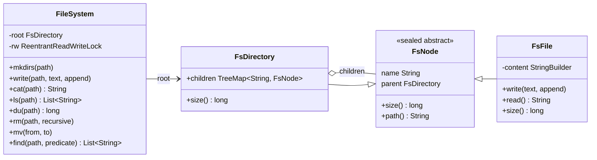
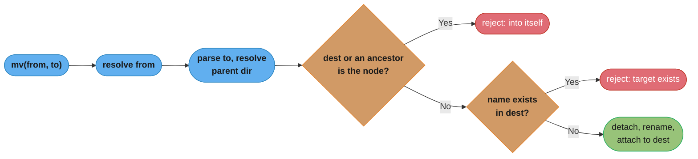

# Design an In-Memory File System
A tree of directories and files with `mkdir -p`, write and append, `cat`, `ls`, `du`, `rm -r`, `mv`, `find`, and path resolution with `.` and `..`.

## Intuition

> **Design intuition**: a file system is a tree where every node answers the same few questions (what is your name, who is your parent, how big are you) and only directories have children. That is the Composite pattern exactly: `size()` on a file returns its length, `size()` on a directory sums its children, and `du /` is one call on the root.

**Key insight**: almost every bug in this problem is a path bug, not a tree bug. Normalize the path once (`/home/bob/../alice/./docs` becomes `[home, alice, docs]`), then walk the tree with that list. Every operation shares one resolver, so `..` handling, "not a directory" errors and missing-path errors are written once. The second trap is `mv` of a directory into its own subtree, which silently detaches a cycle from the tree unless you check the ancestors of the destination.

**Full runnable implementation:** [`FileSystem.java`](FileSystem.java), one file, `main()` on `FileSystem`. It demonstrates the sealed `FsNode` Composite with recursive `size()` (`du`), `TreeMap` children so `ls` is sorted with no extra work, lexical `..` resolution, a non-recursive depth-first `find` with a predicate, `mv` rejecting a move into the node's own subtree, `rm` refusing a non-empty directory without the recursive flag, and one `ReentrantReadWriteLock` that lets reads run in parallel.

---

## Problem Statement

Design an in-memory file system library:

```java
fs.mkdirs("/home/alice/docs");
fs.write("/home/alice/docs/notes.txt", "hello", false);
fs.write("/home/alice/docs/notes.txt", " world", true);       // append
fs.cat("/home/alice/docs/notes.txt");                          // "hello world"
fs.ls("/home/alice");                                          // [docs/, todo.md]
fs.du("/home");                                                // total size, recursive
fs.mv("/home/alice/docs", "/home/bob/docs");
fs.rm("/home/bob", true);
fs.find("/", n -> n.name.endsWith(".txt"));
```

LeetCode 588 ("Design In-Memory File System") asks for `ls`, `mkdir`, `addContentToFile` and `readContentFromFile`; machine-coding rounds add `rm`, `mv`, `du` and `find` to test the Composite pattern, edge cases, and locking.

**Machine-coding time-box.** Build in order: the node classes and path parser; `mkdirs`, `write`, `cat`, `ls`; then `du` (one line, thanks to Composite); then `rm` and `mv` with their error cases. Permissions, symlinks and locking granularity are follow-ups to discuss, not build.

---

## Requirements

### Functional
1. Absolute paths only; `.` and `..` resolve; `..` at the root stays at the root.
2. `mkdirs(path)` creates missing directories; fails if a component is a file.
3. `write(path, text, append)` creates or overwrites or appends to a file; the parent directory must exist.
4. `cat(path)` returns file content; fails on a directory.
5. `ls(path)` lists a directory's children in name order, directories with a trailing `/`; on a file it returns the file name.
6. `du(path)` returns total content size under a node.
7. `rm(path, recursive)` removes a file, an empty directory, or with `recursive` a whole subtree; never `/`.
8. `mv(from, to)` moves or renames a node; fails if the target exists or if moving a directory into itself.
9. `find(path, predicate)` returns matching paths in depth-first name order.

### Non-Functional
1. Path lookup O(depth) with O(log k) per level for k children (sorted map).
2. Thread-safe: concurrent readers, exclusive writers.
3. Clear error messages naming the offending path, like a shell.

---

## Class Diagram



`FsNode` is `sealed`, so `instanceof FsDirectory d` checks and pattern-matching `switch` over node types are exhaustive and checked by the compiler. A `Symlink` added later would have to be named in `permits`, and every exhaustive `switch` would fail to compile until it handled it.

---

## Patterns Used

### 1. Composite: `FsNode`, `FsFile`, `FsDirectory`
**Why**: callers treat a file and a directory the same way for name, path, size, delete and move. `FsDirectory.size()` sums `child.size()`, so `du` on any node is one call, with no type check. See [Composite](../structural/composite/composite.md).

**Where it's the wrong fit**: operations that only make sense on one type (`read` on a file, `children` on a directory) do not belong on the shared base; putting `read()` on `FsNode` and throwing in directories is the "transparent Composite" that trades type safety for uniformity. This design keeps them on the concrete types.

### 2. Iterator: `find`
**Why**: `find` walks the tree with an explicit `ArrayDeque` stack instead of recursion, so a 100,000-level deep tree cannot throw `StackOverflowError`, and the predicate decides what to collect. See [Iterator](../behavioral/iterator/iterator.md).

### 3. Visitor, as an alternative for many operations
If the operations multiply (size, count files, serialize, permissions audit), a Visitor or a pattern-matching `switch` over the sealed `FsNode` keeps each operation in one place instead of adding a method to every node class. See [Visitor](../behavioral/visitor/visitor.md).

---

## Design Decisions & Tradeoffs

### Children container

| Container | Lookup | `ls` order | Memory |
|-----------|--------|-----------|--------|
| `HashMap` | O(1) | Must sort: O(k log k) per `ls` | Lowest |
| **`TreeMap` (chosen)** | O(log k) | Already sorted | Higher per entry |
| `ArrayList` | O(k) | Insertion order | Low; slow lookups in large directories |

With typical directories of tens to thousands of entries, O(log k) lookups cost little and `ls` is a plain iteration.

### Directory size: computed or cached

| Option | `du` cost | Write cost | Risk |
|--------|-----------|------------|------|
| **Recompute on demand (chosen)** | O(subtree) | O(1) | Slow `du /` on huge trees |
| Cache size in each directory | O(1) | O(depth) to update every ancestor | Ancestor updates must happen under the same lock as the write, or the cache drifts |

Real file systems store a file's size in its inode and compute directory totals on demand; `du` walks the tree, which is why it is slow on large trees.

### Path resolution is lexical

`/home/bob/../alice` resolves `..` by dropping the previous component before lookup. That is correct here because there are no symbolic links. With symlinks, `..` after a link must follow the link's target's parent, and POSIX shells and `realpath` differ in exactly this; Java's `Path.normalize()` is lexical too, while `toRealPath()` follows links.

### Locking granularity

| Option | Read concurrency | Write concurrency | Complexity |
|--------|------------------|-------------------|-----------|
| **One read-write lock (chosen)** | Full | One writer at a time | Low |
| Lock per directory, hand-over-hand down the path | Full | Writers in disjoint subtrees run in parallel | `mv` must lock two paths in a global order to avoid deadlock |
| Copy-on-write tree (persistent) | Readers never block | Writers clone the path to the root | Allocation per write; snapshots for free |

The single lock is the right interview answer first; name per-directory locking with ordered acquisition for `mv` as the scaling step.

---

## State / Flow



*Walking up from the destination to the root is O(depth) and is the only check that prevents a directory from becoming its own ancestor.*

---

## Implementation

Core of [`FileSystem.java`](FileSystem.java):

```java
sealed abstract class FsNode permits FsFile, FsDirectory {
    String name;
    FsDirectory parent;
    abstract long size();
    String path() {
        if (parent == null) return "/";
        String parentPath = parent.path();
        return (parentPath.equals("/") ? "" : parentPath) + "/" + name;
    }
}

final class FsDirectory extends FsNode {
    final Map<String, FsNode> children = new TreeMap<>();
    long size() {
        long total = 0;
        for (FsNode child : children.values()) total += child.size();   // Composite recursion
        return total;
    }
}

static List<String> parse(String path) {
    if (path == null || !path.startsWith("/")) throw new FsException("path must be absolute: " + path);
    List<String> parts = new ArrayList<>();
    for (String p : path.split("/")) {
        if (p.isEmpty() || p.equals(".")) continue;
        if (p.equals("..")) { if (!parts.isEmpty()) parts.remove(parts.size() - 1); continue; }
        parts.add(p);
    }
    return parts;
}
```

```java
public void mv(String from, String to) {
    rw.writeLock().lock();
    try {
        FsNode node = resolve(from);
        if (node == root) throw new FsException("cannot move /");
        List<String> target = parse(to);
        if (target.isEmpty()) throw new FsException("target exists: /");
        FsDirectory dest = directory(target.subList(0, target.size() - 1));
        for (FsDirectory d = dest; d != null; d = d.parent) {
            if (d == node) throw new FsException("cannot move " + node.path() + " into itself");
        }
        String newName = target.get(target.size() - 1);
        if (dest.children.containsKey(newName)) throw new FsException("target exists: " + to);
        node.parent.children.remove(node.name);
        node.name = newName;
        node.parent = dest;
        dest.children.put(newName, node);
    } finally {
        rw.writeLock().unlock();
    }
}
```

`mv` is O(depth): it re-links one node and never copies the subtree, which is why a rename on a real file system is instant regardless of directory size (within one file system).

---

## Sample Output

Output of `java FileSystem` on JDK 25 (sizes are character counts, equal to bytes for ASCII content):

```
ls /home -> [alice/, bob/]
ls /home/alice -> [docs/, todo.md]
cat notes.txt -> hello world
cat via .. -> hello world
du /home/alice -> 20 bytes
du / -> 22 bytes
find *.txt or *.md -> [/home/alice/docs/notes.txt, /home/alice/todo.md]
after mv, ls /home/bob -> [build.log, docs/]
du /home/bob -> 13 bytes
mv rejected: cannot move /home/bob into itself
rm rejected: directory not empty: /home/bob
cat rejected: is a directory: /home/alice
mkdirs rejected: not a directory: /home/bob/build.log
after rm -r /home/bob, ls /home -> [alice/], du / -> 9
```

`du /home/alice` is `notes.txt` (11) plus `todo.md` (9); after the move, `/home/bob` holds `notes.txt` (11) plus `build.log` (2). The four rejected operations are the edge cases interviewers check first.

---

## Cross-Perspective: HLD Connections

- **Distributed file systems** (HDFS, Google's Colossus) keep exactly this tree in a metadata server (the NameNode) and store file content as blocks on other machines; the metadata tree's lock granularity is their scaling limit. See [Design Object Storage (S3)](../../hld/case_studies/design_object_storage_s3.md).
- **Object storage** (S3) has no directories at all: keys like `home/alice/docs/notes.txt` are flat, and "listing a directory" is a prefix scan, which is why S3 has no atomic directory rename.
- **ZooKeeper and etcd** expose a file-system-like hierarchical namespace of small nodes for coordination data.

---

## Follow-Up Extensions

1. **Permissions**: store owner, group and mode bits on `FsNode`; check execute permission on every directory along the path during `resolve`, as POSIX does.
2. **Symbolic links**: a third `FsNode` subtype holding a target path; resolution follows it with a hop limit (Linux uses 40) to stop cycles.
3. **Hard links and inodes**: separate the name (directory entry) from the file object (inode) so two names can share one content and a link count decides deletion.
4. **Large files**: store content as fixed-size blocks instead of a `StringBuilder`, with an index from block number to block, so random writes do not copy the whole file.
5. **Finer locking**: per-directory locks taken top-down, with `mv` acquiring both parent directories in a global order.

---

## Interview Questions with Answers

**Q: How do you stop `mv` from moving a directory into its own subtree?**
**Short:** Before re-linking, walk from the destination directory up to the root; if the moved node appears on that path, reject the move.

Moving `/a` to `/a/b/c` would make `/a` a child of its own descendant: the subtree detaches from the root and forms a cycle, and every later walk over it either loops forever or loses data. Checking the destination's ancestors costs O(depth) and is the only check needed. Linux `rename(2)` returns `EINVAL` for this case.

**Q: Why is the Composite pattern a good fit for a file system?**
**Short:** Files and directories share name, path, size and delete operations, and a directory's size is the sum of its children, so one recursive size() call gives du on any node.

Client code never checks whether a node is a file to compute size, delete it or move it. Leaf behavior lives in `FsFile` and the recursion in `FsDirectory`. Operations that apply only to one kind (reading content, listing children) stay on the concrete class, which avoids methods that throw `UnsupportedOperationException` on the other type.

**Q: How do you resolve `..` and `.` in a path?**
**Short:** Split on slashes, skip empty parts and dots, and pop the last kept component on each double dot, staying at the root if nothing is left to pop.

`/home/bob/../alice/./docs` becomes `[home, alice, docs]` before any tree lookup. Doing it lexically, before lookup, is correct when there are no symbolic links. With symlinks, `..` must apply to the resolved target's parent, so resolution has to interleave with the walk; that difference is why `Path.normalize()` and `Path.toRealPath()` can return different results in Java.

**Q: Why use a `TreeMap` for directory children instead of a `HashMap`?**
**Short:** TreeMap keeps children sorted by name, so ls is a plain iteration, at the cost of O(log k) lookups instead of O(1).

`ls` output must be sorted, and sorting a `HashMap`'s keys costs O(k log k) on every call. A `TreeMap` pays O(log k) per lookup and insert instead. For directories with up to thousands of entries the difference in lookup cost is negligible. If `ls` is rare and lookups dominate, a `HashMap` plus sort-on-demand is the other valid choice.

**Q: Should a directory cache its total size?**
**Short:** Only if du is frequent; caching makes du O(1) but every write must update all ancestors under the same lock, or the totals drift.

Recomputing is O(subtree) per `du` and costs nothing on writes. Caching turns each write, append and delete into an O(depth) walk updating every ancestor's total, and `mv` must subtract from the old ancestors and add to the new ones. The source of truth stays the files; the cache is derived data that must change atomically with them.

**Q: How would you make the file system thread-safe, and how could it scale beyond one lock?**
**Short:** Start with one read-write lock so reads run in parallel; to scale, lock directories hand-over-hand down the path and take two-path locks for mv in a fixed global order.

A single `ReentrantReadWriteLock` is simple and correct: `ls`, `cat`, `du` and `find` share the read lock; mutations take the write lock. Writers in unrelated subtrees then serialize. Per-directory locking lets them run in parallel, but `mv` touches two parent directories and must lock them in a consistent order (by path or by a node ID) to avoid two concurrent moves deadlocking. Linux uses a per-filesystem rename lock for cross-directory renames for this reason.

**Q: Why implement `find` with an explicit stack instead of recursion?**
**Short:** A very deep tree would overflow the call stack with recursion, while an explicit stack lives on the heap and its depth is limited only by memory.

The default thread stack is around 512 KB to 1 MB, enough for a few thousand recursive frames. A pathological tree a hundred thousand levels deep throws `StackOverflowError` under recursion. An `ArrayDeque` stack also makes the traversal order explicit: pushing children in reverse name order pops them in name order, giving the same output as a recursive pre-order walk.

**Q: What should `rm` do on a non-empty directory, and how is `rm -r` cheap here?**
**Short:** Without the recursive flag, refuse; with it, remove the one entry from the parent's map, and the whole subtree becomes unreachable and is garbage collected.

Refusing protects against accidental deletion, the same reason `rmdir` fails with `ENOTEMPTY`. In memory, recursive deletion is one map removal: nothing else references the subtree. On disk, a file system must free every block and inode, which is why `rm -rf` on millions of files takes minutes. If something else held references (open file handles, hard links), the deletion would have to respect them.

**Q: How would you add symbolic links?**
**Short:** Add a Symlink node type that stores a target path, follow it during resolution with a hop limit to stop cycles, and decide which operations act on the link versus its target.

Path resolution becomes iterative: when a component is a symlink, replace the remaining path with the link target plus the rest and continue, counting hops. Linux returns `ELOOP` after 40. `rm` and `mv` act on the link itself, while `cat` and `write` follow it, matching POSIX `lstat` versus `stat` behavior. Because `FsNode` is sealed, adding `Symlink` forces every exhaustive `switch` to handle it.

**Q: How do hard links change the data model?**
**Short:** Names and file objects separate: a directory maps names to inodes, several names can point at one inode, and content is freed only when its link count reaches zero.

In this design a file's name and content are one object with one parent, so a second name would be a copy. Hard links need an inode object holding content, size and a link count, with directory entries referencing it. `rm` decrements the count and frees the inode at zero. Directories normally cannot be hard-linked, which keeps the namespace a tree instead of a graph.

**Q: Why does `mv` cost the same no matter how many files the moved directory holds?**
**Short:** mv only removes one entry from the old parent and inserts it in the new parent; the subtree's own nodes are not touched or copied.

Each node knows its parent and name, and paths are computed on demand by walking up. Moving `/home/alice/docs` with 10,000 files under it changes three fields. If nodes stored their full path as a string, every descendant would need rewriting, an O(subtree) rename. Real file systems make rename independent of subtree size for the same reason, within one file system; across file systems it becomes copy plus delete.

**Q: What is a "transparent" versus a "safe" Composite, and which does this design use?**
**Short:** A transparent Composite puts child operations on the shared base so leaves must reject them; a safe one keeps them on the container type; this design is safe.

GoF discusses both. Transparent puts `children()` and `add()` on `FsNode`, so all nodes look alike but `FsFile.add()` must throw at run time. Safe keeps them on `FsDirectory`, so the compiler stops `file.add(...)` and callers check the type with `instanceof` or a sealed `switch`. With sealed types and pattern matching, the safe form costs very little.

**Q: How would you support very large files without copying content on every write?**
**Short:** Store content as fixed-size blocks indexed by block number, so a write at an offset touches only the affected blocks instead of rebuilding one big buffer.

A `StringBuilder` is fine for small files, but an insert in the middle of a 1 GB string copies the tail. File systems store content in blocks (ext4 defaults to 4 KB) with an index (extents in ext4) mapping offsets to blocks. Random writes update one or two blocks, sparse files leave unwritten blocks unallocated, and appends add blocks at the end.

**Q: Why are paths absolute only in this API, and how would you add a current directory?**
**Short:** Absolute paths keep the file system stateless and shareable; a working directory belongs to each client session, which prefixes it to relative paths before calling the file system.

A current directory is per process or per shell, not per file system. Add a `Session` holding a `cwd` node or path, which joins it with a relative path and then calls `parse`. Storing `cwd` as a node reference instead of a string means it survives a rename of an ancestor, which is how a shell's working directory keeps working after `mv` of a parent.

**Q: How does this in-memory design relate to how HDFS or S3 store their namespace?**
**Short:** HDFS keeps a tree like this in the NameNode's memory and stores file blocks elsewhere, while S3 has flat keys with no directories, so directory rename there is a copy of every object.

The HDFS NameNode holds the whole namespace tree in RAM, which limits a cluster to roughly hundreds of millions of files per NameNode. S3 keys are flat strings; a "folder" is a key prefix and `ls` is a prefix scan, so renaming a folder of a million objects means a million copies and deletes. Designs that need fast renames on object storage add a metadata layer (Hive tables, Iceberg manifests) instead of relying on paths.

---
