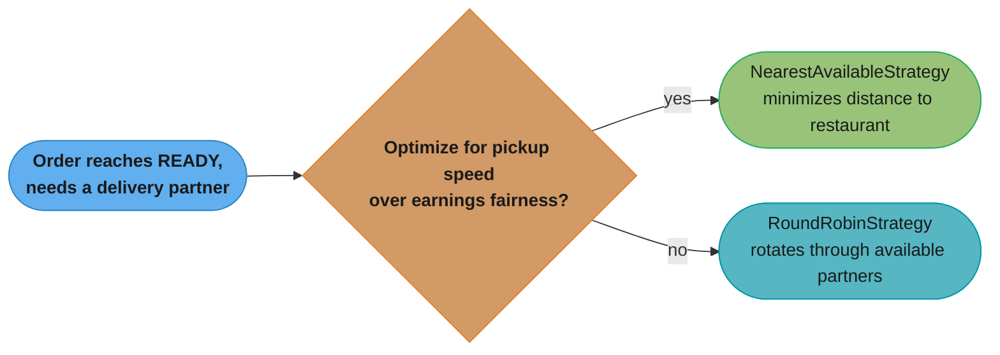
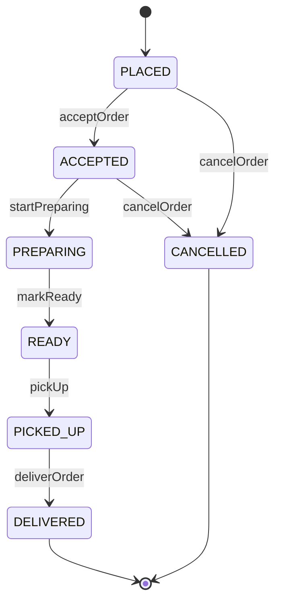
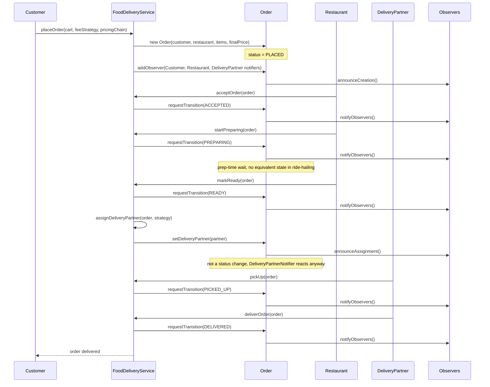

# Food Delivery — Low-Level Design
A three-sided marketplace (customer, restaurant, delivery partner) built around one order that has to survive a kitchen's prep time before anyone can move it.

## Intuition

> **Design intuition**: it is tempting to reach for [`RideSharing.md`](RideSharing.md)'s toolbox unchanged — Strategy for pricing, Observer for status, a guarded state machine for the lifecycle — and that instinct is half right. The pattern *names* repeat; the shapes underneath do not. A ride has two parties who are matched **before** the trip starts and then move together. A food order has three parties who are matched **in stages**: the customer commits first, the restaurant commits second, and the delivery partner isn't even in the picture until there's food to carry. That staged commitment is the whole design — get the lifecycle and the assignment timing right, and the rest (catalogue search, cart, pricing) is bookkeeping.

**Key insight**: pricing here is two patterns wearing one hat, not one. A `DeliveryFeeStrategy` (Strategy) computes a single number — the delivery fee, standard or surge — from distance. Everything after that (tax, a percentage coupon, a flat-amount coupon) is a `PriceCalculator` **Decorator** chain stacked on top of that number. Conflating the two — trying to make surge pricing itself a decorator, or trying to make a coupon a strategy — is the wrong shape and it shows up immediately as a coupon-stacking bug: stack a flat "$20 off" coupon on a $18 order and, without a floor check, the total goes negative before tax even applies. This page's Implementation section walks through exactly that, broken then fixed.

**Full runnable implementation:** [`FoodDelivery.java`](FoodDelivery.java) — 784 lines, one file, `main()` at the bottom. It demonstrates a `RestaurantCatalogue` search/filter, `Cart` checkout wiring a `DeliveryFeeStrategy` (Strategy) into a `PriceCalculator` decorator chain (Decorator), the `OrderStatus` guarded transition table (State) enforcing that cancellation is illegal once `PICKED_UP`, a `DeliveryPartnerAssignmentStrategy` (Strategy) choosing between nearest-available and round-robin, and three independent `OrderObserver`s (Observer) — `CustomerNotifier`, `RestaurantNotifier`, `DeliveryPartnerNotifier` — watching one order's lifecycle from three different vantage points.

---

## Problem Statement

Design an online food delivery service (Swiggy / Zomato / DoorDash / UberEats-style) that supports:
- A catalogue of restaurants, each with a set of cuisines, a rating, and a menu, searchable/filterable by cuisine and minimum rating
- A cart scoped to one restaurant, checked out into an order with a computed price
- Pricing built from a delivery-fee Strategy (standard or surge/distance-based) plus a Decorator chain for taxes and coupons
- An order lifecycle: `PLACED -> ACCEPTED -> PREPARING -> READY -> PICKED_UP -> DELIVERED`, with `CANCELLED` legal only early in that sequence
- Assigning a delivery partner to a ready order via a pluggable strategy (nearest-available vs round-robin)
- Notifying the customer, the restaurant, and the delivery partner independently as the order's status changes

This is scoped as a machine-coding problem: single JVM, in-memory, no database, no framework — the interview signal is the pattern choices and the state machine, not persistence or distributed matching.

---

## Requirements

### Functional
1. Maintain a restaurant catalogue (cuisines, rating, menu) and support `search(cuisine, minRating)`
2. Build a `Cart` scoped to exactly one restaurant; `placeOrder(cart, feeStrategy, pricingChain)` checks it out into an `Order`
3. Compute the final price as `(subtotal + deliveryFee)` run through a caller-supplied chain of `PriceCalculator` decorators (tax, coupons)
4. Walk an order through `acceptOrder -> startPreparing -> markReady -> assignDeliveryPartner -> pickUp -> deliverOrder`
5. Support `cancelOrder` from `PLACED` and `ACCEPTED` only — **not** from `PREPARING` onward, since the kitchen has already committed ingredients and labor by then
6. Assign a delivery partner to a `READY` order using a pluggable strategy (`NearestAvailableStrategy` or `RoundRobinStrategy`)
7. Notify the customer, the restaurant, and the delivery partner independently on every status change relevant to each of them

### Non-Functional
1. Enforce the order state machine — reject invalid transitions (e.g. `PICKED_UP -> CANCELLED`) with a clear error naming both states
2. Delivery-fee strategies and partner-assignment strategies must be swappable per order without modifying `Order` or `FoodDeliveryService`
3. A coupon, or any combination of coupons, must never drive the final price negative — regardless of how the decorator chain is ordered
4. New cuisines, restaurants, coupon types, or assignment strategies should be addable without touching lifecycle or matching logic

---

## Class Diagram

```mermaid
classDiagram
    class Cuisine {
        <<enumeration>>
        NORTH_INDIAN
        CHINESE
        ITALIAN
        MEXICAN
    }

    class OrderStatus {
        <<enumeration>>
        PLACED
        ACCEPTED
        PREPARING
        READY
        PICKED_UP
        DELIVERED
        CANCELLED
        +canTransitionTo(target) boolean
    }

    class Restaurant {
        -cuisines Set~Cuisine~
        -rating double
        -location Location
        -menu List~MenuItem~
    }

    class RestaurantCatalogue {
        -restaurants Map~String,Restaurant~
        +register(Restaurant)
        +search(cuisine, minRating) List~Restaurant~
    }

    class Cart {
        -customer Customer
        -restaurant Restaurant
        -items Map~MenuItem,Integer~
        +addItem(item, qty)
        +subtotal() double
    }

    class Customer { -location Location }
    class DeliveryPartner { -location Location  -available boolean }

    class DeliveryFeeStrategy {
        <<Strategy>>
        +calculateFee(distanceKm) double
    }
    class StandardDeliveryFeeStrategy
    class SurgeDeliveryFeeStrategy

    class PriceCalculator {
        <<interface>>
        +calculate() double
    }
    class BasePriceCalculator
    class PriceDecorator {
        <<abstract>>
        #wrapped PriceCalculator
    }
    class TaxDecorator
    class PercentageDiscountCouponDecorator
    class FlatDiscountCouponDecorator

    class DeliveryPartnerAssignmentStrategy {
        <<Strategy>>
        +assign(available, restaurantLocation) DeliveryPartner
    }
    class NearestAvailableStrategy
    class RoundRobinStrategy

    class OrderObserver {
        <<Observer>>
        +onOrderStatusChanged(Order)
    }
    class CustomerNotifier
    class RestaurantNotifier
    class DeliveryPartnerNotifier

    class Order {
        -status OrderStatus
        -items Map~MenuItem,Integer~
        -deliveryPartner DeliveryPartner
        -finalPrice double
        -observers List~OrderObserver~
        +requestTransition(target)
        +announceAssignment()
    }

    class FoodDeliveryService {
        -catalogue RestaurantCatalogue
        -partners Map~String,DeliveryPartner~
        -orders Map~String,Order~
        +placeOrder(cart, feeStrategy, pricingChain) Order
        +assignDeliveryPartner(order, strategy)
        +cancelOrder(order)
    }

    RestaurantCatalogue "1" --> "*" Restaurant : indexes
    Cart --> Restaurant : restaurant
    Cart --> Customer : customer

    Order --> OrderStatus : status
    Order --> Customer : customer
    Order --> Restaurant : restaurant
    Order --> DeliveryPartner : deliveryPartner
    Order "1" --> "*" OrderObserver : notifies
    OrderObserver <|.. CustomerNotifier
    OrderObserver <|.. RestaurantNotifier
    OrderObserver <|.. DeliveryPartnerNotifier

    DeliveryFeeStrategy <|.. StandardDeliveryFeeStrategy
    DeliveryFeeStrategy <|.. SurgeDeliveryFeeStrategy

    PriceCalculator <|.. BasePriceCalculator
    PriceCalculator <|.. PriceDecorator
    PriceDecorator <|-- TaxDecorator
    PriceDecorator <|-- PercentageDiscountCouponDecorator
    PriceDecorator <|-- FlatDiscountCouponDecorator
    PriceDecorator o-- PriceCalculator : wrapped

    DeliveryPartnerAssignmentStrategy <|.. NearestAvailableStrategy
    DeliveryPartnerAssignmentStrategy <|.. RoundRobinStrategy

    FoodDeliveryService --> RestaurantCatalogue : uses
    FoodDeliveryService "1" --> "*" Order : orchestrates
    FoodDeliveryService ..> DeliveryFeeStrategy : applies
    FoodDeliveryService ..> DeliveryPartnerAssignmentStrategy : applies
```



Four families sit side by side: `OrderStatus` (State — a guarded transition table, not GoF State classes), the two `Strategy` interfaces (`DeliveryFeeStrategy`, `DeliveryPartnerAssignmentStrategy`, deliberately kept separate), the `PriceCalculator` Decorator chain, and the three-member `OrderObserver` family. `FoodDeliveryService` is the only class that touches all of them — everything else has exactly one job.

---

## Patterns Used

### 1. State (guarded transition table) — `OrderStatus`
**Name it precisely**, the same discipline [`RideSharing.md`](RideSharing.md) applies to `RideState`: `OrderStatus.canTransitionTo()` is a `switch (this)` inside an enum, not the GoF State pattern — the seven statuses carry no behavior of their own, only legality rules, so seven handler classes (as [`ATM.md`](ATM.md) builds for its five session phases) would be ceremony around one switch. The rule this table encodes is food-delivery-specific: cancellation is legal from `PLACED` and `ACCEPTED` only, **not** from `PREPARING` onward — narrower than `RideSharing`'s window (`REQUESTED`/`ACCEPTED`/`DRIVER_ARRIVED`), because a ride costs a driver's time to cancel while a food order past `PREPARING` costs the restaurant real ingredients and labor.

**Where:** `OrderStatus` enum + `Order.requestTransition()`.

### 2. Strategy — `DeliveryFeeStrategy` and `DeliveryPartnerAssignmentStrategy` (kept separate)
**Why two Strategy interfaces, not one:** the fee a customer pays and the partner who delivers their food vary independently — a restaurant can be in a surge-priced zone with plenty of idle partners nearby, or a normal-priced zone during a partner shortage. Merging them into one "logistics strategy" would force every fee policy change to also touch matching code, and vice versa.

**How:** `DeliveryFeeStrategy.calculateFee(distanceKm)` returns a dollar amount (`StandardDeliveryFeeStrategy`, `SurgeDeliveryFeeStrategy`). `DeliveryPartnerAssignmentStrategy.assign(availablePartners, restaurantLocation)` returns a `DeliveryPartner` (`NearestAvailableStrategy`, `RoundRobinStrategy`). Neither knows the other exists.

### 3. Decorator — `PriceCalculator` chain
**Why:** tax and coupons are optional, stackable, and order-sensitive line items sitting on top of a number the Strategy already computed — modeling them as more `if` branches inside `FoodDeliveryService.placeOrder()` would make every new coupon type a risky edit to checkout itself.

**How:** `BasePriceCalculator` wraps `subtotal + deliveryFee`. `TaxDecorator`, `PercentageDiscountCouponDecorator`, and `FlatDiscountCouponDecorator` each wrap a `PriceCalculator` and call `wrapped.calculate()` before applying their own adjustment. `FlatDiscountCouponDecorator` clamps its result at `0.0` — see Design Decisions for why that single line is the whole fix for the coupon-stacking bug.

### 4. Observer — `OrderObserver`
**Why:** one status change has to reach three genuinely independent audiences — the customer's app, the restaurant's kitchen display, the delivery partner's app — each caring about a different subset of transitions. Hardcoding three method calls inside every lifecycle method would couple `Order` to all three.

**How:** `Order` holds a `List<OrderObserver>`; every `requestTransition()` call (plus `announceCreation()` and `announceAssignment()`, neither of which is a status change) ends by calling `notifyObservers()`.

| Observer | Reacts to |
|----------|-----------|
| `CustomerNotifier` | Every transition — the customer wants the whole journey |
| `RestaurantNotifier` | `PLACED` (new order alert) and `CANCELLED` (stop cooking) — wider than a single event, unlike `RideSharing`'s `DriverNotifier` |
| `DeliveryPartnerNotifier` | Silent until a partner exists, then `READY`/`PICKED_UP`/`DELIVERED` |

---

## Design Decisions & Tradeoffs

| Decision | Alternative | Reason chosen |
|----------|-------------|---------------|
| Cancellation legal only from `PLACED`/`ACCEPTED` | Legal until `PICKED_UP`, mirroring `RideSharing`'s wider window | Once `PREPARING` starts, the kitchen has committed real ingredients and labor — a later cancel wastes food, not just a partner's idle time |
| `FlatDiscountCouponDecorator.calculate()` clamps at a `0.0` floor | Let every decorator subtract freely and trust the caller to order the chain correctly | A coupon must never leave the restaurant owing the customer money; clamping is correct regardless of decorator order, so it doesn't depend on every caller getting the order right |
| `SurgeDeliveryFeeStrategy` implements `DeliveryFeeStrategy` directly (composition) | Extend `StandardDeliveryFeeStrategy`, the way `RideSharing`'s `SurgePricingFareStrategy` extends `StandardFareStrategy` | Avoids locking surge pricing to one specific base formula — this one can be swapped in wherever `DeliveryFeeStrategy` is expected, with zero coupling to the standard implementation |
| Partner assigned at `READY`, not at order placement | Match a partner immediately, the way `RideSharing` matches a driver at `requestRide()` | A partner's job doesn't start until there's food to carry — matching at placement would idle a partner through the entire `PREPARING` wait, which has no equivalent in ride-hailing |
| `DeliveryPartnerAssignmentStrategy` is its own Strategy, separate from `DeliveryFeeStrategy` | One combined "logistics" strategy | Fee calculation and partner selection are genuinely independent concerns — see Patterns Used above |
| Three separate `OrderObserver`s instead of one `onStatusChanged()` with internal branching | A single `Order.notifyAll()` method with `if/else` per audience | Each audience's reaction set grows independently; a fourth audience (an ops dashboard) is additive, not a rewrite |



Both strategies satisfy the same interface, so a platform can switch per city, per time of day, or per A/B test without touching `Order` or `FoodDeliveryService`.

---

## State / Flow

`OrderStatus.canTransitionTo()` enforces this exact table — both `DELIVERED` and `CANCELLED` are terminal, matching the illegal `PICKED_UP -> CANCELLED` jump rejected in the Sample Output below.



The runtime walkthrough shows the three-sided handoff: the restaurant drives `acceptOrder -> startPreparing -> markReady`, the service assigns a partner independently of any status transition, and the partner drives `pickUp -> deliverOrder`. No single party owns the whole sequence, which is the structural difference from `RideSharing`'s two-sided rider/driver pairing.



---

## Implementation

The full listing is [`FoodDelivery.java`](FoodDelivery.java); this section walks through the two pieces most worth reading closely.

**The guarded transition table** — `OrderStatus.canTransitionTo()` is the single source of legality for every cancellation and every forward step:

```java
enum OrderStatus {
    PLACED, ACCEPTED, PREPARING, READY, PICKED_UP, DELIVERED, CANCELLED;

    public boolean canTransitionTo(OrderStatus target) {
        return switch (this) {
            case PLACED    -> target == ACCEPTED || target == CANCELLED;
            case ACCEPTED  -> target == PREPARING || target == CANCELLED;
            case PREPARING -> target == READY;
            case READY     -> target == PICKED_UP;
            case PICKED_UP -> target == DELIVERED;
            case DELIVERED, CANCELLED -> false; // terminal states
        };
    }
}
```

**The coupon-stacking bug — broken, then fixed.** A flat-amount coupon larger than the order's pre-tax total must never drive the final price negative, no matter where in the decorator chain it sits:

```java
// BROKEN — subtracts with no floor
class FlatDiscountCouponDecorator extends PriceDecorator {
    private final double flatAmount;
    // ...
    @Override
    public double calculate() {
        return wrapped.calculate() - flatAmount;
        // BUG: a $20 coupon on an $18.44 pre-tax total returns -$1.56.
        // TaxDecorator then multiplies a NEGATIVE number by 1.05, making
        // it MORE negative -- the restaurant now owes the customer $1.64.
    }
}
```

```java
// FIXED — clamps at zero, regardless of chain position
class FlatDiscountCouponDecorator extends PriceDecorator {
    private final double flatAmount;
    // ...
    @Override
    public double calculate() {
        return Math.max(0.0, wrapped.calculate() - flatAmount);
    }
}
```

`FoodDelivery.java`'s Order 2 exercises exactly this case — a $20.00 flat coupon against an $18.44 pre-tax total (subtotal $14.00 + a surge-priced delivery fee $4.44) — and the Sample Output below shows the clamped `$0.00`, never a negative number. The fix is one `Math.max` call; the broken version above is teaching material and is not carried into the `.java` file, the same convention [`TaskScheduler.md`](TaskScheduler.md) uses for its lost-wakeup bug.

---

## Sample Output

```
========================================
   Food Delivery System — LLD Demo
========================================

--- Registering restaurants ---
[System] Restaurant registered: Spice Route ([NORTH_INDIAN], rating 4.5) at (2, 3)
[System] Restaurant registered: Dragon Wok ([CHINESE], rating 4.2) at (10, 10)
[System] Restaurant registered: Bella Italia ([ITALIAN], rating 4.8) at (5, 5)
[System] Restaurant registered: Taco Fiesta ([MEXICAN], rating 3.9) at (1, 1)

--- Registering customers ---
[System] Customer registered: Neha at (0, 0)
[System] Customer registered: Vikram at (2, 2)

--- Registering delivery partners ---
[System] Delivery partner registered: Suresh at (2, 2)
[System] Delivery partner registered: Farah at (9, 9)
[System] Delivery partner registered: Om at (3, 4)

--- Searching the catalogue ---
ITALIAN, rating >= 4.0: [Bella Italia]
CHINESE, rating >= 4.5: [] (Dragon Wok is 4.2, filtered out)

--- Order 1: Neha orders from Spice Route ---
  [Customer-Neha] Order ORDER-5001 placed at Spice Route. Estimated total: $30.34
  [Restaurant-Spice Route] New order received: ORDER-5001 (2 line items)
[System] Order ORDER-5001: subtotal $26.50 + delivery $5.61 -> final $30.34 (tax then 10% loyalty discount)

--- Walking order 1 through its lifecycle ---
  [Customer-Neha] Spice Route accepted your order.
  [Customer-Neha] Your food is being prepared.
  [Customer-Neha] Your order is ready and waiting for a delivery partner.
[Match] Nearest available partner: Suresh (distance 1.00 km)
  [Customer-Neha] Your order is ready and waiting for a delivery partner.
  [Partner-Suresh] Assigned to order ORDER-5001 — pick up from Spice Route.

--- Order 2: Vikram orders from Taco Fiesta (surge fee, oversized coupon) ---
  [Customer-Vikram] Order ORDER-5002 placed at Taco Fiesta. Estimated total: $0.00
  [Restaurant-Taco Fiesta] New order received: ORDER-5002 (2 line items)
[System] Order ORDER-5002: subtotal $14.00 + delivery $4.44 = $18.44 pre-discount; $20.00 flat coupon exceeds it, clamped at $0.00 instead of going negative -> final $0.00

--- Walking order 2 through its lifecycle (round-robin assignment, Suresh still busy) ---
  [Customer-Vikram] Taco Fiesta accepted your order.
  [Customer-Vikram] Your food is being prepared.
  [Customer-Vikram] Your order is ready and waiting for a delivery partner.
[Match] Round-robin partner: Farah (distance 11.31 km, not necessarily nearest)
  [Customer-Vikram] Your order is ready and waiting for a delivery partner.
  [Partner-Farah] Assigned to order ORDER-5002 — pick up from Taco Fiesta.

--- Cancelling order 1 after PICKED_UP (expected error) ---
  [Customer-Neha] Suresh picked up your order and is on the way!
  [Partner-Suresh] Picked up order ORDER-5001, heading to Neha.
Caught: Cannot transition order ORDER-5001 from PICKED_UP to CANCELLED.
  [Customer-Neha] Order delivered. Enjoy your meal!
  [Partner-Suresh] Delivered order ORDER-5001.

--- Finishing order 2 ---
  [Customer-Vikram] Farah picked up your order and is on the way!
  [Partner-Farah] Picked up order ORDER-5002, heading to Vikram.
  [Customer-Vikram] Order delivered. Enjoy your meal!
  [Partner-Farah] Delivered order ORDER-5002.

--- Order 3: Neha orders from Dragon Wok, then cancels before ACCEPTED ---
  [Customer-Neha] Order ORDER-5003 placed at Dragon Wok. Estimated total: $28.50
  [Restaurant-Dragon Wok] New order received: ORDER-5003 (1 line items)
  [Customer-Neha] Order ORDER-5003 was cancelled.
  [Restaurant-Dragon Wok] Order ORDER-5003 was cancelled — stand down.
[System] Order ORDER-5003 final status: CANCELLED

========================================
              Demo complete
========================================
```

That is a real run of [`FoodDelivery.java`](FoodDelivery.java) and it is fully deterministic — no `Random`, and `FoodDeliveryService.partners` is a `LinkedHashMap` specifically so the round-robin scan order (registration order: Suresh, Farah, Om) never depends on `String.hashCode()` bucket placement. Two details are worth reading carefully:

**Order 2's round-robin pick is deliberately the far partner, not a coincidence.** Order 1's `assignDeliveryPartner` call marks Suresh unavailable before Order 2 reaches `READY` — the two orders are interleaved in `main()` specifically so `RoundRobinStrategy` has to choose between Farah and Om while Suresh is still busy, landing on Farah (11.31 km) over the much closer Om (3.61 km from Taco Fiesta). That is the point: round-robin optimizes for turn-taking fairness, not proximity.

**`$0.00`, never negative.** Order 2's pre-tax total ($18.44) is smaller than its flat coupon ($20.00); `FlatDiscountCouponDecorator`'s `Math.max(0.0, ...)` floor is what keeps the subsequent `TaxDecorator` from multiplying a negative number and making it worse.

---

## Cross-Perspective: HLD Connections

**HLD View — Where Food Delivery Design Scales to Distributed Systems**

- **Restaurant search -> a real search/discovery service** — `RestaurantCatalogue.search()`'s linear scan over cuisine + rating becomes a query against Elasticsearch or a purpose-built recommendation service at real catalogue sizes, adding relevance ranking, personalization, and open/closed-now filtering that a linear scan can't express.
- **Delivery-partner assignment -> a geospatial dispatch service** — the same jump [`RideSharing.md`](RideSharing.md) describes for driver matching applies here: `NearestAvailableStrategy`'s scan becomes a quadtree/geohash/H3 query against a dedicated proximity service. See [`../../hld/case_studies/design_uber.md`](../../hld/case_studies/design_uber.md) and [`../../hld/case_studies/design_proximity_service.md`](../../hld/case_studies/design_proximity_service.md).
- **Order state machine -> event-sourced order state** — `OrderStatus.canTransitionTo()` enforced in-process becomes an append-only event log at scale, with the "current status" any service reads as a derived projection rather than a single mutable field. See [`../../hld/event_sourcing_cqrs/event_sourcing_cqrs.md`](../../hld/event_sourcing_cqrs/event_sourcing_cqrs.md).
- **Observer -> multi-consumer event fan-out** — `Order.notifyObservers()`'s three in-process listeners become three independent consumer groups on a shared topic (customer push notifications, the restaurant's kitchen display system, and the delivery partner's app), decoupling delivery guarantees per audience. See [`../../hld/message_queues/message_queues.md`](../../hld/message_queues/message_queues.md).

---

## Follow-Up Extensions

1. **Group/scheduled orders** — add a `scheduledFor` field and a background trigger, or extend `Cart`/`Order` to batch multiple customers' orders to one restaurant into a single partner run (a `BatchDeliveryStrategy`).
2. **Real-time partner tracking** — `DeliveryPartner.location` becomes a live-updating field pushed to the customer over WebSocket/SSE once `PICKED_UP`, rather than a fixed coordinate set at registration.
3. **Dynamic menu availability** — a `MenuItem` the kitchen 86s mid-`PREPARING` needs a signal path back into any cart that still references it, and a substitution or partial-refund policy for orders already placed with it.
4. **Multi-restaurant carts** (grocery-style aggregation) — would require relaxing the "`Cart` is scoped to exactly one restaurant" invariant this design holds throughout, likely splitting into one `Order` per restaurant sharing a single checkout and a single delivery partner.
5. **Refunds tied to cancellation** — `cancelOrder()`'s strict `PLACED`/`ACCEPTED` window is a good fit for a no-questions-asked full refund; a `RefundPolicy` (Strategy) is the natural extension for any future case where cancellation legality is loosened.

---

## Interview Questions with Answers

**Q: Why is cancellation legal only from `PLACED` and `ACCEPTED`, narrower than `RideSharing`'s cancellable window?**
**Short:** past `PREPARING` the kitchen has already spent real ingredients and labor, unlike a driver who has only spent idle time.

`RideSharing.md`'s `RideState` allows cancellation through `DRIVER_ARRIVED` because nothing physically irreversible has happened yet — the driver has spent time, not a consumable resource. A food order is different the moment `PREPARING` starts: the kitchen has pulled ingredients, started cooking, and can't "un-cook" a dish the way a driver can simply stop driving. `OrderStatus.canTransitionTo()` encodes that by omitting `PREPARING -> CANCELLED`, `READY -> CANCELLED`, and every later pair entirely — the broken alternative (cancelling a `PICKED_UP` order) is exactly what the Sample Output's caught exception demonstrates.

**Q: Walk through the coupon-stacking bug — why does an unclamped `FlatDiscountCouponDecorator` produce a negative total?**
**Short:** subtracting a flat coupon larger than the running total goes negative, and a later `TaxDecorator` multiplies that negative further.

`Order 2`'s pre-tax total is subtotal $14.00 + surge-priced delivery $4.44 = $18.44. The broken `FlatDiscountCouponDecorator.calculate()` returns `wrapped.calculate() - flatAmount` unconditionally — against a $20.00 coupon, that's `18.44 - 20.00 = -1.56`. If a `TaxDecorator` sits outside it in the chain (as it does in Order 2's pricing), it then computes `-1.56 * 1.05 = -1.64`, and the restaurant now owes the customer money. The fix is one line: `Math.max(0.0, wrapped.calculate() - flatAmount)` — a coupon can reduce the price to zero and no further, regardless of chain position.

**Q: Why does `FlatDiscountCouponDecorator` clamp inside itself rather than validating coupon size against the order total before applying it?**
**Short:** clamping at the point of subtraction is correct no matter what the chain looks like above or below it.

Validating "is this coupon smaller than the current total" at the call site would require the caller to know the running total *before* the decorator that's about to consume it runs — which defeats the point of a decorator chain, where each layer only needs to know about the layer directly beneath it. `Math.max(0.0, ...)` needs no external knowledge and produces the correct answer regardless of whether `FlatDiscountCouponDecorator` is innermost, outermost, or sandwiched between a `TaxDecorator` and a `PercentageDiscountCouponDecorator` — the fix is local to the one class that has the bug, not a discipline every future caller has to remember.

**Q: Why does `SurgeDeliveryFeeStrategy` implement `DeliveryFeeStrategy` directly instead of extending `StandardDeliveryFeeStrategy`, unlike `RideSharing`'s `SurgePricingFareStrategy`?**
**Short:** composition avoids locking surge pricing to one specific base formula, unlike RideSharing's inheritance-based surge.

`RideSharing.md`'s `SurgePricingFareStrategy extends StandardFareStrategy` and calls `super.calculateFare(...)` — which the page itself names as a real limitation: it can only ever surge that one specific formula, with no way to layer the same multiplier onto `PremiumFareStrategy` without duplicating logic. `SurgeDeliveryFeeStrategy` here computes `(baseFee + perKmRate * distanceKm) * surgeMultiplier` entirely on its own, implementing `DeliveryFeeStrategy` fresh — it can be swapped in anywhere a `DeliveryFeeStrategy` is expected, with zero coupling to `StandardDeliveryFeeStrategy`'s implementation, avoiding the exact tradeoff `RideSharing.md` flags as a limitation rather than fixing it.

**Q: Why are `DeliveryFeeStrategy` and `DeliveryPartnerAssignmentStrategy` two separate Strategy interfaces instead of one combined "logistics" strategy?**
**Short:** the fee a customer pays and the partner who delivers vary independently, so merging them couples unrelated changes.

A zone can be surge-priced with plenty of idle delivery partners nearby, or normally priced during a partner shortage — the two concerns don't move together. If a single interface owned both fee calculation and partner selection, a change to the surge-pricing formula would force every implementer to also decide (or re-decide) its partner-assignment behavior, and vice versa. Keeping them separate means `FoodDeliveryService` composes them independently per order — a strategy for "how much does this cost" and a strategy for "who delivers it" — exactly the same separation-of-concerns argument [`RateLimiter.md`](RateLimiter.md) makes for keeping its algorithm Strategy independent of its Factory.

**Q: Why is a delivery partner assigned at `READY`, rather than matched immediately when the order is placed the way `RideSharing` matches a driver at `requestRide()`?**
**Short:** a partner's job doesn't start until there's food to carry, so matching earlier would idle them through the entire PREPARING wait.

`RideSharing.requestRide()` matches a driver at the moment the ride is requested because the ride *is* the driver's job — there's nothing for the driver to do before pickup except drive there. A food order has a genuine gap between "order exists" and "there's something to hand to a partner": `PREPARING` can take anywhere from five to forty-five minutes depending on the dish, during which a partner assigned early would sit idle at the restaurant instead of serving another order. `assignDeliveryPartner()` is called explicitly after `markReady()`, so a partner is only ever committed once there's actually food ready to move — this is the concrete shape of the "prep-time wait" the Intuition section calls out as having no equivalent in ride-hailing.

**Q: Why is partner assignment its own method (`announceAssignment()`) rather than folding into `markReady()`'s transition?**
**Short:** assignment is a separate concern from the READY transition — an order can sit READY with no partner found yet.

`markReady()` calls `Order.requestTransition(READY)`, which is a genuine status change with its own legality check. Assigning a partner is a different kind of event: the order's status doesn't change when a partner is found (it's already `READY` and stays `READY`), so it can't be expressed as a `requestTransition()` call — there's no `READY_WITH_PARTNER` state to transition into. `Order.announceAssignment()` exists specifically to fire `notifyObservers()` for this non-status-change event, which is also exactly why `DeliveryPartnerNotifier` has to check `order.getDeliveryPartner() != null` rather than switching on status alone — the assignment and the status are two independent facts about the order.

**Q: Why is `DeliveryPartnerNotifier` silent for `PLACED`/`ACCEPTED`/`PREPARING`, and how is that different from `RideSharing`'s `DriverNotifier` reacting only to `REQUESTED`?**
**Short:** it isn't a narrow-reaction choice like DriverNotifier — there is genuinely no partner object to notify yet.

`RideSharing`'s `DriverNotifier` reacts only to `REQUESTED` by deliberate design choice — the driver already exists and is simply choosing not to react to states it already caused. `DeliveryPartnerNotifier` here is silent for the same early states for a structurally different reason: `order.getDeliveryPartner()` is genuinely `null` until `assignDeliveryPartner()` runs, so there is no `DeliveryPartner` object to construct a notification about — `onOrderStatusChanged()`'s `if (partner == null) return;` guard isn't filtering *relevance*, it's guarding against a null field that doesn't exist yet. This is the observer-level expression of the same three-sided-handoff difference the Intuition section names.

**Q: Why does `RestaurantNotifier` react to both `PLACED` and `CANCELLED`, when `RideSharing`'s `DriverNotifier` reacts to exactly one event?**
**Short:** a restaurant that's already shopping/cooking for an order genuinely needs the cancellation signal; a driver never needs an equivalent.

`DriverNotifier` only needs `REQUESTED` because a driver's own subsequent actions (`acceptRide`, `arriveAtPickup`, `startRide`) are what drive every later transition — the driver already knows what happened because they caused it, and `IN_PROGRESS` can't be cancelled at all. A restaurant that accepted an order and is midway through `PREPARING` when the *customer* cancels (a legal transition from `ACCEPTED`) needs to actually stop cooking — there's no other party who could have caused that cancellation, so silence would mean wasted food. `RestaurantNotifier` reacting to two events rather than one isn't inconsistency; it's each observer's reaction set being sized to what its audience can and can't already infer.

**Q: Walk through why `RoundRobinStrategy` picks Farah over the much closer Om in the Sample Output.**
**Short:** Suresh is still busy with Order 1 when Order 2's round-robin runs, so it rotates through only the two remaining partners.

`main()` deliberately interleaves the two orders: Order 1 reaches `assignDeliveryPartner(NearestAvailableStrategy)` and marks Suresh unavailable *before* Order 2 reaches `READY`. When Order 2's `RoundRobinStrategy.assign()` runs, the available list is `[Farah, Om]` in `FoodDeliveryService.partners`'s insertion order (a `LinkedHashMap`, chosen specifically for this determinism) — the strategy's internal cursor starts at `0` and picks index `0`, Farah, without ever comparing distances. Om (3.61 km from Taco Fiesta) would have been the obviously better pick by proximity, and `NearestAvailableStrategy` would have chosen him — that gap is the entire point of demonstrating round-robin against a scenario where it visibly disagrees with the nearest-available answer.

**Q: What would the Sample Output show if `RoundRobinStrategy` ran without the interleaving — i.e., after Order 1 fully completes and frees Suresh?**
**Short:** it would pick Suresh, the same partner NearestAvailable would choose, and the two strategies would look indistinguishable.

If Order 1 ran start-to-finish (through `deliverOrder`, which frees Suresh) before Order 2 ever placed, all three partners would be available when Order 2's round-robin runs — the cursor would start at `0` and pick whichever partner is first in insertion order, which happens to be Suresh, who is also genuinely the nearest to Taco Fiesta among the three. The demo would technically still exercise the `RoundRobinStrategy` code path, but it would prove nothing about how the two strategies actually differ, which is exactly why the interleaving in `main()` is deliberate rather than incidental.

**Q: Why is `Cart` scoped to exactly one `Restaurant`, and what breaks if a customer wants items from two restaurants in one checkout?**
**Short:** pricing, prep time, and partner assignment all assume a single kitchen and a single pickup point — splitting that is a bigger redesign than it looks.

`Cart`'s constructor takes both a `Customer` and a `Restaurant`, and every `addItem()` call is implicitly against that restaurant's menu — there is no path in this design for a cart to hold items from two kitchens. The reason it's not a small fix: `DeliveryFeeStrategy.calculateFee()` assumes one `distanceKm` (restaurant to customer), `OrderStatus.PREPARING` assumes one kitchen's prep timeline, and `assignDeliveryPartner()` assumes one pickup location. Supporting a multi-restaurant cart (Follow-Up Extension 4) realistically means splitting it into multiple `Order`s — one per restaurant — sharing a single checkout and, ideally, a single delivery partner making two stops, which is a genuinely different `Order`-to-partner cardinality than this design's one-to-one assumption.

**Q: `RestaurantCatalogue.search()` is a linear scan — why is that acceptable here, and what's the production fix?**
**Short:** fine at demo/interview scale; production replaces it with a search index (Elasticsearch or similar) for relevance and scale.

`search(cuisine, minRating)` iterates every registered restaurant and filters by two conditions — O(n) in catalogue size, which is intentionally simple because an LLD interview's point is the class structure (`RestaurantCatalogue` as the one place discovery logic lives), not a production-grade search engine. At real scale, a platform's catalogue holds tens of thousands of restaurants per city and needs relevance ranking, typo tolerance, and personalization that a linear scan can't express at all — the Cross-Perspective section names Elasticsearch as the production answer, with `RestaurantCatalogue.search()`'s signature (cuisine + rating in, restaurants out) surviving as the interface contract a real search service would fulfill instead.

**Q: How does `OrderStatus.canTransitionTo()` enforced in-process map to distributed order-state coordination at HLD scale?**
**Short:** each transition becomes an immutable event appended to a log; the "current status" any service reads becomes a derived projection.

In this LLD, an order's status is one mutable field on one `Order` object guarded by a switch expression, living entirely in one process's memory. At HLD scale, this becomes event sourcing: every transition (`ACCEPTED`, `PREPARING`, `READY`, ...) is appended as an immutable event to a durable log, and any service that needs "the current status" derives it by replaying or caching those events rather than reading a single shared mutable row that multiple services could race to update — the same mapping [`RideSharing.md`](RideSharing.md) draws for `RideState`. This is what makes a Saga-style compensating action possible if, say, payment capture fails after `ACCEPTED`: the compensation is itself just another event, not a rollback of shared mutable state.

**Q: How does delivery-partner assignment become a real dispatch system at platform scale?**
**Short:** the linear/round-robin scan becomes a geospatial index query against a dedicated proximity service ingesting live partner GPS.

`NearestAvailableStrategy`'s O(n) scan and `RoundRobinStrategy`'s simple rotation both work when the pool of available partners is small — a handful to low hundreds. At city scale with thousands of concurrently available partners, `assign()`'s interface (available partners + restaurant location in, one `DeliveryPartner` out) survives, but its implementation becomes a query against a dedicated proximity service backed by a geospatial index (quadtree, geohash, or H3), continuously updated by a high-volume stream of live partner GPS pings — a genuinely different architecture serving the exact same contract this LLD's Strategy interface already isolates behind `DeliveryPartnerAssignmentStrategy`.

**Q: What's the risk in `MenuItem.price` and `Order.finalPrice` being `double`, and why does this page use `double` anyway?**
**Short:** binary floating point can't represent cents exactly, so repeated arithmetic on price fields can drift from the "real" cent value.

The same risk [`ATM.md`](ATM.md) names for `BankAccount.balance`: `double` cannot exactly represent values like `0.10`, so a long enough chain of additions, tax multiplications, and coupon subtractions can accumulate rounding error that an equality check against an expected total would eventually fail to match. This page uses `double` anyway, consistent with `RideSharing.java`'s fares and `ATM.java`'s balances, because the LLD interview's point is the pattern structure (Strategy, Decorator, State, Observer), not currency-safe arithmetic — the honest production fix is `BigDecimal` with a fixed scale or a `long` count of cents, and naming that fix unprompted is a cheap, easy interview point.

**Q: Why does `Order.requestTransition()` validate through `OrderStatus.canTransitionTo()` itself, rather than `FoodDeliveryService` checking legality before calling into `Order`?**
**Short:** the invariant lives inside the entity that owns it, so every caller anywhere gets the same guard automatically.

If `FoodDeliveryService` were responsible for checking legality before mutating an order's status directly, every future caller — a test, an admin tool, a second orchestrating class — would need to remember to perform that same check itself, and any caller that forgot could silently corrupt the lifecycle (accepting a cancelled order, for instance). Putting the guard inside `Order.requestTransition()` means the invariant holds no matter who calls it — the identical reasoning [`RideSharing.md`](RideSharing.md) gives for `Ride.requestTransition()` and [`LibraryManagement.md`](LibraryManagement.md) gives for keeping its `RESERVED`-copy invariant inside the entity rather than scattered across callers.
