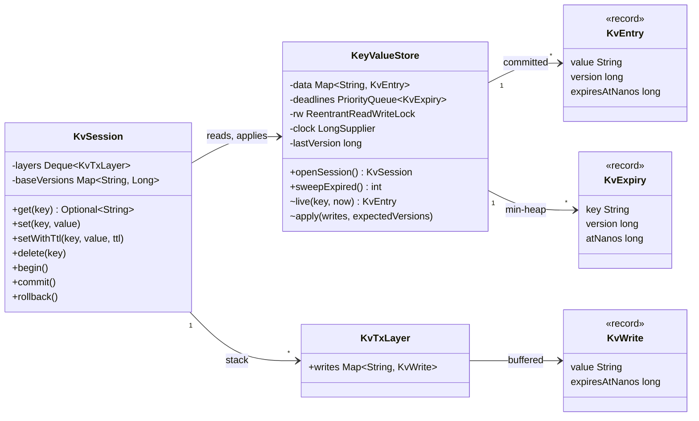
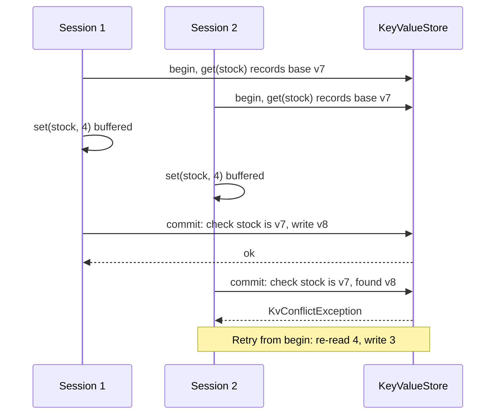

# Design an In-Memory Key-Value Store with Transactions and TTL
A single-process store with `get`/`set`/`delete`, nested `begin`/`commit`/`rollback`, per-key expiry, and optimistic conflict detection between sessions.

## Intuition

> **Design intuition**: a key-value store is a `HashMap` with three promises bolted on. Transactions promise that a group of writes lands all at once or not at all. TTL promises that a key stops existing at a given time. Concurrency promises that two clients cannot silently overwrite each other's read-modify-write. Each promise is one small mechanism: a stack of write buffers, a min-heap of deadlines, and a version number per entry.

**Key insight**: never let uncommitted writes touch the shared map. Buffer them per session in a stack of layers, read through the layers top-down before falling back to the committed map, and apply the outermost layer under one write lock at commit. Rollback then costs nothing: pop the layer and drop it. Nested transactions are just more layers.

**Full runnable implementation:** [`KeyValueStore.java`](KeyValueStore.java), one file, `main()` on `KeyValueStore`. It demonstrates `KvSession` buffering writes in a stack of `KvTxLayer`s (inner commit folds into the parent, inner rollback discards one layer), another session not seeing uncommitted data, lazy TTL expiry on read plus `sweepExpired()` over a min-heap of deadlines that skips stale heap entries by version, and first-committer-wins conflict detection that rejects the second of two concurrent stock decrements. The clock is injected (`KvFakeClock`) so the TTL output is exact.

---

## Problem Statement

Design an in-memory key-value store, used as a library inside one JVM, that supports:

```java
KvSession s = store.openSession();
s.set("balance", "100");
s.setWithTtl("session:42", "alice", Duration.ofSeconds(30));
s.begin();  s.set("balance", "150");  s.begin();  s.delete("balance");  s.rollback();  s.commit();
Optional<String> v = s.get("balance");   // "150"
```

This is a common machine-coding round (sometimes phrased as "implement Redis-like SET/GET with MULTI" or the classic "simple database with BEGIN, ROLLBACK, COMMIT"). It tests data-structure choice, transaction semantics, and concurrency in one small surface.

**Machine-coding time-box.** Per [`system_design_problems.md` §3b](system_design_problems.md), build in order: committed map with `get`/`set`/`delete`; single-level `begin`/`commit`/`rollback` with a write buffer; nested layers; TTL with lazy expiry. Conflict detection and the active sweep are the 70 to 80 minute additions and the first things to name as cut for time.

---

## Requirements

### Functional
1. `get(key)`, `set(key, value)`, `delete(key)`; `get` of a missing key returns empty, never `null`.
2. `setWithTtl(key, value, ttl)`: the key is invisible once `ttl` has elapsed.
3. `begin()`, `commit()`, `rollback()`, nestable to any depth. A nested `commit()` merges into the enclosing transaction; only the outermost `commit()` publishes. `rollback()` discards only the innermost transaction.
4. Writes inside a transaction are visible to that session immediately and to other sessions only after the outermost commit (read committed between sessions, read-your-writes within one).
5. Two sessions that read and then write the same key concurrently must not both succeed silently (no lost update).

### Non-Functional
1. `get` and `set` in O(1) average; commit in O(k) for k keys written; expiry sweep O(log n) per expired key.
2. Thread-safe across sessions; each session is used by one thread at a time.
3. Expired keys must not grow memory without bound: something must eventually remove them.
4. Deterministic tests: time comes from an injected clock, not `System.nanoTime()` directly.

---

## Class Diagram



`KvWrite` with a `null` value is a delete marker (a tombstone inside the transaction), which is what lets an inner `delete` hide a committed key from the session until rollback.

---

## Patterns Used

### 1. Unit of Work: `KvTxLayer`
**Why**: a transaction is a list of intended changes applied together at the end. Buffering them in a map keyed by key also collapses repeated writes to one key into the last one, so a commit of 1,000 updates to one counter applies one write.

**Where it's the wrong fit**: for a write-heavy workload with huge transactions, buffering everything in memory before commit doubles peak memory; a write-ahead log with undo records is the alternative.

### 2. Stack of layers for nested transactions (Memento-like)
**Why**: each `begin()` pushes an empty layer; reads walk layers from innermost to outermost. Rollback restores the previous state by discarding the top layer, without copying the store, which is the property a Memento gives without the snapshot cost. See [Memento](../behavioral/memento/memento.md).

### 3. Optimistic concurrency: versions checked at commit
**Why**: the store assigns a monotonically increasing version to every committed write. A session records the version of each key at first touch inside a transaction; commit fails with `KvConflictException` if any of those versions changed. This is first-committer-wins, the same idea as Redis `WATCH`, a JPA `@Version` column, or a compare-and-set.

**Where it's the wrong fit**: under heavy contention on one hot key (a global counter), most transactions abort and retry; pessimistic locking or a dedicated atomic `incr` operation does better.

### 4. Strategy for time: injected `LongSupplier`
**Why**: TTL logic depends on "now". Passing a clock in makes the 30-second expiry test run in microseconds with an exact result.

---

## Design Decisions & Tradeoffs

### Where uncommitted writes live

| Option | Rollback cost | Read cost | Isolation from other sessions |
|--------|---------------|-----------|-------------------------------|
| Write to the shared map, keep an undo log | O(k) undo | O(1) | None until you add locks: others see dirty data |
| **Per-session buffer layers (chosen)** | O(1) pop | O(depth) layer lookups, then O(1) | Natural: others see only committed data |
| Copy the whole map on `begin()` | O(1) | O(1) | Natural, but `begin()` is O(n) memory and time |

Layer lookups are O(depth), and real nesting depth is small (rarely above 3), so this is effectively O(1).

### Expiry: lazy, active, or both

| Strategy | Memory of dead keys | CPU | Notes |
|----------|---------------------|-----|-------|
| Lazy only (check on read) | Grows forever for keys never read again | None extra | Leaks under write-once keys such as session tokens |
| Active scan of every key | Bounded | O(n) per scan | Too slow at millions of keys |
| **Lazy + min-heap of deadlines (chosen)** | Bounded | O(log n) per expired key | Heap entries for overwritten keys are skipped by version |
| Lazy + random sampling (Redis) | Bounded statistically | Bounded per cycle | Redis samples 20 keys with a TTL per loop, runs the cycle 10 times per second (`hz 10`), and repeats while more than 10% of a sample was expired (`active-expire-effort 1`, the default) |
| Hashed timer wheel | Bounded | O(1) per tick | Best for millions of short, similar TTLs; coarser precision |

Overwriting a key with a new TTL leaves the old heap entry in place. Removing it from a `PriorityQueue` is O(n), so instead each heap entry carries the version it was created for and the sweep ignores entries whose version no longer matches. The cost is a few stale heap entries until their deadline passes.

### TTL computed at write time, not commit time
`setWithTtl` inside a transaction computes `now + ttl` when called. A transaction that stays open for 40 seconds with a 30-second TTL commits an already-expired key, which `get` hides immediately. Computing at commit is the alternative; Redis `MULTI` effectively does that, since queued commands run at `EXEC`. Either is defensible; state which one you chose.

### Isolation level

Between sessions the design gives read committed for single reads, plus first-committer-wins validation for every key the transaction touched. Keys a transaction read are validated, so the classic lost update (two read-modify-writes) is caught. It does not detect phantoms (a predicate such as "count keys with prefix `order:`"), because only individual keys carry versions.

### One store-wide lock

All commits take one `ReentrantReadWriteLock` write lock. That is simple and correct, and commits are short (O(k) map puts). Reads take the read lock and run in parallel. The ceiling is commit throughput on many cores; striping the map into N segments with per-segment locks, acquired in segment order at commit to avoid deadlock, is the next step.

---

## State / Flow



**`get(key)` lookup order**: innermost layer, then each enclosing layer, then the committed map. The first layer that mentions the key wins, including a delete marker, which returns empty. A committed entry past its deadline is treated as absent.

**`commit()`**: pop the top layer. If another layer remains, `putAll` the popped writes into it (newer wins). If it was the outermost, take the write lock, validate every base version, then apply all writes with fresh versions and push deadlines for TTL writes.

---

## Implementation

The listing below is the core of [`KeyValueStore.java`](KeyValueStore.java); the file adds the records, `KvFakeClock` and `main()`.

```java
public Optional<String> get(String key) {
    long now = store.now();
    for (KvTxLayer layer : layers) {                         // innermost first
        KvWrite w = layer.writes.get(key);
        if (w != null) {
            return w.isDelete() || now >= w.expiresAtNanos() ? Optional.empty() : Optional.of(w.value());
        }
    }
    KvEntry e = store.live(key, now);
    if (inTransaction()) baseVersions.putIfAbsent(key, e == null ? 0L : e.version());
    return e == null ? Optional.empty() : Optional.of(e.value());
}

public void commit() {
    KvTxLayer top = popLayer();
    if (!layers.isEmpty()) {
        layers.peek().writes.putAll(top.writes);             // inner commit folds into the parent only
        return;
    }
    try {
        store.apply(top.writes, baseVersions);
    } finally {
        baseVersions.clear();
    }
}
```

```java
void apply(Map<String, KvWrite> writes, Map<String, Long> expectedVersions) {
    rw.writeLock().lock();
    try {
        long now = now();
        for (Map.Entry<String, Long> exp : expectedVersions.entrySet()) {
            KvEntry cur = data.get(exp.getKey());
            long curVersion = cur == null || cur.expiredAt(now) ? 0L : cur.version();
            if (curVersion != exp.getValue()) throw new KvConflictException(exp.getKey());
        }
        for (Map.Entry<String, KvWrite> w : writes.entrySet()) {
            if (w.getValue().isDelete()) { data.remove(w.getKey()); continue; }
            long version = ++lastVersion;
            data.put(w.getKey(), new KvEntry(w.getValue().value(), version, w.getValue().expiresAtNanos()));
            if (w.getValue().expiresAtNanos() != KvEntry.NO_EXPIRY) {
                deadlines.add(new KvExpiry(w.getKey(), version, w.getValue().expiresAtNanos()));
            }
        }
    } finally {
        rw.writeLock().unlock();
    }
}

public int sweepExpired() {
    rw.writeLock().lock();
    try {
        long now = now();
        int removed = 0;
        while (!deadlines.isEmpty() && deadlines.peek().atNanos() <= now) {
            KvExpiry due = deadlines.poll();
            KvEntry e = data.get(due.key());
            if (e != null && e.version() == due.version()) { data.remove(due.key()); removed++; }
        }
        return removed;
    } finally {
        rw.writeLock().unlock();
    }
}
```

Validation runs before any write, so a conflict leaves the store unchanged: the commit is all or nothing.

---

## Sample Output

Output of `java KeyValueStore` on JDK 25:

```
== basic ==
get a -> 1
after delete, get a -> (nil)
== nested transactions ==
inner tx sees balance -> 999
after inner rollback -> 150
other session before commit -> 100
other session after commit -> 150
== TTL ==
t=31s session:42 -> (nil)
t=31s otp:42 -> 731904
stored before sweep = 3
swept = 1, stored after sweep = 2
== optimistic conflict ==
buyer1 committed, stock -> 4
buyer2 rejected: write conflict on key 'stock:sku-1', stock stays 4
```

`stored before sweep = 3` shows lazy expiry: `session:42` is invisible to `get` at t=31s but still occupies memory (`balance`, `session:42`, `otp:42`) until `sweepExpired()` removes it. The last block is the lost update the version check prevents: without it both buyers would write `4` and one sale would vanish from inventory.

---

## Cross-Perspective: HLD Connections

- **Redis** is this design at production scale on one thread: commands run sequentially on an event loop, so there is no lock; `MULTI`/`EXEC` queues commands and runs them together, has no rollback, and `WATCH` gives the same optimistic check as `baseVersions`. See [Redis Internals](../../database/redis_internals/redis_internals.md).
- **Distributed key-value stores** (DynamoDB, etcd, FoundationDB) replace the single lock with partitioning and consensus; etcd's transactions compare revisions exactly like this page's versions. See [Key-Value Stores](../../database/key_value_stores/key_value_stores.md).
- **MVCC databases** keep old versions instead of rejecting conflicts on read, so readers never block; see [Concurrency Control and Locking](../../database/concurrency_control_and_locking/concurrency_control_and_locking.md).

---

## Follow-Up Extensions

1. **Durability**: append every committed write set to a write-ahead log and `fsync` on commit (or every 1 s, as Redis `appendfsync everysec`), replay on startup, and snapshot periodically to bound replay time.
2. **Atomic counters**: `incr(key, delta)` executed under the write lock removes read-modify-write contention for counters without a transaction.
3. **Eviction under a memory cap**: add an LRU or LFU policy when `storedKeys()` exceeds a limit; see [LRUCache](LRUCache.md).
4. **Range scans**: switch `HashMap` to `ConcurrentSkipListMap` (O(log n) point operations) to support `scan(prefix)`.
5. **Snapshot isolation**: keep a short version chain per key so a transaction reads as of its start version and never sees a later commit mid-transaction.

---

## Interview Questions with Answers

**Q: Why buffer transaction writes per session instead of writing to the shared map with an undo log?**
**Short:** Buffering keeps uncommitted data invisible to other sessions and makes rollback a constant-time pop, while writing in place exposes dirty reads and needs an undo pass.

Writing in place means another session can read a value that is later rolled back (a dirty read), unless you add per-key locks held until commit. Rollback then has to replay an undo log in reverse. A per-session buffer is read only by its owner, so isolation from other sessions is automatic, and rollback discards the buffer. The cost is that every read in a transaction first checks the buffer layers, which is a few hash lookups.

**Q: How do nested transactions work, and what does an inner `commit()` actually do?**
**Short:** Each begin pushes a write layer; an inner commit merges its writes into the parent layer and publishes nothing, and only the outermost commit applies to the store.

An inner commit cannot publish, because the outer transaction may still roll back, and rolling back the outer must undo the inner too. So the inner commit folds its map into the parent with `putAll` (newer writes win), and the outermost commit is the single atomic publication. An inner rollback pops only the top layer, restoring exactly the state at the matching `begin()`.

**Q: How does a delete inside a transaction hide a committed key?**
**Short:** The layer stores a delete marker, a write with a null value, and a lookup that finds the marker returns empty before ever reaching the committed map.

Removing the key from the layer would let the read fall through to the committed value, so the delete would appear not to have happened. A tombstone in the layer stops the lookup. At commit the marker becomes `data.remove(key)`. The same idea appears in LSM-tree databases, where deletes are tombstones until compaction.

**Q: What is a lost update, and how does this design prevent it?**
**Short:** Two transactions read the same value and both write a result based on it, so one write is lost; recording each key's version at first touch and rejecting the commit if it changed prevents it.

Both buyers read stock 5 and write 4, and one sale disappears. Each committed write gets a new version from a store-wide counter. A transaction remembers the version of every key it read or wrote, and commit validates all of them under the write lock before applying anything. The second committer sees version 8 instead of 7 and gets `KvConflictException`; it retries from `begin()`, reads 4 and writes 3. Redis `WATCH` and JPA `@Version` work the same way.

**Q: Why use a global version counter rather than a per-key counter?**
**Short:** A per-key counter restarts after delete and re-insert, so a key can return to an old version number; a global counter never repeats a version for any key.

With per-key versions, a key at version 1 that is deleted and re-created starts at version 1 again, and a stale transaction would validate successfully against a value it never saw. The global counter makes every write unique. An absent key is version 0, so delete followed by re-create still changes the version a transaction sees, except when it ends absent again, which leaves the state equal to what the transaction read.

**Q: Why combine lazy expiry with an active sweep?**
**Short:** Lazy expiry alone never frees keys that are never read again, such as session tokens, so memory grows; a sweep removes them without scanning every key.

Lazy expiry checks the deadline on `get` and hides the key, which is cheap and exact for keys that are read. A write-once key that is never read stays in memory forever. The sweep pops deadlines from a min-heap until it reaches one in the future, which costs O(log n) per expired key and nothing for live keys. Redis uses lazy expiry plus a sampling cycle instead of a heap, to keep per-key memory lower.

**Q: What happens to the heap when a key with a TTL is overwritten?**
**Short:** The old heap entry stays; each entry carries the version it was created for, and the sweep skips any entry whose version no longer matches the stored one.

Removing an arbitrary element from `PriorityQueue` is O(n). Leaving it costs a small amount of heap memory until its deadline passes. Without the version check, the sweep would delete the newer value that replaced it, which is a real bug: a session refreshed with a new 30-minute TTL would vanish at the old deadline.

**Q: How does Redis implement the same features?**
**Short:** Redis runs commands on one event-loop thread, queues MULTI commands until EXEC, has no rollback, uses WATCH for optimistic checks, and expires keys lazily plus by periodic sampling.

Because Redis executes commands one at a time, a `MULTI`/`EXEC` block runs without interleaving and needs no lock. A command that fails at run time inside `EXEC` does not roll back the others. `WATCH key` makes `EXEC` return null if the key changed since the watch, which is this design's version check. Expiry is lazy on access plus an active cycle that samples 20 keys with a TTL, 10 times per second by default, repeating while more than 10% of a sample had expired (the `ACTIVE_EXPIRE_CYCLE_ACCEPTABLE_STALE` threshold in `expire.c`).

**Q: What isolation level does this store provide, and what anomaly remains?**
**Short:** Read committed between sessions with first-committer-wins validation on touched keys, which stops lost updates but not phantoms over a key range or predicate.

Other sessions never see uncommitted writes. Every key a transaction reads or writes is validated at commit, so a transaction never commits on top of a changed key. A query such as "count keys starting with `order:`" is not tracked: another session can add a matching key, and the transaction commits a count that is already wrong. Preventing that needs predicate or range locks, or serializable snapshot isolation.

**Q: Why is the clock injected instead of calling `System.nanoTime()`?**
**Short:** So TTL behavior can be tested exactly and instantly; a fake clock advances 31 seconds in one call instead of the test sleeping.

Tests that sleep are slow and flaky near boundaries. With a `LongSupplier` clock, the demo advances 31 seconds and checks that a 30-second key is gone and a 60-second key is not. In production pass `System::nanoTime`, which is monotonic; `System.currentTimeMillis()` can jump backward with NTP corrections and would revive expired keys.

**Q: A transaction calls `setWithTtl(k, v, 30s)` and commits 40 seconds later. What happens?**
**Short:** The deadline was computed at the call, so the key commits already expired and get hides it at once; computing the deadline at commit time is the alternative.

This design computes `now + ttl` when `setWithTtl` runs, so the committed entry is past its deadline and invisible immediately; the next sweep removes it. Redis queues commands inside `MULTI` and runs them at `EXEC`, which behaves like deadline-at-commit. Either choice is valid; the bug is not deciding, so tests catch neither.

**Q: How would you scale commits beyond one write lock?**
**Short:** Stripe the map into N segments with their own locks and acquire the segments a commit touches in a fixed order, so commits on different keys run in parallel without deadlock.

One lock serializes all commits; at a few microseconds per commit that is still hundreds of thousands per second, which is often enough. Beyond that, hash each key to one of, say, 64 segments. A commit sorts its keys' segment numbers, locks them in ascending order (a fixed lock order prevents deadlock), validates and writes, then unlocks. A single-key write locks one segment.

**Q: Why is `KvSession` not thread-safe, and is that a problem?**
**Short:** A session holds one client's transaction state, which has no meaning shared between threads; giving each thread its own session is the same model as a JDBC Connection.

Two threads interleaving `begin`, `set` and `commit` on one session would mix their transactions. Making the session thread-safe would add locking with no correct semantics behind it. The store is the shared, thread-safe object; sessions are cheap, so create one per request or thread, as with a JDBC `Connection` or a Redis client connection inside `MULTI`.

**Q: How would you make committed data survive a crash?**
**Short:** Append each committed write set to a write-ahead log and fsync before acknowledging, replay the log at startup, and take periodic snapshots to bound replay time.

The commit path writes one log record per transaction (all keys, values, deadlines) and calls `fsync` before returning, so an acknowledged commit is on disk. Group commit batches several transactions per `fsync` to cut latency cost. Redis offers the same tradeoff with `appendfsync always`, `everysec` (default, up to one second of loss) and `no`. Snapshots let startup load a recent image and replay only the log tail.

**Q: Which data structure would you use to support `scan(prefix)` or range queries?**
**Short:** A sorted map such as ConcurrentSkipListMap or a B-tree, which gives O(log n) lookups and ordered iteration, instead of a HashMap.

`HashMap` has no order, so a prefix scan reads every key. `ConcurrentSkipListMap.subMap(prefix, prefix + Character.MAX_VALUE)` returns the range directly and supports lock-free concurrent reads. Point operations become O(log n) instead of O(1), so choose it only if range queries are a real requirement. Persistent stores use B-trees (BoltDB, LMDB) or LSM-trees (RocksDB) for the same reason.

---
