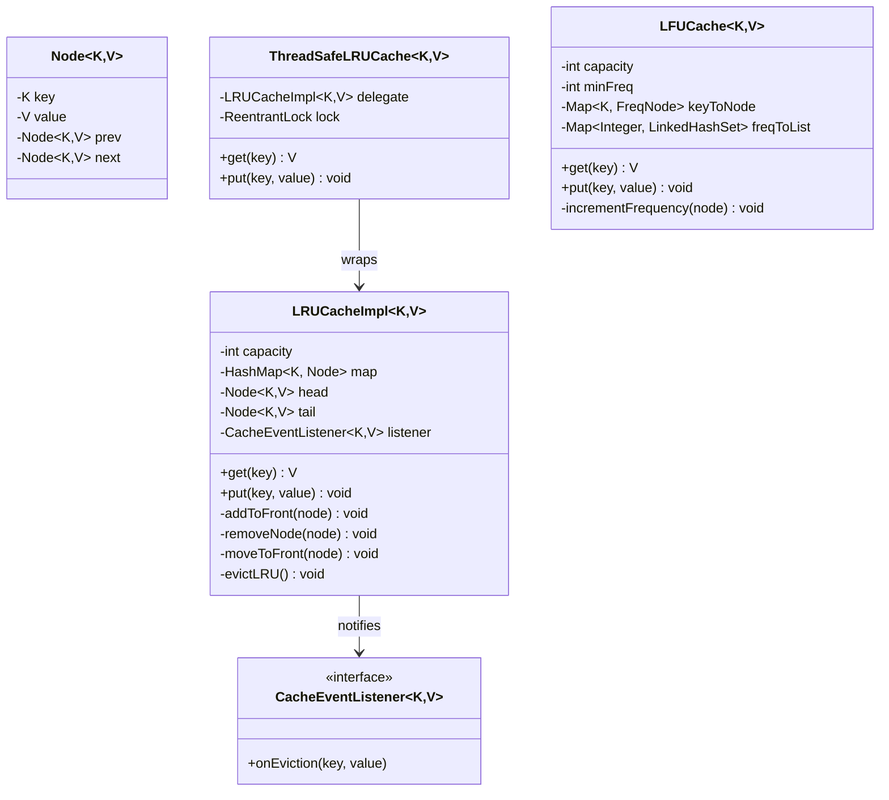
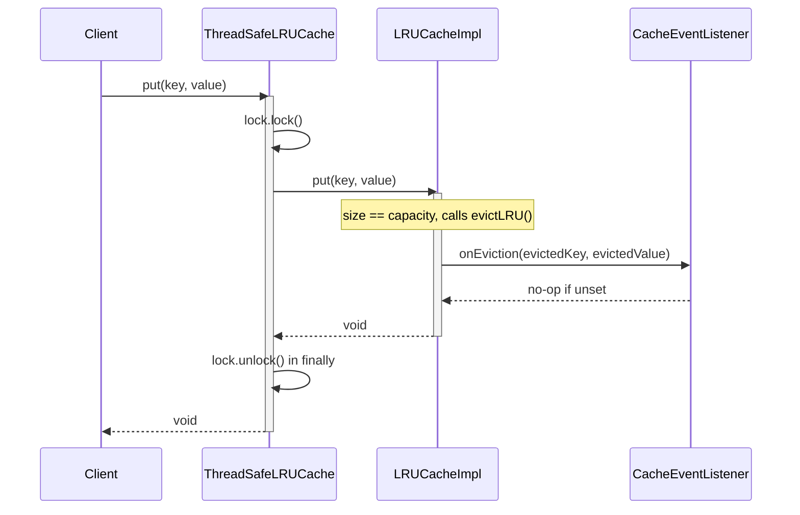
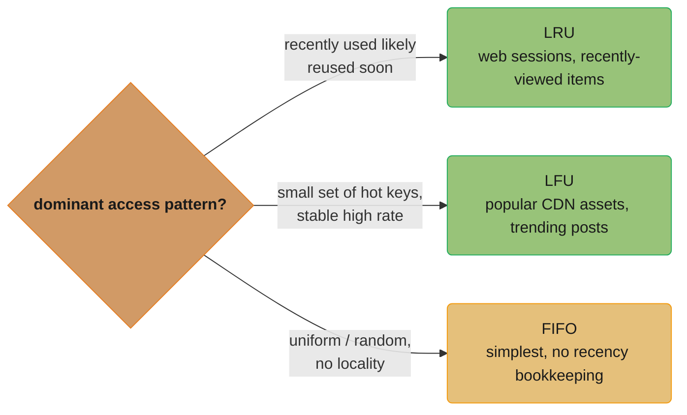
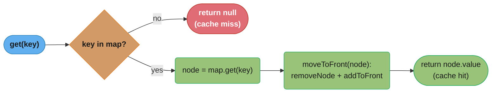
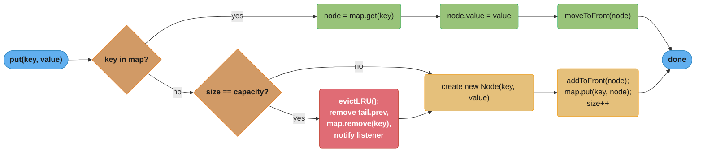

# LRU Cache — Low-Level Design
## Intuition

> **Design intuition**: LRU Cache is the canonical "data structure under pressure" interview question — implement `get(key)` and `put(key, value)` in **O(1)** time for a fixed-capacity cache, evicting the **L**east **R**ecently **U**sed entry when full. Unlike entity-heavy problems (Parking Lot, ATM), there is no sprawling class hierarchy — the entire challenge is choosing the right combination of two data structures and wiring them together correctly.

**Key insight**: Why can't a single `ArrayList` or `LinkedHashMap`-from-scratch solve this in O(1)? A `HashMap` alone gives O(1) lookup but has no notion of order — you can't tell which key was used least recently without an O(n) scan. A plain array/`ArrayList` gives ordering but moving an element to the "most recently used" position requires shifting elements — O(n). A **singly-linked list** gives O(1) insertion at the head, but removing an arbitrary node still requires O(n) traversal to find its predecessor. The fix is a **doubly-linked list** (each node holds `prev` and `next`), combined with a `HashMap<K, Node<K,V>>` that maps each key directly to its node. The HashMap gives O(1) *lookup*; the doubly-linked list's `prev`/`next` pointers give O(1) *removal and re-insertion* — together they give O(1) `get` and `put`. Sentinel `head`/`tail` nodes eliminate null-checks at the list boundaries.

**Full runnable implementation:** [`LRUCache.java`](LRUCache.java) — 463 lines, one file, `main()` at the bottom. It demonstrates `LRUCacheImpl` as a hand-built `HashMap` plus doubly-linked list, `ThreadSafeLRUCache` wrapping it as the decorator, `LFUCache` as the frequency variant, and a `CacheEventListener` fired on eviction.

---

## Problem Statement

Design an in-memory cache with a fixed capacity that:
- Stores key-value pairs of generic types `<K, V>`
- Supports `get(key)` — returns the value and marks the key as most recently used, or returns "not found" if absent
- Supports `put(key, value)` — inserts or updates a value and marks it as most recently used
- When the cache is full and a new key is inserted, evicts the **least recently used** entry automatically
- Both operations run in **O(1)** average time, including the eviction
- Optionally supports **thread-safe** access for concurrent readers/writers
- For comparison, also implement an **LFU (Least Frequently Used)** variant — same interface, different eviction policy, useful for workloads with stable "hot keys" rather than recency-based access patterns

---

## Requirements

### Functional
1. `get(K key)` — O(1) lookup; returns the value or a "miss" indicator; promotes the key to most-recently-used (MRU)
2. `put(K key, V value)` — O(1) insert/update; promotes the key to MRU; if a new key arrives at full capacity, evict the LRU entry first
3. Recency must be updated on **both** `get` and `put` — any access counts as "use"
4. Capacity is fixed at construction time and cannot be exceeded
5. Optional: notify listeners when an entry is evicted (for metrics/logging)

### Non-Functional
1. O(1) time for `get`, `put`, and eviction — no scans, no sorting
2. Generic `<K, V>` — works for any key/value types (subject to `equals`/`hashCode` correctness)
3. Thread-safety must be **opt-in** via composition, not baked into the core class (so single-threaded callers pay no locking overhead)
4. Memory overhead bounded by O(capacity) — exactly `capacity` nodes plus `capacity` HashMap entries, never more

---

## ASCII Class Diagram



`LRUCacheImpl` pairs a `HashMap` (O(1) lookup) with a doubly-linked list of `Node` sentinels (O(1) reorder/evict), and optionally notifies a `CacheEventListener` on eviction. `ThreadSafeLRUCache` decorates it with a `ReentrantLock` around `get`/`put`, released in a `finally` block; `LFUCache` is a separate, unrelated implementation with its own frequency-bucket fields — it shares no code or interface with `LRUCacheImpl`.

**Doubly-linked list layout** — the list order *is* the recency order, so no separate timestamp or counter is needed:

```
head <-> [MRU] <-> ... <-> [LRU] <-> tail
 ^                                    ^
 |                                    |
most recently used    least recently used
  (evicted last)          (evicted first)
```

`head` holds the most-recently-used node (evicted last); `tail` holds the least-recently-used node (evicted first) — every `get`/`put` relinks the accessed node to sit just after `head`.

---

## Patterns Used

This problem is fundamentally a **data structure** problem, not a pattern catalogue — the core `LRUCacheImpl<K,V>` is a hand-rolled algorithm (HashMap + doubly-linked list), not a GoF pattern. (It is named `LRUCacheImpl` in code only because the top-level demo class is itself called `LRUCache` — Java forbids two top-level types with the same name in one file.) Two patterns earn their place honestly around the edges:

### 1. Decorator — `ThreadSafeLRUCache<K,V>` wraps `LRUCacheImpl<K,V>`
**Why**: Most callers (single-threaded contexts, unit tests) don't need locking, and locking every `get`/`put` would add unconditional overhead. We also don't want two near-duplicate implementations of the eviction logic — one of which would inevitably drift out of sync with the other.

**How**: `ThreadSafeLRUCache<K,V>` holds a reference to a plain `LRUCacheImpl<K,V>` (composition, not inheritance) and a `ReentrantLock`. Every `get`/`put` acquires the lock, delegates to the wrapped cache, then releases the lock in a `finally` block. The core cache class is never modified — this is the Open/Closed Principle in action: new behavior (thread safety) added without touching existing, tested code.

---

### 2. Observer — `CacheEventListener<K,V>` for eviction notifications
**Why**: Production caches are routinely instrumented — metrics dashboards track eviction rate to size capacity correctly, and some systems need to know when a value is evicted so they can flush it to a slower backing store (write-back caching). Hard-coding `System.out.println` or a metrics call inside `evictLRU()` would couple the cache to a specific monitoring system.

**How**: `LRUCacheImpl<K,V>` optionally holds a single `CacheEventListener<K,V>` (set via constructor or setter). When `evictLRU()` runs, it calls `listener.onEviction(key, value)` before removing the node. The listener is a no-op by default (`null`-checked), so callers who don't care pay zero cost.

**Runtime collaboration** — a `put` that both requires locking (Decorator) and triggers an eviction (Observer) in one call:



The lock is held for the entire delegated `put` — including the eviction and notification — and released in a `finally` block so it unlocks even if `put` throws; `onEviction` fires synchronously before `put` returns, so a write-back listener can safely assume the evicted value is still valid at notification time.

---

### Why not Strategy / Template Method for eviction policy?
A `Strategy`-based `EvictionPolicy` interface (pluggable LRU/LFU/FIFO inside one `Cache<K,V>` class) is tempting, but it is **not** what this exercise demonstrates honestly: LRU's O(1) guarantee depends on the doubly-linked list being the *primary* data structure, while LFU's O(1) guarantee depends on frequency buckets being primary. Forcing both behind one `EvictionPolicy.onAccess(node)` interface either (a) leaks the internal node representation across the abstraction boundary, or (b) forces a common, slower data structure (e.g., a sorted structure, O(log n)). For interview purposes, presenting `LRUCache` and `LFUCache` as **two separate, complete implementations** that share an informal interface (`get`/`put`) is more honest about the real tradeoff — and is exactly how production libraries (Caffeine, Guava) treat them: different eviction algorithms are different cache builders, not interchangeable strategy objects on one engine.

---

## Design Decisions & Tradeoffs

| Decision | Alternative | Reason chosen |
|----------|-------------|---------------|
| Hand-rolled `HashMap` + doubly-linked list | Java's built-in `LinkedHashMap` with `removeEldestEntry` override | `LinkedHashMap` solves this in ~15 lines and is production-correct — but interviewers want to see the manual pointer manipulation that proves you understand *why* it's O(1) |
| Sentinel `head`/`tail` nodes (dummy, never hold real data) | Track `head`/`tail` as nullable references with null-checks everywhere | Sentinels eliminate ~6 special-case branches (empty list, single node, removing head/tail) — every `addToFront`/`removeNode` call is unconditional pointer surgery |
| `HashMap<K, Node<K,V>>` (map to node references) | `HashMap<K, V>` + separate list, scan list to find node by key | O(1) vs O(n) — without a direct node reference, "move this key to MRU" requires an O(n) search through the list |
| LRU eviction (recency-based) | LFU (frequency-based) / FIFO (insertion-order) | **LRU** fits workloads with *temporal locality* — recently-used data is likely to be reused soon (web sessions, recently-viewed products). **LFU** fits workloads with a small set of "hot keys" accessed at a stable high rate regardless of recency (popular CDN assets, trending posts) — a single burst of unrelated accesses won't evict the hot key under LFU but would under LRU. **FIFO** is simplest (no recency tracking at all) — acceptable when access patterns are uniform/random and the eviction-quality difference doesn't justify the bookkeeping cost |
| `ReentrantLock` around a plain `LRUCache` (Decorator) | `synchronized` methods on `LRUCache` directly | `ReentrantLock` supports `tryLock()` with timeout (fail fast under contention), is `Decorator`-friendly (wraps without modifying), and avoids paying lock overhead for single-threaded callers. `synchronized` is simpler but bakes locking into the core class permanently |
| `ReentrantLock` / `synchronized` (pessimistic) | Lock-free CAS-based structures (e.g., `ConcurrentHashMap` + atomic pointer swaps) | CAS-based doubly-linked lists are notoriously hard to get correct (ABA problem, concurrent removal races) and rarely worth it — `ConcurrentLinkedHashMap`-style designs (used by Guava/Caffeine) instead use **striped locks** or amortize recency tracking via a sampled/approximate LRU, trading strict ordering for throughput |

**Choosing an eviction policy** — the access-pattern question the LRU-vs-LFU-vs-FIFO row above answers visually:



A single burst of unrelated accesses evicts the wrong key under LRU if the real hot set is frequency-based (and vice versa) — picking the axis that matches the workload's actual locality is the interview-defensible answer, not a default reach for LRU.

---

## State / Flow

### `get(key)`



A cache hit (green) relinks the node to just after `head` in O(1) before returning; a cache miss (red) returns immediately with no list mutation — recency is updated on every hit, never on a miss.

### `put(key, value)`



The **update** branch (green) never touches capacity or eviction; the **insert** branch forks again on `size == capacity`, evicting the LRU tail (red) only when the cache is actually full before constructing and registering the new node (gold).

---

## Sample Output

```
========================================
   LRU Cache — LLD Demo
========================================

--- LRUCache (capacity = 3) ---
put(1, "A")  -> cache: [1=A]
put(2, "B")  -> cache: [2=B, 1=A]
put(3, "C")  -> cache: [3=C, 2=B, 1=A]
get(1)       -> "A"   | cache: [1=A, 3=C, 2=B]
             -> EVICTED key=2 (value=B)
put(4, "D")  -> cache: [4=D, 1=A, 3=C]
get(2)       -> null (miss, was evicted)
get(3)       -> "C"   | cache: [3=C, 4=D, 1=A]

--- ThreadSafeLRUCache (capacity = 2, 4 threads) ---
[thread] put(10, "X")
[thread] put(20, "Y")
[thread] get(10) -> "X"
[listener] EVICTED key=20 (value=Y)
[thread] put(30, "Z")
Final state: [30=Z, 10=X]   (no corruption under concurrent access)

--- LFUCache (capacity = 3) ---
put(1, "A")  -> freq{1=[1]}
put(2, "B")  -> freq{1=[1, 2]}
put(3, "C")  -> freq{1=[1, 2, 3]}
get(1)       -> "A"  | freq{1=[2, 3], 2=[1]}
get(1)       -> "A"  | freq{1=[2, 3], 3=[1]}
             -> EVICTED key=2 (value=B, was least frequently used)
put(4, "D")  -> freq{1=[3, 4], 3=[1]}

--- LRU vs LFU contrast (same operation sequence, both caches live) ---
Sequence: put 1,2,3 | get(1) x3 | get(2) | get(3) | put(4)
  LRU  evicted key=1 (least *recently* used)
  LFU  evicted key=2 (least *frequently* used)
  LRU final: [4=D, 3=C, 2=B]
  LFU final: freq{1=[4], 2=[3], 4=[1]}
LRU discarded the most-frequently-used key because two one-off
accesses pushed it to the tail — exactly the case LFU is built for.

========================================
              Demo complete
========================================
```

The contrast block feeds **both** caches the identical operation sequence and prints the key each one actually evicted, rather than asserting what the other policy "would" do. It is deliberately chosen so the two disagree: after `get(1)` three times key 1 has frequency 4, but the two trailing one-off accesses `get(2)`/`get(3)` push it to the LRU tail, so **LRU throws away the hottest key** while LFU keeps it and drops key 2. On the earlier `LFUCache` sequence above (`put 1,2,3; get(1); get(1)`) the two policies would in fact agree on evicting key 2 — a contrast needs a pattern that separates recency from frequency.

The `ThreadSafeLRUCache` block submits four tasks to a four-thread pool, so its line ordering is a valid interleaving, not a guaranteed one; only the final state and the absence of corruption are invariant.

---

## Cross-Perspective: HLD Connections

**HLD View — Where LRU Cache Design Scales to Distributed Systems**

- **In-process LRU -> distributed cache eviction** — This exact node + map structure is the building block inside Redis's and Memcached's per-shard memory managers. At HLD scale, exact LRU becomes too expensive (maintaining a strict doubly-linked list across millions of keys means every `GET` triggers a write to update recency) — so Redis uses **approximated LRU**: it samples a small set of keys and evicts the oldest among the sample. See `../../hld/caching/caching.md` for eviction policies (LRU, LFU, random, TTL) at the distributed-cache layer.
- **Cache-aside / read-through patterns** — The `get`-miss-then-`put` pattern in this LLD maps directly to the cache-aside pattern at HLD scale: application checks cache, on miss reads from the database and populates the cache. See `../../database/database_caching_patterns/database_caching_patterns.md` for read-through, write-through, and write-back variants applied to database-backed caches.
- **CDN edge-cache eviction** — CDN edge nodes run LRU/LFU-style eviction on cached assets (images, video segments) with capacity measured in disk space rather than entry count — the same "evict least-valuable item to make room" logic, just with variable-sized entries instead of fixed-size nodes.
- **Cache stampede / thundering herd** — A related production concern: when a hot key is evicted (or expires) under high concurrent load, many requests simultaneously miss the cache and hit the backing store at once, potentially overwhelming it. Mitigations (request coalescing, probabilistic early expiration, locks on cache-fill) are covered in `../../hld/caching/caching.md`.

---

## Follow-Up Extensions

1. **LFU with O(1) operations** — already implemented in `LFUCache<K,V>` below using a frequency-to-key-list map plus a `minFreq` pointer; the classic LeetCode 460 approach.

2. **LRU-K** — instead of evicting based on the single most-recent access, track the timestamp of the *K-th* most recent access per key (e.g., LRU-2). This prevents a single one-off access from artificially promoting a rarely-used key to MRU — used in database buffer pool management (e.g., PostgreSQL's variant).

3. **TTL-based expiry combined with LRU** — each `Node<K,V>` gains an `expiresAt` timestamp; `get` checks expiry before returning (lazy expiration) and a background sweep thread can proactively evict expired entries even if capacity isn't reached (active expiration), mirroring Redis's hybrid lazy + active expiry.

4. **Write-back vs write-through cache** — write-through writes to the backing store synchronously on every `put` (simple, consistent, slower); write-back buffers writes in the cache and flushes to the backing store asynchronously or on eviction (faster, risk of data loss on crash) — the `CacheEventListener.onEviction` hook is exactly where a write-back flush would be triggered.

5. **Distributed LRU cache coordination** — when the cache is sharded across multiple nodes (consistent hashing to pick the shard per key), each shard runs its own local LRU independently. Global LRU ordering across shards is generally not maintained — instead, each shard's capacity is sized proportionally, and cross-node consistency (if needed) is handled via invalidation messages (pub/sub) rather than a shared linked list.

---

## Interview Questions with Answers

**Q: Why not just use Java's `LinkedHashMap` with a `removeEldestEntry` override, since it solves LRU in ~15 lines?**
**Short:** `LinkedHashMap` is production-correct, but interviewers want to see the manual pointer manipulation.

`LinkedHashMap` with access-order iteration and an overridden `removeEldestEntry` genuinely does solve this problem correctly and concisely — it's the right answer for production code. But an LLD interview is testing whether you understand *why* the operations are O(1), which means demonstrating the manual `HashMap` + doubly-linked-list wiring yourself rather than delegating it to a library that hides the pointer surgery. Reach for `LinkedHashMap` in real code; reach for the hand-rolled version when the point of the exercise is proving you understand the mechanism underneath it.

**Q: Why does `get()` need to mutate the list (`moveToFront`) even though it looks like a pure read?**
**Short:** LRU eviction order depends on recency, and a `get()` that doesn't count as a "use" defeats the policy.

The whole point of Least *Recently* Used is that any access — read or write — resets a key's position in the recency ordering, so `get()` promoting the accessed node to the front (via `removeNode` + `addToFront`) is not an incidental side effect, it's the core mechanism that makes eviction choose correctly. If `get()` didn't update recency, a frequently-read but never-written key would silently drift toward the tail and get evicted despite being the most valuable entry in the cache. This is exactly the requirement the page states outright: "Recency must be updated on both `get` and `put` — any access counts as use."

**Q: Why `HashMap<K, Node<K,V>>` — mapping keys to node references — instead of `HashMap<K, V>` plus a separate list scanned for the key?**
**Short:** a direct node reference makes "move to front" O(1); scanning the list for a key by value would be O(n).

Without a direct pointer from key to its exact list node, "promote this key to MRU" requires an O(n) linear search through the list to even *find* the node before you can move it — defeating the O(1) requirement entirely. Storing `Node<K,V>` references in the map means `get(key)` and `put(key, value)` both go straight from the map lookup to the exact list position that needs relinking, with the map giving O(1) lookup and the doubly-linked list's `prev`/`next` pointers giving O(1) removal and reinsertion. This pairing — map for lookup, list for order — is the entire idea the problem is built to teach.

**Q: What do the sentinel `head`/`tail` nodes eliminate, and why not just use nullable references with null-checks?**
**Short:** sentinels remove ~6 special-case branches for empty list, single node, and removing the head or tail.

Without dummy sentinel nodes, `addToFront`/`removeNode` need explicit branches for "list is empty," "list has exactly one node," "removing the current head," and "removing the current tail" — each a different pointer-update path that's easy to get subtly wrong. `head` and `tail` are permanent dummy nodes that never hold real data, so every real node always has a genuine `prev` and `next` to relink against, making every `addToFront`/`removeNode` call unconditional pointer surgery with no special cases at all. This is a small technique with outsized payoff in an interview setting, since sentinel-related off-by-one bugs are one of the most common ways candidates lose points on this exact problem.

**Q: Why is `ThreadSafeLRUCache` a Decorator wrapping `LRUCacheImpl` instead of adding `synchronized` directly to the core class?**
**Short:** locking every call unconditionally would tax single-threaded callers who never asked to pay for it.

Baking `synchronized` into `LRUCacheImpl` itself means every caller pays lock-acquisition overhead on every `get`/`put`, even single-threaded test code or a single-threaded caller that will never contend for the lock. Wrapping the unmodified core class in `ThreadSafeLRUCache`, which acquires a `ReentrantLock`, delegates, and releases in `finally`, makes thread-safety strictly opt-in — callers who don't need it use `LRUCacheImpl` directly and pay zero locking cost, while callers who do need it wrap once. It also avoids two independently-maintained eviction implementations (a synchronized one and an unsynchronized one) drifting out of sync over time, since there's only ever one eviction algorithm, decorated.

**Q: Why wasn't a single `EvictionPolicy` Strategy interface used to unify LRU and LFU behind one `Cache<K,V>` class?**
**Short:** LRU's O(1) guarantee needs the linked list as primary structure; LFU's needs frequency buckets as primary — incompatible.

LRU's correctness and performance depend on the doubly-linked list *being* the primary data structure that encodes recency order; LFU's depend on frequency-to-key buckets *being* the primary structure that encodes access-count order. Forcing both behind one `EvictionPolicy.onAccess(node)` interface either leaks the internal node representation across the abstraction boundary, or forces both algorithms down to a shared, slower structure (e.g., something sorted, O(log n)) neither actually needs on its own. Presenting them as two separate, complete implementations sharing only an informal `get`/`put` interface is more honest about the real tradeoff, and matches how production libraries like Caffeine and Guava treat different eviction algorithms as different cache builders rather than interchangeable strategies on one engine.

**Q: Where exactly does `CacheEventListener.onEviction` fire relative to node removal, and why does that ordering matter for a write-back cache?**
**Short:** `onEviction` fires before the node is actually removed, so the listener sees a value that's still valid.

`evictLRU()` calls `listener.onEviction(key, value)` before removing the tail node from the map and list, meaning any listener implementing write-back caching (flushing the evicted value to a slower backing store) can safely read and use the value at notification time, since it hasn't been discarded yet. If the ordering were reversed — remove first, notify second — a write-back listener would need the cache to have retained the value somewhere else just to hand it to the listener, adding complexity for no benefit. The sequence diagram in this page makes the ordering explicit: `onEviction` is synchronous and completes before `put()` itself returns to its caller.

**Q: Why does the thread-safe wrapper use `ReentrantLock` instead of `synchronized` methods directly on `LRUCache`?**
**Short:** `ReentrantLock` supports `tryLock()` with a timeout and composes naturally with the Decorator wrapper.

`ReentrantLock` offers `tryLock(timeout)` for fail-fast behavior under contention, which plain `synchronized` cannot express — a caller can choose to give up rather than block indefinitely waiting for the lock. It's also inherently Decorator-friendly: the lock lives on the wrapper object and wraps a delegate call, whereas `synchronized` would need to be a modifier baked directly onto the core class's methods, which is exactly what the Decorator approach is trying to avoid. `synchronized` is simpler to read, but it bakes locking into the core class permanently rather than keeping it strictly opt-in.

**Q: Walk the LRU vs LFU contrast in the Sample Output — why do the two policies disagree on which key to evict from the identical operation sequence?**
**Short:** `get(1)` three times gives key 1 the highest frequency, but two trailing one-off accesses push it to the LRU tail.

After `put(1,2,3)` and `get(1)` three times, key 1 has accumulated a frequency of 4 — the hottest key by far. But the sequence continues with `get(2)` and `get(3)`, and under pure recency ordering those two one-off accesses each push whatever they touch to the front, sliding key 1 further toward the tail with every subsequent access that isn't itself. When `put(4)` triggers eviction, LRU looks only at recency and discards key 1 — the *most frequently used* key — while LFU looks only at frequency and correctly keeps key 1, evicting key 2 instead. This is the textbook failure mode LFU exists to fix: a burst of unrelated accesses can evict a genuinely hot key under pure recency-based eviction.

**Q: What is LRU-K, and what problem does it solve that plain LRU (LRU-1) doesn't?**
**Short:** LRU-K tracks the K-th most recent access per key, preventing a single access from over-promoting a cold key.

Plain LRU promotes a key to most-recently-used on its very first access, meaning a single one-off read of a rarely-used key can push out a genuinely hot key that simply hasn't been touched in the last few milliseconds. LRU-K (commonly LRU-2) instead tracks the timestamp of the *K-th* most recent access, so a key needs to be accessed at least K times before it's treated as truly "recently used" in the eviction ordering — a single access doesn't artificially inflate its priority. This is used in database buffer-pool management (PostgreSQL's variant is a well-known example) precisely because database access patterns include a lot of one-off scans that shouldn't be allowed to evict genuinely hot pages.

**Q: What's the memory bound for `LRUCacheImpl`, and can it ever exceed O(capacity)?**
**Short:** exactly `capacity` nodes plus `capacity` HashMap entries — no more, by the non-functional requirement itself.

The design's non-functional requirement states memory overhead must be bounded by O(capacity) — exactly `capacity` `Node` objects and `capacity` `HashMap` entries, never more, since every `put()` that would exceed capacity evicts one entry first. This holds as long as `evictLRU()` runs correctly on every over-capacity `put` and the map and list stay in sync (an entry never exists in one without the other), which the sentinel-node design and the coupled `addToFront`/`map.put` calls in `put()` guarantee by construction. It would only be violated by a bug — e.g., an eviction that removes the list node but forgets to remove the corresponding map entry, silently leaking memory unbounded by `capacity`.

**Q: How would you add TTL-based expiry on top of LRU eviction?**
**Short:** give each `Node` an `expiresAt` field; check it lazily on `get` and optionally sweep it actively in the background.

Each `Node<K,V>` gains an `expiresAt` timestamp set at insertion, and `get()` checks it before returning a value — if expired, treat it as a miss and evict the node immediately (lazy expiration), mirroring how many caches only pay the expiry-check cost when a key is actually requested. A background sweep thread can additionally scan for and proactively remove expired entries even before they're requested (active expiration), reclaiming memory for keys that expire but are never looked up again. Redis uses exactly this hybrid — lazy expiration on access, plus a periodic active sweep — because lazy-only expiration can leave large amounts of dead memory for keys nobody ever asks about again.

**Q: Why does Redis use approximated LRU instead of this exact doubly-linked-list approach at scale?**
**Short:** maintaining a strict linked list across millions of keys means every GET writes to update recency — too expensive.

The exact LRU structure in this LLD requires every `get()` to mutate the list to reflect the new recency order, which is fine for one process's in-memory cache but becomes prohibitively expensive when a single logical cache holds millions of keys — every read becoming a write against a shared ordering structure is a serialization bottleneck at that scale. Redis instead samples a small random set of keys and evicts the *oldest among the sample*, trading strict exactness for throughput; the approximation gets close to true LRU behavior statistically without paying the cost of maintaining a global, exactly-ordered structure. This is the same "exact vs. approximate" tradeoff the section's Rate Limiter and Splitwise problems name explicitly for their own algorithms — exactness has a real, quantifiable cost that production systems routinely trade away.

**Q: How does the `get`-miss-then-`put` pattern in this LLD map to a distributed cache-miss flow at HLD scale?**
**Short:** it's the cache-aside pattern — check cache, on miss read the database, then populate the cache before returning.

The exact sequence this LLD's cache exhibits — check for the key, and if absent, the caller is responsible for fetching the real value and calling `put()` to populate it — is precisely the cache-aside (lazy-loading) pattern used at HLD scale in front of a database: application checks the cache, on a miss reads from the database, then writes the result into the cache before returning it to the caller. The main risk this pattern introduces at scale that a single in-process LRU doesn't have to worry about is the *cache stampede*: if a hot key expires or is evicted under high concurrent load, many requests can simultaneously miss and hammer the backing store at once. Mitigations for that — request coalescing, probabilistic early expiration, locks on cache-fill — sit one layer above the eviction algorithm itself.

**Q: How is cross-shard eviction ordering typically handled (or not handled) in a distributed LRU cache?**
**Short:** it generally isn't maintained globally — each shard runs its own independent LRU sized proportionally.

When a cache is sharded across multiple nodes via consistent hashing, each shard holds a disjoint subset of keys and runs its own local LRU (the exact structure from this LLD) entirely independently — there is no attempt to maintain one global recency ordering across shards, because doing so would require coordinating every access across the network, defeating the purpose of sharding for throughput. Instead, each shard's capacity is sized proportionally to its share of the total keyspace, and cross-node consistency — if it's needed at all, e.g., for a key that moved shards during a resize — is handled via invalidation messages over pub/sub rather than a shared linked list spanning nodes. This is a deliberate scope boundary: distributed LRU coordination trades global exactness for the same reason approximated LRU does within one Redis node — the cost of exactness doesn't scale.
