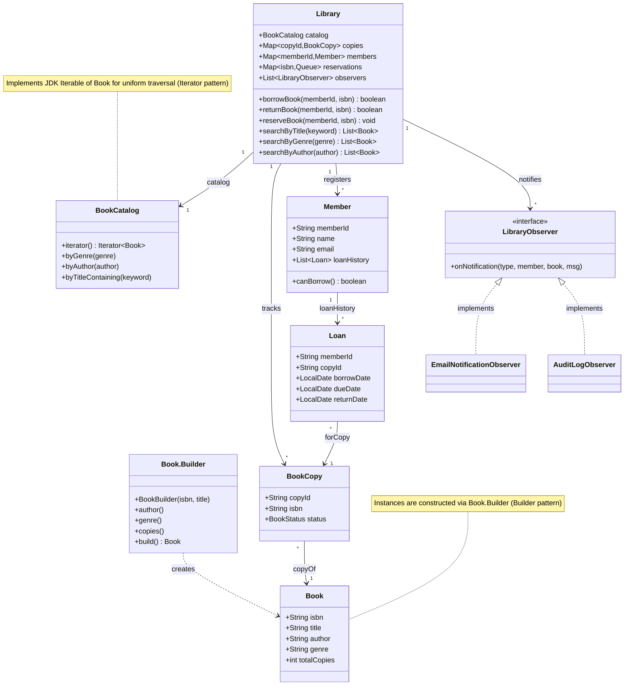
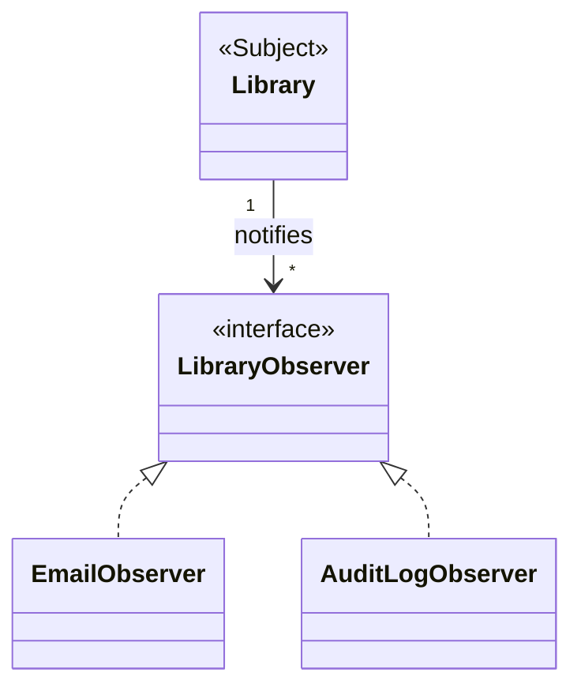
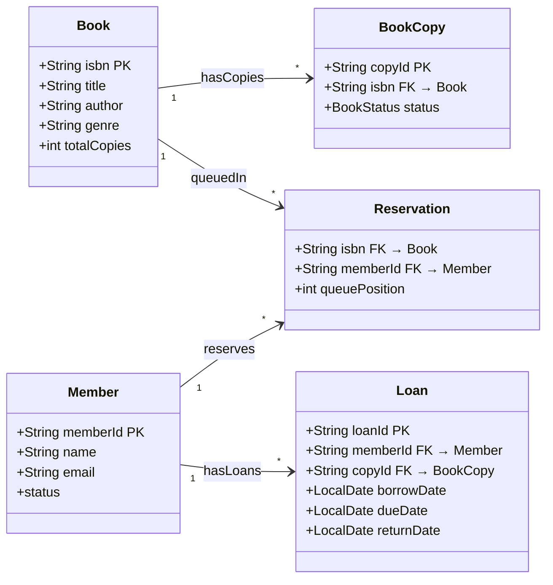
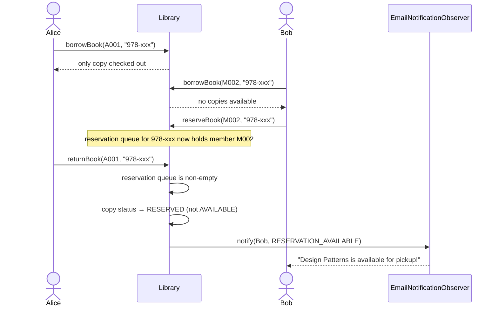
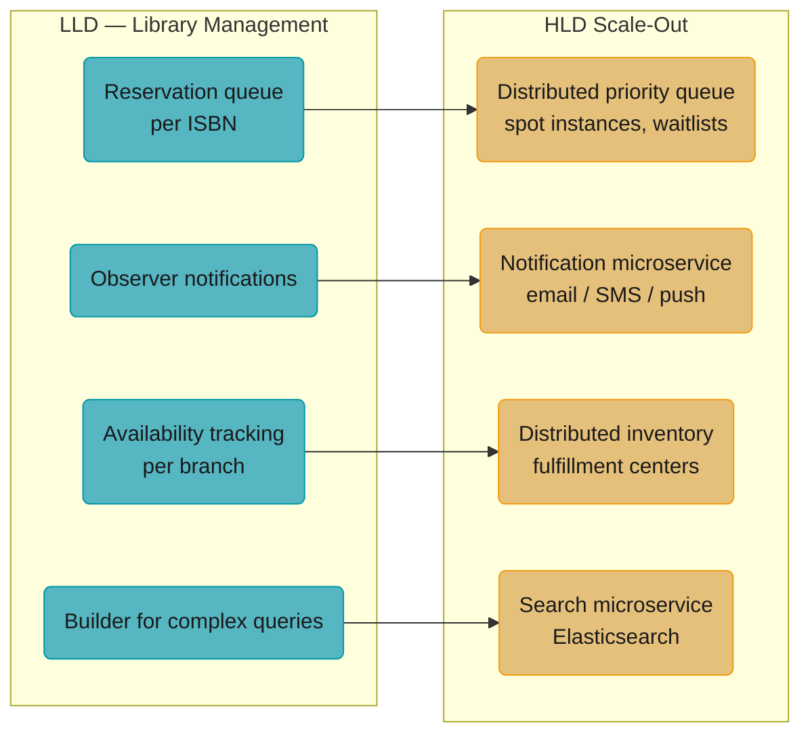

# Library Management System — Builder + Iterator + Observer

## Intuition

> **One-line analogy**: Library Management is a Builder + Iterator + Observer problem — complex objects are constructed step-by-step, collections are traversed uniformly, and members are notified automatically when their reserved book becomes available.

**Mental model**: A `Book` has many optional attributes (ISBN, authors, genres, edition, language) — a classic Builder candidate. The catalog must support diverse search queries (by title, author, genre, availability) — an Iterator over filtered views. When a book is returned and a reservation queue is waiting, observers fire automatically to notify the next in line — Observer in its most natural form.

**Why it matters**: Library Management combines three patterns that individually feel abstract but together model a real workflow elegantly. It also introduces the concept of a reservation queue, which requires careful ordering and notification logic.

**Key insight**: The borrowing flow has multiple failure modes: book not found, no available copies, member limit exceeded, member suspended. Model these as explicit return types or exceptions — not silent boolean returns — so callers can distinguish and respond to each case. The reference `LibraryManagement.java` deliberately does *not* do this: `borrowBook`/`returnBook` return a bare `boolean` and print the reason to stdout, which keeps the demo short enough to read in one pass. Treat that as the thing to fix in the interview, not the thing to copy — a sealed `BorrowResult` with one case per failure mode is the answer that scores.

**Full runnable implementation:** [`LibraryManagement.java`](LibraryManagement.java) — 537 lines, one file, `main()` at the bottom. It demonstrates `BookCatalog` and `Library` with two observers on the same event (`EmailNotificationObserver`, `AuditLogObserver`), plus the deliberately bare `boolean` return from `borrowBook`/`returnBook` that this page tells you to replace with a sealed result type.

---

## Problem Statement

Design a Library Management System that:
- Catalogs books with rich metadata (ISBN, title, author, genre, copies)
- Allows members to search, borrow, and return books
- Manages reservations when books are unavailable
- Notifies members of due dates, returns, and reservations
- Tracks borrow history for all members

---

## Class Diagram



`Library` composes `BookCatalog`, the per-copy inventory, members, and the observer list; `Book.Builder` constructs `Book` (Builder), `BookCatalog` implements `Iterable<Book>` for uniform traversal (Iterator), and `LibraryObserver` is realized by `EmailNotificationObserver`/`AuditLogObserver` (Observer). `Library.reservations` maps each ISBN to a FIFO queue of waiting member IDs (see Key Design Decisions below).

---

## Patterns Used

### 1. Builder Pattern — `Book`

The `Book` class has 2 required and 6 optional fields. Without Builder:
```java
// Constructor hell — which param is which?
Book b = new Book("978-xxx", "Title", "Author", 2008, "Genre", 3, "Publisher", "English");
```

With Builder:
```java
Book book = new Book.Builder("978-xxx", "Effective Java") // required
    .author("Joshua Bloch")
    .publicationYear(2018)
    .genre("Programming")
    .copies(3)
    .build();
```

Benefits: readable, validated at build time, optional fields have defaults.

### 2. Iterator Pattern — `BookCatalog`

`BookCatalog` implements `Iterable<Book>` and exposes filtering iterators:
```java
// Client uses iterator — doesn't know about internal List
Iterator<Book> programmingBooks = catalog.byGenre("Programming");
while (programmingBooks.hasNext()) {
    Book b = programmingBooks.next();
    // process...
}
```

This decouples the catalog's internal structure from clients. The catalog could switch from `ArrayList` to a database-backed store without changing client code.

### 3. Observer Pattern — Notifications



`Library` (the Subject) depends only on the `LibraryObserver` interface, never on a concrete implementation — new channels like SMS or push notifications just add another realization, with zero changes to `Library`.

Events published:
- `BORROW_CONFIRMED` — when book is checked out
- `RETURN_CONFIRMED` — when book is returned
- `RESERVATION_AVAILABLE` — when a reserved book becomes available
- `OVERDUE` — when due date passes (triggered by batch job)

New notification channels (SMS, push notification) just implement `LibraryObserver` — no changes to `Library`.

---

## Data Model



The persistence layer mirrors the class model with explicit keys: `Book` is 1-to-many with `BookCopy` (one row per physical copy), `Member` is 1-to-many with `Loan` (full borrow history), and `Reservation` joins `Book`/`Member` per ISBN queue position. `BookCopy.status` cycles AVAILABLE, BORROWED, RESERVED, LOST; `Loan.returnDate` stays null while a loan is active.

---

## Interview Questions with Answers

**Q: Why `Queue<String>` for reservations instead of `List`?**
**Short:** FIFO ordering means `poll()` always hands the copy to whoever reserved first.

FIFO ordering — first member to reserve gets first pick when a copy becomes available. Queue's `poll()` naturally gives the next in line.

**Q: Why `Loan` object instead of just tracking borrowDate in `BookCopy`?**
**Short:** `Loan` is its own domain entity, enabling history, fine calculation, and reporting.

A Loan is a domain concept with its own lifecycle (borrow → return → overdue). It enables loan history, fine calculation, and report generation. Single Responsibility.

**Q: How is the reservation notification triggered?**
**Short:** `returnBook()` checks the queue immediately and notifies the head waiter — event-driven, not polled.

In `returnBook()` — when a copy is returned, the library immediately checks the reservation queue. If non-empty, it marks the copy as RESERVED and notifies the first waiter. This is event-driven (better than a cron job polling). Name the dead end before the interviewer does: `RESERVED` is terminal in this demo. `findAvailableCopy()` filters on `AVAILABLE`, there is no `claimReservation(memberId, isbn)` to flip `RESERVED -> BORROWED` for the head of the queue, and no TTL to revert `RESERVED -> AVAILABLE` if nobody collects — so the copy is stranded and the polled waitlist entry is gone with it. A production design needs both the claim call and the expiry sweep, and the expiry must re-offer the copy to the next waiter rather than silently returning it to the shelf.

**Q: Why does `borrowBook`/`returnBook` return a bare `boolean` instead of a typed result, and what's wrong with that?**
**Short:** a bare boolean can't distinguish "book not found" from "member suspended" — callers get no reason.

Both methods collapse every failure mode — book not found, no copies available, member limit exceeded, member suspended — into a single `false`, printing the actual reason to stdout instead of returning it. A caller (a UI, a REST controller) can't branch on *why* the borrow failed without scraping console output, which is unusable outside the demo. The Key insight names this directly as the thing to fix, not copy: a sealed `BorrowResult` (or an exception hierarchy) with one case per failure mode — `BookNotFound`, `NoCopiesAvailable`, `MemberLimitExceeded`, `MemberSuspended`, `Success` — lets every caller pattern-match on the outcome and show the member a precise, actionable message.

**Q: What's the dead end when a returned copy is marked RESERVED and the waiting member never shows up?**
**Short:** the copy is stranded RESERVED forever — there's no claim call and no expiry to release it.

`returnBook()` flips the copy straight to `RESERVED` and notifies the head of the queue, but there is no `claimReservation(memberId, isbn)` that actually lets that member complete the borrow, and no TTL to revert the copy back to `AVAILABLE` if they never come. `findAvailableCopy()` only ever looks at `AVAILABLE` copies, so a stranded `RESERVED` copy becomes permanently invisible to every other member, including the rest of that same queue. Fixing this needs both halves: a claim endpoint that transitions `RESERVED -> BORROWED` for the specific reserving member, and a scheduled sweep that, on expiry, re-offers the copy to the *next* queue entry rather than silently dropping it back to `AVAILABLE` and losing the remaining waiters' place in line.

**Q: Why Builder for `Book` instead of a large constructor with all the optional fields?**
**Short:** Builder makes 2 required and 6 optional fields readable and validated, instead of ambiguous positional args.

`Book` has 2 required fields (ISBN, title) and 6 optional ones (author, genre, publication year, copies, publisher, language) — a constructor taking all eight is "constructor hell," where `new Book("978-xxx", "Title", "Author", 2008, "Genre", 3, "Publisher", "English")` gives no clue which positional argument is which without checking the signature. `Book.Builder` names each optional field via a fluent call (`.author(...)`, `.genre(...)`, `.copies(...)`), validates at `build()` time, and gives sensible defaults for anything omitted. It also means adding a ninth optional field later is a non-breaking addition to the Builder, not a change to every call site that constructs a `Book`.

**Q: Why does `BookCatalog` implement `Iterable<Book>` instead of returning a `List<Book>` from each search method?**
**Short:** `Iterable` decouples clients from the catalog's internal storage, so it can change without breaking callers.

A client using `Iterator<Book>` (or a for-each loop over an `Iterable`) never sees whether `BookCatalog` stores books in an `ArrayList`, a `TreeMap`, or a database-backed cursor — it just calls `hasNext()`/`next()`. Returning a concrete `List<Book>` instead would leak that the catalog materializes a full in-memory collection on every search, and would make swapping to a lazily-fetched, database-backed result set a breaking API change. The Iterator pattern's whole value here is that `BookCatalog` can switch its internal structure — say, to page results from a database — without touching any client code that iterates over `byGenre()` or `byTitleContaining()`.

**Q: Why is `Library` the Observer Subject rather than notifications being fired from `BookCopy` or `Loan` directly?**
**Short:** `Library` is the only object that sees the full picture — the copy, the member, and the reservation queue.

A single event like `RESERVATION_AVAILABLE` needs three pieces of context at once: which copy changed, which member is waiting, and the message to send — information that's scattered across `BookCopy.status`, the per-ISBN reservation `Queue`, and the `Member` record. `BookCopy` or `Loan` in isolation only knows about themselves; only `Library`, which orchestrates `borrowBook`/`returnBook` and owns the reservation map, has enough context to construct a meaningful notification. Concentrating the Subject role in `Library` also means there's exactly one place (`Library.notifyObservers()`) where a new event type gets wired to the observer list, rather than notification logic scattered across every entity that could conceivably trigger one.

**Q: Where's the race condition if two members try to borrow the last copy of a book at the same time?**
**Short:** an unsynchronized check-then-act between "is a copy available" and "mark it borrowed" can double-lend one copy.

`borrowBook()` has to (1) find an `AVAILABLE` `BookCopy` for the ISBN, then (2) mark that copy `BORROWED` — and if two threads both pass step 1 before either completes step 2, both can believe they got the last copy and both proceed to lend it. This is the same check-then-act shape as `ParkingLot`'s spot assignment and `OnlineBookingSystem`'s seat race — nothing in this reference design guards it, since the demo is single-threaded. The fix is the same family of solutions: make "find and mark" one atomic operation, either with a `synchronized` block around both steps in-process, or a compare-and-set `UPDATE ... WHERE status = 'AVAILABLE'` at the database layer once there's more than one server.

**Q: How would you add the missing `claimReservation` flow and expiry sweep this page calls for?**
**Short:** add a claim endpoint transitioning RESERVED to BORROWED, plus a scheduled sweep that re-offers on expiry.

`claimReservation(memberId, isbn)` would check that `memberId` matches the head of that ISBN's reservation queue and the copy's status is `RESERVED`, then transition it to `BORROWED` and create the `Loan`, poll the member off the queue, and reject anyone else who tries to claim it. Alongside that, a `Reservation` needs an `expiresAt` timestamp (set when `returnBook()` marks the copy `RESERVED`), checked by a `ScheduledExecutorService` sweep or a background job. On expiry, the sweep must poll the *next* member in the queue and re-mark the copy `RESERVED` for them — not just drop it back to `AVAILABLE`, which would silently discard the remaining queue's priority order.

**Q: Why `Map<isbn, Queue<memberId>>` for reservations instead of one global reservation list scanned per book?**
**Short:** keying by ISBN gives O(1) lookup of a book's exact waitlist instead of an O(n) scan of every reservation.

A single flat list of all reservations across every book would require scanning the entire list and filtering by ISBN every time `returnBook()` needs to know who's waiting for *this* specific title — an O(total reservations) operation on every single return, even in libraries with thousands of active reservations across unrelated books. Keying the map by ISBN means `reservations.get(isbn)` is an O(1) lookup straight to that book's own FIFO queue, with zero cost paid for reservations on any other title. This mirrors why `ParkingLot` groups spots by type rather than scanning a flat list — partitioning by the key you'll actually query on turns an O(n) scan into a direct lookup.

**Q: How does `BookCopy.status` model the physical copy's lifecycle, and what triggers each transition?**
**Short:** status cycles AVAILABLE, BORROWED, RESERVED, LOST — each driven by a specific library operation.

A `BookCopy` starts `AVAILABLE` when acquired. `borrowBook()` moves it to `BORROWED`; `returnBook()` moves a `BORROWED` copy back — to `AVAILABLE` if no one is waiting, or to `RESERVED` (see the dead-end gotcha above) if the queue is non-empty. `LOST` is a manual administrative transition (not modeled in the demo's happy path) for a copy reported missing, which should also remove it from `findAvailableCopy()`'s candidate pool the same way `RESERVED` does. Every transition is driven by an explicit library action — there's no transition that happens purely from time passing except the (currently unimplemented) reservation expiry.

**Q: How would multi-branch inventory change this design?**
**Short:** each branch needs its own copy inventory, plus an explicit inter-branch transfer or hold mechanism.

Right now a `BookCopy` belongs to one implicit "the library," with a single global availability count per ISBN. Multi-branch support means `BookCopy` (or a wrapping entity) needs a `branchId`, `findAvailableCopy()` needs to search within a branch first (and optionally fall back to nearby branches), and the reservation queue likely needs to become branch-scoped too, since a member reserving at Branch A shouldn't necessarily jump the queue for a copy that's only ever been at Branch B. The Follow-Up Extensions list this as inter-branch borrowing — the underlying pattern doesn't change (Builder, Iterator, Observer are all still valid), but every place that currently assumes "the" copy pool needs to become "a branch's" copy pool.

**Q: Why does the persistence layer mirror the class model with explicit foreign keys instead of embedding `Loan` records inside `Member`?**
**Short:** explicit FK tables let you query loans independently of members — by book, by date range, by copy.

Embedding a member's loan history as a nested list inside their own record works for reading "show me Alice's loans," but makes it expensive or impossible to efficiently answer questions that cut across members — "which copies are overdue right now," "how many times has this specific book been borrowed this year." A normalized `Loan` table with `memberId FK` and `copyId FK` supports both access patterns with an index on either foreign key, at the cost of a join when you do want one member's full history. This is the standard relational tradeoff: the class diagram's object graph (`Member` "1-to-many" `Loan`) is preserved, but the physical schema keeps each entity queryable on its own terms rather than nested inside another.

**Q: How does the per-ISBN reservation queue map to distributed resource queuing at HLD scale?**
**Short:** the same "queue waiters, notify on availability, handle expiry" shape appears in spot-instance queuing and appointment systems.

The core mechanic — a FIFO queue of waiters for a scarce resource, an event that fires when the resource frees up, and an expiry policy if the notified party doesn't act — is identical whether the resource is a library book, a cloud spot instance, or a waitlisted event ticket. At distributed scale, the in-memory `Map<isbn, Queue<String>>` becomes a durable, partitioned structure (a database table or a distributed queue keyed by resource ID), and the "notify the head of the queue" step becomes a message published to a notification service rather than a direct in-process Observer call. The unimplemented expiry sweep this page names as a gap is exactly the piece that, at scale, becomes non-optional — a distributed system's notified-but-unclaimed resource has to be reclaimed automatically, because there's no guarantee the notification even reached the client.

---

## Reservation Flow



Two members converge on the same single-copy title: Bob's reservation queues behind Alice's active loan, and `Library.returnBook()` — instead of flipping the copy back to AVAILABLE — marks it RESERVED and pushes an Observer notification straight to Bob, an event-driven alternative to polling a cron job.

---

## Cross-Perspective: HLD Connections

**HLD View — Where Library Management Scales to Distributed Systems**

- **Reservation queue → distributed priority queue** — The book reservation queue maps to distributed task scheduling and resource reservation: medical appointment systems, cloud spot instance queuing, event ticket waitlists. The core problem — queue waiters, notify on availability, handle expiry — is identical at both scales.
- **Observer notifications → notification microservice** — Due-date reminders, return notifications, and reservation availability alerts map to a dedicated notification microservice at HLD scale: it subscribes to library domain events (BookReturned, OverdueBook) and dispatches email/SMS/push via appropriate channels.
- **Availability tracking → distributed inventory** — Tracking available copies across a library network (multiple branches) is a distributed inventory management problem — the same challenge as e-commerce stock management across fulfillment centers. Consistency requirements determine whether you need strong or eventual consistency.
- **Builder for complex queries → search microservice** — Complex catalog search (by title, author, genre, availability, language) at scale becomes a dedicated search service backed by Elasticsearch, with the Builder pattern used to construct search queries from multiple optional filters.



Each Library Management mechanic has a direct distributed-systems analogue — the same "queue waiters, notify on availability" shape recurs at both scales, just with different infrastructure underneath.

---

## Follow-Up Extensions

1. **Fine calculation**: `Loan.calculateFine()` — strategy pattern for different fine rates
2. **Digital books**: `DigitalBook extends Book` with unlimited copies, download links
3. **Multi-branch support**: Each branch has its own inventory; inter-branch borrowing
4. **Barcode scanning**: `copyId` maps to physical barcode
5. **Renewal**: Extend due date if no reservations pending
6. **Reading lists**: Members maintain wish lists
7. **Book recommendations**: Observer pattern collects borrow events for collaborative filtering
