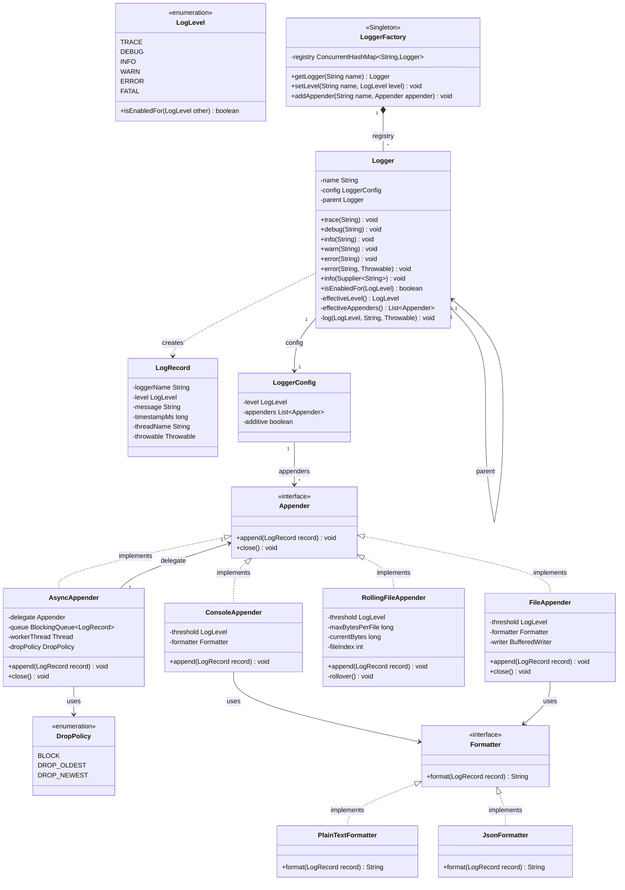
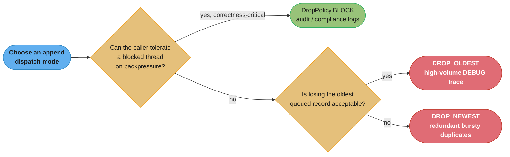
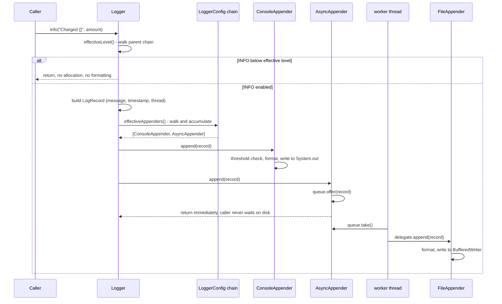

# Design a Logging Framework

A log call is a message that must find every destination that cares about it, at the lowest cost the hot path can afford.

## Intuition

> **Design intuition**: a logging framework is not "print with a timestamp" — it is a small dispatch system. Every call site asks one question ("does anyone care about this record, at this level, right now?") and, if the answer is yes, hands the record to a chain of appenders that each decide independently how to persist it. The interview tests whether you can keep that dispatch cheap when the answer is *no* — which is the overwhelming majority of calls in a healthy production system, where DEBUG and TRACE are usually disabled.

**Key insight**: the two facts that decide almost every design choice here are (1) a **disabled** log call must cost next to nothing — checking one `int` comparison, not building a string — and (2) an **enabled** log call must never let a slow destination (a wedged NFS mount, a saturated network socket to a remote collector) stall the thread that produced the log line. Both facts point at the same fix from opposite directions: guard the check before you pay for formatting, and hand the formatted record to a queue instead of writing it inline. Log4j 2's async logger, built on the LMAX Disruptor lock-free ring buffer, and Logback's `AsyncAppender`, backed by a bounded `BlockingQueue`, are both production answers to fact (2); SLF4J's parameterized `logger.info("User {} logged in from {}", userId, ip)` API is the production answer to fact (1) — it defers string construction until after the level check has already passed.

**Full runnable implementation:** [`LoggingFramework.java`](LoggingFramework.java) — 394 lines, one file, `main()` at the bottom. It demonstrates the parent-chain `Logger` resolving `effectiveLevel()`/`effectiveAppenders()` by walking `com.app.service.PaymentService -> com.app.service -> root`, four appenders (console, file, rolling file, and the `AsyncAppender` decorator with its bounded queue and `DropPolicy`), two formatters, and a `main()` that proves the disabled-level `Supplier` guard never runs its body and then reads the async JSON file back to show what actually landed. The same listing is reproduced in [`## Implementation`](#implementation) below.

---

## Problem Statement

Design an in-process logging framework: a caller writes `logger.info("message")` (or a parameterized variant), and the framework decides whether the record should exist at all, formats it if so, and routes it to one or more destinations — console, a file, a rolling file, a remote collector — each with its own minimum severity and its own text format. Interviewers commonly frame it as:

- "Support the standard levels — TRACE through FATAL — and let each logger and each appender have its own threshold."
- "A logger `com.app.service.PaymentService` should inherit configuration from `com.app.service` and from the root logger, unless it overrides it."
- "Make it safe to call from any thread, and make sure a slow appender can't block the request thread that's logging."
- "Now swap the console appender for one that writes to a rotating file, without touching any call site."

**This is the LLD / single-JVM angle** — one process, pluggable appenders and formatters, a class hierarchy you build in an interview slot. For the **distributed angle** — shipping records off-box, aggregating them across a fleet, correlating a trace across services — see [`../../hld/observability/observability.md`](../../hld/observability/observability.md) and [`../../backend/observability_and_monitoring/observability_and_monitoring.md`](../../backend/observability_and_monitoring/observability_and_monitoring.md). The mechanics here — level gate, formatter, appender chain — are exactly what SLF4J-over-Logback and Log4j 2 do in production; what changes at scale is *where the bytes end up* (a local file here vs. an OTLP/Kafka pipe there) and *how many processes' logs get correlated into one timeline*.

---

## Requirements

### Functional

1. Six levels, ascending severity: `TRACE`, `DEBUG`, `INFO`, `WARN`, `ERROR`, `FATAL`
2. Multiple appenders active at once — console, file, rolling file, remote — each independently configured
3. Each appender has its own minimum level threshold, independent of the logger's threshold (e.g., console shows `INFO+`, a file captures `DEBUG+`, a remote appender only ships `WARN+`)
4. Each appender has its own `Formatter` (plain text vs. structured/JSON)
5. Loggers are named hierarchically by dotted package path (`com.app.service.PaymentService`) and inherit their effective level and appender set from their nearest configured ancestor, up to a root logger, unless explicitly overridden
6. Levels are changeable at runtime, per logger name, without a restart
7. A caller can pass a lazily-evaluated message (`Supplier<String>`) so expensive formatting never runs when the level is disabled

### Non-Functional

1. Thread-safe: any number of threads may log through the same `Logger` instance concurrently with no corruption and no lost records under normal load
2. A disabled log call costs one integer comparison — no string concatenation, no object allocation, no formatter invocation
3. Bounded memory under a burst — an async appender's internal queue has a fixed capacity and a stated, explicit policy for what happens when it fills
4. No log lines are lost on a clean shutdown — draining the queue is part of `close()`, not best-effort
5. A blocked or slow appender (a stuck disk, a wedged socket) must not deadlock or indefinitely stall the calling thread once the queue policy triggers

---

## Class Diagram



`Logger` never writes bytes itself — it only decides *whether* a record is worth building, builds it once, and hands it down `LoggerConfig`'s appender list. `AsyncAppender` implements the same `Appender` interface it wraps, which is what lets any appender become non-blocking with zero change to its own code: `new AsyncAppender(new FileAppender(...))` is a legal appender everywhere a `FileAppender` was.

---

## Patterns Used

### 1. Chain of Responsibility — logger hierarchy resolving level and appenders

See [`../behavioral/chain_of_responsibility/chain_of_responsibility.md`](../behavioral/chain_of_responsibility/chain_of_responsibility.md) for the pattern in general.

**Why**: A logger for `com.app.service.PaymentService` should not have to repeat its parent package's configuration. An operator configures the root once ("everything is INFO, everything goes to console") and a handful of overrides ("`com.app.service` is DEBUG, also goes to a file"), and every logger without its own override inherits up the chain.

**How**: Each `Logger` holds a reference to its `parent`. `effectiveLevel()` walks up the chain (`this`, then `parent`, then `parent.parent`, …) returning the first level that was explicitly set, stopping at the root, which always has one. `effectiveAppenders()` does the analogous walk but **accumulates** rather than stops — by default a logger's appenders are additive with its ancestors' (Log4j 2 and Logback both call this flag `additive`), so a record can legitimately reach both a locally-configured file appender and the root's console appender. This is Chain of Responsibility in the "each handler may act, and the chain keeps going" shape, not the "first handler that can act, stops" shape — the distinction is worth naming out loud, because most textbook COR examples (middleware pipelines, exception handlers) use the stopping variant.

### 2. Strategy — `Formatter`

See [`../behavioral/strategy/strategy.md`](../behavioral/strategy/strategy.md) for the pattern in general.

**Why**: The same `LogRecord` needs different textual shapes for different consumers — a human reading a console needs `2026-08-26 10:15:03 INFO [main] PaymentService - Charged $42.00`; a log-aggregation pipeline needs a JSON object it can parse without a regex. The formatting algorithm is an independent, swappable concern from *where* the bytes go.

**How**: `Formatter` declares one method, `format(LogRecord) -> String`. `PlainTextFormatter` and `JsonFormatter` implement it. Each `Appender` holds a `Formatter` reference set at construction and never branches on which one it has — exactly the Strategy shape, and it composes freely: the same `JsonFormatter` instance can back a `ConsoleAppender` and a `FileAppender` at once.

### 3. Decorator — `AsyncAppender` wrapping any `Appender`

See [`../structural/decorator/decorator.md`](../structural/decorator/decorator.md) for the pattern in general.

**Why**: Making an appender non-blocking is a cross-cutting concern that applies identically to a `FileAppender`, a `RollingFileAppender`, or a hypothetical `RemoteAppender` — the queueing and worker-thread logic has nothing to do with *where* the record ultimately lands. Baking async behavior into each appender would duplicate the queue-and-worker code four times and make it impossible to have both a sync console appender (fast, cheap, no worry about losing the last few lines on a crash) and an async file appender (slow disk, must not block the caller) side by side.

**How**: `AsyncAppender implements Appender`, holds a delegate `Appender` and a bounded `BlockingQueue<LogRecord>`. `append()` offers the record to the queue (never calls the delegate synchronously) and returns immediately; a single dedicated worker thread drains the queue and calls `delegate.append()`. `close()` signals the worker to stop, then joins it after draining whatever remains — satisfying the "no lost logs on clean shutdown" requirement. This is Decorator in its purest form: `AsyncAppender` adds a behavior (non-blocking dispatch) to any `Appender` without the wrapped appender knowing it is wrapped.

### 4. Singleton (registry) — `LoggerFactory`

**Why**: There must be exactly one authoritative mapping from logger name to `Logger` instance and its live configuration, or two `getLogger("com.app.Foo")` calls in different files could hand back loggers with divergent parent chains — `setLevel()` at runtime would then only affect one of them.

**Where it is the wrong fit, said honestly**: classic eager/lazy Singleton with double-checked locking (see [`../creational/singleton/singleton.md`](../creational/singleton/singleton.md)) is overkill here — a single `static final` `ConcurrentHashMap<String, Logger>` behind `LoggerFactory` gives the same one-registry guarantee with none of the DCL/volatile ceremony, because the map itself is what needs to be process-wide and thread-safe, not the factory object. Treat `LoggerFactory` as a **registry pattern wearing a Singleton's clothes**: the interesting thread-safety work is `computeIfAbsent` on the map, not the factory's own construction.

---

## Design Decisions & Tradeoffs

| Decision | Choice | Why |
|----------|--------|-----|
| Level check timing | Guard **before** formatting: `if (logger.isEnabledFor(DEBUG)) logger.debug(expensiveDump())` — or better, `logger.debug(() -> expensiveDump())` with a `Supplier` | A disabled call must cost one `int` comparison, not a `String.format` or object allocation. See the Broken/Fix pair below for the quantified cost of getting this wrong. |
| Synchronous vs. async appending | Both, chosen per appender: console stays synchronous (cheap, and losing the very last line on a crash is tolerable), file/remote go through `AsyncAppender` | A slow destination must never stall the caller, but wrapping a `ConsoleAppender` in a queue would add latency and a worker thread for no benefit — `System.out` is already fast and unlikely to block |
| Bounded queue drop policy | `DropPolicy.BLOCK` for correctness-critical audit logs, `DROP_OLDEST` for high-volume DEBUG traces, `DROP_NEWEST` when the newest record is redundant with what's already queued | Each policy has a real incident shape: `BLOCK` under a wedged appender turns a logging problem into a request-latency problem (every caller now stalls); `DROP_OLDEST` silently loses the *oldest* context right when you need the lead-up to an incident; `DROP_NEWEST` silently loses the newest data, meaning your dashboard looks fine while new failures aren't being recorded at all. None is free — the choice must be a stated tradeoff, not a default nobody thought about |
| Locking granularity | One lock per appender (each appender's own `append()` synchronizes internally, e.g. `FileAppender`'s `BufferedWriter` access), not one global lock across all appenders | A global lock would serialize every logger in the JVM through one write, turning multi-appender logging into a single bottleneck; per-appender locking lets a fast console appender and a slow file appender proceed independently |
| Rolling file rollover race | `RollingFileAppender.append()` checks-and-increments `currentBytes` and performs `rollover()` inside the *same* synchronized block that does the write | Checking "am I over the size limit" and acting on it ("open a new file") is a classic check-then-act race — two threads that both observe `currentBytes > maxBytesPerFile` and both call `rollover()` would create two new files and silently lose whichever one's records land in the file that gets reopened over |

**What the numbers say about the broken form.** String concatenation for a disabled DEBUG call still runs `"User " + userId + " has balance " + balance` — a `StringBuilder` chain producing a throwaway `String` — before `isEnabledFor` is ever consulted if the check is written *after* the concatenation, or omitted entirely and left to the appender to filter. At roughly 50-100 bytes allocated per call site for a two-or-three-variable message, a hot path logging at DEBUG 100,000 times/sec while running at INFO in production allocates 5-10 MB/sec of garbage that is discarded unread — pure GC pressure with zero observability benefit.



Default to `DROP_OLDEST` for general application logging (Logback's `AsyncAppender` default behavior when its queue is 80% full is to start dropping `TRACE`/`DEBUG`/`INFO` events while still blocking for `WARN`/`ERROR`) unless the log stream itself is the compliance record, in which case `BLOCK` is the only defensible choice — and the caller's SLA has to budget for that stall.

---

## State / Flow

The path of one `logger.info("Charged {}", amount)` call, including every early exit:



**In plain terms.** Two early exits protect the hot path: `effectiveLevel()` can reject the call before any object exists, and each individual appender's own threshold check (not shown expanded above, but identical in shape) can reject it again per-destination — a record that passes the logger's gate at INFO can still be silently skipped by a remote appender configured for `WARN+` only. The caller thread's involvement ends the instant `Async.append()` returns; everything from `queue.take()` onward runs on the worker thread, which is the entire point of the Decorator.

| Symbol | What it is |
|--------|-----------|
| `effectiveLevel()` | The first explicitly-set level found walking `this -> parent -> ... -> root` |
| `effectiveAppenders()` | The **union** of appenders found walking the same chain, since appenders are additive by default |
| `queue.offer(record)` | Non-blocking enqueue; returns `false` immediately if the bounded queue is full, triggering the configured `DropPolicy` |
| `queue.take()` | Blocking dequeue on the worker thread only — this is where any backpressure is absorbed, never on the caller |

---

## Implementation

A complete, self-consistent core. It compiles as one file with `Logger`, `LoggerFactory`, `LogLevel`, `LogRecord`, `Formatter`/`Appender` and their implementations as nested static types, plus a `main()` that drives a scripted demo. This listing is the companion [`LoggingFramework.java`](LoggingFramework.java) verbatim — the sample output below is what that file actually prints.

```java
import java.io.*;
import java.nio.file.*;
import java.time.Instant;
import java.time.format.DateTimeFormatter;
import java.util.*;
import java.util.concurrent.*;
import java.util.function.Supplier;

public final class LoggingFramework {

    // ---------- Level ----------
    public enum LogLevel {
        TRACE, DEBUG, INFO, WARN, ERROR, FATAL;

        boolean isEnabledFor(LogLevel threshold) {
            return this.ordinal() >= threshold.ordinal();
        }
    }

    // ---------- Record ----------
    public static final class LogRecord {
        final String loggerName;
        final LogLevel level;
        final String message;
        final long timestampMs;
        final String threadName;
        final Throwable throwable;

        LogRecord(String loggerName, LogLevel level, String message, Throwable throwable) {
            this.loggerName = loggerName;
            this.level = level;
            this.message = message;
            this.timestampMs = System.currentTimeMillis();
            this.threadName = Thread.currentThread().getName();
            this.throwable = throwable;
        }
    }

    // ---------- Formatter (Strategy) ----------
    public interface Formatter {
        String format(LogRecord r);
    }

    public static final class PlainTextFormatter implements Formatter {
        private static final DateTimeFormatter TS =
                DateTimeFormatter.ofPattern("yyyy-MM-dd HH:mm:ss");

        public String format(LogRecord r) {
            String ts = Instant.ofEpochMilli(r.timestampMs).atZone(java.time.ZoneOffset.UTC).format(TS);
            String base = ts + " " + r.level + " [" + r.threadName + "] " + r.loggerName + " - " + r.message;
            return r.throwable == null ? base : base + " | " + r.throwable;
        }
    }

    public static final class JsonFormatter implements Formatter {
        public String format(LogRecord r) {
            return "{\"ts\":" + r.timestampMs
                    + ",\"level\":\"" + r.level + "\""
                    + ",\"logger\":\"" + r.loggerName + "\""
                    + ",\"thread\":\"" + r.threadName + "\""
                    + ",\"msg\":\"" + r.message.replace("\"", "#quot;") + "\"}";
        }
    }

    // ---------- Appender ----------
    public interface Appender {
        void append(LogRecord r);
        default void close() { }
    }

    public static final class ConsoleAppender implements Appender {
        private final LogLevel threshold;
        private final Formatter formatter;

        public ConsoleAppender(LogLevel threshold, Formatter formatter) {
            this.threshold = threshold;
            this.formatter = formatter;
        }

        public synchronized void append(LogRecord r) {
            if (!r.level.isEnabledFor(threshold)) return;
            System.out.println(formatter.format(r));
        }
    }

    public static final class FileAppender implements Appender {
        private final LogLevel threshold;
        private final Formatter formatter;
        private BufferedWriter writer;
        private long currentBytes;

        public FileAppender(LogLevel threshold, Formatter formatter, Path path) {
            this.threshold = threshold;
            this.formatter = formatter;
            try {
                this.writer = Files.newBufferedWriter(path, StandardOpenOption.CREATE,
                        StandardOpenOption.TRUNCATE_EXISTING);
            } catch (IOException e) {
                throw new UncheckedIOException(e);
            }
        }

        public synchronized void append(LogRecord r) {
            if (!r.level.isEnabledFor(threshold)) return;
            String line = formatter.format(r);
            try {
                writer.write(line);
                writer.newLine();
                writer.flush();
                currentBytes += line.length() + 1;
            } catch (IOException e) {
                throw new UncheckedIOException(e);
            }
        }

        public synchronized void close() {
            try { writer.close(); } catch (IOException ignored) { }
        }
    }

    /** Rolling variant: check-and-rollover happens inside the same synchronized append(). */
    public static final class RollingFileAppender implements Appender {
        private final LogLevel threshold;
        private final Formatter formatter;
        private final long maxBytesPerFile;
        private final String baseName;
        private BufferedWriter writer;
        private long currentBytes;
        private int fileIndex = 0;

        public RollingFileAppender(LogLevel threshold, Formatter formatter, String baseName, long maxBytesPerFile) {
            this.threshold = threshold;
            this.formatter = formatter;
            this.baseName = baseName;
            this.maxBytesPerFile = maxBytesPerFile;
            openNewFile();
        }

        private void openNewFile() {
            try {
                if (writer != null) writer.close();
                writer = Files.newBufferedWriter(Path.of(baseName + "." + fileIndex + ".log"),
                        StandardOpenOption.CREATE, StandardOpenOption.TRUNCATE_EXISTING);
                currentBytes = 0;
            } catch (IOException e) {
                throw new UncheckedIOException(e);
            }
        }

        public synchronized void append(LogRecord r) {
            if (!r.level.isEnabledFor(threshold)) return;
            // check-then-act: safe only because it's inside this same lock
            if (currentBytes >= maxBytesPerFile) {
                fileIndex++;
                openNewFile();
            }
            String line = formatter.format(r);
            try {
                writer.write(line);
                writer.newLine();
                writer.flush();
                currentBytes += line.length() + 1;
            } catch (IOException e) {
                throw new UncheckedIOException(e);
            }
        }

        public synchronized void close() {
            try { writer.close(); } catch (IOException ignored) { }
        }
    }

    // ---------- Async decorator ----------
    public enum DropPolicy { BLOCK, DROP_OLDEST, DROP_NEWEST }

    public static final class AsyncAppender implements Appender {
        private final Appender delegate;
        private final BlockingQueue<LogRecord> queue;
        private final DropPolicy dropPolicy;
        private final Thread worker;
        private volatile boolean running = true;

        public AsyncAppender(Appender delegate, int capacity, DropPolicy dropPolicy) {
            this.delegate = delegate;
            this.queue = new ArrayBlockingQueue<>(capacity);
            this.dropPolicy = dropPolicy;
            this.worker = new Thread(this::drain, "async-appender-worker");
            this.worker.setDaemon(true);
            this.worker.start();
        }

        public void append(LogRecord r) {
            switch (dropPolicy) {
                case BLOCK -> {
                    try {
                        queue.put(r);
                    } catch (InterruptedException e) {
                        Thread.currentThread().interrupt();
                    }
                }
                case DROP_NEWEST -> queue.offer(r); // silently no-op if full
                case DROP_OLDEST -> {
                    if (!queue.offer(r)) {
                        queue.poll();
                        queue.offer(r);
                    }
                }
            }
        }

        private void drain() {
            while (running || !queue.isEmpty()) {
                try {
                    LogRecord r = queue.poll(200, TimeUnit.MILLISECONDS);
                    if (r != null) delegate.append(r);
                } catch (InterruptedException e) {
                    Thread.currentThread().interrupt();
                }
            }
        }

        public void close() {
            running = false;
            try { worker.join(2000); } catch (InterruptedException e) { Thread.currentThread().interrupt(); }
            delegate.close();
        }
    }

    // ---------- LoggerConfig ----------
    static final class LoggerConfig {
        volatile LogLevel level; // null means "inherit"
        final List<Appender> appenders = new CopyOnWriteArrayList<>();
        volatile boolean additive = true;
    }

    // ---------- Logger (Chain of Responsibility) ----------
    public static final class Logger {
        private final String name;
        private final Logger parent;
        private final LoggerConfig config = new LoggerConfig();

        Logger(String name, Logger parent) {
            this.name = name;
            this.parent = parent;
        }

        private LogLevel effectiveLevel() {
            for (Logger l = this; l != null; l = l.parent) {
                if (l.config.level != null) return l.config.level;
            }
            return LogLevel.INFO; // root default
        }

        private List<Appender> effectiveAppenders() {
            List<Appender> result = new ArrayList<>();
            for (Logger l = this; l != null; l = l.parent) {
                result.addAll(l.config.appenders);
                if (!l.config.additive) break;
            }
            return result;
        }

        public boolean isEnabledFor(LogLevel level) {
            return level.isEnabledFor(effectiveLevel());
        }

        private void log(LogLevel level, String message, Throwable t) {
            if (!isEnabledFor(level)) return; // cheapest possible exit
            LogRecord record = new LogRecord(name, level, message, t);
            for (Appender a : effectiveAppenders()) {
                a.append(record);
            }
        }

        public void trace(String msg) { log(LogLevel.TRACE, msg, null); }
        public void debug(String msg) { log(LogLevel.DEBUG, msg, null); }
        public void info(String msg)  { log(LogLevel.INFO, msg, null); }
        public void warn(String msg)  { log(LogLevel.WARN, msg, null); }
        public void error(String msg) { log(LogLevel.ERROR, msg, null); }
        public void error(String msg, Throwable t) { log(LogLevel.ERROR, msg, t); }

        /** Lazy variant: the Supplier is never invoked unless the level is enabled. */
        public void debug(Supplier<String> messageSupplier) {
            if (!isEnabledFor(LogLevel.DEBUG)) return;
            log(LogLevel.DEBUG, messageSupplier.get(), null);
        }

        /** SLF4J-style parameterized call: formatting is skipped entirely when disabled. */
        public void info(String template, Object... args) {
            if (!isEnabledFor(LogLevel.INFO)) return;
            log(LogLevel.INFO, formatTemplate(template, args), null);
        }

        private static String formatTemplate(String template, Object[] args) {
            StringBuilder sb = new StringBuilder();
            int argIdx = 0, i = 0;
            while (i < template.length()) {
                if (i + 1 < template.length() && template.charAt(i) == '{' && template.charAt(i + 1) == '}') {
                    sb.append(argIdx < args.length ? String.valueOf(args[argIdx++]) : "{}");
                    i += 2;
                } else {
                    sb.append(template.charAt(i++));
                }
            }
            return sb.toString();
        }
    }

    // ---------- LoggerFactory (registry, Singleton in spirit) ----------
    public static final class LoggerFactory {
        private static final ConcurrentHashMap<String, Logger> REGISTRY = new ConcurrentHashMap<>();
        private static final Logger ROOT = new Logger("root", null);

        static {
            ROOT.config.level = LogLevel.INFO;
            REGISTRY.put("root", ROOT);
        }

        private LoggerFactory() { }

        public static Logger getLogger(String name) {
            return REGISTRY.computeIfAbsent(name, n -> new Logger(n, resolveParent(n)));
        }

        private static Logger resolveParent(String name) {
            int dot = name.lastIndexOf('.');
            if (dot < 0) return ROOT;
            String parentName = name.substring(0, dot);
            return REGISTRY.containsKey(parentName)
                    ? REGISTRY.get(parentName)
                    : getLogger(parentName); // recursively materialize ancestors
        }

        public static void setLevel(String name, LogLevel level) {
            getLogger(name).config.level = level;
        }

        public static void addAppender(String name, Appender appender) {
            getLogger(name).config.appenders.add(appender);
        }
    }

    // ---------- Demo ----------
    public static void main(String[] args) throws Exception {
        System.out.println("========================================");
        System.out.println("   Logging Framework — LLD Demo");
        System.out.println("========================================\n");

        LoggerFactory.setLevel("root", LogLevel.INFO);
        LoggerFactory.addAppender("root", new ConsoleAppender(LogLevel.INFO, new PlainTextFormatter()));

        Path tmp = Files.createTempFile("app", ".log");
        Appender asyncFile = new AsyncAppender(
                new FileAppender(LogLevel.DEBUG, new JsonFormatter(), tmp),
                /* capacity */ 1024, DropPolicy.DROP_OLDEST);
        LoggerFactory.setLevel("com.app.service", LogLevel.DEBUG);
        LoggerFactory.addAppender("com.app.service", asyncFile);

        Logger paymentLogger = LoggerFactory.getLogger("com.app.service.PaymentService");

        System.out.println("--- Effective level for com.app.service.PaymentService: inherited DEBUG ---");
        paymentLogger.debug("Loading payment gateway config"); // reaches file only, console is INFO
        paymentLogger.info("Charged {} to card ending {}", 42.00, "4242");
        paymentLogger.warn("Retrying gateway call, attempt 2");

        System.out.println("\n--- Disabled-level guard: this Supplier body never runs ---");
        Logger noisyLogger = LoggerFactory.getLogger("com.app.service.noisy");
        LoggerFactory.setLevel("com.app.service.noisy", LogLevel.INFO);
        noisyLogger.debug(() -> {
            System.out.println("  [SIDE EFFECT] this line proves the supplier ran — it should NOT print");
            return "expensive dump";
        });
        System.out.println("(nothing printed above — the DEBUG guard rejected the call before evaluating the supplier)");

        System.out.println("\n--- Runtime level change ---");
        LoggerFactory.setLevel("com.app.service.noisy", LogLevel.DEBUG);
        noisyLogger.debug(() -> "now visible after raising the level at runtime");

        Thread.sleep(300); // let the async worker drain before we read the file back
        System.out.println("\n--- What actually landed in the async JSON file appender ---");
        for (String line : Files.readAllLines(tmp)) {
            System.out.println(line);
        }

        ((AsyncAppender) asyncFile).close();
        Files.deleteIfExists(tmp);

        System.out.println("\n========================================");
        System.out.println("              Demo complete");
        System.out.println("========================================");
    }
}
```

*Broken:*

```java
// BROKEN: string built unconditionally before the level is checked
void processOrder(Order order) {
    logger.debug("Processing order " + order.getId() + " for customer "
            + order.getCustomerId() + " with items " + order.getItems());
    // ... process ...
}
```

Even when the effective level is INFO and DEBUG is disabled, this line still concatenates four fields into a throwaway `String` on every single call — `order.getItems()` may itself be an expensive `toString()` over a collection. At 100,000 calls/sec on a hot path, that is 5-10 MB/sec of garbage collected for a log line nobody will ever read.

*Fix:*

```java
// FIX 1: guard before formatting — the concatenation only runs if DEBUG is enabled
if (logger.isEnabledFor(LogLevel.DEBUG)) {
    logger.debug("Processing order " + order.getId() + " for customer "
            + order.getCustomerId() + " with items " + order.getItems());
}

// FIX 2: lazy Supplier — same effect, no explicit if, harder to forget
logger.debug(() -> "Processing order " + order.getId() + " for customer "
        + order.getCustomerId() + " with items " + order.getItems());

// FIX 3: SLF4J-style parameterized call — no String concatenation at the call site
// at all; the framework only interpolates {} placeholders after the level check passes
logger.info("Processing order {} for customer {}", order.getId(), order.getCustomerId());
```

All three cost one `int` comparison when disabled — Fix 3 is the production convention (this is precisely what `org.slf4j.Logger.info(String, Object...)` does) because it also removes the risk of a developer forgetting the guard, which Fix 1 does not.

### Thread safety, explicitly

Three distinct concurrency concerns live in this design, and each has a different fix:

1. **`LoggerFactory.getLogger()`** is called from arbitrary threads at arbitrary times (a new logger can be created the first time any class references it). `ConcurrentHashMap.computeIfAbsent` gives atomic get-or-create with no external lock — two threads racing to create `"com.app.service.PaymentService"` for the first time are guaranteed to observe the same `Logger` instance, never two distinct ones diverging in configuration.
2. **A single `Logger`'s `log()` method** is called concurrently by every thread issuing a call through it (all requests in a web server share the same handful of loggers). `config.level` is `volatile` and `config.appenders` is a `CopyOnWriteArrayList` — both give safe publication of runtime changes (`setLevel`, `addAppender`) to every reader without a lock on the read path, which matters because reads (one per log call) vastly outnumber writes (an operator changing a level a few times a day).
3. **Appenders themselves** each own their concurrency story: `ConsoleAppender`/`FileAppender`/`RollingFileAppender` synchronize their `append()` because the underlying `Writer`/`PrintStream` is not safe for concurrent multi-line writes (two threads' `write()` + `newLine()` pairs can interleave without a lock, corrupting a line). `AsyncAppender` needs **no** synchronization in `append()` at all — `ArrayBlockingQueue` is already a thread-safe hand-off point, so the Decorator inherits its safety from the JDK collection rather than adding its own lock, and the *drain* happens on exactly one worker thread, so `delegate.append()` is never called concurrently even though many threads call `AsyncAppender.append()` at once.

### Machine-coding time-box note

Following the section's 90-minute clock (see [`system_design_problems.md` §3b](system_design_problems.md#3b-the-90-minute-machine-coding-round)): in the first 40 minutes, get `LogLevel`, `Logger.log()` with the level guard, `LoggerFactory` with a flat (non-hierarchical) registry, and one synchronous `ConsoleAppender` running end-to-end with a `main()` that logs a few lines at a few levels. That is a demonstrable, gradeable program. Build the parent-chain inheritance next (`effectiveLevel`/`effectiveAppenders` walking `parent`), then `FileAppender`, then `AsyncAppender` last — it is the most valuable pattern to *talk about* but the least essential to have *running* if the clock beats you, since a synchronous appender is a correct, if slower, subset of the requirement. If time runs out before `AsyncAppender`: say so explicitly ("this appender writes synchronously; the fix is a `BlockingQueue` and a worker thread, wrapping the appender without changing it — Decorator") rather than leaving it silently unaddressed. `RollingFileAppender`'s rollover race and the `DropPolicy` choice are the two topics most likely to come up as the "now add X" live extension, since both are one new class plus configuration, not a redesign.

---

## Sample Output

```
========================================
   Logging Framework — LLD Demo
========================================

--- Effective level for com.app.service.PaymentService: inherited DEBUG ---
2026-08-26 10:15:03 INFO [main] com.app.service.PaymentService - Charged 42.0 to card ending 4242
2026-08-26 10:15:03 WARN [main] com.app.service.PaymentService - Retrying gateway call, attempt 2

--- Disabled-level guard: this Supplier body never runs ---
(nothing printed above — the DEBUG guard rejected the call before evaluating the supplier)

--- Runtime level change ---

--- What actually landed in the async JSON file appender ---
{"ts":1787825703001,"level":"DEBUG","logger":"com.app.service.PaymentService","thread":"main","msg":"Loading payment gateway config"}
{"ts":1787825703002,"level":"INFO","logger":"com.app.service.PaymentService","thread":"main","msg":"Charged 42.0 to card ending 4242"}
{"ts":1787825703002,"level":"WARN","logger":"com.app.service.PaymentService","thread":"main","msg":"Retrying gateway call, attempt 2"}
{"ts":1787825703301,"level":"DEBUG","logger":"com.app.service.noisy","thread":"main","msg":"now visible after raising the level at runtime"}

========================================
              Demo complete
========================================
```

Note: the console appender is INFO-only, so the DEBUG "Loading payment gateway config" line reaches only the file (visible in the JSON dump at the end), never the console — that split is the point of per-appender thresholds. Timestamps are illustrative; exact millisecond values vary between runs.

---

## Cross-Perspective: HLD Connections

- **Centralized logging at fleet scale** — this page's `RemoteAppender`-shaped extension point (any class implementing `Appender`, wrapped in `AsyncAppender` so it never blocks a request thread) is exactly where a real system plugs in a shipper: Filebeat tailing the rolling file, or an appender writing directly to a Kafka topic or an OTLP collector. See [`../../hld/observability/observability.md`](../../hld/observability/observability.md) for how those per-instance streams get aggregated, indexed, and queried across hundreds of processes.
- **Structured logging as the aggregation contract** — `JsonFormatter` here is a toy version of what `../../backend/observability_and_monitoring/observability_and_monitoring.md` covers in depth: once logs are JSON (or another structured form), a log-aggregation backend can index fields instead of grepping text, which is what makes "show me every ERROR for `customerId=42` in the last hour" a query instead of a text search.
- **Correlating one request across services** — the single-JVM `LogRecord.threadName` here is a weak substitute for a distributed trace ID that survives a network hop. A production system attaches a `traceId`/`spanId` pair to every record (propagated via MDC, see the Q&A on virtual threads below) so a request that touches five services produces five processes' worth of log lines that can be joined back into one timeline — the backend module covers the propagation mechanics; this page covers only the single-process half.
- **Backpressure is the same problem at every scale** — the bounded-queue `DropPolicy` decision here (block / drop-oldest / drop-newest) reappears at the HLD level as the exact same three choices for what a log-shipping agent does when the network to the aggregation backend is saturated, just with a network buffer instead of an `ArrayBlockingQueue`.

---

## Follow-Up Extensions

1. **Structured/JSON logging as the default, not an alternative** — extend `JsonFormatter` to accept arbitrary key-value pairs attached to the call site (`logger.info("order placed", Map.of("orderId", id, "amount", total))`) rather than a single interpolated string, which is what lets an aggregation backend index fields without parsing free text.

2. **MDC / context propagation, and what virtual threads change** — a `Map<String, String>` of contextual fields (request ID, user ID, trace ID) that every log call on the current thread automatically includes, without every call site passing them explicitly. Classic implementations back this with a `ThreadLocal<Map<String,String>>`. Under Project Loom's virtual threads (GA since Java 21, JEP 444), a plain `ThreadLocal` MDC still works correctly per-request as long as one virtual thread handles one request end to end — each virtual thread gets its own `ThreadLocal` slot exactly like a platform thread would. The gotcha is structured concurrency: if a request's handler fans work out to child virtual threads via `StructuredTaskScope`, the children do **not** automatically inherit the parent's `ThreadLocal` values (a plain `ThreadLocal` has to be re-set on each child), which is exactly the gap `ScopedValue` (finalized in Java 25 via JEP 506) is designed to close — a `ScopedValue` is immutable, explicitly and cheaply inherited by structured-concurrency children, and scoped to a dynamic extent instead of leaking for the lifetime of a pooled thread.

3. **Sampling under load** — when a hot path would otherwise produce more log volume than the pipeline can absorb, sample: log every Nth occurrence of a repeating message, or log 100% of ERROR/WARN but only 1% of INFO. Implement as a decorator around `Appender` (same shape as `AsyncAppender`) that maintains a per-message-template counter and only forwards every Nth call.

4. **Per-request log levels** — temporarily raise a specific logger (or a specific request, via a header like `X-Debug-Level: DEBUG`) to DEBUG without restarting the process or changing global configuration, useful for reproducing an intermittent bug in production without drowning every other request in noise. Implement by keying an additional override map on request ID or session, consulted before falling back to the name-hierarchy `effectiveLevel()` walk.

---

## Interview Questions with Answers

**Q: Why must the level check happen before the message is formatted, not after?**
**Short:** formatting a disabled record wastes allocation and CPU on output nobody will read.

If `logger.debug(expensiveString())` is written with the expensive string built as a method argument, Java evaluates that argument *before* the call — so the concatenation, `toString()` calls, and any object allocation happen unconditionally, even when the level check inside `log()` immediately discards the result. The fix is to make the check happen before any of that work starts, either explicitly (`if (logger.isEnabledFor(DEBUG)) logger.debug(expensiveString())`), lazily (`logger.debug(() -> expensiveString())`, where the `Supplier` body only runs after the guard passes), or structurally (SLF4J-style parameterized calls, where the framework interpolates placeholders only after deciding the record is worth building). At high call volume the difference is measured in megabytes per second of throwaway garbage, not a micro-optimization.

**Q: Walk the allocation cost — how much garbage does an unguarded DEBUG call generate on a hot path running at INFO in production?**
**Short:** roughly 5-10 MB/sec of throwaway strings at 100,000 disabled calls/sec with a typical multi-field message.

A message like `"Processing order " + order.getId() + " for customer " + order.getCustomerId() + " with items " + order.getItems()` compiles to a chain of `StringBuilder.append()` calls producing one throwaway `String`, roughly 50-100 bytes for a handful of interpolated fields (more if `getItems()`'s `toString()` walks a collection). At 100,000 such calls per second — plausible for a busy service logging per-item detail at DEBUG while running at INFO — that's 5-10 MB/sec allocated and immediately discarded, adding GC pressure with zero observability payoff. The number scales linearly with call volume and message size, which is exactly why the guard (or lazy Supplier, or parameterized call) matters more as traffic grows, not less.

**Q: Why does `RollingFileAppender` perform its rollover check inside the same synchronized block as the write, instead of checking the size first and rolling over separately?**
**Short:** splitting check-then-rollover into two steps lets two threads both observe "over the limit" and both create a new file.

If the size check (`currentBytes >= maxBytesPerFile`) and the rollover action (`openNewFile()`) are not protected by the same lock as the eventual write, two threads racing past the limit simultaneously can both observe the stale "over limit" condition, both call `openNewFile()`, and end up with one thread's writer reference silently overwritten by the other's — records from whichever thread loses the race land in a file handle nobody is tracking any more and are effectively lost. Wrapping check, rollover, and write in one `synchronized` block turns the check-then-act sequence into a single atomic step, so only one thread can ever observe "the file needs rolling" and act on it at a time.

**Q: What actually happens when `AsyncAppender`'s bounded queue fills up, and why does the answer matter operationally?**
**Short:** the configured `DropPolicy` decides between stalling the caller, losing the oldest record, or losing the newest one.

A full `ArrayBlockingQueue` under `DropPolicy.BLOCK` makes `queue.put()` wait until the worker thread drains a slot — which means every future caller now silently stalls on I/O it thought it wasn't performing, turning a logging subsystem's backpressure into caller-visible latency. `DROP_OLDEST` evicts the queue's head to make room, which discards the earliest-queued (often most contextually important — the lead-up to whatever is now going wrong) records first. `DROP_NEWEST` simply refuses the new record, which means a dashboard reading from this appender looks calm exactly while new failures are happening and not being recorded. None of the three is a safe default in the abstract; the right choice depends on whether this appender carries a compliance-grade audit trail (`BLOCK`) or high-volume operational chatter (`DROP_OLDEST` is the common choice, matching Logback's own `AsyncAppender` behavior of preferentially dropping low-severity events once its queue nears capacity).

**Q: Why does `AsyncAppender.append()` need no explicit synchronization, while `FileAppender.append()` does?**
**Short:** `ArrayBlockingQueue` is already thread-safe, so the Decorator inherits safety from the JDK instead of adding a lock.

`AsyncAppender.append()` only calls methods on `BlockingQueue` (`put`, `offer`, `poll`), and `ArrayBlockingQueue` already guarantees safe concurrent access as part of its own contract — wrapping those calls in another lock would be redundant, not more correct. `FileAppender.append()`, by contrast, calls `BufferedWriter.write()` and `newLine()` as two separate operations against a plain `Writer`, which is not safe for concurrent multi-line writes: two threads' `write()`+`newLine()` pairs can interleave, producing a corrupted line that mixes fragments of two records. The general principle: synchronize at the point where a non-atomic multi-step operation touches shared mutable state, and don't re-synchronize around an operation that's already atomic by construction.

**Q: Why is `LoggerFactory` better described as a registry pattern than a textbook Singleton?**
**Short:** the thread-safety-critical object is the `ConcurrentHashMap`, not the factory instance itself.

Classic Singleton (double-checked locking with `volatile`, or a holder class) exists to guarantee exactly one *instance* of a class is ever constructed, which matters when construction itself is expensive or must be coordinated. `LoggerFactory` here is a stateless holder around a `static final ConcurrentHashMap<String, Logger>` — there's nothing to double-check-lock, because the map (via `computeIfAbsent`) already provides the atomic get-or-create guarantee the design actually needs. Calling this a Singleton isn't wrong, but naming it precisely as "a registry backed by a concurrent map, with a Singleton-shaped API" shows you understand *which* piece of the design carries the thread-safety obligation — the same distinction [`RateLimiter.md`](RateLimiter.md) draws between Simple Factory and GoF Factory Method.

**Q: How does a logger resolve its effective level and appenders when it has no configuration of its own?**
**Short:** it walks its parent chain by dotted name, returning the first explicitly-set level and accumulating all additive appenders.

`Logger.effectiveLevel()` walks `this`, then `parent`, then `parent.parent`, and so on, returning the first level it finds explicitly set — stopping at the root, which always has a level, so the walk always terminates. `effectiveAppenders()` performs the same walk but accumulates rather than stops at the first hit, because appenders are additive by default: a logger with no appenders of its own still logs through every ancestor's appenders, all the way to root's. This is why configuring the root logger with a console appender is enough to see output from every logger in the system by default — each one inherits it — and why an explicit local appender adds to, rather than replaces, that inherited set unless `additive` is turned off.

**Q: Why is Chain of Responsibility here a different shape than the "first handler wins" version used in middleware pipelines?**
**Short:** every ancestor's appenders can fire on the same record — the chain doesn't stop at the first one that handles it.

The textbook Chain of Responsibility example (an exception handler chain, a servlet filter chain) stops at the first handler that decides to act, and later handlers in the chain never see the request. Logger inheritance is the opposite: `effectiveAppenders()` deliberately keeps walking past a logger that has appenders of its own, accumulating every ancestor's appenders too (unless `additive` is explicitly turned off), because the whole point is that a record configured at `com.app.service` should reach both that logger's own file appender *and* the root's console appender. Both are legitimately Chain of Responsibility — a linked sequence of handlers each given the chance to act — but naming which variant you're building (stop-on-first vs. accumulate-all) is what separates reciting the pattern's name from understanding its shape.

**Q: What's the argument for making `AsyncAppender` a Decorator over any `Appender`, instead of building async behavior directly into `FileAppender`?**
**Short:** baking async logic into each appender duplicates the queue-and-worker code and forbids a sync/async mix.

If `FileAppender` handled its own queueing and worker thread internally, `RollingFileAppender` and any future `RemoteAppender` would each need to reimplement the identical queue-management and shutdown-draining logic, with three separate chances to get the drop policy or the clean-shutdown drain wrong. Making `AsyncAppender implements Appender` and wrap a delegate means the async behavior is written exactly once and composes with every current and future appender for free — `new AsyncAppender(new FileAppender(...))` and a hypothetical `new AsyncAppender(new RemoteAppender(...))` share all of their queueing code. It also preserves the option to leave some appenders synchronous (the demo's `ConsoleAppender` is never wrapped) where the extra latency and worker thread of async dispatch buys nothing.

**Q: Why does `close()` on `AsyncAppender` join the worker thread after draining, rather than discarding whatever is still queued?**
**Short:** the requirement is no lost logs on a clean shutdown, so draining is mandatory, not best-effort.

`close()` sets `running = false` and then joins the worker thread, but the worker's `drain()` loop condition is `while (running || !queue.isEmpty())` — so it keeps consuming until the queue is genuinely empty even after `running` flips to false, rather than exiting the instant the flag changes. If `close()` simply interrupted the worker or exited the loop the moment `running` became false, any records still sitting in the queue at shutdown time would be silently discarded, violating the stated non-functional requirement that a clean shutdown loses nothing. This is the same "drain, don't abandon" pattern used by any bounded producer-consumer shutdown — see [`../concurrency_patterns/ProducerConsumer.md`](../concurrency_patterns/ProducerConsumer.md) for the general form.

**Q: Does a plain `ThreadLocal`-based MDC still work correctly under Java's virtual threads?**
**Short:** yes for one thread per request, but children spawned via `StructuredTaskScope` don't automatically inherit it.

Each virtual thread gets its own `ThreadLocal` storage exactly like a platform thread does, so a request handled entirely on one virtual thread — the common case — sees no correctness change: MDC set at the start of the request is visible to every log call on that same thread with no cross-request bleeding. The gap appears with structured concurrency: if a handler fans work out to child virtual threads via `StructuredTaskScope`, those children do not automatically see the parent's `ThreadLocal` values, so an MDC implementation built purely on `ThreadLocal` silently loses context on any forked subtask unless the caller manually re-propagates it. `ScopedValue` (finalized in Java 25 via JEP 506) is the designed replacement for exactly this case — immutable, cheaply and automatically inherited by structured-concurrency children, and bound only for a dynamic extent instead of leaking for a pooled platform thread's entire lifetime.

**Q: What's the difference between a logger's own level threshold and an appender's threshold, and why have both?**
**Short:** the logger's level gates whether a record is built at all; each appender's threshold further filters where it's sent.

A logger's effective level is the first, cheapest gate — if the call doesn't clear it, no `LogRecord` is ever constructed and no appender is even consulted. Each appender then applies its *own* independent threshold to any record that does get built, which is what allows one record at INFO to reach a console appender configured for INFO while being silently dropped by a remote appender configured for WARN-only, without the logger needing to know anything about what any individual destination cares about. This two-layer gate is what makes "log everything to the file but only errors to the pager" a configuration change rather than a code change — both appenders receive every record the logger lets through, and each decides independently what to keep.

**Q: How would you add a brand-new destination — say, shipping records to a remote HTTP collector — without touching `Logger`?**
**Short:** implement `Appender`, wrap it in `AsyncAppender` so network latency never blocks the caller, and register it.

A `RemoteAppender implements Appender` needs only its own `append(LogRecord)` that serializes the record (via the same `Formatter` interface, likely `JsonFormatter`) and POSTs it to a collector endpoint. Because `Logger.log()` only knows about the `Appender` interface — never the concrete classes — this new appender is usable the moment `LoggerFactory.addAppender(name, appender)` registers it, with zero changes to `Logger`, `LoggerConfig`, or any call site. Wrapping it in `AsyncAppender` (`new AsyncAppender(new RemoteAppender(...), capacity, dropPolicy)`) is not optional in practice — an unwrapped synchronous HTTP call inside `append()` would stall every logging thread for the duration of a slow or failed network request, exactly the failure mode the whole Decorator exists to prevent.

**Q: What does SLF4J's parameterized logging API buy over plain string concatenation, beyond avoiding the guard-forgetting risk?**
**Short:** it lets the framework skip building the final string entirely when the level is disabled, with no caller-side branch.

`logger.info("User {} logged in from {}", userId, ip)` passes the template and the raw arguments separately; the framework's `isEnabledFor()` check happens *before* any placeholder substitution occurs, so when the level is disabled, neither the substitution logic nor a `String.valueOf()` on each argument ever runs — the caller does not need to write an `if` guard or a lambda to get that benefit, because the API shape makes the check-before-format ordering automatic rather than something every call site has to remember. This is why the pattern generalizes better across a large codebase than "remember to wrap expensive calls in a guard": it moves the responsibility for correct ordering from every individual call site into the one function signature everyone already uses.

**Q: If the interviewer says "now make the console appender colorize ERROR and FATAL lines red" with ten minutes left, what's the smallest correct change?**
**Short:** add the ANSI-code logic inside `ConsoleAppender.append()` or its formatter — no other class needs to change.

Because `Appender` implementations own their own output logic entirely, and `ConsoleAppender` already receives a fully-formatted `String` from its `Formatter` before printing it, the colorization is a localized change: either wrap the formatted string in an ANSI escape sequence conditionally based on `r.level` inside `ConsoleAppender.append()`, or add a `ColorizingFormatter` decorator around the existing `Formatter` that prefixes/suffixes escape codes for ERROR/FATAL. Neither approach touches `Logger`, `LoggerFactory`, `LoggerConfig`, or any other appender — which is exactly the "new class plus one line of registration, not an edited `if`-chain" signal the machine-coding rubric is checking for on a live extension request.
