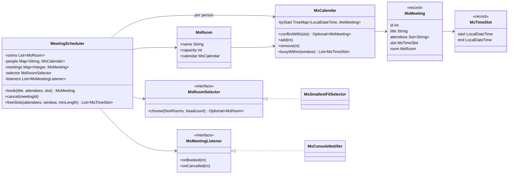
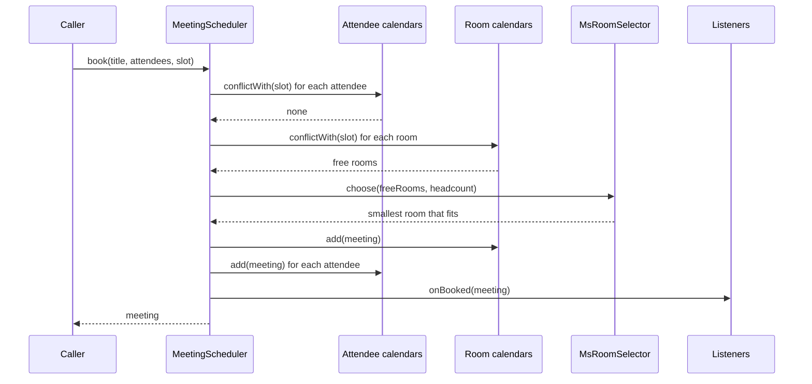

# Design a Meeting Room / Calendar Scheduler
Book rooms and people for time slots without double-booking either, pick the right room, find common free time, and notify attendees.

## Intuition

> **Design intuition**: every room and every person is a calendar, and every calendar is a sorted list of non-overlapping intervals. Booking a meeting is "check N + 1 calendars for a clash, then insert into all of them at once". Everything else (room choice, free-slot search, notifications) sits on top of that one interval structure.

**Key insight**: because intervals in one calendar never overlap, they are sorted by start and by end at the same time. So the only meeting that can clash with a new slot is the last one that starts before the new slot ends: one `TreeMap.lowerEntry(slot.end)` lookup, O(log n), no scan. Use half-open intervals `[start, end)` so a 10:00 to 10:30 meeting and a 10:30 to 11:00 meeting are back-to-back, not a conflict.

**Full runnable implementation:** [`MeetingScheduler.java`](MeetingScheduler.java), one file, `main()` on `MeetingScheduler`. It demonstrates `MsCalendar`'s single-lookup conflict check, `MsSmallestFitSelector` choosing the smallest free room that fits and falling back to a larger one when the small rooms are busy, rejection when an attendee is already booked or no room is large enough, back-to-back meetings allowed by half-open intervals, a common-free-time search that merges every attendee's busy intervals, and `MsConsoleNotifier` receiving invites and cancellations through the Observer interface.

---

## Problem Statement

Design a scheduler for an office:

```java
MsMeeting m = scheduler.book("Design review", Set.of("carol", "dave", "erin"), slot("10:00", "11:00"));
scheduler.cancel(m.id());
List<MsTimeSlot> options = scheduler.freeSlots(Set.of("alice", "carol"), slot("09:00", "12:00"), Duration.ofMinutes(30));
```

Variants appear as "design a meeting room booking system", "design Google Calendar (LLD)", and LeetCode's "Meeting Rooms II" (minimum rooms for a list of intervals) as a warm-up. The LLD version tests interval data structures, a selection strategy, atomic multi-resource booking, and notifications.

**Machine-coding time-box.** Build in order: `MsTimeSlot` with validation and the half-open overlap rule; one room calendar with the conflict check; booking across rooms with a simple first-fit; attendee calendars; then the smallest-fit strategy and free-slot search. Recurring meetings and time zones are follow-ups to discuss.

---

## Requirements

### Functional
1. Rooms have a name and a capacity.
2. `book(title, attendees, slot)` picks a free room with capacity at least the headcount, and fails if any attendee is busy or no room fits.
3. A person and a room can never be in two overlapping meetings.
4. `cancel(id)` frees the room and every attendee's calendar.
5. `freeSlots(attendees, window, minLength)` returns gaps in the window where all attendees are free, each at least `minLength`.
6. Attendees are notified on booking and cancellation.

### Non-Functional
1. Conflict check O(log n) per calendar; booking O(A log n + R log n) for A attendees and R rooms.
2. Concurrent bookings must not double-book a room or a person.
3. Room choice is a replaceable policy.

---

## Class Diagram



Rooms and people share one `MsCalendar` class: the conflict rule is the same for both, so it is written once.

---

## Patterns Used

### 1. Strategy: `MsRoomSelector`
**Why**: which free room to give a meeting is a business policy that changes: smallest fit to keep big rooms free, nearest to the organizer's floor, rooms with video equipment. The scheduler passes the free rooms and the headcount and accepts any `Optional<MsRoom>`. See [Strategy](../behavioral/strategy/strategy.md).

### 2. Observer: `MsMeetingListener`
**Why**: notifications (email, chat, calendar sync) are side effects that should not live in the booking logic. Each channel is a listener. See [Observer](../behavioral/observer/observer.md) and [NotificationService](NotificationService.md) for a full notification design.

**Where it's the wrong fit**: listeners here run synchronously inside the `synchronized` booking method, so a slow email call would hold the lock. In production publish an event after the booking commits and deliver asynchronously.

### 3. Value objects: `MsTimeSlot` record
**Why**: the record's compact constructor rejects `start >= end`, so an invalid interval cannot exist anywhere in the system, and every overlap computation can assume `start < end`.

---

## Design Decisions & Tradeoffs

### Interval structure per calendar

| Structure | Conflict check | Insert | Notes |
|-----------|----------------|--------|-------|
| List, scan all | O(n) | O(1) | Fine for 10 meetings, not for a room booked every 15 minutes for a year (35,000 slots) |
| **`TreeMap<start, meeting>` (chosen)** | O(log n), one `lowerEntry` | O(log n) | Valid only because entries in one calendar never overlap |
| Interval tree | O(log n + k) | O(log n) | Needed when entries can overlap, such as a person's tentative invitations |
| Bitmap of fixed slots (e.g. 15-min) | O(slots in meeting) | O(slots) | Simple and fast for fixed granularity; wastes space for long horizons |

### Why one `lowerEntry` is enough

Entries in one calendar do not overlap, so if they are sorted by start they are also sorted by end. Take the last meeting `M` that starts before the new slot's end. Every other meeting that starts before the new slot's end ends no later than `M` does. If `M` ends at or before the new slot's start, they all do, and nothing overlaps. A second lookup is unnecessary.

### Room selection policies

| Policy | Effect | Risk |
|--------|--------|------|
| First fit (list order) | Simple | Small meetings occupy large rooms |
| **Smallest fit (chosen)** | Keeps large rooms for large meetings | Small rooms run out first; a 2-person meeting may get a 10-person room at peak, as in the sample output |
| Best fit with lookahead | Considers known future requests | More complex; still a heuristic, since optimal room assignment for a known batch is interval scheduling |

### Atomic booking across many calendars

A booking touches one room and A attendee calendars. If two bookings check and insert independently, both can pass the check for `alice` and both insert: a double booking. This design makes `book` and `cancel` `synchronized`, so check-then-insert across all calendars is one critical section. The ceiling is one booking at a time per scheduler; at office scale (hundreds per minute) that is ample. To scale, lock each calendar involved, acquired in a fixed order (sort by room name and person ID) to avoid deadlock.

### Half-open intervals

`[start, end)` makes `10:00-10:30` and `10:30-11:00` non-overlapping, uses the same comparison everywhere (`a.start < b.end && b.start < a.end`), and makes lengths add up (`[9,10) + [10,11) = [9,11)`). Closed intervals force one-minute gaps or special-case equality.

---

## State / Flow



**Free-slot search**: collect every attendee's busy intervals inside the window, sort by start, then sweep a cursor from the window start. Each busy interval that starts after the cursor leaves a gap; the cursor then moves to `max(cursor, busy.end)`. Overlapping busy intervals from different people merge naturally because the cursor only moves forward.

---

## Implementation

Core of [`MeetingScheduler.java`](MeetingScheduler.java):

```java
record MsTimeSlot(LocalDateTime start, LocalDateTime end) {
    MsTimeSlot {
        if (!start.isBefore(end)) throw new IllegalArgumentException("start must be before end");
    }
}

final class MsCalendar {
    private final TreeMap<LocalDateTime, MsMeeting> byStart = new TreeMap<>();

    Optional<MsMeeting> conflictWith(MsTimeSlot slot) {
        Map.Entry<LocalDateTime, MsMeeting> e = byStart.lowerEntry(slot.end());   // last meeting starting before our end
        if (e != null && e.getValue().slot().end().isAfter(slot.start())) return Optional.of(e.getValue());
        return Optional.empty();
    }
}

final class MsSmallestFitSelector implements MsRoomSelector {
    public Optional<MsRoom> choose(List<MsRoom> freeRooms, int headcount) {
        return freeRooms.stream()
                .filter(r -> r.capacity >= headcount)
                .min(Comparator.comparingInt((MsRoom r) -> r.capacity).thenComparing(r -> r.name));
    }
}
```

```java
public synchronized MsMeeting book(String title, Set<String> attendees, MsTimeSlot slot) {
    for (String person : new TreeSet<>(attendees)) {
        Optional<MsMeeting> clash = calendarOf(person).conflictWith(slot);
        if (clash.isPresent()) {
            throw new MsSchedulingException(person + " is busy in '" + clash.get().title() + "' " + clash.get().slot());
        }
    }
    List<MsRoom> free = rooms.stream().filter(r -> r.calendar.conflictWith(slot).isEmpty()).toList();
    MsRoom room = selector.choose(free, attendees.size())
            .orElseThrow(() -> new MsSchedulingException("no free room for " + attendees.size() + " at " + slot));
    MsMeeting m = new MsMeeting(ids.incrementAndGet(), title, Set.copyOf(attendees), slot, room);
    room.calendar.add(m);
    for (String person : attendees) calendarOf(person).add(m);
    meetings.put(m.id(), m);
    listeners.forEach(l -> l.onBooked(m));
    return m;
}

public synchronized List<MsTimeSlot> freeSlots(Set<String> attendees, MsTimeSlot window, Duration minLength) {
    List<MsTimeSlot> busy = new ArrayList<>();
    for (String person : attendees) busy.addAll(calendarOf(person).busyWithin(window));
    busy.sort(Comparator.comparing(MsTimeSlot::start));
    List<MsTimeSlot> free = new ArrayList<>();
    LocalDateTime cursor = window.start();
    for (MsTimeSlot b : busy) {
        if (b.start().isAfter(cursor)) addIfLongEnough(free, cursor, min(b.start(), window.end()), minLength);
        if (b.end().isAfter(cursor)) cursor = b.end();
    }
    addIfLongEnough(free, cursor, window.end(), minLength);
    return free;
}
```

Every check runs before any insert, so a failed booking changes nothing.

---

## Sample Output

Output of `java MeetingScheduler` on JDK 25:

```
== booking ==
  invite  #1 '1:1' 10:00-10:30 in Huddle-2 -> [alice, bob]
  invite  #2 'Design review' 10:00-11:00 in Focus-4 -> [carol, dave, erin]
  invite  #3 'Vendor sync' 10:15-10:45 in Board-10 -> [frank, grace]
  reject  'Planning' 10:30-11:00: carol is busy in 'Design review' 10:00-11:00
  invite  #4 'Follow-up' 10:30-11:00 in Huddle-2 -> [alice, bob]
  reject  'All hands' 14:00-15:00: no free room for 11 at 14:00-15:00
== free slots for alice + carol, 09:00-12:00, >= 30 min ==
  [09:00-10:00, 11:00-12:00]
== cancel the design review ==
  cancel  #2 'Design review' -> [carol, dave, erin]
  [09:00-10:00, 11:00-12:00]
  invite  #5 'Planning' 11:00-11:30 in Huddle-2 -> [alice, carol]
```

"Vendor sync" needs 2 seats but gets the 10-seat room, because `Huddle-2` and `Focus-4` are busy at 10:15: smallest fit picks among free rooms only. "Follow-up" at 10:30 reuses `Huddle-2` immediately after the 10:30 end, which only works with half-open intervals. After the cancellation the free slots do not change, because `alice` is still busy from 10:00 to 11:00.

---

## Cross-Perspective: HLD Connections

- **Distributed booking** replaces the `synchronized` method with a database constraint: PostgreSQL's exclusion constraint `EXCLUDE USING gist (room_id WITH =, slot WITH &&)` on a `tstzrange` column rejects overlapping rows atomically, even across many application servers. See [Concurrency Control and Locking](../../database/concurrency_control_and_locking/concurrency_control_and_locking.md).
- **Hotel and ticket booking** are the same interval problem with inventory counts; see [OnlineBookingSystem](OnlineBookingSystem.md).
- **Calendar sync across providers** uses iCalendar (RFC 5545) for events and recurrence rules, and webhooks or polling for changes.

---

## Follow-Up Extensions

1. **Recurring meetings**: store an iCalendar `RRULE` (RFC 5545) and expand occurrences within a query window, rather than inserting a year of rows; exceptions (one cancelled occurrence) are stored separately.
2. **Time zones**: store instants (`Instant` or `OffsetDateTime`) and convert to each attendee's zone for display; a "9:00 daily" meeting is defined in the organizer's zone and moves for others across DST changes.
3. **Optional attendees and tentative replies**: keep them out of the hard conflict check, which then needs an interval tree because tentative entries may overlap.
4. **Room features**: filter free rooms by required equipment before the selector runs.
5. **Waitlist**: when no room is free, queue the request and retry on each cancellation event for that slot.

---

## Interview Questions with Answers

**Q: Why can one `TreeMap.lowerEntry(end)` lookup detect every conflict?**
**Short:** Meetings in one calendar never overlap, so sorted by start they are also sorted by end, and the last one starting before the new end is the only one that can overlap.

If any meeting overlaps the new slot, it starts before the slot's end. Among those, the last to start also ends last, because non-overlapping intervals cannot nest. So checking whether that one meeting ends after the slot's start answers the question for all of them in O(log n). The argument fails if a calendar may hold overlapping entries, such as tentative invitations, which then need an interval tree.

**Q: Why use half-open intervals `[start, end)`?**
**Short:** They let back-to-back meetings touch without overlapping, keep one overlap formula everywhere, and make adjacent lengths add up exactly.

With closed intervals, a 10:00 to 10:30 meeting and a 10:30 to 11:00 meeting share the instant 10:30 and would conflict, forcing artificial gaps. With half-open intervals, overlap is `a.start < b.end && b.start < a.end` with strict comparisons and no special cases. `java.time`, PostgreSQL's default `[)` ranges and most calendar systems use the same convention.

**Q: How do you prevent two concurrent bookings from double-booking the same person?**
**Short:** Make check and insert across every involved calendar one atomic step, either with one lock for booking or with per-calendar locks acquired in a fixed order.

The race is check-then-act: both requests see `alice` free, then both insert. Here `book` is `synchronized`, so checking all attendee and room calendars and inserting into them happens in one critical section. Per-calendar locks scale better but must be acquired in a global order (for example sorted IDs) or two bookings that share two people can deadlock. In a database, a unique or exclusion constraint makes the store reject the second insert.

**Q: Why choose the smallest room that fits, and when does that policy fail?**
**Short:** It keeps large rooms available for large meetings, but it decides one request at a time, so a later large meeting can still find every big room taken by small ones that arrived when small rooms were busy.

Smallest fit is a greedy heuristic. It is good when requests arrive online in unknown order. In the sample, a 2-person meeting at 10:15 takes the 10-person room because the small rooms are busy; an 8-person meeting arriving later at 10:15 would then fail. Fixes include reserving large rooms for meetings above a size until shortly before the slot, or batching requests and solving the assignment offline.

**Q: How do you find a time when all attendees are free?**
**Short:** Collect each attendee's busy intervals in the window, sort by start, and sweep a cursor forward, recording each gap of at least the required length.

The cursor starts at the window start. For each busy interval in start order, a start after the cursor means a gap from cursor to that start; then the cursor moves to the later of itself and the interval's end, which merges overlaps across people. A final gap runs from the cursor to the window end. Cost is O(B log B) for B busy intervals, dominated by the sort.

**Q: How many rooms are needed for a given list of meetings (Meeting Rooms II)?**
**Short:** Sort start times and end times separately and sweep both; the maximum number of meetings in progress at once is the answer, in O(n log n).

Walk both sorted arrays: a start before the next end adds a room in use, otherwise an end frees one, and the peak is the minimum number of rooms. A min-heap of end times gives the same answer and also tells you which room to reuse. In the scheduler, this number tells facilities whether the room count matches demand at peak hours.

**Q: Why should notifications not run inside the booking lock?**
**Short:** Sending email or chat messages can take hundreds of milliseconds or fail, and doing it inside the lock blocks every other booking and can make a failed notification look like a failed booking.

The booking's correctness depends only on the calendars. Listeners called inside `synchronized` extend the critical section by their I/O time, so throughput collapses when the mail server is slow. Publish an event after the booking is committed and deliver it asynchronously with retries; a lost notification can be resent, but a lock held for 2 seconds delays every user.

**Q: How would you model recurring meetings?**
**Short:** Store one series with an RFC 5545 recurrence rule and expand occurrences inside the query window, storing exceptions such as one cancelled or moved occurrence separately.

Materializing every occurrence of a weekly meeting with no end date is impossible, and materializing a year is 52 rows per series to update on every change. Store the `RRULE` (for example `FREQ=WEEKLY;BYDAY=MO`), expand it lazily for conflict checks within the needed window, and keep exception dates and overrides. Conflict checking a new recurring series against existing ones needs expansion over a bounded horizon, often 6 to 12 months.

**Q: How do time zones and daylight saving time affect the design?**
**Short:** Store instants, not local times, and define recurring meetings in the organizer's zone, because a wall-clock meeting moves relative to UTC when DST changes.

A 9:00 New York daily standup is 14:00 UTC in winter and 13:00 UTC in summer. Storing `LocalDateTime` without a zone makes conflicts across offices wrong. Store `Instant` or `ZonedDateTime` for single meetings, keep the zone ID with recurring series, and expand occurrences in that zone. The demo uses `LocalDateTime` on one day in one office, which is valid only under that assumption.

**Q: What does an atomic booking look like in a relational database?**
**Short:** An exclusion constraint on the room and a time range rejects overlapping rows, so concurrent inserts from many servers cannot double-book, with no application lock.

PostgreSQL supports `EXCLUDE USING gist (room_id WITH =, during WITH &&)` on a `tstzrange` column, with the `btree_gist` extension for the equality part. Two transactions inserting overlapping slots for one room: the second fails with an exclusion violation. Attendee conflicts need the same constraint on an attendee-booking table. Without range types, use `SELECT ... FOR UPDATE` on the room row before checking, which serializes bookings per room.

**Q: Why is `MsTimeSlot` a record with a validating constructor?**
**Short:** The compact constructor rejects start not before end, so every slot in the system is valid and overlap code never has to handle empty or inverted intervals.

Validation at construction makes the invariant hold everywhere the type is used, instead of at each API boundary. Records also give value equality and an immutable shape, so a slot can be used as a map key or shared between meetings safely. This is the "make illegal states unrepresentable" approach applied to time intervals.

**Q: How would you support tentative or optional attendees?**
**Short:** Keep them out of the hard conflict check, store their entries in a structure that allows overlaps such as an interval tree, and report soft conflicts as warnings.

A person may have several tentative invitations at the same time, so their calendar can contain overlapping entries, which breaks the single-lookup trick. An interval tree returns all overlapping entries in O(log n + k). The scheduler then blocks booking only on accepted meetings of required attendees and returns soft conflicts for the organizer to decide.

**Q: Where would you put room features like video equipment or accessibility?**
**Short:** As attributes on the room, filtered before the room selector runs, so the selector still only chooses among rooms that satisfy every hard requirement.

Hard requirements (capacity, video, wheelchair access) are filters: a room either qualifies or not. Preferences (same floor as the organizer, natural light) belong in the selector's ranking. Mixing them into one score makes it possible to pick a room that lacks a required feature because it scored well on preferences.

**Q: How would you scale the scheduler to a company of 100,000 people across many offices?**
**Short:** Partition by office or building so each partition schedules its own rooms, and keep person calendars in a separate service checked on booking, with database constraints guarding both.

Rooms are local to a building, so room scheduling partitions cleanly and each partition can use per-room locking or database constraints. People span offices, so their calendars live in a shared calendar service; a booking reserves the room in its partition and inserts attendee entries with conflict checks there, using a saga or two-phase approach if both must succeed together. Free-time queries for many people are read-heavy and can use cached busy intervals.

**Q: Which edge cases does a booking API need to reject?**
**Short:** Start not before end, slots in the past, an empty attendee list, a headcount above every room's capacity, and duplicate attendees, each with a clear error naming the cause.

The record constructor covers inverted and zero-length slots. Past slots and empty attendee sets are request validation. A headcount above the largest room fails fast before any search. Using a `Set` for attendees removes duplicates, so a person listed twice does not inflate the headcount or conflict with themselves. Reporting which attendee is busy and in which meeting, as the sample output does, lets the caller fix the request.

---
