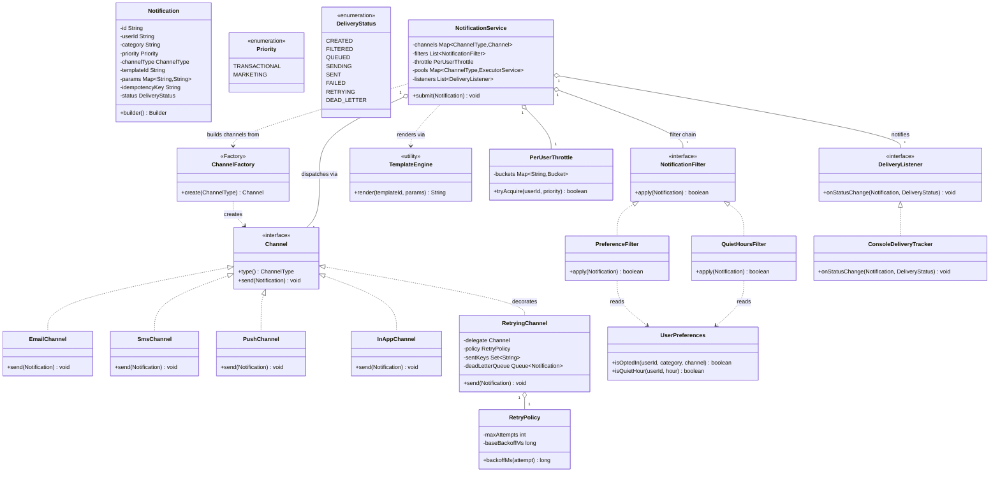
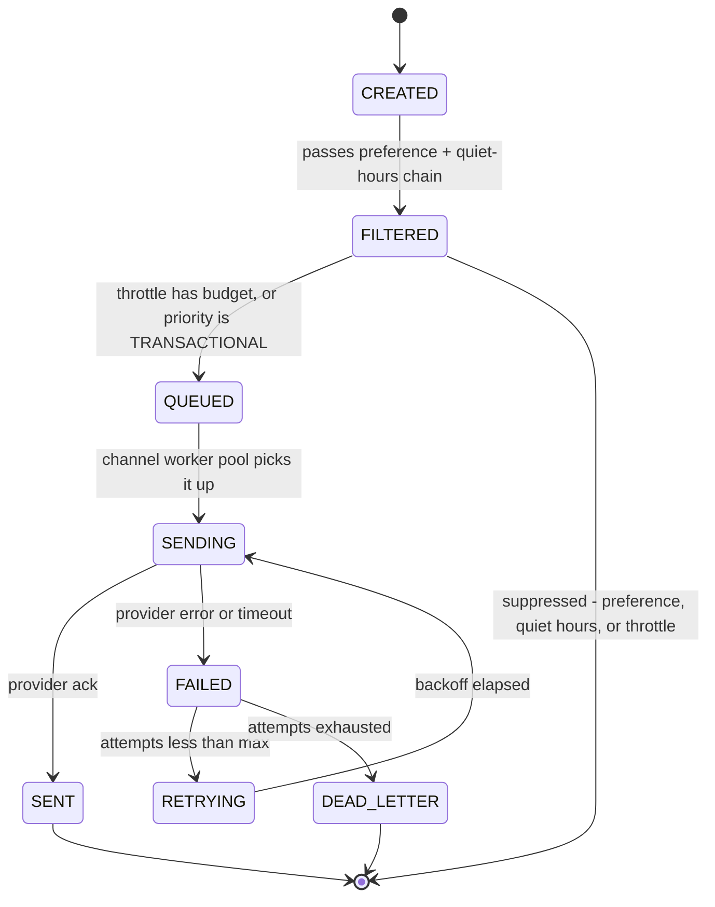
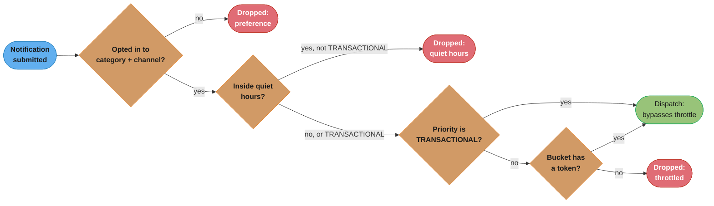

# Design a Notification Service

*One event, many channels, per-user preferences, priority classes, and a retry path that cannot double-send — as a single-JVM class design.*

## Intuition

> **Design intuition**: a notification service is one method — `submit(Notification)` — behind which sits a fan-out problem dressed as a class-design problem. The interview isn't "can you call the Twilio SDK," it's "can you decompose channel selection, per-user preference, priority, throttling, and retry into objects that don't know about each other's internals, and can you do it without one slow provider stalling every other channel."

**Key insight**: the two requirements that fight each other are "retry on failure" and "never send twice." A naive retry loop treats every exception the same way — network blip or provider-actually-accepted-it-and-the-ack-was-lost — and a blind retry after the second kind is a duplicate OTP, a duplicate charge-confirmation email, a duplicate "your order shipped" push. The fix isn't a smarter retry loop; it's moving the decision earlier — check an idempotency key *before* dispatching, so a retry after a lost acknowledgement becomes a no-op instead of a second send. That single design decision, not the channel abstraction, is what separates a working notification service from one that quietly spams users under load.

**Full runnable implementation:** [`NotificationService.java`](NotificationService.java) — 412 lines, one file, `main()` at the bottom. It demonstrates the `Notification` Builder deriving an idempotency key from the logical event, four `Channel` strategies behind `ChannelFactory`, the preference/quiet-hours filter chain, a per-user token-bucket throttle that `TRANSACTIONAL` bypasses, `RetryingChannel` as the Decorator whose claim-the-key-first fix makes a retry after a lost acknowledgement a no-op, and one fixed thread pool per channel type as a bulkhead — driven by a `main()` that sends a transactional OTP, a five-notification marketing burst against a bucket of 3, and one opted-out send. The same listing is reproduced in [Implementation](#implementation) below.

---

## Problem Statement

Design an in-process notification service. A producer somewhere in the system — Orders, Fraud, Marketing — calls one method:

```java
void submit(Notification notification);
```

and the service decides, per notification: is this user opted in to this category on this channel, is it inside their quiet hours, does the sender have throttle budget left, which channel handles it, and — if the provider fails — whether to retry, and how to guarantee the retry cannot duplicate a send.

Requirements given in the prompt are typically:
- "One event needs to reach a user by email, SMS, push, or in-app — pick the channel abstraction."
- "Users can opt out per category and per channel, and set quiet hours — respect both."
- "A payment-failed alert must never be delayed or dropped; a promo email can be."
- "If sending fails, retry — but don't double-send if the retry races with a delayed success."

**This is the LLD / single-JVM angle**: one process, in-memory preference and throttle state, a clean interface per channel, and thread safety inside one heap — the kind of design you build in 90 minutes in an IDE, not the kind that spans services. For the **distributed-systems angle** — Kafka for durable fan-out, per-provider rate limiters across many service instances, 500M-DAU scale estimation, and quiet-hours-by-timezone at population scale — see [`../../hld/case_studies/design_notification_system.md`](../../hld/case_studies/design_notification_system.md). The channel abstraction and the idempotency-before-dispatch rule here are the same idea at any scale; what changes is *where the state lives* (a `ConcurrentHashMap` here vs. Kafka partitions and a Redis dedupe store there).

---

## Requirements

### Functional

1. One entry point, `NotificationService.submit(Notification)`, dispatches to a channel behind a single `Channel` interface — email, SMS, push, in-app, webhook
2. Per-user, per-category, per-channel preferences: a user can opt out of `marketing` on `SMS` while staying opted in on `email`
3. Quiet hours: a user-configured local-time window during which non-critical sends are suppressed, not queued for later
4. Templates: a producer sends a `templateId` and a parameter map; the service renders the final text via `{variable}` substitution
5. Two priority classes: `TRANSACTIONAL` (OTP, payment failure, security alert) — must never be throttled and must never be suppressed by quiet hours; `MARKETING` (promotions, re-engagement) — may be both
6. Retry with exponential backoff on a transient provider failure, and a dead-letter path once retries are exhausted
7. Delivery-status tracking through an explicit lifecycle, observable by registered listeners

### Non-Functional

1. Thread-safe under concurrent `submit()` calls from many producer threads at once
2. Adding a sixth channel touches zero existing classes (Strategy + Factory, not a `switch` on channel type)
3. A slow or degraded provider on one channel must never delay or block delivery on another channel (bulkhead)
4. Bounded memory — one throttle bucket per *active* user, not one per notification, not one per all-time user
5. No duplicate sends on retry, even when the provider's acknowledgement is lost after the message was actually accepted

---

## Class Diagram



`Channel` is a Strategy realized by four concrete providers plus one decorator (`RetryingChannel`) that wraps any of them. `NotificationFilter` is a two-step Chain of Responsibility. `NotificationService` is the orchestrator — it owns the filter chain, the throttle, one worker pool per channel type (the bulkhead), and the listener list, but it never touches provider-specific logic; that lives entirely inside each `Channel` implementation.

---

## Patterns Used

### 1. Strategy — `Channel`
**Why**: the channel a notification goes out on is a pluggable algorithm behind one contract, `send(Notification)`. An interviewer's most common live extension for this problem is "now add Slack" — with Strategy, that's a new class implementing `Channel`, zero changes to `NotificationService`.
**Wrong fit**: if every channel needed the *same* retry/backoff/dedup logic duplicated inside it, Strategy alone would scatter that logic four times. That's why retry lives in a Decorator around the strategy, not inside each strategy.

### 2. Simple Factory — `ChannelFactory`
**Name it precisely** (same discipline as this section's [RateLimiter](RateLimiter.md#patterns-used)): a static `create(ChannelType)` switching on an enum is a **Simple Factory**, not GoF Factory Method or Abstract Factory — neither of those describes a static switch statement.
**Why**: centralizes construction so `NotificationService` never does `new EmailChannel()` directly.
**Wrong fit**: if channel construction needed per-request configuration — a different SendGrid API key per tenant, say — a static factory can't carry that; a small DI container or an `Abstract Factory` per tenant would fit better.

### 3. Observer — `DeliveryListener`
**Why**: dashboards, producer webhooks, and audit logs all want "tell me when a notification's status changes" without `NotificationService` knowing who's listening or how many listeners exist.
**Wrong fit**: this implementation calls listeners synchronously on the dispatching thread. A slow or blocking listener stalls that thread's next dispatch — production systems publish status changes to a queue and let listeners consume asynchronously instead of calling them inline. Not implemented here; called out as a cut (see Follow-Up Extensions).

### 4. Builder — `Notification.Builder`
**Why**: `Notification` has five required fields and an open-ended parameter map; a Builder makes construction readable and lets `build()` validate required fields in one place rather than validating N constructor overloads.
**Wrong fit**: for a two- or three-field value type, a Builder is ceremony over a constructor — see [`../creational/builder/builder.md`](../creational/builder/builder.md) for where the line sits.

### 5. Decorator — `RetryingChannel`
**Why**: retry, exponential backoff, idempotency-key dedup, and dead-lettering are cross-cutting concerns that apply identically regardless of which provider is underneath. Wrapping any `Channel` in `RetryingChannel` adds all four without touching `EmailChannel`, `SmsChannel`, or the interface itself.
**Wrong fit**: if channels genuinely needed *different* retry policies — SendGrid has no server-side idempotency support, Twilio does — a single shared `RetryPolicy` per `RetryingChannel` instance is actually the right shape (one instance per channel, each configured differently), but a *single* policy object reused across all channels would be wrong. This design instantiates one `RetryingChannel` per channel type for exactly that reason.

### 6. Chain of Responsibility — `PreferenceFilter` → `QuietHoursFilter`
**Why**: preference and quiet-hours checks are independent pass/fail gates that should be addable, removable, or reorderable without touching each other or the caller.
**Wrong fit**: `NotificationFilter.apply()` returns a bare `boolean` — it can't carry *why* a filter rejected the notification, which is why both filters are checked in `Design Decisions` as terminating at the same `FILTERED` status rather than a distinguishable one. A richer chain would return a reason code, not just allow/deny.

---

## Design Decisions & Tradeoffs

| Decision | Chosen | Why | Rejected alternative |
|---|---|---|---|
| Throttle scope | Per-user token bucket; `TRANSACTIONAL` bypasses it entirely | Protects each user's own quota from every *other* user's marketing blast, at O(active users) memory | A single global bucket caps total output but does nothing to stop one user's traffic from starving everyone else's — the bucket has no notion of whose request it is |
| Dispatch | Async — `submit()` filters and throttles synchronously, then hands off to a per-channel `ExecutorService` and returns | A caller gets an immediate accept/reject; the actual provider I/O never runs on the caller's thread | Fully synchronous dispatch would make `submit()`'s latency equal to the slowest provider's, defeating the "fast producer, slow provider" split entirely |
| Worker pools | One fixed pool **per channel type** | A backlog of slow Twilio calls exhausts only the SMS pool's threads — email keeps sending on its own, untouched pool (the bulkhead) | One shared pool sized for the whole system reintroduces the coupling the bulkhead exists to remove: a burst of slow SMS sends can consume every thread, leaving zero for a perfectly healthy email provider |
| Idempotency | A `Set<String>` of already-sent idempotency keys, owned by `RetryingChannel`, checked *before* every dispatch | Provider-agnostic: it catches a duplicate whether the provider supports its own dedup (Twilio's `Idempotency-Key` header) or not at all (SendGrid — see Q&A) | Relying only on the provider's own idempotency support fails for SendGrid outright, and even where a provider supports it, that only dedupes one literal retried HTTP request, not two logically-identical `submit()` calls with different notification ids |
| Quiet hours vs. transactional | `QuietHoursFilter` checks `priority == TRANSACTIONAL` **first**, before it ever reads the clock | A fraud alert is not a courtesy notification — it must never wait for morning | Checking the clock first and priority second would suppress a genuinely urgent alert during a user's quiet window, which is the one outcome the requirement explicitly forbids |
| Full-queue drop policy | Not implemented — fixed pools with the default unbounded queue | Named as a cut under the 90-minute clock (see below), not silently skipped | A production `ThreadPoolExecutor` needs an explicit bounded queue and a rejection policy that differs by priority: drop `MARKETING`, escalate or page on-call before dropping `TRANSACTIONAL` |

**The sharp one is throttle scope.** A global limiter answers one question — "are we, in aggregate, within what our providers can absorb" — and answers it well. It cannot answer a second question that matters just as much: "is any single user's traffic crowding out everyone else's." Those are different failure modes with different fixes, and a per-user bucket is the one that actually protects other users, at the cost of state that is bounded only because `computeIfAbsent` creates a bucket lazily, per active user, not per all-time user — a real deployment still needs a TTL eviction for buckets belonging to users who stopped sending, which this 90-minute design does not implement.

---

## State / Flow

The lifecycle of one notification, `CREATED` through a terminal state:



A notification that never reaches a provider terminates at `FILTERED` for any of three reasons — opted out, inside quiet hours, or out of throttle budget — because none of those are provider failures and none of them should ever retry. `DEAD_LETTER` is reserved for the opposite case: the provider was actually asked and refused every attempt.

The filter chain that decides `CREATED → FILTERED`, and what happens after:



`TRANSACTIONAL` has two separate escape hatches in this chain, not one — it skips suppression inside `QuietHoursFilter` and skips consumption inside `PerUserThrottle` — because "never throttled" and "never delayed by quiet hours" are two distinct requirements that happen to share a priority check.

---

## Implementation

Reproduced from the companion [`NotificationService.java`](NotificationService.java). Organized as one conceptual listing: enums and the `Notification` value type, the `Channel` strategy family, the filter chain, the throttle, the retry decorator shown broken then fixed, the orchestrating `NotificationService`, and a `main()` that drives a scripted demo. Split into one file per public type for a real project; shown together here for readability.

**Enums and the `Notification` value type (Builder pattern):**

```java
public enum Priority { TRANSACTIONAL, MARKETING }

public enum ChannelType { EMAIL, SMS, PUSH, IN_APP, WEBHOOK }

public enum DeliveryStatus {
    CREATED, FILTERED, QUEUED, SENDING, SENT, FAILED, RETRYING, DEAD_LETTER
}

public final class Notification {
    private final String id = java.util.UUID.randomUUID().toString();
    private final String userId;
    private final String category;
    private final Priority priority;
    private final ChannelType channelType;
    private final String templateId;
    private final Map<String, String> params;
    private final String idempotencyKey;
    private volatile DeliveryStatus status = DeliveryStatus.CREATED;
    private final AtomicInteger attempts = new AtomicInteger(0);

    private Notification(Builder b) {
        this.userId = b.userId;
        this.category = b.category;
        this.priority = b.priority;
        this.channelType = b.channelType;
        this.templateId = b.templateId;
        this.params = Map.copyOf(b.params);
        // Derived from the LOGICAL event, not the random id above — a producer retrying
        // submit() for "the same" OTP must land on the same key both times.
        this.idempotencyKey = userId + ":" + category + ":" + templateId + ":" + params;
    }

    public static Builder builder() { return new Builder(); }

    public String id() { return id; }
    public String userId() { return userId; }
    public String category() { return category; }
    public Priority priority() { return priority; }
    public ChannelType channelType() { return channelType; }
    public String templateId() { return templateId; }
    public Map<String, String> params() { return params; }
    public String idempotencyKey() { return idempotencyKey; }
    public DeliveryStatus status() { return status; }
    void setStatus(DeliveryStatus s) { this.status = s; }
    int nextAttempt() { return attempts.incrementAndGet(); }

    public static final class Builder {
        private String userId, category, templateId;
        private Priority priority = Priority.MARKETING;
        private ChannelType channelType;
        private final Map<String, String> params = new HashMap<>();

        public Builder userId(String v) { this.userId = v; return this; }
        public Builder category(String v) { this.category = v; return this; }
        public Builder priority(Priority v) { this.priority = v; return this; }
        public Builder channel(ChannelType v) { this.channelType = v; return this; }
        public Builder template(String v) { this.templateId = v; return this; }
        public Builder param(String k, String v) { this.params.put(k, v); return this; }

        public Notification build() {
            Objects.requireNonNull(userId, "userId");
            Objects.requireNonNull(channelType, "channelType");
            Objects.requireNonNull(templateId, "templateId");
            return new Notification(this);
        }
    }
}
```

**The `Channel` strategy family and `ChannelFactory`:**

```java
public interface Channel {
    ChannelType type();
    /** Throws on a transient provider failure; RetryingChannel decides what happens next. */
    void send(Notification n) throws ChannelException;
}

public final class ChannelException extends Exception {
    public ChannelException(String message) { super(message); }
}

public final class EmailChannel implements Channel {
    private final Random random = new Random();
    public ChannelType type() { return ChannelType.EMAIL; }
    public void send(Notification n) throws ChannelException {
        String body = TemplateEngine.render(n.templateId(), n.params());
        sleep(50); // simulated SES/SendGrid round trip
        if (random.nextInt(10) == 0) throw new ChannelException("provider 5xx");
        System.out.println("[EMAIL] -> " + n.userId() + " : " + body);
    }
    private void sleep(long ms) {
        try { Thread.sleep(ms); } catch (InterruptedException e) { Thread.currentThread().interrupt(); }
    }
}

public final class SmsChannel implements Channel {
    private final Random random = new Random();
    public ChannelType type() { return ChannelType.SMS; }
    public void send(Notification n) throws ChannelException {
        String body = TemplateEngine.render(n.templateId(), n.params());
        sleep(300); // deliberately the slow provider in this demo — proves the bulkhead
        if (random.nextInt(5) == 0) throw new ChannelException("provider timeout");
        System.out.println("[SMS]   -> " + n.userId() + " : " + body);
    }
    private void sleep(long ms) {
        try { Thread.sleep(ms); } catch (InterruptedException e) { Thread.currentThread().interrupt(); }
    }
}

public final class PushChannel implements Channel {
    public ChannelType type() { return ChannelType.PUSH; }
    public void send(Notification n) {
        // FCM HTTP v1 (OAuth2 service-account token) for Android, APNs (ES256 JWT) for iOS —
        // see Cross-Perspective; both are token-based, neither uses a long-lived server key.
        System.out.println("[PUSH]  -> " + n.userId() + " : " + TemplateEngine.render(n.templateId(), n.params()));
    }
}

public final class InAppChannel implements Channel {
    public ChannelType type() { return ChannelType.IN_APP; }
    public void send(Notification n) {
        System.out.println("[INAPP] -> " + n.userId() + " : " + TemplateEngine.render(n.templateId(), n.params()));
    }
}

public final class ChannelFactory {
    private static final Map<ChannelType, Channel> REGISTRY = Map.of(
        ChannelType.EMAIL, new EmailChannel(),
        ChannelType.SMS, new SmsChannel(),
        ChannelType.PUSH, new PushChannel(),
        ChannelType.IN_APP, new InAppChannel()
    );
    public static Channel create(ChannelType type) {
        Channel c = REGISTRY.get(type);
        if (c == null) throw new IllegalArgumentException("no channel wired for " + type);
        return c;
    }
}
```

**`TemplateEngine` and `UserPreferences`:**

```java
public final class TemplateEngine {
    private static final Map<String, String> TEMPLATES = Map.of(
        "order_shipped", "Your order {orderId} shipped, track at {trackingUrl}",
        "otp", "Your OTP is {code}, expires in 5 minutes",
        "promo", "{discount}% off today only!"
    );
    public static String render(String templateId, Map<String, String> params) {
        String result = TEMPLATES.getOrDefault(templateId, templateId);
        for (Map.Entry<String, String> e : params.entrySet()) {
            result = result.replace("{" + e.getKey() + "}", e.getValue());
        }
        return result;
    }
}

public final class UserPreferences {
    // "<userId>:<category>:<channel>" -> opted out. Composite key, O(1), lock-free reads.
    private final Set<String> optOuts = ConcurrentHashMap.newKeySet();
    // userId -> [quietStartHourLocal, quietEndHourLocal]
    private final Map<String, int[]> quietHours = new ConcurrentHashMap<>();

    public void optOut(String userId, String category, ChannelType channel) {
        optOuts.add(key(userId, category, channel));
    }
    public boolean isOptedIn(String userId, String category, ChannelType channel) {
        return !optOuts.contains(key(userId, category, channel));
    }
    public void setQuietHours(String userId, int startHourLocal, int endHourLocal) {
        quietHours.put(userId, new int[]{startHourLocal, endHourLocal});
    }
    public boolean isQuietHour(String userId, int currentHourLocal) {
        int[] window = quietHours.get(userId);
        if (window == null) return false;
        int start = window[0], end = window[1];
        return start <= end
            ? (currentHourLocal >= start && currentHourLocal < end)
            : (currentHourLocal >= start || currentHourLocal < end); // wraps past midnight
    }
    private String key(String userId, String category, ChannelType channel) {
        return userId + ":" + category + ":" + channel;
    }
}
```

**The preference / quiet-hours filter chain (Chain of Responsibility):**

```java
public interface NotificationFilter {
    /** True lets the notification continue; false stops the chain and drops it. */
    boolean apply(Notification n);
}

public final class PreferenceFilter implements NotificationFilter {
    private final UserPreferences prefs;
    public PreferenceFilter(UserPreferences prefs) { this.prefs = prefs; }
    public boolean apply(Notification n) {
        return prefs.isOptedIn(n.userId(), n.category(), n.channelType());
    }
}

public final class QuietHoursFilter implements NotificationFilter {
    private final UserPreferences prefs;
    public QuietHoursFilter(UserPreferences prefs) { this.prefs = prefs; }
    public boolean apply(Notification n) {
        if (n.priority() == Priority.TRANSACTIONAL) return true; // never suppressed
        int hourLocal = java.time.LocalTime.now().getHour(); // per-user zone in a real system
        return !prefs.isQuietHour(n.userId(), hourLocal);
    }
}
```

**`PerUserThrottle` — token bucket, bypassed entirely for `TRANSACTIONAL`:**

```java
public final class PerUserThrottle {
    private static final class Bucket { double tokens; long lastRefillMs; }
    private final Map<String, Bucket> buckets = new ConcurrentHashMap<>();
    private final double capacity;
    private final double refillPerSecond;

    public PerUserThrottle(double capacity, double refillPerSecond) {
        this.capacity = capacity;
        this.refillPerSecond = refillPerSecond;
    }

    public boolean tryAcquire(String userId, Priority priority) {
        if (priority == Priority.TRANSACTIONAL) return true; // the requirement, not an optimization
        Bucket b = buckets.computeIfAbsent(userId, k -> {
            Bucket nb = new Bucket();
            nb.tokens = capacity;
            nb.lastRefillMs = System.currentTimeMillis();
            return nb;
        });
        synchronized (b) { // per-bucket lock, not a global one — see Q&A
            long now = System.currentTimeMillis();
            double elapsedSec = (now - b.lastRefillMs) / 1000.0;
            b.tokens = Math.min(capacity, b.tokens + elapsedSec * refillPerSecond);
            b.lastRefillMs = now;
            if (b.tokens >= 1.0) { b.tokens -= 1.0; return true; }
            return false;
        }
    }
}
```

**`RetryPolicy` and the observer types:**

```java
public final class RetryPolicy {
    private final int maxAttempts;
    private final long baseBackoffMs;
    public RetryPolicy(int maxAttempts, long baseBackoffMs) {
        this.maxAttempts = maxAttempts;
        this.baseBackoffMs = baseBackoffMs;
    }
    public int maxAttempts() { return maxAttempts; }
    public long backoffMs(int attempt) { return baseBackoffMs * (1L << (attempt - 1)); }
}

public interface DeliveryListener {
    void onStatusChange(Notification n, DeliveryStatus status);
}

public final class ConsoleDeliveryTracker implements DeliveryListener {
    public void onStatusChange(Notification n, DeliveryStatus status) {
        System.out.println("[STATUS] " + n.id().substring(0, 8) + " " + n.userId() + " -> " + status);
    }
}
```

*Broken:* retrying blindly on any exception duplicates a send whose acknowledgement was simply lost on the wire — the provider may have already accepted it.

```java
// BROKEN: no idempotency check. If delegate.send(n) throws AFTER the provider already
// accepted the message (the response was lost, not the request), this retries anyway.
public final class RetryingChannelBroken implements Channel {
    private final Channel delegate;
    private final RetryPolicy policy;
    public RetryingChannelBroken(Channel delegate, RetryPolicy policy) {
        this.delegate = delegate;
        this.policy = policy;
    }
    public ChannelType type() { return delegate.type(); }
    public void send(Notification n) throws ChannelException {
        for (int attempt = 1; attempt <= policy.maxAttempts(); attempt++) {
            try {
                delegate.send(n);
                return;
            } catch (ChannelException e) {
                if (attempt == policy.maxAttempts()) throw e;
                sleep(policy.backoffMs(attempt));
            }
        }
    }
    private void sleep(long ms) {
        try { Thread.sleep(ms); } catch (InterruptedException e) { Thread.currentThread().interrupt(); }
    }
}
```

*Fix:* check the idempotency key before dispatching, so a retry after a lost acknowledgement is a no-op, not a second send.

```java
// FIX: claim the idempotency key BEFORE dispatching. Set.add() is atomic, so two concurrent
// attempts for the same logical event race safely — exactly one of them actually sends.
public final class RetryingChannel implements Channel {
    private final Channel delegate;
    private final RetryPolicy policy;
    private final Set<String> sentKeys = ConcurrentHashMap.newKeySet();
    private final Queue<Notification> deadLetterQueue = new ConcurrentLinkedQueue<>();

    public RetryingChannel(Channel delegate, RetryPolicy policy) {
        this.delegate = delegate;
        this.policy = policy;
    }
    public ChannelType type() { return delegate.type(); }

    public void send(Notification n) {
        if (!sentKeys.add(n.idempotencyKey())) {
            System.out.println("[DEDUP] skipped duplicate for " + n.idempotencyKey());
            return;
        }
        n.setStatus(DeliveryStatus.SENDING);
        for (int attempt = n.nextAttempt(); attempt <= policy.maxAttempts(); attempt = n.nextAttempt()) {
            try {
                delegate.send(n);
                n.setStatus(DeliveryStatus.SENT);
                return;
            } catch (ChannelException e) {
                n.setStatus(DeliveryStatus.FAILED);
                if (attempt == policy.maxAttempts()) {
                    n.setStatus(DeliveryStatus.DEAD_LETTER);
                    deadLetterQueue.add(n);
                    return;
                }
                n.setStatus(DeliveryStatus.RETRYING);
                sleep(policy.backoffMs(attempt));
            }
        }
    }
    public Queue<Notification> deadLetterQueue() { return deadLetterQueue; }
    private void sleep(long ms) {
        try { Thread.sleep(ms); } catch (InterruptedException e) { Thread.currentThread().interrupt(); }
    }
}
```

**`NotificationService` — filters, throttle, per-channel bulkhead pools, dispatch:**

```java
public final class NotificationService {
    private final List<NotificationFilter> filters;
    private final PerUserThrottle throttle;
    private final Map<ChannelType, Channel> channels = new ConcurrentHashMap<>();
    private final Map<ChannelType, ExecutorService> pools = new ConcurrentHashMap<>();
    private final List<DeliveryListener> listeners = new CopyOnWriteArrayList<>();

    public NotificationService(List<NotificationFilter> filters, PerUserThrottle throttle, RetryPolicy retryPolicy) {
        this.filters = filters;
        this.throttle = throttle;
        for (ChannelType type : ChannelType.values()) {
            if (type == ChannelType.WEBHOOK) continue; // cut for this demo — see Follow-Up
            channels.put(type, new RetryingChannel(ChannelFactory.create(type), retryPolicy));
            // One fixed pool PER channel type: the bulkhead. A backlog on SMS never
            // steals a thread that EMAIL needs.
            pools.put(type, Executors.newFixedThreadPool(2));
        }
    }

    public void addListener(DeliveryListener l) { listeners.add(l); }

    public void submit(Notification n) {
        for (NotificationFilter f : filters) {
            if (!f.apply(n)) {
                n.setStatus(DeliveryStatus.FILTERED);
                notifyListeners(n);
                return;
            }
        }
        n.setStatus(DeliveryStatus.FILTERED);
        if (!throttle.tryAcquire(n.userId(), n.priority())) {
            notifyListeners(n); // stays FILTERED: suppressed by throttle, not a provider failure
            return;
        }
        n.setStatus(DeliveryStatus.QUEUED);
        pools.get(n.channelType()).submit(() -> dispatch(n));
    }

    private void dispatch(Notification n) {
        try {
            channels.get(n.channelType()).send(n); // drives SENDING/SENT/FAILED/RETRYING/DEAD_LETTER
        } catch (ChannelException e) {
            // send() is declared `throws ChannelException`, and dispatch() runs inside a
            // bare Runnable -- so this MUST be handled here; `throws` would not compile.
            n.setStatus(DeliveryStatus.DEAD_LETTER);
        }
        notifyListeners(n);
    }

    private void notifyListeners(Notification n) {
        for (DeliveryListener l : listeners) l.onStatusChange(n, n.status());
    }

    public void shutdown() {
        pools.values().forEach(ExecutorService::shutdown);
    }
}
```

**`main()` — one transactional OTP, a five-notification marketing burst against a bucket of 3, and one preference-opted-out send:**

```java
public final class NotificationServiceDemo {
    public static void main(String[] args) throws InterruptedException {
        UserPreferences prefs = new UserPreferences();
        prefs.optOut("user-42", "marketing", ChannelType.SMS);
        prefs.setQuietHours("user-42", 22, 8);

        List<NotificationFilter> filters = List.of(new PreferenceFilter(prefs), new QuietHoursFilter(prefs));
        PerUserThrottle throttle = new PerUserThrottle(3, 1.0); // burst 3, refill 1/sec, MARKETING only
        RetryPolicy retryPolicy = new RetryPolicy(3, 200);

        NotificationService service = new NotificationService(filters, throttle, retryPolicy);
        service.addListener(new ConsoleDeliveryTracker());

        // Transactional: never throttled, never suppressed by quiet hours.
        service.submit(Notification.builder()
            .userId("user-7").category("security").priority(Priority.TRANSACTIONAL)
            .channel(ChannelType.SMS).template("otp").param("code", "482913").build());

        // Marketing burst: capacity 3, so requests 4 and 5 are throttled.
        // NOTE the varying param. The idempotency key is
        // userId:category:templateId:params -- five IDENTICAL sends would collapse onto one
        // key and be dropped by RetryingChannel's dedupe BEFORE the throttle ever saw them.
        // Five distinct offers is what actually exercises the rate limiter.
        for (int i = 1; i <= 5; i++) {
            service.submit(Notification.builder()
                .userId("user-88").category("marketing").priority(Priority.MARKETING)
                .channel(ChannelType.EMAIL).template("promo")
                .param("discount", String.valueOf(10 * i)).build());
        }

        // Opted-out channel: filtered before it ever reaches the throttle or a worker pool.
        service.submit(Notification.builder()
            .userId("user-42").category("marketing").priority(Priority.MARKETING)
            .channel(ChannelType.SMS).template("promo").param("discount", "50").build());

        Thread.sleep(3000); // let the worker pools drain
        service.shutdown();
    }
}
```

**Thread safety, explicitly.** `UserPreferences` uses `ConcurrentHashMap`/`newKeySet()` for lock-free reads on the hot preference-check path. `PerUserThrottle` synchronizes on the *individual user's* bucket object, not a shared lock, so users never contend with each other. `RetryingChannel.sentKeys` is a concurrent set whose `add()` is the atomic check-and-claim that makes the idempotency fix correct under concurrent retries. `Notification.status` is a plain `volatile` field, safe because exactly one thread — the worker that owns that notification through its whole dispatch — ever writes it; other threads (listeners) only read it, and `volatile` is exactly the tool for single-writer, multi-reader visibility. `attempts` is an `AtomicInteger` for the same reason a plain `int` would not be: `nextAttempt()` needs `++` to be a single indivisible operation even though, again, only one thread calls it per notification — the atomic type costs nothing here and removes the need to reason about it.

**Time-box note (90-minute round).** First 40 minutes: `Channel` interface, `Notification` + Builder, `EmailChannel`/`SmsChannel`, `ChannelFactory`, and a `main()` that sends one notification end to end with no filters, no throttle, no retry — a trivial path running early, per [§3b's own advice](system_design_problems.md#3b-the-90-minute-machine-coding-round). Minutes 40–70: layer in `UserPreferences` + the two filters, `PerUserThrottle`, and `RetryingChannel` with the idempotency fix — the interview's real signal, since "add retry" or "add quiet hours" is a common live extension. Minutes 70–90: the full `main()` demo above, the dead-letter queue, and naming the cuts out loud: no `WebhookChannel` wiring, no bounded-queue rejection policy, no per-user timezone (uses JVM default), no bucket eviction for idle users. Naming these beats hiding them — see the House Rules in [§3b](system_design_problems.md#3b-the-90-minute-machine-coding-round).

---

## Sample Output

```
[STATUS] c7185ff4 user-88 -> FILTERED
[STATUS] fbcae932 user-88 -> FILTERED
[STATUS] 9f52a2b4 user-42 -> FILTERED
[EMAIL] -> user-88 : 20% off today only!
[EMAIL] -> user-88 : 10% off today only!
[STATUS] 585fafcb user-88 -> SENT
[STATUS] ca875788 user-88 -> SENT
[EMAIL] -> user-88 : 30% off today only!
[STATUS] 30f4ee12 user-88 -> SENT
[SMS]   -> user-7 : Your OTP is 482913, expires in 5 minutes
[STATUS] d2c1e3a9 user-7 -> SENT
```

Three `FILTERED` lines come first, all printed on the caller's thread inside `submit()` before any worker has finished: marketing notifications 4 and 5 for `user-88` are throttled (the bucket of 3 was already spent), and `user-42`'s SMS never touches the throttle or a worker pool at all, since `PreferenceFilter` rejects it first. **There is no `QUEUED` line** — `submit()` sets `DeliveryStatus.QUEUED` and hands the notification straight to the pool without calling `notifyListeners()`, so a listener only ever observes a terminal status (`FILTERED`, `SENT`, `DEAD_LETTER`). Adding a `notifyListeners(n)` call after the `QUEUED` transition is a one-line change and a fair "now make delivery observable end to end" live extension. The `[SMS]` OTP finishes last despite being submitted first, because `SmsChannel` deliberately sleeps 300ms against `EmailChannel`'s 50ms — that ordering is the bulkhead working, not a priority inversion. Exact interleaving of the `[EMAIL]`/`[SMS]` provider lines against the `[STATUS]` lines varies between runs (two worker threads per channel, ~10-20% simulated provider failures triggering retries) — the sequence above is one real run, representative and not byte-exact, exactly as the caveat on [RateLimiter's sample output](RateLimiter.md#sample-output) notes for its own timing-dependent numbers.

---

## Cross-Perspective: HLD Connections

- **Single-JVM state vs. Kafka + a shared dedupe store** — this design keeps preferences, throttle buckets, and the idempotency-key set in one process's heap. At the scale [`../../hld/case_studies/design_notification_system.md`](../../hld/case_studies/design_notification_system.md) targets (500M DAU, ~145K notifications/sec at peak), a single JVM's heap and thread pools cannot hold this state, and the same idempotency problem this page solves with a `ConcurrentHashMap.newKeySet()` gets solved there with a durable dedupe store (Redis or a database), because a service instance can crash mid-retry and a JVM-local set disappears with it.

- **Per-channel worker pools vs. per-provider rate limiters** — the bulkhead here (one `ExecutorService` per channel type) is the single-JVM analogue of the HLD design's per-provider token-bucket limiters guarding FCM, APNs, Twilio, and SES quotas across many service instances — same idea (isolate one provider's back-pressure from the others), different mechanism because the state has to be shared across a fleet, not one heap.

- **`ChannelFactory` vs. real provider integrations** — `PushChannel` and the other stubs here print to the console; the HLD page's provider layer is where `PushChannel` would actually call FCM's HTTP v1 endpoint with an OAuth2 service-account bearer token, or APNs' HTTP/2 provider API with an ES256-signed JWT — the interfaces in this page's class diagram are exactly where that real integration would plug in without changing `NotificationService`.

- **Priority tiers as SLA classes, not just a throttle exemption** — `TRANSACTIONAL` bypassing the throttle here is the LLD shadow of the HLD design's much larger claim: transactional and broadcast traffic get *entirely separate* infrastructure paths (separate Kafka topics, separate consumer groups, separate rate-limit budgets per provider) so a 100M-user campaign can never compete with an OTP for the same resources.

---

## Follow-Up Extensions

1. **Digests and batching** — instead of sending five separate "someone liked your post" pushes, hold non-transactional notifications in a per-user buffer and flush one combined digest on a timer or a count threshold. Implementable as a `DigestingChannel` decorator sitting in front of `RetryingChannel`, symmetric with how retry wraps the raw provider channel.
2. **Localization** — `TemplateEngine.render` currently ignores locale; extend the template lookup key to `(templateId, locale)` and store per-locale template strings, falling back to a default locale when a translation is missing.
3. **Scheduled sends** — "send 24h after signup" needs a delay queue (a `DelayQueue<Notification>` keyed on a `scheduledAtMs` field) feeding into `submit()` once the delay elapses, rather than every notification going straight to a worker pool.
4. **Delivery receipts and webhooks from providers** — FCM, APNs, and SES all report delivery/open/click events asynchronously after the initial send accepts. A `DeliveryReceiptListener` implementing `DeliveryListener` closes that loop, translating a provider webhook back into a `DeliveryStatus` update on the original `Notification`.

---

## Interview Questions with Answers

**Q: Why must a `TRANSACTIONAL` notification bypass the throttle bucket entirely, rather than just get a higher limit?**
**Short:** a higher limit is still a limit; a security alert must never be dropped, not merely dropped less often.

A generous limit for transactional traffic still has a ceiling, and any ceiling means there exists a burst of legitimate security alerts (a credential-stuffing attack triggering many failed-login notifications, say) that exceeds it and gets dropped. `PerUserThrottle.tryAcquire()` checks `priority == Priority.TRANSACTIONAL` and returns `true` immediately, before touching the bucket at all — there is no number of transactional notifications that can exhaust it, because it is never consulted. This is a correctness requirement stated directly in the problem, not a tuning knob, which is why the code path is a bypass rather than a separate, larger bucket.

**Q: Why does `RetryingChannel` check the idempotency key BEFORE dispatching, instead of after a failed send?**
**Short:** by the time a send fails, the provider may have already accepted it — the check has to happen before that ambiguity exists.

The dangerous case isn't a request that never reached the provider; it's one that reached the provider, was accepted, and then the acknowledgement was lost on the way back — from the caller's side, that looks identical to a request that failed outright, so any decision made *after* the exception is guessing. Claiming the idempotency key with `sentKeys.add()` before the first dispatch attempt removes the guess: a second attempt for the same logical event — whether from this retry loop or a completely separate `submit()` call racing it — finds the key already present and returns immediately instead of dispatching. This is exactly the fix shown against the broken version above, which retries on any exception with no way to tell "lost in transit" from "lost on the way back."

**Q: Why is the idempotency key derived from `(userId, category, templateId, params)` instead of `Notification.id()`, which is already unique?**
**Short:** `id()` is unique to the object, but a retried `submit()` call creates a NEW object for the same logical event.

If the key were the random `id()`, every retry — including a legitimate producer retry after a network timeout on its own `submit()` call — would construct a brand-new `Notification` with a brand-new `id()`, and `sentKeys.add()` would never see a collision, defeating the entire dedup mechanism. Deriving the key from the fields that describe *what the notification means* ("send the OTP with code 482913 to user-7") rather than *which object represents it* means two different `Notification` instances for the same logical send collapse onto the same key, which is the actual property the fix needs.

**Q: Why can a slow SMS provider never delay email delivery in this design?**
**Short:** each channel type gets its own fixed-size worker pool, so SMS threads blocking on I/O cannot consume EMAIL's threads.

`NotificationService`'s constructor allocates one `Executors.newFixedThreadPool(2)` per `ChannelType`, and `submit()` routes a notification to `pools.get(n.channelType())` — the SMS pool's two threads can both be blocked inside `SmsChannel.send()`'s simulated 300ms Twilio round trip (or a real one hung far longer) with zero effect on the two threads dedicated to `EMAIL`, because they are different `ExecutorService` instances with no shared queue. A single shared pool sized for the whole system would reintroduce exactly this coupling: enough slow SMS sends in flight and every thread is busy, so even a perfectly healthy email provider has nothing free to send on.

**Q: SendGrid has no server-side idempotency support, but Twilio does — how does that affect `RetryingChannel`?**
**Short:** the dedup can't rely on any one provider's feature, so it lives inside `RetryingChannel` itself, ahead of every provider.

Twilio accepts an idempotency-key-style header on message creation and returns the original response instead of sending a duplicate on a retried request with the same key, but SendGrid intentionally offers nothing equivalent — retrying a SendGrid call sends a second email, full stop. Because the two providers disagree, `RetryingChannel`'s `sentKeys` check has to be provider-agnostic: it never depends on whether the underlying `Channel` happens to support dedup, so `EmailChannel` (backed by a provider with no idempotency story) gets exactly the same duplicate-prevention guarantee as `SmsChannel` does. Relying on Twilio's own header and skipping the application-level check would work for SMS and silently double-send every retried email.

**Q: Why does `QuietHoursFilter` still return `true` for a `TRANSACTIONAL` notification at 3am inside the user's configured quiet-hours window?**
**Short:** the priority check runs first inside the filter, before the clock is ever read, so quiet hours never apply to transactional traffic.

`QuietHoursFilter.apply()`'s first line is `if (n.priority() == Priority.TRANSACTIONAL) return true;` — the method returns before `prefs.isQuietHour()` is even called, so a fraud alert or an OTP is structurally incapable of being suppressed by this filter regardless of what quiet-hours window the user configured. This mirrors the throttle bypass for the same reason: quiet hours exist to protect a user from a *courtesy* notification waking them up, and a transactional message is defined as one that is never a courtesy — waiting until 8am for a payment-failure alert isn't a UX nicety, it's a missed requirement.

**Q: Why does `PerUserThrottle.tryAcquire()` synchronize on the individual user's `Bucket` object instead of one lock shared across all users?**
**Short:** per-bucket locking lets users refill and spend concurrently; one shared lock would serialize every user's throttle check on every other user's.

`synchronized (b)` locks only the specific `Bucket` retrieved for that `userId` — two different users calling `tryAcquire()` at the same instant acquire two different monitors and proceed in parallel, with zero contention between them. A single lock guarding the whole `PerUserThrottle` instance would force every concurrent `submit()` call, across every user, through one serialized critical section, turning a per-user rate check into a global bottleneck under load even though the actual computation touches only one user's state. `computeIfAbsent` itself is what guarantees each user maps to exactly one `Bucket` object for every caller to synchronize on.

**Q: Why is `Notification.status` a plain `volatile` field instead of something guarded by an explicit lock?**
**Short:** exactly one thread ever writes it per notification, so `volatile` gives correct visibility without paying for a lock nobody needs.

A given `Notification` is dispatched to exactly one channel worker thread, and that thread is the only writer of `status` across the entire lifecycle — `submit()`'s thread sets `FILTERED`/`QUEUED`, then the assigned pool thread sets `SENDING`/`SENT`/`FAILED`/`RETRYING`/`DEAD_LETTER`, one at a time, never concurrently with another writer for the same object. `volatile` solves exactly the problem that remains: making sure any other thread reading `status()` — a `DeliveryListener`, a dashboard poll — sees the latest write rather than a stale cached value. Locking would add contention for a race that structurally cannot happen; `volatile` is the correctly-sized tool.

**Q: What happens to a notification whose provider send fails on every retry attempt?**
**Short:** it lands in `RetryingChannel`'s dead-letter queue with status `DEAD_LETTER`, for a human or an ops process to inspect, not for automatic resubmission.

Inside the retry loop, when `attempt == policy.maxAttempts()`, the notification's status is set to `DEAD_LETTER` and the object itself is added to `deadLetterQueue`, then the method returns — no further automatic attempt is made. This is a deliberate terminal state distinct from a transient `FAILED`: `FAILED` means "this one attempt didn't work, try again," while `DEAD_LETTER` means "this notification's retry budget is spent," and conflating the two would either retry forever (never actually give up) or discard the notification with no trace once it stops retrying. In this LLD, `deadLetterQueue()` exposes the queue directly for a caller to drain; in a real deployment that queue is durable storage an ops dashboard or a reprocessing job reads from.

**Q: Why is `ChannelFactory` a Simple Factory rather than GoF Factory Method or Abstract Factory?**
**Short:** it's one static method switching on an enum — no subclass overrides the decision, and it produces one product, not a family.

`ChannelFactory.create(ChannelType)` looks up a concrete `Channel` from a static map keyed by an enum — the same shape as `RateLimiterFactory` in [`RateLimiter.md`](RateLimiter.md#patterns-used), which is explicitly named a Simple Factory there for the same reason. GoF's actual Factory Method defers the "what to instantiate" decision to an overridable method on a subclass — nothing here is overridden or subclassed. Abstract Factory produces *families* of related objects together (a UI toolkit's button-and-checkbox pair, for instance) — `ChannelFactory` produces one `Channel` per call, not a family. Calling a static switch "Factory Method" is a precision error worth avoiding out loud in an interview.

**Q: Why is retry logic implemented as a `Decorator` around `Channel` instead of inside each channel implementation?**
**Short:** retry, backoff, and dedup are identical across every channel — duplicating that logic four times invites four slightly different bugs.

`EmailChannel` and `SmsChannel` each contain only the logic specific to their provider — render a body, make the call, throw on failure — and know nothing about retries, backoff timing, or idempotency keys. `RetryingChannel` wraps any `Channel` and adds all three uniformly, which means fixing a bug in the retry logic (like the broken/fixed pair on this page) is a single-class fix instead of four copy-pasted ones that could easily drift out of sync. It also composes cleanly with Strategy: `NotificationService` constructs one `RetryingChannel` per channel type, each wrapping a different concrete `Channel`, with the retry code itself never needing to know which provider is underneath.

**Q: What changed about FCM's push API that this design's `PushChannel` comment calls out?**
**Short:** the legacy FCM HTTP and XMPP APIs were shut down in 2024; HTTP v1 with OAuth2 service-account tokens is the only current option.

Google deprecated the legacy FCM HTTP and XMPP APIs in mid-2023 and shut them down in mid-2024, after extending the original deadline once to give developers more migration time. The replacement, FCM's HTTP v1 API, authenticates with short-lived OAuth2 access tokens minted from a service-account credential rather than the legacy API's long-lived static server key, which is both more secure (a leaked short-lived token expires) and the only path forward — a `PushChannel` implementation written against the legacy server-key flow today would not work against any current FCM project. APNs made the equivalent move earlier, to token-based (JWT, ES256-signed) authentication over HTTP/2, which is what the same comment in `PushChannel` names for iOS.

**Q: How would adding a sixth channel — say, a Slack webhook — touch this design, and which classes stay untouched?**
**Short:** one new class implementing `Channel`, one line in `ChannelFactory`'s map, and a `ChannelType` enum value — `NotificationService` never changes.

A `SlackChannel implements Channel` handles the Slack-specific HTTP call; `ChannelType` gains a `SLACK` value; `ChannelFactory.REGISTRY` gains one entry. `NotificationService` never references any concrete channel type by name — it looks up `channels.get(n.channelType())` and `pools.get(n.channelType())`, both driven by the enum, so the orchestrator, the filter chain, the throttle, and `RetryingChannel` all work unmodified the instant the new channel is registered. This is the concrete payoff of Strategy plus Simple Factory the "Patterns Used" section claims in the abstract: the extension really is additive, not a `switch` statement growing a new case in three files.

**Q: Why do both a preference opt-out and a throttle drop terminate at the same `FILTERED` status, even though they're checked in different places?**
**Short:** neither is a provider failure and neither should ever retry, so they share the one terminal state that means exactly that.

`NotificationFilter` rejections and a throttle denial both stop `submit()` before a notification ever reaches a worker pool or a `Channel`, and both represent the same underlying fact from a producer's point of view: "this was deliberately not sent, and retrying it would be wrong" — a throttled marketing email shouldn't queue up and fire the instant the bucket refills, any more than an opted-out SMS should. Reusing `FILTERED` for both avoids inventing a third near-duplicate terminal state; the tradeoff, named explicitly in "Patterns Used" under Chain of Responsibility, is that a producer querying status can't distinguish *which* reason applied — a richer design would carry a reason code alongside the status, which this 90-minute version does not.

**Q: What would you cut first if the 90-minute clock runs out on this problem, and what would you say instead of hiding it?**
**Short:** cut the bounded-queue rejection policy and webhook wiring first, and say so out loud rather than leaving them silently missing.

Following the same priority order this section's [`system_design_problems.md`](system_design_problems.md#3b-the-90-minute-machine-coding-round) lays out — persistence, then UI, then thread safety, then secondary features — the two genuinely optional pieces here are `WEBHOOK` channel wiring (a fifth channel with no unique lesson once `Channel` exists) and a real bounded `ThreadPoolExecutor` rejection policy for a full queue (the default unbounded queue is a silent, acceptable stand-in for a 90-minute demo). What must never be cut is the primary flow, `main()`, and the idempotency check — a rate limiter with no throttle is a lesser rate limiter, but a notification service that can double-send an OTP is a broken one. Naming the cuts — "I skipped per-user timezone and used JVM default; the fix is passing a `ZoneId` alongside quiet hours" — is itself part of what the round grades, per the same section's rubric.
