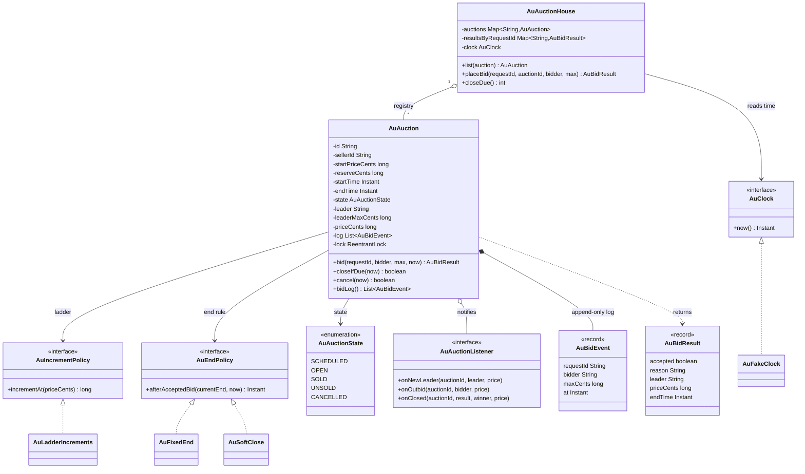
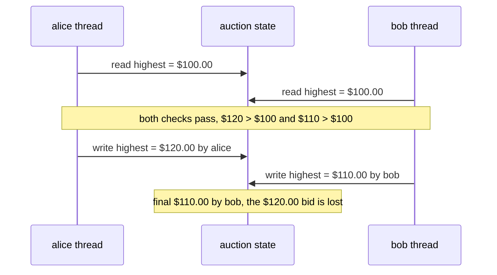
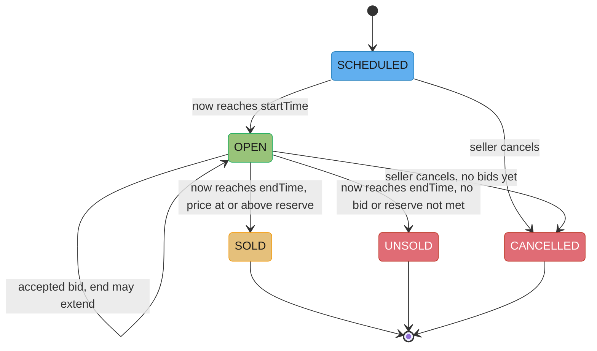
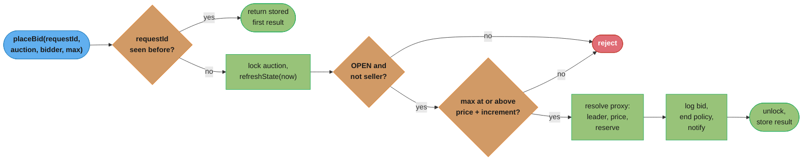

# Online Auction — Low-Level Design

An eBay-style timed auction: many bidders, one item, one deadline. The problem looks like "store the highest bid", and the grade comes from three things that are not in that sentence: proxy bidding, the race between two bids that both look high enough, and what exactly happens at the end time.

## Intuition

> **One-line analogy**: every bidder hands a sealed envelope with their maximum to an auctioneer, who then bids for each of them one step at a time, never revealing anyone's envelope. The visible price is "the second-best envelope plus one step".

**Mental model**: an auction is one small piece of shared state (leader, leader's hidden maximum, visible price, end time) that many threads want to change, plus a clock that eventually freezes it. Everything else, listing, search, payment, shipping, is outside the class you are asked to design.

**Why it matters**: the auction is the cleanest LLD example of a check-then-act race on money. "Is this bid higher than the current one? Then make it the current one." If the check and the write are not one atomic step, two bids that both passed the check overwrite each other and the lower one can win. Interviewers also use it to test time: a bid that arrives at the exact end time, a close job that runs late, and a last-second "sniper" bid all need a stated rule.

**Key insight**: put **one lock per auction** around the whole bid path (check, write, end-time update) and make **closing a rule that every bid evaluates** (`now < endTime`), not only an event a scheduler fires. Then a bid can never land in a closed auction, even when the close job is late, and two auctions never contend with each other.

**Full runnable implementation:** [`OnlineAuction.java`](OnlineAuction.java) — one file, `main()` in the `OnlineAuction` class. It demonstrates proxy bidding on the eBay increment ladder (`AuLadderIncrements`), an `AuAuction` whose bid path runs under its own `ReentrantLock`, the lost-update race in an unlocked version (forced with latches so it fails the same way on every run), lazy and scheduled closing with an exclusive end time and reserve prices, fixed-end vs soft-close end policies against a last-second bid, request-id idempotency for retried bids, replay of the accepted-bid log into an identical auction, and an 8-thread stress run that checks the invariants afterwards. Every type carries an `Au` prefix because all files in this package are compiled together.

---

## Problem Statement

Design the core of an online auction service:

- A seller lists an item with a **start price**, an optional hidden **reserve price**, a **start time** and an **end time**
- Bidders place bids while the auction is open; each bid must beat the current price by at least the **minimum increment**
- Support **proxy (automatic) bidding**: a bidder enters a maximum, and the system bids for them up to that maximum
- At the end time the auction **closes**: the leader wins at the current price if the reserve is met, otherwise the item is unsold
- Notify bidders when they are outbid and when the auction closes
- Many bidders bid at the same time; the result must be the same as if the bids had arrived one at a time
- Optional: protect against **sniping** (bids placed in the last seconds so nobody can respond)

---

## Requirements

### Functional
1. `list(auction)` registers an auction with start price, reserve, start and end time, increment policy and end policy
2. `placeBid(requestId, auctionId, bidder, max)` accepts or rejects a bid and returns the new leader and price
3. Proxy bidding: the visible price is the lower of the leader's maximum and the runner-up's maximum plus one increment; equal maxima keep the earlier bidder in the lead
4. Reject: bids before the start, bids at or after the end, bids below the minimum, bids by the seller, a leader lowering their own maximum
5. Close at the end time: `SOLD` to the leader if the price reaches the reserve, else `UNSOLD`; closing happens exactly once
6. A seller may cancel before the start or while there are no bids
7. Notify: new leader, outbid, closed

### Non-Functional
1. **Linearizable per auction**: the final state equals some one-at-a-time order of the accepted bids
2. **No contention across auctions**: a hot auction must not slow down bids on other auctions
3. **Exact money**: prices in integer cents, never `double`
4. **Idempotent bids**: a retried request (same request id) never places a second bid
5. **Deterministic replay**: the accepted-bid log rebuilds the same leader and price
6. **Testable time**: the clock is injected, so close-time edge cases are unit-testable without sleeping

---

## Class Diagram



`AuAuction` owns all mutable state of one auction and the lock that guards it. `AuAuctionHouse` is the facade a controller would call: it finds the auction, reads the clock once, and owns request-id idempotency, which spans auctions. The three strategies (increments, end policy, clock) are the parts a product team changes; the bid algorithm itself is not a strategy, because there is one correct way to resolve proxy bids.

---

## Patterns Used

### 1. Strategy — `AuIncrementPolicy`, `AuEndPolicy`, `AuClock`
**Where:** `AuLadderIncrements` implements the eBay ladder; `AuFixedEnd` and `AuSoftClose` decide whether a late bid extends the end; `AuFakeClock` replaces wall time in tests.

**Why:** these are exactly the knobs that differ between marketplaces (eBay uses a published ladder; a charity auction might use a flat $5; an art house might extend on late bids). Injecting the clock is what makes "a bid at exactly the end time" a three-line test instead of a flaky sleep.

### 2. State — `AuAuctionState`
**Where:** `SCHEDULED -> OPEN -> SOLD | UNSOLD`, plus `CANCELLED`. `refreshState(now)` moves the state forward and runs at the start of every bid, read and close call.

**Why an enum:** every state answers "may I bid?" with one rule. The transitions are driven by time, not by method calls, so the important design choice is *where* the time check runs (everywhere, under the lock), not how many classes represent the states.

### 3. Observer — `AuAuctionListener`
**Where:** `onNewLeader`, `onOutbid`, `onClosed`.

**Why:** outbid e-mails, a websocket push to the item page and a search-index update all react to the same events. The demo calls listeners while holding the auction lock, which is fine for a console listener; a production listener must only enqueue (see [Design Decisions](#design-decisions--tradeoffs)).

### 4. Facade — `AuAuctionHouse`
**Where:** the single `placeBid` entry point.

**Why:** callers should not look up auctions, read the clock or deduplicate retries themselves. Keeping the clock read in one place also means every check inside one bid sees the same `now`.

---

## Design Decisions & Tradeoffs

| Decision | Alternative | Why this choice |
|---|---|---|
| One `ReentrantLock` per auction around the whole bid path | One global lock; or no lock and `AtomicLong` for the price | A global lock serialises every auction on the site. An atomic price alone cannot update leader, maximum, price, log and end time together |
| Proxy bidding with a hidden maximum | Plain English auction (each bid is the price) | Bidders do not have to watch the item; the price is a fair second-price result; and the number of bids per auction drops, which matters for the lock |
| Close as a rule evaluated on every call (`now < endTime`) plus a scheduler | Scheduler only | A late or crashed scheduler would otherwise let bids land after the end. The scheduler only makes sure the close event fires for auctions nobody touches |
| End time exclusive (`now >= endTime` is closed) | Inclusive | One rule, no tie: a bid at 13:00:00.000 on an auction ending at 13:00:00.000 is rejected. Write the rule down; both sides of the boundary are tested in the demo |
| Money as `long` cents | `double` dollars | `0.1 + 0.2 != 0.3`. The increment ladder adds small steps to large prices thousands of times |
| Request-id map for idempotency | Trust the client not to retry | Mobile clients retry on timeout. Without the map, a retry is a second bid with a later timestamp, which loses ties it should have won |
| Append-only log of accepted bids | Store only current leader and price | The log gives replay, audit ("why did I lose?") and dispute handling; current state is a fold over it |
| Listeners called under the lock (demo) | Collect events, call listeners after unlock | Simple in a demo. In production, put events in an outbox or queue inside the lock and deliver after, so a slow e-mail call never holds the auction lock |

### Proxy bidding, worked through

The ladder is the one eBay publishes on its "Automatic bidding" help page:

| Current price | Increment |
|---|---|
| $0.01 – $0.99 | $0.05 |
| $1.00 – $4.99 | $0.25 |
| $5.00 – $24.99 | $0.50 |
| $25.00 – $99.99 | $1.00 |
| $100.00 – $249.99 | $2.50 |
| $250.00 – $499.99 | $5.00 |
| $500.00 – $999.99 | $10.00 |
| $1,000.00 – $2,499.99 | $25.00 |
| $2,500.00 – $4,999.99 | $50.00 |
| $5,000.00 and up | $100.00 |

The resolution rule, for a challenger with maximum `m` against a leader with maximum `L` and visible price `p`:

```
minimum valid bid      = p + inc(p)                    reject if m < minimum
if m > L  (new leader) : price = min(m, L + inc(L))    old leader gets "outbid"
if m <= L (leader holds): price = min(L, m + inc(m))   challenger gets "outbid" at once
equal maxima           : the earlier bid keeps the lead
reserve                : if leader's max >= reserve and price < reserve, price = reserve
```

Step 1 of the demo, start price $10.00:

```
bid     max      check                          leader  price    why
alice   $50.00   first bid >= start $10.00      alice   $10.00   first bid sets price = start
bob     $30.00   min $10.50; 30 <= 50           alice   $31.00   min(50, 30 + 1.00)
carol   $50.00   min $32.00; 50 == 50           alice   $50.00   tie: earlier bid keeps lead
dave    $75.00   min $51.00; 75 > 50            dave    $51.00   min(75, 50 + 1.00)
erin    $51.50   min $52.00; 51.50 < 52.00      dave    $51.00   rejected
```

*Nobody but the leader knows the leader's maximum. Dave leads at $51.00 while willing to pay $75.00; the price only moves when someone pushes it.*

### The race the lock prevents



*Both threads passed the check against a value that was already stale when they wrote. The lock makes "read, compare, write" one step, so bob's thread reads $120.00 and its $110.00 bid is resolved against alice's proxy instead.*

### Sniping: fixed end vs soft close

A "snipe" is a bid placed seconds before the end so that the previous leader has no time to answer. Two honest answers exist, and the design supports both behind `AuEndPolicy`:

- **Fixed end** (`AuFixedEnd`): the end never moves. Proxy bidding is the defence: if alice's maximum is higher than the sniper's, her proxy wins anyway. Sniping only wins against bidders who did not enter their true maximum.
- **Soft close** (`AuSoftClose`): a bid inside the last N minutes moves the end to `now + N`. The auction ends only after N quiet minutes. The cost is that the end time is no longer known in advance, which affects "ending soon" listings and the close scheduler.

In the demo, a bid 10 seconds before the end extends a soft-close auction to 1 minute 50 seconds past the original end, and alice's answer 30 seconds after the original end is accepted. Under fixed end the same answer is rejected.

---

## State / Flow



*Time drives every transition out of `SCHEDULED` and `OPEN`. Because `refreshState(now)` runs at the top of every call under the lock, the first call after `endTime` closes the auction, whether that call is the scheduler or a late bid.*

**One `placeBid`, in order:**



*The lock covers everything from the state refresh to the end-policy update. The idempotency lookup sits outside it, keyed by request id, so a retry never touches the auction at all.*

---

## Implementation

The full listing is in [`OnlineAuction.java`](OnlineAuction.java). These are the parts that carry the decisions above.

**BROKEN, then FIX: check-then-act:**

```java
// BROKEN -- check and write are two steps; another thread can run between them
boolean bid(String bidder, long cents) {
    if (cents <= highestCents) {
        return false;
    }
    highestCents = cents;      // last writer wins, even if it is the LOWER bid
    highestBidder = bidder;
    return true;
}
```

```java
// FIX -- the whole bid path runs under the auction's own lock
AuBidResult bid(String requestId, String bidder, long maxCents, Instant now) {
    lock.lock();
    try {
        refreshState(now);                 // may close the auction right here
        if (state != AuAuctionState.OPEN) return reject("auction is closed (" + state + ")");
        long minimum = priceCents + increments.incrementAt(priceCents);
        if (maxCents < minimum) return reject("below minimum bid " + AuMoney.fmt(minimum));
        // ... resolve proxy, update leader / max / price, log, end policy, notify
    } finally {
        lock.unlock();
    }
}
```

**Proxy resolution against the hidden maximum:**

```java
if (maxCents > leaderMaxCents) {                       // challenger takes the lead
    long step = increments.incrementAt(leaderMaxCents);
    priceCents = Math.min(maxCents, leaderMaxCents + step);
    leader = bidder;
    leaderMaxCents = maxCents;
} else {                                               // leader's proxy answers
    long step = increments.incrementAt(maxCents);
    priceCents = Math.min(leaderMaxCents, maxCents + step);
}
```

**Close as a rule, with an exclusive end time:**

```java
private void refreshState(Instant now) {
    if (state == AuAuctionState.SCHEDULED && !now.isBefore(startTime)) state = AuAuctionState.OPEN;
    if (state == AuAuctionState.OPEN && !now.isBefore(endTime)) {      // now >= endTime
        boolean sold = leader != null && priceCents >= reserveCents;
        state = sold ? AuAuctionState.SOLD : AuAuctionState.UNSOLD;
        // fire onClosed exactly once: the state can only leave OPEN once
    }
}
```

**BROKEN, then FIX: retries:**

```java
// BROKEN -- the server invents a fresh id per call, so a client that timed out
// and retried places a second bid
AuBidResult placeBid(String auctionId, String bidder, long max) {
    return auctions.get(auctionId).bid(UUID.randomUUID().toString(), bidder, max, clock.now());
}
```

```java
// FIX -- the request id is the key; the first result is stored and returned again
AuBidResult placeBid(String requestId, String auctionId, String bidder, long maxCents) {
    AuAuction auction = auctions.get(auctionId);
    return resultsByRequestId.computeIfAbsent(requestId,
            rid -> auction.bid(rid, bidder, maxCents, clock.now()));
}
```

---

## Sample Output

Real output from `java OnlineAuction.java`, pasted verbatim:

```text
=== Online Auction: proxy bids, per-auction lock, close rules, idempotent retries ===

--- Broken: check-then-act without a lock ---
alice bid $120.00, bob bid $110.00, both passed the check against $100.00
final highest: bob at $110.00   <- the $120.00 bid was silently overwritten
Fix (one lock per auction): alice ACCEPTED  leader=alice  price=$100.00
                            bob   ACCEPTED (accepted but immediately outbid by a proxy)  leader=alice  price=$112.50

--- Step 1: proxy bidding on the eBay increment ladder ---
start price $10.00; ladder step at $10.00 is $0.50, at $30.00 is $1.00
    [notify] alice now leads A-1 at $10.00
alice max $50.00 -> ACCEPTED  leader=alice  price=$10.00
    [notify] bob was outbid on A-1 (price $31.00)
bob   max $30.00 -> ACCEPTED (accepted but immediately outbid by a proxy)  leader=alice  price=$31.00
    [notify] carol was outbid on A-1 (price $50.00)
carol max $50.00 -> ACCEPTED (accepted but immediately outbid by a proxy)  leader=alice  price=$50.00
    [notify] alice was outbid on A-1 (price $51.00)
    [notify] dave now leads A-1 at $51.00
dave  max $75.00 -> ACCEPTED  leader=dave  price=$51.00
erin  max $51.50 -> REJECTED (below minimum bid $52.00)  leader=dave  price=$51.00
sam (seller)     -> REJECTED (seller cannot bid on own item)  leader=dave  price=$51.00
    [notify] dave now leads A-1 at $51.00
dave raises own max to $90.00 -> ACCEPTED  leader=dave  price=$51.00

--- Step 2: a bid 10 seconds before the end, fixed end vs soft close ---
fixed end: sniper ACCEPTED  leader=sniper  price=$41.00  end=2026-11-25T13:00:00Z
  alice answers 30 s after the original end -> REJECTED (auction is closed (SOLD))  leader=sniper  price=$41.00
soft close (2 min window): sniper ACCEPTED  leader=sniper  price=$41.00  end=2026-11-25T13:01:50Z
  alice answers 30 s after the original end -> ACCEPTED  leader=alice  price=$46.00

--- Step 3: close semantics ---
bid before start -> REJECTED (auction has not started)  leader=null  price=$10.00
alice max $150.00 (reserve $200.00 hidden) -> ACCEPTED  leader=alice  price=$10.00
    [notify] A-3 closed: UNSOLD
bob bids at EXACTLY the end time -> REJECTED (auction is closed (UNSOLD))  leader=alice  price=$10.00
scheduler pass 1 closed: 0   (already closed lazily by bob's bid)
scheduler pass 2 closed: 0   (idempotent)
A-4: carol max $250.00 covers the $200.00 reserve -> ACCEPTED  leader=carol  price=$200.00
    [notify] A-4 closed: SOLD, winner carol pays $200.00
scheduler pass 3 closed: 1

--- Step 4: a client retries the same request after a timeout ---
retry of req-77 returns the stored first result: ACCEPTED  leader=alice  price=$10.00
bids in the log: 2  (not 3)

--- Step 5: rebuild an auction from its accepted-bid log ---
40 attempts, 7 accepted and logged
original: leader=bob price=$201.00
restored: leader=bob price=$201.00
identical? true

--- Step 6: 8 threads x 2,000 bids on one auction, with the per-auction lock ---
bids submitted: 16000, accepted == logged? true
leader's max == highest accepted max? true
price <= leader's max? true
```

**What to read in it.** The first block is the bug and its fix on the same two bids: without the lock the $110.00 bid wins; with it, bob's $110.00 is resolved against alice's $120.00 proxy and the price lands at $112.50. Step 1's carol line is the tie rule: same $50.00 maximum as alice, later, so alice keeps the lead and the price rises to exactly $50.00. Step 3's bob line is the boundary rule: a bid at exactly the end time closes the auction (lazily, because the scheduler had not run) and is rejected, after which both scheduler passes find nothing left to close. Step 5 replays the log with the **recorded** timestamps; replaying with `now()` would reject every bid as late.

---

## Cross-Perspective: HLD Connections

- **One lock per auction becomes one owner per auction.** Across servers, a JVM lock is not enough. Either route every request for an auction to one owner (hash the auction id onto a partition, the same shape as a per-symbol matching engine in [Design a Stock Exchange](../../hld/case_studies/design_stock_exchange.md)), or make the database the lock with a conditional update (`UPDATE auction SET price = ?, leader = ?, version = version + 1 WHERE id = ? AND version = ?`). [Coordination and Contention](../../hld/coordination_and_contention/coordination_and_contention.md) covers both and the fencing-token problem a lease-based owner introduces.
- **A hot auction is a hot key.** A celebrity item can take thousands of bids in its last minute, all on one row or one partition. Proxy bidding helps (most bids are resolved in one step), and so does rejecting bids below the minimum before taking the lock. The flash-sale version of this problem, many buyers for limited stock, is in [Design a Flash Sale Ticketing System](../../hld/case_studies/design_flash_sale_ticketing.md).
- **The close scheduler is a distributed job scheduler.** Millions of auctions with end times are timers. [Design a Distributed Job Scheduler](../../hld/case_studies/design_distributed_job_scheduler.md) covers bucketing timers by minute and handing them to workers. The lazy close on every bid is what makes a late timer harmless.
- **Listeners become an outbox.** Outbid notifications must not be sent for a bid that was then rolled back, and must not be lost if the process dies after commit. Write the event in the same transaction as the bid and publish it afterwards, as in [Design a Notification System](../../hld/case_studies/design_notification_system.md).
- **The winning bid starts a payment.** Charging the winner, holding funds and handling a winner who does not pay belong to the payment flow in [Design a Payment System](../../hld/case_studies/design_payment_system.md), not to the auction class.
- **The whole design at fleet scale.** [Design an Online Auction](../../hld/case_studies/design_online_auction.md) takes this class model to millions of auctions: compare-and-set bid acceptance per auction, soft close decided by the server clock, live price fan-out to watchers, and settlement.

---

## Follow-Up Extensions

### Extension drill: concurrency, multi-instance, persistence

| Follow-up | What changes in the design | What stays the same |
|---|---|---|
| **Concurrency**: thousands of bids per second on one item | Keep one lock per auction; move the cheap rejections (below minimum against a cached price, auction closed) before the lock; deliver notifications after unlock through a queue | The proxy algorithm and the state machine; the lock scope stays "one auction" |
| **Multi-instance**: auction service on N servers | Partition auctions by id so one server owns each one (single writer), or keep servers stateless and apply each bid as a conditional update on a `version` column with retry on conflict; store request ids with a unique constraint and a TTL | `AuAuction.bid()` logic; it runs either inside the owner or inside the transaction |
| **Persistence**: survive a crash, explain a result | Append each accepted bid (request id, bidder, max, timestamp) before acknowledging; rebuild by replaying with recorded timestamps; snapshot leader, max and price every N bids | The rules; replay uses the same `bid()` path |
| **Close at scale**: millions of end times | A timer wheel or per-minute buckets feeding `closeIfDue`; the lazy close on bids and reads covers any lag | Closing is idempotent, so duplicate or late timer firings are harmless |
| **Fairness under clock skew**: servers disagree about "now" | Take `now` from the owner of the auction (or the database) only, never from the client or from whichever server received the request | The exclusive end rule |

### Other extensions

1. **Buy It Now.** A fixed price that closes the auction immediately, usually only until the first bid. It is one more transition, `OPEN -> SOLD`, taken under the same lock.
2. **Bid retraction.** Allowed only in narrow cases. Removing a bid means recomputing leader and price from the remaining log, which is one more reason to keep the log.
3. **Dutch (descending) auctions.** The price falls on a schedule until someone accepts. The clock and end policy stay; the bid rule becomes "first acceptance wins", which is a compare-and-set on the state.
4. **Sealed-bid auctions.** Bids are hidden until the end, then the highest (first-price) or the highest paying the second price (Vickrey) wins. The proxy rule here already behaves like a second-price auction plus one increment.
5. **Shill-bid detection.** Rejecting the seller's own account is the easy part. Detecting linked accounts is a fraud-scoring problem, not an LLD one.

---

## Interview Questions with Answers

**Q: Two bids arrive at the same time and both are higher than the current price. What can go wrong?**
**Short:** without one atomic check-and-write, both pass the check and the later write wins, even if it is the lower bid.

Each thread reads the current highest ($100.00), sees that its bid is higher, and then writes. If bob's $110.00 write lands after alice's $120.00 write, the auction now shows bob leading at $110.00 and alice's higher offer is gone. The demo forces exactly this interleaving with two latches. The fix is to make read, compare and write one critical section: a lock per auction in one process, or a conditional update on a version column across processes.

**Q: Why one lock per auction and not one global lock or a lock-free price?**
**Short:** a global lock serialises the whole site; an atomic price cannot update leader, maximum, price, log and end time together.

Bids on different auctions never interact, so a global lock adds contention with no correctness benefit. A single `AtomicLong` for the price would make the price update atomic but leave the leader, the hidden maximum, the log and the end time free to tear. A per-auction `ReentrantLock` guards exactly the state that must change together and nothing more. If one auction becomes hot, only its bidders wait.

**Q: How does proxy bidding decide the visible price?**
**Short:** the price is the lower of the leader's maximum and the runner-up's maximum plus one increment.

Each bidder submits a maximum that stays hidden. When a challenger beats the leader's maximum, the challenger leads at `min(challengerMax, oldLeaderMax + inc)`. When the challenger does not beat it, the leader keeps the lead and the price rises to `min(leaderMax, challengerMax + inc)`. The result is close to a second-price auction: the winner pays about what the runner-up was willing to pay, not their own maximum. In the demo, dave leads at $51.00 with a $75.00 maximum.

**Q: Two bidders enter the same maximum. Who wins?**
**Short:** the earlier bid keeps the lead, and the price rises to that shared maximum.

The tie rule must be stated, because "higher maximum wins" does not decide it. Earlier-wins is the natural choice: the first bidder committed that amount first, and it gives the later bidder a reason to bid a little more. In the demo, carol matches alice's $50.00 maximum, alice keeps the lead and the price becomes exactly $50.00. This tie rule is also why idempotent retries matter: a retried request that became a new bid would carry a later timestamp and lose ties it had won.

**Q: What happens to a bid that arrives at exactly the end time?**
**Short:** it is rejected: the end is exclusive, so a bid is valid only while now is strictly before endTime.

Whatever rule you pick, state it and test both sides of the boundary. This design closes when `now >= endTime`. The bid path calls `refreshState(now)` under the lock before validating, so the bid that arrives at the end time is the call that closes the auction, and it is then rejected as "auction is closed". Taking `now` from the server that owns the auction, never from the client, keeps the rule meaningful.

**Q: Why evaluate the close on every bid if there is a scheduler anyway?**
**Short:** a late or failed scheduler must not let bids land after the end; the lazy check makes the deadline exact.

Schedulers run late: GC pauses, a backlog of millions of timers, a restart. If closing were only the scheduler's job, a bid arriving one second after the end but before the job ran would be accepted. With the check inside the lock on every call, the deadline is enforced exactly, and the scheduler's role shrinks to firing `onClosed` for auctions that nobody touched. Because the state can leave `OPEN` only once, the two paths cannot close an auction twice.

**Q: How do you make closing idempotent?**
**Short:** the transition out of OPEN happens once under the lock, so repeated close calls find nothing to do.

`closeIfDue` returns true only when this call moved the state from `OPEN` to `SOLD` or `UNSOLD`, and it does so under the auction's lock. A second call sees a terminal state and returns false, and `onClosed` is fired only inside the transition. In the demo the auction closed lazily on a bid, and the next two scheduler passes report 0. In a database the equivalent is `UPDATE ... SET state = 'SOLD' WHERE id = ? AND state = 'OPEN'`, which only one caller can win.

**Q: What is bid sniping, and how can the design respond to it?**
**Short:** a last-second bid that leaves no time to answer; proxy bidding blunts it, and a soft close removes it.

Under a fixed end, proxy bidding already protects a bidder who entered their true maximum, because their proxy answers instantly. Sniping only beats bidders who planned to raise later. A soft close goes further: any bid in the last N minutes pushes the end to `now + N`, so the auction ends only after N quiet minutes. The cost is an unpredictable end time, which complicates "ending soon" pages and the close scheduler. `AuEndPolicy` makes the choice a configuration, not a fork in the bid code.

**Q: How do you handle a client that retries a bid after a timeout?**
**Short:** the client sends a request id; the server stores the first result for that id and returns it again.

A mobile client that times out cannot know whether the bid landed, so it retries. Without deduplication, the retry is a second bid with a later timestamp: harmless in the best case, and a lost tie or a self-outbid in the worst. The facade keys results by request id and returns the stored result for a repeat. Across servers the same idea is a table with a unique constraint on the request id, written in the same transaction as the bid, and expired after a retention window.

**Q: How do reserve prices work in this design?**
**Short:** the reserve is hidden; once the leader's maximum covers it, the price jumps to it; at close, below-reserve means UNSOLD.

The reserve protects the seller from selling too cheaply without showing a high start price. While no maximum reaches the reserve, bidding proceeds normally and the auction closes `UNSOLD` if it ends there. As soon as the leader's maximum is at or above the reserve, the price is raised to the reserve, because the leader has already agreed to pay at least that much. In the demo a $150.00 maximum against a $200.00 reserve ends unsold, and a $250.00 maximum sells at exactly $200.00.

**Q: Why store money as `long` cents?**
**Short:** floating point cannot represent most decimal amounts exactly, and auction prices are built by adding many small steps.

`0.10 + 0.20` in `double` is `0.30000000000000004`. A price built from hundreds of increments can drift by fractions of a cent, and a comparison such as `max >= minimum` can then flip the wrong way at exactly the boundary that matters. Integer cents make every addition and comparison exact. The same rule and the same bug appear in [Order Matching Engine](OrderMatchingEngine.md), which keys its book by `long` ticks.

**Q: Why should listeners not be called while holding the auction lock in production?**
**Short:** a slow listener (e-mail, HTTP) would hold the lock and stall every other bid on that auction.

The demo's console listener is instant, so calling it under the lock is fine. A real `onOutbid` sends an e-mail or a push notification, which can take hundreds of milliseconds or block on a remote service. Holding the lock during that call turns the notification latency into bid latency. Collect the events inside the lock (or write them to an outbox table in the same transaction), release the lock, then deliver. The ordering guarantee you keep is "no event for a bid that was not committed".

**Q: How would you persist an auction so it survives a crash?**
**Short:** append each accepted bid to a durable log before acknowledging it, and rebuild by replaying with recorded timestamps.

The log entry holds request id, bidder, maximum and the server timestamp. Current state (leader, maximum, price, end time) is a fold over that log, so recovery replays it through the same `bid()` method. The timestamps must be the recorded ones: replaying with `now()` would reject every bid as late. For a long auction, snapshot the state every N bids and replay only the tail. The log also answers disputes, because it shows every maximum in order.

**Q: How would you run this across several servers?**
**Short:** give each auction a single owner by partitioning on its id, or apply each bid as a versioned conditional update in the database.

With a single owner per auction, the in-memory lock stays correct, latency is low, and the database only stores the log; failover needs fencing so that an old owner cannot keep accepting bids. With stateless servers, each bid reads the row, computes the new state, and writes it with `WHERE version = ?`, retrying on conflict; that is simpler to operate but every bid is a database round trip, and a hot auction produces many conflicts. Either way, take `now` from the owner or the database.

**Q: What would change for a sealed-bid (Vickrey) auction?**
**Short:** bids stay hidden until the end; at close the highest bidder wins and pays the second-highest bid.

There is no visible price and no outbid notification during the auction, so the per-bid work is just validation and an append to the log. All the resolution happens once, at close: sort the maxima, pick the highest (ties to the earliest), and charge the second-highest (or the reserve, whichever is higher). The class structure survives: the state machine, the clock, the end policy and the log stay; the proxy resolution step moves from `bid()` to the close transition.
