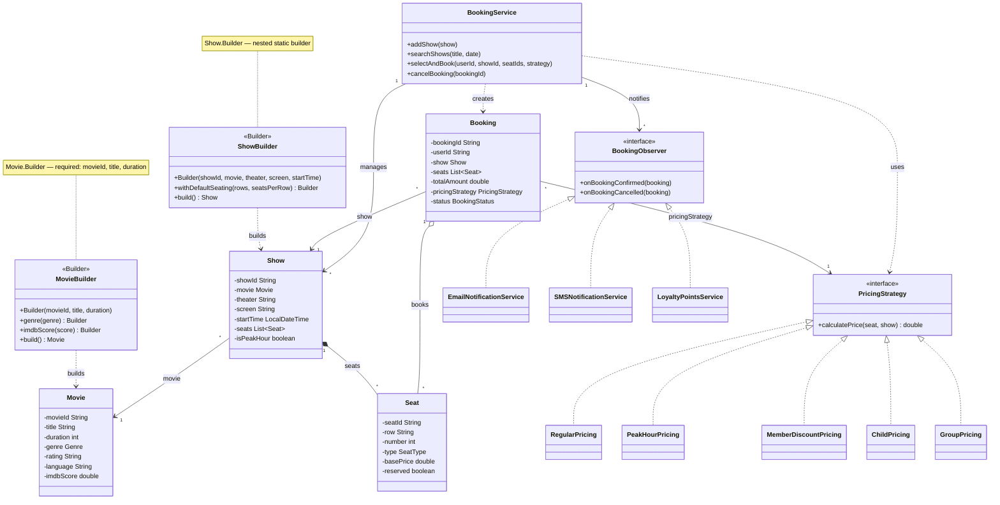
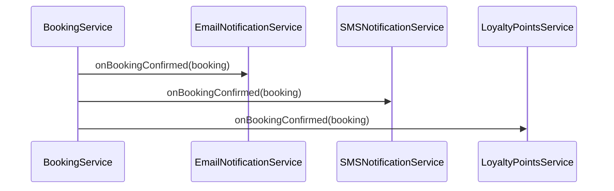
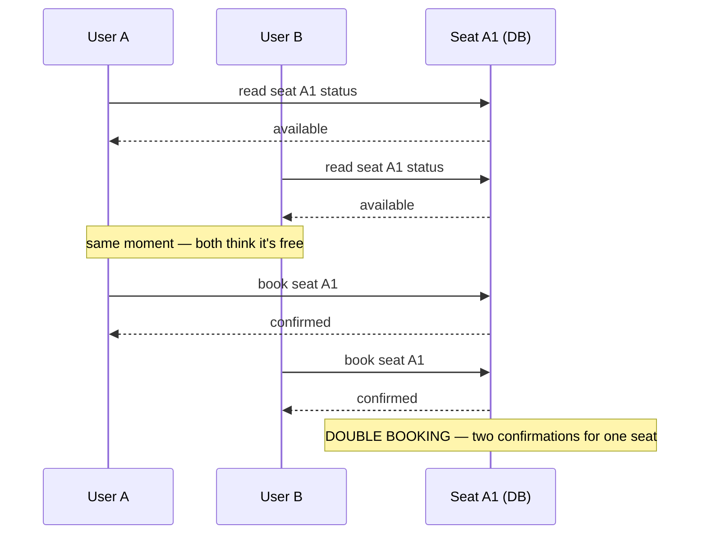
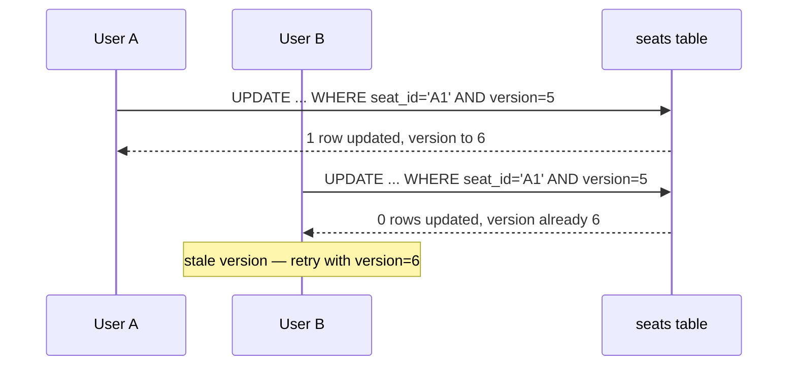
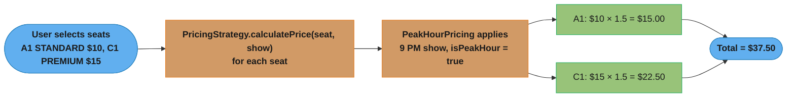

# Online Booking System — Builder + Strategy + Observer
## Intuition

> **One-line analogy**: Online Booking is a concurrency problem dressed as a design problem — the interesting challenge isn't the class hierarchy, it's preventing two users from booking the same seat simultaneously at scale.

**Mental model**: The functional model is straightforward: Show → Seats → Booking → Payment. The real design challenge is the seat reservation race condition. At BookMyShow scale (1M+ bookings/day), two users can click the same seat in milliseconds. Two families of fix exist and they are not the same thing: a **pessimistic** short-lived lock (`SELECT ... FOR UPDATE`, or a Redis key with a TTL) that holds the seat while the user pays, versus **optimistic** locking (a `version` column plus a conditional `UPDATE`) that lets both proceed and rejects the loser at commit time. Dynamic pricing (Strategy pattern) then applies multipliers based on seat type, show time, and membership tier.

**Why it matters**: This problem combines Builder (complex Movie/Show construction), Strategy (pricing algorithms), Observer (email/SMS/loyalty notifications), and concurrency thinking — making it a comprehensive interview problem that tests both patterns and distributed systems instincts.

**Key insight**: The most common interview miss is ignoring seat lock expiry. Model the reservation as a time-bounded lock: if payment isn't completed within N minutes, the seat is released. This also requires a cleanup mechanism (scheduler or TTL). The reference `OnlineBookingSystem.java` omits it on purpose — `Seat.reserved` is a plain `boolean` with `reserve()`/`release()` and no timestamp, so an abandoned checkout holds the seat for the life of the JVM. Adding an `expiresAt` field plus a `ScheduledExecutorService` sweep in `BookingService` (or a Redis key with a TTL, once there is more than one JVM) is the first extension to name out loud.

**Full runnable implementation:** [`OnlineBookingSystem.java`](OnlineBookingSystem.java) — 559 lines, one file, `main()` at the bottom. It demonstrates five `PricingStrategy` implementations, three `BookingObserver`s, and `BookingService`'s `synchronized` seat reservation — the double-booking guard, without the lock expiry this page asks you to add out loud.

---

## Problem Statement

Design a movie ticket booking system that handles:
- 1M+ bookings/day (BookMyShow, Fandango scale)
- Concurrent seat selection without double-booking
- Dynamic pricing based on time, membership, group size
- Multi-channel notifications (email, SMS, loyalty points)

---

## Class Diagram



Movie/Show are assembled via nested Builders (required fields enforced in the constructor, optional fields via fluent setters); `PricingStrategy` and `BookingObserver` are the two interfaces realized by five pricing algorithms and three notification channels respectively — swapping either in requires zero changes to `BookingService`.

---

## Patterns Used

### Builder — Movie and Show

Both `Movie` and `Show` have many optional fields. Builder makes construction readable and validates required fields.

```java
Movie movie = new Movie.Builder("M001", "Inception", 148) // required
    .genre(Genre.SCIFI)
    .director("Christopher Nolan")
    .imdbScore(8.8)
    .build();

Show show = new Show.Builder("S001", movie, "CityPlex", "Screen A", showTime)
    .withDefaultSeating(6, 8)  // 6 rows, 8 seats each
    .build();
```

### Strategy — Pricing

Pricing is a classic Strategy example — the algorithm for calculating price varies, but the interface is the same.

```java
// At booking time, client selects the strategy
PricingStrategy strategy = member.isPremium()
    ? new MemberDiscountPricing(20)
    : new PeakHourPricing();

service.selectAndBook(userId, showId, seatIds, strategy);
```

| Strategy | Logic |
|----------|-------|
| `RegularPricing` | Base price |
| `PeakHourPricing` | 1.5× on evenings/weekends |
| `MemberDiscountPricing` | configurable % off |
| `ChildPricing` | max $7 flat |
| `GroupPricing` | 20% off for 10+ people |

### Observer — Notifications



Adding a new channel (push notification, WhatsApp) = add one class + register it. No changes to `BookingService`.

---

## Concurrency Challenge: Double-Booking Prevention

The hardest problem in booking systems is concurrent seat selection.

### The Race Condition:


Both reads land in the same race window before either write commits, so both bookings appear to succeed — this is exactly why the fix below needs an atomic check-and-set instead of a read-then-write.

### Solutions:

**1. Optimistic Locking (recommended for most systems)**
```sql
UPDATE seats SET reserved = true, version = version + 1
WHERE seat_id = 'A1' AND reserved = false AND version = :expectedVersion
-- If 0 rows updated → someone else got it first → retry
```

This resolves the exact UserA/UserB race shown above: both transactions read the same `version`, but only the first `UPDATE` to commit advances it — the second's `WHERE version = :expectedVersion` then matches zero rows instead of silently overwriting.



UserB's compare-and-set fails cleanly instead of double-booking; the retry re-reads the seat at `version = 6` and, if it is now reserved, surfaces `SeatAlreadyTakenException` to the caller.

**2. Pessimistic Locking**
```sql
SELECT * FROM seats WHERE seat_id = 'A1' FOR UPDATE;
-- Locks the row, others must wait
```

**3. Redis Distributed Lock**

`SETNX` itself takes no expiry, so the atomic form is `SET key value NX PX <ms>` — one round trip that both acquires and arms the TTL. A bare `SETNX` followed by a separate `EXPIRE` is the classic bug: a crash between the two leaves the seat locked forever.

```java
// Jedis
String key   = "seat_lock:" + seatId;
String token = UUID.randomUUID().toString();   // fencing token: only the owner may release
String ok = jedis.set(key, token, SetParams.setParams().nx().px(10_000));
if (ok == null) throw new SeatAlreadyTakenException(seatId);
// ... take payment, then release with a compare-and-delete Lua script so a lock
// that already expired and was re-acquired by someone else is never deleted.
```

**4. Database Transaction with Isolation Level**
```java
@Transactional(isolation = Isolation.SERIALIZABLE)
public Booking selectAndBook(...) { ... }
```

The current implementation makes `BookingService.selectAndBook` and `cancelBooking` `synchronized`, so the "is this seat free? then reserve it" check-then-act is atomic **within one JVM**. That is the whole guarantee: put two instances of this service behind a load balancer and the race in the diagram above returns unchanged, because each JVM has its own monitor. Production needs option 1 or 3.

---

## Pricing Calculation Flow



Each seat's `calculatePrice` runs independently through the same `PeakHourPricing` strategy (9 PM show triggers the 1.5× multiplier), then the per-seat results sum to the booking's `totalAmount`.

---

## Database Schema

```sql
CREATE TABLE movies (
    movie_id VARCHAR PRIMARY KEY,
    title VARCHAR NOT NULL,
    duration_minutes INT,
    genre VARCHAR,
    rating VARCHAR
);

CREATE TABLE shows (
    show_id VARCHAR PRIMARY KEY,
    movie_id VARCHAR REFERENCES movies(movie_id),
    theater VARCHAR,
    screen VARCHAR,
    start_time TIMESTAMP NOT NULL,
    is_peak_hour BOOLEAN
);

CREATE TABLE seats (
    seat_id VARCHAR,
    show_id VARCHAR REFERENCES shows(show_id),
    row_label VARCHAR,
    seat_number INT,
    seat_type VARCHAR,  -- STANDARD, PREMIUM, VIP
    base_price DECIMAL,
    reserved BOOLEAN DEFAULT false,
    version INT DEFAULT 0,  -- for optimistic locking
    PRIMARY KEY (seat_id, show_id)
);

CREATE TABLE bookings (
    booking_id VARCHAR PRIMARY KEY,
    user_id VARCHAR,
    show_id VARCHAR REFERENCES shows(show_id),
    total_amount DECIMAL,
    pricing_strategy VARCHAR,
    status VARCHAR,
    booked_at TIMESTAMP
);

CREATE TABLE booking_seats (
    booking_id VARCHAR REFERENCES bookings(booking_id),
    seat_id VARCHAR,
    price_paid DECIMAL,
    PRIMARY KEY (booking_id, seat_id)
);
```

---

## Scale Estimates (BookMyShow India scale)

- 5M bookings/day → 5,000,000 / 86,400 ≈ 58 bookings/sec average; assume a 5x evening/weekend peak → ~300/sec
- 10K shows/day, 200 seats/show → 2M seat records/day
- Caching: show catalog (Redis, TTL 1hr), seat availability (Redis, TTL 5min)
- Sharding by show_id for seats table

---

## Cross-Perspective: HLD Connections

**HLD View — Where Online Booking Scales to Distributed Systems**

- **Seat lock → distributed lock** — The temporary seat reservation during checkout is a distributed locking problem. At scale (BookMyShow: 1M+ bookings/day), the lock is implemented via Redis SETNX with a TTL: if payment isn't completed within 10 minutes, the lock expires and the seat is released. A cleanup job handles expired locks as backup.
- **Double-booking prevention → optimistic locking** — Two users clicking the same seat simultaneously requires either pessimistic locking (SETNX) or optimistic locking (version field in the database, reject on CAS failure). At high concurrency, optimistic locking with conflict detection and user-facing retry is more scalable.
- **Dynamic pricing → pricing microservice** — Pricing logic (peak hours, membership tier, group discount, demand surge) becomes a dedicated pricing service with its own data store at HLD scale. The Strategy pattern structures the pricing algorithms internally within the pricing service.
- **Notification fan-out → event-driven** — Post-booking notifications (email receipt, SMS confirmation, loyalty points update) are decoupled from the booking flow via a message queue. The booking service publishes `BookingConfirmed`; email, SMS, and loyalty services consume it independently — Observer at infrastructure scale.

---

## Follow-Up Extensions

1. **Waitlist**: Queue of users waiting for cancellations
2. **Dynamic pricing**: ML model adjusting prices based on real-time demand
3. **Food & beverage**: Add-ons using Decorator pattern
4. **Seat recommendation**: Suggest best available seats based on preference
5. **Multi-city rollout**: Tenant-aware sharding by city
6. **Corporate bookings**: Bulk booking with invoice generation

---

## Interview Questions with Answers

**Q: What's the single biggest gap this page names in its own seat reservation design?**
**Short:** `Seat.reserved` is a plain boolean with no expiry, so an abandoned checkout holds the seat forever.

The Key insight is explicit: the most common interview miss is ignoring seat lock expiry, and the reference implementation deliberately reproduces that miss — `Seat.reserved` is a boolean flipped by `reserve()`/`release()` with no timestamp attached, so a user who selects a seat and never completes payment holds it for the life of the JVM. Fixing this needs an `expiresAt` field on the reservation plus a cleanup mechanism (a `ScheduledExecutorService` sweep in-process, or a Redis key with a TTL once there's more than one JVM). Naming this gap unprompted, before the interviewer asks "what about someone who abandons checkout," is exactly the signal this page is built to teach.

**Q: `BookingService.selectAndBook` and `cancelBooking` are `synchronized` — why does that stop preventing double-booking the moment you add a second service instance?**
**Short:** `synchronized` guards one JVM's monitor; a second instance has its own monitor and its own race window.

`synchronized` makes the "is this seat free? then reserve it" check-then-act sequence atomic *within one JVM's monitor* — two threads inside the same process genuinely cannot interleave through it. But put two instances of `BookingService` behind a load balancer and each has its own independent monitor; the exact race in the UserA/UserB diagram returns unchanged, because neither instance's lock has any relationship to the other's. This is the whole point of the distinction the page draws between local concurrency control and distributed concurrency control — the fix has to move the atomicity into shared state (the database's optimistic-locking version column, or a Redis distributed lock) that every instance actually contends over.

**Q: Why is `Seat.reserved` a plain `boolean`, and what does that cost beyond the missing expiry?**
**Short:** a boolean can't record *who* reserved it or *when*, which is exactly what a claim-and-expire flow needs.

Beyond having no timestamp for expiry, a bare boolean also can't answer "which user currently holds this seat" or "since when" — both of which are needed the moment you want to release an abandoned hold back to the pool, or resolve a dispute about who reserved first. A production-shaped version needs at minimum a reservation record (`seatId`, `userId`, `reservedAt`, `expiresAt`) rather than a scalar flag, which is the same shift `LibraryManagement.md` calls for on its own `RESERVED` copy state — a status flag with no owning-party field is a recurring shortcut across this section's demos.

**Q: Walk the double-booking race condition — where exactly does it happen?**
**Short:** both users read "available" in the same window before either write commits, so both bookings appear to succeed.

User A reads seat A1's status as available, and User B reads it as available too, both landing in the same race window before either has written anything back — this is the classic check-then-act gap, where the read and the write are two separate, non-atomic operations. Both then proceed to book, and both writes succeed independently because nothing enforced that the second write had to see the first write's result first. The fix in every case below is the same shape: replace the separate read-then-write with a single atomic check-and-set, so the second writer's attempt fails cleanly instead of silently overwriting the first.

**Q: How does the optimistic-locking `version` column fix the UserA/UserB race?**
**Short:** the second `UPDATE`'s `WHERE version = expectedVersion` matches zero rows once the first commit advances it.

Both transactions read the same seat row at the same `version` (say, 5), but the update is `UPDATE seats SET reserved = true, version = version + 1 WHERE seat_id = 'A1' AND reserved = false AND version = 5` — only the first `UPDATE` to actually commit succeeds and advances the row to `version = 6`. The second transaction's identical `UPDATE ... WHERE version = 5` now matches zero rows, since the row is already at 6, so it fails cleanly (0 rows updated) instead of silently succeeding and double-booking the seat. The application detects the zero-row result and surfaces `SeatAlreadyTakenException`, or retries after re-reading the seat at its new version.

**Q: Why is `SET key value NX PX <ms>` preferred over a separate `SETNX` followed by `EXPIRE`?**
**Short:** the combined form is one atomic round trip; a crash between two separate calls leaves the lock permanently held.

A bare `SETNX` that acquires the lock, followed by a separate `EXPIRE` call to arm the TTL, has a window between the two commands where a crash (or a network partition) leaves the key set with no expiry at all — the seat lock is then held forever, since nothing will ever release it. `SET key value NX PX <ms>` performs the acquire-and-arm-TTL as one atomic Redis command, closing that window entirely: either the whole operation succeeds with the TTL already attached, or it doesn't happen at all. This is the classic bug this page names explicitly as "the classic bug" — it's exactly the kind of two-step-that-should-be-one-step mistake that looks correct in a demo and fails under real crash conditions.

**Q: Why Builder for `Movie` and `Show` instead of large constructors?**
**Short:** both have many optional fields, and Builder makes construction readable and validated at build time.

`Movie` has required fields (movieId, title, duration) and several optional ones (genre, director, IMDb score); `Show` similarly has required identity fields plus optional seating configuration. A constructor taking all of them positionally is exactly the "which param is which" ambiguity `LibraryManagement`'s `Book` Builder solves the same way — named fluent calls (`.genre(...)`, `.imdbScore(...)`) make the intent of each argument explicit at the call site, and validation can happen once at `build()` rather than scattered across every caller who constructs one manually.

**Q: Why Strategy for pricing instead of a single pricing method with conditionals on seat type and show time?**
**Short:** five pricing rules change independently and far more often than the rest of the booking flow.

`RegularPricing`, `PeakHourPricing`, `MemberDiscountPricing`, `ChildPricing`, and `GroupPricing` each encode a genuinely different calculation, and pricing policy is exactly the kind of business rule that changes on marketing's schedule, not the engineering team's — bundling all five into one method with a chain of `if (isPeakHour) ... else if (isMember) ...` would make every pricing change a risky edit to shared logic touching every booking. `Booking` holds a `PricingStrategy` reference chosen at booking time, so a new pricing rule (say, a holiday surcharge) is one new class implementing the interface, with zero changes to `BookingService` or any existing strategy.

**Q: Why Observer for notifications instead of calling each channel (email, SMS, loyalty) directly from `BookingService`?**
**Short:** `BookingService` depends only on the `BookingObserver` interface, so a new channel needs zero changes to it.

Hardcoding three method calls inside `BookingService` for email, SMS, and loyalty points would tightly couple the booking flow to exactly those three channels, and adding a fourth (push notifications, WhatsApp) would mean editing `BookingService` itself. With `BookingObserver`, `BookingService` calls `notifyObservers()` once and every registered observer reacts independently — the same pattern `LibraryManagement` and `ParkingLot` use for their own notification fan-out, and the natural local analogue of the message-queue fan-out this page's HLD section describes for the same concern at scale.

**Q: `Seat.basePrice` and `Booking.totalAmount` are `double` — what's the fix, and which other files in this section share the same shortcut?**
**Short:** use `BigDecimal`; the same double-for-money shortcut appears in `ATM.java` and `VendingMachine.java`.

Binary floating point cannot exactly represent monetary fractions, so repeated price calculations (per-seat pricing summed into a booking total, across many bookings) can accumulate rounding error that eventually produces a total a cent or two off from what a customer was actually charged. The fix, as `Splitwise.md` demonstrates fully, is `BigDecimal` with a fixed scale and an explicit rounding mode. This page names `ATM.java` and `VendingMachine.java` explicitly as sharing the identical shortcut — all three keep the listings short for the demo, and naming the pattern once you've spotted it in one file is a strong signal you'd catch it in the others too.

**Q: Pessimistic vs optimistic locking — when would you pick `SELECT ... FOR UPDATE` over the version-column approach?**
**Short:** pessimistic locking fits low-contention, short critical sections; optimistic fits high-concurrency with graceful retry.

`SELECT ... FOR UPDATE` locks the row immediately and makes every other transaction wait, which is simple to reason about and avoids wasted work when contention is low or the locked section is brief — but at high concurrency it serializes transactions and can create queuing delays under load. The version-column approach lets every transaction proceed optimistically and only detects conflict at commit time, which scales better under high concurrency precisely because it doesn't block anyone up front — the tradeoff is that a losing transaction has already done its work and now has to retry, which needs to be a well-defined, user-facing flow rather than a silent failure. The page's own recommendation is optimistic locking for most high-traffic booking systems, reserving pessimistic locking for genuinely short, low-contention critical sections.

**Q: How would you add the seat-lock expiry and cleanup mechanism this page explicitly calls for?**
**Short:** add an `expiresAt` timestamp to the reservation and a sweep (in-process scheduler or Redis TTL) that releases it.

The reservation needs to become time-bounded: attach an `expiresAt` to the seat hold when it's created, and add a cleanup mechanism that checks for expired holds and releases them back to `AVAILABLE` — either a `ScheduledExecutorService` running a periodic sweep inside a single-instance design, or, once there's more than one JVM instance (which the `synchronized`-only design cannot survive anyway), a Redis key carrying the seat lock with a native TTL that expires automatically without any sweep logic needed at all. The Redis approach is strictly better once you're distributed, since it doesn't depend on any particular instance staying alive to run its sweep — the expiry is enforced by Redis itself.

**Q: How would food & beverage add-ons fit into this design via Decorator?**
**Short:** wrap a `Booking` (or its price) with add-on decorators that each layer on an extra item and cost.

The Follow-Up Extensions name Decorator specifically for this: rather than adding a growing list of optional fields to `Booking` for popcorn, drinks, and combo add-ons, a `BookingDecorator` (or a decorator around the priced total) wraps the base booking and adds its own item plus cost on top, and multiple add-ons stack by wrapping each other. This keeps the core `Booking`/`PricingStrategy` relationship untouched — add-ons are a separate, composable concern layered on top of the base fare calculation, the same way `LRUCache.java`'s `ThreadSafeLRUCache` wraps `LRUCacheImpl` without modifying it.

**Q: Walk the scale estimate — how does the page get to roughly 300 bookings/sec at peak?**
**Short:** 5M bookings/day averages ~58/sec; a 5x evening/weekend peak multiplier brings that to ~300/sec.

5,000,000 bookings/day divided by 86,400 seconds/day gives roughly 58 bookings/sec as the flat daily average — but booking traffic isn't uniform, it clusters heavily around evening and weekend show times. Applying the stated 5x peak multiplier to the average (58 × 5 ≈ 290, rounded to ~300/sec) gives the number that actually matters for capacity planning, since a system provisioned only for the average would fall over during the actual peak load it needs to survive. This is the standard pattern for any consumer-facing booking system: always size for the peak multiplier, never the flat average, because the average is never what breaks production.

**Q: How does the seat lock map to a distributed lock at BookMyShow scale?**
**Short:** Redis SETNX with a TTL enforces the temporary hold across every service instance, with a cleanup job as backup.

The single-JVM `synchronized` block that only guarantees atomicity within one process becomes, at scale, a Redis-backed distributed lock: `SET key value NX PX <ms>` acquires the hold with an automatic TTL that every service instance respects identically, since they're all checking the same shared Redis key rather than each having their own independent in-memory flag. The 10-minute-style expiry the page describes releases the seat automatically if payment isn't completed, and a periodic cleanup job serves as a backup in case the TTL mechanism itself has an edge case — the same "TTL primary, sweep as backup" redundancy pattern the seat-expiry fix above uses at the single-instance scale, just now enforced across every instance behind the load balancer.
